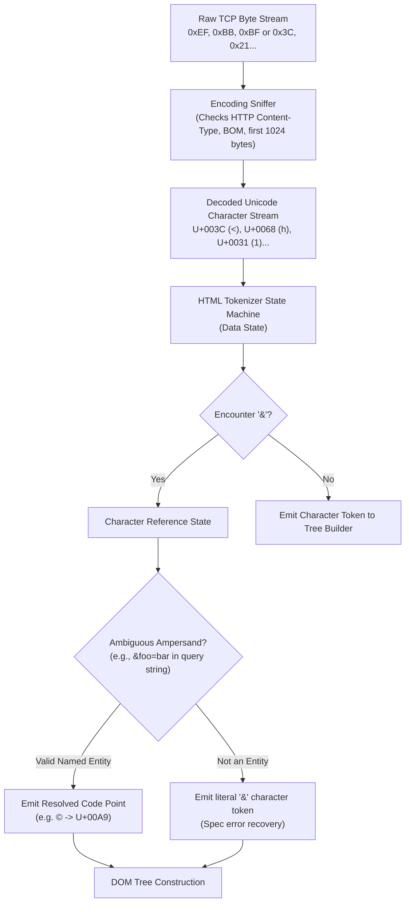

# Character Encoding, Unicode, and HTML Entities

| Metadata | Details |
| :--- | :--- |
| **Level** | Core / Fundamental |
| **Prerequisites** | `01-document-structure.md`, `02-syntax-rules-and-error-recovery.md` |
| **Estimated Reading Time** | 25 minutes |
| **Status** | Production-Ready |
| **Baseline Status** | Widely Available across all modern browsers |
| **Browsers Tested** | Chrome 120+, Firefox 120+, Safari 17+, Edge 120+ |
| **Tested With** | W3C Nu HTML Checker, WHATWG Living Standard Encoding Spec, Python 3.12 |

---

## Table of Contents
- [1 What & Why](#1-what--why)
- [2 Core Concepts](#2-core-concepts)
- [3 How It Works Internally](#3-how-it-works-internally)
- [4 Syntax & Usage](#4-syntax--usage)
- [5 Practical Examples](#5-practical-examples)
- [6 Best Practices](#6-best-practices)
- [7 Common Mistakes & Pitfalls](#7-common-mistakes--pitfalls)
- [8 Performance, Accessibility, SEO & Security Notes](#8-performance-accessibility-seo--security-notes)
- [9 Comparison / When to Use What](#9-comparison--when-to-use-what)
- [10 Interview Questions](#10-interview-questions)
- [11 Practice Exercises](#11-practice-exercises)
- [12 Summary / Cheat Sheet](#12-summary--cheat-sheet)
- [13 Further Reading](#13-further-reading)

---

## 1 What & Why

Computers process sequences of binary bits (`0`s and `1`s), whereas human communication relies on linguistic graphemes, symbols, emojis, and mathematical notations. The bridge connecting these worlds is **character encoding**—the deterministic algorithmic mapping between numerical byte sequences and conceptual characters.

In the early decades of the web, fragmented encodings (ASCII, ISO-8859-1, Windows-1252, Shift-JIS, Big5) caused rampant **mojibake** (character corruption where `café` renders as `café`) and severe security vulnerabilities (e.g., UTF-7 cross-site scripting bypasses). 

The modern web platform has unified around **UTF-8** (Unicode Transformation Format - 8-bit). Over 98% of all websites globally use UTF-8. In HTML, character handling also involves **HTML Entities** (named, decimal, and hexadecimal character references), which allow authors to inject reserved syntax characters (`<`, `>`, `&`, `"`) into markup safely, prevent unintended tag tokenization, and manage typographic spacing (`&nbsp;`, `&thinsp;`).

---

## 2 Core Concepts

### Unicode Scalar Values and UTF-8
- **Unicode**: A universal character repertoire that assigns a unique integer code point (ranging from `U+0000` to `U+10FFFF`, totaling over 1.1 million possible code points) to every character across all human languages, historical scripts, symbols, and emojis.
- **UTF-8**: A variable-width character encoding that maps Unicode code points to 1 to 4 one-byte (8-bit) units:
  - `1 byte`: ASCII characters (`U+0000` to `U+007F`), providing 100% backward compatibility with 7-bit ASCII.
  - `2 bytes`: Latin diacritics, Greek, Cyrillic, Hebrew, Arabic (`U+0080` to `U+07FF`).
  - `3 bytes`: Asian scripts (Chinese, Japanese, Korean), Devanagari, mathematical symbols (`U+0800` to `U+FFFF`).
  - `4 bytes`: Emojis, historic scripts, supplementary musical symbols (`U+10000` to `U+10FFFF`).

### The 1024-Byte Declaration Rule
The HTML Living Standard dictates that the encoding declaration:
```html
<meta charset="utf-8">
```
must appear within the **first 1024 bytes** of the HTML document. When the browser starts receiving raw bytes from the network stream, it cannot parse complex markup until it determines the character encoding. The engine reads an initial 1024-byte buffer; if it finds `<meta charset="...">`, it locks the decoding algorithm to UTF-8 without having to restart or re-tokenize the document.

### The Five XML/HTML Reserved Characters
Five specific characters are reserved in HTML because they form the syntactic scaffolding of tags and attributes:
1. `<` (`&lt;`): Tag open delimiter.
2. `>` (`&gt;`): Tag close delimiter.
3. `&` (`&amp;`): Entity reference prefix delimiter.
4. `"` (`&quot;`): Attribute value double-quote delimiter.
5. `'` (`&apos;` or `&#39;`): Attribute value single-quote delimiter.

If an author writes `5 < 10` in raw text, the HTML tokenizer risks interpreting `< 10` as the start of a tag named `10`. To represent these characters literally in text content or attribute values, they must be escaped using character references.

### Character Reference Syntax
1. **Named Character References**: Human-readable mnemonic aliases standardized in the WHATWG named character reference table (e.g., `&amp;`, `&copy;`, `&trade;`, `&euro;`).
2. **Decimal Numeric References**: The decimal Unicode code point prefixed with `&#` and suffixed with `;` (e.g., `&#38;` for `&`, `&#169;` for `©`).
3. **Hexadecimal Numeric References**: The hex Unicode code point prefixed with `&#x` (case-insensitive) and suffixed with `;` (e.g., `&#x26;` for `&`, `&#x00A9;` for `©`).

---

## 3 How It Works Internally

### Byte Stream to Character Tokenization Pipeline



### The Ambiguous Ampersand Parsing Algorithm
Authors frequently write unescaped ampersands in URLs inside attributes, such as:
```html
<a href="/search?category=books&page=2">Next</a>
```
According to the WHATWG specification, the tokenizer enters the **"Character reference state"** upon encountering `&`. It consumes following characters trying to match an entity in the named character reference table.
- In `&page=2`: `page` is NOT a recognized named character reference.
- The parser realizes this is an "ambiguous ampersand". It emits a parse warning (in strict validators), leaves the `&` as a literal character, and returns to parsing the attribute value.
- **However, disaster strikes with real entity names!** If an author writes:
  ```html
  <a href="/process?id=10&not=true&copy=all">Link</a>
  ```
  `&not` is a valid named character reference for `¬` (NOT sign, `U+00AC`), and `&copy` matches `©` (`U+00A9`). The browser transforms the URL into:
  `/process?id=10¬=true©=all`!
  This silently corrupts backend query parameters. Therefore, **all ampersands in HTML attributes must be written as `&amp;`**.

---

## 4 Syntax & Usage

```html
<!DOCTYPE html>
<html lang="en">
<head>
  <!-- MUST be declared in the first 1024 bytes -->
  <meta charset="utf-8">
  <title>Unicode &amp; Character Entity Standards</title>
</head>
<body>
  <!-- 1. Escaping Reserved Delimiters in Prose -->
  <p>To verify if <code>x &lt; y</code> and <code>y &gt; z</code>, evaluate <code>x &amp;&amp; z</code>.</p>

  <!-- 2. Clean URL Query String Escaping inside Attributes -->
  <p>
    <a href="/api/filter?format=json&amp;status=active&amp;sort=desc">
      Fetch Active Records
    </a>
  </p>

  <!-- 3. Typographic Spacing and Non-Breaking Sequences -->
  <p>
    The cluster handled 10,000&nbsp;req/sec without dropping packets.
    <!-- &nbsp; prevents the number "10,000" and the unit "req/sec" from splitting across lines -->
  </p>

  <!-- 4. Direct UTF-8 Literals vs Entities for Symbols -->
  <p>
    <!-- Preferred: Direct UTF-8 in modern editors -->
    Price: €45.00 &bull; Copyright © 2026 Enterprise Corp.
    <!-- Alternative: Explicit named/numeric references -->
    Price: &euro;45.00 &bull; Copyright &copy; 2026 Enterprise Corp. (&#x00A9;)
  </p>
</body>
</html>
```

> [!NOTE]
> **Baseline Status: Widely Available**
> The `<meta charset="utf-8">` declaration, Unicode UTF-8 decoding engine, and all standard named/numeric entities are baseline web standards supported across every browser engine created since the late 1990s.

---

## 5 Practical Examples

### Example 1: Code Display Block with Strict Delimiter Escaping
```html
<article>
  <h2>Rendering HTML Tags as Text Inside Prose</h2>
  <p>
    To display raw HTML markup on a web page without having the browser interpret
    it as active DOM nodes, replace all opening angle brackets with <code>&amp;lt;</code>
    and closing brackets with <code>&amp;gt;</code>.
  </p>

  <figure>
    <figcaption>Example: Template Document Structure</figcaption>
    <pre><code>&lt;!DOCTYPE html&gt;
&lt;html lang="en"&gt;
  &lt;head&gt;
    &lt;meta charset="utf-8"&gt;
    &lt;title&gt;My Application&lt;/title&gt;
  &lt;/head&gt;
  &lt;body&gt;
    &lt;h1&gt;Hello World&lt;/h1&gt;
  &lt;/body&gt;
&lt;/html&gt;</code></pre>
  </figure>
</article>
```

### Example 2: Mathematical and Scientific Notation with Numeric Entities
```html
<section aria-labelledby="physics-heading">
  <h2 id="physics-heading">Relativistic Quantum Mechanics</h2>
  <p>
    The Dirac equation in covariant formulation is expressed as:
  </p>
  <!-- Using Unicode characters directly alongside hex entities for exotic symbols -->
  <p class="equation">
    (<i>i</i>&#x0127;&gamma;<sup>&mu;</sup>&part;<sub>&mu;</sub> &minus; <i>mc</i>)&psi; = 0
  </p>
  <p>
    Where:
  </p>
  <ul>
    <li>&#x0127; (<code>&amp;#x0127;</code>): Reduced Planck constant (Dirac constant)</li>
    <li>&gamma;<sup>&mu;</sup> (<code>&amp;gamma;&lt;sup&gt;&amp;mu;&lt;/sup&gt;</code>): Dirac gamma matrices</li>
    <li>&part;<sub>&mu;</sub> (<code>&amp;part;&lt;sub&gt;&amp;mu;&lt;/sub&gt;</code>): 4-gradient operator</li>
    <li>&psi; (<code>&amp;psi;</code>): Four-component wave function spinor</li>
  </ul>
</section>
```

### Example 3: Edge Case — Legacy Named Entities without Trailing Semicolons
```html
<!-- In legacy HTML, certain named entities were allowed without semicolons -->
<!-- WHATWG defines legacy compatibility rules for 100+ entities -->

<p>I paid &dollar;100 for this book.</p> <!-- Valid: $100 -->
<p>Copyright &copy2026 Corporation</p>   <!-- Valid in HTML5 parser error recovery! -->

<!-- HOWEVER, numeric entities ALWAYS require the trailing semicolon: -->
<p>&#1692026</p> <!-- BROKEN: Will parse as character U+1692026 (outside Unicode space!) -->
<p>&#169;2026</p> <!-- CORRECT: Renders ©2026 -->
```

### Example 4: Failure Case — Mojibake from Encoding Mismatches
```html
<!-- ANTI-PATTERN: DO NOT COPY -->
<!-- Server sends: Content-Type: text/html; charset=ISO-8859-1 -->
<!-- File was saved on disk as: UTF-8 -->

<!DOCTYPE html>
<html>
<head>
  <!-- Missing meta charset declaration in first 1024 bytes! -->
  <title>Corrupted Document</title>
</head>
<body>
  <!-- The multi-byte UTF-8 sequence for 'é' (0xC3 0xA9) gets interpreted as two ISO-8859-1 characters: -->
  <h1>Café &amp; Restaurant</h1>
  
  <!-- Query string corrupted by ambiguous entity match -->
  <a href="/filter?category=tech&copy=false&not=true">Filter Records</a>
  <!-- Browser resolves to: /filter?category=tech©=false¬=true -->
</body>
</html>
```

### Example 5: Production-Grade Multilingual Page with Typography
```html
<!DOCTYPE html>
<html lang="en">
<head>
  <meta charset="utf-8">
  <meta name="viewport" content="width=device-width, initial-scale=1.0">
  <title>International Multilingual Typography</title>
  <style>
    body { font-family: system-ui, -apple-system, sans-serif; line-height: 1.6; padding: 2rem; }
    .quote { font-style: italic; color: #374151; }
    .unit-value { white-space: nowrap; }
  </style>
</head>
<body>
  <main>
    <h1>Global Content &amp; Localization Architecture</h1>
    
    <article>
      <h2>Native UTF-8 Script Representation</h2>
      <p>
        Modern HTML requires no entities for foreign alphabets when saved in UTF-8.
        Write the scripts natively:
      </p>

      <ul>
        <li><strong>Japanese:</strong> こんにちは世界 (Hello World)</li>
        <li><strong>Arabic (RTL):</strong> <span dir="rtl" lang="ar">مرحبا بالعالم</span></li>
        <li><strong>Devanagari:</strong> नमस्ते दुनिया (Namaste World)</li>
        <li><strong>Greek:</strong> Γειά σου Κόσμε</li>
      </ul>

      <h2>Typographic Punctuation Entities</h2>
      <p>
        Use semantic entities for editorial quality:
      </p>
      <ul>
        <li>En-dash (ranges): 2024&ndash;2026 (<code>&amp;ndash;</code>)</li>
        <li>Em-dash (dialogue/break): Performance&mdash;not cost&mdash;is paramount (<code>&amp;mdash;</code>)</li>
        <li>Non-breaking space: Server latency must stay below <span class="unit-value">15&nbsp;ms</span> (<code>&amp;nbsp;</code>)</li>
        <li>Curly typographical quotes: &ldquo;Production Ready&rdquo; (<code>&amp;ldquo;</code> and <code>&amp;rdquo;</code>)</li>
      </ul>
    </article>
  </main>
</body>
</html>
```

---

## 6 Best Practices

1. **Always Declare `<meta charset="utf-8">` Immediately**: Place it as the very first child of `<head>`, immediately following the opening `<head>` tag, ensuring it is well within the first 1024 bytes.
2. **Save All Source Files in UTF-8 Without BOM**: Ensure your IDE / code editor saves all `.html`, `.css`, and `.js` files using UTF-8 without a Byte Order Mark (UTF-8 BOM can introduce invisible zero-width whitespace artifacts that break CSS parsers).
3. **Write Foreign Characters Directly in UTF-8**: Do not use cumbersome entities like `&eacute;` or `&#x3053;` for normal prose. Write `é` and `こ` directly in your editor. UTF-8 natively supports all languages without entity bloat.
4. **Always Escape `&` in URLs within HTML**: In `href` and `src` attributes, always escape the ampersand as `&amp;` (e.g., `href="/search?q=rust&amp;lang=en"`).
5. **Always Escape `<`, `>`, and `&` in Text Content**: Whenever authoring technical prose or tutorials discussing code, convert `<` to `&lt;`, `>` to `&gt;`, and `&` to `&amp;`.
6. **Use `&nbsp;` to Prevent Orphaned Typographical Units**: Bind numbers to their units (e.g., `100&nbsp;MB`, `3.14&nbsp;rad`, `Version&nbsp;2.0`) to avoid awkward responsive line-wrapping where the number is left stranded at the end of a line.

---

## 7 Common Mistakes & Pitfalls

| Mistake | Bad Code | Good Code | Technical Explanation |
| :--- | :--- | :--- | :--- |
| **Unescaped URL Ampersands** | `<a href="/v1?a=1&copy=true">` | `<a href="/v1?a=1&amp;copy=true">` | `&copy` matches the named character reference for `©`, corrupting backend query parameters to `?a=1©=true`. |
| **Unescaped Less-Than Operator** | `<p>If x < 5 then proceed</p>` | `<p>If x &lt; 5 then proceed</p>` | The parser may attempt to tokenize `< 5` as a start tag, corrupting the DOM tree. |
| **Omitting Meta Charset** | `<head><title>App</title></head>` | `<head><meta charset="utf-8">...` | Forces browser to guess encoding via heuristic sniffing, risking mojibake on systems with non-Western locales. |
| **Declaring Charset Too Late** | Placing `<meta charset>` after 1500 bytes of inline CSS | Place `<meta charset="utf-8">` as first child of `<head>` | Exceeds the 1024-byte sniffing window; browser may initiate initial parsing in Windows-1252 before restarting. |
| **Unterminated Numeric Entities** | `&#1692026 Inc` | `&#169; 2026 Inc` | Numeric entities do not support error recovery without the semicolon; parses as single massive code point. |
| **Using `&nbsp;` for Layout Margins** | `<p>&nbsp;&nbsp;&nbsp;&nbsp;Indented</p>` | `p { text-indent: 2rem; }` | Pollutes the accessibility tree and text stream with non-breaking whitespace tokens. Use CSS for indentation. |

---

## 8 Performance, Accessibility, SEO & Security Notes

### Accessibility (WCAG 2.2 AA)
- Screen readers rely on the declared character encoding to choose the correct speech synthesis engine and phonetic dictionary. If an encoding mismatch occurs, screen readers pronounce mojibake characters as unintelligible gibberish (e.g., reading `é` as *"A-tilde copyright"* instead of *"eh"*).
- **Invisible Zero-Width Characters**: Malicious or accidental insertion of `&ZeroWidthSpace;` (`&#8203;`) inside words can cause screen readers to stutter or misread words entirely.

### Search Engine Optimization (SEO)
- Search engine spiders (Googlebot, Bingbot) penalize pages with widespread mojibake because character corruption corrupts keyword indexing, entity extraction, and semantic relevance scores.
- Google treats `<meta charset="utf-8">` inside the first 1024 bytes as the gold standard for text extraction.

### Performance & Byte Efficiency
- Direct UTF-8 characters are significantly more byte-efficient than HTML entity strings:
  - Entity `&euro;`: 6 ASCII bytes.
  - Numeric `&#x20AC;`: 8 ASCII bytes.
  - Native UTF-8 `€`: Exactly 3 bytes in network payload!
- Using native UTF-8 reduces HTML payload weight by 5–15% on non-English multilingual sites.

### Security Notes (Encoding-Based XSS)
- **UTF-7 XSS (Historical)**: In legacy browsers (IE6/7), attackers could bypass input sanitizers by encoding `<script>` tags in UTF-7 (`+ADw-script+AD4-`). Because the page lacked an explicit charset, IE auto-detected UTF-7 and executed the payload. Explicitly locking `<meta charset="utf-8">` permanently neutralizes this vulnerability.
- **Attribute Escaping in Sanitizers**: When building server-side renderers, always escape `"` as `&quot;` and `'` as `&#39;` within HTML attributes to prevent attribute-breakout injection attacks.

---

## 9 Comparison / When to Use What

| Technique | Representation | Byte Weight | When to Use | When NOT to Use |
| :--- | :--- | :--- | :--- | :--- |
| **Native UTF-8** | `©`, `€`, `ñ`, `汉` | 1 to 4 bytes | Standard prose, multilingual content, modern editors. | Reserved syntax characters (`<`, `>`, `&`). |
| **Named Entity** | `&copy;`, `&euro;` | 6 to 8 bytes | Reserved syntax characters (`&lt;`, `&amp;`), visible code blocks. | Large multilingual text blocks (wastes bytes). |
| **Numeric Hex Entity** | `&#x00A9;`, `&#x20AC;` | 8 to 10 bytes | Obscure mathematical or technical symbols lacking named aliases. | Standard everyday punctuation. |
| **Non-Breaking Space** | `&nbsp;` (`U+00A0`) | 6 bytes | Binding numbers to units (`10&nbsp;kg`), preventing orphan words. | Simulating spacing, indents, or margins (use CSS). |
| **Zero-Width Space** | `&#8203;` (`U+200B`) | 8 bytes | Providing line-break opportunities inside ultra-long strings. | Regular prose. |

---

## 10 Interview Questions

<details>
<summary><strong>1. Why must the `<meta charset="utf-8">` declaration be placed within the first 1024 bytes of the HTML document?</strong></summary>

**Answer:**
When a browser initiates an HTTP request for an HTML page, it receives a raw stream of binary bytes over TCP/TLS. The browser cannot construct the DOM tree until it knows which character decoding algorithm to apply to transform those bytes into characters.

The WHATWG HTML specification requires browser engines to sniff an initial buffer of **1024 bytes** to detect the document's character encoding. If `<meta charset="utf-8">` appears within this first 1024 bytes:
1. The engine confirms UTF-8 immediately and continues parsing smoothly.
2. If the declaration appears *after* the 1024th byte (e.g., pushed down by massive inline stylesheets or comment blocks), the engine must guess using heuristics or default to an OS locale (like Windows-1252).
3. If it later encounters `<meta charset="utf-8">` deep in the document, the engine is forced to discard all parsed tokens, clear the DOM, and restart parsing from byte 0, causing severe performance degradation and visual flashing.
</details>

<details>
<summary><strong>2. Explain the "ambiguous ampersand" problem in HTML URL attributes and how it can cause silent bugs.</strong></summary>

**Answer:**
In HTML attributes like `href`, an unescaped ampersand (`&`) triggers the tokenizer's "character reference state". The parser attempts to match the characters immediately following `&` against the WHATWG named character reference dictionary.

If an author writes:
`<a href="/report?department=sales&trade=retail">`
The string `&trade` matches the named entity for the trademark symbol (`™`, `U+2122`). Even though there is no trailing semicolon, HTML error-recovery rules for legacy compatibility recognize `&trade` as an entity if not followed by an alphanumeric character or `=` in certain contexts, or in standard attribute parsing.
The browser replaces `&trade` with `™`, sending the request to `/report?department=sales™=retail`. The server receives a corrupted query parameter `sales™` instead of `trade=retail`, resulting in silent application failures. 

To prevent this, all ampersands in URLs within HTML must be escaped as `&amp;`:
`<a href="/report?department=sales&amp;trade=retail">`
</details>

<details>
<summary><strong>3. What is a Byte Order Mark (BOM), and why is it recommended to save UTF-8 HTML files without BOM?</strong></summary>

**Answer:**
A Byte Order Mark (BOM) is the Unicode character `U+FEFF`. In multi-byte encodings like UTF-16 and UTF-32, the BOM placed at the very start of a file indicates endianness (Big-Endian vs. Little-Endian).

In UTF-8, byte order is fixed (bytes are read sequentially 1 by 1), so a BOM is technically unnecessary, though it serializes as the 3-byte sequence `0xEF 0xBB 0xBF`.
While HTML5 parsers recognize the UTF-8 BOM and use it as an encoding signature, using a BOM can cause subtle issues:
1. In server-side scripting (like PHP or Node.js string concatenation), a BOM in an included template can be output to the HTTP stream prematurely, preventing HTTP response headers from being sent.
2. Some legacy Unix tools and linters treat the BOM as unexpected syntax tokens, breaking build scripts.
Therefore, industry standards mandate saving files as **"UTF-8 without BOM"**.
</details>

<details>
<summary><strong>4. What is the difference between `&nbsp;`, `&ensp;`, and `&emsp;`?</strong></summary>

**Answer:**
All three are typographic whitespace entities, but they differ in width and wrapping behavior:
- `&nbsp;` (Non-Breaking Space, `U+00A0`): Has standard character space width, but **prohibits automatic line-breaking** at its position. The words on either side are locked onto the same rendered line.
- `&ensp;` (En Space, `U+2002`): Typographic space equal to the width of half an "em" (approximately the width of the letter 'n'). It allows normal line-wrapping unless styled otherwise.
- `&emsp;` (Em Space, `U+2003`): Typographic space equal to the full point size of the current font (e.g., 16px wide in a 16px font, approximately the width of the letter 'M'). Allows normal line-wrapping.
</details>

<details>
<summary><strong>5. Can you use `&apos;` in HTML5, and why was it problematic in legacy HTML 4.01?</strong></summary>

**Answer:**
Yes, `&apos;` (`'`) is fully supported and valid in HTML5 and the WHATWG Living Standard.
Historically in **HTML 4.01**, `&apos;` was defined in XML and XHTML, but was **not** included in the official HTML 4.01 character entity specification. Consequently, older versions of Internet Explorer (IE6–IE8) failed to recognize `&apos;` when rendering documents in HTML mode, displaying the raw text string `&apos;` on screen. Developers historically used the numeric entity `&#39;` or `&#x27;` for cross-browser safety. Today, `&apos;` is universal across all modern browsers.
</details>

<details>
<summary><strong>6. How did historical UTF-7 XSS attacks work, and how does `<meta charset="utf-8">` prevent them?</strong></summary>

**Answer:**
UTF-7 was an obsolete encoding designed to transmit 7-bit Unicode over ASCII-only email systems. In UTF-7, reserved characters like `<` and `>` were encoded as modified Base64 strings:
`+ADw-script+AD4-alert(1)+ADw-/script+AD4-`

In early browsers (e.g., Internet Explorer), if an HTML document omitted a character encoding declaration, the browser inspected the raw content. If an attacker injected UTF-7 strings into a guestbook or profile field, the browser's encoding sniffer would guess that the entire page was UTF-7. It would decode `+ADw-script+AD4-` into real `<script>` tags and execute the JavaScript, completely bypassing server-side input filters that only checked for literal `<script>`.
By declaring `<meta charset="utf-8">` in the first 1024 bytes, the browser permanently locks the decoding engine into UTF-8, rendering UTF-7 sequences as inert text.
</details>

<details>
<summary><strong>7. How does the browser handle invalid UTF-8 byte sequences?</strong></summary>

**Answer:**
According to the W3C/WHATWG Encoding Standard, if the browser's decoding engine encounters an illegal byte sequence (e.g., an orphan continuation byte or an invalid leading byte not conforming to the UTF-8 specification), it does not halt parsing. Instead, it replaces every invalid sequence with the **Unicode Replacement Character**:
`` (`U+FFFD`, rendered visually as a black diamond with a white question mark).
This guarantees that character parsing never crashes the browser engine.
</details>

<details>
<summary><strong>8. What is the semantic and functional difference between `&ZeroWidthSpace;` and the `<wbr>` element?</strong></summary>

**Answer:**
- `&ZeroWidthSpace;` (`&#8203;` or `U+200B`) is a **Unicode character token**. When inserted, it introduces an invisible zero-width character into the DOM text node. If a user copies text containing `U+200B` to their clipboard, the zero-width character remains in the copied string, potentially breaking command-line scripts or database lookups if pasted into external tools.
- `<wbr>` is an **HTML element** (`HTMLWBRElement`). It represents an editorial instruction to the layout engine indicating a word-break opportunity. Because it is an element rather than a character in the text node, standard clipboard copy operations typically omit it, preserving the purity of the copied string. `<wbr>` is generally preferred for technical strings like URLs and hashes.
</details>

---

## 11 Practice Exercises

### Exercise 1 (Easy): Escape Reserved Characters in a Tutorial
**Task**: Escape all reserved characters in this prose snippet so it passes strict W3C validation:
`In React, writing <Component title="John & Sons" /> renders an element.`

<details>
<summary><strong>Solution</strong></summary>

```html
<p>
  In React, writing <code>&lt;Component title=&quot;John &amp; Sons&quot; /&gt;</code> renders an element.
</p>
```
*Explanation*: `<` becomes `&lt;`, `>` becomes `&gt;`, `"` becomes `&quot;`, and `&` becomes `&amp;`.
</details>

### Exercise 2 (Easy): Fix URL Query String Ampersands
**Task**: Correct the following anchor tag to prevent ambiguous ampersand parsing issues:
`<a href="/export?table=users&format=csv&registered=true">Download</a>`

<details>
<summary><strong>Solution</strong></summary>

```html
<a href="/export?table=users&amp;format=csv&amp;registered=true">Download</a>
```
*Explanation*: Both `&format` and `&registered` must have their ampersands escaped as `&amp;` to ensure strict HTML validity and prevent accidental entity matches.
</details>

### Exercise 3 (Medium): Bind Values and Units with Non-Breaking Spaces
**Task**: Mark up a server telemetry report preventing numbers from wrapping separately from their units across 3 metrics: "42 GB", "10,000 ms", and "2.4 GHz".

<details>
<summary><strong>Solution</strong></summary>

```html
<dl class="metrics">
  <dt>RAM Consumption</dt>
  <dd>42&nbsp;GB</dd>

  <dt>Max Response Latency</dt>
  <dd>10,000&nbsp;ms</dd>

  <dt>Clock Speed</dt>
  <dd>2.4&nbsp;GHz</dd>
</dl>
```
*Explanation*: Replacing normal spaces with `&nbsp;` guarantees that the quantity and the measurement unit remain together on the same line during responsive container reflow.
</details>

### Exercise 4 (Medium): Verify 1024-Byte Placement
**Task**: Inspect this `<head>` block. Identify why the character encoding configuration is dangerously flawed and refactor it.

```html
<!-- Flawed Source -->
<head>
  <title>Enterprise Cloud Analytics Console</title>
  <style>
    /* 1500 bytes of reset CSS and typography rules placed here... */
    body { margin: 0; padding: 0; background-color: #f8fafc; font-family: sans-serif; }
    /* ...more verbose styles... */
  </style>
  <meta charset="utf-8">
</head>
```

<details>
<summary><strong>Solution</strong></summary>

```html
<!-- Corrected Source -->
<head>
  <meta charset="utf-8">
  <title>Enterprise Cloud Analytics Console</title>
  <style>
    /* Styles now safely follow the charset declaration */
    body { margin: 0; padding: 0; background-color: #f8fafc; font-family: sans-serif; }
  </style>
</head>
```
*Explanation*: Moving `<meta charset="utf-8">` to the very first line of `<head>` ensures it resides within byte offset 0–50, well within the 1024-byte boundary requirement.
</details>

### Exercise 5 (Hard): Identify Corrupted Entities in Real Markup
**Task**: Predict the exact rendered output for each of the following lines and identify where subtle entity bugs exist:
1. `<p>Value: 10 & 20 &pound;30</p>`
2. `<a href="/data?search=rock&roll=classic">Link</a>`
3. `<p>Hex symbol: &#x260E;</p>`

<details>
<summary><strong>Solution</strong></summary>

```
1. <p>Value: 10 & 20 &pound;30</p>
   Rendered: "Value: 10 & 20 £30"
   Explanation: & is treated as an ambiguous ampersand and printed literally. &pound; resolves to the British Pound sign (£).

2. <a href="/data?search=rock&roll=classic">Link</a>
   Rendered: Points to "/data?search=rock&roll=classic"
   Explanation: &roll is NOT a valid named entity, so the browser parser falls back to literal &, but this triggers a W3C validator warning.

3. <p>Hex symbol: &#x260E;</p>
   Rendered: "Hex symbol: ☎"
   Explanation: Code point U+260E is the Black Telephone symbol in Unicode.
```
</details>

### Exercise 6 (Hard): Build an Accessible Mathematical Proof
**Task**: Mark up the mathematical expression `x ∈ ℝ, ∀x (x² ≥ 0)` using proper HTML entities, superscripts, and accessible textual labeling.

<details>
<summary><strong>Solution</strong></summary>

```html
<p class="math-statement" aria-label="For all x in the set of real numbers, x squared is greater than or equal to zero.">
  <span aria-hidden="true">
    <i>x</i> &isin; &#x211D;, &forall;<i>x</i> (<i>x</i><sup>2</sup> &ge; 0)
  </span>
</p>
```
*Explanation*:
- `&isin;`: Element of ($\in$)
- `&#x211D;`: Double-struck capital R ($\mathbb{R}$, real numbers)
- `&forall;`: For all ($\forall$)
- `&ge;`: Greater than or equal to ($\ge$)
- Accessible pattern: Sighted users see clean mathematical notation; `aria-label` on the container paired with `aria-hidden="true"` on the equation provides a natural-sounding spoken sentence for screen readers.
</details>

---

## 12 Summary / Cheat Sheet

```
┌────────────────────────────────────────────────────────────────────────┐
│                        CHARACTER ENCODING CHEAT SHEET                  │
├───────────────────┬────────────────────────────────────────────────────┤
│ Pattern           │ Syntax / Rule                                      │
├───────────────────┼────────────────────────────────────────────────────┤
│ Encoding Tag      │ <meta charset="utf-8"> (Must be in 1st 1024 bytes) │
│ Reserved: <       │ &lt;                                               │
│ Reserved: >       │ &gt;                                               │
│ Reserved: &       │ &amp; (Mandatory in URLs inside href too!)         │
│ Reserved: "       │ &quot;                                             │
│ Reserved: '       │ &apos; or &#39;                                    │
│ Non-breaking space│ &nbsp; (Locks words onto same line)                │
│ Em-dash / En-dash │ &mdash; (—) / &ndash; (–)                          │
│ Unicode Syntax    │ Decimal: &#169; / Hex: &#x00A9; (©)                │
└───────────────────┴────────────────────────────────────────────────────┘
```

---

## 13 Further Reading

- [WHATWG HTML Living Standard: Section 13.2.5.72 Character Reference State](https://html.spec.whatwg.org/multipage/parsing.html#character-reference-state)
- [WHATWG Living Standard: Named Character References Table](https://html.spec.whatwg.org/multipage/named-characters.html#named-character-references)
- [W3C Character Model for the World Wide Web: String Matching and Encoding](https://www.w3.org/TR/charmod/)
- [Joel on Software: The Absolute Minimum Every Software Developer Must Know About Unicode](https://www.joelonsoftware.com/2003/10/08/the-absolute-minimum-every-software-developer-absolutely-positively-must-know-about-unicode-and-character-sets-no-excuses/)
- [MDN Web Docs: &lt;meta&gt; Charset Attribute](https://developer.mozilla.org/en-US/docs/Web/HTML/Element/meta#charset)

---

| [Previous: 06 Images & Alt Text](06-images-and-alt-text.md) | [Section Index](README.md) | [Next: 08 Comments & Whitespace Handling](08-comments-and-whitespace-handling.md) |
