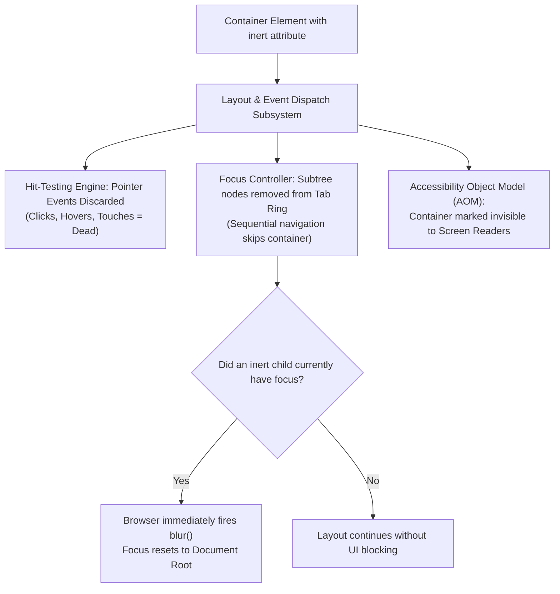

# Global Attributes: Core, State, Internationalization, and Interactivity

| Metadata | Details |
| :--- | :--- |
| **Level** | Core / Fundamental |
| **Prerequisites** | `01-document-structure.md` through `08-comments-and-whitespace-handling.md` |
| **Estimated Reading Time** | 30 minutes |
| **Status** | Production-Ready |
| **Baseline Status** | Widely Available (`inert` Widely Available 2023; `popover` Newly Available Jan 2025) |
| **Browsers Tested** | Chrome 120+, Firefox 120+, Safari 17+, Edge 120+ |
| **Tested With** | W3C Nu HTML Checker, Axe-core v4.8, NVDA 2023.3, VoiceOver macOS Sonoma |

---

## Table of Contents
- [1 What & Why](#1-what--why)
- [2 Core Concepts](#2-core-concepts)
- [3 How It Works Internally](#3-how-it-works-internally)
- [4 Syntax & Usage](#4-syntax--usage)
- [5 Practical Examples](#5-practical-examples)
- [6 Best Practices](#6-best-practices)
- [7 Common Mistakes & Pitfalls](#7-common-mistakes--pitfalls)
- [8 Performance, Accessibility, SEO & Security Notes](#8-performance-accessibility-seo--security-notes)
- [9 Comparison / When to Use What](#9-comparison--when-to-use-what)
- [10 Interview Questions](#10-interview-questions)
- [11 Practice Exercises](#11-practice-exercises)
- [12 Summary / Cheat Sheet](#12-summary--cheat-sheet)
- [13 Further Reading](#13-further-reading)

---

## 1 What & Why

In HTML, elements carry semantic roles (e.g., `<article>`, `<button>`, `<table>`), but many capabilities cut across the entire document hierarchy. **Global attributes** are universal attributes permitted on **any valid HTML element** without violating the WHATWG content model.

Global attributes govern the deepest architectural layers of web applications:
- **Identity & Styling Hooks**: `id` provides global document-unique addressing for fragment navigation and accessibility relationships; `class` groups elements for CSS and JavaScript queries.
- **Accessibility & Focus Traversal**: `tabindex` coordinates the sequential keyboard navigation ring; `inert` freezes background UI trees during modal dialog display.
- **Modern State & Visibility**: `hidden` (including modern `hidden="until-found"`) and `popover` govern native presentation layers without heavy JavaScript libraries.
- **Internationalization (i18n)**: `lang`, `dir`, and `translate` allow search engines, assistive technologies, and machine translators to render bidirectional and localized text accurately.
- **Client Extensibility**: `data-*` embeds private custom telemetry and state attributes that reflect directly into JavaScript's `dataset` DOM API.

Understanding global attributes is essential for writing accessible, secure, and performant web applications.

---

## 2 Core Concepts

### Identity & Presentation
- **`id`**: A document-wide unique identifier. It must not contain whitespace. Used for CSS styling, fragment linking (`#my-id`), JavaScript selection (`document.getElementById`), and ARIA relationship wiring (`aria-labelledby="my-id"`).
- **`class`**: A space-separated list of case-sensitive classification tokens. Enables multi-element CSS styling and DOM querying (`querySelectorAll`).
- **`style`**: Contains inline CSS declarations. Inline styles have high CSS specificity and violate strict Content Security Policies (`style-src 'self'`). Modern architectures reserve `style` almost exclusively for dynamic CSS Custom Properties (variables), e.g., `style="--progress: 75%;"`.
- **`title`**: Advisory tooltip text. **Severely discouraged** for essential information because touchscreens cannot trigger hover tooltips, and screen readers rarely announce them by default.

### Keyboard Navigation & Accessibility State
- **`tabindex`**: Controls element keyboard focusability:
  - `tabindex="0"`: Inserts a non-focusable element (like `<div>` or `<span>`) into the natural sequential keyboard navigation order (Tab ring).
  - `tabindex="-1"`: Makes an element programmatically focusable via JavaScript (`element.focus()`), but **excludes** it from the natural Tab sequence.
  - `tabindex="1+"` (Positive Integer): **Anti-Pattern**. Artificially overrides the natural DOM tab order, creating chaotic, broken navigation for keyboard users.
- **`inert`** *(Widely Available 2023)*: A boolean attribute that completely disables an element and all of its DOM descendants:
  - Blocks all mouse clicks, touches, and pointer interactions.
  - Removes all descendant elements from the sequential keyboard Tab ring.
  - Completely hides the subtree from the Accessibility Object Model (AOM), behaving like `aria-hidden="true"` and `pointer-events: none` combined.

### Visibility & Popovers
- **`hidden`**: A boolean attribute that hides the element visually and removes it from the accessibility tree (User-Agent default: `display: none !important;`).
- **`hidden="until-found"`**: An advanced visibility state that hides the element visually, but allows the browser's built-in **"Find in Page" (Ctrl+F)** search engine and fragment identifiers to locate text inside it. When found, the browser automatically strips the `hidden` attribute and reveals the content (used in accordions).
- **`popover`** *(Newly Available Jan 2025)*: A native HTML attribute (`auto` or `manual`) that turns any element into a top-layer popover with light-dismiss, keyboard `Escape` closing, and backdrop handling built into the browser engine.

### Internationalization & Editing
- **`lang`**: Specifies the primary human language of the element's content using BCP 47 language tags (e.g., `lang="en"`, `lang="fr-CA"`, `lang="ja"`).
- **`dir`**: Specifies the text directionality: `ltr` (left-to-right), `rtl` (right-to-left), or `auto` (browser inspects the first strong directional character).
- **`translate`**: Specifies whether the content should be translated by automated browser translation tools (`yes` or `no`). Use `translate="no"` for corporate brand names, code snippets, or product SKUs.
- **`contenteditable`**: Enables rich or plain-text in-place editing directly within the browser (`true`, `false`, or modern `plaintext-only`).

### Custom Data Attributes (`data-*`)
- Attributes prefixed with `data-` allow developers to embed custom data directly on HTML elements.
- Reflected in JavaScript via the `HTMLElement.dataset` camelCase object:
  - `data-user-id="49"` $\to$ `element.dataset.userId === "49"`.
  - `data-is-active="true"` $\to$ `element.dataset.isActive === "true"`.

---

## 3 How It Works Internally

### The `inert` Subtree Invalidation State Machine
When the browser engine encounters the `inert` attribute on a container node:



1. **Focus Eviction**: If keyboard focus was previously located inside an element that suddenly becomes `inert`, the browser immediately blurs that element and resets focus to the document body or nearest non-inert ancestor.
2. **Hit-Testing Bypass**: The layout engine flags the bounding client rect of the inert element. In the compositor thread, pointer event hit-testing returns `null`, preventing clicks from dispatching to event listeners.
3. **Accessibility Exclusion**: The browser's accessibility bridge treats all child nodes of an `inert` container as absent from the virtual accessibility cursor.

### `data-*` Attribute Name Mapping Algorithm
The WHATWG specification defines a strict transformation algorithm between HTML `data-*` attributes and the JavaScript `dataset` DOM property:
1. Strip the `data-` prefix.
2. For any hyphen (`-`) followed by a lowercase ASCII character, remove the hyphen and convert the following character to uppercase (camelCase).
3. In reverse (assigning to `dataset` in JS), any uppercase letter is converted to `-` followed by lowercase.

```
HTML Source                     JavaScript Reflection
-----------------------------------------------------------------------
data-user-id="101"              element.dataset.userId === "101"
data-auth-token="xyz"           element.dataset.authToken === "xyz"
data-http-status-code="200"     element.dataset.httpStatusCode === "200"
data-api-v2-endpoint="/stream"  element.dataset.apiV2Endpoint === "/stream"
```

---

## 4 Syntax & Usage

```html
<!-- 1. Unique Identity, Class Tokens, and CSS Custom Property Style -->
<section id="telemetry-dashboard" 
         class="dashboard-panel theme-dark active" 
         style="--chart-columns: 4;">
  <h2>Real-time Cluster Metrics</h2>
</section>

<!-- 2. Screen-Reader Exclusion via inert for Inactive Drawer -->
<aside id="side-drawer" inert aria-label="Settings Drawer">
  <button type="button">Close</button>
  <a href="/security">Security Policies</a>
</aside>

<!-- 3. Native Popover API (Modern 2025 Baseline) -->
<button type="button" popovertarget="notification-popover">
  Toggle Notifications
</button>
<div id="notification-popover" popover="auto">
  <h3>Notifications</h3>
  <p>All Kubernetes nodes operating within safe CPU limits.</p>
</div>

<!-- 4. Internationalization and Brand Translation Lockdown -->
<p lang="de">
  Willkommen bei <span translate="no">CloudScale Enterprise</span>.
</p>

<!-- 5. Dynamic Telemetry Data Attributes -->
<div class="server-node" 
     data-node-id="worker-az1-node-09" 
     data-rack-position="rack-4b" 
     data-status="healthy">
  Node: worker-az1-node-09
</div>
```

> [!NOTE]
> **Baseline Status:**
> - `id`, `class`, `style`, `title`, `lang`, `dir`, `tabindex`, `hidden`, and `data-*` are **Widely Available** across all modern browsers.
> - `inert` is **Widely Available** (supported across all engines since mid-2023).
> - `popover` is **Newly Available** (supported across Chrome 114+, Safari 17+, Firefox 125+, Edge 114+ as of early 2025).

---

## 5 Practical Examples

### Example 1: Modal Backdrop Focus Trapping using `inert`
```html
<!DOCTYPE html>
<html lang="en">
<head>
  <meta charset="utf-8">
  <title>Inert Focus Trapping Demo</title>
  <style>
    .modal { position: fixed; inset: 20% 30%; background: #fff; padding: 2rem; border: 2px solid #000; z-index: 100; }
    .backdrop { position: fixed; inset: 0; background: rgba(0,0,0,0.5); z-index: 99; }
    [inert] { opacity: 0.4; pointer-events: none; }
  </style>
</head>
<body>
  <!-- Main content wrapper becomes inert when modal is open -->
  <div id="app-root" inert>
    <header>
      <nav><a href="/">Home</a></nav>
    </header>
    <main>
      <h1>Project Management</h1>
      <button type="button">Create Project</button>
      <input type="text" placeholder="Filter projects...">
    </main>
  </div>

  <!-- Active Modal: Outside of the inert container, retains focus and interactivity -->
  <div class="backdrop"></div>
  <div role="dialog" aria-modal="true" aria-labelledby="dialog-title" class="modal">
    <h2 id="dialog-title">Confirm Database Purge</h2>
    <p>Are you sure you want to permanently erase the staging cluster?</p>
    <button type="button" autofocus>Cancel</button>
    <button type="button">Purge Database</button>
  </div>
</body>
</html>
```

### Example 2: Find-In-Page Accordion with `hidden="until-found"`
```html
<article class="faq-accordion">
  <h2>Frequently Asked Questions</h2>

  <div class="faq-item">
    <h3>
      <button type="button" aria-expanded="false" id="q1-btn">
        How do we rotate TLS certificates?
      </button>
    </h3>
    <!-- hidden="until-found" allows Ctrl+F in the browser to locate words inside! -->
    <!-- When found, the browser automatically fires the 'beforematch' event and reveals this div -->
    <div id="q1-panel" hidden="until-found" aria-labelledby="q1-btn">
      <p>
        Certificates rotate automatically via cert-manager every 60 days.
        To execute an emergency manual rotation, invoke <code>cmctl renew-cert</code>.
      </p>
    </div>
  </div>
</article>

<script>
  const panel = document.getElementById("q1-panel");
  const btn = document.getElementById("q1-btn");

  // Native beforematch event fires when browser Ctrl+F unhides the container
  panel.addEventListener("beforematch", () => {
    btn.setAttribute("aria-expanded", "true");
  });
</script>
```

### Example 3: Edge Case — Safe In-Place Editing with `contenteditable="plaintext-only"`
```html
<!-- Problem with contenteditable="true": Pasting formatted text pastes nested <span>, <div>, font tags! -->
<!-- Solution: contenteditable="plaintext-only" strips all HTML formatting on paste automatically! -->

<div class="terminal-command-editor" 
     contenteditable="plaintext-only" 
     spellcheck="false" 
     autocorrect="off" 
     aria-label="Editable Bash command string">
  kubectl get pods -n kube-system -o wide
</div>

<style>
  .terminal-command-editor {
    background: #1e1e1e;
    color: #4ade80;
    font-family: monospace;
    padding: 1rem;
    border-radius: 4px;
    outline: none;
  }
  .terminal-command-editor:focus {
    box-shadow: 0 0 0 2px #38bdf8;
  }
</style>
```

### Example 4: Failure Case — Broken Focus Rings and Dangerous Tooltips
```html
<!-- ANTI-PATTERN: DO NOT COPY -->

<!-- Error 1: Positive tabindex overrides logical DOM order -->
<form>
  <input type="text" name="name" tabindex="3">
  <input type="email" name="email" tabindex="1"> <!-- Jumps here first! -->
  <button type="submit" tabindex="2">Submit</button>
</form>

<!-- Error 2: Storing critical information ONLY in the title attribute -->
<!-- Touchscreen users can NEVER see this! Screen readers ignore it by default! -->
<button type="button" title="Deletes your account forever">
  
</button>

<!-- Error 3: Duplicate ID in document -->
<div id="card">Item 1</div>
<div id="card">Item 2</div> <!-- INVALID: Breaks document.getElementById and ARIA linking -->

<!-- Error 4: Arbitrary non-standard custom attributes -->
<div userId="123" isAdmin="true">Bad markup</div> <!-- INVALID HTML5 -->
```

### Example 5: Production Internationalized Component
```html
<!DOCTYPE html>
<html lang="en">
<head>
  <meta charset="utf-8">
  <title>International Multilingual Header</title>
</head>
<body>
  <!-- Bi-directional text isolation with lang and translate controls -->
  <header>
    <h1>Global Operations Telemetry</h1>

    <div class="announcement" lang="ar" dir="rtl">
      <p>
        تنبيه: سيتم إجراء صيانة مجدولة لخوادم الشرق الأوسط الليلة.
        الرجاء مراجعة وثائق <span lang="en" dir="ltr" translate="no">CloudScale Kubernetes</span>.
      </p>
    </div>

    <!-- Client-side dataset telemetry tracker -->
    <button type="button" 
            class="telemetry-action" 
            data-action-type="deploy-trigger" 
            data-target-region="ap-southeast-1" 
            data-cluster-id="prod-k8s-04">
      Deploy to Asia-Pacific
    </button>
  </header>
</body>
</html>
```

---

## 6 Best Practices

1. **Keep `id` Unique Across the Entire DOM**: Duplicate IDs break CSS fragment targeting, JavaScript DOM queries (`getElementById`), and ARIA relationships (`aria-describedby`).
2. **Never Use Positive `tabindex` Values (`tabindex="1+"`)**: Rely on the natural DOM document order for keyboard navigation. If the tab sequence feels wrong, rearrange the HTML source order rather than hacking it with positive integers.
3. **Use `tabindex="-1"` for Programmatic Focus Targets**: Apply `tabindex="-1"` to headings, modals, or skip targets that need to receive programmatic focus via `element.focus()` without appearing in the standard user Tab ring.
4. **Deploy `inert` on Inactive Offscreen Content**: When a mobile menu drawer or modal dialog opens, apply `inert` to the background page wrapper to immediately isolate focus and prevent background screen-reader exploration.
5. **Never Use `title` as Primary Accessible Labels**: `title` tooltips fail on touch devices, are inaccessible to keyboard-only users, and are ignored by most screen readers. Use visible labels, `<figcaption>`, or `aria-label`.
6. **Use `data-*` Exclusively for Custom Scripts**: Never use `data-*` attributes for styling hooks when standard classes or ARIA states (`aria-expanded="true"`) are semantically appropriate.

---

## 7 Common Mistakes & Pitfalls

| Mistake | Bad Code | Good Code | Technical Explanation |
| :--- | :--- | :--- | :--- |
| **Positive `tabindex`** | `<button tabindex="2">Save</button>` | `<button>Save</button>` (Ordered in DOM) | Positive integers hijack the natural keyboard ring, disorienting keyboard users (violates WCAG 2.4.3). |
| **Duplicate `id`** | `<input id="email"><input id="email">` | `<input id="user-email"><input id="work-email">` | Duplicate IDs violate HTML validation, break label associations, and cause JavaScript query bugs. |
| **Relying on `title` for Help** | `<input type="text" title="Must be 8 chars">` | `<input aria-describedby="rule"><p id="rule">Must be 8 chars</p>` | `title` is inaccessible on touchscreens and cannot be read by keyboard navigation without custom CSS. |
| **Non-Standard Attributes** | `<div userToken="abc">` | `<div data-user-token="abc">` | Custom attributes without the `data-` prefix violate the HTML specification and may collide with future HTML standards. |
| **Misusing `hidden` on Blockers** | `<div hidden style="display: block;">` | Avoid inline display overrides on `[hidden]` | CSS rules (`display: block`) can accidentally override User-Agent `[hidden] { display: none; }`, revealing secret elements. |
| **Missing `dir="auto"` on User Input** | `<p>${userSubmittedComment}</p>` | `<p dir="auto">${userSubmittedComment}</p>` | If a user posts in Arabic or Hebrew on an English site, text renders backwards/misaligned without `dir="auto"`. |

---

## 8 Performance, Accessibility, SEO & Security Notes

### Accessibility (WCAG 2.2 AA)
- **Criterion 2.4.3 (Focus Order - Level A)**: If a web page can be navigated sequentially, focusable components receive focus in an order that preserves meaning and operability. Positive `tabindex` violates this rule.
- **Criterion 3.1.2 (Language of Parts - Level AA)**: Any inline phrase in a language different from the root document must be marked with a local `lang` attribute (e.g., `<span lang="fr">C'est la vie</span>`) so screen readers switch to the proper phonetic pronunciation engine.
- **The Power of `inert`**: Prior to `inert`, developers had to write hundreds of lines of fragile JavaScript to trap focus inside modals by listening to `keydown` tab events. `inert` solves this natively in the browser C++ engine.

### Search Engine Optimization (SEO)
- Search engines parse `lang` and `dir` to catalog documents into regional search indices (e.g., serving Spanish results to Spanish-speaking territories).
- Setting `translate="no"` on trademarked product names ensures machine translation tools do not corrupt brand identity on localized landing pages.

### Performance & Memory
- `dataset` property access in JavaScript involves string allocation and camelCase string manipulation. In hot performance loops (e.g., inside 60fps animations or 10,000-row table renders), reading `element.getAttribute('data-id')` is 2–3x faster than accessing `element.dataset.id`.

### Security Notes
- **XSS via `contenteditable`**: Elements with `contenteditable` allow users to type and paste arbitrary content. If their inner HTML is saved directly to a database and rendered without server-side sanitization, an attacker can paste malicious `` payloads. Always sanitize with DOMPurify before storing.

---

## 9 Comparison / When to Use What

| Global Attribute | Primary Mechanism | AOM Representation | Trigger Modality |
| :--- | :--- | :--- | :--- |
| `hidden` | `display: none` equivalent | Completely removed from tree | Programmatic DOM mutation |
| `hidden="until-found"` | Hidden until matched | Exposed to Ctrl+F index | Browser in-page search / anchor |
| `inert` | Blocks hit-test + tab focus | Completely removed from tree | Programmatic modal state |
| `tabindex="0"` | Inserts into sequential tab ring | Focusable element | Keyboard `Tab` navigation |
| `tabindex="-1"` | Programmatically focusable | Focusable via script only | JavaScript `.focus()` call |
| `popover="auto"` | Top-layer presentation | Standard accessible node | `popovertarget` button / Escape key |
| `data-*` | Dataset string storage | No AOM impact | JavaScript telemetry / state logic |

---

## 10 Interview Questions

<details>
<summary><strong>1. What does the `inert` attribute do, and how does it revolutionize accessible modal dialog implementations?</strong></summary>

**Answer:**
The `inert` boolean attribute informs the browser engine to treat a DOM subtree as completely non-interactive:
1. **Focus Management**: All interactive elements (links, buttons, inputs) within the inert subtree are removed from the sequential keyboard Tab ring.
2. **Event Dispatch**: Mouse clicks, touches, and hover hit-tests are completely blocked on the inert subtree.
3. **Accessibility**: The entire subtree is hidden from the Accessibility Object Model (AOM), behaving as if `aria-hidden="true"` were applied to every node.

**Impact on Modals**:
Historically, creating an accessible modal dialog required complex "focus trap" JavaScript scripts that listened to every `keydown` event on the `Tab` key to prevent users from tabbing into the background page, alongside manually setting `aria-hidden="true"` on background containers. 
With `inert`, developers simply set `inert` on the background page wrapper (`<div id="app" inert>`). The browser's native C++ engine automatically traps keyboard and screen-reader focus inside the active modal dialog with zero custom JavaScript.
</details>

<details>
<summary><strong>2. Why are positive values of `tabindex` (e.g., `tabindex="1"`, `tabindex="2"`) considered a severe accessibility anti-pattern?</strong></summary>

**Answer:**
Browsers construct the keyboard navigation ring based on two tiers:
1. First, the browser visits **all elements with positive `tabindex` values**, in ascending numerical order (`1`, `2`, `3`...).
2. Only after exhausting all positive tabindex elements does the browser visit elements with `tabindex="0"` and natively focusable elements (`<a>`, `<button>`, `<input>`) in their natural DOM order.

When an author assigns positive `tabindex` values:
- It decouples visual layout from the keyboard navigation flow.
- Inserting a new element later requires manually renumbering every other positive tabindex on the page.
- Keyboard users pressing `Tab` will experience unpredictable jumps across different sections of the viewport before returning to the top of the page.
Standard engineering practice dictates using only `tabindex="0"` (to make an element focusable in natural order) or `tabindex="-1"` (for programmatic focus).
</details>

<details>
<summary><strong>3. How does the `hidden="until-found"` attribute differ from the standard `hidden` boolean attribute?</strong></summary>

**Answer:**
- Standard **`hidden`**: The element has `display: none !important`. It is completely invisible on screen, completely absent from the accessibility tree, and **cannot be found by the browser's built-in "Find in Page" (Ctrl+F) search engine**.
- **`hidden="until-found"`**: The element is styled with `content-visibility: hidden`. While invisible on screen, the browser engine indexes its text content for in-page searches and URL fragment matching. 
When a user presses `Ctrl+F` and searches for text located inside a `hidden="until-found"` container:
1. The browser automatically scrolls to the element.
2. The browser fires the `beforematch` event on the element.
3. The browser strips the `hidden` attribute automatically, making the content visible so the user can read the matched text.
This is ideal for accordions and collapsed tabs.
</details>

<details>
<summary><strong>4. How does the HTML parser map a `data-*` attribute to the JavaScript `element.dataset` object? Give an example of a potential naming conflict.</strong></summary>

**Answer:**
The mapping algorithm operates as follows:
1. Strip the `data-` prefix.
2. Convert every hyphen followed by a lowercase ASCII character into its uppercase equivalent (camelCase).

**Naming Collision Example**:
Suppose an author defines:
- `data-user-name="John"` $\to$ maps to `dataset.userName`.
- `data-user--name="Doe"` $\to$ under certain older implementations or edge regexes, double hyphens or case quirks can collide.
More commonly:
If an author writes both `data-user-id="1"` and dynamically writes `dataset.userId = "2"`, it updates the exact same underlying attribute.
Furthermore, attribute names cannot contain uppercase characters in HTML (e.g., `data-userID` will be lowercased to `data-userid` by the HTML parser), reflecting into `dataset.userid`, NOT `dataset.userId`!
</details>

<details>
<summary><strong>5. Why is the `title` attribute discouraged as the primary method for providing accessible labels on controls?</strong></summary>

**Answer:**
The `title` attribute has fatal usability and accessibility shortcomings:
1. **Touch Incompatibility**: On mobile devices and touchscreens, there is no "hover" state. Touch users can never trigger a `title` tooltip.
2. **Keyboard Inaccessibility**: In most browsers, navigating to a button via the keyboard (`Tab`) does **not** display the `title` tooltip.
3. **Screen Reader Inconsistency**: Most screen readers (NVDA, JAWS) do not announce the `title` attribute by default unless configured in verbose settings, because it is considered supplementary advisory text.
4. **Magnification Software Issues**: Tooltips can obscure the focused element for users with high-zoom screen magnifiers.
Accessible controls should always use visible text, `<label>`, or `aria-label`.
</details>

<details>
<summary><strong>6. What is the difference between `contenteditable="true"` and `contenteditable="plaintext-only"`?</strong></summary>

**Answer:**
- `contenteditable="true"`: Enables full rich-text editing. When a user pastes text from an external application (like Microsoft Word or another webpage), the browser pastes rich markup containing `<span>`, `<div>`, inline CSS, and `<font>` tags, corrupting application styling and state models.
- `contenteditable="plaintext-only"`: Restricts in-place editing to plain raw text. When text is pasted, the browser automatically strips all rich HTML formatting, tags, and inline styles, inserting only the clean text characters. This eliminates complex clipboard sanitization scripts in code editors and single-line editable labels.
</details>

<details>
<summary><strong>7. How does the `dir="auto"` attribute determine text directionality?</strong></summary>

**Answer:**
When `dir="auto"` is specified, the browser engine does not rely on the document's global `dir` or language settings. Instead, it inspects the **first character with strong directionality** in the element's text content:
- If the first strong character belongs to a Right-to-Left script (e.g., Arabic, Hebrew, Persian, Urdu), the element renders with `dir="rtl"`.
- If the first strong character belongs to a Left-to-Right script (e.g., Latin, Cyrillic, Greek, Devanagari), it renders with `dir="ltr"`.
This is essential for user-generated content feeds (like social media comments) where posts may alternate between English and Arabic.
</details>

<details>
<summary><strong>8. What is the native Popover API, and what advantage does it offer over custom JavaScript modal libraries?</strong></summary>

**Answer:**
The Popover API (`popover="auto"` or `popover="manual"`) is a native HTML standard (Newly Available Jan 2025) that promotes elements into the browser's **Top Layer**:
- **Automatic Stacking**: Renders above all other elements on the page, completely immune to `z-index` and `overflow: hidden` clipping bugs in parent containers.
- **Built-in Light Dismiss**: Clicking outside the popover automatically closes it.
- **Keyboard Dismiss**: Pressing `Escape` automatically dismisses the popover and returns focus to the invoker button.
- **Zero JavaScript Scaffolding**: Can be wired purely in HTML using `<button popovertarget="my-popover">`.
</details>

---

## 11 Practice Exercises

### Exercise 1 (Easy): Eliminate Positive Tabindex Anti-Patterns
**Task**: Refactor this form so that keyboard navigation follows the logical order (First Name $\to$ Last Name $\to$ Email $\to$ Submit) without any positive `tabindex` integers.

```html
<!-- Flawed Source -->
<form>
  <button type="submit" tabindex="4">Submit</button>
  <input type="text" name="fname" placeholder="First Name" tabindex="1">
  <input type="email" name="email" placeholder="Email" tabindex="3">
  <input type="text" name="lname" placeholder="Last Name" tabindex="2">
</form>
```

<details>
<summary><strong>Solution</strong></summary>

```html
<!-- Corrected Source: DOM Order Dictates Tab Order -->
<form>
  <div>
    <label for="fname">First Name</label>
    <input type="text" id="fname" name="fname">
  </div>
  <div>
    <label for="lname">Last Name</label>
    <input type="text" id="lname" name="lname">
  </div>
  <div>
    <label for="email">Email</label>
    <input type="email" id="email" name="email">
  </div>
  <button type="submit">Submit</button>
</form>
```
*Explanation*: Simply ordering the HTML elements in their logical sequence eliminates the need for any `tabindex` attributes.
</details>

### Exercise 2 (Easy): Multi-Language Inline Quote with Directionality
**Task**: Mark up an English sentence quoting an Arabic proverb: "As the Arabic proverb says: [الصبر مفتاح الفرج] (Patience is the key to relief)."

<details>
<summary><strong>Solution</strong></summary>

```html
<p lang="en">
  As the Arabic proverb says:
  <q lang="ar" dir="rtl">الصبر مفتاح الفرج</q>
  (Patience is the key to relief).
</p>
```
*Explanation*: Setting `lang="ar"` and `dir="rtl"` isolates the Arabic phrase so that punctuation and cursor flow render correctly without bleeding into the surrounding English sentence.
</details>

### Exercise 3 (Medium): Wire a Native Popover Notification Card
**Task**: Create a button that triggers a native HTML popover card with id `notification-panel` using the modern Popover API without any JavaScript.

<details>
<summary><strong>Solution</strong></summary>

```html
<button type="button" popovertarget="notification-panel">
  View Telemetry Alerts
</button>

<div id="notification-panel" popover="auto" class="popover-card">
  <h3>Cluster Alerts</h3>
  <ul>
    <li>Node 04: Memory usage 82%</li>
    <li>Node 12: Ingress latency nominal</li>
  </ul>
</div>

<style>
  /* Top-layer popovers can be styled natively */
  #notification-panel {
    border: 1px solid #d1d5db;
    border-radius: 8px;
    padding: 1.5rem;
    box-shadow: 0 10px 15px -3px rgba(0, 0, 0, 0.1);
  }
  #notification-panel::backdrop {
    background: rgba(0, 0, 0, 0.2);
  }
</style>
```
*Explanation*: `popovertarget="notification-panel"` pairs with `popover="auto"`. The browser handles opening, backdrop rendering, light dismiss on outside click, and `Escape` key listeners automatically.
</details>

### Exercise 4 (Medium): Build an Inactive Drawer State with `inert`
**Task**: Write the HTML structure for a slide-out mobile drawer navigation. When the drawer is closed, ensure it is completely isolated from the keyboard and screen readers using `inert`.

<details>
<summary><strong>Solution</strong></summary>

```html
<!-- Main page content -->
<div id="page-content">
  <button type="button" id="open-menu-btn" aria-haspopup="dialog">
    Open Menu
  </button>
  <main>
    <h1>Infrastructure Portal</h1>
  </main>
</div>

<!-- Offscreen drawer (Closed State) -->
<nav id="mobile-drawer" inert aria-label="Mobile Navigation" class="drawer-closed">
  <button type="button" id="close-menu-btn">Close Menu</button>
  <ul>
    <li><a href="/dashboard">Dashboard</a></li>
    <li><a href="/deployments">Deployments</a></li>
    <li><a href="/settings">Settings</a></li>
  </ul>
</nav>

<script>
  // Toggling state simply toggles the boolean 'inert' attribute!
  function openDrawer() {
    document.getElementById("page-content").setAttribute("inert", "");
    document.getElementById("mobile-drawer").removeAttribute("inert");
  }

  function closeDrawer() {
    document.getElementById("mobile-drawer").setAttribute("inert", "");
    document.getElementById("page-content").removeAttribute("inert");
  }
</script>
```
</details>

### Exercise 5 (Hard): Map `data-*` Attributes to Clean JavaScript Objects
**Task**: Given the following HTML snippet:
`<div id="metric" data-cluster-name="eu-central" data-max-iops="15000" data-is-encrypted="true"></div>`
Write JavaScript to read these attributes via `dataset` and construct a strictly typed data model object.

<details>
<summary><strong>Solution</strong></summary>

```javascript
const el = document.getElementById("metric");

// Reading from dataset (camelCase reflection)
const clusterConfig = {
  clusterName: el.dataset.clusterName,             // "eu-central"
  maxIops: parseInt(el.dataset.maxIops, 10),      // 15000 (number)
  isEncrypted: el.dataset.isEncrypted === "true"  // true (boolean)
};

console.log("Parsed telemetry config:", clusterConfig);
```
*Explanation*: All `dataset` values are returned as raw strings. The engineer must explicitly cast numbers and booleans to their desired runtime types.
</details>

### Exercise 6 (Hard): Refactor Inaccessible Tooltip and Non-Standard Attributes
**Task**: Review this malformed button component and refactor it into compliant, accessible HTML.
```html
<!-- Dirty Source -->
<button myAction="delete-cluster" 
        clusterId="node-99" 
        title="Permanently removes this cluster from the cloud network" 
        tabindex="5">
  
</button>
```

<details>
<summary><strong>Solution</strong></summary>

```html
<button type="button" 
        class="btn-danger" 
        data-action="delete-cluster" 
        data-cluster-id="node-99" 
        aria-describedby="delete-hint">
  
  <span>Delete Cluster</span>
</button>
<p id="delete-hint" class="visually-hidden">
  Permanently removes this cluster from the cloud network
</p>
```
*Explanation*:
1. Custom attributes replaced with compliant `data-*` attributes.
2. Positive `tabindex="5"` removed.
3. Inaccessible `title` replaced with visible label text and an `aria-describedby` reference for the permanent deletion warning.
4. Image marked decorative (`alt="" aria-hidden="true"`).
</details>

---

## 12 Summary / Cheat Sheet

```
┌────────────────────────────────────────────────────────────────────────┐
│                        GLOBAL ATTRIBUTES CHEAT SHEET                   │
├───────────────────┬────────────────────────────────────────────────────┤
│ Attribute         │ Primary Purpose & Value                            │
├───────────────────┼────────────────────────────────────────────────────┤
│ id                │ Unique document identifier (no spaces)             │
│ class             │ Space-separated styling/script tokens              │
│ style             │ Inline CSS (Prefer CSS custom properties: --var)   │
│ tabindex="0"      │ Natural sequential keyboard focus                  │
│ tabindex="-1"     │ Programmatic focus only (element.focus())          │
│ inert             │ Freezes pointer, keyboard, and AOM for subtree     │
│ hidden            │ display: none (hides from screen and AOM)          │
│ hidden="until-found"| Hidden, but searchable via browser Ctrl+F search │
│ popover="auto"    │ Promotes element to Top Layer with light-dismiss   │
│ lang="xx"         │ BCP 47 language identifier                         │
│ dir="ltr|rtl|auto"│ Text directionality control                        │
│ translate="no"    │ Prevents automated translation of brand/code names │
│ data-*            │ Custom JavaScript metadata via element.dataset     │
└───────────────────┴────────────────────────────────────────────────────┘
```

---

## 13 Further Reading

- [WHATWG HTML Living Standard: Section 3.2.6 Global Attributes](https://html.spec.whatwg.org/multipage/dom.html#global-attributes)
- [MDN Web Docs: Global Attributes](https://developer.mozilla.org/en-US/docs/Web/HTML/Global_attributes)
- [web.dev: Introducing the inert attribute](https://web.dev/articles/inert)
- [MDN Web Docs: Popover API](https://developer.mozilla.org/en-US/docs/Web/API/Popover_API)
- [W3C WAI: Using the tabindex attribute](https://www.w3.org/WAI/WCAG21/Techniques/general/G59)

---

| [Previous: 08 Comments & Whitespace Handling](08-comments-and-whitespace-handling.md) | [Section Index](README.md) | [Next Module: 02 Semantics & Document Structure](../02-semantics-and-structure/README.md) |
