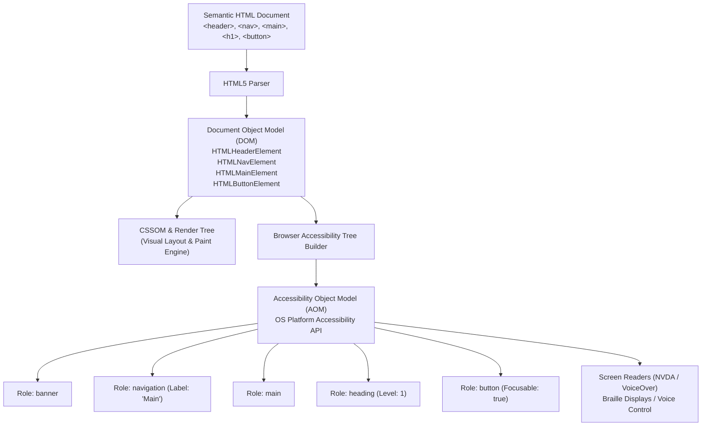

# The Principles of Semantic HTML and AOM Mapping

| Metadata | Details |
| :--- | :--- |
| **Level** | Core / Fundamental |
| **Prerequisites** | `01-fundamentals/01-document-structure.md`, `01-fundamentals/09-global-attributes.md` |
| **Estimated Reading Time** | 25 minutes |
| **Status** | Production-Ready |
| **Baseline Status** | Widely Available across all modern browsers |
| **Browsers Tested** | Chrome 120+, Firefox 120+, Safari 17+, Edge 120+ |
| **Tested With** | W3C Nu HTML Checker, Axe-core v4.8, NVDA 2023.3, VoiceOver macOS Sonoma |

---

## Table of Contents
- [1 What & Why](#1-what--why)
- [2 Core Concepts](#2-core-concepts)
- [3 How It Works Internally](#3-how-it-works-internally)
- [4 Syntax & Usage](#4-syntax--usage)
- [5 Practical Examples](#5-practical-examples)
- [6 Best Practices](#6-best-practices)
- [7 Common Mistakes & Pitfalls](#7-common-mistakes--pitfalls)
- [8 Performance, Accessibility, SEO & Security Notes](#8-performance-accessibility-seo--security-notes)
- [9 Comparison / When to Use What](#9-comparison--when-to-use-what)
- [10 Interview Questions](#10-interview-questions)
- [11 Practice Exercises](#11-practice-exercises)
- [12 Summary / Cheat Sheet](#12-summary--cheat-sheet)
- [13 Further Reading](#13-further-reading)

---

## 1 What & Why

In computer science, **semantics** refers to the relationship between symbols and their operational or conceptual meaning. In the context of the World Wide Web, **Semantic HTML** is the practice of selecting HTML elements based on what the content *is* and what role it plays in the information hierarchy, rather than how it *looks* in a visual graphical browser.

During the early 2000s, web development suffered from the **"div soup" anti-pattern**: developers built complex pages entirely out of generic `<div>` and `<span>` elements, attaching CSS classes like `<div class="nav-bar">` or `<div class="article-title">` to achieve visual layout. While visually functional for sighted users on desktop displays, these pages were completely opaque to machines:
- Assistive technologies (screen readers, braille readers, switch controls) had no programmatic way to deduce page structure, navigation menus, or headings.
- Search engine crawlers (Googlebot, Bingbot) could not determine which text represented primary editorial content versus auxiliary boilerplate, footer links, or advertising sidebars.
- Browser accessibility engines were forced to guess or present flat text walls.

Semantic HTML solves this by providing native elements that map automatically into standardized browser accessibility roles, keyboard behaviors, and structural trees.

---

## 2 Core Concepts

### Semantics vs. Presentation
- **Presentation**: Concerns the visual appearance of content on a 2D canvas—font size, margins, colors, padding, flexbox directions, and animations. Presentation is the exclusive responsibility of **CSS**.
- **Semantics**: Concerns the rhetorical meaning, relationships, and functional roles of content—indicating that a block of text is a navigation landmark (`<nav>`), a primary heading (`<h1>`), an independent article (`<article>`), a quotation (`<blockquote>`), or a button control (`<button>`). Semantics is the exclusive responsibility of **HTML**.

### The Div Soup Anti-Pattern
When developers use `<div>` and `<span>` for all layout and typography, they discard the browser's built-in accessibility and interaction behaviors:
```html
<!-- ANTI-PATTERN: DIV SOUP -->
<div class="page-container">
  <div class="site-header">
    <div class="logo">CloudScale</div>
    <div class="menu-list">
      <div class="menu-item" onclick="navigate('/home')">Home</div>
      <div class="menu-item" onclick="navigate('/docs')">Docs</div>
    </div>
  </div>
  <div class="main-body">
    <div class="headline">Architecture Overview</div>
    <div class="text-block">Distributed consensus is difficult.</div>
  </div>
</div>
```
To a screen reader, every element in this snippet has `role="generic"`. The screen reader user hears: *"CloudScale, Home, Docs, Architecture Overview, Distributed consensus is difficult"*. There are no headings to jump to, no navigation regions to skip past, and the menu items cannot be activated via keyboard `Tab` or `Enter`.

### The First Rule of ARIA
The W3C Web Accessibility Initiative (WAI) establishes the **First Rule of ARIA Use**:
> *"If you can use a native HTML element or attribute with the semantics and behavior you require already built-in, instead of re-purposing an element and adding an ARIA role, state or property to make it accessible, then do so."*

Writing `<button>` is infinitely superior to writing `<div role="button" tabindex="0">` because `<button>` includes native keyboard activation (`Enter` and `Space`), form submission integration, disabled state management, and focus styling out of the box.

---

## 3 How It Works Internally

### The Dual-Tree Architecture: DOM and AOM
When the browser engine renders an HTML document, it constructs two concurrent tree structures:
1. **Document Object Model (DOM)**: A tree of C++ node objects representing the raw HTML elements, attributes, and text nodes used for JavaScript execution and CSS styling.
2. **Accessibility Object Model (AOM)**: A parallel tree of accessible objects exposed to the host operating system's native accessibility API (MSAA/UI Automation on Windows, NSAccessibility on macOS, AT-SPI on Linux, AccessibilityKit on iOS/Android).



### Implicit ARIA Semantics
The HTML Living Standard defines the **Implicit ARIA Semantics** of every native HTML element:
- `<header>` (at root level) $\to$ `role="banner"`
- `<nav>` $\to$ `role="navigation"`
- `<main>` $\to$ `role="main"`
- `<article>` $\to$ `role="article"`
- `<aside>` $\to$ `role="complementary"`
- `<footer>` (at root level) $\to$ `role="contentinfo"`
- `<h1>` $\to$ `role="heading"` with `aria-level="1"`
- `<button>` $\to$ `role="button"` (with native tab stop and keyboard listeners)

Because these roles are mapped implicitly by the browser engine in native C++, authors do **not** need to write `<main role="main">` or `<nav role="navigation">`. Writing redundant ARIA roles is considered bad practice.

---

## 4 Syntax & Usage

```html
<!DOCTYPE html>
<html lang="en">
<head>
  <meta charset="utf-8">
  <title>Semantic Architecture Baseline</title>
</head>
<body>
  <!-- 1. Banner Landmark -->
  <header>
    <a href="/" class="brand">CloudScale</a>
    
    <!-- 2. Navigation Landmark -->
    <nav aria-label="Primary Navigation">
      <ul>
        <li><a href="/clusters">Clusters</a></li>
        <li><a href="/telemetry">Telemetry</a></li>
        <li><a href="/settings">Settings</a></li>
      </ul>
    </nav>
  </header>

  <!-- 3. Main Content Landmark -->
  <main id="main-content">
    <article>
      <header>
        <h1>Consensus Protocols in Distributed Clusters</h1>
        <p>Published <time datetime="2026-03-15">March 15, 2026</time></p>
      </header>

      <section aria-labelledby="raft-heading">
        <h2 id="raft-heading">The Raft Consensus Algorithm</h2>
        <p>
          Raft decomposes consensus into leader election, log replication,
          and safety invariants.
        </p>
      </section>
    </article>

    <!-- 4. Complementary Landmark -->
    <aside aria-label="Related Topics">
      <h3>Related Architectures</h3>
      <ul>
        <li><a href="/paxos">Paxos Foundations</a></li>
        <li><a href="/byzantine">Byzantine Fault Tolerance</a></li>
      </ul>
    </aside>
  </main>

  <!-- 5. Content Information Landmark -->
  <footer>
    <p>&copy; 2026 CloudScale Systems Inc. All rights reserved.</p>
  </footer>
</body>
</html>
```

> [!NOTE]
> **Baseline Status: Widely Available**
> All primary semantic landmarks (`<header>`, `<nav>`, `<main>`, `<article>`, `<section>`, `<aside>`, `<footer>`) are baseline web platform standards supported across all desktop and mobile browsers since HTML5 (2014).

---

## 5 Practical Examples

### Example 1: Refactoring Div Soup into Semantic Hypertext
```html
<!-- BEFORE: Div Soup (0% Semantic Value) -->
<div class="top-nav">
  <div class="logo">Nexus</div>
  <div class="links">
    <div class="link" onclick="go('/docs')">Docs</div>
  </div>
</div>
<div class="content">
  <div class="title">System Performance</div>
  <div class="section">
    <div class="subtitle">CPU Utilization</div>
    <div class="desc">Average cluster CPU load is 42%.</div>
  </div>
</div>

<!-- AFTER: Production Semantic HTML (100% Machine Determinable) -->
<header>
  <a href="/" class="logo">Nexus</a>
  <nav aria-label="Global">
    <ul>
      <li><a href="/docs">Docs</a></li>
    </ul>
  </nav>
</header>
<main>
  <article>
    <h1>System Performance</h1>
    <section aria-labelledby="cpu-title">
      <h2 id="cpu-title">CPU Utilization</h2>
      <p>Average cluster CPU load is 42%.</p>
    </section>
  </article>
</main>
```

### Example 2: Landmark Scoping Rules (`<header>` and `<footer>`)
```html
<!-- Rule: <header> and <footer> only become ARIA landmarks (banner/contentinfo) -->
<!-- when they are direct children of <body>. Inside <article> or <section>, -->
<!-- they represent scoped editorial headers/footers without landmark roles. -->

<body>
  <!-- EXPOSES: role="banner" -->
  <header>
    <h1>Enterprise Cloud Portal</h1>
  </header>

  <main>
    <article>
      <!-- NOT A LANDMARK: Simply the header of this specific article -->
      <header>
        <h2>Release Notes v5.2</h2>
        <p>By Platform Engineering</p>
      </header>

      <p>New telemetry metrics are now streaming.</p>

      <!-- NOT A LANDMARK: Simply the footer of this specific article -->
      <footer>
        <p>Tags: <a href="/tag/devops">DevOps</a>, <a href="/tag/k8s">Kubernetes</a></p>
      </footer>
    </article>
  </main>

  <!-- EXPOSES: role="contentinfo" -->
  <footer>
    <p>Corporate Headquarters &bull; San Francisco, CA</p>
  </footer>
</body>
```

### Example 3: Edge Case — Labelling Multiple Landmarks
```html
<!-- When multiple landmarks of the same type exist on a page, -->
<!-- they MUST have unique accessible names via aria-label or aria-labelledby -->

<header>
  <!-- Primary Site Navigation -->
  <nav aria-label="Primary Site">
    <ul>
      <li><a href="/">Home</a></li>
      <li><a href="/products">Products</a></li>
    </ul>
  </nav>
</header>

<main>
  <!-- Breadcrumb Navigation -->
  <nav aria-label="Breadcrumbs">
    <ol>
      <li><a href="/products">Products</a></li>
      <li><a href="/products/hardware">Hardware</a></li>
      <li aria-current="page">Servers</li>
    </ol>
  </nav>
  
  <h1>Server Fleet</h1>
</main>

<footer>
  <!-- Footer Legal Navigation -->
  <nav aria-label="Legal & Corporate">
    <ul>
      <li><a href="/privacy">Privacy Policy</a></li>
      <li><a href="/terms">Terms of Service</a></li>
    </ul>
  </nav>
</footer>
```

### Example 4: Failure Case — Broken ARIA Redundancy and Role Overriding
```html
<!-- ANTI-PATTERN: DO NOT COPY -->

<!-- Error 1: Redundant ARIA roles on native elements -->
<header role="banner"> <!-- Redundant -->
  <nav role="navigation"> <!-- Redundant -->
    <ul role="list"> <!-- Redundant (unless combating WebKit list bug) -->
      <li role="listitem"><a href="/" role="link">Home</a></li> <!-- Very Redundant! -->
    </ul>
  </nav>
</header>

<!-- Error 2: Overriding native element semantics to something contradictory -->
<h1 role="button">Submit Query</h1> <!-- BAD: Destroys heading role in AOM -->

<!-- Error 3: Rebuilding buttons out of divs with incomplete ARIA -->
<div class="custom-button" role="button" onclick="execute()">
  Save Changes
</div> <!-- BAD: Missing tabindex="0", missing Enter/Space keydown handlers! -->

<!-- Accessibility Audit Result:
1. Axe-core warning: Redundant WAI-ARIA roles detected.
2. Severe WCAG 2.1.1 Failure: Custom button cannot be focused or operated via keyboard!
-->
```

### Example 5: Production Accessible Documentation Layout
```html
<!DOCTYPE html>
<html lang="en">
<head>
  <meta charset="utf-8">
  <meta name="viewport" content="width=device-width, initial-scale=1.0">
  <title>Kafka Ingress Architecture - CloudScale Docs</title>
  <style>
    body { font-family: system-ui, -apple-system, sans-serif; display: grid; grid-template-rows: auto 1fr auto; min-height: 100vh; margin: 0; }
    .layout-container { display: grid; grid-template-columns: 240px 1fr 200px; gap: 2rem; max-width: 1200px; margin: 0 auto; padding: 1rem; }
    nav ul { list-style: none; padding: 0; }
    aside { border-left: 1px solid #e5e7eb; padding-left: 1rem; }
  </style>
</head>
<body>
  <header>
    <a href="/">CloudScale Docs</a>
  </header>

  <div class="layout-container">
    <!-- Left Navigation: Documentation Hierarchy -->
    <nav aria-label="Documentation Sidebar">
      <h2>Topics</h2>
      <ul>
        <li><a href="/arch/overview">Overview</a></li>
        <li><a href="/arch/ingress" aria-current="page">Ingress Core</a></li>
        <li><a href="/arch/storage">Storage Engine</a></li>
      </ul>
    </nav>

    <!-- Main Editorial Article -->
    <main id="main-content">
      <article>
        <header>
          <h1>Kafka Ingress Gateway Architecture</h1>
          <p>Technical reference for high-throughput stream ingestion.</p>
        </header>

        <section aria-labelledby="partition-strategy">
          <h2 id="partition-strategy">Partition Assignment Strategies</h2>
          <p>
            Topic partitioning guarantees ordered delivery per partition key
            while enabling horizontal consumer scaling.
          </p>
        </section>
      </article>
    </main>

    <!-- Right Aside: Table of Contents / Contextual Sidebar -->
    <aside aria-label="On this page">
      <h2>On this page</h2>
      <ul>
        <li><a href="#partition-strategy">Partition Strategies</a></li>
      </ul>
    </aside>
  </div>

  <footer>
    <p>&copy; 2026 CloudScale Inc.</p>
  </footer>
</body>
</html>
```

---

## 6 Best Practices

1. **Follow the First Rule of ARIA**: Always use native semantic HTML elements (`<button>`, `<a>`, `<nav>`, `<input>`) instead of styling generic `<div>` elements and bolting on ARIA roles.
2. **Never Override Built-In Semantics**: Avoid setting conflicting roles on native elements (e.g., `<h2 role="button">` or `<a role="checkbox">`). If it acts like a button, use `<button>`.
3. **Differentiate Multiple Landmarks with `aria-label`**: If a page features more than one `<nav>` element (e.g., primary navigation, breadcrumbs, footer links), distinguish them with unique `aria-label` values.
4. **Use `<div>` Exclusively for Non-Semantic Wrappers**: Use `<div>` only when you need a purely visual styling container (such as a CSS Grid wrapper, Flexbox row, or centering card) that carries no structural or rhetorical meaning.
5. **Ensure Headings Follow Logical Hierarchy**: Maintain an unbroken descending sequence of headings (`<h1>` $\to$ `<h2>` $\to$ `<h3>`) to give assistive software a clean document map.
6. **Avoid Redundant ARIA Roles**: Do not pollute HTML with redundant attributes like `<main role="main">` or `<button role="button">`. Modern browsers supply these roles automatically.

---

## 7 Common Mistakes & Pitfalls

| Mistake | Bad Code | Good Code | Technical Explanation |
| :--- | :--- | :--- | :--- |
| **Fake Buttons via `<div>`** | `<div onclick="save()">Save</div>` | `<button type="button" onclick="save()">Save</button>` | `<div>` has no button role in AOM, cannot receive keyboard focus, and does not fire on `Enter`/`Space`. |
| **Fake Links via `<span>`** | `<span onclick="nav()">Profile</span>` | `<a href="/profile">Profile</a>` | Cannot be opened in a new tab, right-clicked, or navigated by screen reader link rotors. |
| **Multiple Unlabelled `<nav>`s** | `<nav>...</nav><nav>...</nav>` | `<nav aria-label="Site">...<nav aria-label="Footer">...` | Screen reader announces "Navigation landmark" twice without context, confusing blind users. |
| **Redundant ARIA Attributes** | `<header role="banner">` | `<header>` | WHATWG spec already maps top-level `<header>` to `role="banner"`. Redundant ARIA clutters source code. |
| **Using `<section>` without Heading** | `<section><p>Some text</p></section>` | `<section aria-labelledby="id"><h2 id="id">Title</h2><p>Text</p></section>` | A `<section>` in the HTML spec represents a thematic group of content that **must have a heading**. Without a heading, use `<div>`. |
| **Misusing `<article>` for Cards** | `<article class="user-card">John</article>` | `<div class="user-card">John</div>` | `<article>` represents self-contained, syndicatable content (like a blog post). Minor UI widgets are not articles. |

---

## 8 Performance, Accessibility, SEO & Security Notes

### Accessibility (WCAG 2.2 AA)
- **Criterion 1.3.1 (Info and Relationships - Level A)**: Information, structure, and relationships conveyed through presentation must be programmatically determinable or available in text. Semantic HTML is the primary mechanism to fulfill this criterion.
- **Landmark Navigation**: Screen readers provide dedicated shortcut keys to jump directly between landmarks (e.g., pressing `D` in NVDA jumps between `<header>`, `<nav>`, `<main>`, and `<footer>`). In a page constructed purely with `<div>` soup, the user must tab through every link sequentially.

### Search Engine Optimization (SEO)
- Search engine crawlers parse HTML semantics to isolate primary content:
  - Text inside `<main>` and `<article>` is prioritized for indexing and keyword ranking.
  - Text inside `<header>`, `<nav>`, and `<footer>` is recognized as site-wide boilerplate and de-weighted to prevent duplicate content penalties.
- Rich Snippets and Google Discover algorithms heavily prioritize semantic documents over unstructured `<div>` soup.

### Performance & Memory
- Native elements require zero JavaScript initialization code. In contrast, building custom div-based interactive components requires loading, executing, and memory-retaining large JavaScript polyfill libraries for focus management, keyboard handlers, and ARIA state updates.

### Security Notes
- Semantic elements create clean component boundaries. Sanitizers (like DOMPurify) can be configured to strip unsafe elements (`<script>`, `<iframe>`) while preserving verified semantic structures (`<article>`, `<section>`, `<header>`).

---

## 9 Comparison / When to Use What

| Semantic Element | Implicit ARIA Role | Primary Semantic Purpose | Common Misuse |
| :--- | :--- | :--- | :--- |
| `<header>` | `banner` (at body root) | Introductory metadata, brand logo, top nav | Section headers inside articles are NOT landmarks |
| `<nav>` | `navigation` | Major navigation link collection | Do not wrap single links or external utility links |
| `<main>` | `main` | Central unique topic of the document | Must not appear more than once (unless hidden) |
| `<article>` | `article` | Self-contained, independently redistributable piece | Do not use for generic UI cards or styling boxes |
| `<section>` | `region` (if named) | Thematic grouping of content with a heading | Do not use purely for CSS styling wrappers (use `<div>`) |
| `<aside>` | `complementary` | Content tangentially related to surrounding prose | Do not use for primary navigation sidebars |
| `<footer>` | `contentinfo` (at body root) | Author info, copyright, legal links, footnotes | Minor card footers are NOT landmarks |
| `<div>` | `generic` (no role) | Purely visual styling and layout hook | Never use when a semantic element applies |

---

## 10 Interview Questions

<details>
<summary><strong>1. Explain the relationship between the DOM and the Accessibility Object Model (AOM). How does semantic HTML influence this relationship?</strong></summary>

**Answer:**
The **DOM (Document Object Model)** is the internal C++ tree structure representing the parsed HTML nodes, elements, and attributes used for CSS rendering and JavaScript DOM manipulation.

The **AOM (Accessibility Object Model)** is a parallel, synchronized tree structure generated by the browser engine that translates DOM nodes into accessible objects conforming to host OS accessibility APIs (UI Automation on Windows, NSAccessibility on macOS, AT-SPI on Linux). 

When you use **Semantic HTML** (such as `<main>`, `<nav>`, or `<button>`), the browser engine automatically maps those elements into standardized accessible roles, states, and properties in the AOM with zero manual intervention. Conversely, if you write a `<div>`, the browser assigns it a generic role with no interactive capabilities in the AOM. If you use CSS to make a `<div>` look like a button, the visual Render Tree updates, but the AOM remains blank—leaving blind users completely unable to detect or activate the control.
</details>

<details>
<summary><strong>2. What is the W3C "First Rule of ARIA", and why is it considered an architectural mandate?</strong></summary>

**Answer:**
The First Rule of ARIA states:
*"If you can use a native HTML element or attribute with the semantics and behavior you require already built-in, instead of re-purposing an element and adding an ARIA role, state or property to make it accessible, then do so."*

It is an architectural mandate because native HTML elements supply vast amounts of built-in behavior that ARIA attributes do **not** provide:
- Adding `role="button"` to a `<div>` only alters how screen readers announce the element; it **does NOT** make the `<div>` keyboard-focusable, does NOT handle `Enter` or `Space` keydown events, and does NOT support form submission or disabled states.
- Using native `<button>` provides all of these keyboard and platform behaviors automatically in compiled C++ engine code with zero JavaScript dependencies.
</details>

<details>
<summary><strong>3. Under what conditions does a `<section>` element become an official ARIA landmark in the accessibility tree?</strong></summary>

**Answer:**
According to the WHATWG and W3C HTML-AAM (HTML Accessibility API Mappings) specification, a `<section>` element only receives the ARIA role `region` (a landmark) **if it has an accessible name** (typically provided via `aria-labelledby` referencing a child heading, or via `aria-label`).

If a `<section>` element does **not** have an accessible name, the browser accessibility engine treats it as a generic container (equivalent to a `<div>`) in the accessibility tree to avoid cluttering screen reader landmark lists with dozens of nameless regions.
</details>

<details>
<summary><strong>4. Why is having multiple `<header>` or `<footer>` elements on a single page valid, and how do their ARIA roles change depending on context?</strong></summary>

**Answer:**
Both `<header>` and `<footer>` are context-sensitive elements:
- When placed as direct descendants of `<body>`, `<header>` maps to the ARIA **`banner`** landmark, and `<footer>` maps to the **`contentinfo`** landmark. A page should have only one `banner` and one `contentinfo` landmark.
- However, `<header>` and `<footer>` can also be used inside sectioning content (`<article>`, `<section>`, `<aside>`). When nested inside these elements, they represent the introductory or concluding sections of *that specific component*. In this context, they do **not** expose `banner` or `contentinfo` landmark roles to the accessibility tree; they are treated as structural groupings, ensuring the page outline remains clean.
</details>

<details>
<summary><strong>5. Can an `<article>` contain `<section>` elements, or can a `<section>` contain `<article>` elements?</strong></summary>

**Answer:**
**Both are valid** depending on the rhetorical relationship of the content:
- **`<article>` containing `<section>`s**: A comprehensive blog post or research paper (`<article>`) divided into thematic chapters or subsections (`<section>`). This is the most common pattern.
- **`<section>` containing `<article>`s**: A section of a newspaper homepage or dashboard (e.g., `<section id="breaking-news">`) that aggregates multiple independent news articles (`<article>` elements).
</details>

<details>
<summary><strong>6. Why should multiple `<nav>` elements on the same page always have `aria-label` attributes?</strong></summary>

**Answer:**
When a screen reader user presses the landmark navigation key (e.g., `D` in NVDA), the screen reader announces landmarks as it reaches them. If a page has three `<nav>` elements (e.g., header menu, breadcrumbs, footer legal links) without labels, the screen reader announces each one identically: *"Navigation landmark"*. The user has no way of knowing which navigation block they have entered without listening to all child links.

Adding distinct labels (`aria-label="Primary Site"`, `aria-label="Breadcrumb"`, `aria-label="Legal"`) causes the screen reader to announce: *"Primary Site Navigation landmark"*, allowing blind users to immediately skip or interact with the intended menu.
</details>

<details>
<summary><strong>7. How do search engine web crawlers leverage semantic HTML over visual CSS layouts?</strong></summary>

**Answer:**
Search engine crawlers (like Googlebot) are headless automated agents that parse HTML without a human eye. They rely on semantic elements to determine the informational value of page sections:
1. Content inside `<main>` and `<article>` is identified as primary unique content, directly weighted for search ranking and query relevance.
2. Content inside `<header>`, `<nav>`, `<aside>`, and `<footer>` is recognized as auxiliary boilerplate repeated across routes, filtering it out from primary snippet generation.
3. Proper `<h1>` through `<h6>` outlines allow crawlers to understand sub-topic hierarchy, generating deep jump-links in Google Search snippets.
</details>

<details>
<summary><strong>8. Why is using `div` soup considered a performance and maintainability liability in large-scale frontend codebases?</strong></summary>

**Answer:**
1. **DOM Depth & Memory**: Div soup frequently leads to excessive nesting (15–30 layers deep), which inflates DOM node counts, increases memory consumption, and slows down style recalculation and reflow passes.
2. **Code Readability**: Scanning a template of 40 closing `</div>` tags makes it nearly impossible for engineers to identify where components start and end. Semantic tags (`</article>`, `</main>`, `</header>`) provide immediate structural readability.
3. **Debugging Overhead**: In browser DevTools, inspecting a tree of semantic tags allows engineers to pinpoint layout regions instantly, whereas expanding endless generic `div`s is tedious and error-prone.
</details>

---

## 11 Practice Exercises

### Exercise 1 (Easy): Identify the Landmark Roles
**Task**: Match each semantic HTML element to its default implicit ARIA landmark role when placed at the root level of `<body>`:
1. `<header>`
2. `<nav>`
3. `<main>`
4. `<footer>`
5. `<aside>`

<details>
<summary><strong>Solution</strong></summary>

```
1. <header> -> role="banner"
2. <nav>    -> role="navigation"
3. <main>   -> role="main"
4. <footer> -> role="contentinfo"
5. <aside>  -> role="complementary"
```
</details>

### Exercise 2 (Easy): Refactor a Non-Semantic Button
**Task**: Convert this inaccessible custom `div` button into an accessible native button.
`<div class="btn" onclick="submitOrder()">Submit Order</div>`

<details>
<summary><strong>Solution</strong></summary>

```html
<button type="button" class="btn" onclick="submitOrder()">
  Submit Order
</button>
```
*Explanation*: The `<button>` element is natively focusable, works with `Enter` and `Space`, and conveys `role="button"` to screen readers without custom ARIA hacks.
</details>

### Exercise 3 (Medium): Disambiguate Multiple Navbars
**Task**: Write the semantic HTML for a webpage that contains a main site navigation bar in the header and a breadcrumb navigation bar in the main container. Ensure both are distinguishable by screen readers.

<details>
<summary><strong>Solution</strong></summary>

```html
<header>
  <nav aria-label="Main Site Navigation">
    <ul>
      <li><a href="/">Home</a></li>
      <li><a href="/clusters">Clusters</a></li>
    </ul>
  </nav>
</header>

<main>
  <nav aria-label="Breadcrumb">
    <ol>
      <li><a href="/">Home</a></li>
      <li><a href="/clusters">Clusters</a></li>
      <li aria-current="page">US-East Node Pool</li>
    </ol>
  </nav>

  <h1>US-East Node Pool Telemetry</h1>
</main>
```
</details>

### Exercise 4 (Medium): Build an Accessible Article with Subsections
**Task**: Construct a semantic `<article>` about "Zero-Downtime Database Migrations" containing an introductory header, two thematic subsections with headings, and an article footer with author metadata.

<details>
<summary><strong>Solution</strong></summary>

```html
<article>
  <header>
    <h1>Zero-Downtime Database Migrations</h1>
    <p>Published on <time datetime="2026-03-10">March 10, 2026</time></p>
  </header>

  <section aria-labelledby="expand-contract-heading">
    <h2 id="expand-contract-heading">The Expand-Contract Pattern</h2>
    <p>
      Phase 1 expands the database schema to support both old and new code paths simultaneously.
    </p>
  </section>

  <section aria-labelledby="backfill-heading">
    <h2 id="backfill-heading">Asynchronous Data Backfilling</h2>
    <p>
      Background workers populate new columns incrementally without locking production tables.
    </p>
  </section>

  <footer>
    <p>Written by Senior Database Reliability Engineering Team.</p>
  </footer>
</article>
```
</details>

### Exercise 5 (Hard): Detect 5 Semantic & ARIA Flaws
**Task**: Analyze this markup and identify 5 violations of semantic HTML and ARIA best practices:
```html
<div class="header">
  <div class="nav">
    <a href="/home">Home</a>
  </div>
</div>
<div role="main">
  <section>
    <p>Some standalone content without a title.</p>
  </section>
  <h2 role="button">Click me</h2>
  <footer role="contentinfo">
    <p>&copy; 2026 Corp</p>
  </footer>
</div>
```

<details>
<summary><strong>Solution</strong></summary>

```
Violations & Fixes:
1. <div class="header"> should be native <header>.
2. <div class="nav"> should be native <nav aria-label="...">.
3. <div role="main"> should be native <main> without redundant role.
4. <section> contains no heading (violates WHATWG section model; should be <div> or include <h2>).
5. <h2 role="button"> destroys the heading semantics in the AOM! If it is a button, use <button> (or wrap <button> inside <h2>).
6. <footer> is nested inside <div role="main"> yet explicitly declares role="contentinfo", which violates ARIA rules (contentinfo must be top-level).
```
</details>

### Exercise 6 (Hard): Refactor a Complex Dashboard Layout
**Task**: Rewrite this completely div-based enterprise dashboard into a fully semantic, WCAG 2.2 AA compliant document structure.

```html
<!-- Dirty Source -->
<div id="app">
  <div class="topbar">
    <div class="logo">KubeDash</div>
    <div class="menu">
      <span onclick="go('/')">Overview</span>
      <span onclick="go('/nodes')">Nodes</span>
    </div>
  </div>
  <div class="body-area">
    <div class="sidebar">
      <div class="side-title">Quick Links</div>
      <div class="link" onclick="go('/alerts')">Alerts</div>
    </div>
    <div class="workspace">
      <div class="page-title">Active Deployments</div>
      <div class="deployment-entry">
        <div class="dep-name">Ingress Gateway v2</div>
        <div class="dep-status">Healthy (3/3 replicas)</div>
      </div>
    </div>
  </div>
  <div class="bottom-bar">System Operational</div>
</div>
```

<details>
<summary><strong>Solution</strong></summary>

```html
<!DOCTYPE html>
<html lang="en">
<head>
  <meta charset="utf-8">
  <title>KubeDash - Active Deployments</title>
</head>
<body>
  <header>
    <a href="/" class="logo">KubeDash</a>
    <nav aria-label="Main Navigation">
      <ul>
        <li><a href="/">Overview</a></li>
        <li><a href="/nodes">Nodes</a></li>
      </ul>
    </nav>
  </header>

  <div class="body-area">
    <aside aria-label="Quick Links">
      <h2>Quick Links</h2>
      <ul>
        <li><a href="/alerts">Alerts</a></li>
      </ul>
    </aside>

    <main id="main-content">
      <h1>Active Deployments</h1>
      
      <article class="deployment-entry">
        <h2>Ingress Gateway v2</h2>
        <p>Status: <strong class="status-healthy">Healthy</strong> (3/3 replicas)</p>
      </article>
    </main>
  </div>

  <footer>
    <p>System Operational</p>
  </footer>
</body>
</html>
```
</details>

---

## 12 Summary / Cheat Sheet

```
┌────────────────────────────────────────────────────────────────────────┐
│                        SEMANTIC HTML PRINCIPLES                        │
├───────────────────┬────────────────────────────────────────────────────┤
│ Principle         │ Rule                                               │
├───────────────────┼────────────────────────────────────────────────────┤
│ First Rule of ARIA│ Use native HTML elements before reaching for ARIA  │
│ AOM Synchronization│ Native tags map automatically to OS accessible roles│
│ Avoid Div Soup    │ Reserve <div> exclusively for non-semantic wrappers│
│ Landmark Labelling│ Distinguish multiple identical landmarks with       │
│                   │ aria-label="Unique Name"                           │
│ Section Heading   │ Every <section> must have a heading (or use <div>) │
│ Article vs Section│ <article> is self-contained / syndicatable;        │
│                   │ <section> is a thematic sub-group of a parent      │
│ No Contradictions │ Never put role="button" on a heading or link       │
└───────────────────┴────────────────────────────────────────────────────┘
```

---

## 13 Further Reading

- [WHATWG HTML Living Standard: Section 4.3 Sections](https://html.spec.whatwg.org/multipage/sections.html)
- [W3C WAI: ARIA in HTML & The First Rule of ARIA](https://www.w3.org/TR/html-aria/#first-rule-of-aria-use)
- [MDN Web Docs: Semantics in HTML](https://developer.mozilla.org/en-US/docs/Glossary/Semantics#semantics_in_html)
- [W3C Web Accessibility Initiative (WAI): Page Regions Tutorial](https://www.w3.org/WAI/tutorials/page-structure/regions/)
- [Bruce Lawson: Why Semantic HTML Matters](https://brucelawson.co.uk/2018/why-semantic-html-matters/)

---

| [Previous Module: 01 Fundamentals](../01-fundamentals/README.md) | [Section Index](README.md) | [Next: 02 Landmarks & Page Regions](02-landmarks-and-page-regions.md) |
