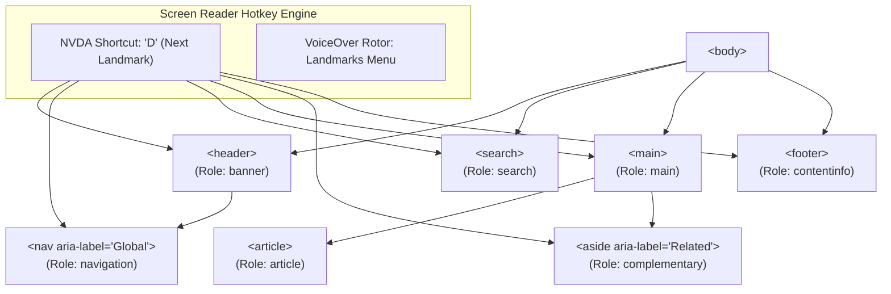

# Landmarks, Page Regions, and the `<search>` Element

| Metadata | Details |
| :--- | :--- |
| **Level** | Core / Fundamental |
| **Prerequisites** | `01-semantic-html-principles.md` |
| **Estimated Reading Time** | 25 minutes |
| **Status** | Production-Ready |
| **Baseline Status** | Widely Available (`<search>` Widely Available Oct 2023) |
| **Browsers Tested** | Chrome 120+, Firefox 120+, Safari 17+, Edge 120+ |
| **Tested With** | W3C Nu HTML Checker, Axe-core v4.8, NVDA 2023.3, VoiceOver iOS 17 |

---

## Table of Contents
- [1 What & Why](#1-what--why)
- [2 Core Concepts](#2-core-concepts)
- [3 How It Works Internally](#3-how-it-works-internally)
- [4 Syntax & Usage](#4-syntax--usage)
- [5 Practical Examples](#5-practical-examples)
- [6 Best Practices](#6-best-practices)
- [7 Common Mistakes & Pitfalls](#7-common-mistakes--pitfalls)
- [8 Performance, Accessibility, SEO & Security Notes](#8-performance-accessibility-seo--security-notes)
- [9 Comparison / When to Use What](#9-comparison--when-to-use-what)
- [10 Interview Questions](#10-interview-questions)
- [11 Practice Exercises](#11-practice-exercises)
- [12 Summary / Cheat Sheet](#12-summary--cheat-sheet)
- [13 Further Reading](#13-further-reading)

---

## 1 What & Why

A modern web application contains a rich diversity of functional zones: branding headers, primary navigation menus, global search inputs, primary document views, contextual sidebars, and legal footers. Sighted users visually parse these zones in milliseconds through spatial layouts, contrasting colors, and typographic hierarchy.

For blind and low-vision users utilizing assistive software (screen readers, refreshable braille displays), spatial layout is invisible. Without structural cues, navigating a page requires tabbing through hundreds of links sequentially.

To solve this, modern HTML defines **Landmarks and Page Regions**. Landmarks assign programmatic boundaries to major zones of a web page:
- `<header>` (Banner)
- `<nav>` (Navigation)
- `<main>` (Main Content)
- `<article>` (Self-contained Article)
- `<aside>` (Complementary Sidebar)
- `<footer>` (Content Information)
- `<search>` (Search Region - *Widely Available Oct 2023*)

Screen readers provide dedicated hotkeys (e.g., pressing `D` in NVDA/JAWS or using the VoiceOver Rotor) that allow users to leap directly between landmarks, transforming an otherwise frustrating linear experience into an efficient, structured hypermedia interface.

---

## 2 Core Concepts

### The Seven Semantic Landmarks
1. **`<header>`**: Represents introductory content for its nearest ancestor sectioning content or sectioning root. When placed as a direct child of `<body>`, it carries the implicit ARIA role **`banner`**.
2. **`<nav>`**: Represents a section of a page whose purpose is to provide navigation links, either within the current document or to other documents. Carries implicit role **`navigation`**.
3. **`<main>`**: Represents the dominant, unique content of the document `<body>`. A document must not have more than one non-hidden `<main>` element. Carries implicit role **`main`**.
4. **`<article>`**: Represents a complete, or self-contained, composition in a document, page, application, or site that is independently distributable or reusable (e.g., a forum post, magazine article, blog entry). Carries implicit role **`article`**.
5. **`<aside>`**: Represents a portion of a document whose content is tangentially related to the content around it, and which could be considered separate from that content (e.g., sidebars, callouts, related links). Carries implicit role **`complementary`**.
6. **`<footer>`**: Represents a footer for its nearest sectioning content. When placed at the root of `<body>`, it carries implicit role **`contentinfo`**.
7. **`<search>`**: Represents a container consisting of a collection of elements that form a search or filtering interface. Standardized in WHATWG and baseline supported across all engines since October 2023. Carries implicit role **`search`**.

### Sectioning Roots vs. Sectioning Content
- **Sectioning Content**: `<article>`, `<aside>`, `<nav>`, and `<section>`. These elements define scopes for child headings and local `<header>`/`<footer>` elements.
- When `<header>` and `<footer>` are nested inside an `<article>` or `<section>`, they do **not** expose global `banner` or `contentinfo` landmark roles to screen readers; they are treated as scoped local headers and footers.

### The Standardized `<search>` Element
Historically, web authors had to write `<form role="search">` or `<div role="search">` to expose a search landmark to screen readers. In 2023, the WHATWG officially standardized the native `<search>` element. It accepts any flow content (forms, search inputs, filtering controls) and provides native `role="search"` mapping in browser accessibility engines without requiring explicit ARIA attributes.

---

## 3 How It Works Internally

### Landmark Tree Construction & Screen Reader Navigation
When the browser builds the Accessibility Object Model (AOM), landmark elements are registered in a dedicated **Landmark Navigation Index**:



### The Landmark Navigation Workflow
1. A blind user visits an enterprise web portal.
2. Rather than listening to the screen reader read 40 navigation links in the header, the user presses the `D` key (or `Shift + D` to go back).
3. The screen reader immediately announces: *"Main landmark"*, jumping keyboard focus and virtual reading cursor past the header and navigation directly into the primary content.
4. If the user wants to search, they press `D` again until the screen reader announces: *"Search landmark"*, landing directly in the search input box.

---

## 4 Syntax & Usage

```html
<!DOCTYPE html>
<html lang="en">
<head>
  <meta charset="utf-8">
  <title>Complete Semantic Landmarks Pattern</title>
</head>
<body>
  <!-- 1. Banner Landmark -->
  <header>
    <a href="/" class="brand-logo">CloudScale Enterprise</a>
    
    <!-- 2. Navigation Landmark -->
    <nav aria-label="Global Directory">
      <ul>
        <li><a href="/dashboard">Dashboard</a></li>
        <li><a href="/clusters">Clusters</a></li>
      </ul>
    </nav>
  </header>

  <!-- 3. Native Search Landmark (Widely Available Oct 2023) -->
  <search>
    <form action="/search" method="get">
      <label for="site-search">Search documentation:</label>
      <input type="search" id="site-search" name="q" placeholder="e.g., Kubernetes Ingress">
      <button type="submit">Search</button>
    </form>
  </search>

  <!-- 4. Main Landmark (Single instance per page) -->
  <main id="main-content">
    <article>
      <h1>Zero-Trust Cluster Security</h1>
      <p>Mutual TLS encryption and ephemeral service mesh tokens.</p>
    </article>

    <!-- 5. Complementary Landmark -->
    <aside aria-label="Telemetry Summary">
      <h3>Active Node Health</h3>
      <p>99.998% packet delivery across all availability zones.</p>
    </aside>
  </main>

  <!-- 6. Contentinfo Landmark -->
  <footer>
    <p>&copy; 2026 CloudScale Systems Inc. &bull; <a href="/privacy">Privacy Notice</a></p>
  </footer>
</body>
</html>
```

> [!NOTE]
> **Baseline Status:**
> - `<header>`, `<nav>`, `<main>`, `<article>`, `<aside>`, and `<footer>` are **Widely Available** baseline standards.
> - `<search>` is **Widely Available** across all major engines (Chrome 118+, Safari 17.0+, Firefox 118+ since October 2023).

---

## 5 Practical Examples

### Example 1: Multi-Landmark Application Shell
```html
<!DOCTYPE html>
<html lang="en">
<head>
  <meta charset="utf-8">
  <meta name="viewport" content="width=device-width, initial-scale=1.0">
  <title>Enterprise Cloud Console</title>
</head>
<body>
  <!-- Global Top Bar -->
  <header>
    <a href="/">Console Core</a>
    
    <!-- Search Landmark inside header -->
    <search>
      <form action="/api/query" method="get">
        <label for="global-search" class="sr-only">Search resources</label>
        <input type="search" id="global-search" name="query" placeholder="Search resources, pods, or IP addresses...">
        <button type="submit">Query</button>
      </form>
    </search>

    <nav aria-label="User Account">
      <ul>
        <li><a href="/profile">Profile</a></li>
        <li><a href="/logout">Sign Out</a></li>
      </ul>
    </nav>
  </header>

  <div class="workspace-wrapper">
    <!-- Contextual Left Navigation -->
    <nav aria-label="Infrastructure Navigation">
      <h2>Resources</h2>
      <ul>
        <li><a href="/vpcs">Virtual Private Clouds</a></li>
        <li><a href="/instances" aria-current="page">Compute Instances</a></li>
        <li><a href="/volumes">Storage Disks</a></li>
      </ul>
    </nav>

    <!-- Main Workspace -->
    <main id="main-content">
      <h1>Compute Instances: US-East Region</h1>
      <p>Showing 14 active virtualization worker nodes.</p>
    </main>

    <!-- Auxiliary Inspector Sidebar -->
    <aside aria-label="Node Inspector">
      <h2>Node Details: worker-01</h2>
      <p>Instance Type: c6g.4xlarge &bull; State: Running</p>
    </aside>
  </div>

  <footer>
    <p>Console build: 2026.03-rel-11 &bull; Region: us-east-1</p>
  </footer>
</body>
</html>
```

### Example 2: Scoped `<header>` and `<footer>` Inside `<article>`
```html
<article>
  <!-- Scoped Header: Exposes NO banner role -->
  <header>
    <h2>Deep Dive into eBPF Kernel Tracing</h2>
    <p>
      Published by <a href="/author/elena">Elena Rostova</a> on
      <time datetime="2026-03-01">March 1, 2026</time>
    </p>
  </header>

  <p>
    Extended Berkeley Packet Filter (eBPF) provides sandboxed bytecode execution
    within the Linux kernel without requiring kernel module compilation.
  </p>

  <!-- Scoped Footer: Exposes NO contentinfo role -->
  <footer>
    <p>Categories: <a href="/cat/linux">Linux</a>, <a href="/cat/networking">Networking</a></p>
    <p><a href="#comments">Discuss this article (14 comments)</a></p>
  </footer>
</article>
```

### Example 3: Edge Case — Filtering Interface using `<search>`
```html
<!-- The <search> element is not restricted to text search boxes! -->
<!-- It represents ANY search or filtering interface (date pickers, dropdown facets) -->

<search aria-label="Incident Log Filtering">
  <form action="/telemetry/logs" method="get">
    <fieldset>
      <legend>Filter Incident Records</legend>

      <div>
        <label for="severity">Severity Level:</label>
        <select id="severity" name="level">
          <option value="all">All Severities</option>
          <option value="fatal">Fatal Only</option>
          <option value="error">Error &amp; Fatal</option>
          <option value="warn">Warnings</option>
        </select>
      </div>

      <div>
        <label for="timeframe">Timeframe:</label>
        <input type="date" id="timeframe" name="start_date">
      </div>

      <button type="submit">Apply Filters</button>
      <button type="reset">Reset</button>
    </fieldset>
  </form>
</search>
```

### Example 4: Failure Case — Landmark Soup and Missing Labels
```html
<!-- ANTI-PATTERN: DO NOT COPY -->

<!-- Error 1: Landmark Soup! Excessive nav elements everywhere -->
<header>
  <nav><a href="/a">A</a></nav>
  <nav><a href="/b">B</a></nav>
  <nav><a href="/c">C</a></nav> <!-- BAD: Unlabelled, fragmented nav landmarks -->
</header>

<!-- Error 2: Multiple <main> elements in single document -->
<main>
  <h1>Section 1</h1>
</main>
<main> <!-- BAD: Violates WHATWG specification (only one <main> permitted) -->
  <h1>Section 2</h1>
</main>

<!-- Error 3: Legacy redundant search role -->
<div role="search"> <!-- BAD: Use native <search> instead! -->
  <input type="text">
</div>

<!-- Screen Reader Audit Result:
VoiceOver Rotor:
- "Navigation landmark" (3 times without name)
- "Main landmark" (announced twice - invalid document structure)
-->
```

### Example 5: Production-Grade Accessible Blog Layout
```html
<!DOCTYPE html>
<html lang="en">
<head>
  <meta charset="utf-8">
  <title>Microservice Latency Optimization</title>
</head>
<body>
  <!-- Skip link targeting <main> -->
  <a href="#main-content" class="skip-link">Skip to main content</a>

  <!-- Banner -->
  <header>
    <a href="/">Engineering Insights</a>
    <nav aria-label="Site Navigation">
      <ul>
        <li><a href="/topics">Topics</a></li>
        <li><a href="/archive">Archive</a></li>
      </ul>
    </nav>
  </header>

  <!-- Main Content Area -->
  <main id="main-content" tabindex="-1">
    <article>
      <header>
        <h1>Eliminating Tail Latency in Asynchronous RPCs</h1>
        <p>Published <time datetime="2026-02-14">February 14, 2026</time></p>
      </header>

      <p>
        In high-fanout distributed architectures, 99th percentile (p99) latency
        dominates overall system responsiveness.
      </p>

      <section aria-labelledby="hedged-requests-heading">
        <h2 id="hedged-requests-heading">Hedged Requests Pattern</h2>
        <p>
          By sending duplicate requests to secondary replicas when responses
          exceed the 95th percentile delay threshold, tail latency is truncated.
        </p>
      </section>
    </article>

    <!-- Contextual Aside -->
    <aside aria-label="Author Bio">
      <h3>About the Author</h3>
      <p>Alex Rivera is a Principal Systems Architect specializing in distributed storage.</p>
    </aside>
  </main>

  <!-- Contentinfo -->
  <footer>
    <nav aria-label="Corporate Directory">
      <ul>
        <li><a href="/security">Security Policies</a></li>
        <li><a href="/contact">Contact Infrastructure Team</a></li>
      </ul>
    </nav>
    <p>&copy; 2026 Engineering Insights Inc.</p>
  </footer>
</body>
</html>
```

---

## 6 Best Practices

1. **Exactly One `<main>` Per Page**: Every HTML document must contain exactly one visible `<main>` element representing the primary subject of the page.
2. **Always Distinguish Multiple Identical Landmarks**: If you have more than one `<nav>` or `<aside>`, assign a distinct `aria-label` to each (e.g., `aria-label="Site"` vs. `aria-label="Breadcrumb"`).
3. **Use the Native `<search>` Element**: Replace legacy `<div role="search">` and `<form role="search">` containers with the standard `<search>` element across all templates.
4. **Avoid Landmark Overload ("Landmark Soup")**: Only wrap major, substantial collections of links in `<nav>`. Do not wrap single utility links, back buttons, or pagination arrows in isolated `<nav>` containers.
5. **Pair `<main>` with an Accessible Skip Link**: Always place an `<a href="#main-content">Skip to content</a>` link as the first element in `<body>` and ensure `<main id="main-content" tabindex="-1">` can receive focus cleanly.
6. **Use `<aside>` Only for Tangential Material**: Do not use `<aside>` for primary navigation bars or essential articles. Reserve it for glossary definitions, related reading lists, advertising blocks, or author biographies.

---

## 7 Common Mistakes & Pitfalls

| Mistake | Bad Code | Good Code | Technical Explanation |
| :--- | :--- | :--- | :--- |
| **Multiple Visible `<main>`s** | `<main>...</main><main>...</main>` | Single `<main id="main-content">` | Violates HTML specification and WCAG 1.3.1. Only one non-hidden `<main>` is permitted. |
| **Legacy `role="search"`** | `<div role="search"><input ...></div>` | `<search><form ...>...</form></search>` | `<search>` is now a baseline native HTML element. Native tags supersede ARIA hacks. |
| **Unlabelled Navigation Bars** | `<nav>...</nav><nav>...</nav>` | `<nav aria-label="Primary">...<nav aria-label="Legal">...` | Screen reader announces "Navigation" repeatedly with zero differentiation. |
| **Overuse of `<nav>` for Single Links** | `<nav><a href="/back">Back</a></nav>` | `<a href="/back">Back</a>` | Clutters the screen reader landmark index with meaningless, tiny navigation stops. |
| **Using `<aside>` for Main Content** | `<aside class="article-body">` | `<main><article>...</article></main>` | Assistive technologies categorize `complementary` as secondary/skippable information. |
| **Nesting Landmarks inside `<aside>` without Context** | `<aside><main>...</main></aside>` | `<main>` must not be nested inside `<aside>` | `<main>` cannot be a descendant of `<aside>`, `<article>`, `<header>`, or `<footer>`. |

---

## 8 Performance, Accessibility, SEO & Security Notes

### Accessibility (WCAG 2.2 AA)
- **Criterion 1.3.1 (Info and Relationships - Level A)**: Regional boundaries must be programmatically exposed. Landmarks provide native regional segmentation.
- **Criterion 2.4.1 (Bypass Blocks - Level A)**: Landmarks allow screen reader users to bypass repeated navigation headers with a single keystroke (`D` key in NVDA/JAWS), satisfying bypass requirements even when skip links are absent.
- **VoiceOver Rotor Support**: On iOS and macOS, VoiceOver includes a dedicated "Landmarks" rotor dial, allowing swipe-based jumping between `<header>`, `<nav>`, `<main>`, `<search>`, and `<footer>`.

### Search Engine Optimization (SEO)
- Search engines parse `<main>` and `<article>` to identify the core topic and primary keywords for search snippet generation.
- Content enclosed in `<aside>` is recognized as secondary and does not dilute the thematic density of the primary `<article>`.

### Performance & Memory
- Native landmark elements incur zero runtime JavaScript memory overhead. In contrast, complex client-side skip-navigation scripts and custom focus-trapping libraries consume memory and main-thread processing cycles.

### Security Notes
- Content security policies should isolate user-generated comments within distinct `<article>` or `<section>` tags so that content sanitizers can apply strict sanitization rules without affecting trusted header/footer regions.

---

## 9 Comparison / When to Use What

| HTML Element | Implicit ARIA Role | Scope / Position | When to Use |
| :--- | :--- | :--- | :--- |
| `<header>` | `banner` (at body root) | Top of page or article | Brand logo, site title, global search bar. |
| `<nav>` | `navigation` | Inside header, sidebar, footer | Collections of 3+ related navigational links. |
| `<main>` | `main` | Direct child of `<body>` | The central topic of the document (once per route). |
| `<search>` | `search` | Any valid container | Search forms, filter bars, facet controls. |
| `<article>` | `article` | Inside main, feed, or root | Self-contained, independently syndicatable content. |
| `<aside>` | `complementary` | Next to article or inside main | Related articles, callout notes, author bios. |
| `<footer>` | `contentinfo` (at body root) | Bottom of page or article | Copyright, legal links, disclaimers, sitemaps. |

---

## 10 Interview Questions

<details>
<summary><strong>1. What is the newly standardized `<search>` element, and how does it replace historical ARIA patterns?</strong></summary>

**Answer:**
Standardized in the WHATWG HTML Living Standard in 2023 and achieving Baseline Widely Available status in October 2023 (supported in Chrome 118+, Safari 17+, Firefox 118+), `<search>` represents a dedicated container for search and filtering capabilities.

**Historical Pattern**:
Historically, HTML lacked a dedicated search element. Developers had to use ARIA role attributes:
`<form role="search">` or `<div role="search">`
to expose a search landmark to the Accessibility Object Model.

**Modern Standard**:
`<search>` provides native `role="search"` mapping directly in browser C++ engines without requiring explicit ARIA attributes:
```html
<search>
  <form action="/search" method="get">
    <input type="search" name="q">
    <button type="submit">Search</button>
  </form>
</search>
```
It can encompass text search bars, filtering facets, dropdown filters, or database search controls.
</details>

<details>
<summary><strong>2. Can an HTML document contain more than one `<main>` element?</strong></summary>

**Answer:**
Under the WHATWG HTML specification, an HTML document **must not have more than one `<main>` element** that is visible. 

The only exception permitted by the specification is if all additional `<main>` elements have the `hidden` attribute applied (for example, in a Single-Page Application where inactive views are pre-rendered in the DOM with `hidden` and toggled via JavaScript). At any given moment, exactly **one** visible `<main>` element must be exposed to the Accessibility Object Model.
</details>

<details>
<summary><strong>3. When does a `<header>` element NOT carry the ARIA `banner` role?</strong></summary>

**Answer:**
A `<header>` element maps to `role="banner"` **only when it is a direct child of the `<body>` element** (i.e., when its nearest ancestor is the document body).

If a `<header>` element is nested inside sectioning content (`<article>`, `<section>`, `<aside>`, or `<nav>`), it represents the introductory header for that *specific sub-component*. In this nested context, the browser engine does **not** assign it the `banner` landmark role; it maps to a generic structural role in the AOM to prevent confusing screen reader users with multiple global banner landmarks.
</details>

<details>
<summary><strong>4. How do screen readers like NVDA and JAWS facilitate navigation using landmarks?</strong></summary>

**Answer:**
Screen readers implement dedicated single-letter navigation shortcut keys:
- **NVDA / JAWS**: Pressing `D` jumps forward to the next landmark region on the page; `Shift + D` jumps backward to the previous landmark.
- **NVDA Elements List (`Insert + F7`)**: Users can open the Landmarks modal, which lists every landmark on the page along with its accessible name (e.g., *"banner"*, *"Primary Site Navigation"*, *"main"*, *"search"*), allowing instant teleportation to any region.
- **VoiceOver (macOS / iOS)**: Users rotate the two-finger Rotor to "Landmarks" and flick up/down to browse through landmarks.
</details>

<details>
<summary><strong>5. Why is wrapping single navigational links inside `<nav>` elements considered an accessibility anti-pattern?</strong></summary>

**Answer:**
This anti-pattern is known as **"Landmark Soup"**. Screen readers treat every `<nav>` element as a major landmark stop. If an author wraps single utility links (like "Back to top", a "Cancel" button, or an individual breadcrumb step) in separate `<nav>` containers, the landmark list becomes cluttered with dozens of trivial entries. 

Landmarks should only be used for major, substantial navigation regions (such as site-wide headers, sidebar tables of contents, or primary footer links).
</details>

<details>
<summary><strong>6. What is the semantic difference between `<aside>` and `<section>`?</strong></summary>

**Answer:**
- **`<section>`**: Represents a generic, thematic grouping of content that forms an integral part of the primary narrative or document flow. A `<section>` must have an associated heading and directly contributes to the document's outline.
- **`<aside>`**: Represents content that is **tangentially related** to the primary content around it, and which could be removed or placed in an appendix without altering the primary document's rhetorical meaning (e.g., callout boxes, related article sidebars, author biographies, glossaries). In the AOM, `<aside>` exposes `role="complementary"`.
</details>

<details>
<summary><strong>7. How should you label a `<search>` landmark when multiple search bars exist on a page?</strong></summary>

**Answer:**
If a page contains multiple search interfaces (for example, a global site-wide search in the header and a specific table-filtering search in the main content area), each `<search>` element should be distinguished using `aria-label`:
```html
<header>
  <search aria-label="Site-wide Search">...</search>
</header>
<main>
  <search aria-label="Filter Cluster Logs">...</search>
</main>
```
Screen readers will announce *"Site-wide Search landmark"* and *"Filter Cluster Logs Search landmark"*, preventing user confusion.
</details>

<details>
<summary><strong>8. Can `<main>` be nested inside an `<article>` or `<section>`?</strong></summary>

**Answer:**
**No.** According to the WHATWG specification, the `<main>` element must not be a descendant of `<article>`, `<aside>`, `<footer>`, `<header>`, or `<nav>`. It represents the top-level container for the primary document content and must reside directly within `<body>` (or inside non-semantic `<div>` layout wrappers).
</details>

---

## 11 Practice Exercises

### Exercise 1 (Easy): Identify Missing Accessible Labels
**Task**: In the following snippet, identify why the navigation landmarks are problematic for screen readers and fix them.

```html
<header>
  <nav>
    <a href="/">Home</a>
    <a href="/products">Products</a>
  </nav>
</header>
<footer>
  <nav>
    <a href="/terms">Terms</a>
    <a href="/privacy">Privacy</a>
  </nav>
</footer>
```

<details>
<summary><strong>Solution</strong></summary>

```html
<header>
  <nav aria-label="Primary Site">
    <ul>
      <li><a href="/">Home</a></li>
      <li><a href="/products">Products</a></li>
    </ul>
  </nav>
</header>
<footer>
  <nav aria-label="Legal">
    <ul>
      <li><a href="/terms">Terms</a></li>
      <li><a href="/privacy">Privacy</a></li>
    </ul>
  </nav>
</footer>
```
*Explanation*: Adding `aria-label="Primary Site"` and `aria-label="Legal"` ensures screen readers announce the exact purpose of each navigation landmark.
</details>

### Exercise 2 (Easy): Implement the Modern `<search>` Element
**Task**: Convert this legacy search form into modern HTML using the native `<search>` element.
`<div role="search"><form action="/find"><input type="text" name="query"><button>Go</button></form></div>`

<details>
<summary><strong>Solution</strong></summary>

```html
<search>
  <form action="/find" method="get">
    <label for="search-input">Search records:</label>
    <input type="search" id="search-input" name="query">
    <button type="submit">Go</button>
  </form>
</search>
```
*Explanation*: The generic `<div>` with `role="search"` is replaced with the native `<search>` element, and a semantic `<label>` and `type="search"` are applied for complete accessibility.
</details>

### Exercise 3 (Medium): Complex Multi-Region Portal Architecture
**Task**: Author the high-level semantic layout skeleton for an enterprise cloud administration dashboard containing:
1. Top branding banner with user navigation.
2. Global search bar.
3. Left-hand resource tree navigation.
4. Main document view with an article and an aside.
5. Footer with legal links.

<details>
<summary><strong>Solution</strong></summary>

```html
<!DOCTYPE html>
<html lang="en">
<head>
  <meta charset="utf-8">
  <title>Enterprise Portal Skeleton</title>
</head>
<body>
  <header>
    <a href="/">CloudOS</a>
    <nav aria-label="Account">
      <ul><li><a href="/settings">Settings</a></li></ul>
    </nav>
  </header>

  <search aria-label="Global Resource Search">
    <form action="/search" method="get">
      <input type="search" name="q" placeholder="Search clusters...">
    </form>
  </search>

  <div class="layout-body">
    <nav aria-label="Resource Hierarchy">
      <h2>Resources</h2>
      <ul><li><a href="/clusters">Clusters</a></li></ul>
    </nav>

    <main id="main-content">
      <article>
        <h1>Cluster: East-US-01</h1>
        <p>Operational status is normal.</p>
      </article>

      <aside aria-label="Cluster Quick Stats">
        <h3>Live IOPS</h3>
        <p>12,450 IOPS</p>
      </aside>
    </main>
  </div>

  <footer>
    <p>&copy; 2026 CloudOS Enterprise</p>
  </footer>
</body>
</html>
```
</details>

### Exercise 4 (Medium): Refactor Landmark Nesting Violations
**Task**: Inspect this invalid snippet and rewrite it to conform strictly to WHATWG landmark hierarchy rules.

```html
<!-- Flawed Source -->
<article>
  <main>
    <h1>Article Title</h1>
    <p>Content goes here.</p>
  </main>
</article>
```

<details>
<summary><strong>Solution</strong></summary>

```html
<!-- Corrected Source: <main> wraps <article>, NEVER vice versa -->
<main id="main-content">
  <article>
    <h1>Article Title</h1>
    <p>Content goes here.</p>
  </article>
</main>
```
*Explanation*: `<main>` represents the primary topic container of the document and cannot be a descendant of `<article>`. The correct hierarchy places `<article>` inside `<main>`.
</details>

### Exercise 5 (Hard): Implement an Accessible Faceted Filter Sidebar
**Task**: Build a complete, accessible product filtering sidebar for an e-commerce platform using the `<search>` element, semantic fieldsets, and clear labeling.

<details>
<summary><strong>Solution</strong></summary>

```html
<search aria-label="Product Catalog Filter">
  <form action="/products" method="get">
    <h2>Filter Catalog</h2>

    <fieldset>
      <legend>Processor Architecture</legend>
      <div>
        <input type="checkbox" id="arch-x86" name="arch" value="x86_64">
        <label for="arch-x86">x86_64 (Intel / AMD)</label>
      </div>
      <div>
        <input type="checkbox" id="arch-arm" name="arch" value="arm64">
        <label for="arch-arm">ARM64 (Ampere / Graviton)</label>
      </div>
    </fieldset>

    <fieldset>
      <legend>Minimum RAM</legend>
      <label for="min-ram">Capacity (GB):</label>
      <input type="number" id="min-ram" name="min_ram" min="16" max="512" step="16" value="32">
    </fieldset>

    <button type="submit">Apply Filter</button>
    <button type="reset">Clear All</button>
  </form>
</search>
```
</details>

### Exercise 6 (Hard): Audit and Correct 6 Landmark Failures
**Task**: Find and remediate all 6 architectural landmark bugs in this production page:

```html
<!-- Flawed Source -->
<div id="header">
  <nav>Home</nav>
</div>
<div id="main">
  <div class="search-box" role="search">
    <input type="text">
  </div>
  <aside>
    <main>
      <h1>Sub Title</h1>
    </main>
  </aside>
</div>
<div id="footer">
  <nav>Terms</nav>
</div>
```

<details>
<summary><strong>Solution</strong></summary>

```html
<!-- Fully Remediated Semantic Layout -->
<header>
  <nav aria-label="Site Navigation">
    <ul><li><a href="/">Home</a></li></ul>
  </nav>
</header>

<main id="main-content">
  <search>
    <form action="/search" method="get">
      <label for="q">Search:</label>
      <input type="search" id="q" name="q">
      <button type="submit">Submit</button>
    </form>
  </search>

  <article>
    <h1>Primary Document Title</h1>
    <p>Main content prose goes here.</p>
  </article>

  <aside aria-label="Supplementary Information">
    <h2>Related Details</h2>
    <p>Sidebar notes.</p>
  </aside>
</main>

<footer>
  <nav aria-label="Legal Directory">
    <ul><li><a href="/terms">Terms</a></li></ul>
  </nav>
</footer>
```
*Explanation of Remediations*:
1. `<div id="header">` replaced with native `<header>`.
2. Both `<nav>` elements given explicit, unique `aria-label` tags and proper `<ul><li><a>` markup.
3. `<div role="search">` modernized to native `<search>` with `<form>` and accessible `<label>`.
4. Extraneous nested `<main>` inside `<aside>` removed; single top-level `<main>` implemented.
5. `<aside>` properly positioned adjacent to primary content with an `aria-label`.
6. `<div id="footer">` replaced with native `<footer>`.
</details>

---

## 12 Summary / Cheat Sheet

```
┌────────────────────────────────────────────────────────────────────────┐
│                        PAGE LANDMARKS CHEAT SHEET                      │
├───────────────┬────────────────────────────┬───────────────────────────┤
│ Element       │ Implicit ARIA Role         │ Key Placement Rule        │
├───────────────┼────────────────────────────┼───────────────────────────┤
│ <header>      │ banner                     │ Direct child of <body>    │
│ <nav>         │ navigation                 │ Must label if >1 on page  │
│ <main>        │ main                       │ Exactly 1 visible per page│
│ <search>      │ search (Baseline 2023)     │ Search & filter forms     │
│ <article>     │ article                    │ Independent, reusable unit│
│ <aside>       │ complementary              │ Tangential to main flow   │
│ <footer>      │ contentinfo                │ Direct child of <body>    │
└───────────────┴────────────────────────────┴───────────────────────────┘
```

---

## 13 Further Reading

- [WHATWG HTML Living Standard: Section 4.3.11 The &lt;search&gt; Element](https://html.spec.whatwg.org/multipage/grouping-content.html#the-search-element)
- [W3C WAI: ARIA Landmark Roles Overview](https://www.w3.org/WAI/ARIA/apg/practices/landmark-regions/)
- [MDN Web Docs: The &lt;search&gt; Element](https://developer.mozilla.org/en-US/docs/Web/HTML/Element/search)
- [Scott O'Hara: The Search Element](https://www.scottohara.me/blog/2023/03/27/search-element.html)
- [Smashing Magazine: How To Use ARIA Landmarks In HTML](https://www.smashingmagazine.com/2020/01/html5-landmarks-accessibility/)

---

| [Previous: 01 Semantic HTML Principles](01-semantic-html-principles.md) | [Section Index](README.md) | [Next: 03 Headings & Document Outline](03-headings-and-document-outline.md) |
