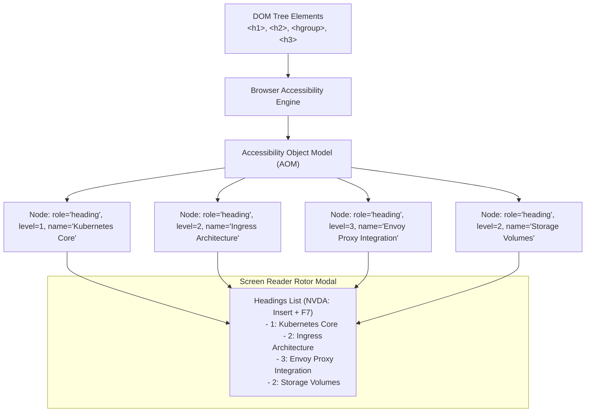

# Headings, Document Outline, and the `<hgroup>` Element

| Metadata | Details |
| :--- | :--- |
| **Level** | Core / Fundamental |
| **Prerequisites** | `02-landmarks-and-page-regions.md` |
| **Estimated Reading Time** | 25 minutes |
| **Status** | Production-Ready |
| **Baseline Status** | Widely Available across all modern browsers |
| **Browsers Tested** | Chrome 120+, Firefox 120+, Safari 17+, Edge 120+ |
| **Tested With** | W3C Nu HTML Checker, Axe-core v4.8, NVDA 2023.3, VoiceOver macOS Sonoma |

---

## Table of Contents
- [1 What & Why](#1-what--why)
- [2 Core Concepts](#2-core-concepts)
- [3 How It Works Internally](#3-how-it-works-internally)
- [4 Syntax & Usage](#4-syntax--usage)
- [5 Practical Examples](#5-practical-examples)
- [6 Best Practices](#6-best-practices)
- [7 Common Mistakes & Pitfalls](#7-common-mistakes--pitfalls)
- [8 Performance, Accessibility, SEO & Security Notes](#8-performance-accessibility-seo--security-notes)
- [9 Comparison / When to Use What](#9-comparison--when-to-use-what)
- [10 Interview Questions](#10-interview-questions)
- [11 Practice Exercises](#11-practice-exercises)
- [12 Summary / Cheat Sheet](#12-summary--cheat-sheet)
- [13 Further Reading](#13-further-reading)

---

## 1 What & Why

Headings are the primary cognitive navigation system of the World Wide Web. When sighted readers look at a technical manual, blog post, or dashboard, they do not read every word linearly from top to bottom; they scan the large headings to locate the specific section of interest.

For blind and visually impaired users navigating via screen readers, headings are even more critical. Over **75% of screen reader users** report using heading shortcut keys as their primary method to explore unfamiliar web pages. A page with a well-structured heading outline allows an assistive technology user to grasp the entire table of contents of a page in under thirty seconds.

However, the web development community historically suffered from widespread confusion surrounding the **HTML5 Document Outline Algorithm**—a theoretical specification that envisioned nesting multiple `<h1>` elements inside sectioning containers (`<section>`, `<article>`) and having the browser engine automatically calculate heading depth. Because **no browser engine or assistive software ever implemented this algorithm**, treating it as reality resulted in broken accessibility outlines.

Understanding modern headings requires mastering the single `<h1>` hierarchy, the modernized `<hgroup>` element for subtitles, and screen reader outline navigation.

---

## 2 Core Concepts

### The Six Heading Ranks (`<h1>` to `<h6>`)
HTML defines six levels of section headings:
- `<h1>`: The primary subject of the document. Best practice mandates exactly **one logical `<h1>` per route or page**.
- `<h2>`: The major structural divisions of the primary subject.
- `<h3>`: Subsections belonging to the preceding `<h2>`.
- `<h4>`–`<h6>`: Deeper structural tiers nested sequentially under their parent levels.

Each heading tag communicates an implicit ARIA role of `heading` and an explicit integer property `aria-level` corresponding to its number (`1` through `6`).

### The Fall of the HTML5 Document Outline Algorithm
In the early days of HTML5, the specification proposed an automated outline algorithm:
```html
<!-- THE THEORETICAL (AND DEAD) OUTLINE ALGORITHM -->
<body>
  <h1>Page Title</h1>
  <section>
    <h1>This was supposed to become Level 2 automatically</h1>
    <section>
      <h1>This was supposed to become Level 3 automatically</h1>
    </section>
  </section>
</body>
```
The intention was that web components could be authored using `<h1>` internally and nested anywhere without worrying about heading depth.

**The Reality**: Browser makers and assistive technology vendors never implemented the algorithm. Screen readers continued to inspect the literal numerical tag (`h1` announced as "Heading level 1"). As a result, pages authoring multiple `<h1>`s produced flat, disorienting accessibility trees with 10 different top-level headings. The W3C and WHATWG officially declared the HTML5 Outline Algorithm dead and updated the specification to mandate literal numerical heading nesting (`<h1>` $\to$ `<h2>` $\to$ `<h3>`).

### Subtitles, Kickers, and the Modernized `<hgroup>` Element
Subtitles and taglines represent a classic typographic dilemma: developers frequently used `<h2>` immediately following an `<h1>` to display a subtitle:
```html
<h1>Mastering Distributed Systems</h1>
<h2>The Definitive Architectural Guide</h2>
```
This corrupts the document outline by creating a phantom level-2 section that has no content of its own!

The modern HTML Living Standard resolved this by redefining the **`<hgroup>`** element:
- An `<hgroup>` groups a single heading (`<h1>`–`<h6>`) with one or more accompanying `<p>` elements representing subtitles, taglines, or kickers.
- In modern accessibility mappings, the `<p>` inside `<hgroup>` is associated with the heading without generating extraneous phantom outline nodes!

---

## 3 How It Works Internally

### Screen Reader Heading Extraction Pipeline
When a screen reader user opens a webpage, the assistive software queries the browser's Accessibility Object Model (AOM) to construct a virtual **Headings Table of Contents**:



### Keyboard Navigation Mechanics
Screen readers provide direct single-key navigation:
- `H`: Jumps to the next heading of **any** level on the page.
- `Shift + H`: Jumps to the previous heading.
- `1` through `6`: Jumps directly to the next heading of that specific numeric rank (e.g., pressing `2` jumps to the next `<h2>`, skipping over all `<h3>` and `<h4>` children).

If an author skips heading ranks (e.g., jumping from `<h1>` directly to `<h4>`), the user pressing `2` will completely miss that section of the document!

---

## 4 Syntax & Usage

```html
<!DOCTYPE html>
<html lang="en">
<head>
  <meta charset="utf-8">
  <title>Clean Heading Architecture</title>
</head>
<body>
  <header>
    <!-- Modern <hgroup> with kicker, main title, and subtitle -->
    <hgroup>
      <p class="kicker">Systems Engineering &bull; Architecture</p>
      <h1>High-Throughput Stream Ingestion</h1>
      <p class="subtitle">Architecting sub-millisecond pipelines at petabyte scale</p>
    </hgroup>
  </header>

  <main id="main-content">
    <!-- Major Section (Level 2) -->
    <section aria-labelledby="partition-heading">
      <h2 id="partition-heading">1. Topic Partitioning Foundations</h2>
      <p>Data ordering guarantees are preserved strictly per partition.</p>

      <!-- Subsection (Level 3) -->
      <section aria-labelledby="hashing-heading">
        <h3 id="hashing-heading">1.1 Consistent Hashing Topologies</h3>
        <p>Minimizing key remapping during cluster node resizing.</p>
      </section>
    </section>

    <!-- Next Major Section (Level 2) -->
    <section aria-labelledby="failover-heading">
      <h2 id="failover-heading">2. Zero-Downtime Rebalancing</h2>
      <p>Dynamic replica synchronization across availability zones.</p>
    </section>
  </main>
</body>
</html>
```

> [!NOTE]
> **Baseline Status: Widely Available**
> The heading elements `<h1>` through `<h6>` are universally supported baseline features. The updated `<hgroup>` specification permitting child `<p>` elements for subheadings is supported across all modern browsers (Chrome 107+, Safari 16.4+, Firefox 115+).

---

## 5 Practical Examples

### Example 1: Accessible Technical Blog Post with Multi-Tier Outlines
```html
<article>
  <header>
    <hgroup>
      <p class="post-category">Database Internals</p>
      <h1>Log-Structured Merge-Trees Explained</h1>
      <p class="post-tagline">Why modern write-heavy storage engines reject in-place B-Trees</p>
    </hgroup>
    <p>Published on <time datetime="2026-03-12">March 12, 2026</time></p>
  </header>

  <section aria-labelledby="write-path-title">
    <h2 id="write-path-title">1. The Write Path</h2>
    <p>All incoming mutations are appended sequentially to a write-ahead log (WAL).</p>

    <section aria-labelledby="memtable-title">
      <h3 id="memtable-title">1.1 Memtable In-Memory Buffers</h3>
      <p>Writes are buffered in memory using concurrent skip-lists.</p>
    </section>

    <section aria-labelledby="flush-title">
      <h3 id="flush-title">1.2 Immutable SSTable Flushes</h3>
      <p>When buffers fill, sequential disk blocks are persisted immutably.</p>
    </section>
  </section>

  <section aria-labelledby="compaction-title">
    <h2 id="compaction-title">2. Compaction Strategies</h2>
    <p>Background threads merge overlapping SSTables to reclaim disk space.</p>
  </section>
</article>
```

### Example 2: Scoping Section Headings via `aria-labelledby`
```html
<!-- Pairing sections with their headings via aria-labelledby creates -->
<!-- officially named regions in the Accessibility Object Model -->

<main>
  <h1>Infrastructure Control Plane</h1>

  <section aria-labelledby="cluster-health-title">
    <h2 id="cluster-health-title">Cluster Health Overview</h2>
    <p>All 48 node pools report healthy heartbeats.</p>
  </section>

  <section aria-labelledby="audit-logs-title">
    <h2 id="audit-logs-title">Administrative Audit Logs</h2>
    <p>Showing past 24 hours of privilege escalation requests.</p>
  </section>
</main>
```

### Example 3: Edge Case — Heading Containing an Image or Interactive Link
```html
<!-- Case A: Image inside heading MUST have descriptive alt text -->
<!-- If alt is empty, the screen reader announces "Empty Heading Level 1" -->
<h1>
  
</h1>

<!-- Case B: Link inside heading -->
<!-- The link must wrap INSIDE the heading, NOT vice versa! -->
<!-- Good: <h2><a href="...">Title</a></h2> -->
<!-- Bad:  <a href="..."><h2>Title</h2></a> -->
<article class="feed-entry">
  <h2>
    <a href="/posts/raft-consensus">Understanding Raft Consensus In-Depth</a>
  </h2>
  <p>An accessible walkthrough of cluster leader elections.</p>
</article>
```

### Example 4: Failure Case — Broken Outlines and Visual Heading Selection
```html
<!-- ANTI-PATTERN: DO NOT COPY -->

<!-- Error 1: Multiple top-level <h1> elements creating a flat, chaotic outline -->
<h1>Acme Corp</h1>
<h1>Product Catalog</h1>
<h1>Special Promotions</h1>

<!-- Error 2: Skipping heading ranks purely to get smaller CSS default font size -->
<h1>System Overview</h1>
<h4>Hardware Specifications</h4> <!-- BAD: Skipped from 1 to 4! -->

<!-- Error 3: Fake headings built from styled bold text -->
<p><strong style="font-size: 24px;">Security Policies</strong></p> <!-- Completely absent from AOM! -->

<!-- Screen Reader Audit Result:
VoiceOver Rotor:
- Alert: Skipped heading level from 1 to 4.
- "Security Policies" is completely missing from the headings list modal!
-->
```

### Example 5: Production-Grade Documentation Layout with Navigational Headings
```html
<!DOCTYPE html>
<html lang="en">
<head>
  <meta charset="utf-8">
  <meta name="viewport" content="width=device-width, initial-scale=1.0">
  <title>Kafka Ingress Architecture - CloudScale Docs</title>
  <style>
    body { font-family: system-ui, -apple-system, sans-serif; line-height: 1.6; padding: 2rem; }
    hgroup .kicker { text-transform: uppercase; font-size: 0.8rem; font-weight: 700; color: #2563eb; margin: 0; }
    hgroup h1 { font-size: 2.25rem; margin: 0.25rem 0; }
    hgroup .subtitle { font-size: 1.15rem; color: #4b5563; margin-top: 0; }
    .sr-only { position: absolute; width: 1px; height: 1px; padding: 0; margin: -1px; overflow: hidden; clip: rect(0, 0, 0, 0); border: 0; }
  </style>
</head>
<body>
  <header>
    <a href="/">CloudScale Documentation</a>
    <!-- Accessible hidden heading to identify navigation regions -->
    <nav aria-labelledby="site-nav-heading">
      <h2 id="site-nav-heading" class="sr-only">Site Directory</h2>
      <ul>
        <li><a href="/guides">Guides</a></li>
        <li><a href="/api">API Reference</a></li>
      </ul>
    </nav>
  </header>

  <main id="main-content">
    <article>
      <header>
        <hgroup>
          <p class="kicker">Telemetry Core</p>
          <h1>Kafka Ingress Gateway Topology</h1>
          <p class="subtitle">Distributed stream ingestion pipeline specification</p>
        </hgroup>
      </header>

      <section aria-labelledby="sec-ingest">
        <h2 id="sec-ingest">1. Ingress Tier Architecture</h2>
        <p>Traffic passes through layer-4 Network Load Balancers into Envoy proxies.</p>

        <section aria-labelledby="sec-buffering">
          <h3 id="sec-buffering">1.1 Disk Buffering Mechanism</h3>
          <p>Local NVMe disks prevent data loss during broker backpressure events.</p>
        </section>
      </section>

      <section aria-labelledby="sec-failover">
        <h2 id="sec-failover">2. Automatic Failover Procedures</h2>
        <p>Active health checks detect partitions within 500 milliseconds.</p>
      </section>
    </article>
  </main>

  <footer>
    <p>&copy; 2026 CloudScale Systems Inc.</p>
  </footer>
</body>
</html>
```

---

## 6 Best Practices

1. **Maintain Exactly One `<h1>` Per Route**: Every document should possess a single `<h1>` representing the title or primary topic of that specific URL route.
2. **Never Skip Heading Levels Downward**: Progress strictly sequentially (`<h1>` $\to$ `<h2>` $\to$ `<h3>`). Never jump from `<h2>` directly to `<h4>`. (Stepping upward, such as `<h3>` back to `<h2>`, is normal when starting a new major section).
3. **Use CSS for Font Sizing, Never Heading Tags**: Never select an `<h4>` because you want a 16px font. Use the semantically correct heading level (`<h2>`) and style it using CSS (`font-size: 1rem;`).
4. **Use `<hgroup>` for Subtitles**: Group titles with subtitles or taglines using `<hgroup>` containing `<h1>` and `<p class="subtitle">` to avoid polluting the heading outline with phantom level-2 entries.
5. **Always Place Anchor Tags Inside Headings**: When linking section titles, wrap the `<a>` inside the `<h2>` (`<h2><a href="...">Title</a></h2>`). Wrapping a block-level heading inside an anchor creates confusing focus boxes.
6. **Provide Accessible Hidden Headings for Landmarks**: When constructing navigation sidebars or footers without visible titles, include an accessible hidden heading (`<h2 class="sr-only">Navigation</h2>`) to give screen reader users clear outline landmarks.

---

## 7 Common Mistakes & Pitfalls

| Mistake | Bad Code | Good Code | Technical Explanation |
| :--- | :--- | :--- | :--- |
| **Skipping Heading Ranks** | `<h1>Title</h1><h3>Section</h3>` | `<h1>Title</h1><h2>Section</h2>` | Screen reader users navigating by level 2 headings miss the section entirely (violates WCAG 1.3.1). |
| **Subtitle as `<h2>`** | `<h1>Title</h1><h2>Subtitle</h2>` | `<hgroup><h1>Title</h1><p>Subtitle</p></hgroup>` | An immediate `<h2>` creates an empty phantom section in the screen reader table of contents. |
| **Multiple Unstructured `<h1>`s** | 5 `<h1>` tags scattered across page | Single `<h1>`, followed by `<h2>` sections | Flattens the document outline, making the page appear as 5 unrelated documents. |
| **Visual Fake Headings** | `<p class="heading-text">Title</p>` | `<h2>Title</h2>` | Text formatted via CSS bold/size is completely invisible to screen reader heading navigation (`H` key). |
| **Empty Headings** | `<h2></h2>` | `<h2> Text</h2>` | Screen readers announce "Heading level 2, blank", disorienting blind users. |
| **Wrapping Headings with Anchors** | `<a href="..."><h2>Title</h2></a>` | `<h2><a href="...">Title</a></h2>` | Violates traditional phrasing content models and results in abnormal focus bounding box highlights. |

---

## 8 Performance, Accessibility, SEO & Security Notes

### Accessibility (WCAG 2.2 AA)
- **Criterion 1.3.1 (Info and Relationships - Level A)**: Structural hierarchy conveyed visually through typography must be programmatically determinable via heading elements (`<h1>`–`<h6>`).
- **Criterion 2.4.6 (Headings and Labels - Level AA)**: Headings and labels must describe topic or purpose clearly.
- **Criterion 2.4.10 (Section Headings - Level AAA)**: Section headings are used to organize content logically.
- Screen readers (NVDA, JAWS, VoiceOver) construct a dedicated interactive Table of Contents from headings. Well-architected heading trees allow non-sighted users to scan large documents in seconds.

### Search Engine Optimization (SEO)
- Search engine spiders (Googlebot) parse `<h1>` as the authoritative primary title signal for page relevance.
- Sub-headings (`<h2>` and `<h3>`) provide semantic contextual clustering, which Google algorithms use to generate **Featured Snippets** and indexed section jump links on search engine result pages (SERPs).
- Fake headings (`<div class="h2">`) deprive search bots of semantic section hierarchy.

### Performance & DOM Simplicity
- Native heading tags have negligible layout overhead. However, deeply nested heading structures inside dozens of redundant container elements inflate DOM tree depth, increasing style recalculation costs during reflow cycles.

### Security Notes
- When rendering user-submitted article titles, always escape HTML characters (`&`, `<`, `>`) before outputting into headings. Never execute `headingElement.innerHTML = userTitle` to prevent stored Cross-Site Scripting (XSS).

---

## 9 Comparison / When to Use What

| Element Pattern | AOM Representation | Outline Contribution | When to Use |
| :--- | :--- | :--- | :--- |
| `<h1>` | Role: `heading`, Level: 1 | Root / Document Topic | Single primary title per web page. |
| `<h2>` | Role: `heading`, Level: 2 | Major Section Node | Major sections directly under the `<h1>`. |
| `<h3>`–`<h6>` | Role: `heading`, Level: 3–6 | Nested Sub-section Nodes | Sub-sections nested inside preceding parent rank. |
| `<hgroup>` | Structural Grouping Wrapper | Excludes child `<p>` from outline | Grouping a heading with subtitles or kickers. |
| `<p class="kicker">` | Role: `paragraph` / `text` | None | Category labels placed immediately above headings. |
| `<span class="bold">` | Role: `generic` | None | Visual emphasis inside a sentence (NOT for headings). |

---

## 10 Interview Questions

<details>
<summary><strong>1. Why did the HTML5 Document Outline Algorithm fail to achieve industry adoption, and what is the current standard recommendation?</strong></summary>

**Answer:**
The HTML5 Document Outline Algorithm was a theoretical concept introduced in early HTML5 drafts. It proposed that nesting `<h1>` tags inside sectioning containers (`<section>`, `<article>`, `<aside>`, `<nav>`) would allow the browser engine to automatically compute the heading level based on the nesting depth (e.g., an `<h1>` inside a `<section>` would automatically behave as an `<h2>`).

**Why It Failed**:
1. **Zero Browser Implementation**: No major browser engine (Blink, Gecko, WebKit) ever implemented the algorithm in their accessibility tree mappers.
2. **Screen Reader Failure**: Assistive software continued to rely entirely on the literal numerical rank of the tag (`<h1>` through `<h6>`). Consequently, sites authored using multiple `<h1>` elements presented a completely flat, disorienting accessibility tree where every section was announced as a top-level document.

**Current Recommendation**:
Both the WHATWG HTML Living Standard and W3C WAI officially abandoned the outline algorithm. The current mandatory practice is to author **literal numerical headings** (`<h1>` through `<h6>`) in an unbroken descending hierarchy, maintaining a single logical `<h1>` per page.
</details>

<details>
<summary><strong>2. What is the semantic role of the `<hgroup>` element under the modern HTML Living Standard?</strong></summary>

**Answer:**
Under the modernized HTML Living Standard specification, `<hgroup>` represents a heading grouping mechanism used to associate a heading (`<h1>`–`<h6>`) with one or more supplementary paragraphs (`<p>`) representing **subtitles, subheadings, alternative titles, or taglines**.

Before this update, authors had no clean way to display subtitles without either using an immediate `<h2>` (which corrupted the document outline by creating an empty section) or using a `<span>`/`<div>` (which lacked semantic association with the heading). 

Inside `<hgroup>`, any child `<p>` element is explicitly defined as auxiliary subtitle text. The browser accessibility engine associates the text with the heading while preventing the subtitle from generating an erroneous entry in the document outline tree.
</details>

<details>
<summary><strong>3. How does skipping a heading level (e.g., from `<h2>` directly to `<h4>`) impact screen reader users?</strong></summary>

**Answer:**
Screen readers allow users to navigate by specific heading levels using number keys (e.g., pressing `2` jumps to the next `<h2>`, pressing `3` jumps to the next `<h3>`).

When an author skips from `<h2>` directly to `<h4>`:
1. A user pressing `3` to review sub-topics will completely skip over the `<h4>` content, assuming no level-3 subtopics exist in that section.
2. When the user navigates by general heading key (`H`), hearing *"Heading Level 4"* immediately following *"Heading Level 2"* induces cognitive friction: the user assumes they missed a parent level-3 heading or that the document tree is corrupted.
3. It directly violates **WCAG 2.2 Success Criterion 1.3.1 (Info and Relationships)**.
</details>

<details>
<summary><strong>4. Why should an anchor tag (`<a>`) be placed inside a heading (`<h2><a href="...">...</a></h2>`) rather than wrapping the heading with the anchor?</strong></summary>

**Answer:**
While HTML5 permits `<a>` to wrap block-level elements in certain scenarios, placing `<a>` inside `<h2>` is the preferred architectural pattern:
1. **Focus Ring Rendering**: Wrapping `<h2>` inside `<a>` causes the interactive focus outline to stretch across the entire block width of the heading, often causing overlapping visual outlines.
2. **Accessibility Consistency**: In older screen reader implementations, wrapping block headings in anchors can lead to erratic announcements where the screen reader announces the link role first and fails to announce the heading level until the link is entered.
3. Placing `<a>` inside the heading maintains the heading as the structural parent container in the DOM and AOM, with the interactive hyperlink as its phrasing child.
</details>

<details>
<summary><strong>5. What constitutes an "empty heading", and why is it considered a critical accessibility violation?</strong></summary>

**Answer:**
An empty heading occurs when an `<h1>`–`<h6>` tag contains no visible text or non-text alternative:
```html
<h2></h2>
<h3></h3>
```
When a screen reader encounters an empty heading during keyboard navigation, it announces: *"Heading Level 2, blank"*. 
This is a critical violation because:
- The user is alerted that a structural section exists, but is given zero information about what the section represents.
- It pollutes the screen reader's Headings List modal with useless blank rows, frustrating navigation.
Every heading must provide non-empty text content or an image with a descriptive `alt` attribute.
</details>

<details>
<summary><strong>6. How can developers provide headings for screen readers without altering the visual design of a minimalist UI?</strong></summary>

**Answer:**
Developers use a CSS utility class commonly called `.sr-only` or `.visually-hidden`. This pattern hides the heading visually offscreen while ensuring the browser accessibility engine fully retains the element in the Accessibility Object Model:
```css
.sr-only {
  position: absolute;
  width: 1px;
  height: 1px;
  padding: 0;
  margin: -1px;
  overflow: hidden;
  clip: rect(0, 0, 0, 0);
  white-space: nowrap;
  border: 0;
}
```
Using `<h2 class="sr-only">Main Navigation</h2>` allows blind users to navigate directly to the navigation region via heading shortcuts, while preserving the visual designer's minimal aesthetic. *(Note: Never use `display: none` or `visibility: hidden`, as these remove the heading from screen readers completely).*
</details>

<details>
<summary><strong>7. Is it ever permissible to have more than one `<h1>` element on a single web page?</strong></summary>

**Answer:**
While not an explicit syntax error in raw HTML parsers, having more than one visible `<h1>` on a standard webpage is strongly advised against by accessibility standards (W3C WAI) and modern SEO guidelines.

A webpage represents a single document resource at a specific URL route. The `<h1>` serves as the primary title of that document. Having multiple `<h1>` elements creates multiple top-level roots in the accessibility tree, confusing assistive technology users about which heading represents the overarching topic of the page. The only standard exception is in Single-Page Applications where multiple views exist in the DOM with all inactive views hidden via the `hidden` attribute.
</details>

<details>
<summary><strong>8. What is the difference in heading outline contribution between `<b>Bold Title</b>` and `<h3>Bold Title</h3>`?</strong></summary>

**Answer:**
- `<h3>Bold Title</h3>` creates an explicit node in the Accessibility Object Model with `role="heading"` and `level="3"`. It is indexed in screen reader tables of contents, can be jumped to via the `3` key, and contributes to the search engine semantic document map.
- `<b>Bold Title</b>` is purely a visual text-level styling element with `role="generic"`. It has **zero contribution** to the document outline, is completely invisible to screen reader heading navigation tools, and provides no structural ranking signals to search engines.
</details>

---

## 11 Practice Exercises

### Exercise 1 (Easy): Fix the Broken Heading Outline
**Task**: Inspect this heading hierarchy. Rewrite the tags so they form an unbroken, logical sequential hierarchy without skipping ranks.

```html
<!-- Flawed Source -->
<h1>CloudScale Operations Console</h1>
<h4>Cluster Fleet Health</h4>
<p>Status of worker pools.</p>
<h6>US-East Region</h6>
<p>Latency is nominal.</p>
<h4>Storage Volumes</h4>
<p>Persistent disk capacity.</p>
```

<details>
<summary><strong>Solution</strong></summary>

```html
<!-- Corrected Sequential Outline -->
<h1>CloudScale Operations Console</h1>

<h2>Cluster Fleet Health</h2>
<p>Status of worker pools.</p>

<h3>US-East Region</h3>
<p>Latency is nominal.</p>

<h2>Storage Volumes</h2>
<p>Persistent disk capacity.</p>
```
*Explanation*: The sequence proceeds cleanly: `<h1>` (Root) $\to$ `<h2>` (Major Section) $\to$ `<h3>` (Region Subsection) $\to$ `<h2>` (Next Major Section).
</details>

### Exercise 2 (Easy): Author an Accessible Subtitle with `<hgroup>`
**Task**: Mark up an article header with a kicker "DevOps Whitepaper", a title "Zero-Trust Service Meshes", and a subtitle "Eliminating implicit trust in container communication" using modern `<hgroup>`.

<details>
<summary><strong>Solution</strong></summary>

```html
<header>
  <hgroup>
    <p class="kicker">DevOps Whitepaper</p>
    <h1>Zero-Trust Service Meshes</h1>
    <p class="subtitle">Eliminating implicit trust in container communication</p>
  </hgroup>
</header>
```
*Explanation*: The `<hgroup>` links the kicker and subtitle paragraphs directly to the `<h1>` without creating false entries in the document outline.
</details>

### Exercise 3 (Medium): Accessible Visually Hidden Landmark Heading
**Task**: Write the HTML for a footer navigation section that has no visible title in the designer mockup, but must expose an accessible heading for screen reader users.

<details>
<summary><strong>Solution</strong></summary>

```html
<footer>
  <nav aria-labelledby="footer-nav-title">
    <h2 id="footer-nav-title" class="sr-only">Corporate &amp; Legal Directory</h2>
    <ul>
      <li><a href="/terms">Terms of Service</a></li>
      <li><a href="/privacy">Privacy Notice</a></li>
      <li><a href="/compliance">SOC 2 Compliance</a></li>
    </ul>
  </nav>
</footer>

<style>
  .sr-only {
    position: absolute;
    width: 1px;
    height: 1px;
    padding: 0;
    margin: -1px;
    overflow: hidden;
    clip: rect(0, 0, 0, 0);
    white-space: nowrap;
    border: 0;
  }
</style>
```
</details>

### Exercise 4 (Medium): Refactor Linked Headings
**Task**: Review this malformed linked card header and rewrite it following semantic best practices:
`<a href="/posts/raft"><h3>Understanding Raft Consensus</h3></a>`

<details>
<summary><strong>Solution</strong></summary>

```html
<h3>
  <a href="/posts/raft">Understanding Raft Consensus</a>
</h3>
```
*Explanation*: Placing `<a>` inside the heading maintains `<h3>` as the primary structural block element in the document tree, avoiding awkward focus bounding box overflows.
</details>

### Exercise 5 (Hard): Identify 5 Architectural Outline Flaws
**Task**: Analyze this enterprise documentation page and pinpoint 5 heading outline and accessibility defects:

```html
<!-- Flawed Source -->
<div class="header">
  <h2>My Company</h2>
</div>
<main>
  <h3>Overview</h3>
  <p>Introductory text.</p>
  <h1>API Endpoints</h1>
  <h2></h2>
  <p>All endpoints require JWT.</p>
  <h5>Query Parameters</h5>
</main>
```

<details>
<summary><strong>Solution</strong></summary>

```
Defects Identified:
1. Missing top-level <h1> at start of document: The document begins with an <h2> in the header, followed by an <h3>, and only reaches <h1> in the middle of <main>.
2. Out-of-order outline: The <h1> appears after <h3>, inverting the hierarchical parent-child relationship.
3. Empty heading: <h2> contains only an image with alt="", creating a "Heading Level 2, blank" announcement for screen reader users.
4. Severe heading skipping: Content jumps from <h2> directly to <h5> for "Query Parameters", skipping levels 3 and 4 completely.
5. Header semantics: <div class="header"> should be the semantic <header> landmark.
```
</details>

### Exercise 6 (Hard): Construct a Multi-Section Technical Specification Outline
**Task**: Author a complete, semantic HTML document outline for a technical RFC specification with 3 major sections, 2 subsections each, and an accessible table of contents.

<details>
<summary><strong>Solution</strong></summary>

```html
<!DOCTYPE html>
<html lang="en">
<head>
  <meta charset="utf-8">
  <title>RFC 9204: QPACK Header Compression</title>
</head>
<body>
  <header>
    <hgroup>
      <p>IETF Standards Track</p>
      <h1>RFC 9204: QPACK Field Compression for HTTP/3</h1>
      <p>Abstract: A byte-efficient compression format for HTTP fields</p>
    </hgroup>

    <nav aria-label="Table of Contents">
      <h2>Table of Contents</h2>
      <ol>
        <li><a href="#sec-intro">1. Introduction</a></li>
        <li><a href="#sec-arch">2. Compression Architecture</a></li>
        <li><a href="#sec-security">3. Security Considerations</a></li>
      </ol>
    </nav>
  </header>

  <main id="main-content">
    <section id="sec-intro" aria-labelledby="h2-intro">
      <h2 id="h2-intro">1. Introduction</h2>
      <p>QPACK adapts HPACK algorithms for out-of-order QUIC stream transport.</p>
    </section>

    <section id="sec-arch" aria-labelledby="h2-arch">
      <h2 id="h2-arch">2. Compression Architecture</h2>
      <p>Dual unnumbered unidirectional encoder and decoder control streams.</p>

      <section id="sec-dynamic-table" aria-labelledby="h3-dynamic">
        <h3 id="h3-dynamic">2.1 Dynamic Table Management</h3>
        <p>State tracking with stream cancellation synchronization.</p>
      </section>

      <section id="sec-eviction" aria-labelledby="h3-eviction">
        <h3 id="h3-eviction">2.2 Entry Eviction Policies</h3>
        <p>FIFO ring-buffer eviction algorithms.</p>
      </section>
    </section>

    <section id="sec-security" aria-labelledby="h2-security">
      <h2 id="h2-security">3. Security Considerations</h2>
      <p>Mitigations against compression side-channel attacks (CRIME/BREACH).</p>
    </section>
  </main>
</body>
</html>
```
</details>

---

## 12 Summary / Cheat Sheet

```
┌────────────────────────────────────────────────────────────────────────┐
│                        HEADING OUTLINE CHEAT SHEET                     │
├───────────────────┬────────────────────────────────────────────────────┤
│ Element           │ Rule / Principle                                   │
├───────────────────┼────────────────────────────────────────────────────┤
│ <h1>              │ Exactly one per page route (Document Subject)      │
│ <h2>–<h6>         │ Strictly sequential descending ranks               │
│ Never Skip Down   │ h1 -> h2 -> h3 (Never jump from h1 to h3 or h4!)   │
│ Upward Jumps      │ Permitted (h3 -> h2 starts a new major topic)      │
│ Outline Algorithm │ Officially dead; rely on literal tag numbers       │
│ Subtitles         │ Use <hgroup><h1>...</h1><p>Subtitle</p></hgroup>   │
│ Screen Reader Rotor│ Headings List (NVDA: Insert+F7, VO: Rotor)         │
│ Hidden Headings   │ Use .sr-only class, NEVER display: none            │
└───────────────────┴────────────────────────────────────────────────────┘
```

---

## 13 Further Reading

- [WHATWG HTML Living Standard: Section 4.3.10 The &lt;hgroup&gt; Element](https://html.spec.whatwg.org/multipage/sections.html#the-hgroup-element)
- [W3C WAI: Headings Structure Tutorial](https://www.w3.org/WAI/tutorials/page-structure/headings/)
- [MDN Web Docs: &lt;hgroup&gt; Element](https://developer.mozilla.org/en-US/docs/Web/HTML/Element/hgroup)
- [Adrian Roselli: There Is No Document Outline Algorithm](https://adrianroselli.com/2013/05/there-is-no-document-outline-algorithm.html)
- [WebAIM: Screen Reader User Survey - Heading Navigation Behavior](https://webaim.org/projects/screenreadersurvey9/#finding)

---

| [Previous: 02 Landmarks & Page Regions](02-landmarks-and-page-regions.md) | [Section Index](README.md) | [Next: 04 Text-Level Semantics](04-text-level-semantics.md) |
