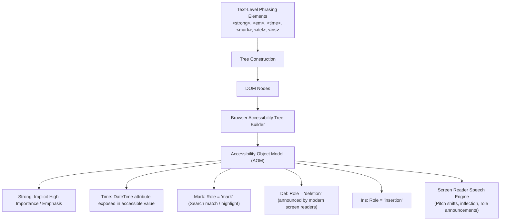

# Text-Level Semantics and Inline Phrasing Elements

| Metadata | Details |
| :--- | :--- |
| **Level** | Core / Fundamental |
| **Prerequisites** | `01-semantic-html-principles.md`, `01-fundamentals/03-text-content-and-typography.md` |
| **Estimated Reading Time** | 30 minutes |
| **Status** | Production-Ready |
| **Baseline Status** | Widely Available across all modern browsers |
| **Browsers Tested** | Chrome 120+, Firefox 120+, Safari 17+, Edge 120+ |
| **Tested With** | W3C Nu HTML Checker, Axe-core v4.8, NVDA 2023.3, VoiceOver macOS Sonoma |

---

## Table of Contents
- [1 What & Why](#1-what--why)
- [2 Core Concepts](#2-core-concepts)
- [3 How It Works Internally](#3-how-it-works-internally)
- [4 Syntax & Usage](#4-syntax--usage)
- [5 Practical Examples](#5-practical-examples)
- [6 Best Practices](#6-best-practices)
- [7 Common Mistakes & Pitfalls](#7-common-mistakes--pitfalls)
- [8 Performance, Accessibility, SEO & Security Notes](#8-performance-accessibility-seo--security-notes)
- [9 Comparison / When to Use What](#9-comparison--when-to-use-what)
- [10 Interview Questions](#10-interview-questions)
- [11 Practice Exercises](#11-practice-exercises)
- [12 Summary / Cheat Sheet](#12-summary--cheat-sheet)
- [13 Further Reading](#13-further-reading)

---

## 1 What & Why

While block-level landmarks and headings establish the macroscopic architecture of a document, **text-level semantics** (inline phrasing elements) provide the fine-grained linguistic and operational nuance of prose.

In human language, meaning is altered through intonation, emphasis, punctuation, and contextual registers. In digital hypermedia, rendering text in bold or italics is insufficient because visual typography alone cannot inform search engine indexers, automated scrapers, machine translation engines, or screen readers *why* that text is distinct.

HTML provides over twenty specialized text-level phrasing elements designed to convey exact semantic intent:
- Distinguishing verbal stress (`<em>`) from idiomatic shifts (`<i>`).
- Distinguishing critical urgency (`<strong>`) from stylistic highlighting (`<b>`).
- Providing machine-readable calendar metadata via the `<time>` element.
- Expressing editorial document mutations (`<ins>` and `<del>`) versus outdated values (`<s>`).
- Modeling technical workflows using computer interaction tags (`<code>`, `<kbd>`, `<samp>`, `<var>`).
- Safely rendering user-generated mixed-direction text using Bi-directional Isolation (`<bdi>`).

---

## 2 Core Concepts

### Emphasis vs. Idiomatic Voice (`<em>` vs. `<i>`)
- **`<em>` (Stress Emphasis)**: Represents stress emphasis of its contents, changing the verbal inflection and semantic meaning of the sentence. (e.g., *"I *love* distributed systems"* vs. *"I love *distributed* systems"*). Screen readers that support voice inflection alter pitch or stress when reading `<em>`.
- **`<i>` (Idiomatic Text)**: Represents text in an alternate voice or mood, or otherwise offset from normal prose without implying emphasis or importance (e.g., taxonomic species names like *Homo sapiens*, foreign phrases, ship names, technical terms, or internal monologue thoughts).

### Importance vs. Stylistic Offset (`<strong>` vs. `<b>`)
- **`<strong>` (Strong Importance)**: Represents text of strong importance, seriousness, or urgency for its contents (e.g., warning notices, critical safety parameters). It conveys an explicit high-importance semantic state in the accessibility tree.
- **`<b>` (Bring Attention To)**: Represents text offset from normal prose for utilitarian purposes without conveying extra importance (e.g., product keywords in a summary, lead sentences in a review). It renders bold by default, but implies no urgency.

### Editorial History (`<del>`, `<ins>`, and `<s>`)
- **`<del>` (Deleted Content)**: Represents a removal from the document in an editorial revision context. Supports the `cite` attribute (URL explaining the change) and `datetime` attribute (timestamp of deletion).
- **`<ins>` (Inserted Content)**: Represents an addition to the document in an editorial revision context. Also accepts `cite` and `datetime`.
- **`<s>` (Strikethrough / Outdated)**: Represents things that are no longer accurate or no longer relevant (e.g., expired sale prices), without implying document edit history.

### Temporal Metadata (`<time>`)
The `<time>` element represents either a specific period in time or a calendar date, paired with a machine-readable `datetime` attribute:
```html
<time datetime="2026-03-15T14:30:00Z">March 15, 2026 at 2:30 PM UTC</time>
```
The `datetime` attribute must conform to ISO 8601 syntax. Web crawlers, calendar utilities, and browser time-zone converters parse the `datetime` string directly.

### The Computer Interaction Suite (`<code>`, `<kbd>`, `<samp>`, `<var>`)
1. **`<code>`**: Computer code fragments (keywords, function names, file paths).
2. **`<kbd>`**: User input, representing keys pressed on a physical keyboard, voice commands, or CLI inputs.
3. **`<samp>`**: Sample output or return values produced by a computer program, terminal, or daemon.
4. **`<var>`**: Variables in mathematical equations or software programming contexts.

### Bi-directional Text Controls (`<bdi>` and `<bdo>`)
- **`<bdi>` (Bi-Directional Isolation)**: Isolates a span of text that might be formatted in a different direction (e.g., user usernames or comments that could be Arabic or Hebrew) from the surrounding text, preventing the Unicode BiDi algorithm from corrupting layout.
- **`<bdo>` (Bi-Directional Override)**: Explicitly overrides the bidirectional algorithm to force characters to render strictly left-to-right (`dir="ltr"`) or right-to-left (`dir="rtl"`).

---

## 3 How It Works Internally

### Parser Tokenization and Formatting Elements
Text-level elements participate in the **Adoption Agency Algorithm (AAA)** when improperly nested. Because tags like `<strong>`, `<em>`, `<code>`, and `<a>` are classified as "formatting elements", the HTML parser maintains a dedicated **Active Formatting Elements List**. 

If an author writes mismatched tags:
```html
<p>Alpha <em>Beta <strong>Gamma</em> Delta</strong></p>
```
The parser's Adoption Agency reconstructs the DOM so that the active formatting elements cleanly nest without breaking the tree:
```
HTMLParagraphElement
  ├─ Text: "Alpha "
  ├─ HTMLElement (em)
  │    ├─ Text: "Beta "
  │    └─ HTMLElement (strong)
  │         └─ Text: "Gamma"
  └─ HTMLElement (strong)
       └─ Text: " Delta"
```

### Accessibility Object Model (AOM) Mapping



Modern screen readers (e.g., NVDA with "Announce revisions" toggled on, VoiceOver iOS/macOS) announce `<del>` as *"Deletion: [text]"* and `<ins>` as *"Insertion: [text]"*. The `<time>` element's `datetime` attribute provides machine-deterministic timestamps that assist users across global time zones.

---

## 4 Syntax & Usage

```html
<!-- 1. Emphasis vs Idiomatic vs Strong -->
<p>
  <strong>Warning:</strong> You must <em>never</em> commit private keys to public Git repositories.
  The vulnerability was first classified under <i>CVE-2026-1049</i>.
</p>

<!-- 2. Machine-Readable Calendar Time with ISO 8601 -->
<p>
  Scheduled cluster maintenance starts at:
  <time datetime="2026-04-01T02:00:00-05:00">April 1, 2026 at 2:00 AM EST</time>.
  Expected outage duration: <time datetime="PT2H30M">2 hours and 30 minutes</time>.
</p>

<!-- 3. Computer Interaction Terminal Instructions -->
<p>
  To inspect the pod logs, type <kbd>kubectl logs -f <var>pod_name</var></kbd> and press <kbd>Enter</kbd>.
  The terminal will return <samp>[READY] Handshake completed</samp>.
</p>

<!-- 4. Editorial Revisions and Outdated Content -->
<p>
  Original pricing: <s>$99/month</s>.
  <del datetime="2026-03-01T00:00:00Z">Requires annual contract.</del>
  <ins datetime="2026-03-01T00:00:00Z">Now completely free for open-source teams.</ins>
</p>

<!-- 5. Search Relevance Highlighting -->
<p>
  Search results for "quic": Found 1 match in <mark>QUIC</mark> transport layer.
</p>

<!-- 6. Bidirectional Isolation for User Content -->
<p>
  User <bdi>مستخدم_جديد</bdi> published 42 pull requests.
</p>
```

> [!NOTE]
> **Baseline Status: Widely Available**
> All standard text-level semantics (`<em>`, `<strong>`, `<i>`, `<b>`, `<time>`, `<code>`, `<kbd>`, `<samp>`, `<var>`, `<del>`, `<ins>`, `<s>`, `<mark>`, `<abbr>`, `<sub/sup>`, `<bdi/bdo>`) are baseline features supported universally across all browsers.

---

## 5 Practical Examples

### Example 1: Terminal Interactive CLI Tutorial
```html
<article>
  <h2>Generating Cryptographic Ed25519 SSH Keys</h2>
  
  <p>
    To generate an elliptic-curve key pair, open your terminal and input:
  </p>

  <p>
    <kbd>ssh-keygen -t ed25519 -C <var>"ops@enterprise.net"</var></kbd>
  </p>

  <p>
    When prompted with the terminal message:
  </p>
  <blockquote>
    <samp>Enter file in which to save the key (/home/user/.ssh/id_ed25519):</samp>
  </blockquote>
  <p>
    Press the <kbd><kbd>Enter</kbd></kbd> key to accept the default path.
  </p>

  <p>
    <strong>Caution:</strong> Ensure your private key file permissions are locked via:
    <code>chmod 600 ~/.ssh/id_ed25519</code>.
  </p>
</article>
```

### Example 2: Legal Contract Revision History with `<del>` and `<ins>`
```html
<article class="legal-clause">
  <h2>Section 4: Service Level Agreements (SLA)</h2>
  <p>
    The Provider guarantees a monthly uptime commitment of
    <s>99.9%</s>
    <ins datetime="2026-01-01" cite="/legal/amendment-2026-01">99.99%</ins>.
  </p>
  <p>
    <del datetime="2026-01-01" cite="/legal/amendment-2026-01">
      Scheduled maintenance windows on Sunday mornings are exempt from downtime calculations.
    </del>
    <ins datetime="2026-01-01" cite="/legal/amendment-2026-01">
      All scheduled maintenance must occur with zero downtime via canary rolling restarts.
    </ins>
  </p>
</article>
```

### Example 3: Edge Case — ISO 8601 Durations and Relative Dates in `<time>`
```html
<!-- Valid ISO 8601 formats accepted by the datetime attribute -->

<!-- Standard Date -->
<p>Date: <time datetime="2026-11-26">November 26, 2026</time></p>

<!-- Date with UTC Time -->
<p>Timestamp: <time datetime="2026-11-26T14:45:00Z">2:45 PM UTC</time></p>

<!-- Date with Explicit Timezone Offset -->
<p>Local Time: <time datetime="2026-11-26T20:15:00+05:30">8:15 PM IST</time></p>

<!-- Duration: P[n]Y[n]M[n]DT[n]H[n]M[n]S (e.g. 2 days, 4 hours, 15 minutes) -->
<p>Maintenance Duration: <time datetime="P2DT4H15M">2 days, 4 hours, and 15 mins</time></p>

<!-- Year and Month only -->
<p>Release Cycle: <time datetime="2026-11">November 2026</time></p>
```

### Example 4: Failure Case — Inaccessible Edits and Visual-Only Badges
```html
<!-- ANTI-PATTERN: DO NOT COPY -->

<!-- Error 1: Using CSS strike-through for deleted text without semantics -->
<p>Old price: <span style="text-decoration: line-through;">$50</span> $30</p>
<!-- Screen reader reads: "Old price: $50 $30" with zero indication of change! -->

<!-- Error 2: Using <b> for serious life-safety warnings -->
<p><b>DANGER: High Voltage</b></p> <!-- BAD: Must be <strong> -->

<!-- Error 3: Arbitrary invalid datetime formats in <time> -->
<p>Launched: <time datetime="last Tuesday">Last Tuesday</time></p> <!-- INVALID ISO 8601 -->

<!-- Error 4: Missing <bdi> in user-generated dynamic listings -->
<ul>
  <li>User: مستخدم - 10 points</li> <!-- BiDi spillover will flip numbers and hyphens! -->
</ul>
```

### Example 5: Production International User Feed Component with `<bdi>`
```html
<!DOCTYPE html>
<html lang="en">
<head>
  <meta charset="utf-8">
  <title>International User Leaderboard</title>
  <style>
    .leaderboard { max-width: 400px; margin: 2rem auto; font-family: sans-serif; }
    .leaderboard-item { display: flex; justify-content: space-between; padding: 0.5rem; border-bottom: 1px solid #e5e7eb; }
    mark { background: #fef08a; padding: 0.1rem 0.2rem; border-radius: 2px; }
  </style>
</head>
<body>
  <main class="leaderboard">
    <h1>Active Contributor Leaderboard</h1>
    
    <ol>
      <li class="leaderboard-item">
        <!-- bdi isolates arbitrary usernames containing Arabic, Hebrew, or Urdu -->
        <span>User: <bdi>احمد_99</bdi></span>
        <span>Score: 1,420</span>
      </li>
      <li class="leaderboard-item">
        <span>User: <bdi>Sarah_Dev</bdi></span>
        <span>Score: 1,380</span>
      </li>
      <li class="leaderboard-item">
        <span>User: <bdi>יהונתן</bdi></span>
        <span>Score: 1,290</span>
      </li>
    </ol>

    <p>
      Search query: <mark>Sarah</mark> matched 1 contributor.
    </p>
  </main>
</body>
</html>
```

---

## 6 Best Practices

1. **Use `<strong>` for Importance, `<b>` for Visual Attention**: Reserve `<strong>` for warnings, crucial constraints, and key summary conclusions. Use `<b>` for product keywords or styling offsets without urgency.
2. **Always Provide ISO 8601 in `<time datetime="...">`**: Never put human-relative strings like `"yesterday"` in the `datetime` attribute. Always provide machine-parsable strings (e.g., `datetime="2026-03-15T09:00:00Z"`).
3. **Wrap User-Generated Names in `<bdi>`**: When rendering database records containing foreign names or multilingual usernames adjacent to punctuation or numbers, wrap them in `<bdi>` to prevent catastrophic bidirectional layout distortion.
4. **Use `<kbd>` for Physical Keys and CLI Commands**: Mark up all physical keyboard keys (`<kbd><kbd>Ctrl</kbd> + <kbd>C</kbd></kbd>`) and terminal user inputs with `<kbd>`.
5. **Use `<mark>` for Search Results and Context Highlighting**: Apply `<mark>` exclusively when text is highlighted due to its relevance in another context (e.g., matching search terms). Do not use `<mark>` as a generic yellow highlighter.
6. **Always Announce `<del>` and `<ins>` for Screen Readers**: Because some screen readers mute strikethrough styling by default, pair `<del>` with visually hidden text (`<span class="sr-only">Deleted: </span>`) or custom ARIA labels in high-compliance legal documents.

---

## 7 Common Mistakes & Pitfalls

| Mistake | Bad Code | Good Code | Technical Explanation |
| :--- | :--- | :--- | :--- |
| **Visual-Only Strikethrough** | `<span style="text-decoration: line-through;">$50</span>` | `<s>$50</s>` or `<del>$50</del>` | Screen readers read raw text without announcing the strikethrough unless semantic tags are used. |
| **Invalid `<time>` Datetime** | `<time datetime="15th March">March 15</time>` | `<time datetime="2026-03-15">March 15</time>` | Violates WHATWG specification. The `datetime` value must parse as a valid ISO 8601 date/time. |
| **Confusing `<i>` and `<em>`** | `<i>Do not press!</i>` | `<em>Do not press!</em>` or `<strong>` | `<i>` conveys alternate voice without verbal stress; `<em>` conveys linguistic stress emphasis. |
| **Missing `<bdi>` on Dynamic Feeds** | `<span>User ${name} won!</span>` | `<span>User <bdi>${name}</bdi> won!</span>` | RTL characters in `${name}` cause following punctuation (" won!") to spill over backwards to the left! |
| **Using `<code>` for Keyboard Keys** | `<code>Press Enter</code>` | `Press <kbd>Enter</kbd>` | `<code>` represents computer code; `<kbd>` represents user keyboard interaction. |
| **Nesting Block Tags inside Inline Elements** | `<strong><div>Warning</div></strong>` | `<div class="warning"><strong>Warning</strong></div>` | Phrasing elements like `<strong>` and `<em>` cannot contain block-level containers like `<div>`. |

---

## 8 Performance, Accessibility, SEO & Security Notes

### Accessibility (WCAG 2.2 AA)
- **Screen Reader Pronunciation of `<del>` and `<ins>`**: Assistive software provides configurable verbosity for document revisions. By default, JAWS and NVDA announce: *"Del start ... Del end"* or *"Ins start ... Ins end"*.
- **The Screen Reader Silence of `<s>`**: Many screen readers do **not** announce `<s>` by default (reading the crossed-out text as if it were valid prose). For critical price discounts or contract changes, augment with visually hidden explanatory text:
  ```html
  <p>Price: <span class="sr-only">Original price: </span><s>$100</s>, <span class="sr-only">Sale price: </span>$70</p>
  ```

### Search Engine Optimization (SEO)
- Search engines parse `<time datetime="...">` to generate publication dates in **Google Search Snippets** and News Carousels. Accurate ISO 8601 timestamps improve Freshness Algorithm rankings.
- Text marked with `<strong>` receives subtle semantic weighting in content relevance models compared to plain text.

### Performance & Parser Overhead
- Inline phrasing elements are lightweight. However, generating thousands of tiny inline elements (`<span>`, `<code>`) inside huge tables increases DOM node counts. Use CSS class delegation on parent containers when styling large monospace data tables.

### Security Notes
- Content rendered inside `<code>` or `<kbd>` often displays user input or scripts. **Always escape HTML entities** (`<` $\to$ `&lt;`, `>` $\to$ `&gt;`, `&` $\to$ `&amp;`) before injecting code into `<code>` blocks to permanently neutralize Cross-Site Scripting (XSS).

---

## 9 Comparison / When to Use What

| Element | Visual Default | Implicit AOM Semantics | Ideal Use Case |
| :--- | :--- | :--- | :--- |
| `<em>` | Italic | Stress emphasis (pitch inflection) | Emphasizing a word that alters sentence meaning. |
| `<i>` | Italic | Alternate voice / taxonomy | Technical terms, Latin names, idioms, ship names. |
| `<strong>` | Bold | Strong importance / seriousness | Critical warnings, safety rules, urgency. |
| `<b>` | Bold | Utilitarian stylistic offset | Product keywords, lead phrases in a review. |
| `<mark>` | Yellow highlight | Role: `mark` (relevance) | Highlighting matched terms in search results. |
| `<time>` | Normal | Date / Time metadata container | Machine-readable dates, times, durations. |
| `<code>` | Monospace | Computer code fragment | API functions, variables, file paths. |
| `<kbd>` | Monospace | User keyboard input | Keystrokes, keyboard shortcuts, terminal input. |
| `<samp>` | Monospace | Computer system output | Terminal stdout, error messages, compiler logs. |
| `<var>` | Italic | Variable in math/code | Mathematical equations, CLI variable arguments. |
| `<del>` | Strikethrough | Role: `deletion` | Content removed during editorial document revision. |
| `<ins>` | Underline | Role: `insertion` | Content added during editorial document revision. |
| `<s>` | Strikethrough | Content no longer relevant | Expired prices, superseded non-historical claims. |
| `<bdi>` | Normal | Isolated bidirectional boundary | Usernames or comments with unpredictable RTL/LTR. |

---

## 10 Interview Questions

<details>
<summary><strong>1. What is the semantic difference between `<strong>` and `<b>`, and between `<em>` and `<i>`?</strong></summary>

**Answer:**
- **`<strong>` vs `<b>`**:
  - `<strong>` represents **strong importance, seriousness, or urgency**. It alerts screen readers and machines that the content is critical (such as a system warning or legal disclaimer).
  - `<b>` is for **stylistic attention** without conveying extra importance. It draws visual focus to keywords (such as product names in a catalog description) without telling assistive software that the word is urgent.
- **`<em>` vs `<i>`**:
  - `<em>` represents **stress emphasis**. Emphasizing a word changes the grammatical meaning and rhetorical intention of a sentence. Speech synthesizers adjust voice pitch and inflection when reading `<em>`.
  - `<i>` represents text in an **alternate voice, mood, or classification** (e.g., taxonomic species names, technical terms, foreign expressions, or internal thoughts) without implying verbal stress or importance.
</details>

<details>
<summary><strong>2. How does the `<bdi>` element prevent text corruption in user-generated multilingual interfaces?</strong></summary>

**Answer:**
The Unicode Consortium defines the **Bidirectional (BiDi) Algorithm** to lay out text containing mixed Left-to-Right (LTR) and Right-to-Left (RTL) scripts. The algorithm determines directionality based on character properties.

If an author writes:
`<li>User: مستخدم - 5 points</li>`
Because Arabic characters are strongly RTL, and punctuation marks like `-` and spaces are "neutral", the BiDi algorithm groups the neutral characters into the RTL flow. As a result, the number `5` and the hyphen get mirrored and scrambled to the left of the username!

Wrapping the dynamic username in `<bdi>` (Bi-Directional Isolation):
`<li>User: <bdi>مستخدم</bdi> - 5 points</li>`
instructs the browser layout engine to treat the contents of `<bdi>` as an independent, isolated directional island. The surrounding English text treats the island as a single opaque LTR character, keeping all punctuation and numbers in their proper sequential positions.
</details>

<details>
<summary><strong>3. What are the permitted formats for the `datetime` attribute on a `<time>` element?</strong></summary>

**Answer:**
The `datetime` attribute accepts strict subsets of the ISO 8601 calendar standard:
1. **Year only**: `datetime="2026"`
2. **Year and month**: `datetime="2026-03"`
3. **Month and day**: `datetime="03-15"`
4. **Full date**: `datetime="2026-03-15"`
5. **Time only**: `datetime="14:30"` or `datetime="14:30:45.500"`
6. **Date and Time (UTC)**: `datetime="2026-03-15T14:30:00Z"`
7. **Date and Time with Timezone**: `datetime="2026-03-15T09:30:00-05:00"`
8. **Duration**: Prefixed with `P`, e.g., `datetime="PT2H30M"` (2 hours, 30 minutes) or `datetime="P1Y2M"` (1 year, 2 months).
Values failing ISO 8601 (like `"next week"`) trigger W3C validation errors.
</details>

<details>
<summary><strong>4. How should software engineers represent keyboard shortcuts using the `<kbd>` element?</strong></summary>

**Answer:**
The recommended standard for keyboard shortcuts is **nesting individual key `<kbd>` elements inside an outer `<kbd>` element**:
```html
<p>To copy selected text, press <kbd><kbd>Ctrl</kbd> + <kbd>C</kbd></kbd>.</p>
```
- The outer `<kbd>` represents the overall keyboard input gesture.
- The inner `<kbd>` elements represent each individual physical key required in the keystroke sequence.
This pattern provides clean CSS targeting hooks (e.g., styling inner `kbd` with keyboard keycaps, shadows, and borders).
</details>

<details>
<summary><strong>5. What is the semantic difference between `<s>` and `<del>`?</strong></summary>

**Answer:**
- **`<del>`**: Represents an **editorial deletion** from the document. It indicates that the text was part of a prior revision of the document and has been removed as part of an editing history. It accepts `datetime` and `cite` attributes documenting when and why the text was deleted.
- **`<s>`**: Represents text that is **no longer accurate or no longer relevant**, without implying an editorial document modification. A classic example is a discounted retail price (e.g., `<s>$99</s> now $49`). The document was not edited to delete the historical fact; rather, the old price is currently superseded.
</details>

<details>
<summary><strong>6. What is the `<dfn>` element, and how is it used to define terminology?</strong></summary>

**Answer:**
The `<dfn>` element represents the **defining instance of a term** in an HTML document. The nearest ancestor paragraph, description list, or section is considered the definition of the term.
```html
<p>
  A <dfn id="def-raft">Raft cluster</dfn> is a distributed system that implements
  consensus through leader election and replicated state machines.
</p>
```
If an `id` is provided on `<dfn>`, other sections of the document can link directly to that definition using `<a href="#def-raft">`.
</details>

<details>
<summary><strong>7. Why should you avoid using `<mark>` purely for visual styling or text highlighting?</strong></summary>

**Answer:**
In HTML semantics, `<mark>` represents **relevance in another context**, such as highlighting search query matches inside a document excerpt or flagging text referenced in an external critique.

In the Accessibility Object Model, modern browser engines expose `<mark>` with `role="mark"`. Screen readers announce *"Marked"* or *"Highlighted"* when reading marked spans. If a developer uses `<mark>` purely to add a decorative yellow background to arbitrary words, screen reader users will be repeatedly interrupted with meaningless "Marked" announcements. For pure visual decoration, use `<span class="highlight">`.
</details>

<details>
<summary><strong>8. What is the difference between `<abbr>` with a `title` and without a `title`?</strong></summary>

**Answer:**
The `<abbr>` element represents an abbreviation or acronym. 
- When the `title` attribute is present (e.g., `<abbr title="HyperText Markup Language">HTML</abbr>`), it provides the **full expansion** of the abbreviation. Graphical desktop browsers display the expansion as a hover tooltip and apply a dotted underline.
- When `title` is omitted, `<abbr>` simply identifies the token as an abbreviation to spellcheckers and translation engines without providing an inline expansion (ideal if the abbreviation has already been defined earlier in the prose).
</details>

---

## 11 Practice Exercises

### Exercise 1 (Easy): Choose Between `<strong>` and `<b>`
**Task**: In the following paragraph, decide whether each emphasized span should be `<strong>` or `<b>`:
1. "The **Quantum-X** server is our fastest node."
2. "**DANGER**: Disconnect power before servicing internal capacitors."

<details>
<summary><strong>Solution</strong></summary>

```html
<p>The <b>Quantum-X</b> server is our fastest node.</p>
<p><strong>DANGER:</strong> Disconnect power before servicing internal capacitors.</p>
```
*Explanation*: The product name "Quantum-X" is a stylistic keyword offset (`<b>`). The life-safety alert "DANGER:" conveys critical urgency and seriousness (`<strong>`).
</details>

### Exercise 2 (Easy): Author Machine-Readable ISO Timestamps
**Task**: Mark up the sentence: "The next release is scheduled for October 14, 2026 at 18:00 UTC" using `<time>` with a valid ISO 8601 `datetime`.

<details>
<summary><strong>Solution</strong></summary>

```html
<p>
  The next release is scheduled for
  <time datetime="2026-10-14T18:00:00Z">October 14, 2026 at 18:00 UTC</time>.
</p>
```
</details>

### Exercise 3 (Medium): Technical Instruction with `<kbd>`, `<code>`, and `<samp>`
**Task**: Mark up this technical instruction using the correct semantic phrasing elements:
"To verify the compiler version, execute `rustc --version` in your shell and press Enter. The terminal will display `rustc 1.82.0`."

<details>
<summary><strong>Solution</strong></summary>

```html
<p>
  To verify the compiler version, execute
  <kbd>rustc --version</kbd> in your shell and press
  <kbd><kbd>Enter</kbd></kbd>. The terminal will display
  <samp>rustc 1.82.0</samp>.
</p>
```
*Explanation*: User command and keystroke use `<kbd>`, while program terminal response uses `<samp>`.
</details>

### Exercise 4 (Medium): Accessible Price Discount Representation
**Task**: Mark up an e-commerce price tag where the original price was $120 and the sale price is $79. Ensure screen reader users are explicitly informed of which price is old and which is new.

<details>
<summary><strong>Solution</strong></summary>

```html
<div class="pricing-badge">
  <span class="sr-only">Original price: </span>
  <s>$120</s>
  <span class="sr-only">Sale price: </span>
  <span class="current-price">$79</span>
</div>

<style>
  .sr-only {
    position: absolute;
    width: 1px;
    height: 1px;
    padding: 0;
    margin: -1px;
    overflow: hidden;
    clip: rect(0, 0, 0, 0);
    white-space: nowrap;
    border: 0;
  }
</style>
```
*Explanation*: `<s>` semantically represents the outdated price, while visually hidden text prevents screen readers from announcing ambiguous adjacent numbers.
</details>

### Exercise 5 (Hard): Identify and Fix 5 Text-Level Semantics Bugs
**Task**: Review this markup snippet and correct all 5 semantic and accessibility defects:

```html
<!-- Flawed Source -->
<p>
  To save your document, press <code style="border: 1px solid #ccc;">Ctrl + S</code>.
  The server replied with error <code>500 Internal Error</code>.
  <time datetime="tomorrow morning">Tomorrow Morning</time> we deploy.
  Review our <a href="/terms"><span style="text-decoration: underline;">Terms</span></a>.
  Welcome user: <span>ابن_سينا</span> - 4 new messages.
</p>
```

<details>
<summary><strong>Solution</strong></summary>

```html
<!-- Fully Corrected Phrasing Markup -->
<p>
  To save your document, press <kbd><kbd>Ctrl</kbd> + <kbd>S</kbd></kbd>.
  The server replied with error <samp>500 Internal Error</samp>.
  <time datetime="2026-11-27T08:00:00Z">Tomorrow Morning</time> we deploy.
  Review our <a href="/terms">Terms</a>.
  Welcome user: <bdi>ابن_سينا</bdi> - 4 new messages.
</p>
```
*Explanation*:
1. Keystroke shortcut updated from `<code>` to nested `<kbd>`.
2. Server error message updated from `<code>` to `<samp>`.
3. Relative datetime string replaced with valid ISO 8601 string in `<time>`.
4. Redundant underline styling span inside `<a>` removed (hyperlinks carry intrinsic underline semantics).
5. Dynamic Arabic username wrapped in `<bdi>` to prevent bidirectional text scrambling.
</details>

### Exercise 6 (Hard): Construct an Accessible Contract Modification Clause
**Task**: Build a complete, valid revision clause for a software contract showing two clauses removed, two clauses inserted, and full machine-readable citations and timestamps.

<details>
<summary><strong>Solution</strong></summary>

```html
<section aria-labelledby="sla-revision-heading">
  <h2 id="sla-revision-heading">Contract Revision: Service Credits</h2>

  <p>
    Customer acknowledges the following contract amendments executed on
    <time datetime="2026-03-01">March 1, 2026</time>:
  </p>

  <p>
    <del datetime="2026-03-01T00:00:00Z" cite="/amendments/sec-credits-v1">
      Service credits must be claimed manually via support ticket submission within 14 business days.
    </del>
    <ins datetime="2026-03-01T00:00:00Z" cite="/amendments/sec-credits-v2">
      Service credits are automatically computed and credited directly to the customer's ledger within 48 hours.
    </ins>
  </p>

  <p>
    Maximum credit cap:
    <s>15% of monthly billing</s>
    <ins datetime="2026-03-01T00:00:00Z" cite="/amendments/sec-credits-v2">
      100% of monthly billing for outages exceeding 4 continuous hours.
    </ins>
  </p>
</section>
```
</details>

---

## 12 Summary / Cheat Sheet

```
┌────────────────────────────────────────────────────────────────────────┐
│                        TEXT-LEVEL SEMANTICS CHEAT SHEET                │
├───────────────┬────────────────────────────┬───────────────────────────┤
│ Element       │ Meaning                    │ Key Requirement           │
├───────────────┼────────────────────────────┼───────────────────────────┤
│ <em>          │ Stress Emphasis            │ Changes verbal inflection │
│ <i>           │ Alternate Voice / Taxonomy │ Species names, terms      │
│ <strong>      │ Strong Importance          │ Warnings, urgency         │
│ <b>           │ Stylistic Offset           │ Keywords in summary       │
│ <time>        │ Temporal Metadata          │ Must use ISO 8601 datetime│
│ <code>        │ Computer Code Fragment     │ Escape <, >, & entities   │
│ <kbd>         │ User Input / Keys Pressed  │ Nest: <kbd><kbd>K</kbd>   │
│ <samp>        │ System Output / Logs       │ Terminal responses        │
│ <var>         │ Mathematical / Code Var    │ Variable parameters       │
│ <del> / <ins> │ Editorial Revisions        │ Use datetime and cite     │
│ <s>           │ Outdated / Superseded      │ Inaccurate information    │
│ <mark>        │ Contextual Relevance       │ Search matches            │
│ <bdi>         │ Bi-directional Isolation   │ Usernames / foreign text  │
│ <abbr>        │ Abbreviation / Acronym     │ Use title="Expansion"     │
└───────────────┴────────────────────────────┴───────────────────────────┘
```

---

## 13 Further Reading

- [WHATWG HTML Living Standard: Section 4.5 Text-Level Semantics](https://html.spec.whatwg.org/multipage/text-level-semantics.html)
- [W3C WAI: Complex Text Formatting Accessibility](https://www.w3.org/WAI/tutorials/page-structure/content/)
- [MDN Web Docs: The HTML &lt;time&gt; Element](https://developer.mozilla.org/en-US/docs/Web/HTML/Element/time)
- [MDN Web Docs: Bi-directional Isolation with &lt;bdi&gt;](https://developer.mozilla.org/en-US/docs/Web/HTML/Element/bdi)
- [Smashing Magazine: When To Use Which HTML Phrasing Element](https://www.smashingmagazine.com/2021/08/html-phrasing-elements-guide/)

---

| [Previous: 03 Headings & Document Outline](03-headings-and-document-outline.md) | [Section Index](README.md) | [Next: 05 Details, Summary & Accordions](05-details-summary-and-accordions.md) |
