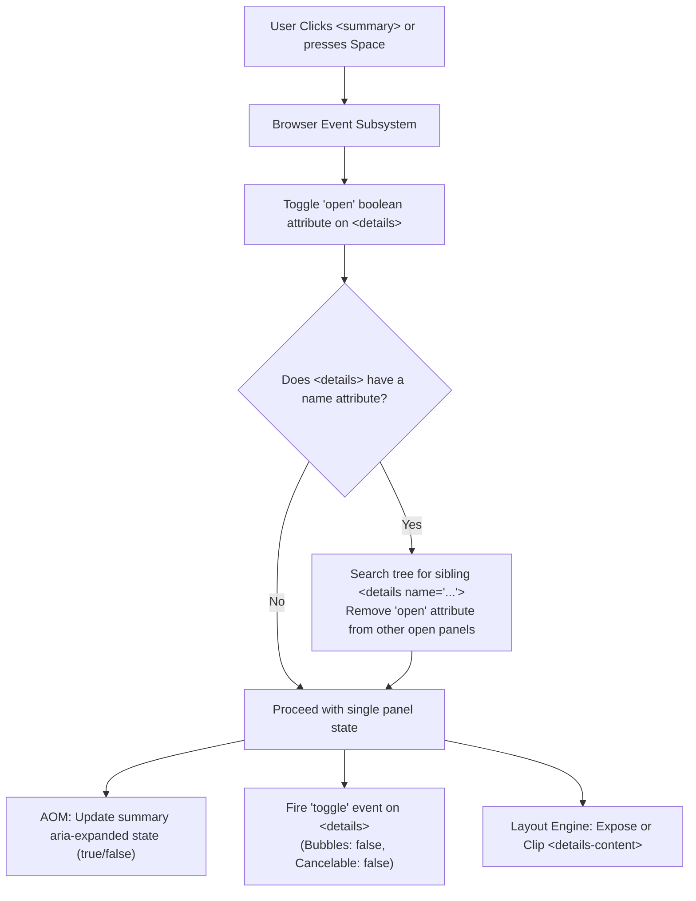

# Native Disclosures, Details, Summary, and Exclusive Accordions

| Metadata | Details |
| :--- | :--- |
| **Level** | Core / Fundamental |
| **Prerequisites** | `01-semantic-html-principles.md`, `01-fundamentals/09-global-attributes.md` |
| **Estimated Reading Time** | 25 minutes |
| **Status** | Production-Ready |
| **Baseline Status** | Widely Available (`<details name="...">` Newly Available Sep 2024) |
| **Browsers Tested** | Chrome 120+, Firefox 130+, Safari 17.2+, Edge 120+ |
| **Tested With** | W3C Nu HTML Checker, Axe-core v4.8, NVDA 2023.3, VoiceOver macOS Sonoma |

---

## Table of Contents
- [1 What & Why](#1-what--why)
- [2 Core Concepts](#2-core-concepts)
- [3 How It Works Internally](#3-how-it-works-internally)
- [4 Syntax & Usage](#4-syntax--usage)
- [5 Practical Examples](#5-practical-examples)
- [6 Best Practices](#6-best-practices)
- [7 Common Mistakes & Pitfalls](#7-common-mistakes--pitfalls)
- [8 Performance, Accessibility, SEO & Security Notes](#8-performance-accessibility-seo--security-notes)
- [9 Comparison / When to Use What](#9-comparison--when-to-use-what)
- [10 Interview Questions](#10-interview-questions)
- [11 Practice Exercises](#11-practice-exercises)
- [12 Summary / Cheat Sheet](#12-summary--cheat-sheet)
- [13 Further Reading](#13-further-reading)

---

## 1 What & Why

The interactive disclosure widget—commonly recognized as an **accordion**, **collapsible panel**, or **expandable spoiler**—is one of the most widely used UI patterns on the web. It manages cognitive load by hiding secondary or verbose details until a user explicitly requests to inspect them.

Historically, implementing accessible accordions required dozens of lines of brittle JavaScript:
- Manually creating `<button>` controls with `aria-expanded="false"`.
- Wiring `aria-controls` attributes referencing dynamic panel IDs.
- Listening to keyboard `Enter` and `Space` events.
- Synchronizing CSS height calculations (`max-height: 0` transitions).
- Maintaining exclusive "open-one-at-a-time" accordion state through event buses.

The WHATWG HTML Living Standard eliminates this JavaScript scaffolding through native semantic disclosure elements: **`<details>`** and **`<summary>`**. 

Furthermore, as of late **2024 (Baseline Newly Available)**, the standard introduced native **exclusive accordions** via the **`name` attribute** (`<details name="group">`). Browsers now manage exclusive disclosure behavior directly in compiled engine C++, automatically closing sibling panels when a new one opens without a single line of JavaScript.

---

## 2 Core Concepts

### The `<details>` Element
The `<details>` element represents a disclosure widget from which the user can obtain additional information or controls. It supports the boolean attribute **`open`**:
- When `open` is present, the widget is expanded and its child contents are visible.
- When `open` is omitted, the widget is collapsed and its contents (except `<summary>`) are hidden from layout and the accessibility tree.

### The `<summary>` Element
The `<summary>` element represents a summary, caption, or legend for its parent `<details>` element.
- It must be the **first child** of a `<details>` element.
- If an author omits `<summary>`, browser engines automatically synthesize a default summary element with localized text (typically *"Details"*).
- In the Accessibility Object Model (AOM), `<summary>` maps to an interactive button with `role="button"` and dynamic state `aria-expanded="true|false"`.
- Keyboard users can focus `<summary>` via `Tab` and toggle it via `Enter` or `Space`.

### Exclusive Accordions via the `name` Attribute *(2024 Baseline)*
Historically, grouping multiple `<details>` elements so that opening one closes all others required JavaScript mutation listeners. 
In modern HTML (Baseline Newly Available Sep 2024 across Chrome 120+, Safari 17.2+, Firefox 130+), the **`name` attribute** can be placed on multiple `<details>` elements:
```html
<details name="faq-group">
  <summary>Question 1</summary>
  <p>Answer 1</p>
</details>
<details name="faq-group">
  <summary>Question 2</summary>
  <p>Answer 2</p>
</details>
```
When `<details name="...">` elements share the same `name` token within the same tree, opening one panel causes the browser engine to **automatically close all other panels with that name**, mirroring native radio button behavior!

### The Modern `::details-content` Pseudo-Element
Historically, animating `<details>` height was notoriously difficult because child elements immediately swapped between `display: none` and visual layout. The modern CSS specification introduced the **`::details-content`** pseudo-element (paired with CSS `interpolate-size: allow-keywords;`), allowing smooth 0-to-auto height transitions purely in CSS.

---

## 3 How It Works Internally

### Native Shadow DOM and Toggle Lifecycle
Under the hood, browser engines implement `<details>` using an internal **User-Agent Shadow DOM**:



### The `toggle` DOM Event
When a `<details>` element opens or closes:
1. The browser engine toggles the presence of the `open` attribute.
2. The browser fires an asynchronous **`toggle` event** (`Event`, not `CustomEvent`) targeting the `<details>` element.
3. Because `toggle` fires *after* the attribute change has taken effect, inspecting `details.open` inside the event listener reflects the newly updated state.
4. *Note*: The `toggle` event does **not** bubble up the DOM tree by default.

---

## 4 Syntax & Usage

```html
<!-- 1. Standard Interactive Disclosure -->
<details>
  <summary>Inspect Raw Telemetry Payload</summary>
  <pre><code>{
  "cluster_id": "us-east-k8s-01",
  "memory_pressure": false,
  "active_pods": 84
}</code></pre>
</details>

<!-- 2. Exclusive Name-Grouped Accordion (2024 Baseline) -->
<section aria-labelledby="faq-title">
  <h2 id="faq-title">Frequently Asked Questions</h2>

  <details name="cloud-faq" open>
    <summary>How do automated rolling updates operate?</summary>
    <p>Pod replicas are updated incrementally using canary health checks.</p>
  </details>

  <details name="cloud-faq">
    <summary>What are the persistent disk IOPS limits?</summary>
    <p>Standard SSD volumes provide a baseline of 3,000 IOPS burstable to 16,000.</p>
  </details>

  <details name="cloud-faq">
    <summary>How is multi-region disaster recovery handled?</summary>
    <p>Asynchronous Raft replication maintains a standby cluster in eu-central-1.</p>
  </details>
</section>
```

> [!NOTE]
> **Baseline Status:**
> - `<details>`, `<summary>`, and the `open` attribute are **Widely Available** baseline standards supported across all browsers for over a decade.
> - Exclusive accordions via the `name` attribute are **Newly Available** (supported across Chrome 120+, Safari 17.2+, Firefox 130+, Edge 120+ as of late 2024).

---

## 5 Practical Examples

### Example 1: Accessible FAQ Accordion with Heading Inside `<summary>`
```html
<!DOCTYPE html>
<html lang="en">
<head>
  <meta charset="utf-8">
  <title>Accessible Exclusive FAQ</title>
  <style>
    details { border: 1px solid #e5e7eb; border-radius: 6px; margin-bottom: 0.75rem; padding: 0.5rem; background: #fff; }
    summary { font-weight: 600; cursor: pointer; padding: 0.5rem; outline-offset: 2px; }
    summary:hover { color: #2563eb; }
    summary h3 { display: inline; font-size: 1rem; margin: 0; }
    details[open] { border-color: #2563eb; }
    details p { padding: 0.5rem 1rem; margin: 0; color: #4b5563; }
  </style>
</head>
<body>
  <main>
    <h1>Billing &amp; Subscription Guidelines</h1>

    <!-- Exclusive group: Opening one closes the other automatically -->
    <details name="billing-group">
      <summary><h3>Can I upgrade my tier mid-billing cycle?</h3></summary>
      <p>Yes. Charges are prorated to the exact second of modification.</p>
    </details>

    <details name="billing-group">
      <summary><h3>What payment methods are supported for enterprise?</h3></summary>
      <p>We support corporate credit cards, ACH wire transfers, and annual net-30 invoicing.</p>
    </details>

    <details name="billing-group">
      <summary><h3>How do I claim service uptime SLA credits?</h3></summary>
      <p>SLA credits are automatically credited directly to your monthly balance.</p>
    </details>
  </main>
</body>
</html>
```

### Example 2: In-Page Find (Ctrl+F) Integration with Closed `<details>`
```html
<!-- Native browser engines index text inside collapsed <details>! -->
<!-- When a user searches for "CVE-2026-9041" via Ctrl+F, modern Chrome/Safari -->
<!-- automatically expands the <details> and scrolls directly to the match! -->

<article>
  <h2>Security Advisory Index</h2>

  <details name="security-advisories">
    <summary>Resolved Vulnerabilities: Q1 2026</summary>
    <p>
      Audit log confirms patch applied for <code>CVE-2026-9041</code> targeting
      the HTTP/3 frame decoding overflow buffer.
    </p>
  </details>
</article>
```

### Example 3: Edge Case — Customizing Disclosure Triangles via `::marker`
```html
<style>
  /* Case A: Modern standard styling of summary triangle marker */
  details.custom-arrow summary::marker {
    color: #3b82f6;
    font-size: 1.2em;
  }

  /* Case B: Replacing the native marker with custom + / - iconography */
  details.plus-minus summary {
    list-style: none; /* Strips native marker in modern browsers */
    display: flex;
    justify-content: space-between;
    align-items: center;
  }
  /* WebKit legacy compatibility prefix */
  details.plus-minus summary::-webkit-details-marker {
    display: none;
  }
  details.plus-minus summary::after {
    content: "+";
    font-size: 1.5rem;
    font-weight: bold;
  }
  details.plus-minus[open] summary::after {
    content: "−";
  }
</style>

<details class="plus-minus">
  <summary>Advanced Network Proxy Configuration</summary>
  <p>Set custom upstream proxy timeout parameters in milliseconds.</p>
</details>
```

### Example 4: Failure Case — Interactive Controls Nested inside `<summary>`
```html
<!-- ANTI-PATTERN: DO NOT COPY -->

<!-- Error 1: Placing buttons or links inside <summary> -->
<!-- The <summary> element has implicit role="button". Nesting a button inside a button -->
<!-- creates invalid nested interactive controls that completely break keyboard activation! -->
<details>
  <summary>
    User Profile
    <button type="button" onclick="edit()">Edit</button> <!-- INVALID NESTED BUTTON -->
    <a href="/profile">View Link</a> <!-- INVALID NESTED LINK -->
  </summary>
  <p>User details and preferences.</p>
</details>

<!-- Error 2: Missing <summary> when custom title was intended -->
<details>
  <h3>My Custom Header</h3> <!-- BAD: Parser synthesizes default "Details" summary above this! -->
  <p>Content.</p>
</details>

<!-- Axe-core Accessibility Audit:
- [nested-interactive]: Interactive controls must not be nested.
-->
```

### Example 5: Production Pure-CSS Animated Disclosure Component
```html
<!DOCTYPE html>
<html lang="en">
<head>
  <meta charset="utf-8">
  <title>CSS Animated Details</title>
  <style>
    /* Modern 2024 CSS animation for <details> content */
    details {
      border: 1px solid #d1d5db;
      border-radius: 8px;
      overflow: hidden;
      margin-bottom: 1rem;
    }
    summary {
      background: #f9fafb;
      padding: 1rem;
      cursor: pointer;
      user-select: none;
      font-weight: 600;
    }
    
    /* Modern ::details-content pseudo-element transition */
    details::details-content {
      opacity: 0;
      transition: content-visibility 300ms allow-discrete,
                  opacity 300ms ease,
                  height 300ms ease;
      height: 0;
      overflow: hidden;
    }
    details[open]::details-content {
      opacity: 1;
      height: auto;
    }
  </style>
</head>
<body>
  <main>
    <h1>Cluster Diagnostic Tooling</h1>

    <details name="diagnostics">
      <summary>Network Packet Inspection</summary>
      <div class="content-body" style="padding: 1rem;">
        <p>Continuous pcap capture listening on interface <code>eth0</code>.</p>
      </div>
    </details>

    <details name="diagnostics">
      <summary>Disk Latency Histogram</summary>
      <div class="content-body" style="padding: 1rem;">
        <p>Read operations maintain median latency of 0.24ms.</p>
      </div>
    </details>
  </main>
</body>
</html>
```

---

## 6 Best Practices

1. **Always Make `<summary>` the First Child**: The `<summary>` element must be the very first child of `<details>`. Any content placed above `<summary>` will cause the parser to construct an invalid DOM outline.
2. **Never Put Interactive Elements Inside `<summary>`**: `<summary>` already acts as a native button. Never place `<button>`, `<a>`, `<input>`, or other interactive controls inside `<summary>`. Place action buttons inside the expanded details body instead.
3. **Use the `name` Attribute for Exclusive Groups**: Instead of writing complex JavaScript event listeners to close sibling accordions, use native `<details name="group-name">`.
4. **Wrap Heading Elements Inside `<summary>` When Appropriate**: If an accordion section contributes to the document outline, place the heading tag *inside* the summary (`<summary><h3>Section Title</h3></summary>`). Set `h3 { display: inline; }` in CSS to preserve the triangle marker.
5. **Listen to the Native `toggle` Event**: When tracking analytics or performing lazy-loaded queries upon disclosure expansion, listen to `details.addEventListener('toggle', ...)` rather than click events on `<summary>`.
6. **Provide Clear, Descriptive Summary Text**: The text of `<summary>` must make sense in isolation so screen reader users understand what content will be revealed upon expansion.

---

## 7 Common Mistakes & Pitfalls

| Mistake | Bad Code | Good Code | Technical Explanation |
| :--- | :--- | :--- | :--- |
| **Nested Interactive Elements** | `<summary>Title <button>Edit</button></summary>` | Move `<button>` inside `<details>` body | Violates HTML specification. Nesting interactive elements inside `<summary>` breaks keyboard activation. |
| **Custom JS Accordions** | 50 lines of JS managing `aria-expanded` | `<details name="faq">` | Native exclusive accordions are built into the browser engine with zero JavaScript dependencies. |
| **Omitting `<summary>`** | `<details><p>Content</p></details>` | `<details><summary>Label</summary><p>...</p></details>` | Omitting `<summary>` forces the browser to synthesize a generic "Details" label, failing descriptive UX. |
| **Placing `<summary>` Second** | `<details><div>Header</div><summary>Tab</summary></details>` | `<details><summary>Tab</summary><div>Header</div></details>` | `<summary>` must be the first child; otherwise, the browser creates an empty default summary above it. |
| **Display Override on `<details>`** | `details { display: flex; }` | Apply Flexbox to inner content wrapper | Overriding `display` on `<details>` can break the browser's User-Agent shadow tree disclosure mechanics. |
| **Keyboard Trapping in `<summary>`** | `summary { outline: none; }` | `summary:focus-visible { outline: 2px solid blue; }` | Stripping focus outlines prevents keyboard-only users from locating the active accordion trigger. |

---

## 8 Performance, Accessibility, SEO & Security Notes

### Accessibility (WCAG 2.2 AA)
- **Native AOM Role**: The `<summary>` element is exposed in the accessibility tree with `role="button"` and `aria-expanded="false"` (when closed) or `aria-expanded="true"` (when open).
- Screen readers announce:
  - NVDA: *"Button, collapsed, Inspect Telemetry Payload"*
  - VoiceOver: *"Inspect Telemetry Payload, collapsed button"*
- Activating the element immediately updates the announced state to *"expanded"*.

### Search Engine Optimization (SEO) & Find-in-Page
- Search engine spiders (Googlebot) fully parse and index content inside closed `<details>` elements.
- **Ctrl+F / In-Page Search**: Unlike elements hidden via `display: none`, modern browser search engines automatically expand collapsed `<details>` when a user searches for text matching inside the panel, scrolling smoothly to the discovered phrase.

### Performance & Memory
- Native `<details>` widgets consume zero JavaScript heap memory and incur no runtime event-listener garbage collection overhead.
- Browser engines skip paint calculations for collapsed details subtrees until the `open` attribute is toggled.

### Security Notes
- If disclosure panels fetch remote data upon expansion, ensure responses injected into the DOM are sanitized to prevent stored XSS attacks.

---

## 9 Comparison / When to Use What

| Pattern | Native Element | Screen Reader Role | Requires JavaScript? |
| :--- | :--- | :--- | :--- |
| Single Collapsible Box | `<details>` + `<summary>` | `button` (`aria-expanded`) | **No (0 lines of JS)** |
| Exclusive Accordion | `<details name="...">` | `button` (`aria-expanded`) | **No (0 lines of JS)** |
| Dialog / Modal Window | `<dialog>` | `dialog` (`aria-modal`) | Minor (`showModal()`) |
| Top-Layer Floating Card| `popover="auto"` | Varies by role | **No (0 lines of JS)** |
| Tabbed Interface (Tabs)| `<div role="tablist">` | `tablist`, `tab`, `tabpanel` | **Yes (Full JS required)** |

---

## 10 Interview Questions

<details>
<summary><strong>1. How does the newly standardized `name` attribute on `<details>` implement exclusive accordions without JavaScript?</strong></summary>

**Answer:**
Standardized in the WHATWG HTML Living Standard and achieving Baseline Newly Available status in September 2024 (supported across Chrome 120+, Safari 17.2+, Firefox 130+, Edge 120+), the `name` attribute connects multiple `<details>` elements into a mutually exclusive group.

When multiple `<details>` elements within the same document tree share the same `name` attribute value:
1. The browser engine tracks them as an associated set (similar to how `<input type="radio" name="...">` groups radio buttons).
2. The moment any `<details>` element in the set transitions to the `open` state, the browser engine automatically finds all other open `<details>` elements sharing that `name` and strips their `open` attribute.
3. This eliminates the need for custom JavaScript mutation observers, click event loops, or third-party accordion libraries.
</details>

<details>
<summary><strong>2. Why is nesting a `<button>` or `<a>` inside a `<summary>` element an accessibility and specification violation?</strong></summary>

**Answer:**
Under the WHATWG specification, the `<summary>` element has an implicit ARIA role of **`button`**. 

According to the W3C WAI-ARIA and HTML specifications, **interactive controls cannot be nested inside other interactive controls** ("no nested interactive controls").
If an author nests `<button>` inside `<summary>`:
1. **Accessibility Breakdown**: Assistive technologies encounter a button nested inside another button. Screen readers cannot properly determine which control should receive focus or announce its state.
2. **Keyboard Conflict**: Pressing `Space` or `Enter` triggers both the inner button's click event and the outer summary's accordion toggle event, causing unpredictable double activations.
3. It triggers an automatic failure on all automated WCAG testing engines (Axe-core rule `nested-interactive`).
</details>

<details>
<summary><strong>3. How does the `toggle` event behave, and why can it not be prevented via `event.preventDefault()`?</strong></summary>

**Answer:**
The `toggle` event fires on the `<details>` element **after** the `open` attribute has already been added or removed by the browser engine.
- Its `bubbles` property is `false` (it does not bubble up to ancestor containers).
- Its `cancelable` property is `false`.
Because `cancelable` is false, calling `event.preventDefault()` inside a `toggle` event listener has **no effect**. The state transition has already occurred.
*(Note: To cancel or intercept a toggle action before it occurs, developers must intercept the user's `click` or `keydown` event on the child `<summary>` element).*
</details>

<details>
<summary><strong>4. How do browser engines handle "Find in Page" (Ctrl+F) inside closed `<details>` elements?</strong></summary>

**Answer:**
Unlike content hidden with CSS `display: none` (which is typically excluded from browser in-page search indices), content inside a closed `<details>` element is indexed by modern browser engines.

When a user triggers "Find in Page" and types text that matches content inside a collapsed `<details>` panel:
1. The browser engine detects the match.
2. The engine automatically adds the `open` attribute to the parent `<details>` element, expanding it immediately.
3. The browser scrolls the viewport directly to the highlighted text string.
This ensures information stored in disclosures remains fully discoverable during user text search.
</details>

<details>
<summary><strong>5. What occurs if an author provides multiple `<summary>` elements inside a single `<details>` tag?</strong></summary>

**Answer:**
According to the WHATWG tree construction rules:
- The **very first** `<summary>` child element becomes the official disclosure summary and interactive button.
- Any subsequent `<summary>` elements are treated as ordinary block-level flow content inside the disclosure body; they do **not** become interactive summary triggers and are rendered as standard text when the widget expands.
</details>

<details>
<summary><strong>6. Can an author place a heading element (`<h2>`–`<h6>`) inside a `<summary>`, and what are the visual styling considerations?</strong></summary>

**Answer:**
**Yes.** Placing a heading inside `<summary>` is fully valid and encouraged when the disclosure widget represents a major section in the document outline:
```html
<details>
  <summary><h3>Advanced Cluster Parameters</h3></summary>
  <p>Configuration options.</p>
</details>
```
**Styling Consideration**: By default, headings have `display: block` with top and bottom margins, which can break the default inline alignment of the disclosure triangle marker (`::marker`). Authors should apply:
```css
summary h3 {
  display: inline;
  margin: 0;
  font-size: 1rem;
}
```
to keep the heading text cleanly aligned adjacent to the triangle marker.
</details>

<details>
<summary><strong>7. How does the modern `::details-content` pseudo-element enable pure-CSS accordion animations?</strong></summary>

**Answer:**
Historically, `<details>` could not be animated using CSS `transition: height` because the browser engine toggled the internal content container between `display: none` and `display: block` instantaneously.

The modern CSS specification introduces the `::details-content` pseudo-element, which targets the anonymous box containing the non-summary children of `<details>`. By pairing `::details-content` with modern CSS properties like `interpolate-size: allow-keywords;` and `transition: height 300ms ease;`, developers can transition height from `0` to `auto` smoothly without writing JavaScript measurement scripts.
</details>

<details>
<summary><strong>8. What is the difference between `<details>` and `<dialog>`?</strong></summary>

**Answer:**
- **`<details>`**: An inline disclosure widget embedded directly in the document flow. It expands and collapses in-place, pushing sibling content down. It does not create a modal overlay and does not trap focus.
- **`<dialog>`**: A separate window or modal dialog container. When invoked via `dialog.showModal()`, it is promoted to the browser's **Top Layer**, renders above all other document elements, displays a `::backdrop`, traps keyboard focus, and blocks interaction with the background page.
</details>

---

## 11 Practice Exercises

### Exercise 1 (Easy): Create a Native 3-Item Exclusive FAQ
**Task**: Write an FAQ section containing 3 questions using the native `name` attribute so that only one question can be open at a time. The first question should be open by default.

<details>
<summary><strong>Solution</strong></summary>

```html
<section aria-labelledby="faq-heading">
  <h2 id="faq-heading">Platform FAQ</h2>

  <details name="platform-faq" open>
    <summary>What is the maximum container memory allocation?</summary>
    <p>Worker nodes support up to 512 GB RAM per instance.</p>
  </details>

  <details name="platform-faq">
    <summary>Is IPv6 supported out of the box?</summary>
    <p>Yes, all ingress load balancers support dual-stack IPv4 and IPv6.</p>
  </details>

  <details name="platform-faq">
    <summary>Where are audit logs preserved?</summary>
    <p>Audit logs are streamed to tamper-proof S3 buckets with 7-year retention.</p>
  </details>
</section>
```
</details>

### Exercise 2 (Easy): Fix the Missing Summary Trap
**Task**: Correct this invalid details markup so that it displays an accessible label instead of the browser's default "Details" text.

```html
<!-- Broken Source -->
<details>
  <p>Database password must contain at least 16 characters.</p>
</details>
```

<details>
<summary><strong>Solution</strong></summary>

```html
<details>
  <summary>Password Complexity Requirements</summary>
  <p>Database password must contain at least 16 characters.</p>
</details>
```
*Explanation*: Adding `<summary>` as the first child provides the explicit text label for the disclosure trigger.
</details>

### Exercise 3 (Medium): Accessible Semantic Heading in `<summary>`
**Task**: Author an accordion element containing a Level 3 heading inside the `<summary>`. Provide the minimal CSS needed to prevent layout breakage with the native disclosure arrow.

<details>
<summary><strong>Solution</strong></summary>

```html
<details class="heading-disclosure">
  <summary>
    <h3>Database Sharding Topology</h3>
  </summary>
  <p>Data is horizontally partitioned across 16 database shards using MurmurHash3.</p>
</details>

<style>
  .heading-disclosure summary h3 {
    display: inline;
    margin: 0;
    font-size: 1.1rem;
    font-weight: 600;
  }
</style>
```
*Explanation*: Setting `display: inline` on the `<h3>` prevents the heading from dropping onto a new line below the disclosure triangle marker.
</details>

### Exercise 4 (Medium): Remove Nested Interactive Controls
**Task**: Refactor this problematic code snippet to eliminate nested interactive elements while preserving the action button functionality.

```html
<!-- Flawed Source -->
<details>
  <summary>
    Cluster Ingress Settings
    <button type="button" onclick="resetDefaults()">Reset</button>
  </summary>
  <p>Port configurations and proxy timeouts.</p>
</details>
```

<details>
<summary><strong>Solution</strong></summary>

```html
<details>
  <summary>Cluster Ingress Settings</summary>
  <div class="details-body">
    <p>Port configurations and proxy timeouts.</p>
    <button type="button" onclick="resetDefaults()">Reset to Defaults</button>
  </div>
</details>
```
*Explanation*: The `<button>` is moved inside the expanded body container, eliminating the invalid button-inside-button accessibility violation.
</details>

### Exercise 5 (Hard): Track State with Native `toggle` Event
**Task**: Write the JavaScript to listen to a `<details id="audit-panel">` element and log to `console.log` whether the panel was opened or closed, recording the exact timestamp.

<details>
<summary><strong>Solution</strong></summary>

```html
<details id="audit-panel">
  <summary>View System Audit Logs</summary>
  <p>No critical anomalies detected in the past 24 hours.</p>
</details>

<script>
  const panel = document.getElementById("audit-panel");

  panel.addEventListener("toggle", (event) => {
    if (panel.open) {
      console.log(`[${new Date().toISOString()}] Audit panel was EXPANDED.`);
      // Ideal place to trigger asynchronous fetch for telemetry data!
    } else {
      console.log(`[${new Date().toISOString()}] Audit panel was COLLAPSED.`);
    }
  });
</script>
```
*Explanation*: The `toggle` event fires on `<details>` immediately after the state transition. Inspecting `panel.open` reveals the active state.
</details>

### Exercise 6 (Hard): Build an Accessible Multi-Category Troubleshooting Wizard
**Task**: Build a troubleshooting guide with 2 categories ("Network Issues" and "Storage Issues"). Each category has 2 exclusive sub-questions.

<details>
<summary><strong>Solution</strong></summary>

```html
<article>
  <h1>Infrastructure Troubleshooting Guide</h1>

  <section aria-labelledby="network-heading">
    <h2 id="network-heading">1. Network Diagnostics</h2>
    
    <details name="network-troubleshoot" open>
      <summary><h3>High TCP Retransmission Rates</h3></summary>
      <p>Check interface MTU settings and ensure jumbo frames are configured across all switches.</p>
    </details>

    <details name="network-troubleshoot">
      <summary><h3>DNS Resolution Timeouts</h3></summary>
      <p>Verify CoreDNS upstream forwarder health and inspect local resolver cache daemon.</p>
    </details>
  </section>

  <section aria-labelledby="storage-heading">
    <h2 id="storage-heading">2. Storage Diagnostics</h2>

    <details name="storage-troubleshoot">
      <summary><h3>Volume Mount Timeouts</h3></summary>
      <p>Verify iSCSI initiator sessions and check cloud provider volume attachment limits.</p>
    </details>

    <details name="storage-troubleshoot">
      <summary><h3>Disk Full (No Space Left on Device)</h3></summary>
      <p>Inspect unlinked open file descriptors consuming inode space via <code>lsof +L1</code>.</p>
    </details>
  </section>
</article>
```
*Explanation*: Using two distinct name attributes (`name="network-troubleshoot"` and `name="storage-troubleshoot"`) scopes exclusivity independently per category!
</details>

---

## 12 Summary / Cheat Sheet

```
┌────────────────────────────────────────────────────────────────────────┐
│                        DETAILS & SUMMARY CHEAT SHEET                   │
├───────────────────┬────────────────────────────────────────────────────┤
│ Pattern           │ Syntax / Rule                                      │
├───────────────────┼────────────────────────────────────────────────────┤
│ Basic Disclosure  │ <details><summary>Title</summary><p>...</p></details>│
│ Default Expanded  │ <details open>                                     │
│ Exclusive Accordion│ <details name="group-name"> (Baseline 2024)       │
│ First Child Rule  │ <summary> MUST be first child of <details>         │
│ No Nesting        │ NEVER put <button> or <a> inside <summary>         │
│ Event Listener    │ details.addEventListener('toggle', (e) => {...})   │
│ Accessibility Role│ summary exposes role="button" aria-expanded="bool" │
│ Marker Styling    │ summary::marker or details::details-content        │
└───────────────────┴────────────────────────────────────────────────────┘
```

---

## 13 Further Reading

- [WHATWG HTML Living Standard: Section 4.11.1 The &lt;details&gt; Element](https://html.spec.whatwg.org/multipage/interactive-elements.html#the-details-element)
- [MDN Web Docs: The &lt;details&gt; Element & Name Attribute](https://developer.mozilla.org/en-US/docs/Web/HTML/Element/details)
- [web.dev: Exclusive Accordions with details name](https://web.dev/articles/exclusive-accordion)
- [Scott O'Hara: In Details We Trust (Accessibility Deep Dive)](https://www.scottohara.me/blog/2018/09/03/details-and-summary.html)
- [CSS-Tricks: Animating the Details Element with ::details-content](https://css-tricks.com/how-to-animate-the-details-element/)

---

| [Previous: 04 Text-Level Semantics](04-text-level-semantics.md) | [Section Index](README.md) | [Next: 06 Accessible Data Tables](06-accessible-data-tables.md) |
