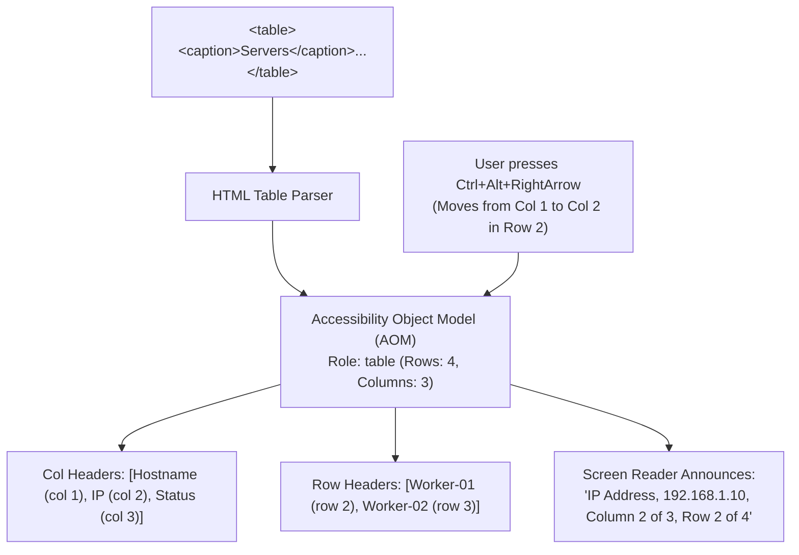

# Accessible Data Tables, Structural Headers, and Scoping

| Metadata | Details |
| :--- | :--- |
| **Level** | Core / Fundamental |
| **Prerequisites** | `01-semantic-html-principles.md`, `01-fundamentals/04-lists-and-grouping.md` |
| **Estimated Reading Time** | 30 minutes |
| **Status** | Production-Ready |
| **Baseline Status** | Widely Available across all modern browsers |
| **Browsers Tested** | Chrome 120+, Firefox 120+, Safari 17+, Edge 120+ |
| **Tested With** | W3C Nu HTML Checker, Axe-core v4.8, NVDA 2023.3, VoiceOver macOS Sonoma |

---

## Table of Contents
- [1 What & Why](#1-what--why)
- [2 Core Concepts](#2-core-concepts)
- [3 How It Works Internally](#3-how-it-works-internally)
- [4 Syntax & Usage](#4-syntax--usage)
- [5 Practical Examples](#5-practical-examples)
- [6 Best Practices](#6-best-practices)
- [7 Common Mistakes & Pitfalls](#7-common-mistakes--pitfalls)
- [8 Performance, Accessibility, SEO & Security Notes](#8-performance-accessibility-seo--security-notes)
- [9 Comparison / When to Use What](#9-comparison--when-to-use-what)
- [10 Interview Questions](#10-interview-questions)
- [11 Practice Exercises](#11-practice-exercises)
- [12 Summary / Cheat Sheet](#12-summary--cheat-sheet)
- [13 Further Reading](#13-further-reading)

---

## 1 What & Why

In enterprise computing, tabular data is ubiquitous. System metrics, financial ledgers, database query results, network routing tables, and server manifests all rely on a two-dimensional grid of rows and columns.

Sighted users understand tables by visually glancing across columns and down rows, instantaneously correlating an intersection cell with its column header above and row header to the left.

For a non-sighted user navigating via a screen reader, visual grid correlation is impossible. Screen readers can only read one cell at a time. If a table is authored without semantic headers (`<th>`) and explicit scoping (`scope="col"`, `scope="row"`), the screen reader merely announces disconnected values (e.g., *"14ms, 99.2%, 48GB"*). The user has no idea which server or metric those numbers belong to.

Furthermore, using tables for **visual page layout** (a historical hack from the 1990s) is a catastrophic accessibility failure, trapping screen reader users inside fake tabular coordinates.

Modern HTML provides a robust suite of semantic elements designed to expose 2D data grids to the **Accessibility Object Model (AOM)**, ensuring assistive technologies speak row and column context automatically as users navigate with directional arrow keys.

---

## 2 Core Concepts

### Core Tabular Elements
- **`<table>`**: Represents data with more than one dimension, in the form of a table.
- **`<caption>`**: Represents the title or description of the table. It must be the **first child** of the `<table>`. In the accessibility tree, `<caption>` provides the table's accessible name.
- **`<thead>`**: Represents the block of rows that consist of the column labels (headers) for the parent table.
- **`<tbody>`**: Represents the block of rows that consist of the body data of the table. A table can have multiple `<tbody>` elements for logical batching.
- **`<tfoot>`**: Represents the block of rows that consist of the column summaries or footers for the parent table.
- **`<tr>`**: A table row containing cells.
- **`<th>`**: Represents a header cell. By default, it renders bold and centered, and conveys `role="columnheader"` or `role="rowheader"`.
- **`<td>`**: Represents a standard data cell. Conveys `role="cell"`.

### Header Scoping: The `scope` Attribute
The `scope` attribute on a `<th>` element explicitly declares the direction of cells to which the header applies:
- `scope="col"`: The header applies to all data cells in the **column** beneath it.
- `scope="row"`: The header applies to all data cells in the **row** to its right.
- `scope="colgroup"`: The header spans across and applies to an entire structural **column group**.
- `scope="rowgroup"`: The header spans across and applies to an entire structural **row group** (e.g., a multi-row category header).

### Spanning Dimensions (`colspan` and `rowspan`)
- `colspan="n"`: Causes a cell (`<th>` or `<td>`) to span across `n` contiguous columns.
- `rowspan="n"`: Causes a cell to span downward across `n` contiguous rows.

### Complex Multi-Level Tables: The `id` and `headers` Technique
For simple tables with single-tier headers, `scope="col"` and `scope="row"` provide sufficient context. 
However, for **complex multi-tiered tables** (e.g., a table with nested multi-level column headers and intermediate sub-row headers), the `scope` attribute breaks down. 
The standard solution is the **`headers` and `id` technique**:
1. Assign a unique `id` to every `<th>` element.
2. On each `<td>`, declare a space-separated `headers` attribute listing the IDs of every header cell that applies to that specific data point:
```html
<th id="reg-east">US-East</th>
<th id="cpu-load">CPU Load</th>
...
<td headers="reg-east cpu-load">42%</td>
```
When a screen reader focuses this cell, it reads all associated headers in sequence.

---

## 3 How It Works Internally

### Screen Reader Table Navigation State Machine
When assistive technologies (NVDA, JAWS, VoiceOver) encounter a semantic `<table>`:
1. The engine announces the table title and dimensions: *"Table with 5 columns and 12 rows, Server Telemetry Overview"*.
2. The user enters **Table Navigation Mode** (e.g., holding `Ctrl + Alt` and pressing `ArrowLeft`, `ArrowRight`, `ArrowUp`, `ArrowDown`).
3. As the user navigates from cell to cell, the screen reader checks the Accessibility Object Model for associated headers.



If `scope` or `<th>` elements are missing, the screen reader cannot deduce column or row identities, speaking only *"192.168.1.10"* with zero contextual meaning!

---

## 4 Syntax & Usage

```html
<!-- 1. Semantic Data Table with Complete Scoping -->
<table class="telemetry-table">
  <caption>Cluster Node Memory Utilization (Past 24 Hours)</caption>
  
  <thead>
    <tr>
      <th scope="col">Node Identifier</th>
      <th scope="col">Region</th>
      <th scope="col">Allocated RAM</th>
      <th scope="col">Health State</th>
    </tr>
  </thead>

  <tbody>
    <tr>
      <!-- Row header identifies this specific record -->
      <th scope="row">worker-us-east-01</th>
      <td>us-east-1a</td>
      <td>64 GB</td>
      <td>Healthy</td>
    </tr>
    <tr>
      <th scope="row">worker-us-east-02</th>
      <td>us-east-1b</td>
      <td>128 GB</td>
      <td>Degraded</td>
    </tr>
  </tbody>

  <tfoot>
    <tr>
      <th scope="row">Fleet Total</th>
      <td>2 Nodes</td>
      <td>192 GB</td>
      <td>Active</td>
    </tr>
  </tfoot>
</table>
```

> [!NOTE]
> **Baseline Status: Widely Available**
> All table elements (`<table>`, `<caption>`, `<thead>`, `<tbody>`, `<tfoot>`, `<tr>`, `<th>`, `<td>`), along with attributes `scope`, `colspan`, `rowspan`, and `headers`, are foundational baseline web standards supported universally across all browsers and operating system accessibility bridges.

---

## 5 Practical Examples

### Example 1: Multi-Tier Column Groups with `<colgroup>` and `scope="colgroup"`
```html
<table class="financial-table">
  <caption>Q3 Cloud Infrastructure Expenditures (in Thousands USD)</caption>
  
  <colgroup>
    <col class="service-col">
  </colgroup>
  <colgroup span="2" class="compute-group"></colgroup>
  <colgroup span="2" class="storage-group"></colgroup>

  <thead>
    <tr>
      <th rowspan="2" scope="col">Service Name</th>
      <th colspan="2" scope="colgroup">Compute Tier</th>
      <th colspan="2" scope="colgroup">Storage Tier</th>
    </tr>
    <tr>
      <th scope="col">Budget</th>
      <th scope="col">Actual</th>
      <th scope="col">Budget</th>
      <th scope="col">Actual</th>
    </tr>
  </thead>

  <tbody>
    <tr>
      <th scope="row">Ingress Proxies</th>
      <td>$12.5k</td>
      <td>$11.8k</td>
      <td>$4.0k</td>
      <td>$3.9k</td>
    </tr>
    <tr>
      <th scope="row">Kafka Brokers</th>
      <td>$45.0k</td>
      <td>$48.2k</td>
      <td>$30.0k</td>
      <td>$31.4k</td>
    </tr>
  </tbody>
</table>
```

### Example 2: Complex Multi-Header Association via `id` and `headers`
```html
<table class="sla-matrix">
  <caption>Network Latency SLA Matrix (Percentiles in Milliseconds)</caption>

  <thead>
    <tr>
      <th id="hdr-region" rowspan="2">Datacenter Region</th>
      <th id="hdr-intra" colspan="2">Intra-Region</th>
      <th id="hdr-cross" colspan="2">Cross-Region</th>
    </tr>
    <tr>
      <th id="hdr-p50-intra">p50</th>
      <th id="hdr-p99-intra">p99</th>
      <th id="hdr-p50-cross">p50</th>
      <th id="hdr-p99-cross">p99</th>
    </tr>
  </thead>

  <tbody>
    <tr>
      <th id="row-virginia">Virginia (US-East)</th>
      <td headers="hdr-region row-virginia hdr-intra hdr-p50-intra">0.45 ms</td>
      <td headers="hdr-region row-virginia hdr-intra hdr-p99-intra">1.20 ms</td>
      <td headers="hdr-region row-virginia hdr-cross hdr-p50-cross">18.4 ms</td>
      <td headers="hdr-region row-virginia hdr-cross hdr-p99-cross">34.1 ms</td>
    </tr>
    <tr>
      <th id="row-ireland">Ireland (EU-West)</th>
      <td headers="hdr-region row-ireland hdr-intra hdr-p50-intra">0.52 ms</td>
      <td headers="hdr-region row-ireland hdr-intra hdr-p99-intra">1.45 ms</td>
      <td headers="hdr-region row-ireland hdr-cross hdr-p50-cross">22.1 ms</td>
      <td headers="hdr-region row-ireland hdr-cross hdr-p99-cross">41.0 ms</td>
    </tr>
  </tbody>
</table>
```

### Example 3: Edge Case — Responsive Horizontally Scrolling Table Container
```html
<!-- Problem: Wide data tables break mobile viewports (causing page horizontal blowout) -->
<!-- Solution: Wrap <table> in a container with overflow-x: auto, tabindex="0", and role="region" -->
<!-- tabindex="0" allows keyboard-only users to scroll the overflow container via arrow keys! -->

<div class="table-scroll-wrapper" 
     tabindex="0" 
     role="region" 
     aria-labelledby="metrics-caption">
  <table>
    <caption id="metrics-caption">High-Density Cluster Telemetry Log (Scrollable)</caption>
    <thead>
      <tr>
        <th scope="col">Timestamp</th>
        <th scope="col">Instance ID</th>
        <th scope="col">vCPUs</th>
        <th scope="col">Disk Read IOPS</th>
        <th scope="col">Disk Write IOPS</th>
        <th scope="col">Network In (MB/s)</th>
        <th scope="col">Network Out (MB/s)</th>
        <th scope="col">TCP Retransmits</th>
      </tr>
    </thead>
    <tbody>
      <tr>
        <th scope="row">2026-03-15T12:00:00Z</th>
        <td>i-08429184</td>
        <td>64</td>
        <td>14,200</td>
        <td>8,900</td>
        <td>420.5</td>
        <td>610.2</td>
        <td>0</td>
      </tr>
    </tbody>
  </table>
</div>

<style>
  .table-scroll-wrapper {
    overflow-x: auto;
    max-width: 100%;
    border: 1px solid #d1d5db;
  }
  .table-scroll-wrapper:focus-visible {
    outline: 2px solid #2563eb;
  }
</style>
```

### Example 4: Failure Case — Layout Tables and Missing Scopes
```html
<!-- ANTI-PATTERN: DO NOT COPY -->

<!-- Error 1: Using tables for page layout (DESTRUCTIVE TO ACCESSIBILITY) -->
<table>
  <tr>
    <td width="200">Sidebar Navigation</td>
    <td width="600">Main Content Body</td>
  </tr>
</table>

<!-- Error 2: Missing <caption> and missing <th scope="..."> -->
<table>
  <tr>
    <td>Name</td> <td>Email</td> <td>Role</td> <!-- BAD: Should be <th> with scope="col" -->
  </tr>
  <tr>
    <td>Alice</td> <td>alice@corp.com</td> <td>Admin</td>
  </tr>
</table>

<!-- Error 3: Arbitrary styled divs simulating tables without ARIA table roles -->
<div class="table">
  <div class="row"><div class="cell">Data</div></div>
</div>

<!-- Screen Reader Audit Result:
- Error 1 causes NVDA to announce layout as a 2-cell data grid, disorienting blind readers.
- Error 2 causes screen reader to lose header correlation entirely.
-->
```

### Example 5: Production-Grade Accessible Table with Sorting Indicators
```html
<!DOCTYPE html>
<html lang="en">
<head>
  <meta charset="utf-8">
  <title>Production Sortable Data Table</title>
  <style>
    table { width: 100%; border-collapse: collapse; font-family: sans-serif; }
    caption { text-align: left; font-size: 1.25rem; font-weight: 700; margin-bottom: 0.75rem; }
    th, td { padding: 0.75rem; text-align: left; border-bottom: 1px solid #e5e7eb; }
    th { background: #f9fafb; font-weight: 600; }
    th button { background: none; border: none; font: inherit; font-weight: inherit; cursor: pointer; display: flex; align-items: center; gap: 0.5rem; }
    tr:hover td { background: #f3f4f6; }
  </style>
</head>
<body>
  <main>
    <div tabindex="0" role="region" aria-labelledby="fleet-table-title">
      <table>
        <caption id="fleet-table-title">Compute Fleet Instance Telemetry</caption>
        
        <thead>
          <tr>
            <th scope="col" aria-sort="ascending">
              <button type="button">
                <span>Instance Name</span>
                <span aria-hidden="true">&uarr;</span>
              </button>
            </th>
            <th scope="col" aria-sort="none">
              <button type="button">
                <span>Zone</span>
                <span aria-hidden="true">&udarr;</span>
              </button>
            </th>
            <th scope="col" aria-sort="none">
              <button type="button">
                <span>CPU Load (%)</span>
                <span aria-hidden="true">&udarr;</span>
              </button>
            </th>
          </tr>
        </thead>

        <tbody>
          <tr>
            <th scope="row">db-primary-az1</th>
            <td>us-east-1a</td>
            <td>42%</td>
          </tr>
          <tr>
            <th scope="row">db-replica-az2</th>
            <td>us-east-1b</td>
            <td>18%</td>
          </tr>
          <tr>
            <th scope="row">db-replica-az3</th>
            <td>us-east-1c</td>
            <td>24%</td>
          </tr>
        </tbody>
      </table>
    </div>
  </main>
</body>
</html>
```

---

## 6 Best Practices

1. **Always Include a `<caption>`**: Every data table must have a `<caption>` element as its very first child to provide a concise, accessible title for screen readers.
2. **Explicitly Declare `scope` on All `<th>` Cells**: Never leave a `<th>` without a `scope` attribute. Always specify `scope="col"` for column headers and `scope="row"` for row identifier headers.
3. **Use Row Headers (`<th scope="row">`)**: The first cell of every data row should typically be a `<th scope="row">` representing the unique primary key or name of that row.
4. **Never Use Tables for Page Layout**: CSS Flexbox and CSS Grid handle responsive layout. Using `<table>` for visual alignment traps screen readers in table navigation mode (violates WCAG 1.3.1).
5. **Wrap Overflowing Tables in an Accessible Focusable Region**: When implementing horizontal scrolling for responsive tables, wrap `<table>` in `<div tabindex="0" role="region" aria-labelledby="caption-id">` so keyboard users can scroll via arrow keys.
6. **Use `aria-sort` for Interactive Columns**: If a table supports client-side sorting, place `aria-sort="ascending"`, `aria-sort="descending"`, or `aria-sort="none"` on the active `<th>` element to communicate sort state to screen readers.

---

## 7 Common Mistakes & Pitfalls

| Mistake | Bad Code | Good Code | Technical Explanation |
| :--- | :--- | :--- | :--- |
| **Missing `<caption>`** | `<table><thead>...` | `<table><caption>Title</caption>...` | Screen reader users navigating via table lists hear "Table with X columns" with zero name or purpose. |
| **Omitting `scope` on `<th>`** | `<th>Hostname</th>` | `<th scope="col">Hostname</th>` | Without explicit scope, screen readers in complex tables cannot determine whether the header applies horizontally or vertically. |
| **Data Cells as Headers** | `<tr><td><strong>Name</strong></td></tr>` | `<tr><th scope="col">Name</th></tr>` | Using `<td>` for headers fails to create header roles in the AOM, breaking cell association. |
| **Layout Tables** | `<table><tr><td>Nav</td><td>Body</td></tr>` | Use CSS Grid: `display: grid;` | Screen readers announce grid coordinates and column numbers for pure presentation layout, destroying usability. |
| **Unscrollable Mobile Tables** | Mobile viewport clips wide table | Wrap in `<div tabindex="0" role="region">` | Keyboard users and touchscreen users cannot access offscreen columns without a focusable scroll container. |
| **Misusing `colspan` Count** | `<td colspan="5">` on 3-col table | Ensure `colspan` matches exact grid math | Grid mathematical mismatches cause browser layout engines to synthesize phantom empty columns. |

---

## 8 Performance, Accessibility, SEO & Security Notes

### Accessibility (WCAG 2.2 AA)
- **Criterion 1.3.1 (Info and Relationships - Level A)**: Structural relationships in tabular data must be programmatically exposed. Accessible tables with `<caption>`, `<th>`, and `scope` are mandatory for compliance.
- Screen readers provide extensive shortcut commands:
  - NVDA / JAWS: `T` jumps to the next table on the page.
  - `Ctrl + Alt + Arrow Keys` navigates within table grid coordinates. When moving horizontally, the screen reader automatically announces the associated column header; when moving vertically, it announces the associated row header.

### Search Engine Optimization (SEO)
- Search engines parse semantic `<table>` elements to extract tabular data for **Featured Snippets** (e.g., comparing product specifications, pricing tiers, or hardware parameters).
- Tables lacking `<caption>` and `<th>` elements are frequently ignored by Googlebot's structured table extraction pipeline.

### Performance & Parser Cost
- Rendering massive HTML tables with 10,000+ rows directly in the DOM creates thousands of C++ node objects, severely bottlenecking browser memory and causing sluggish scrolling.
- For high-density datasets (> 500 rows), implement **DOM Virtualization / Windowing** (rendering only visible rows in the viewport) or server-side pagination.

### Security Notes
- Data tables frequently display database query results. Ensure all cell values are properly entity-escaped (`&lt;`, `&gt;`, `&amp;`) to prevent Stored Cross-Site Scripting (XSS) when rendering user-submitted records.

---

## 9 Comparison / When to Use What

| Data Relationship | Semantic Pattern | Screen Reader Experience | When to Use |
| :--- | :--- | :--- | :--- |
| 2D Matrix (Rows $\times$ Columns) | `<table>` + `<th> scope` | Full 2D grid coordinates | Telemetry metrics, financial ledgers, comparisons. |
| 1D Key-Value Pairs | `<dl>` + `<dt>` / `<dd>` | "Description list, X items" | System specs, user profiles, hardware info. |
| Ordinal Sequence | `<ol>` + `<li>` | "List, X items, Item 1..." | Algorithmic steps, leaderboards, recipes. |
| Unordered Collection | `<ul>` + `<li>` | "List, X items" | Feature lists, navigation links. |
| Visual Component Grid | CSS Grid on `<div>` | Generic container | Product card grids, photo galleries. |

---

## 10 Interview Questions

<details>
<summary><strong>1. Why is using `<table>` elements for visual page layout considered a severe accessibility failure?</strong></summary>

**Answer:**
When a browser engine parses a `<table>` tag, it constructs an accessible table structure in the Accessibility Object Model (AOM), exposing properties like row counts, column indices, and cell relationships.

If an author uses `<table>` purely to achieve a multi-column visual page layout (e.g., putting navigation links in column 1 and main article text in column 2):
1. **Confusing Announcements**: Screen reader users are announced: *"Table with 1 row and 2 columns"*.
2. **Broken Navigation Modes**: Assistive software attempts to switch into Table Navigation Mode, intercepting arrow keys to navigate between layout blocks instead of standard document reading flow.
3. **Responsive Breakage**: Layout tables cannot easily reflow on mobile viewports without fragile CSS hacks (`table, tbody, tr, td { display: block; }`), which ironically strips the accessibility role on real data tables.
Page layout must always be handled using CSS Flexbox or CSS Grid.
</details>

<details>
<summary><strong>2. What is the semantic difference between `scope="col"` and `scope="colgroup"`?</strong></summary>

**Answer:**
- **`scope="col"`**: Specifies that a header cell (`<th>`) applies to all data cells in that **single vertical column**.
- **`scope="colgroup"`**: Specifies that a header cell applies to an entire **structural group of columns**. This is used when a table features multi-level grouped headers, where an overarching super-header spans across multiple sub-headers (e.g., a header "Q3 Financials" spanning across two sub-columns "Budget" and "Actual"):
```html
<tr>
  <th scope="colgroup" colspan="2">Q3 Financials</th>
</tr>
<tr>
  <th scope="col">Budget</th>
  <th scope="col">Actual</th>
</tr>
```
Assistive technologies announce the `colgroup` header followed by the individual column header when navigating cells within that group.
</details>

<details>
<summary><strong>3. When should developers use the `headers` and `id` technique instead of the simpler `scope` attribute?</strong></summary>

**Answer:**
The `scope` attribute (`col`, `row`, `colgroup`, `rowgroup`) works reliably for simple tables with single-tier or standard two-tier rectangular hierarchies.

However, for **complex, irregular, or multi-dimensional data matrices** (for example, tables with headers embedded within body rows, diagonal header relationships, or non-uniform spans), `scope` becomes ambiguous for screen readers. 

In these scenarios, the **`headers` and `id` technique** is required:
1. Every relevant `<th>` is assigned an explicit `id` (e.g., `id="h-east"`).
2. Every data cell (`<td>`) explicitly lists the exact IDs of all applicable headers in its `headers` attribute: `<td headers="h-east h-q3 h-latency">`.
This establishes an unambiguous, hard-coded relationship graph in the AOM regardless of physical visual layout.
</details>

<details>
<summary><strong>4. What is the purpose of the `<caption>` element, and where must it be positioned in HTML source code?</strong></summary>

**Answer:**
The `<caption>` element represents the accessible title or description of a table. In the Accessibility Object Model, it provides the table's **accessible name**, which screen readers announce immediately upon entering the table (e.g., *"Table: Server Latency Telemetry, 5 rows, 4 columns"*).

According to the WHATWG specification, the `<caption>` element **must be the very first child of the `<table>` element**, appearing immediately after the opening `<table>` tag before any `<thead>`, `<tbody>`, `<colgroup>`, or `<tr>` tags. (It can be visually repositioned to the bottom of the table using CSS `caption-side: bottom`).
</details>

<details>
<summary><strong>5. How does the `aria-sort` attribute work, and what are its valid values?</strong></summary>

**Answer:**
The `aria-sort` attribute is placed on a header cell (`<th>`) to communicate the current sorting direction of that column in an interactive data table:
- **`ascending`**: Items in the column are sorted from lowest to highest (e.g., A–Z, 0–9).
- **`descending`**: Items in the column are sorted from highest to lowest (e.g., Z–A, 9–0).
- **`none`**: The column is sortable, but is not currently sorted.
- **`other`**: The column is sorted by a non-standard algorithm.
Only the header of the currently active sorted column should have `aria-sort="ascending"` or `descending`; other sortable headers should have `aria-sort="none"`.
</details>

<details>
<summary><strong>6. Why is wrapping a responsive table in `<div tabindex="0" role="region" aria-labelledby="...">` critical for keyboard accessibility?</strong></summary>

**Answer:**
When a wide data table overflows on a mobile or narrow viewport, developers apply `overflow-x: auto` to a wrapping container.

For mouse and touch users, dragging or swiping scrolls the overflow area easily. However, **keyboard-only users** cannot scroll an element using arrow keys unless that element is **keyboard-focusable**. 
By adding `tabindex="0"`, the wrapper enters the natural keyboard Tab ring. Adding `role="region"` and `aria-labelledby` ensures that when keyboard focus lands on the container, screen readers announce: *"Scrollable region: Server Telemetry Table"*, informing the user they can press `ArrowRight` and `ArrowLeft` to scroll through offscreen columns.
</details>

<details>
<summary><strong>7. What happens in the DOM when CSS `display: block` is applied to `<table>`, `<tr>`, or `<td>` in WebKit/Safari?</strong></summary>

**Answer:**
In WebKit (Safari), applying `display: block`, `display: flex`, or `display: grid` directly to table elements (`<table>`, `<tr>`, `<td>`) to achieve responsive card layouts causes WebKit's accessibility engine to **strip the table roles from the AOM**. The browser treats the table as a generic `div`, destroying table navigation shortcuts for VoiceOver users.

To retain table semantics in Safari when using CSS layout overrides, developers must explicitly add ARIA table roles: `<table role="table">`, `<tr role="row">`, `<th role="columnheader">`, `<td role="cell">`.
</details>

<details>
<summary><strong>8. Can a `<table>` contain multiple `<tbody>` elements?</strong></summary>

**Answer:**
**Yes.** Under the WHATWG specification, a `<table>` can contain zero or more `<tbody>` elements. Using multiple `<tbody>` tags is an excellent semantic technique for partitioning large datasets into discrete logical blocks (for example, grouping servers by region, where each region has its own `<tbody>`), allowing independent styling or accordion collapsing per group.
</details>

---

## 11 Practice Exercises

### Exercise 1 (Easy): Author an Accessible 2x2 Data Table
**Task**: Create an accessible table comparing memory and storage for two servers ("Node-Alpha" and "Node-Beta"). Include a caption and explicit column/row scopes.

<details>
<summary><strong>Solution</strong></summary>

```html
<table>
  <caption>Server Hardware Allocation</caption>
  <thead>
    <tr>
      <th scope="col">Node</th>
      <th scope="col">RAM</th>
      <th scope="col">Disk</th>
    </tr>
  </thead>
  <tbody>
    <tr>
      <th scope="row">Node-Alpha</th>
      <td>64 GB</td>
      <td>1 TB</td>
    </tr>
    <tr>
      <th scope="row">Node-Beta</th>
      <td>128 GB</td>
      <td>2 TB</td>
    </tr>
  </tbody>
</table>
```
*Explanation*: `scope="col"` handles column titles; `<th scope="row">` on each data row identifies the server name for screen readers.
</details>

### Exercise 2 (Easy): Fix the Missing Caption and Scope Violations
**Task**: Correct all semantic and accessibility defects in this malformed table:

```html
<!-- Broken Source -->
<table>
  <tr>
    <td>Product</td><td>Price</td>
  </tr>
  <tr>
    <td>Widget</td><td>$10</td>
  </tr>
</table>
```

<details>
<summary><strong>Solution</strong></summary>

```html
<table>
  <caption>Product Pricing Catalog</caption>
  <thead>
    <tr>
      <th scope="col">Product</th>
      <th scope="col">Price</th>
    </tr>
  </thead>
  <tbody>
    <tr>
      <th scope="row">Widget</th>
      <td>$10</td>
    </tr>
  </tbody>
</table>
```
</details>

### Exercise 3 (Medium): Two-Tier Grouped Column Headers
**Task**: Build a table showing "Quarterly Revenue" with an overarching column header "2026 Quarters" spanning two sub-columns ("Q1" and "Q2") using `colspan` and `scope="colgroup"`.

<details>
<summary><strong>Solution</strong></summary>

```html
<table>
  <caption>Corporate Revenue by Department</caption>
  <thead>
    <tr>
      <th rowspan="2" scope="col">Department</th>
      <th colspan="2" scope="colgroup">2026 Fiscal Quarters</th>
    </tr>
    <tr>
      <th scope="col">Q1</th>
      <th scope="col">Q2</th>
    </tr>
  </thead>
  <tbody>
    <tr>
      <th scope="row">Cloud Infrastructure</th>
      <td>$4.2M</td>
      <td>$4.8M</td>
    </tr>
    <tr>
      <th scope="row">Professional Services</th>
      <td>$1.1M</td>
      <td>$1.3M</td>
    </tr>
  </tbody>
</table>
```
*Explanation*: `rowspan="2"` keeps "Department" vertically centered across both header rows, while `colspan="2"` and `scope="colgroup"` define the super-header.
</details>

### Exercise 4 (Medium): Build a Responsive Keyboard-Accessible Table Shell
**Task**: Write the complete HTML and CSS for a responsive data table container that scrolls horizontally on small screens and is navigable via keyboard.

<details>
<summary><strong>Solution</strong></summary>

```html
<div class="table-responsive-container" 
     tabindex="0" 
     role="region" 
     aria-labelledby="tbl-caption">
  <table>
    <caption id="tbl-caption">Live Ingress Traffic Routing</caption>
    <thead>
      <tr>
        <th scope="col">Route Path</th>
        <th scope="col">Upstream Service</th>
        <th scope="col">Latency (p99)</th>
        <th scope="col">Status</th>
      </tr>
    </thead>
    <tbody>
      <tr>
        <th scope="row">/api/v1/auth</th>
        <td>auth-service.internal</td>
        <td>14 ms</td>
        <td>Active</td>
      </tr>
    </tbody>
  </table>
</div>

<style>
  .table-responsive-container {
    overflow-x: auto;
    border: 1px solid #e5e7eb;
    border-radius: 6px;
    outline-offset: 2px;
  }
  .table-responsive-container:focus-visible {
    outline: 2px solid #2563eb;
  }
</style>
```
</details>

### Exercise 5 (Hard): Map Complex Headers via `headers` and `id`
**Task**: Implement a 2x2 matrix using explicit `id` and `headers` attributes where cell data represents "Europe - Server Load - 85%".

<details>
<summary><strong>Solution</strong></summary>

```html
<table>
  <caption>Regional Resource Utilization</caption>
  <thead>
    <tr>
      <th id="hdr-region">Continent</th>
      <th id="hdr-load">Server Load</th>
    </tr>
  </thead>
  <tbody>
    <tr>
      <th id="row-europe" headers="hdr-region">Europe</th>
      <td headers="hdr-region row-europe hdr-load">85%</td>
    </tr>
  </tbody>
</table>
```
*Explanation*: The cell `85%` explicitly lists `headers="hdr-region row-europe hdr-load"`, ensuring assistive technologies speak both the continent and the metric name.
</details>

### Exercise 6 (Hard): Audit and Remediate 6 Table Accessibility Bugs
**Task**: Identify and fix all 6 defects in this high-consequence medical telemetry table:

```html
<!-- Flawed Source -->
<table>
  <tr>
    <td colspan="3"><b>Patient Heart Telemetry</b></td>
  </tr>
  <tr>
    <td>ID</td> <td>BPM</td> <td>Status</td>
  </tr>
  <tr>
    <td>PT-01</td> <td>72</td> <td>Normal</td>
  </tr>
</table>
```

<details>
<summary><strong>Solution</strong></summary>

```html
<!-- Fully Remediated Semantic Data Table -->
<table>
  <caption>Patient Heart Telemetry</caption>
  
  <thead>
    <tr>
      <th scope="col">Patient Identifier</th>
      <th scope="col">Heart Rate (BPM)</th>
      <th scope="col">Clinical Status</th>
    </tr>
  </thead>

  <tbody>
    <tr>
      <th scope="row">PT-01</th>
      <td>72</td>
      <td>Normal</td>
    </tr>
  </tbody>
</table>
```
*Defects Remediated*:
1. Fake title cell (`<td colspan="3"><b>Title</b></td>`) replaced with native `<caption>`.
2. Missing `<thead>` added.
3. Header cells converted from generic `<td>` to semantic `<th>` with explicit `scope="col"`.
4. Row identifier `PT-01` converted from `<td>` to `<th scope="row">`.
5. Missing `<tbody>` container added.
6. Header labels expanded to clear, descriptive terms for audio readability.
</details>

---

## 12 Summary / Cheat Sheet

```
┌────────────────────────────────────────────────────────────────────────┐
│                        ACCESSIBLE TABLE CHEAT SHEET                    │
├───────────────────┬────────────────────────────────────────────────────┤
│ Element / Attr    │ Architectural Requirement                          │
├───────────────────┼────────────────────────────────────────────────────┤
│ <caption>         │ First child of <table>; provides accessible name   │
│ <th scope="col">  │ Declares column header                             │
│ <th scope="row">  │ Declares row header (first cell of data rows)      │
│ scope="colgroup"  │ Header applies to multiple sub-columns             │
│ id / headers      │ Explicit linkage for complex multi-tier tables     │
│ Scroll Wrapper    │ <div tabindex="0" role="region" aria-labelledby>   │
│ aria-sort         │ "ascending" | "descending" | "none" on active <th> │
│ Never for Layout  │ NEVER use <table> for CSS visual positioning       │
└───────────────────┴────────────────────────────────────────────────────┘
```

---

## 13 Further Reading

- [WHATWG HTML Living Standard: Section 4.9 Tabular Data](https://html.spec.whatwg.org/multipage/tables.html)
- [W3C WAI: Tables Tutorial - Concepts and Scoping](https://www.w3.org/WAI/tutorials/tables/)
- [MDN Web Docs: HTML Table Advanced Features & Accessibility](https://developer.mozilla.org/en-US/docs/Learn/HTML/Tables/Advanced)
- [Adrian Roselli: Under-Engineered Responsive Tables](https://adrianroselli.com/2020/11/under-engineered-responsive-tables.html)
- [Scott O'Hara: Having an ARIA Sort of Day](https://www.scottohara.me/blog/2018/05/05/aria-sort.html)

---

| [Previous: 05 Details, Summary & Accordions](05-details-summary-and-accordions.md) | [Section Index](README.md) | [Next: 07 Choosing the Right Element Guide](07-choosing-the-right-element-guide.md) |
