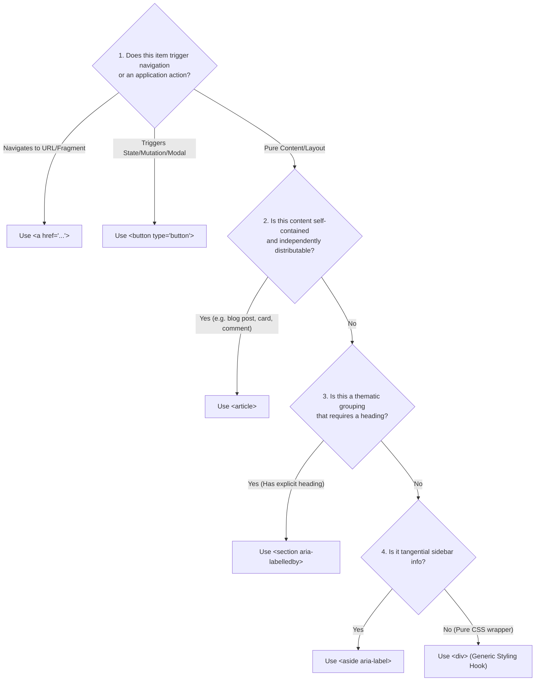

# Element Selection Architectural Framework and Decision Matrices

| Metadata | Details |
| :--- | :--- |
| **Level** | Core / Fundamental |
| **Prerequisites** | `01-semantic-html-principles.md` through `06-accessible-data-tables.md` |
| **Estimated Reading Time** | 30 minutes |
| **Status** | Production-Ready |
| **Baseline Status** | Widely Available across all modern browsers |
| **Browsers Tested** | Chrome 120+, Firefox 120+, Safari 17+, Edge 120+ |
| **Tested With** | W3C Nu HTML Checker, Axe-core v4.8, NVDA 2023.3, VoiceOver macOS Sonoma |

---

## Table of Contents
- [1 What & Why](#1-what--why)
- [2 Core Concepts](#2-core-concepts)
- [3 How It Works Internally](#3-how-it-works-internally)
- [4 Syntax & Usage](#4-syntax--usage)
- [5 Practical Examples](#5-practical-examples)
- [6 Best Practices](#6-best-practices)
- [7 Common Mistakes & Pitfalls](#7-common-mistakes--pitfalls)
- [8 Performance, Accessibility, SEO & Security Notes](#8-performance-accessibility-seo--security-notes)
- [9 Comparison / When to Use What](#9-comparison--when-to-use-what)
- [10 Interview Questions](#10-interview-questions)
- [11 Practice Exercises](#11-practice-exercises)
- [12 Summary / Cheat Sheet](#12-summary--cheat-sheet)
- [13 Further Reading](#13-further-reading)

---

## 1 What & Why

HTML defines over 110 distinct elements in the WHATWG Living Standard. In production frontend engineering, software developers make hundreds of micro-decisions daily:
- *Should this container be an `<article>`, a `<section>`, or a `<div>`?*
- *Should this interactive control be a `<button>` or an `<a>`?*
- *Should this product metadata be a `<table>`, a `<dl>`, or a `<ul>`?*
- *Should this screenshot be an ``, a `<figure>`, or a CSS `background-image`?*

Choosing the wrong element introduces compounding architectural debt:
1. **Accessibility Degradation**: Using `<div onclick>` strips keyboard focus and screen reader roles, requiring hundreds of lines of fragile ARIA and key listener polyfills.
2. **Outline Pollution**: Misusing `<section>` without headings generates nameless, phantom regions in the accessibility tree.
3. **SEO Dilution**: Overusing `<article>` on minor UI widgets misleads search engine indexers regarding the primary subject matter of the page.

This guide provides a definitive, algorithm-driven **Element Selection Framework**—equipping software engineers with rigorous decision trees to select the exact right HTML element for any user interface scenario.

---

## 2 Core Concepts

### The 4-Step Semantic Decision Algorithm
When authoring any piece of web content or component layout, evaluate these four questions in strict chronological sequence:



### The Three Major Element Selection Dilemmas

#### 1. `<article>` vs. `<section>` vs. `<div>`
- **`<article>`**: Represents self-contained, independently syndicatable content that would make complete sense if lifted out of the site and read in an RSS reader or email digest (e.g., a blog article, a forum post, an individual customer review).
- **`<section>`**: Represents a thematic subgrouping of a larger document. It **must have a heading** (`<h2>`–`<h6>`). If a container does not have a natural heading, it is **not** a `<section>`.
- **`<div>`**: Represents a non-semantic generic container used strictly as a styling or layout wrapper (e.g., CSS Grid container, Flexbox row, card wrapper).

#### 2. `<button>` vs. `<a>`
- **`<a>` (Anchor)**: Represents **navigation**. It must have an `href` pointing to a URL, document, or in-page fragment (`#id`). It updates the browser history stack and can be opened in a new tab.
- **`<button>`**: Represents an **in-page action or mutation**. It opens modals, toggles dropdowns, submits forms, or changes application state without navigating to a new resource.

#### 3. `<table>` vs. `<dl>` vs. `<ul>` / `<ol>`
- **`<table>`**: Two-dimensional data with intersecting rows and columns (e.g., telemetry logs, financial comparisons).
- **`<dl>`**: One-dimensional associative key-value pairings (e.g., metadata lists, system properties, glossaries).
- **`<ul>` / `<ol>`**: One-dimensional enumerations of items (e.g., navigation links, feature lists, sequential instructions).

---

## 3 How It Works Internally

### How Element Choice Shapes the Accessibility Object Model (AOM)
The element an author selects directly instructs the browser engine which native C++ class to instantiate in the DOM and which accessible interface to expose in the AOM:

```
Author Element Selected       C++ DOM Interface Class          AOM Role Exposed        Native Capabilities
-----------------------------------------------------------------------------------------------------------------
<button type="button">        HTMLButtonElement                role="button"           Focusable, Space/Enter trigger
<a href="/profile">           HTMLAnchorElement                role="link"             Focusable, Enter trigger, New Tab
<article>                     HTMLElement                      role="article"          Exposed to Article Navigation
<section aria-labelledby>    HTMLElement                      role="region"           Exposed to Landmark Navigation
<div>                         HTMLDivElement                   role="generic"          Ignored by AT, Styling only
```

When an engineer writes `<div class="btn" onclick="save()">`, the engine creates an `HTMLDivElement` with `role="generic"`. The browser's focus controller completely ignores the element; the keyboard accessibility loop skips past it; and speech synthesizers announce nothing.

---

## 4 Syntax & Usage

### The Complete Element Selection Reference Matrix

```html
<!-- Pattern 1: Navigation vs Action -->
<!-- Navigates to a resource -> Anchor -->
<a href="/clusters/us-east-01" class="btn-style">Manage Cluster</a>

<!-- Toggles state without URL navigation -> Button -->
<button type="button" class="btn-style" popovertarget="cluster-menu">Options</button>

<!-- Pattern 2: Article vs Section vs Div -->
<!-- Independent entity -> Article -->
<article class="review-card">
  <h3>Excellent Latency Performance</h3>
  <p>p99 latency remained sub-millisecond during peak load.</p>
</article>

<!-- Thematic sub-chapter with heading -> Section -->
<section aria-labelledby="benchmarks-heading">
  <h2 id="benchmarks-heading">Storage Benchmarks</h2>
  <p>Comparative disk throughput telemetry.</p>
</section>

<!-- Pure visual flexbox row -> Div -->
<div class="flex-row justify-between">
  <span>Metric: Memory</span>
  <span>Value: 64 GB</span>
</div>

<!-- Pattern 3: Key-Value Metadata vs Table -->
<!-- Key-Value pairs -> Description List -->
<dl class="meta-grid">
  <dt>Kernel</dt>
  <dd>6.8.0-generic</dd>
  <dt>Uptime</dt>
  <dd>104 days</dd>
</dl>
```

---

## 5 Practical Examples

### Example 1: E-Commerce Product Card Refactoring
```html
<!-- BEFORE: Div Soup (Every element is a generic <div> or <span>) -->
<div class="product-card">
  <div class="product-image"></div>
  <div class="product-title">QuantumBook Pro 16</div>
  <div class="specs">
    <div class="spec-item"><span class="k">RAM:</span> <span class="v">64GB</span></div>
  </div>
  <div class="buy-link" onclick="addToCart(492)">Add to Cart</div>
</div>

<!-- AFTER: Architecturally Correct Semantic Implementation -->
<article class="product-card" aria-labelledby="prod-492-title">
  <figure>
    
  </figure>

  <h3 id="prod-492-title">
    <a href="/products/quantumbook-pro-16">QuantumBook Pro 16</a>
  </h3>

  <dl class="specs">
    <dt>RAM</dt>
    <dd>64 GB Unified</dd>
  </dl>

  <!-- Action mutation -> Button! -->
  <button type="button" class="btn-primary" onclick="addToCart(492)">
    Add to Cart
  </button>
</article>
```

### Example 2: Interactive Media Listing (`<figure>` vs. ``)
```html
<!-- Case A: Simple inline image inside prose -> Plain  -->
<p>
  The server chassis features dual redundant power supplies, as seen in
   icon indicator.
</p>

<!-- Case B: Complex self-contained diagram referenced with caption -> <figure> -->
<figure aria-labelledby="fig-cluster-topology">
  
  <figcaption id="fig-cluster-topology">
    <strong>Figure 3:</strong> High-Availability Ingress Topology across dual failure domains.
  </figcaption>
</figure>
```

### Example 3: Edge Case — Interactive Tabbed Panels vs. In-Page Headings
```html
<!-- Decision: When should you use <details> vs Tablist vs Sections? -->

<!-- Option A: Standard Editorial Content -> Sequential <section> elements with headings -->
<!-- Best for reading, search indexing, and universal mobile reflow! -->
<section id="features" aria-labelledby="h-features">
  <h2 id="h-features">Features</h2>
  <p>Detailed feature breakdown.</p>
</section>

<!-- Option B: Collapsible FAQs or Verbose Disclosures -> <details> -->
<!-- Zero JS required! Built-in accessibility -->
<details>
  <summary>View Debug Logs</summary>
  <pre><code>Connection established: socket #42</code></pre>
</details>

<!-- Option C: High-density interactive application workspace -> ARIA Tablist -->
<!-- Requires full keyboard JS (ArrowLeft/ArrowRight focus management) -->
<div role="tablist" aria-label="Console Views">
  <button role="tab" aria-selected="true" id="tab-1" aria-controls="panel-1">Metrics</button>
  <button role="tab" aria-selected="false" id="tab-2" aria-controls="panel-2">Logs</button>
</div>
<div role="tabpanel" id="panel-1" aria-labelledby="tab-1">Metrics content</div>
<div role="tabpanel" id="panel-2" aria-labelledby="tab-2" hidden>Logs content</div>
```

### Example 4: Failure Case — The Worst Element Selection Anti-Patterns
```html
<!-- ANTI-PATTERN: DO NOT COPY -->

<!-- Error 1: Anchor acting as a button with javascript:void(0) -->
<a href="javascript:void(0)" onclick="deleteAccount()">Delete Account</a>

<!-- Error 2: Button acting as navigation link -->
<button type="button" onclick="window.location.href='/home'">Home</button>

<!-- Error 3: <section> used purely for CSS visual box styling without a heading -->
<section class="rounded-blue-box">
  <p>Special promotional message.</p> <!-- INVALID: Section must have a heading! -->
</section>

<!-- Error 4: Tabular data marked up with flexbox divs -->
<div class="table">
  <div class="row"><div>Name</div><div>IP</div></div>
  <div class="row"><div>Node1</div><div>10.0.0.1</div></div>
</div>

<!-- Technical Failures:
1. Error 1 breaks right-click "Open in new tab", violates CSP, fails screen reader button expectations.
2. Error 2 prevents users from middle-clicking or bookmarking the page.
3. Error 3 creates nameless phantom landmark regions in AOM.
4. Error 4 completely destroys screen reader 2D table navigation keys.
-->
```

### Example 5: Production-Grade Component Selection in Complex Layout
```html
<!DOCTYPE html>
<html lang="en">
<head>
  <meta charset="utf-8">
  <title>Architectural Decision Showcase</title>
</head>
<body>
  <!-- Landmark: banner -->
  <header>
    <a href="/" class="brand">CloudScale</a>
    <!-- Landmark: navigation -->
    <nav aria-label="Global">
      <ul>
        <li><a href="/clusters">Clusters</a></li>
      </ul>
    </nav>
    <!-- Landmark: search -->
    <search>
      <form action="/find" method="get">
        <input type="search" name="q" placeholder="Search...">
      </form>
    </search>
  </header>

  <!-- Landmark: main -->
  <main id="main-content">
    <!-- Landmark: article (Self-contained post) -->
    <article>
      <header>
        <hgroup>
          <p>Whitepaper</p>
          <h1>Distributed Consensus Protocols</h1>
          <p>Architecting quorum systems</p>
        </hgroup>
      </header>

      <!-- Section: Thematic block with heading -->
      <section aria-labelledby="sec-raft">
        <h2 id="sec-raft">Raft Protocol Mechanics</h2>
        <p>Leader election requires majority consensus of active nodes.</p>

        <!-- Associative Key-Value Metadata -> Description List -->
        <dl>
          <dt>Election Timeout</dt>
          <dd>150ms &ndash; 300ms</dd>
          <dt>Heartbeat Frequency</dt>
          <dd>50ms</dd>
        </dl>
      </section>

      <!-- Moveable referenced asset with caption -> Figure -->
      <figure aria-labelledby="fig-quorum">
        
        <figcaption id="fig-quorum">Figure 1: Quorum threshold in 5-node cluster.</figcaption>
      </figure>
    </article>

    <!-- Landmark: complementary (Sidebar tangential info) -->
    <aside aria-label="Related Topics">
      <h2>Related Standards</h2>
      <ul>
        <li><a href="/paxos">Paxos Foundations</a></li>
      </ul>
    </aside>
  </main>

  <!-- Landmark: contentinfo -->
  <footer>
    <p>&copy; 2026 CloudScale Systems</p>
  </footer>
</body>
</html>
```

---

## 6 Best Practices

1. **The Navigation vs. Action Test**: Ask: *"Does this trigger a URL navigation or an in-page state mutation?"* If URL $\to$ `<a>`. If state/mutation $\to$ `<button type="button">`.
2. **The RSS Syndication Test for `<article>`**: Ask: *"If this piece of content were exported to an RSS feed or email newsletter by itself, would it make complete sense to a reader?"* If yes $\to$ `<article>`. If no $\to$ `<section>` or `<div>`.
3. **The Heading Test for `<section>`**: Ask: *"Does this thematic container have a logical heading that describes its contents?"* If yes $\to$ `<section aria-labelledby="...">`. If no $\to$ `<div>`.
4. **The Dimensionality Test for Collections**:
   - 1D unordered list $\to$ `<ul>`
   - 1D sequential steps $\to$ `<ol>`
   - 1D key-value pairings $\to$ `<dl>`
   - 2D matrix of intersecting rows and columns $\to$ `<table>`
5. **The Moveability Test for `<figure>`**: Ask: *"Could this diagram, code block, or photo be moved to an appendix at the end of the document without breaking the flow of the text?"* If yes $\to$ `<figure>`. If it is an integral sentence fragment $\to$ inline `` or `<pre>`.
6. **Default to `<div>` for Pure Visual Layout**: Do not feel guilty about using `<div>` when you simply need a container for CSS Grid, Flexbox centering, or background colors. Semantics should only represent genuine meaning.

---

## 7 Common Mistakes & Pitfalls

| Mistake | Bad Code | Good Code | Technical Explanation |
| :--- | :--- | :--- | :--- |
| **Fake Buttons via Anchors** | `<a onclick="save()">Save</a>` | `<button type="button" onclick="save()">Save</button>` | Anchors lack native Spacebar activation, do not support `disabled` attributes, and violate CSP. |
| **Fake Links via Buttons** | `<button onclick="go()">Home</button>` | `<a href="/home">Home</a>` | Buttons cannot be opened in new tabs, copied as URLs, or parsed by search engine crawlers. |
| **`<section>` Without Headings** | `<section class="card"><p>Text</p></section>` | `<div class="card"><p>Text</p></div>` | A `<section>` without a heading creates nameless phantom regions in the AOM, violating WHATWG intent. |
| **Misusing `<article>` for Cards** | `<article class="user-card">Alice</article>` | `<div class="user-card">Alice</div>` | An individual user chip or minor UI card is not an independent syndicatable editorial article. |
| **Table for Key-Value Pairs** | `<table><tr><td>CPU</td><td>4 cores</td></tr></table>` | `<dl><dt>CPU</dt><dd>4 cores</dd></dl>` | Key-value pairs are 1-dimensional; tables imply 2-dimensional multi-column relationships. |
| **Nesting Interactive Controls** | `<a href="/post"><button>Like</button></a>` | `<a href="/post">Read</a> <button>Like</button>` | Severe WCAG violation: interactive controls must never be nested inside other interactive controls. |

---

## 8 Performance, Accessibility, SEO & Security Notes

### Accessibility (WCAG 2.2 AA)
- **Criterion 1.3.1 (Info and Relationships)**: Choosing the correct element guarantees that informational structure is programmatically exposed to the host operating system's accessibility bridge automatically.
- **Criterion 4.1.2 (Name, Role, Value)**: Using native controls (`<button>`, `<a>`, `<input>`) automatically satisfies role and state requirements with zero custom JavaScript.

### Search Engine Optimization (SEO)
- Search engines build knowledge graph entities by parsing semantic HTML:
  - `<article>` identifies authoritative long-form content.
  - `<dl>` extracts entity attribute pairs for Google Knowledge Panels.
  - `<time>` supplies verified publication dates for Google News carousels.
  - `<table>` provides structured data for Featured Snippets.

### Performance & Memory
- Native elements run on optimized C++ browser engine code. Rebuilding custom buttons, disclosures, and dialogs using `<div>` and JavaScript increases script bundle weight, delays Time to Interactive (TTI), and wastes mobile battery life on event bus listeners.

### Security Notes
- Choosing native elements enforces security boundaries:
  - Anchors with `target="_blank"` naturally enforce `rel="noopener"`.
  - Native `<form method="post">` leverages built-in SameSite cookie and CSRF protections.

---

## 9 Comparison / When to Use What

| Component / Goal | Correct Semantic Element | Why NOT the Alternatives? |
| :--- | :--- | :--- |
| Trigger modal / drawer | `<button type="button">` | NOT `<a>`: Does not navigate; breaks history; no Spacebar activation. |
| Navigate to sub-page | `<a href="/path">` | NOT `<button>`: Cannot right-click "Open in new tab", cannot bookmark. |
| Self-contained blog post | `<article>` | NOT `<section>`: Has independent syndication value beyond parent. |
| Chapter inside a blog post| `<section>` with `<h2>` | NOT `<article>`: Part of the parent narrative; not standalone. |
| CSS Flexbox center wrapper | `<div>` | NOT `<section>`: Carries no structural heading or rhetorical meaning. |
| Server specs (RAM, CPU) | `<dl>` (`<dt>` / `<dd>`) | NOT `<table>`: 1-dimensional associative pairs, not a 2D matrix. |
| Telemetry log (100 rows) | `<table>` | NOT `<dl>`: Multiple intersecting dimensions (time $\times$ metric $\times$ host). |
| Diagram with caption | `<figure>` + `<figcaption>` | NOT `` alone: Caption is semantically bound to the asset. |
| Code snippet with caption | `<figure>` + `<pre><code>` | NOT `<div>`: Can be moved to appendix without breaking reading flow. |

---

## 10 Interview Questions

<details>
<summary><strong>1. Explain the architectural difference between `<article>` and `<section>`. Give a concrete example where an `<article>` contains `<section>`s, and where a `<section>` contains `<article>`s.</strong></summary>

**Answer:**
- **`<article>`**: Represents a complete, self-contained composition that is independently reusable or distributable (e.g., could be syndicated via RSS or displayed in a standalone card).
- **`<section>`**: Represents a thematic grouping of content that forms an integral part of an overall parent document. A `<section>` must have an associated heading.

**Examples of Nesting**:
1. **`<article>` containing `<section>`s**: A comprehensive technical whitepaper (`<article>`) divided into thematic chapters: "1. Introduction" (`<section>`), "2. Architecture" (`<section>`), and "3. Conclusion" (`<section>`).
2. **`<section>` containing `<article>`s**: A dashboard or magazine homepage section titled "Latest Incident Reports" (`<section>`), which aggregates three independent incident report entries (`<article>` elements).
</details>

<details>
<summary><strong>2. Why should an engineer never use `<a href="#">` or `<a href="javascript:void(0)">` for button-like actions?</strong></summary>

**Answer:**
Using fake anchors for actions violates multiple foundational web standards:
1. **Keyboard Accessibility**: Sighted keyboard users expect buttons to activate with either `Enter` or `Spacebar`. Anchors only activate with `Enter`. Pressing `Spacebar` on an anchor scrolls the viewport down, frustrating keyboard users.
2. **Role Mismatch**: Screen readers announce the element as a "Link". When activated, the blind user expects navigation to occur or page focus to shift. When nothing navigates, they assume the site is broken.
3. **Security (CSP)**: `href="javascript:..."` is blocked by strict Content Security Policies (`script-src 'self'`), causing runtime JavaScript console errors.
4. **Browser Affordances**: Fake anchors mislead users who right-click to "Open link in new tab" or bookmark the link, resulting in broken blank pages.
If an action modifies state or opens a dialog, **always use `<button type="button">`**.
</details>

<details>
<summary><strong>3. When is it semantically appropriate to use a generic `<div>` in modern HTML?</strong></summary>

**Answer:**
The `<div>` element is the official element of **last resort**. It is semantically appropriate **only when no other semantic element applies**, specifically for:
1. **Pure Presentation and Layout Hooks**: Containers needed exclusively to apply CSS Flexbox (`display: flex`), CSS Grid (`display: grid`), column alignments, background images, or positioning contexts (`position: relative`).
2. **Non-Thematic Grouping**: Grouping sibling elements for JavaScript animation triggers or DOM manipulation without implying a new sectioning boundary or document outline node.
If a container represents an article, a thematic section, a navigation menu, or an aside, using `<div>` is an anti-pattern.
</details>

<details>
<summary><strong>4. How do you decide between a Description List (`<dl>`), a Table (`<table>`), and an Unordered List (`<ul>`)?</strong></summary>

**Answer:**
- **Use `<dl>`** when the data consists of **one-dimensional associative pairings** between terms/keys and descriptions/values (e.g., product specifications, user profile attributes, dictionary terms).
- **Use `<table>`** when the data is **two-dimensional**, requiring a matrix of intersecting rows and columns where data points depend simultaneously on both a vertical column header and a horizontal row header (e.g., financial balance sheets, telemetry performance logs).
- **Use `<ul>`** when the data is a **one-dimensional collection of related items** where items do not have key-value pairings and sequence does not alter meaning (e.g., a list of features, a group of navigation links, a list of tags).
</details>

<details>
<summary><strong>5. What is the semantic difference between `` and `<figure>`?</strong></summary>

**Answer:**
- **``**: Embeds a graphical asset into the document. When used alone, it is an inline or block element that sits directly within the sentence or narrative flow.
- **`<figure>`**: Represents **self-contained content**, optionally with a caption (`<figcaption>`), that is referenced as a single distinct unit from the main text stream. Crucially, a `<figure>` could be lifted and relocated to an appendix, sidebar, or another page without altering the rhetorical meaning of the surrounding document. It can contain images, code snippets (`<pre>`), audio clips, charts, or quotes.
</details>

<details>
<summary><strong>6. Why should you avoid using `<section>` as a generic visual card container?</strong></summary>

**Answer:**
In the WHATWG HTML specification, `<section>` is sectioning content that establishes a thematic structural branch in the document outline. 
If an author wraps every minor visual card, user avatar badge, or banner in a `<section>`:
1. It clutters the document outline with nameless, fragmented sections if no headings are present.
2. In the Accessibility Object Model, if `<section>` has an accessible name, it exposes `role="region"`, flooding the screen reader landmark navigation index (`D` key in NVDA) with dozens of trivial stops.
Visual card components with no distinct heading should always use generic `<div>` elements.
</details>

<details>
<summary><strong>7. How should an author mark up a clickable card component where the entire card is clickable, but only the title should be announced as the link?</strong></summary>

**Answer:**
Wrapping the entire card in an anchor (`<a href="..."> <div class="card">...</div> </a>`) is an accessibility anti-pattern: the screen reader announces the entire multi-paragraph card as one giant link text string.

**The Semantic CSS-Stretching Pattern**:
1. Mark the card container as `<article>` or `<div>` with CSS `position: relative`.
2. Mark the title as a semantic heading containing the anchor:
   `<h3><a href="/post" class="card-link">Post Title</a></h3>`
3. In CSS, use a pseudo-element on the anchor to stretch its click hit-box over the entire container:
```css
.card { position: relative; }
.card-link::after {
  content: "";
  position: absolute;
  inset: 0;
}
```
Screen readers cleanly announce only the heading and link title, while mouse and touch users can click anywhere on the card!
</details>

<details>
<summary><strong>8. What is the difference between `<summary>` and `<header>`?</strong></summary>

**Answer:**
- **`<summary>`**: A specialized interactive trigger element that must be the first child of a `<details>` element. It functions as an interactive button that toggles the disclosure state of its parent `<details>`.
- **`<header>`**: A structural container representing introductory metadata (brand logo, author info, navigation, headings) for the entire page (when at root of `<body>`) or for its nearest ancestor `<article>` or `<section>`. It does not have built-in interactive disclosure behavior.
</details>

---

## 11 Practice Exercises

### Exercise 1 (Easy): Choose Between `<button>` and `<a>`
**Task**: Select the correct element (`<button>` or `<a>`) for each of the following 4 UI controls:
1. A control labelled "Log Out" that clears the authentication cookie and redirects to `/login`.
2. A control labelled "Print Receipt" that invokes `window.print()`.
3. A control labelled "Jump to Top" that scrolls the page to `#main-content`.
4. A control labelled "Dark Mode" that toggles the `dark` class on `document.body`.

<details>
<summary><strong>Solution</strong></summary>

```
1. <a href="/logout"> (or a form submit button <button type="submit"> for POST logout)
2. <button type="button" onclick="window.print()">
3. <a href="#main-content">
4. <button type="button" onclick="toggleDarkMode()">
```
*Explanation*: 1 and 3 navigate to URLs/fragments (`<a>`). 2 and 4 trigger browser mutations/state changes (`<button>`).
</details>

### Exercise 2 (Easy): Choose Between `<article>`, `<section>`, and `<div>`
**Task**: Assign the most semantically accurate element to each container:
1. A single independent customer review on a product page.
2. A CSS Grid wrapper used to position 3 cards side-by-side.
3. The "Warranty & Returns" policy subsection with a heading on a product page.

<details>
<summary><strong>Solution</strong></summary>

```
1. <article> (Self-contained, independently syndicatable review)
2. <div> (Pure visual CSS Grid styling wrapper)
3. <section aria-labelledby="..."> (Thematic subgroup with a heading)
```
</details>

### Exercise 3 (Medium): Refactor an Inaccessible Action Link
**Task**: Convert this anti-pattern into compliant HTML:
`<a href="#" onclick="openModal('settings-modal'); return false;" class="settings-btn">Settings</a>`

<details>
<summary><strong>Solution</strong></summary>

```html
<button type="button" 
        class="settings-btn" 
        aria-haspopup="dialog" 
        aria-controls="settings-modal" 
        onclick="openModal('settings-modal')">
  Settings
</button>
```
*Explanation*: The action is an in-page modal trigger; `<button type="button">` provides native keyboard focus, `Spacebar` and `Enter` activation, and accurate accessibility semantics.
</details>

### Exercise 4 (Medium): Build an Accessible Multi-Attribute Specification Card
**Task**: Mark up an Amazon EC2 instance specification ("Type: c6g.4xlarge", "vCPUs: 16", "Memory: 32 GB", "Network: Up to 12.5 Gbps") using the appropriate semantic collection element.

<details>
<summary><strong>Solution</strong></summary>

```html
<article class="instance-card">
  <h3>c6g.4xlarge Instance Specification</h3>
  <dl class="specs-grid">
    <dt>Instance Type</dt>
    <dd>c6g.4xlarge</dd>

    <dt>vCPUs</dt>
    <dd>16 cores (AWS Graviton2)</dd>

    <dt>Memory</dt>
    <dd>32 GB</dd>

    <dt>Network Bandwidth</dt>
    <dd>Up to 12.5 Gbps</dd>
  </dl>
</article>
```
*Explanation*: `<dl>` is the exact semantic fit for 1-dimensional associative key-value metadata.
</details>

### Exercise 5 (Hard): Identify and Remediate 6 Semantic Selection Failures
**Task**: Review this component from a cloud analytics dashboard. Identify all 6 element selection errors and provide the corrected code.

```html
<!-- Flawed Source -->
<section class="flex-box">
  <div class="blog-entry">
    <div class="title">Incident Post-Mortem #492</div>
    <div class="meta">March 14, 2026</div>
    <p>DNS resolution failed due to upstream route flapping.</p>
    <a href="#" onclick="showDetails(492)">Read Incident Logs</a>
  </div>
  <table class="specs">
    <tr><td>Cluster:</td><td>K8s-Prod</td></tr>
    <tr><td>Region:</td><td>US-East</td></tr>
  </table>
</section>
```

<details>
<summary><strong>Solution</strong></summary>

```html
<!-- Fully Remediated Semantic Structure -->
<div class="flex-box">
  <article class="blog-entry">
    <header>
      <h2>Incident Post-Mortem #492</h2>
      <p>Published on <time datetime="2026-03-14">March 14, 2026</time></p>
    </header>
    
    <p>DNS resolution failed due to upstream route flapping.</p>
    
    <button type="button" onclick="showDetails(492)">
      Read Incident Logs
    </button>
  </article>

  <aside aria-label="Incident Cluster Context">
    <h3>Cluster Context</h3>
    <dl class="specs">
      <dt>Cluster</dt>
      <dd>K8s-Prod</dd>
      <dt>Region</dt>
      <dd>US-East</dd>
    </dl>
  </aside>
</div>
```
*Remediations*:
1. `<section class="flex-box">` replaced with `<div>` (was purely a CSS flexbox wrapper without a heading).
2. `<div class="blog-entry">` replaced with self-contained `<article>`.
3. `<div class="title">` replaced with semantic `<h2>`.
4. `<div class="meta">` replaced with semantic `<time datetime="2026-03-14">`.
5. `<a href="#" onclick="showDetails()">` replaced with `<button type="button">`.
6. Fake 2-row table replaced with semantic `<dl>` key-value list inside an `<aside>`.
</details>

### Exercise 6 (Hard): Construct an Accessible Clickable Card with Stretched Link
**Task**: Author a complete, production-grade product teaser card where:
- The entire card is clickable via CSS pseudo-element stretching.
- Only the product title is announced as the link by screen readers.
- The card contains an image, a category tag, and price metadata.

<details>
<summary><strong>Solution</strong></summary>

```html
<article class="product-card" aria-labelledby="card-title-99">
  <figure>
    
  </figure>

  <div class="card-content">
    <span class="category-badge">Audio Hardware</span>
    <h3 id="card-title-99">
      <a href="/products/studio-pro-wireless" class="stretched-link">
        Apex Studio Pro Wireless
      </a>
    </h3>
    <p class="description">40mm custom planar magnetic drivers delivering ultra-low distortion.</p>
    <p class="price" aria-label="Price: 349 dollars">$349</p>
  </div>
</article>

<style>
  .product-card {
    position: relative;
    border: 1px solid #e5e7eb;
    border-radius: 8px;
    overflow: hidden;
    max-width: 340px;
    transition: transform 150ms ease, box-shadow 150ms ease;
  }
  .product-card:hover {
    transform: translateY(-2px);
    box-shadow: 0 4px 6px -1px rgba(0, 0, 0, 0.1);
  }
  /* The anchor pseudo-element stretches over the entire .product-card container */
  .stretched-link::after {
    content: "";
    position: absolute;
    inset: 0;
    z-index: 1;
  }
</style>
```
</details>

---

## 12 Summary / Cheat Sheet

```
┌────────────────────────────────────────────────────────────────────────┐
│                        ELEMENT SELECTION CHEAT SHEET                   │
├───────────────────┬────────────────────────────────────────────────────┤
│ Scenario          │ Exact Semantic Element                             │
├───────────────────┼────────────────────────────────────────────────────┤
│ URL Navigation    │ <a href="...">                                     │
│ In-Page Mutation  │ <button type="button">                             │
│ Standalone Entity │ <article> (Independent syndication value)          │
│ Thematic Subgroup │ <section aria-labelledby> (MUST have a heading!)   │
│ Pure CSS Layout   │ <div> (Flexbox, Grid, centering wrapper)           │
│ 1D Key-Values     │ <dl> (<dt> key, <dd> value)                        │
│ 2D Data Grid      │ <table> (<caption>, <thead>, <th scope>)           │
│ Standalone Asset  │ <figure> + <figcaption>                            │
│ Inline Image      │  (Always include alt)                         │
│ Inline Quote      │ <q> / Block Quote: <blockquote>                    │
│ User Input Keys   │ <kbd><kbd>Key</kbd></kbd>                          │
│ Machine Timestamp │ <time datetime="ISO-8601">                         │
└───────────────────┴────────────────────────────────────────────────────┘
```

---

## 13 Further Reading

- [WHATWG HTML Living Standard: Section 4 The Elements of HTML](https://html.spec.whatwg.org/multipage/semantics.html)
- [W3C WAI: Developing Accessible User Interfaces](https://www.w3.org/WAI/fundamentals/accessibility-usable/)
- [MDN Web Docs: HTML Elements Reference](https://developer.mozilla.org/en-US/docs/Web/HTML/Element)
- [CSS-Tricks: Accessible Clickable Cards](https://css-tricks.com/block-links-the-search-for-a-perfect-solution/)
- [Smashing Magazine: Why You Should Choose Native HTML Over ARIA](https://www.smashingmagazine.com/2021/04/accessible-front-end-patterns-aria/)

---

| [Previous: 06 Accessible Data Tables](06-accessible-data-tables.md) | [Section Index](README.md) | [Next Module: 03 Forms, Input Modalities & Validation](../03-forms/README.md) |
