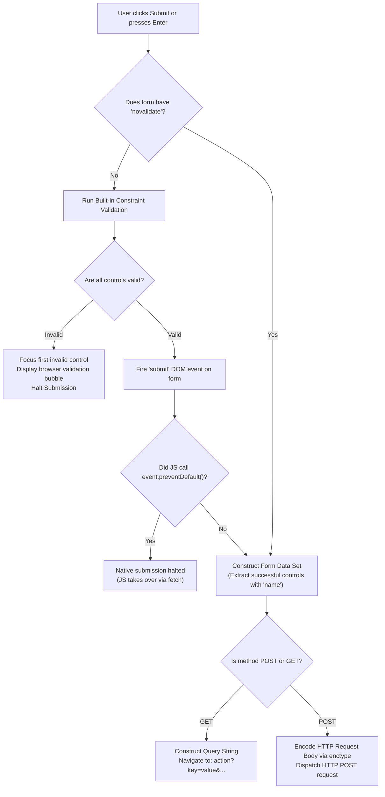

# Form Architecture, HTTP Methods, and Submission Lifecycles

| Metadata | Details |
| :--- | :--- |
| **Level** | Core / Fundamental |
| **Prerequisites** | `02-semantics-and-structure/01-semantic-html-principles.md` |
| **Estimated Reading Time** | 25 minutes |
| **Status** | Production-Ready |
| **Baseline Status** | Widely Available across all modern browsers |
| **Browsers Tested** | Chrome 120+, Firefox 120+, Safari 17+, Edge 120+ |
| **Tested With** | W3C Nu HTML Checker, Axe-core v4.8, NVDA 2023.3, Node.js HTTP Server |

---

## Table of Contents
- [1 What & Why](#1-what--why)
- [2 Core Concepts](#2-core-concepts)
- [3 How It Works Internally](#3-how-it-works-internally)
- [4 Syntax & Usage](#4-syntax--usage)
- [5 Practical Examples](#5-practical-examples)
- [6 Best Practices](#6-best-practices)
- [7 Common Mistakes & Pitfalls](#7-common-mistakes--pitfalls)
- [8 Performance, Accessibility, SEO & Security Notes](#8-performance-accessibility-seo--security-notes)
- [9 Comparison / When to Use What](#9-comparison--when-to-use-what)
- [10 Interview Questions](#10-interview-questions)
- [11 Practice Exercises](#11-practice-exercises)
- [12 Summary / Cheat Sheet](#12-summary--cheat-sheet)
- [13 Further Reading](#13-further-reading)

---

## 1 What & Why

At the dawn of the web, hypertext was predominantly read-only: servers delivered static HTML files to passive browser clients. The introduction of the `<form>` element in 1993 revolutionized the Internet by transforming it into an **interactive, two-way hypermedia communication network**.

Forms collect user input, package it into structured payloads, and transmit it to web servers using standard HTTP methods. While modern Single-Page Applications (SPAs) frequently intercept form submissions using JavaScript's `event.preventDefault()` and `fetch()`, native HTML forms remain the foundational engine:
- **Progressive Enhancement**: Native forms submit reliably even if JavaScript fails to load, crashes, or is blocked by strict enterprise firewalls.
- **Accessibility & Automation**: Browser password managers, credit card autofill engines, and assistive screen readers rely entirely on native form structures to map inputs, identify submit triggers, and coordinate validation bubbles.
- **Declarative Web Standards**: Attributes like `action`, `method`, `enctype`, and `novalidate` configure network transport protocols directly in markup without writing a single line of procedural networking code.

---

## 2 Core Concepts

### The `<form>` Element Attributes
The `<form>` element acts as a boundary container coordinating all child interactive input controls:
- **`action`**: The target URL endpoint where form data will be transmitted. If omitted, the browser defaults to submitting to the current document's URL.
- **`method`**: The HTTP request method used to send data:
  - `GET` (Default): Serializes form inputs into a URL query string (`?key=val&key2=val2`).
  - `POST`: Serializes form inputs into the HTTP request body payload.
  - `dialog`: Modern method that does not transmit network data; instead, it immediately closes an enclosing `<dialog>` element and sets `dialog.returnValue`.
- **`enctype`**: The MIME encoding format of the HTTP request body (used exclusively with `POST`):
  - `application/x-www-form-urlencoded` (Default): Encodes keys and values into percent-encoded URL strings.
  - `multipart/form-data`: Mandated whenever uploading binary files (`<input type="file">`). Encodes inputs as separate MIME segments divided by boundary delimiters.
  - `text/plain`: Encodes raw text with simple newlines (used primarily for legacy debugging; never used in production).
- **`target`**: Where to display the response returned by the server (`_self`, `_blank`, `_parent`, `_top`, or named frame).
- **`novalidate`**: A boolean attribute instructing the browser engine to bypass built-in client-side constraint validation checks upon submission.

### Successful Form Controls
A form does **not** submit every element nested within its boundaries. According to the WHATWG specification, an element is classified as a **successful form control** (and included in the submission payload) only if:
1. It possesses a valid **`name` attribute**. (An input without a `name` attribute is completely ignored by the form serialization engine!).
2. It is **not disabled** (does not have the `disabled` attribute).
3. If it is a radio button or checkbox, it has the `checked` state active.
4. It is not inside an inactive `<template>` or disconnected subtree.

---

## 3 How It Works Internally

### The Form Submission Algorithm
When a user clicks a `<button type="submit">` or presses `Enter` inside a text input:



### HTTP GET vs. POST Serialization Mechanics

#### Method GET:
If the form has `action="/search"` and inputs `query=rust` and `page=1`:
```http
GET /search?query=rust&page=1 HTTP/1.1
Host: api.enterprise.net
User-Agent: Mozilla/5.0...
```
- Inputs appear directly in the browser address bar.
- Bookmarkable and shareable as a hyperlink.
- Strictly limited in payload size (URLs exceeding 2,048 characters risk truncation by intermediate proxies).
- **Security Warning**: Never use `GET` for passwords, credit cards, or PII; query strings are logged in plaintext across server access logs, CDN proxies, and browser histories.

#### Method POST with `application/x-www-form-urlencoded`:
```http
POST /login HTTP/1.1
Host: api.enterprise.net
Content-Type: application/x-www-form-urlencoded
Content-Length: 38

username=shiva%40corp.net&auth_flow=mfa
```

#### Method POST with `multipart/form-data`:
```http
POST /upload HTTP/1.1
Host: api.enterprise.net
Content-Type: multipart/form-data; boundary=----WebKitFormBoundary7MA4YWxkTrZu0gW
Content-Length: 324

------WebKitFormBoundary7MA4YWxkTrZu0gW
Content-Disposition: form-data; name="title"

Incident Report
------WebKitFormBoundary7MA4YWxkTrZu0gW
Content-Disposition: form-data; name="log_file"; filename="telemetry.log"
Content-Type: text/plain

[ERROR] Socket timeout at 12:00:01
------WebKitFormBoundary7MA4YWxkTrZu0gW--
```

---

## 4 Syntax & Usage

```html
<!-- 1. Search Query Form (Idempotent, Read-Only -> GET) -->
<form action="/telemetry/search" method="get" role="search">
  <label for="q">Query Cluster Logs:</label>
  <input type="search" id="q" name="query" required>
  <button type="submit">Search</button>
</form>

<!-- 2. State Mutation Form (Creates Resource -> POST) -->
<form action="/api/v1/clusters" method="post" class="standard-form">
  <div>
    <label for="cluster-name">Cluster Name:</label>
    <input type="text" id="cluster-name" name="cluster_name" required>
  </div>
  <div>
    <label for="region">Datacenter Region:</label>
    <select id="region" name="region">
      <option value="us-east-1">US-East (N. Virginia)</option>
      <option value="eu-central-1">EU-Central (Frankfurt)</option>
    </select>
  </div>
  <button type="submit">Provision Cluster</button>
</form>

<!-- 3. Binary Asset Upload Form (Mandates multipart/form-data) -->
<form action="/api/v1/assets/upload" method="post" enctype="multipart/form-data">
  <label for="diag-bundle">Upload Diagnostic Archive (ZIP):</label>
  <input type="file" id="diag-bundle" name="diagnostic_archive" accept=".zip,.tar.gz" required>
  <button type="submit">Upload Archive</button>
</form>

<!-- 4. In-Dialog Modal Form (Method Dialog) -->
<dialog id="delete-modal">
  <form method="dialog">
    <p>Are you sure you want to permanently delete this pod?</p>
    <button type="submit" value="cancel">Cancel</button>
    <button type="submit" value="confirm" class="btn-danger">Delete</button>
  </form>
</dialog>
```

> [!NOTE]
> **Baseline Status: Widely Available**
> The `<form>` element, `GET`, `POST`, `enctype`, `novalidate`, and standard submission lifecycles are foundational baseline standards supported across every web browser engine since HTML 2.0. The `method="dialog"` attribute is widely available alongside `<dialog>` (2022 Baseline).

---

## 5 Practical Examples

### Example 1: Progressive Enhancement Form Pattern
```html
<!DOCTYPE html>
<html lang="en">
<head>
  <meta charset="utf-8">
  <title>Progressive Enhancement Form</title>
</head>
<body>
  <main>
    <h1>Deploy Worker Node</h1>

    <!-- Native HTML form functions 100% without JavaScript -->
    <form id="deploy-form" action="/workers/deploy" method="post">
      <div>
        <label for="worker-ip">Worker IPv4 Address:</label>
        <input type="text" id="worker-ip" name="ip" pattern="^((25[0-5]|(2[0-4]|1\d|[1-9]|)\d)\.?\b){4}$" required>
      </div>

      <button type="submit" id="submit-btn">Initiate Provisioning</button>
      <div id="status-message" aria-live="polite"></div>
    </form>
  </main>

  <script>
    // Progressive Enhancement Layer: Intercepts submission if JS is operational
    const form = document.getElementById("deploy-form");
    const statusMsg = document.getElementById("status-message");

    form.addEventListener("submit", async (event) => {
      // 1. Prevent full-page document reload
      event.preventDefault();
      statusMsg.textContent = "Deploying worker asynchronously...";

      // 2. Extract form data using native FormData API
      const formData = new FormData(form);

      try {
        const response = await fetch(form.action, {
          method: form.method,
          body: formData,
          headers: { "Accept": "application/json" }
        });

        if (response.ok) {
          statusMsg.textContent = "Worker successfully provisioned!";
        } else {
          statusMsg.textContent = "Deployment failed. Check network logs.";
        }
      } catch (err) {
        // Fallback: If network fetch fails, submit natively
        form.submit();
      }
    });
  </script>
</body>
</html>
```

### Example 2: In-Dialog Modal Confirmation using `method="dialog"`
```html
<button type="button" onclick="document.getElementById('confirm-dialog').showModal()">
  Purge Telemetry Cache
</button>

<dialog id="confirm-dialog" aria-labelledby="dialog-heading">
  <!-- When submitted, method="dialog" automatically closes the dialog -->
  <!-- and sets dialog.returnValue to the value of the clicked submit button! -->
  <form method="dialog">
    <h2 id="dialog-heading">Confirm Cache Invalidation</h2>
    <p>This action cannot be undone. Are you certain?</p>

    <div class="button-row">
      <button type="submit" value="dismiss">Cancel</button>
      <button type="submit" value="confirmed" class="btn-danger">Purge Cache</button>
    </div>
  </form>
</dialog>

<script>
  const dialog = document.getElementById("confirm-dialog");
  dialog.addEventListener("close", () => {
    console.log("Dialog closed with user choice:", dialog.returnValue);
    if (dialog.returnValue === "confirmed") {
      executeCachePurge();
    }
  });
</script>
```

### Example 3: Edge Case — Button-Level Submission Overrides
```html
<!-- An individual submit button can dynamically override form-level attributes -->
<!-- using formaction, formmethod, formenctype, and formtarget! -->

<form action="/orders/draft" method="post" id="order-form">
  <label for="item">Item SKU:</label>
  <input type="text" id="item" name="sku" value="SSD-2TB-NVME" required>

  <!-- Button 1: Uses standard form action (/orders/draft) -->
  <button type="submit">Save Draft</button>

  <!-- Button 2: Overrides action to execute immediate checkout -->
  <button type="submit" formaction="/orders/checkout">Execute Instant Checkout</button>

  <!-- Button 3: Overrides method and target to preview in new window -->
  <button type="submit" formaction="/orders/preview" formmethod="get" formtarget="_blank">
    Preview Invoice (New Tab)
  </button>
</form>
```

### Example 4: Failure Case — Fatal Form Submission Anti-Patterns
```html
<!-- ANTI-PATTERN: DO NOT COPY -->

<!-- Error 1: Missing 'name' attributes on inputs! -->
<!-- In native submission, an input WITHOUT a name attribute is COMPLETELY OMITTED -->
<!-- The server receives an EMPTY payload: {} -->
<form action="/login" method="post">
  <input type="text" placeholder="Username"> <!-- MISSING name="username" -->
  <input type="password" placeholder="Password"> <!-- MISSING name="password" -->
  <button type="submit">Log In</button>
</form>

<!-- Error 2: Transmitting passwords via method="get" -->
<!-- Exposes password in browser URL bar, browser history, and proxy access logs! -->
<form action="/login" method="get">
  <input type="password" name="secret">
  <button type="submit">Sign In</button>
</form>

<!-- Error 3: File upload form missing enctype="multipart/form-data" -->
<!-- Browser submits only the filename string, NOT the binary file contents! -->
<form action="/upload" method="post">
  <input type="file" name="doc">
  <button type="submit">Upload</button>
</form>
```

### Example 5: Production Enterprise Authentication Form with Security Attributes
```html
<!DOCTYPE html>
<html lang="en">
<head>
  <meta charset="utf-8">
  <meta name="viewport" content="width=device-width, initial-scale=1.0">
  <title>Single Sign-On Authentication</title>
</head>
<body>
  <main>
    <h1>Infrastructure Gateway Sign-In</h1>

    <!-- Secure POST form with HTTPS action, autocomplete, and CSRF token -->
    <form action="https://auth.enterprise.net/v2/authenticate" 
          method="post" 
          autocomplete="on" 
          class="auth-card">

      <!-- Hidden CSRF Synchronizer Token -->
      <input type="hidden" name="csrf_token" value="c8f92a10b48e912034e89b">

      <div>
        <label for="work-email">Corporate Email Address</label>
        <input type="email" 
               id="work-email" 
               name="username" 
               autocomplete="username" 
               required 
               autofocus>
      </div>

      <div>
        <label for="work-password">Password</label>
        <input type="password" 
               id="work-password" 
               name="password" 
               autocomplete="current-password" 
               required>
      </div>

      <div>
        <label for="mfa-token">Authenticator 6-Digit Code</label>
        <input type="text" 
               id="mfa-token" 
               name="totp" 
               inputmode="numeric" 
               pattern="[0-9]{6}" 
               autocomplete="one-time-code" 
               placeholder="000000" 
               required>
      </div>

      <button type="submit">Authenticate Session</button>
    </form>
  </main>
</body>
</html>
```

---

## 6 Best Practices

1. **Always Supply `name` Attributes on Interactive Inputs**: Every input, select, and textarea intended for data transmission must have a `name` attribute. Without a `name`, inputs are ignored during form data assembly.
2. **Use `method="get"` Strictly for Idempotent Queries**: Use `GET` only for searches, filtering, or read-only queries where submitting the form multiple times produces no side effects or mutations.
3. **Use `method="post"` for Mutations and Sensitive Data**: Use `POST` for logins, account creation, payments, database updates, or whenever sending passwords or PII.
4. **Always Specify `enctype="multipart/form-data"` for File Inputs**: If a `<form>` contains `<input type="file">`, declaring `enctype="multipart/form-data"` is mandatory; otherwise, binary file bytes will never be sent.
5. **Architect for Progressive Enhancement**: Ensure that every form has a valid `action` URL and backend endpoint capable of handling traditional non-JS form submissions before attaching client-side `fetch()` event listeners.
6. **Include CSRF Protection on All POST Forms**: Every state-mutating form must transmit an unpredictable, cryptographically secure anti-CSRF token (typically in an `<input type="hidden">`) to prevent cross-site request forgery attacks.

---

## 7 Common Mistakes & Pitfalls

| Mistake | Bad Code | Good Code | Technical Explanation |
| :--- | :--- | :--- | :--- |
| **Missing `name` Attribute** | `<input type="text" id="user">` | `<input type="text" id="user" name="username">` | Inputs without a `name` attribute are not successful form controls and are omitted from submission payloads. |
| **Passwords via GET** | `<form method="get"><input type="password" ...>` | `<form method="post">...` | `GET` parameters leak into browser history, web server access logs, and referrer headers. |
| **Missing Multipart Enctype** | `<form method="post"><input type="file" name="f">` | `<form method="post" enctype="multipart/form-data">` | Default encoding (`x-www-form-urlencoded`) sends only the filename string, dropping the actual file contents. |
| **Using `<div>` as Form Trigger** | `<div onclick="form.submit()">Submit</div>` | `<button type="submit">Submit</button>` | Custom `div` buttons cannot be focused via keyboard `Tab` and cannot be activated via `Enter` keypresses. |
| **Unneeded `novalidate`** | `<form novalidate>` without custom JS validation | Rely on native validation or wire custom errors | Disabling native validation without a comprehensive custom client validator allows malformed data through. |
| **Nesting `<form>` Elements** | `<form><form>...</form></form>` | Sequential, independent forms | HTML parsers strictly prohibit nested `<form>` elements. The inner form tag is ignored by error recovery. |

---

## 8 Performance, Accessibility, SEO & Security Notes

### Accessibility (WCAG 2.2 AA)
- **Criterion 3.3.2 (Labels or Instructions - Level A)**: Every input within a form must have an accessible programmatic label via `<label for="input-id">`.
- **Keyboard Submission**: Sighted and non-sighted keyboard users rely on pressing `Enter` within any single-line input to trigger form submission. This is built into native `<form>` elements; custom `div` forms completely break this behavior unless laborious key listeners are implemented.

### Search Engine Optimization (SEO)
- Search engine crawlers (Googlebot) generally **do not submit forms**. Content accessible only behind a `POST` form will not be indexed.
- Public search forms using `method="get"` can have their target URLs indexed if crawled via static links.

### Performance & Network Efficiency
- Native form submissions incur zero JavaScript execution overhead, making them instantaneous on low-powered mobile devices.
- Payload efficiency: `application/x-www-form-urlencoded` has lower byte overhead for small key-value strings; `multipart/form-data` introduces MIME boundary overhead, making it efficient only when transmitting large binary files.

### Security Notes
- **Cross-Site Request Forgery (CSRF)**: An attacker hosting an external website can forge a POST submission targeting `https://yourbank.com/transfer` using an invisible iframe or auto-submitting form. Protect all mutating forms using SameSite cookies (`SameSite=Lax` or `Strict`) and unique server-generated CSRF tokens.
- **Always Transmit Over HTTPS**: Any form containing credentials or personal data must submit to an `https://` endpoint to prevent Man-in-the-Middle (MITM) packet sniffing.

---

## 9 Comparison / When to Use What

| Form Method / Enctype | Data Transmission Location | Idempotent? | Browser History Stored? | Ideal Use Case |
| :--- | :--- | :--- | :--- | :--- |
| `method="get"` | URL Query String (`?a=1&b=2`) | **Yes** | **Yes** (Full URL logged) | Search bars, product catalog filters, public views. |
| `method="post"` (`x-www-form-urlencoded`) | HTTP Request Body Payload | **No** | **No** (Body is private) | Authentication, account updates, checkout transactions. |
| `method="post"` (`multipart/form-data`) | Multi-part MIME Request Body | **No** | **No** (Body is private) | File uploads, image avatars, binary attachments. |
| `method="dialog"` | None (Local DOM state only) | **Yes** | **No** (No network hit) | Closing modal dialogs, returning confirmation values. |

---

## 10 Interview Questions

<details>
<summary><strong>1. Explain the architectural difference between HTTP `GET` and `POST` methods in HTML forms. When is each required?</strong></summary>

**Answer:**
- **`GET` Method**:
  - The browser serializes all successful form controls into a URL-encoded query string and appends it to the target URL (`action?name=val&...`).
  - **Idempotency**: `GET` requests are idempotent and safe—submitting the form multiple times should produce no side effects or server-side mutations.
  - **Caching & Bookmarking**: The resulting URL can be bookmarked, shared, and cached by browsers and intermediate CDNs.
  - **Limitation**: Cannot transmit binary files; limited by URL length limits (~2,048 characters); leaks data in server logs.
  - **Required for**: Search bars, catalog filtering, documentation lookups.
- **`POST` Method**:
  - The browser serializes data and transmits it inside the HTTP request body payload.
  - **Non-Idempotent**: Represents an action that alters state (creating a user, charging a card, deleting a cluster). Re-submitting a POST prompts the browser's "Confirm Form Resubmission" dialog.
  - **Payload Size**: Can transmit massive payloads and binary files (gigabytes).
  - **Required for**: Authentication, financial transactions, database mutations, and file uploads.
</details>

<details>
<summary><strong>2. What is a "successful form control" according to the WHATWG HTML Living Standard?</strong></summary>

**Answer:**
A successful form control is an interactive element within a `<form>` whose name and value are included in the constructed form data set upon submission.
To be successful:
1. The element must have a non-empty **`name` attribute**.
2. The element must **not be disabled** (`disabled` attribute is absent).
3. If it is a button, it must be the specific button that initiated the submission.
4. If it is a checkbox or radio button, it must be in the **`checked`** state.
5. It must not be an `<input type="reset">` or `<input type="button">`.
Any input lacking a `name` attribute or having `disabled` applied is completely discarded by the browser's submission serialization algorithm.
</details>

<details>
<summary><strong>3. Why is `enctype="multipart/form-data"` strictly mandatory when uploading files via `<input type="file">`?</strong></summary>

**Answer:**
By default, the encoding type of a POST form is `application/x-www-form-urlencoded`. Under this encoding:
- Keys and values are serialized into a continuous string where characters are converted to ASCII hex percent-encodings (e.g., space becomes `+` or `%20`).
- If an `<input type="file">` is submitted under `x-www-form-urlencoded`, the browser sends **only the file's filename string** (e.g., `avatar=profile.png`), discarding the actual binary contents of the file!

Declaring `enctype="multipart/form-data"` instructs the browser engine to partition the HTTP body into distinct MIME parts separated by a unique boundary string. Each part contains its own headers (`Content-Disposition`, `Content-Type`) and preserves the raw binary stream of the uploaded file.
</details>

<details>
<summary><strong>4. How does `method="dialog"` work on a form, and what problem does it solve?</strong></summary>

**Answer:**
Introduced as part of the HTML5 `<dialog>` specification, `method="dialog"` configures a form to execute **client-side modal dismissal** without dispatching any network request.

When a `<form method="dialog">` is submitted from within an enclosing `<dialog>` element:
1. The browser engine prevents any HTTP GET or POST network dispatch.
2. The browser automatically closes the parent `<dialog>` element.
3. The browser inspects the submit button that was clicked and sets `dialog.returnValue` to that button's `value` attribute.
This provides a native, zero-JavaScript mechanism to build accessible confirmation dialogs, prompt modals, and cancel/confirm buttons.
</details>

<details>
<summary><strong>5. What is the effect of the `novalidate` attribute on a `<form>`?</strong></summary>

**Answer:**
The `novalidate` boolean attribute instructs the browser engine to **bypass native client-side constraint validation** upon form submission:
- The browser will not evaluate attributes like `required`, `pattern`, `min`, `max`, or `type="email"`.
- The browser will not display native validation warning bubbles.
- The browser fires the `submit` event immediately regardless of field validity.
This attribute is widely used by frontend engineers who implement custom JavaScript validation frameworks (e.g., React Hook Form, Formik) and want to prevent default browser validation popups from clashing with their custom inline error styling.
</details>

<details>
<summary><strong>6. Can an HTML document contain nested `<form>` elements? What does the parser do if you try?</strong></summary>

**Answer:**
**No.** The WHATWG HTML specification strictly forbids nested `<form>` elements. 

According to the HTML tree construction state machine:
- When the parser is inside an open `HTMLFormElement` and encounters another opening `<form>` tag, the start tag is **ignored and discarded as a parse error**.
- The inner `<form>` is never created in the DOM.
- When the first closing `</form>` tag is encountered, it closes the top-level form, leaving any subsequent inputs as orphans.
Forms must always be authored as sequential siblings in the DOM.
</details>

<details>
<summary><strong>7. How do button-level form attributes (`formaction`, `formmethod`, `formenctype`) function?</strong></summary>

**Answer:**
Button-level form override attributes allow individual `<button type="submit">` or `<input type="submit">` elements to override the form's top-level configuration dynamically for that specific click:
- `formaction="/custom-endpoint"`: Overrides the form's `action`.
- `formmethod="get"`: Overrides the form's `method`.
- `formenctype="multipart/form-data"`: Overrides the form's `enctype`.
- `formnovalidate`: Bypasses validation for that specific button (e.g., a "Save Draft" button).
- `formtarget="_blank"`: Overrides the target window.
This allows a single form to submit to different endpoints depending on which button the user activates.
</details>

<details>
<summary><strong>8. Why should you avoid using `<input type="image">` as a modern submit button?</strong></summary>

**Answer:**
While historically used in HTML 4 to create graphical submit buttons, `<input type="image">` introduces quirks:
- Upon submission, it appends the exact X and Y pixel coordinates of the user's mouse click to the form data payload (e.g., `submit.x=42&submit.y=19`).
- It has limited styling capabilities compared to modern CSS.
Modern best practice mandates using a semantic `<button type="submit">` containing an `` or SVG icon, styled with CSS.
</details>

---

## 11 Practice Exercises

### Exercise 1 (Easy): Fix the Missing Name Anti-Pattern
**Task**: In the following form, identify why the server receives an empty payload upon submission and correct it.

```html
<!-- Broken Source -->
<form action="/login" method="post">
  <label for="u">Username</label>
  <input type="text" id="u">
  <label for="p">Password</label>
  <input type="password" id="p">
  <button type="submit">Sign In</button>
</form>
```

<details>
<summary><strong>Solution</strong></summary>

```html
<form action="/login" method="post">
  <label for="u">Username</label>
  <input type="text" id="u" name="username" required>
  
  <label for="p">Password</label>
  <input type="password" id="p" name="password" required>
  
  <button type="submit">Sign In</button>
</form>
```
*Explanation*: Adding `name="username"` and `name="password"` transforms the inputs into successful form controls included in the POST request body.
</details>

### Exercise 2 (Easy): Author a Secure Multipart Upload Form
**Task**: Write the HTML for an avatar upload form that accepts PNG and JPEG images and submits them via POST to `/api/avatar`.

<details>
<summary><strong>Solution</strong></summary>

```html
<form action="/api/avatar" method="post" enctype="multipart/form-data">
  <label for="avatar-file">Select Profile Avatar (PNG or JPEG):</label>
  <input type="file" id="avatar-file" name="avatar" accept="image/png, image/jpeg" required>
  <button type="submit">Upload Avatar</button>
</form>
```
*Explanation*: `method="post"` and `enctype="multipart/form-data"` ensure the binary image stream is transmitted to the server.
</details>

### Exercise 3 (Medium): Dual-Action Form with `formaction`
**Task**: Build a single form that allows an author to write a support ticket. The form must contain two submit buttons: "Save Draft" (submits to `/tickets/draft`) and "Publish Ticket" (submits to `/tickets/publish`).

<details>
<summary><strong>Solution</strong></summary>

```html
<form action="/tickets/draft" method="post">
  <div>
    <label for="ticket-title">Ticket Title:</label>
    <input type="text" id="ticket-title" name="title" required>
  </div>

  <div>
    <label for="ticket-desc">Description:</label>
    <textarea id="ticket-desc" name="description" rows="5" required></textarea>
  </div>

  <!-- Standard submit uses form action -->
  <button type="submit">Save Draft</button>

  <!-- Override submit redirects to publish endpoint -->
  <button type="submit" formaction="/tickets/publish" class="btn-primary">
    Publish Ticket
  </button>
</form>
```
</details>

### Exercise 4 (Medium): Build an In-Dialog Confirmation Flow
**Task**: Author an accessible `<dialog>` component containing a `<form method="dialog">` that allows a user to confirm or cancel the termination of an EC2 virtual machine instance.

<details>
<summary><strong>Solution</strong></summary>

```html
<dialog id="terminate-modal" aria-labelledby="modal-title">
  <form method="dialog">
    <h2 id="modal-title">Confirm Instance Termination</h2>
    <p>Terminating instance <code>i-0982341</code> will destroy all ephemeral storage.</p>

    <div class="modal-actions">
      <button type="submit" value="cancel">Keep Instance</button>
      <button type="submit" value="terminate" class="btn-danger">Terminate</button>
    </div>
  </form>
</dialog>
```
*Explanation*: Submitting either button closes the dialog immediately and sets `dialog.returnValue` to `"cancel"` or `"terminate"`.
</details>

### Exercise 5 (Hard): Identify and Fix 5 Form Architecture Bugs
**Task**: Review this production checkout form and remediate all 5 security, specification, and validation bugs:

```html
<!-- Flawed Source -->
<form action="/checkout" method="get">
  <form action="/coupon">
    <input type="text" name="coupon_code">
  </form>
  <input type="text" id="card-num" placeholder="Card Number">
  <input type="file" name="tax_exemption_doc">
  <div class="submit-btn" onclick="submit()">Complete Order</div>
</form>
```

<details>
<summary><strong>Solution</strong></summary>

```html
<!-- Fully Remediated Semantic Checkout Form -->
<form action="/checkout" method="post" enctype="multipart/form-data">
  <!-- Hidden CSRF token -->
  <input type="hidden" name="csrf_token" value="sec_token_98412">

  <div>
    <label for="coupon-code">Coupon Code</label>
    <input type="text" id="coupon-code" name="coupon_code">
  </div>

  <div>
    <label for="card-num">Credit Card Number</label>
    <input type="text" 
           id="card-num" 
           name="card_number" 
           inputmode="numeric" 
           autocomplete="cc-number" 
           required>
  </div>

  <div>
    <label for="tax-doc">Tax Exemption Certificate (PDF)</label>
    <input type="file" id="tax-doc" name="tax_exemption_doc" accept=".pdf">
  </div>

  <button type="submit" class="btn-primary">Complete Order</button>
</form>
```
*Bugs Remediated*:
1. Changed `method="get"` to `method="post"` (transmitting credit cards over GET is a severe security flaw).
2. Removed illegal nested `<form action="/coupon">`.
3. Added missing `name="card_number"` and associated `<label for="card-num">`.
4. Added `enctype="multipart/form-data"` to support the file input.
5. Replaced fake `div` button with semantic `<button type="submit">`.
</details>

### Exercise 6 (Hard): Predict HTTP Request Wire Format
**Task**: Given this form submitted by a browser, write the exact HTTP/1.1 raw request wire text that arrives at the server:
```html
<form action="/api/register" method="post">
  <input type="text" name="username" value="shiva">
  <input type="checkbox" name="terms" value="accepted" checked>
  <input type="checkbox" name="newsletter" value="yes">
</form>
```

<details>
<summary><strong>Solution</strong></summary>

```http
POST /api/register HTTP/1.1
Host: example.com
Content-Type: application/x-www-form-urlencoded
Content-Length: 37

username=shiva&terms=accepted
```
*Explanation*:
1. The unchecked checkbox (`newsletter`) is **not a successful form control**, so it is completely excluded from the payload!
2. The checked checkbox (`terms=accepted`) and the text input (`username=shiva`) are combined via `&`.
3. The body contains exactly 30 ASCII bytes (`username=shiva&terms=accepted` = 29 characters, plus line breaks).
</details>

---

## 12 Summary / Cheat Sheet

```
┌────────────────────────────────────────────────────────────────────────┐
│                        FORM BASICS CHEAT SHEET                         │
├───────────────────┬────────────────────────────────────────────────────┤
│ Attribute / Method│ Rule / Requirement                                 │
├───────────────────┼────────────────────────────────────────────────────┤
│ method="get"      │ Query string URL params (?a=b); for safe searches  │
│ method="post"     │ Request body payload; for mutations and passwords  │
│ method="dialog"   │ Closes <dialog>; sets dialog.returnValue           │
│ enctype="multipart│ Mandatory when uploading files via input[type=file]│
│ name attribute    │ Mandatory! Inputs without name are ignored         │
│ novalidate        │ Skips native client-side validation popups         │
│ formaction / form-│ Button-level override attributes on submit buttons │
│ CSRF Token        │ Mandatory hidden input for mutating POST forms     │
└───────────────────┴────────────────────────────────────────────────────┘
```

---

## 13 Further Reading

- [WHATWG HTML Living Standard: Section 4.10 Forms](https://html.spec.whatwg.org/multipage/forms.html)
- [MDN Web Docs: Sending Form Data](https://developer.mozilla.org/en-US/docs/Learn/HTML/Forms/Sending_and_retrieving_form_data)
- [MDN Web Docs: The HTML &lt;form&gt; Element](https://developer.mozilla.org/en-US/docs/Web/HTML/Element/form)
- [web.dev: Learn Forms - Payment and Address Autofill](https://web.dev/learn/forms/)
- [OWASP: Cross-Site Request Forgery Prevention Cheat Sheet](https://cheatsheetseries.owasp.org/cheatsheets/Cross-Site_Request_Forgery_Prevention_Cheat_Sheet.html)

---

| [Previous Module: 02 Semantics & Structure](../02-semantics-and-structure/README.md) | [Section Index](README.md) | [Next: 02 Input Types & Mobile Modalities](02-input-types-and-mobile-keyboards.md) |
