# Input Types, Mobile Keyboards, and Virtual Input Modalities

| Metadata | Details |
| :--- | :--- |
| **Level** | Core / Fundamental |
| **Prerequisites** | `01-form-basics-and-methods.md` |
| **Estimated Reading Time** | 30 minutes |
| **Status** | Production-Ready |
| **Baseline Status** | Widely Available (`enterkeyhint` Widely Available 2024) |
| **Browsers Tested** | Chrome 120+, Firefox 120+, Safari 17+, Edge 120+ |
| **Tested With** | W3C Nu HTML Checker, Axe-core v4.8, iOS 17 Mobile Safari, Android 14 Chrome |

---

## Table of Contents
- [1 What & Why](#1-what--why)
- [2 Core Concepts](#2-core-concepts)
- [3 How It Works Internally](#3-how-it-works-internally)
- [4 Syntax & Usage](#4-syntax--usage)
- [5 Practical Examples](#5-practical-examples)
- [6 Best Practices](#6-best-practices)
- [7 Common Mistakes & Pitfalls](#7-common-mistakes--pitfalls)
- [8 Performance, Accessibility, SEO & Security Notes](#8-performance-accessibility-seo--security-notes)
- [9 Comparison / When to Use What](#9-comparison--when-to-use-what)
- [10 Interview Questions](#10-interview-questions)
- [11 Practice Exercises](#11-practice-exercises)
- [12 Summary / Cheat Sheet](#12-summary--cheat-sheet)
- [13 Further Reading](#13-further-reading)

---

## 1 What & Why

Over 65% of global web traffic originates from mobile devices, tablets, and wearable interfaces where physical hardware keyboards do not exist. On touchscreen devices, the user interacts with software-rendered **virtual keyboards** (On-Screen Keyboards / OSKs).

Early HTML relied almost exclusively on `<input type="text">`. When a mobile user focused a text input to enter a phone number or credit card, the operating system popped up a standard full QWERTY keyboard, forcing the user to tap the numeric shift key (`123`), navigate tiny buttons, and endure high cognitive and typing friction.

The modern WHATWG HTML Living Standard defines **22 distinct input types**, complemented by the **`inputmode`** and **`enterkeyhint`** attributes:
- Directly commanding the mobile OS to display specialized keypad layouts (e.g., pure numeric pinpads, decimal keyboards, email layouts with `@` and `.com` keys).
- Customizing the bottom-right action key on the software keyboard (e.g., displaying **"Next"**, **"Go"**, **"Search"**, or **"Send"** instead of a generic return symbol).
- Providing native validation semantics and accessibility roles automatically without custom JavaScript masking libraries.

---

## 2 Core Concepts

### The 22 Native Input Types Catalog
The WHATWG specification categorizes `<input type="...">` into distinct functional families:

1. **Textual Types**:
   - `text`: Generic single-line text input.
   - `password`: Obscured single-line text (masked characters with native toggle affordances).
   - `search`: Single-line search text with native clear-button icon.
   - `email`: Validates email address syntax conforming to RFC 5322; summons mobile keyboard with `@` and period keys.
   - `tel`: Telephone number input; summons phone dialpad keyboard.
   - `url`: Validates absolute URI syntax (`https://...`); summons keyboard with `.com` and `/` keys.
2. **Numeric & Range Types**:
   - `number`: Floating-point numeric spinner with up/down increment controls. Supports `min`, `max`, and `step`.
   - `range`: Visual slider control for non-precise scalar selections.
3. **Temporal & Calendar Types**:
   - `date`: Full date picker (year, month, day).
   - `time`: Time picker (hour, minute, optional seconds).
   - `datetime-local`: Combined date and time without timezone offset.
   - `month`: Year and month picker.
   - `week`: Year and week-number picker.
4. **Binary & Choice Types**:
   - `checkbox`: Independent boolean toggle.
   - `radio`: Mutually exclusive option within a named group.
   - `file`: File upload picker with OS file manager integration.
   - `color`: Visual hexadecimal color picker wheel/palette.
5. **Button & Action Types**:
   - `submit`: Triggers form submission.
   - `reset`: Resets all form controls to default values.
   - `button`: Generic button with no default behavior (use `<button type="button">` instead).
   - `image`: Graphical submit button with (x, y) coordinates.
6. **Data Storage**:
   - `hidden`: Non-rendered form control storing session tokens or database primary keys.

---

### The `inputmode` Global Attribute
The `inputmode` attribute provides granular control over the mobile virtual keyboard layout **independently** of the input's data validation type:
- `none`: Suppresses the virtual keyboard entirely (used for custom in-app pinpads or date pickers).
- `text` (Default): Standard localized QWERTY keyboard.
- `decimal`: Numeric keyboard featuring digits `0-9` and a localized decimal separator (`.` or `,`).
- `numeric`: Strict numeric pinpad featuring digits `0-9`.
- `tel`: Telephone dialpad featuring digits, `*`, and `#`.
- `search`: Keyboard optimized for search queries with a dedicated magnifying glass action button.
- `email`: Keyboard featuring `@` and domain shortcuts.
- `url`: Keyboard featuring `/` and `.com` shortcuts.

---

### The `enterkeyhint` Attribute *(2024 Baseline)*
The `enterkeyhint` attribute dictates the visual label and icon of the **Enter / Return key** on mobile virtual keyboards:
- `enter`: Standard carriage return.
- `done`: Informs the user they have completed the form; dismisses the virtual keyboard.
- `go`: Executes the action (e.g., loading an application route).
- `next`: Moves focus automatically to the next interactive field.
- `previous`: Moves focus to the preceding interactive field.
- `search`: Executes a search query.
- `send`: Dispatches a message or payload (common in chat apps).

---

## 3 How It Works Internally

### Virtual Keyboard Trigger Lifecycle on Mobile OS
When a user taps an input element on iOS (Safari) or Android (Chrome):

```mermaid
sequenceDiagram
    autonumber
    actor User as Mobile User
    participant Browser as Browser Layout Engine
    participant OS as Operating System (iOS / Android)
    participant OSK as On-Screen Keyboard (OSK)

    User->>Browser: Taps <input type="text" inputmode="numeric" enterkeyhint="next">
    Browser->>OS: Request Input Context (Type, inputmode, enterkeyhint)
    Note over OS: OS inspects attributes:<br>inputmode="numeric" -> Select PIN Pad<br>enterkeyhint="next" -> Render "Next" button
    OS->>OSK: Instantiate Custom Keypad Layout
    OSK-->>User: Slide up 0-9 Pinpad with "Next" blue button!
    User->>OSK: Types digits and taps "Next"
    OSK->>Browser: Emit synthetic Enter/Tab keydown event
```



1. **Focus Notification**: The browser engine detects the focus event and queries the DOM node for `type`, `inputmode`, `enterkeyhint`, and `autocomplete`.
2. **Input Context Assembly**: The browser passes these parameters to the host OS input method editor (IME) bridge.
3. **Keypad Allocation**: The operating system allocates the exact virtual keyboard requested, minimizing user keypresses and eliminating accidental inputs.

---

## 4 Syntax & Usage

```html
<!-- 1. The Superior Numeric Pattern: Credit Cards, OTPs, and Postal Codes -->
<!-- DO NOT use type="number" for credit cards! Use type="text" + inputmode="numeric" -->
<label for="mfa-pin">Two-Factor Authentication Code:</label>
<input type="text" 
       id="mfa-pin" 
       name="totp_pin" 
       inputmode="numeric" 
       pattern="[0-9]{6}" 
       autocomplete="one-time-code" 
       enterkeyhint="done" 
       maxlength="6" 
       placeholder="123456" 
       required>

<!-- 2. Currency and Financial Amount Inputs -->
<label for="deposit-amount">Deposit Amount (USD):</label>
<input type="text" 
       id="deposit-amount" 
       name="amount" 
       inputmode="decimal" 
       pattern="^\d+(\.\d{1,2})?$" 
       placeholder="0.00" 
       required>

<!-- 3. Mobile Optimized Search Field -->
<label for="doc-search">Search API Documentation:</label>
<input type="search" 
       id="doc-search" 
       name="query" 
       inputmode="search" 
       enterkeyhint="search" 
       placeholder="e.g., Kubernetes Ingress">

<!-- 4. Native Date and Time Controls -->
<label for="meeting-time">Select Incident Review Window:</label>
<input type="datetime-local" 
       id="meeting-time" 
       name="review_timestamp" 
       min="2026-03-01T00:00" 
       max="2026-12-31T23:59">
```

> [!NOTE]
> **Baseline Status:**
> - All 22 native input types and `inputmode` are **Widely Available** baseline web platform standards supported across all modern mobile and desktop engines.
> - `enterkeyhint` is **Widely Available** across all major engines (Chrome 77+, Safari 13.1+, Firefox 128+ since mid-2024).

---

## 5 Practical Examples

### Example 1: High-Performance Multi-Step Mobile Checkout Form
```html
<!DOCTYPE html>
<html lang="en">
<head>
  <meta charset="utf-8">
  <meta name="viewport" content="width=device-width, initial-scale=1.0">
  <title>Mobile Optimized Checkout</title>
  <style>
    .form-group { margin-bottom: 1.25rem; display: flex; flex-direction: column; }
    label { font-weight: 600; margin-bottom: 0.25rem; font-family: sans-serif; }
    input { padding: 0.75rem; font-size: 1rem; border: 1px solid #d1d5db; border-radius: 6px; }
  </style>
</head>
<body>
  <main>
    <h1>Secure Hardware Order</h1>

    <form action="/checkout/pay" method="post">
      <!-- 1. Email with dedicated email keyboard -->
      <div class="form-group">
        <label for="cust-email">Email Address</label>
        <input type="email" 
               id="cust-email" 
               name="email" 
               inputmode="email" 
               autocomplete="email" 
               enterkeyhint="next" 
               required>
      </div>

      <!-- 2. Phone with telephone dialpad -->
      <div class="form-group">
        <label for="cust-tel">SMS Delivery Notification Phone</label>
        <input type="tel" 
               id="cust-tel" 
               name="telephone" 
               inputmode="tel" 
               autocomplete="tel" 
               enterkeyhint="next" 
               required>
      </div>

      <!-- 3. Credit Card Number (Zero scrollwheel bugs via inputmode) -->
      <div class="form-group">
        <label for="cc-num">Credit Card Number</label>
        <input type="text" 
               id="cc-num" 
               name="cardnumber" 
               inputmode="numeric" 
               pattern="[0-9\s]{13,19}" 
               autocomplete="cc-number" 
               enterkeyhint="next" 
               placeholder="xxxx xxxx xxxx xxxx" 
               required>
      </div>

      <!-- 4. Security CVV Code -->
      <div class="form-group">
        <label for="cc-cvv">Security Code (CVV)</label>
        <input type="password" 
               id="cc-cvv" 
               name="cvc" 
               inputmode="numeric" 
               pattern="[0-9]{3,4}" 
               maxlength="4" 
               autocomplete="cc-csc" 
               enterkeyhint="done" 
               required>
      </div>

      <button type="submit">Authorize Payment</button>
    </form>
  </main>
</body>
</html>
```

### Example 2: The Range Slider with Synchronized Output
```html
<form class="scaler-form">
  <label for="node-replicas">Cluster Worker Node Replicas:</label>
  
  <div class="slider-wrapper">
    <input type="range" 
           id="node-replicas" 
           name="replicas" 
           min="1" 
           max="32" 
           step="1" 
           value="3" 
           oninput="replicaOutput.value = nodeReplicas.value">
    
    <!-- Accessible live output linked to input ID -->
    <output id="replicaOutput" for="node-replicas">3</output> Nodes
  </div>
</form>

<script>
  const nodeReplicas = document.getElementById("node-replicas");
  const replicaOutput = document.getElementById("replicaOutput");
</script>
```

### Example 3: Edge Case — Why `type="number"` is Harmful for Identifiers
```html
<!-- DANGEROUS ANTI-PATTERN: DO NOT USE FOR IDS, CARDS, OR ZIP CODES -->
<label for="bad-card">Credit Card Number (Broken):</label>
<input type="number" id="bad-card" name="card">

<!-- WHAT BREAKS WITH TYPE="NUMBER":
1. Scrollwheel Hazard: If a user scrolls their mouse while hovering over the input,
   the credit card number silently increments or decrements!
2. Leading Zeros Stripped: In US ZIP codes (e.g. "01234"), type="number" converts
   the string to the mathematical integer 1234, destroying the leading zero!
3. Scientific E-Notation: Users can type characters like 'e' or 'E' (e.g. 1e10),
   confusing backend parsers.
4. Mobile Screen Readers: Announce numbers as mathematical quantities
   ("Four trillion, two hundred billion...") instead of distinct digits!
-->

<!-- THE CORRECT PATTERN: -->
<label for="good-card">Credit Card Number (Secure):</label>
<input type="text" id="good-card" name="card" inputmode="numeric" pattern="[0-9]*">
```

### Example 4: Failure Case — Inaccessible Color & Password Modalities
```html
<!-- ANTI-PATTERN: DO NOT COPY -->

<!-- Error 1: Missing label on color picker -->
<input type="color" name="theme_color"> <!-- Screen reader announces "Color well", no purpose! -->

<!-- Error 2: Password field with copy/paste disabled -->
<!-- Violates WCAG: Disables password managers from pasting secure 64-char passwords! -->
<input type="password" onpaste="return false;" oncopy="return false;">

<!-- Error 3: Number input lacking min and max constraints -->
<input type="number" name="age"> <!-- Allows user to enter -99999 or 10000000 -->
```

### Example 5: Production Incident Filing Form with Date and Color Pickers
```html
<!DOCTYPE html>
<html lang="en">
<head>
  <meta charset="utf-8">
  <title>Production Incident Triage</title>
</head>
<body>
  <main>
    <h1>Log Infrastructure Incident</h1>

    <form action="/incidents" method="post">
      <div>
        <label for="inc-title">Incident Summary</label>
        <input type="text" id="inc-title" name="summary" enterkeyhint="next" required>
      </div>

      <div>
        <label for="inc-time">Anomaly Detection Timestamp</label>
        <input type="datetime-local" id="inc-time" name="occurred_at" required>
      </div>

      <div>
        <label for="inc-severity">Severity Indicator Color</label>
        <input type="color" id="inc-severity" name="badge_color" value="#ef4444">
      </div>

      <div>
        <label for="inc-impact">Estimated Impact Radius (Percentage):</label>
        <input type="range" id="inc-impact" name="impact_pct" min="0" max="100" step="5" value="25">
      </div>

      <button type="submit" enterkeyhint="send">File Incident Ticket</button>
    </form>
  </main>
</body>
</html>
```

---

## 6 Best Practices

1. **Use `inputmode="numeric"` for Non-Mathematical Numbers**: For credit cards, telephone numbers, OTP tokens, Social Security numbers, and ZIP codes, always use `<input type="text" inputmode="numeric" pattern="[0-9]*">`. Never use `type="number"`.
2. **Pair `type="search"` with `inputmode="search"` and `enterkeyhint="search"`**: This trio transforms mobile virtual keyboards to display the blue "Search" glass button and provides native clear-input ("X") affordances.
3. **Never Block Pasting on Password Fields**: Never disable `onpaste` on `<input type="password">`. Blocking paste prevents users from utilizing password managers (1Password, Bitwarden) and pasting strong cryptographic passwords.
4. **Always Define `min`, `max`, and `step` on Numeric and Temporal Inputs**: When using `type="number"`, `range`, or `date`, always provide boundary constraints to prevent out-of-range payloads.
5. **Set `enterkeyhint` Intentionally Across Form Chains**: On multi-field inputs, configure `enterkeyhint="next"` on initial fields and `enterkeyhint="done"` or `"send"` on the final field.
6. **Use `type="tel"` for International Dialing**: Phone inputs must use `type="tel"` rather than `type="text"` to trigger the international keypad supporting `+` prefixes.

---

## 7 Common Mistakes & Pitfalls

| Mistake | Bad Code | Good Code | Technical Explanation |
| :--- | :--- | :--- | :--- |
| **`type="number"` for Cards** | `<input type="number" name="card">` | `<input type="text" inputmode="numeric" pattern="[0-9]*">` | Mouse wheel scrolls mutate card numbers; leading zeros are lost; speech synthesizers read math quantities. |
| **Blocking Password Paste** | `<input type="password" onpaste="return false">` | Allow native clipboard paste | Blocks password managers, encouraging users to choose dangerously short, memorable passwords. |
| **Missing `enterkeyhint`** | Generic enter key on mobile | `<input enterkeyhint="next">` | Misses opportunity to provide seamless keyboard tab advancement on iOS and Android. |
| **Unconstrained `type="range"`** | `<input type="range">` | `<input type="range" min="0" max="100" step="10">` | Default range spans 0 to 100 with step 1, which may not align with backend scalar requirements. |
| **Using `type="text"` for Emails** | `<input type="text" name="email">` | `<input type="email" autocomplete="email">` | Forces mobile users to manually tap shift keys to find `@` and `.`; misses browser syntax validation. |
| **`type="date"` Without Min/Max** | `<input type="date">` | `<input type="date" min="1900-01-01" max="2026-12-31">` | Allows users to select calendar years like 0001 or 9999, crashing backend database date parsers. |

---

## 8 Performance, Accessibility, SEO & Security Notes

### Accessibility (WCAG 2.2 AA)
- **Criterion 1.3.5 (Identify Input Purpose - Level AA)**: Input controls collecting user personal information (name, email, phone, address, credit card) must provide valid `autocomplete` tokens paired with correct `type` attributes.
- **Screen Reader Modality**: Assistive technologies announce input types automatically:
  - `type="search"` $\to$ NVDA announces: *"Search edit"*.
  - `type="password"` $\to$ NVDA announces: *"Password edit, protected"*.
  - `type="range"` $\to$ NVDA announces: *"Slider, value 25, minimum 0, maximum 100"*, allowing direct manipulation via `PageUp`/`PageDown` and arrow keys.

### Search Engine Optimization (SEO)
- Public search forms equipped with `<input type="search">` within a `<search>` landmark allow search engines to automatically detect and index site search functionality for Google Search Sitelinks Searchboxes.

### Performance & Memory
- Native date pickers (`type="date"`) and color pickers (`type="color"`) are executed entirely in compiled operating system code, eliminating the need to bundle 150 KB of heavy JavaScript calendar/color libraries.

### Security Notes
- **Input Masking**: Browser password managers respect `<input type="password">` by applying memory encryption and preventing plaintext leakage during screen sharing or shoulder surfing.
- **Sanitizing Range Inputs**: Never trust client-side `min` and `max` limits implicitly; malicious attackers can easily bypass client constraints via `curl` or DevTools. Validate numeric bounds server-side.

---

## 9 Comparison / When to Use What

| Input Pattern | Recommended HTML Configuration | Mobile OS Keyboard Behavior | Ideal Use Case |
| :--- | :--- | :--- | :--- |
| **Credit Card / OTP PIN** | `type="text" inputmode="numeric" pattern="[0-9]*"` | Pure 0–9 Numeric Pinpad | Credit cards, 6-digit MFA codes, Social Security numbers. |
| **Financial Currency** | `type="text" inputmode="decimal"` | Numeric Pinpad with Decimal (.) | Monetary payments, exchange amounts, invoice totals. |
| **Mathematical Count** | `type="number" min="1" max="100"` | Numeric keypad with up/down controls | Quantity counters, items in cart, thread pool size. |
| **User Email** | `type="email" autocomplete="email"` | QWERTY with `@` and `.com` | Account registration, authentication, contact forms. |
| **Phone Number** | `type="tel" autocomplete="tel"` | Telephony dialpad with `*`, `#`, `+` | Customer support lines, delivery dispatch contact. |
| **Website URL** | `type="url" autocomplete="url"` | QWERTY with `/`, `.`, `.com` | Webhook endpoints, Git repository URLs, portfolio links. |
| **Search Query** | `type="search" enterkeyhint="search"` | QWERTY with blue magnifying glass | Global site searches, log query filters, catalog search. |

---

## 10 Interview Questions

<details>
<summary><strong>1. Why is `<input type="number">` considered an anti-pattern for credit cards, phone numbers, and ZIP codes? What should be used instead?</strong></summary>

**Answer:**
`<input type="number">` is designed specifically for **mathematical quantities** (e.g., number of items in a shopping cart, age, weight), not for strings of numeric identifiers:
1. **Scrollwheel Mutation**: In desktop browsers, scrolling the mouse wheel while hovering over a focused `type="number"` increments or decrements the value. A user scrolling down a checkout page can accidentally corrupt their credit card number without realizing it.
2. **Leading Zeros**: Mathematically, integers do not have leading zeros. If a user enters a Boston ZIP code `02134`, `type="number"` coerces it to `2134`, breaking address validation.
3. **Scientific Notation**: Mathematical number inputs legally accept characters like `e` and `E` (e.g., `1e5` for $100,000$), which makes no sense in a credit card.
4. **Accessibility**: Screen readers announce number inputs as scalar quantities (e.g., reading a card as *"Four trillion, one hundred billion..."*), rather than speaking individual digits.

**Correct Solution**:
```html
<input type="text" inputmode="numeric" pattern="[0-9]*">
```
This summons the exact same numeric keypad on mobile devices while completely eliminating scrollwheel bugs, preserving leading zeros, and ensuring correct character-by-character screen reader pronunciation.
</details>

<details>
<summary><strong>2. What is the difference between `<input type="search">` and `<input type="text">`?</strong></summary>

**Answer:**
While both accept arbitrary text strings:
1. **Accessibility**: `type="search"` exposes the ARIA role `searchbox` in the Accessibility Object Model, informing screen reader users that the input will execute a search query rather than standard text data entry.
2. **Browser UI Affordances**: On desktop engines (WebKit, Chromium), `type="search"` renders a native "clear" button (the small "X" icon on the right) when text is entered, allowing users to clear queries instantly.
3. **Mobile Keyboards**: When paired with `enterkeyhint="search"`, mobile virtual keyboards render a specialized blue action button with a magnifying glass icon.
4. **Styling Hooks**: Provides dedicated CSS pseudo-elements: `::-webkit-search-cancel-button` and `::-webkit-search-decoration`.
</details>

<details>
<summary><strong>3. How does the `enterkeyhint` attribute enhance mobile user experience?</strong></summary>

**Answer:**
Standard mobile virtual keyboards display a generic "Return" or "Enter" arrow key in the bottom-right corner.

The `enterkeyhint` attribute informs the mobile operating system's software keyboard what action will take place when the user taps that key:
- Setting `enterkeyhint="next"` renders a "Next" button, signaling that tapping will advance focus to the next input in the form.
- Setting `enterkeyhint="send"` renders a "Send" button (or paper airplane icon in chat applications).
- Setting `enterkeyhint="search"` renders a "Search" button with a magnifying glass.
- Setting `enterkeyhint="done"` renders a "Done" button that dismisses the on-screen keyboard.
This eliminates guesswork and accelerates mobile form completion.
</details>

<details>
<summary><strong>4. What is the difference between the `inputmode` values `numeric`, `decimal`, and `tel`?</strong></summary>

**Answer:**
All three trigger keypad layouts on mobile devices, but with distinct keys:
- **`inputmode="numeric"`**: Displays a strict 10-digit keypad (`0` through `9`). It contains **no punctuation, decimal points, or letters**. Ideal for OTP pins, credit card numbers, and security codes.
- **`inputmode="decimal"`**: Displays digits `0-9` along with a **single localized decimal separator** (`.` or `,` depending on device system locale). Ideal for currency amounts, coordinates, or floating-point parameters.
- **`inputmode="tel"`**: Displays a traditional telephone keypad layout featuring digits `0-9` along with the **asterisk (`*`) and hash (`#`) symbols**, plus long-press access to the `+` character. Ideal for international telephone dialing.
</details>

<details>
<summary><strong>5. How does `<input type="range">` differ from `<input type="number">` in terms of user experience and precision?</strong></summary>

**Answer:**
- **`<input type="number">`**: Designed for **precise mathematical input**. Users can type exact values via keyboard or adjust incrementally using micro-spinner buttons. It is preferred when exact values matter (e.g., age, flight passenger count, port number).
- **`<input type="range">`**: Designed for **imprecise or subjective scalar adjustments** where the exact numerical value is secondary to the relative magnitude (e.g., volume slider, screen brightness, audio balance, zoom level). Sighted users interact via a draggable visual thumb along a track, while screen reader users adjust using `Arrow` or `PageUp`/`PageDown` keys.
</details>

<details>
<summary><strong>6. What is the browser fallback behavior when an unknown or unsupported `type` attribute is specified on an `<input>`?</strong></summary>

**Answer:**
According to the WHATWG HTML error-recovery specification, if a browser encounters an `<input>` element with an unrecognised, misspelled, or unsupported `type` attribute (for example, `<input type="foobar">` or a legacy browser encountering modern `<input type="color">`), the browser engine **automatically falls back to treating it as `<input type="text">`**.
This ensures forward compatibility: developers can use new input types knowing that older browsers will continue functioning as generic text boxes without throwing runtime exceptions.
</details>

<details>
<summary><strong>7. Why should you avoid using `<input type="color">` for accessibility-critical branding tools without providing a paired text input?</strong></summary>

**Answer:**
`<input type="color">` invokes the operating system's native color picker palette. 
However:
1. Keyboard accessibility within OS color dialogs varies dramatically across operating systems.
2. Color-blind users or low-vision users navigating via screen readers struggle to deduce exact hex color codes from graphical palettes.
3. Fine precision (e.g., entering an exact corporate hex code like `#2563EB`) is difficult using only a visual color picker wheel.
Best practice pairs `<input type="color">` with a synchronized `<input type="text" pattern="^#[0-9a-fA-F]{6}$">` text field, allowing users to either pick visually or paste exact hexadecimal color strings.
</details>

<details>
<summary><strong>8. What is the purpose of `<input type="hidden">`, and can its contents be manipulated by end users?</strong></summary>

**Answer:**
`<input type="hidden">` is a form control that is not rendered on screen and cannot be directly focused by users. It is used to store state data that must be submitted to the server alongside visible inputs (e.g., CSRF synchronizer tokens, user session IDs, database record UUIDs, or pagination cursors).

**Security Reality**:
Hidden inputs offer **zero security isolation**. Any user can open browser DevTools, inspect the DOM, and freely edit the `value` attribute of a hidden input before submitting. Therefore, servers must **never trust** data from hidden inputs without strict cryptographic signature verification or session validation.
</details>

---

## 11 Practice Exercises

### Exercise 1 (Easy): Configure an Accessible 6-Digit MFA Input
**Task**: Author an HTML `<input>` for a 6-digit one-time authenticator passcode. Ensure the mobile keypad displays digits 0-9, the Enter key signals "Done", and password managers can automatically inject SMS verification codes.

<details>
<summary><strong>Solution</strong></summary>

```html
<label for="two-factor-pin">Enter 6-Digit Authenticator Code</label>
<input type="text" 
       id="two-factor-pin" 
       name="mfa_code" 
       inputmode="numeric" 
       pattern="[0-9]{6}" 
       maxlength="6" 
       autocomplete="one-time-code" 
       enterkeyhint="done" 
       placeholder="000000" 
       required>
```
*Explanation*: `inputmode="numeric"` brings up the 0-9 keypad; `autocomplete="one-time-code"` triggers the mobile OS "Paste code from Messages" bar; `enterkeyhint="done"` provides a clean completion button.
</details>

### Exercise 2 (Easy): Author a Currency Input
**Task**: Build a donation amount input accepting US dollars and cents. Configure the mobile keyboard to display numbers and the decimal point, while rejecting negative values.

<details>
<summary><strong>Solution</strong></summary>

```html
<label for="donation">Donation Amount ($ USD):</label>
<input type="text" 
       id="donation" 
       name="donation_amount" 
       inputmode="decimal" 
       pattern="^\d+(\.\d{1,2})?$" 
       placeholder="25.00" 
       required>
```
*Explanation*: `inputmode="decimal"` gives users digits plus the decimal point without spinner scrollwheel bugs.
</details>

### Exercise 3 (Medium): Synchronized Color Picker with Hex String
**Task**: Create a pair of inputs for choosing a theme color: an `<input type="color">` and an `<input type="text">`. Synchronize their values using inline JavaScript so changing one updates the other.

<details>
<summary><strong>Solution</strong></summary>

```html
<div class="color-picker-group">
  <label for="theme-color-picker">Select Brand Color:</label>
  <input type="color" 
         id="theme-color-picker" 
         name="theme_color_picker" 
         value="#3b82f6" 
         oninput="hexInput.value = this.value">

  <label for="hexInput">Hex Code:</label>
  <input type="text" 
         id="hexInput" 
         name="theme_hex" 
         value="#3b82f6" 
         pattern="^#[0-9a-fA-F]{6}$" 
         maxlength="7" 
         oninput="themeColorPicker.value = this.value">
</div>

<script>
  const themeColorPicker = document.getElementById("theme-color-picker");
  const hexInput = document.getElementById("hexInput");
</script>
```
</details>

### Exercise 4 (Medium): Date Range Reservation Picker
**Task**: Author two `<input type="date">` elements for booking a cluster testing reservation: "Start Date" and "End Date". Ensure users cannot pick dates prior to 2026-03-01.

<details>
<summary><strong>Solution</strong></summary>

```html
<fieldset>
  <legend>Cluster Reservation Window</legend>

  <div>
    <label for="start-date">Reservation Start Date:</label>
    <input type="date" id="start-date" name="start_date" min="2026-03-01" required>
  </div>

  <div>
    <label for="end-date">Reservation End Date:</label>
    <input type="date" id="end-date" name="end_date" min="2026-03-01" required>
  </div>
</fieldset>
```
</details>

### Exercise 5 (Hard): Identify and Fix 5 Mobile Input Defects
**Task**: Review this mobile registration form and fix all 5 UX, security, and virtual keyboard bugs:

```html
<!-- Flawed Source -->
<form action="/signup" method="post">
  <label>Phone Number</label>
  <input type="number" name="phone">
  <label>Password</label>
  <input type="text" name="pass" onpaste="return false">
  <label>Search Interests</label>
  <input type="text" name="q">
  <label>Postal Code</label>
  <input type="number" name="zip">
</form>
```

<details>
<summary><strong>Solution</strong></summary>

```html
<!-- Fully Remediated Mobile Form -->
<form action="/signup" method="post">
  <div>
    <label for="phone">Phone Number</label>
    <input type="tel" 
           id="phone" 
           name="phone" 
           inputmode="tel" 
           autocomplete="tel" 
           enterkeyhint="next" 
           required>
  </div>

  <div>
    <label for="pass">Password</label>
    <input type="password" 
           id="pass" 
           name="password" 
           autocomplete="new-password" 
           enterkeyhint="next" 
           required>
  </div>

  <div>
    <label for="search-q">Search Interests</label>
    <input type="search" 
           id="search-q" 
           name="q" 
           inputmode="search" 
           enterkeyhint="next">
  </div>

  <div>
    <label for="zip">Postal Code</label>
    <input type="text" 
           id="zip" 
           name="zip" 
           inputmode="numeric" 
           pattern="[0-9]{5}(-[0-9]{4})?" 
           autocomplete="postal-code" 
           enterkeyhint="done" 
           required>
  </div>

  <button type="submit">Complete Registration</button>
</form>
```
*Defects Remediated*:
1. Phone input converted from `type="number"` to `type="tel"` with `inputmode="tel"` and `autocomplete="tel"`.
2. Password input converted from unmasked `type="text"` to `type="password"`; hostile `onpaste="return false"` removed.
3. Search input converted from `type="text"` to `type="search"` with `enterkeyhint="search"`.
4. ZIP code input converted from `type="number"` to `type="text"` with `inputmode="numeric"` to preserve leading zeros.
5. Missing `id` and `<label for>` bindings added across all controls.
</details>

### Exercise 6 (Hard): Build an Accessible Slider with Native Output
**Task**: Build an accessible CPU allocation control using `<input type="range">`, `<output>`, and `<datalist>` tick marks representing 4, 8, 16, and 32 vCPUs.

<details>
<summary><strong>Solution</strong></summary>

```html
<div class="cpu-scaler-widget">
  <label for="cpu-range">Allocated vCPU Compute Cores:</label>

  <input type="range" 
         id="cpu-range" 
         name="vcpus" 
         min="4" 
         max="32" 
         step="4" 
         value="8" 
         list="cpu-ticks" 
         oninput="cpuOutput.value = this.value">

  <datalist id="cpu-ticks">
    <option value="4" label="4 Cores"></option>
    <option value="8" label="8 Cores"></option>
    <option value="16" label="16 Cores"></option>
    <option value="32" label="32 Cores (Max)"></option>
  </datalist>

  <p>Currently Selected: <output id="cpuOutput" for="cpu-range">8</output> vCPUs</p>
</div>

<script>
  const cpuRange = document.getElementById("cpu-range");
  const cpuOutput = document.getElementById("cpuOutput");
</script>
```
</details>

---

## 12 Summary / Cheat Sheet

```
┌────────────────────────────────────────────────────────────────────────┐
│                        INPUT TYPES & MODALITIES CHEAT SHEET            │
├───────────────────┬────────────────────────────────────────────────────┤
│ Configuration     │ Target Mobile Keypad / Behavior                    │
├───────────────────┼────────────────────────────────────────────────────┤
│ inputmode="numeric"│ Pure 0–9 Numeric PIN pad (Cards, OTPs, ZIPs)       │
│ inputmode="decimal"│ Numbers + Localized Decimal (. or ,) for currency  │
│ inputmode="tel"   │ Telephone keypad with +, *, #                      │
│ inputmode="search"│ Keyboard with search glass icon                    │
│ enterkeyhint="next"│ Renders "Next" button; advances focus             │
│ enterkeyhint="done"│ Renders "Done" button; dismisses keyboard         │
│ type="email"      │ Adds @ and .com keys; RFC 5322 syntax validation   │
│ type="password"   │ Obscured characters; memory encryption             │
│ Never use number  │ NEVER use type="number" for IDs, cards, or ZIPs    │
│ Never block paste │ NEVER use onpaste="return false" on passwords      │
└───────────────────┴────────────────────────────────────────────────────┘
```

---

## 13 Further Reading

- [WHATWG HTML Living Standard: Section 4.10.5 The &lt;input&gt; Element](https://html.spec.whatwg.org/multipage/input.html)
- [MDN Web Docs: The inputmode Global Attribute](https://developer.mozilla.org/en-US/docs/Web/HTML/Global_attributes/inputmode)
- [MDN Web Docs: The enterkeyhint Global Attribute](https://developer.mozilla.org/en-US/docs/Web/HTML/Global_attributes/enterkeyhint)
- [Smashing Magazine: Why the Number Input is the Worst Input](https://www.smashingmagazine.com/2023/05/why-number-input-is-the-worst-input/)
- [web.dev: Help Users Enter the Right Data in Forms](https://web.dev/learn/forms/input-types/)

---

| [Previous: 01 Form Basics & Methods](01-form-basics-and-methods.md) | [Section Index](README.md) | [Next: 03 Labels, Fieldsets & Legends](03-labels-fieldsets-and-legends.md) |
