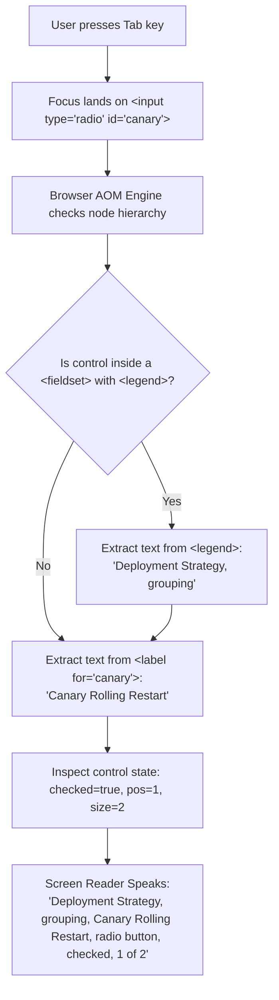

# Form Labels, Fieldsets, Legends, and Accessible Input Grouping

| Metadata | Details |
| :--- | :--- |
| **Level** | Core / Fundamental |
| **Prerequisites** | `01-form-basics-and-methods.md`, `02-input-types-and-mobile-keyboards.md` |
| **Estimated Reading Time** | 25 minutes |
| **Status** | Production-Ready |
| **Baseline Status** | Widely Available across all modern browsers |
| **Browsers Tested** | Chrome 120+, Firefox 120+, Safari 17+, Edge 120+ |
| **Tested With** | W3C Nu HTML Checker, Axe-core v4.8, NVDA 2023.3, VoiceOver macOS Sonoma |

---

## Table of Contents
- [1 What & Why](#1-what--why)
- [2 Core Concepts](#2-core-concepts)
- [3 How It Works Internally](#3-how-it-works-internally)
- [4 Syntax & Usage](#4-syntax--usage)
- [5 Practical Examples](#5-practical-examples)
- [6 Best Practices](#6-best-practices)
- [7 Common Mistakes & Pitfalls](#7-common-mistakes--pitfalls)
- [8 Performance, Accessibility, SEO & Security Notes](#8-performance-accessibility-seo--security-notes)
- [9 Comparison / When to Use What](#9-comparison--when-to-use-what)
- [10 Interview Questions](#10-interview-questions)
- [11 Practice Exercises](#11-practice-exercises)
- [12 Summary / Cheat Sheet](#12-summary--cheat-sheet)
- [13 Further Reading](#13-further-reading)

---

## 1 What & Why

Form controls are visually meaningless without labels. An unlabelled `<input type="text">` or group of circular radio buttons presents sighted users with ambiguous empty boxes and blind users with an unnavigable audio experience: the screen reader announces merely *"Edit text, blank"* or *"Radio button, unchecked"*.

In modern web development, associating labels with controls is not merely a styling concern—it directly governs the **Accessibility Object Model (AOM)** and touchscreen usability:
- **Universal Accessible Names**: The `<label>` element programmatically provides the accessible name for its target control. Without it, automated accessibility audits (Lighthouse, Axe-core) fail instantly under WCAG 3.3.2.
- **Physical Touch Target Expansion**: Clicking or tapping the text of a `<label>` automatically transfers focus to the associated text field or toggles the checkbox/radio button, expanding the interactive hit target to conform to WCAG 2.5.5 / 2.5.8 touch target standards.
- **Contextual Grouping via `<fieldset>` and `<legend>`**: For multi-choice controls like radio buttons, individual labels (e.g., *"Canary"*, *"Blue/Green"*, *"Rolling"*) convey zero information without their overarching category context (*"Deployment Strategy"*). The `<fieldset>` and `<legend>` elements bind these options together, ensuring screen readers announce the category title before speaking individual options.

---

## 2 Core Concepts

### Labelling Modalities: Explicit vs. Implicit
HTML supports two distinct techniques to associate a `<label>` with an interactive control:

1. **Explicit Association (Industry Standard)**:
   The `<label>` possesses a **`for` attribute** matching the exact unique **`id` attribute** of the target form control:
   ```html
   <label for="user-email">Corporate Email Address</label>
   <input type="email" id="user-email" name="email">
   ```
   *Why it is superior*: Decouples DOM layout from label association, allowing labels and inputs to sit in separate table cells, flexbox columns, or grid coordinates, and provides 100% reliability across all assistive tech.

2. **Implicit Wrapping**:
   The input control is placed physically inside the `<label>` element:
   ```html
   <label>
     <input type="checkbox" name="agree">
     I accept the Master Service Agreement
   </label>
   ```
   *Trade-off*: While valid HTML, older speech recognition software and custom testing automation tools occasionally fail to resolve implicit labels cleanly. Best practice recommends using both `for` and `id` even when wrapping.

---

### The `<fieldset>` and `<legend>` Elements
- **`<fieldset>`**: A grouping element used to organize logically related form controls and labels into a distinct semantic unit.
- **`<legend>`**: Represents a caption or title for its parent `<fieldset>`. It **must be the very first child** of `<fieldset>`.
- **Cascading `disabled` State**: Applying the `disabled` attribute to a `<fieldset>` automatically disables **every single form control nested inside it**, including buttons, inputs, selects, and textareas, with zero JavaScript!

---

### Radio Button Groups and Mutual Exclusivity
Radio buttons (`<input type="radio">`) are inherently grouped by their **`name` attribute**:
```html
<fieldset>
  <legend>Select Failover Strategy</legend>
  <div>
    <input type="radio" id="strat-canary" name="strategy" value="canary" checked>
    <label for="strat-canary">Canary Rolling Restart</label>
  </div>
  <div>
    <input type="radio" id="strat-bluegreen" name="strategy" value="bluegreen">
    <label for="strat-bluegreen">Blue/Green Standby Cutover</label>
  </div>
</fieldset>
```
Within a named radio group:
- Exactly one radio button can be checked at a time.
- Keyboard users navigate between radio buttons using **`ArrowUp` / `ArrowDown` / `ArrowLeft` / `ArrowRight`**, while `Tab` advances past the entire radio group to the next form control.

---

## 3 How It Works Internally

### Screen Reader Announcement Lifecycle on Focus
When a user tabs into an input within a `<fieldset>`:



If the developer used `<div>` instead of `<fieldset>`:
The screen reader would announce only: *"Canary Rolling Restart, radio button, checked, 1 of 2"*. The user would have no idea what "Canary" refers to!

### Hit-Target Expansion Mechanics
When an explicit label is clicked:
1. The browser layout engine detects the click event on `HTMLLabelElement`.
2. The engine reads `label.htmlFor` and queries the document for an element with matching `id`.
3. If the target is a text/number/date input, the browser dispatches a synthetic `focus()` event and places the text cursor inside the input.
4. If the target is a checkbox or radio button, the browser toggles the `checked` boolean property and fires the native `change` event.

---

## 4 Syntax & Usage

```html
<!-- 1. Explicit Labelling for Text Inputs -->
<div class="form-row">
  <label for="db-cluster-id">Database Cluster Identifier:</label>
  <input type="text" id="db-cluster-id" name="cluster_id" required>
</div>

<!-- 2. Accessible Checkbox with Expanded Hit Target -->
<div class="checkbox-row">
  <input type="checkbox" id="mfa-opt-in" name="enforce_mfa" value="yes">
  <label for="mfa-opt-in">Enforce Multi-Factor Authentication on All Administrators</label>
</div>

<!-- 3. Radio Group Wrapped in Fieldset and Legend -->
<fieldset>
  <legend>Service Tier Architecture</legend>

  <div class="radio-option">
    <input type="radio" id="tier-shared" name="service_tier" value="shared" checked>
    <label for="tier-shared">Shared Multi-Tenant Cluster (Baseline)</label>
  </div>

  <div class="radio-option">
    <input type="radio" id="tier-dedicated" name="service_tier" value="dedicated">
    <label for="tier-dedicated">Dedicated Single-Tenant VPC</label>
  </div>
</fieldset>

<!-- 4. Disabling Entire Subtrees via Fieldset -->
<fieldset disabled>
  <legend>Archived Deployment Parameters (Read-Only)</legend>
  <label for="legacy-ip">Legacy Ingress IPv4:</label>
  <input type="text" id="legacy-ip" name="legacy_ip" value="192.168.10.4">
  <button type="button">Purge</button>
</fieldset>
```

> [!NOTE]
> **Baseline Status: Widely Available**
> The `<label>` element, `for` attribute, `<fieldset>`, `<legend>`, cascading `disabled` inheritance on fieldsets, and radio group arrow navigation are baseline web platform standards supported across all browsers since the 1990s.

---

## 5 Practical Examples

### Example 1: Multi-Group Shipping & Billing Address Form
```html
<!DOCTYPE html>
<html lang="en">
<head>
  <meta charset="utf-8">
  <title>Customer Address Specification</title>
  <style>
    fieldset { border: 1px solid #d1d5db; border-radius: 8px; padding: 1.5rem; margin-bottom: 1.5rem; }
    legend { font-weight: 700; padding: 0 0.5rem; color: #1e293b; }
    .field { margin-bottom: 1rem; display: flex; flex-direction: column; }
    label { font-weight: 600; margin-bottom: 0.25rem; }
    input { padding: 0.5rem; border: 1px solid #9ca3af; border-radius: 4px; }
  </style>
</head>
<body>
  <main>
    <h1>Infrastructure Hardware Delivery</h1>

    <form action="/orders/shipping" method="post">
      <!-- Fieldset 1: Primary Delivery Address -->
      <fieldset>
        <legend>Primary Datacenter Shipping Address</legend>

        <div class="field">
          <label for="ship-street">Street Address &amp; Receiving Dock</label>
          <input type="text" id="ship-street" name="ship_street" required>
        </div>

        <div class="field">
          <label for="ship-city">City</label>
          <input type="text" id="ship-city" name="ship_city" required>
        </div>

        <div class="field">
          <label for="ship-zip">Postal / ZIP Code</label>
          <input type="text" id="ship-zip" name="ship_zip" inputmode="numeric" required>
        </div>
      </fieldset>

      <!-- Fieldset 2: Billing Contact -->
      <fieldset>
        <legend>Accounts Payable Corporate Address</legend>

        <div class="field">
          <label for="bill-org">Organization Entity Name</label>
          <input type="text" id="bill-org" name="bill_org" required>
        </div>

        <div class="field">
          <label for="bill-tax-id">VAT / Tax Identification Number</label>
          <input type="text" id="bill-tax-id" name="bill_tax_id" required>
        </div>
      </fieldset>

      <button type="submit">Submit Delivery Manifest</button>
    </form>
  </main>
</body>
</html>
```

### Example 2: Interactive Cascading Fieldset Disabling
```html
<form>
  <!-- Master toggle switch outside fieldset -->
  <div class="toggle-wrapper">
    <input type="checkbox" id="enable-tls" onchange="tlsFieldset.disabled = !this.checked">
    <label for="enable-tls">Enable Custom Mutual TLS (mTLS) Encryption</label>
  </div>

  <!-- Fieldset disabled by default in HTML -->
  <fieldset id="tlsFieldset" disabled>
    <legend>Mutual TLS Certificate Parameters</legend>

    <div>
      <label for="ca-cert">Certificate Authority (CA) Bundle (PEM):</label>
      <textarea id="ca-cert" name="ca_bundle" rows="4"></textarea>
    </div>

    <div>
      <label for="client-auth">Client Auth Mode:</label>
      <select id="client-auth" name="auth_mode">
        <option value="require">Require and Verify Client Certificate</option>
        <option value="optional">Verify Client Certificate if Present</option>
      </select>
    </div>
  </fieldset>
</form>

<script>
  const tlsFieldset = document.getElementById("tlsFieldset");
</script>
```

### Example 3: Edge Case — Labelling Custom Styled Toggle Switches
```html
<!-- Pattern: Accessible CSS Toggle Switch using Hidden Checkbox + Label -->
<div class="toggle-container">
  <input type="checkbox" 
         id="telemetry-switch" 
         name="realtime_stream" 
         class="sr-only-checkbox" 
         role="switch" 
         aria-checked="false" 
         onchange="this.setAttribute('aria-checked', this.checked)">
  
  <label for="telemetry-switch" class="switch-label">
    <span class="switch-ui" aria-hidden="true"></span>
    <span class="label-text">Enable Real-Time Telemetry Streaming</span>
  </label>
</div>

<style>
  /* Visually hide input while keeping it focusable */
  .sr-only-checkbox { position: absolute; opacity: 0; width: 0; height: 0; }
  .switch-label { display: flex; align-items: center; gap: 0.75rem; cursor: pointer; }
  .switch-ui { width: 44px; height: 24px; background: #ccc; border-radius: 12px; position: relative; transition: background 200ms; }
  .switch-ui::after { content: ""; position: absolute; top: 2px; left: 2px; width: 20px; height: 20px; background: #fff; border-radius: 50%; transition: transform 200ms; }
  .sr-only-checkbox:checked + .switch-label .switch-ui { background: #2563eb; }
  .sr-only-checkbox:checked + .switch-label .switch-ui::after { transform: translateX(20px); }
  .sr-only-checkbox:focus-visible + .switch-label .switch-ui { outline: 2px solid #2563eb; outline-offset: 2px; }
</style>
```

### Example 4: Failure Case — Placeholder As Label and Broken IDs
```html
<!-- ANTI-PATTERN: DO NOT COPY -->

<!-- Error 1: Using placeholder instead of <label> (CRITICAL WCAG VIOLATION) -->
<!-- When the user types the first letter, the placeholder VANISHES! -->
<!-- Screen readers frequently ignore placeholders; contrast ratio is low. -->
<input type="text" placeholder="Enter Cluster Name"> <!-- NO LABEL! -->

<!-- Error 2: Mismatched for/id pairing -->
<label for="email-address">Work Email</label>
<input type="email" id="email" name="email"> <!-- for="email-address" != id="email" -->

<!-- Error 3: Duplicate IDs across repeated components -->
<div class="user-row">
  <label for="name">Name</label> <input id="name">
</div>
<div class="user-row">
  <label for="name">Name</label> <input id="name"> <!-- DUPLICATE ID! Clicking label 2 focuses input 1! -->
</div>

<!-- Error 4: Radio group without <fieldset> or shared name -->
<div>
  <h3>Pick Color</h3>
  <input type="radio" id="c1" name="r1"><label for="c1">Red</label>
  <input type="radio" id="c2" name="r2"><label for="c2">Blue</label> <!-- Different name! Both can be checked! -->
</div>
```

### Example 5: Production-Grade Multi-Option Permission Matrix
```html
<!DOCTYPE html>
<html lang="en">
<head>
  <meta charset="utf-8">
  <title>Role-Based Access Control</title>
  <style>
    fieldset { border: 1px solid #cbd5e1; border-radius: 8px; padding: 1.5rem; max-width: 500px; }
    legend { font-weight: 700; color: #0f172a; padding: 0 0.5rem; font-size: 1.1rem; }
    .perm-item { display: flex; align-items: flex-start; gap: 0.75rem; margin-bottom: 1rem; }
    .perm-item input { margin-top: 0.25rem; }
    .perm-text strong { display: block; color: #1e293b; }
    .perm-text span { font-size: 0.875rem; color: #64748b; }
  </style>
</head>
<body>
  <main>
    <form action="/admin/roles" method="post">
      <fieldset>
        <legend>Kubernetes Namespace RBAC Permissions</legend>

        <div class="perm-item">
          <input type="checkbox" id="perm-read" name="permissions" value="pod_read" checked>
          <div class="perm-text">
            <label for="perm-read">
              <strong>Pod Telemetry Read Access</strong>
              <span>Allows querying metrics, inspecting live container logs, and viewing events.</span>
            </label>
          </div>
        </div>

        <div class="perm-item">
          <input type="checkbox" id="perm-exec" name="permissions" value="pod_exec">
          <div class="perm-text">
            <label for="perm-exec">
              <strong>Pod Shell Exec Privilege</strong>
              <span>Grants interactive terminal shell attachment to running application containers.</span>
            </label>
          </div>
        </div>

        <div class="perm-item">
          <input type="checkbox" id="perm-delete" name="permissions" value="namespace_delete">
          <div class="perm-text">
            <label for="perm-delete">
              <strong>Namespace Destruction</strong>
              <span>Permits permanent deletion of namespaces and all cascading volumes.</span>
            </label>
          </div>
        </div>
      </fieldset>

      <button type="submit">Update Role Privileges</button>
    </form>
  </main>
</body>
</html>
```

---

## 6 Best Practices

1. **Always Use Explicit `for` and `id` Associations**: Pair `<label for="x">` with `<input id="x">` across all form elements to ensure 100% reliable accessibility across all browser engines.
2. **Never Use `placeholder` as a Replacement for `<label>`**: Placeholders vanish upon keystroke entry, have notoriously poor color contrast, and are ignored by many screen readers. Always provide a permanent, visible `<label>`.
3. **Wrap All Radio Groups in `<fieldset>` and `<legend>`**: Ensure that sets of mutually exclusive options possess an overarching group caption via `<legend>`.
4. **Leverage Cascading `<fieldset disabled>`**: When disabling an entire form section (e.g., during async network loading or when a feature flag is inactive), set `disabled` on the parent `<fieldset>` rather than iterating through dozens of child inputs with JavaScript.
5. **Ensure Checkbox Labels Explain the "Checked" State**: The label text for a checkbox must make it completely clear what will happen when the box is checked (e.g., *"Email me daily security alerts"* rather than *"Security alerts"*).
6. **Keep All Element IDs Document-Unique**: Never duplicate IDs in dynamic components or repeating lists. Duplicating IDs causes clicking the second label to focus the first input in the document!

---

## 7 Common Mistakes & Pitfalls

| Mistake | Bad Code | Good Code | Technical Explanation |
| :--- | :--- | :--- | :--- |
| **Placeholder as Label** | `<input placeholder="Your Name">` | `<label for="name">Your Name</label><input id="name">` | Violates WCAG 3.3.2. Disappears while typing, disorienting users and memory-impaired readers. |
| **Mismatched `for`/`id`** | `<label for="mail">Email</label><input id="email">` | `<label for="email">Email</label><input id="email">` | Label is not programmatically associated. Clicking label does not focus input; screen reader hears no name. |
| **Radio Group without Fieldset** | `<div><h3>Strategy</h3><input type="radio"...></div>` | `<fieldset><legend>Strategy</legend><input type="radio"...></fieldset>` | Screen reader announces options without context, failing to inform blind users of the overarching choice. |
| **Different `name` on Radios** | `<input type="radio" name="r1"><input type="radio" name="r2">` | `<input type="radio" name="tier"><input type="radio" name="tier">` | Radios with different names do not act mutually exclusively; both can be checked simultaneously. |
| **`<legend>` as Second Child** | `<fieldset><div>Title</div><legend>Name</legend>...` | `<fieldset><legend>Name</legend><div>Title</div>...` | `<legend>` must be the very first child of `<fieldset>` to be recognized as the group's accessible label. |
| **Duplicate IDs in Form Rows** | Repeating `<input id="price">` across multiple table rows | Unique IDs: `<input id="price-0">`, `<input id="price-1">` | Clicking any label in the list will always transfer focus exclusively to the very first input. |

---

## 8 Performance, Accessibility, SEO & Security Notes

### Accessibility (WCAG 2.2 AA)
- **Criterion 3.3.2 (Labels or Instructions - Level A)**: Labels or instructions are provided when content requires user input.
- **Criterion 2.5.5 / 2.5.8 (Target Size - Level AA/AAA)**: Interactive touch target size must be at least 24x24 CSS pixels. Wrapping text in `<label for>` expands the tap target from a tiny 13px checkbox to the entire text phrase, effortlessly achieving compliance.
- **Screen Reader Radio Grouping**: Assistive software computes and announces set metrics automatically inside `<fieldset>`:
  - VoiceOver: *"Deployment Strategy, radio group, Canary, 1 of 3"*.

### Search Engine Optimization (SEO)
- Search engines parse `<label>` and `<legend>` text to understand the context and purpose of web application forms, contributing to entity extraction for local business and transaction actions.

### Performance & Memory
- Cascading fieldset disabling (`<fieldset disabled>`) executes natively in browser C++ code, executing in under 0.1ms without triggering heavy JavaScript DOM query loops or layout thrashing.

### Security Notes
- Avoid injecting unescaped user input directly into `<label>` or `<legend>` innerHTML to prevent Cross-Site Scripting (XSS).

---

## 9 Comparison / When to Use What

| Pattern | Semantic Element | Accessibility Role | Primary Purpose |
| :--- | :--- | :--- | :--- |
| Single Control Label | `<label for="id">` | Accessible Name Source | Name a specific text input, select, or checkbox. |
| Logical Form Group | `<fieldset>` | `group` | Bind related inputs (billing address, radio group). |
| Group Caption | `<legend>` | Accessible Name for Group | The overarching title for a `<fieldset>` container. |
| Standalone Heading | `<h2>`–`<h6>` | `heading` | Major document section divisions (outside forms). |
| Independent Toggle | `<input type="checkbox">` | `checkbox` | Boolean choices that can be toggled independently. |
| Mutually Exclusive Option | `<input type="radio">` | `radio` | Pick exactly one choice from a named group. |

---

## 10 Interview Questions

<details>
<summary><strong>1. Explain the architectural difference between explicit labelling (`for`/`id`) and implicit labelling (wrapping) in HTML forms. Why is explicit preferred in enterprise software?</strong></summary>

**Answer:**
- **Explicit Labelling**: The `<label>` specifies a `for` attribute referencing the `id` of an `<input>`:
  `<label for="email">Email</label> <input id="email">`
- **Implicit Labelling**: The `<input>` is nested directly inside the `<label>`:
  `<label>Email <input type="email"></label>`

**Why Explicit Labelling is Preferred in Enterprise Systems**:
1. **Layout Flexibility**: Explicit labelling decouples DOM hierarchy from semantic association. A label and its input can live in separate table columns, distinct grid areas, or different flexbox tiers without breaking the accessible link.
2. **Assistive Technology Reliability**: Some legacy speech recognition tools (e.g., Dragon NaturallySpeaking) and older mobile screen readers occasionally struggle to identify form controls wrapped implicitly, especially when complex styling divs are nested inside the label.
3. **Automated Testing**: End-to-end testing frameworks (Playwright, Cypress, Testing Library) provide selectors like `getByLabelText('Email')` that perform optimally and unambiguously when explicit `for`/`id` pairs are defined.
</details>

<details>
<summary><strong>2. How does the `<fieldset>` element communicate context to screen reader users, and why can `<div>` not replace it?</strong></summary>

**Answer:**
A `<fieldset>` represents a logical group of form controls, and its child `<legend>` represents the accessible caption of that group. In the Accessibility Object Model, `<fieldset>` maps to `role="group"` with its accessible name derived from `<legend>`.

When a screen reader user navigates into a control inside a `<fieldset>` (such as a radio button or shipping address field):
1. The screen reader checks for an ancestor `group` container.
2. It speaks the `<legend>` text **first** as the contextual prefix before speaking the control's individual label (e.g., *"Shipping Address, grouping, Street Address, edit text"*).
3. If an engineer uses a generic `<div>` with an `<h3>` instead of `<fieldset>` and `<legend>`, the screen reader does not associate the heading with the input; when the user tabs into the input, the screen reader speaks only *"Street Address, edit text"*, leaving the user unaware of whether it is the shipping or billing address.
</details>

<details>
<summary><strong>3. What is the cascading behavior of the `disabled` attribute when placed on a `<fieldset>`? Are there any exceptions?</strong></summary>

**Answer:**
When `disabled` is applied to `<fieldset>`:
- **Cascading Inactivation**: All descendant form controls (`<input>`, `<select>`, `<textarea>`, `<button>`) are automatically treated as disabled by the browser engine. They cannot receive focus, cannot be typed into, do not fire change events, and are **excluded from the form data set upon submission**.
- **Visual Styling**: Inherits `:disabled` CSS pseudo-class styles across all child inputs.
- **The One Critical Exception**: Form controls placed **inside the `<legend>` element** of that disabled `<fieldset>` are **NOT disabled**! The specification deliberately exempts controls in `<legend>` so developers can place a master checkbox inside the legend to toggle the fieldset's state.
</details>

<details>
<summary><strong>4. Why is using `placeholder` as a replacement for `<label>` a critical WCAG accessibility violation?</strong></summary>

**Answer:**
Using `placeholder` instead of `<label>` violates **WCAG 3.3.2 (Labels or Instructions)** and introduces severe usability failures:
1. **Disappearing Clues**: The moment the user types a single character, the placeholder text vanishes. Users with short-term cognitive or memory impairments forget what field they are filling out.
2. **Low Contrast**: Default browser placeholder styles use faint gray text (#757575 or lighter), violating WCAG 1.4.3 minimum contrast requirements (4.5:1).
3. **Screen Reader Inconsistency**: Many screen readers do not announce placeholders by default or treat them as secondary hints rather than official accessible names.
4. **Form Error Recovery**: If an invalid input is submitted, a user cannot verify what the field was supposed to contain because the placeholder is obscured by their entered text.
</details>

<details>
<summary><strong>5. How do keyboard users navigate mutually exclusive radio button groups versus checkboxes?</strong></summary>

**Answer:**
- **Radio Buttons (Single Tab Stop)**:
  An entire named group of radio buttons constitutes **one single tab stop** in the sequential keyboard Tab ring. Pressing `Tab` lands focus on the currently checked radio button (or the first radio button if none are checked). Once inside the group, pressing **`ArrowUp` / `ArrowLeft`** moves to and checks the previous option; pressing **`ArrowDown` / `ArrowRight`** moves to and checks the next option. Pressing `Tab` exits the group.
- **Checkboxes (Independent Tab Stops)**:
  Each individual checkbox is an independent boolean control and represents its **own individual tab stop**. Users press `Tab` to move from one checkbox to the next, and press **`Spacebar`** to toggle each checkbox on or off independently.
</details>

<details>
<summary><strong>6. Where must the `<legend>` element be positioned within a `<fieldset>`?</strong></summary>

**Answer:**
According to the WHATWG HTML specification, the `<legend>` element **must be the very first child of the `<fieldset>` element**. 

If any other element (such as a `<div>`, `<p>`, or heading) appears before `<legend>` inside the `<fieldset>`, the browser's accessibility engine fails to map `<legend>` as the accessible name of the group, and HTML validators (W3C Nu Checker) report a fatal syntax error.
</details>

<details>
<summary><strong>7. How does clicking a `<label>` affect user experience on mobile touchscreen devices?</strong></summary>

**Answer:**
On mobile touchscreen devices, physical fingertips are much larger than desktop cursor arrows. Small checkboxes and radio buttons (typically 12px to 16px wide) are notoriously difficult for users to tap accurately without mis-clicks.

When an input is explicitly paired with a `<label>`, the browser expands the interactive hit target to include the **entire bounding box of the label text**. Tapping anywhere on the label text toggles the checkbox or opens the keyboard, easily meeting WCAG 2.5.8 target size requirements and dramatically improving mobile usability.
</details>

<details>
<summary><strong>8. Can a single form control have multiple associated `<label>` elements?</strong></summary>

**Answer:**
**Yes.** An input can have multiple `<label>` elements pointing to its `id` via the `for` attribute:
```html
<label for="terms">I agree to terms</label>
<input type="checkbox" id="terms" name="terms">
<label for="terms">Read terms document</label>
```
In the Accessibility Object Model, the browser concatenates the text of all associated labels to compute the accessible name, and clicking either label toggles the input.
</details>

---

## 11 Practice Exercises

### Exercise 1 (Easy): Connect Disconnected Inputs
**Task**: In the following snippet, connect each label to its corresponding input using explicit association.

```html
<!-- Broken Source -->
<label>Database Username</label>
<input type="text" name="user">

<label>Database Port</label>
<input type="number" name="port">
```

<details>
<summary><strong>Solution</strong></summary>

```html
<label for="db-user">Database Username</label>
<input type="text" id="db-user" name="user">

<label for="db-port">Database Port</label>
<input type="number" id="db-port" name="port">
```
*Explanation*: Adding `id="db-user"` and `id="db-port"` paired with matching `for` attributes establishes explicit programmatic association.
</details>

### Exercise 2 (Easy): Build a Mutually Exclusive Radio Group
**Task**: Write the HTML for a radio group asking users to select a log retention period: "7 Days", "30 Days", or "90 Days". Wrap the group in a fieldset and legend. Default to "30 Days".

<details>
<summary><strong>Solution</strong></summary>

```html
<fieldset>
  <legend>Telemetry Log Retention Period</legend>

  <div>
    <input type="radio" id="ret-7" name="retention" value="7">
    <label for="ret-7">7 Days</label>
  </div>

  <div>
    <input type="radio" id="ret-30" name="retention" value="30" checked>
    <label for="ret-30">30 Days</label>
  </div>

  <div>
    <input type="radio" id="ret-90" name="retention" value="90">
    <label for="ret-90">90 Days</label>
  </div>
</fieldset>
```
</details>

### Exercise 3 (Medium): Disable Form Section with Fieldset
**Task**: Author an address modification form containing an "Account Active" checkbox. Below it, create a fieldset with two inputs ("Street" and "City") that starts in the `disabled` state in pure HTML.

<details>
<summary><strong>Solution</strong></summary>

```html
<form>
  <div>
    <input type="checkbox" id="acct-toggle">
    <label for="acct-toggle">Enable Profile Address Updates</label>
  </div>

  <fieldset id="addr-section" disabled>
    <legend>Mailing Address</legend>

    <div>
      <label for="addr-street">Street:</label>
      <input type="text" id="addr-street" name="street">
    </div>

    <div>
      <label for="addr-city">City:</label>
      <input type="text" id="addr-city" name="city">
    </div>
  </fieldset>
</form>
```
*Explanation*: Adding `disabled` directly to `<fieldset>` disables all child inputs without requiring individual `disabled` attributes on every field.
</details>

### Exercise 4 (Medium): Accessible Multi-Select Checkbox Matrix
**Task**: Build a form section for selecting notification channels (Email, SMS, Slack Webhook). Provide an overarching fieldset, individual labels, and descriptive helper text.

<details>
<summary><strong>Solution</strong></summary>

```html
<fieldset>
  <legend>Alert Escalation Channels</legend>

  <div class="channel-option">
    <input type="checkbox" id="ch-email" name="channels" value="email" checked>
    <label for="ch-email">Email Notification (ops@enterprise.net)</label>
  </div>

  <div class="channel-option">
    <input type="checkbox" id="ch-sms" name="channels" value="sms">
    <label for="ch-sms">Emergency SMS Alert (+1 415 555 0199)</label>
  </div>

  <div class="channel-option">
    <input type="checkbox" id="ch-slack" name="channels" value="slack">
    <label for="ch-slack">Slack Channel Webhook (#ops-critical)</label>
  </div>
</fieldset>
```
</details>

### Exercise 5 (Hard): Audit and Remediate 6 Form Labelling Flaws
**Task**: Identify and fix all 6 labelling and grouping bugs in this cloud configuration form:

```html
<!-- Flawed Source -->
<form action="/save" method="post">
  <fieldset>
    <div>Server Settings</div>
    <legend>Configuration</legend>
    <input type="text" placeholder="Server Hostname">
    <input type="radio" name="opt1" id="ha-yes"><label for="ha-yes">Enable HA</label>
    <input type="radio" name="opt2" id="ha-no"><label for="ha-no">Disable HA</label>
    <label for="token">Access Token</label>
    <input type="password" id="access-token">
  </fieldset>
</form>
```

<details>
<summary><strong>Solution</strong></summary>

```html
<!-- Fully Remediated Form Structure -->
<form action="/save" method="post">
  <fieldset>
    <!-- 1. <legend> MUST be the very first child of <fieldset> -->
    <legend>Server Configuration Parameters</legend>

    <div>
      <!-- 2. Permanent label replaces vanishing placeholder -->
      <label for="server-host">Server Hostname</label>
      <input type="text" id="server-host" name="hostname" required>
    </div>

    <!-- 3. Nested fieldset for the radio group -->
    <fieldset>
      <legend>High Availability (HA) Clustering</legend>
      <!-- 4. Radio buttons share the EXACT same name attribute -->
      <div>
        <input type="radio" id="ha-yes" name="ha_mode" value="yes" checked>
        <label for="ha-yes">Enable HA</label>
      </div>
      <div>
        <input type="radio" id="ha-no" name="ha_mode" value="no">
        <label for="ha-no">Disable HA</label>
      </div>
    </fieldset>

    <div>
      <!-- 5. Corrected for and id matching; 6. Added missing name attribute -->
      <label for="access-token">Access Token</label>
      <input type="password" id="access-token" name="access_token" required>
    </div>

    <button type="submit">Persist Configuration</button>
  </fieldset>
</form>
```
</details>

### Exercise 6 (Hard): Accessible Custom Radio Cards Component
**Task**: Build a cluster plan selector with 3 visual cards ("Starter", "Professional", "Enterprise"). The cards must function as native radio buttons using hidden inputs and styled labels.

<details>
<summary><strong>Solution</strong></summary>

```html
<fieldset class="plan-selector">
  <legend>Select Compute Cluster Infrastructure Tier</legend>

  <div class="plans-grid">
    <div class="plan-card">
      <input type="radio" id="plan-starter" name="plan" value="starter" class="sr-only">
      <label for="plan-starter" class="plan-label">
        <span class="plan-name">Starter</span>
        <span class="plan-price">$49/mo</span>
        <span class="plan-specs">2 vCPUs &bull; 4GB RAM</span>
      </label>
    </div>

    <div class="plan-card">
      <input type="radio" id="plan-pro" name="plan" value="pro" class="sr-only" checked>
      <label for="plan-pro" class="plan-label">
        <span class="plan-name">Professional</span>
        <span class="plan-price">$199/mo</span>
        <span class="plan-specs">8 vCPUs &bull; 32GB RAM</span>
      </label>
    </div>

    <div class="plan-card">
      <input type="radio" id="plan-ent" name="plan" value="enterprise" class="sr-only">
      <label for="plan-ent" class="plan-label">
        <span class="plan-name">Enterprise</span>
        <span class="plan-price">$899/mo</span>
        <span class="plan-specs">32 vCPUs &bull; 128GB RAM</span>
      </label>
    </div>
  </div>
</fieldset>

<style>
  .sr-only { position: absolute; opacity: 0; width: 0; height: 0; }
  .plans-grid { display: grid; grid-template-columns: repeat(3, 1fr); gap: 1rem; }
  .plan-label { display: flex; flex-direction: column; padding: 1.5rem; border: 2px solid #cbd5e1; border-radius: 8px; cursor: pointer; }
  .plan-name { font-weight: 700; font-size: 1.25rem; }
  .plan-price { font-size: 1.5rem; color: #2563eb; font-weight: 800; margin: 0.5rem 0; }
  .plan-specs { font-size: 0.875rem; color: #64748b; }
  
  /* Focus-visible and checked styling */
  .sr-only:checked + .plan-label { border-color: #2563eb; background: #eff6ff; }
  .sr-only:focus-visible + .plan-label { outline: 3px solid #facc15; outline-offset: 2px; }
</style>
```
</details>

---

## 12 Summary / Cheat Sheet

```
┌────────────────────────────────────────────────────────────────────────┐
│                        LABELS & FIELDSETS CHEAT SHEET                  │
├───────────────────┬────────────────────────────────────────────────────┤
│ Pattern           │ Syntax / Rule                                      │
├───────────────────┼────────────────────────────────────────────────────┤
│ Explicit Label    │ <label for="unique-id">Label Text</label>          │
│ Target Input      │ <input id="unique-id" name="field_name">           │
│ Fieldset          │ <fieldset><legend>Title</legend>...</fieldset>     │
│ Legend Placement  │ <legend> MUST be the very first child of fieldset  │
│ Cascading Disable │ <fieldset disabled> disables all child inputs!     │
│ Radio Grouping    │ Grouped by exact shared name attribute             │
│ Radio Navigation  │ Tab lands on group; Arrow keys navigate within     │
│ Touch Target      │ Label click/tap triggers input focus/toggle        │
│ Never Placeholder │ NEVER use placeholder as a substitute for label    │
└───────────────────┴────────────────────────────────────────────────────┘
```

---

## 13 Further Reading

- [WHATWG HTML Living Standard: Section 4.10.4 The &lt;label&gt; Element](https://html.spec.whatwg.org/multipage/forms.html#the-label-element)
- [WHATWG HTML Living Standard: Section 4.10.15 The &lt;fieldset&gt; Element](https://html.spec.whatwg.org/multipage/form-control-infrastructure.html#the-fieldset-and-legend-elements)
- [W3C WAI: Labeling Controls Tutorial](https://www.w3.org/WAI/tutorials/forms/labels/)
- [W3C WAI: Grouping Controls Tutorial](https://www.w3.org/WAI/tutorials/forms/grouping/)
- [MDN Web Docs: How to Structure a Web Form](https://developer.mozilla.org/en-US/docs/Learn/HTML/Forms/How_to_structure_a_web_form)

---

| [Previous: 02 Input Types & Mobile Modalities](02-input-types-and-mobile-keyboards.md) | [Section Index](README.md) | [Next: 04 Select, Datalist & Optgroup](04-select-datalist-and-optgroup.md) |
