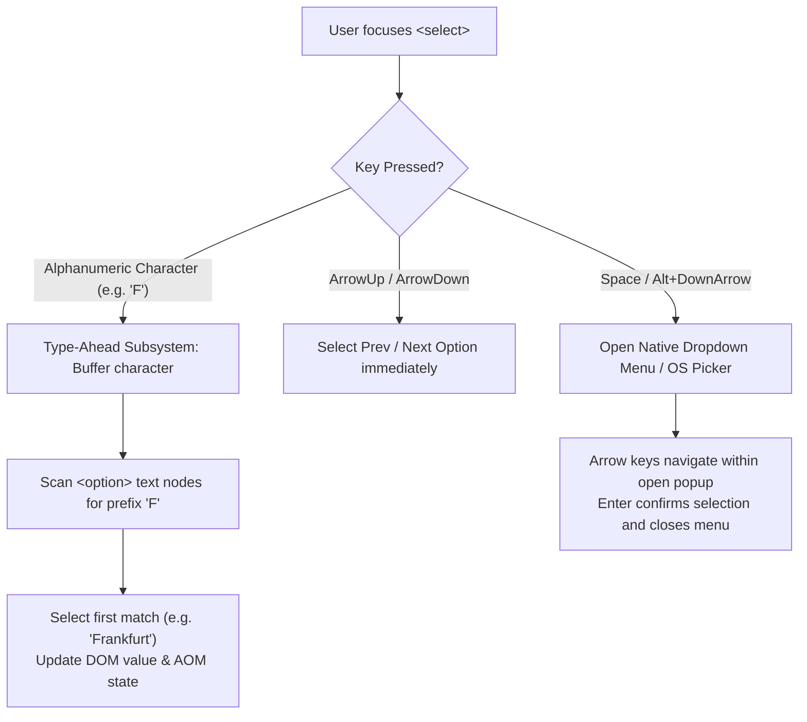

# Select Menus, Datalist Comboboxes, and Option Groups

| Metadata | Details |
| :--- | :--- |
| **Level** | Core / Fundamental |
| **Prerequisites** | `01-form-basics-and-methods.md`, `03-labels-fieldsets-and-legends.md` |
| **Estimated Reading Time** | 25 minutes |
| **Status** | Production-Ready |
| **Baseline Status** | Widely Available (`<selectedcontent>` Limited Availability / Preview) |
| **Browsers Tested** | Chrome 120+, Firefox 120+, Safari 17+, Edge 120+ |
| **Tested With** | W3C Nu HTML Checker, Axe-core v4.8, NVDA 2023.3, VoiceOver macOS Sonoma |

---

## Table of Contents
- [1 What & Why](#1-what--why)
- [2 Core Concepts](#2-core-concepts)
- [3 How It Works Internally](#3-how-it-works-internally)
- [4 Syntax & Usage](#4-syntax--usage)
- [5 Practical Examples](#5-practical-examples)
- [6 Best Practices](#6-best-practices)
- [7 Common Mistakes & Pitfalls](#7-common-mistakes--pitfalls)
- [8 Performance, Accessibility, SEO & Security Notes](#8-performance-accessibility-seo--security-notes)
- [9 Comparison / When to Use What](#9-comparison--when-to-use-what)
- [10 Interview Questions](#10-interview-questions)
- [11 Practice Exercises](#11-practice-exercises)
- [12 Summary / Cheat Sheet](#12-summary--cheat-sheet)
- [13 Further Reading](#13-further-reading)

---

## 1 What & Why

When designing forms, engineers must balance data integrity with user typing effort. Allowing users to type arbitrary strings into text fields for standardized enumerations (such as country codes, cloud regions, or currency types) results in spelling errors, capitalization mismatches, and database corruption.

HTML provides two distinct architectural solutions for pre-defined option selection:
1. **The Closed Enumeration (`<select>`)**: Restricts user choice strictly to a pre-defined set of options. Sighted users interact via a dropdown picker; mobile users interact via native wheel pickers; screen reader users interact with full ARIA combobox semantics.
2. **The Open-Ended Auto-Suggest Combobox (`<datalist>`)**: Combines a standard text input with a hidden pool of suggested values. The user can either pick a pre-populated recommendation or type their own custom free-form string.

However, `<select>` has historically been the most notoriously difficult HTML element to style with CSS. This guide covers production patterns for `<select>`, `<optgroup>`, `<datalist>`, and provides an architectural preview of the emerging **Customizable Select** standard (`<selectedcontent>`).

---

## 2 Core Concepts

### The `<select>` Element
The `<select>` element represents a control that provides a menu of options.
Key attributes:
- `name`: Identifies the control in form submission.
- `multiple`: Boolean attribute allowing users to select more than one option (represented as an array of values in backend parsers).
- `size`: An integer specifying how many options should be visible at once (transforms a dropdown into a scrolling listbox).
- `required`: Prevents submission if the selected option has an empty string value (`value=""`).

### The `<option>` Element
Represents an individual choice within a `<select>` or `<datalist>`:
- `value`: The data payload submitted to the server. If `value` is omitted, the text content of the `<option>` is submitted instead.
- `selected`: Boolean attribute indicating the option is chosen by default.
- `disabled`: Prevents the option from being selected (often used for category labels or placeholder instructions).

### The `<optgroup>` Element
Represents a group of `<option>` elements sharing a common category:
- `label`: Mandatory attribute providing the visual and accessible name of the category (e.g., `<optgroup label="Europe">`).
- `disabled`: Disables all child options within that entire category.
- An `<optgroup>` cannot be nested inside another `<optgroup>`.

### The `<datalist>` Element (The Native Combobox)
The `<datalist>` element contains a set of `<option>` elements that represent permissible or recommended options available for an associated `<input>`:
```html
<label for="city">Select or type a city:</label>
<input type="text" id="city" name="city" list="cities-list">

<datalist id="cities-list">
  <option value="San Francisco">
  <option value="Frankfurt">
  <option value="Tokyo">
</datalist>
```
The link is established via the `list` attribute on `<input>` referencing the `id` of `<datalist>`. Unlike `<select>`, users can type any free-form value not present in the list.

### The Future: Customizable Select (`<selectedcontent>`) *(Preview)*
In historical HTML, the internal dropdown popup of a `<select>` was rendered by the operating system, making it impossible to style with CSS or insert rich HTML (like icons or descriptions) inside options. 

The OpenUI group and WHATWG are standardizing **Customizable Select**:
- `<select>` elements styled with `appearance: base-select` expose their internal shadow DOM to CSS styling.
- The `<selectedcontent>` element reflects the rich HTML content of the currently chosen option directly into the closed button button. *(Status: Limited Availability / Chromium Developer Trial in 2024–2026).*

---

## 3 How It Works Internally

### Keyboard Navigation & Type-Ahead State Machine
When a `<select>` receives focus:



### Type-Ahead Buffering
Browser engines maintain a short **type-ahead buffer** (typically 500–1000ms timeout). If a user rapidly types `"U"` then `"S"`, the engine does not jump to "U" and then jump to "S"; it buffers the string `"US"` and jumps directly to "United States".

---

## 4 Syntax & Usage

```html
<!-- 1. Semantic Dropdown with Placeholder and Required Validation -->
<label for="cluster-region">Datacenter Region:</label>
<select id="cluster-region" name="region" required>
  <!-- Placeholder pattern: empty value + disabled + selected -->
  <option value="" disabled selected>-- Select a Datacenter Region --</option>
  
  <optgroup label="North America">
    <option value="us-east-1">US-East (N. Virginia)</option>
    <option value="us-west-2">US-West (Oregon)</option>
  </optgroup>
  
  <optgroup label="Europe">
    <option value="eu-central-1">EU-Central (Frankfurt)</option>
    <option value="eu-west-1">EU-West (Ireland)</option>
  </optgroup>
</select>

<!-- 2. Combobox Auto-Suggest with Datalist -->
<label for="cluster-node-type">Worker Instance SKU:</label>
<input type="text" 
       id="cluster-node-type" 
       name="instance_sku" 
       list="sku-recommendations" 
       placeholder="Pick suggested or type custom SKU">

<datalist id="sku-recommendations">
  <option value="c6g.2xlarge">General Compute (ARM64)</option>
  <option value="r6g.4xlarge">Memory Optimized (High RAM)</option>
  <option value="p4de.24xlarge">GPU Accelerated (Machine Learning)</option>
</datalist>
```

> [!NOTE]
> **Baseline Status:**
> - `<select>`, `<option>`, `<optgroup>`, `<datalist>`, and the `list` attribute are **Widely Available** baseline web platform standards supported across all modern browsers.
> - Fully customizable select via `<selectedcontent>` is in **Limited Availability / Preview** (Chromium experimental flags in 2024–2026; progressive enhancement fallbacks required).

---

## 5 Practical Examples

### Example 1: Multi-Select Array for Firewall Port Rules
```html
<form action="/security/firewall" method="post">
  <label for="firewall-ports">Select Authorized Ingress Ports (Hold Ctrl/Cmd to select multiple):</label>
  
  <select id="firewall-ports" name="allowed_ports" multiple size="5">
    <option value="22">Port 22 (SSH Remote Shell)</option>
    <option value="80">Port 80 (HTTP Ingress)</option>
    <option value="443" selected>Port 443 (HTTPS TLS Ingress)</option>
    <option value="5432">Port 5432 (PostgreSQL Database)</option>
    <option value="8443">Port 8443 (Mutual TLS Gateway)</option>
    <option value="9090">Port 9090 (Prometheus Metrics)</option>
  </select>

  <button type="submit">Update Security Group Rules</button>
</form>
```

### Example 2: Datalist with Two-Factor Search Matching
```html
<!-- Datalist supports value (submitted) + label/text (human readable) -->
<label for="airport-search">Departure Airport (Code or City):</label>
<input type="text" id="airport-search" name="airport" list="airports" placeholder="e.g. SFO or San Francisco">

<datalist id="airports">
  <!-- Users typing "Frankfurt" or "FRA" will match this option! -->
  <option value="FRA" label="Frankfurt am Main Airport, Germany">
  <option value="SFO" label="San Francisco International, USA">
  <option value="LHR" label="London Heathrow, United Kingdom">
  <option value="HND" label="Tokyo Haneda, Japan">
</datalist>
```

### Example 3: Edge Case — Empty Option Required Validation Pattern
```html
<!-- To enforce required validation on a <select>, the initial option -->
<!-- MUST have value="" (an empty string). If value is omitted, the text -->
<!-- becomes the value, bypassing required validation! -->

<form action="/profile" method="post">
  <label for="country">Country of Incorporation:</label>
  <select id="country" name="country_code" required>
    <!-- Valid: Submitting without changing this triggers native validation error -->
    <option value="" disabled selected>Please select a country...</option>
    <option value="US">United States</option>
    <option value="DE">Germany</option>
    <option value="JP">Japan</option>
  </select>
  <button type="submit">Save</button>
</form>
```

### Example 4: Failure Case — Broken Select Usability Anti-Patterns
```html
<!-- ANTI-PATTERN: DO NOT COPY -->

<!-- Error 1: Missing value="" on placeholder option -->
<!-- Browser treats value as the text string "Select...". Required validation PASSES! -->
<select name="tier" required>
  <option>Select Tier</option> <!-- BUG: Submits tier="Select Tier" to server! -->
  <option value="free">Free</option>
</select>

<!-- Error 2: Using <select multiple> for primary mobile consumer forms -->
<!-- Terrible mobile UX: Requires awkward multi-finger scrolling and modifier keys -->
<select multiple> <!-- BAD: Checkbox lists are vastly superior for accessibility -->
  <option>Option 1</option>
</select>

<!-- Error 3: Broken datalist ID linking -->
<input list="fruit-list">
<datalist id="fruits"> <!-- BUG: ID mismatch (fruit-list != fruits). No suggestions appear! -->
  <option value="Apple">
</datalist>
```

### Example 5: Production-Grade Accessible Timezone Selector
```html
<!DOCTYPE html>
<html lang="en">
<head>
  <meta charset="utf-8">
  <meta name="viewport" content="width=device-width, initial-scale=1.0">
  <title>Timezone Configuration</title>
  <style>
    .select-group { max-width: 450px; display: flex; flex-direction: column; gap: 0.5rem; }
    label { font-weight: 600; font-family: sans-serif; }
    select { padding: 0.6rem; border: 1px solid #cbd5e1; border-radius: 6px; font-size: 1rem; }
  </style>
</head>
<body>
  <main>
    <h1>Infrastructure Schedule Settings</h1>

    <form action="/settings/timezone" method="post">
      <div class="select-group">
        <label for="tz-select">Maintenance Window Timezone</label>
        
        <select id="tz-select" name="timezone" required>
          <option value="" disabled selected>-- Select Regional Timezone --</option>
          
          <optgroup label="Americas">
            <option value="America/New_York">Eastern Time (US &amp; Canada) [UTC-5]</option>
            <option value="America/Chicago">Central Time (US &amp; Canada) [UTC-6]</option>
            <option value="America/Denver">Mountain Time (US &amp; Canada) [UTC-7]</option>
            <option value="America/Los_Angeles">Pacific Time (US &amp; Canada) [UTC-8]</option>
          </optgroup>

          <optgroup label="Europe &amp; Africa">
            <option value="UTC">Coordinated Universal Time (UTC) [UTC+0]</option>
            <option value="Europe/London">London / Greenwich Mean Time [UTC+0]</option>
            <option value="Europe/Berlin">Berlin / Frankfurt / Paris [UTC+1]</option>
          </optgroup>

          <optgroup label="Asia &amp; Pacific">
            <option value="Asia/Tokyo">Tokyo / Japan Standard Time [UTC+9]</option>
            <option value="Australia/Sydney">Sydney / Eastern Australia [UTC+10]</option>
          </optgroup>
        </select>
      </div>

      <button type="submit" style="margin-top: 1rem;">Update Schedule</button>
    </form>
  </main>
</body>
</html>
```

---

## 6 Best Practices

1. **Always Use `value=""` for Placeholder Options**: The first placeholder option must explicitly declare `value="" disabled selected` to enforce HTML5 `required` validation correctly.
2. **Use `<optgroup>` for Catalogs Exceeding 10 Items**: When dropdowns contain more than 10 options, group them logically with `<optgroup label="...">` to reduce visual scanning fatigue.
3. **Prefer Checkboxes Over `<select multiple>`**: The `<select multiple>` control has notoriously poor usability on touch devices and requires desktop users to know keyboard modifiers (`Ctrl` or `Cmd`). A fieldset with `<input type="checkbox">` elements is universally superior.
4. **Deploy `<datalist>` for Suggested Free-Form Inputs**: Use `<datalist>` for fields where suggestions are helpful but custom entries are valid (e.g., job titles, search filters, airport codes, browser user-agents).
5. **Always Explicitly Supply `value` Attributes on `<option>`**: Never rely on implicit text fallbacks for option values. Hardcode programmatic values (`value="us-east-1"`) while displaying human-friendly text (*"US-East (N. Virginia)"*).
6. **Provide Visible `<label>` Elements for Comboboxes**: Both `<select>` and `<input list="...">` must be explicitly associated with a visible `<label for="...">`.

---

## 7 Common Mistakes & Pitfalls

| Mistake | Bad Code | Good Code | Technical Explanation |
| :--- | :--- | :--- | :--- |
| **Omitted Value on Placeholder** | `<option>Select Region</option>` | `<option value="" disabled selected>Select Region</option>` | Omitting `value` treats the string "Select Region" as a valid non-empty value, bypassing `required` checks! |
| **Mismatched Datalist ID** | `<input list="items"><datalist id="item">` | `<input list="items"><datalist id="items">` | The `list` attribute must exactly match the `id` of `<datalist>`. Mismatches silently fail. |
| **Nesting `<optgroup>` Elements** | `<optgroup><optgroup>...</optgroup></optgroup>` | Flat `<optgroup>` list only | WHATWG specification strictly prohibits nested `<optgroup>` elements. |
| **Overuse of `<select multiple>`** | Using `<select multiple>` for tags | Use a list of `<input type="checkbox">` | Terrible touch UX on mobile devices; screen reader users struggle with multi-selection mechanics. |
| **Dynamic Datalist Stale IDs** | Re-rendering inputs with duplicate datalist IDs | Ensure unique datalist IDs per component | Duplicate IDs in the DOM cause inputs to bind only to the first datalist encountered. |
| **Missing `<optgroup>` Label** | `<optgroup><option>A</option></optgroup>` | `<optgroup label="Letters"><option>A</option></optgroup>` | An `<optgroup>` without a `label` attribute has no name in the AOM, disorienting screen readers. |

---

## 8 Performance, Accessibility, SEO & Security Notes

### Accessibility (WCAG 2.2 AA)
- **Criterion 4.1.2 (Name, Role, Value - Level A)**: Native `<select>` elements expose `role="combobox"` in the Accessibility Object Model with accessible states (`expanded`, `collapsed`, `selected`).
- **Screen Reader Navigation**: Screen readers announce the active option, its index, and the total count:
  - NVDA: *"Region combobox, collapsed, US-East (N. Virginia), 1 of 4"*.
  - Inside an `<optgroup>`: *"Europe group, EU-Central (Frankfurt), 1 of 2"*.

### Search Engine Optimization (SEO)
- Search engines parse `<select>` and `<option>` elements on public catalog pages to extract variant properties (e.g., shoe sizes, colors, regions) for Google Shopping product schema graphs.

### Performance & Memory
- Native select pickers consume negligible memory because the popup menu is generated natively by the operating system. In contrast, heavy JavaScript dropdown libraries (e.g., Select2, React-Select) inject hundreds of div nodes into the DOM, slowing down page reflows.

### Security Notes
- **Server-Side Validation**: Never assume the submitted value from a `<select>` is one of the valid `<option>` values declared in HTML. Attackers can modify option values in DevTools or craft direct HTTP POST requests with arbitrary strings (e.g., `region=../../etc/passwd`). Always validate submitted values against an allowed server-side whitelist.

---

## 9 Comparison / When to Use What

| Requirement | Recommended Element | Usability Modality | Freeform Input Allowed? |
| :--- | :--- | :--- | :--- |
| Strict single choice from $< 5$ options | `<input type="radio">` in `<fieldset>` | Visible radio buttons | **No** |
| Strict single choice from $5 - 100$ options | `<select>` + `<optgroup>` | Native dropdown popup | **No** |
| Suggested choices + custom typing | `<input>` + `<datalist>` | Combobox auto-suggest | **Yes** |
| Multiple choices from $< 10$ options | `<input type="checkbox">` list | Independent checkboxes | **No** |
| Huge collection ($> 500$ choices, e.g. cities) | Virtualized Async Combobox (JS) | Asynchronous search filter | **Yes** |

---

## 10 Interview Questions

<details>
<summary><strong>1. How does the HTML5 `required` attribute interact with a `<select>` element, and how must the default placeholder option be configured?</strong></summary>

**Answer:**
A `<select>` element is considered **invalid** under HTML5 constraint validation if the `required` attribute is present and the currently selected `<option>` has a **value equal to the empty string (`value=""`)**.

To configure an accessible, non-submittable placeholder:
```html
<select name="country" required>
  <option value="" disabled selected>-- Select a Country --</option>
  <option value="US">United States</option>
</select>
```
1. `value=""`: Guarantees that the browser's constraint validation engine flags the field as missing (`validity.valueMissing === true`).
2. `disabled`: Prevents the user from deliberately re-selecting the placeholder once they open the menu.
3. `selected`: Ensures the placeholder is displayed initially when the page renders.
If an author omits `value=""` (e.g., `<option>Select</option>`), the browser treats the text `"Select"` as the submitted value, bypassing validation!
</details>

<details>
<summary><strong>2. What is the semantic and functional difference between `<select>` and `<datalist>`?</strong></summary>

**Answer:**
- **`<select>` (Closed Enumeration)**:
  - Users **must** choose strictly from the pre-defined `<option>` tags provided in the markup.
  - Users cannot type custom free-form text.
  - Submits the selected option's `value` attribute.
  - Standardized as a native dropdown menu.
- **`<datalist>` (Open Auto-Suggest Combobox)**:
  - The primary element is a standard `<input type="text" list="id">`.
  - The `<datalist>` merely provides **helpful recommendations or hints**.
  - Users are completely free to ignore the suggestions and type any arbitrary custom string.
  - Provides native filtering/autocomplete without restricting input format.
</details>

<details>
<summary><strong>3. Why is `<select multiple>` generally discouraged in modern consumer UX, and what accessible alternative should be used?</strong></summary>

**Answer:**
`<select multiple>` presents severe usability friction:
1. **Desktop Friction**: It requires users to know and execute keyboard modifier combinations (holding `Ctrl` on Windows or `Cmd` on macOS) while clicking to select multiple non-adjacent items. Accidentally clicking an option without holding the modifier clears all previously selected choices!
2. **Mobile Breakdown**: Mobile browsers handle `<select multiple>` inconsistently, often rendering cumbersome multi-step modal pickers that disorient users.
3. **Accessibility**: Screen reader users find toggling states inside multi-select listboxes challenging compared to standard checkboxes.

**Accessible Alternative**: Use a `<fieldset>` containing standard `<input type="checkbox">` controls. Checkboxes are intuitive on touchscreens, require no modifier keys, and expose clear individual toggle states.
</details>

<details>
<summary><strong>4. How does the type-ahead feature work on native `<select>` elements, and why does custom div-based dropdowns often break it?</strong></summary>

**Answer:**
Native `<select>` elements implement compiled C++ type-ahead buffering. When a user focuses a `<select>` and types letters (e.g., `"C"` then `"A"`), the browser buffers the keystrokes within a millisecond window and immediately jumps focus to "California".

Custom div-based dropdown libraries (often built for aesthetic styling) frequently fail to implement multi-character buffering, only listening to single `keydown` events. As a result, typing `"C"` jumps to "California", but typing `"A"` immediately jumps to "Alabama", frustrating keyboard-only users who rely on rapid type-ahead navigation.
</details>

<details>
<summary><strong>5. What is the newly emerging Customizable Select (`<selectedcontent>`) standard?</strong></summary>

**Answer:**
Traditionally, `<select>` options could only contain plain text strings; authors could not insert `` flags, SVG icons, or rich HTML descriptions inside `<option>`. 

Standardized by the OpenUI community and WHATWG, the **Customizable Select** specification allows developers to opt into native CSS styling using `appearance: base-select`. It introduces the **`<selectedcontent>`** element inside `<select>`:
```html
<select>
  <button><selectedcontent></selectedcontent></button>
  <option value="us"> United States</option>
</select>
```
When an option is chosen, the browser automatically clones the rich HTML markup of that option directly into the `<selectedcontent>` container, enabling fully branded, icon-rich select menus with 100% native accessibility and zero JavaScript overhead.
</details>

<details>
<summary><strong>6. Can an `<optgroup>` be nested inside another `<optgroup>`?</strong></summary>

**Answer:**
**No.** The WHATWG specification explicitly forbids nested `<optgroup>` elements. The content model of `<optgroup>` permits **only `<option>` elements** (and script-supporting tags) as children. Multi-level hierarchical categories must be flattened or represented using custom accessible tree-view widgets.
</details>

<details>
<summary><strong>7. How does a `<datalist>` handle both an option's `value` and its text label?</strong></summary>

**Answer:**
Browsers support two-factor searching inside `<datalist>`:
```html
<option value="SFO">San Francisco International Airport</option>
<!-- or -->
<option value="SFO" label="San Francisco Airport">
```
When a user types into the associated input:
- Typing either `"SFO"` or `"San Francisco"` will match the option.
- When selected, the input's text value is typically populated with the `value` attribute (`"SFO"`), ensuring backend systems receive standardized machine codes while allowing humans to search by familiar names.
</details>

<details>
<summary><strong>8. What is the purpose of the `size` attribute on a `<select>` element?</strong></summary>

**Answer:**
The `size` attribute accepts an integer specifying the number of visible rows:
- By default (`size="1"` or omitted), `<select>` renders as a single-line drop-down menu that expands only when clicked.
- When `size="4"` is specified, the browser renders the control as a **scrolling listbox** showing four options simultaneously without requiring the user to open a dropdown popup.
</details>

---

## 11 Practice Exercises

### Exercise 1 (Easy): Create a Required Country Dropdown
**Task**: Build a `<select>` for picking a billing country (US, CA, UK). Configure the required validation pattern so submitting without choosing a country fails client-side validation.

<details>
<summary><strong>Solution</strong></summary>

```html
<label for="billing-country">Billing Country:</label>
<select id="billing-country" name="country" required>
  <option value="" disabled selected>-- Select a Country --</option>
  <option value="US">United States</option>
  <option value="CA">Canada</option>
  <option value="UK">United Kingdom</option>
</select>
```
*Explanation*: `value="" disabled selected` guarantees `validity.valueMissing` is true until the user selects a real country option.
</details>

### Exercise 2 (Easy): Connect an Input to a Datalist
**Task**: Create an input for entering a server operating system name. Suggest "Ubuntu 24.04", "Debian 12", and "Alpine 3.19" using a `<datalist>`.

<details>
<summary><strong>Solution</strong></summary>

```html
<label for="os-select">Server Operating System:</label>
<input type="text" id="os-select" name="os_name" list="os-options" placeholder="Pick or type OS...">

<datalist id="os-options">
  <option value="Ubuntu 24.04 LTS">
  <option value="Debian 12 Bookworm">
  <option value="Alpine 3.19">
</datalist>
```
*Explanation*: `list="os-options"` matches `id="os-options"`.
</details>

### Exercise 3 (Medium): Group Options by Cloud Provider
**Task**: Author a `<select>` with `<optgroup>` tags grouping virtual machine instance types under "Amazon Web Services" and "Google Cloud Platform".

<details>
<summary><strong>Solution</strong></summary>

```html
<label for="vm-type">Select Instance Type:</label>
<select id="vm-type" name="instance_type" required>
  <option value="" disabled selected>-- Select Cloud Instance --</option>

  <optgroup label="Amazon Web Services (AWS)">
    <option value="t4g.nano">t4g.nano (2 vCPU, 0.5 GB RAM)</option>
    <option value="m6i.xlarge">m6i.xlarge (4 vCPU, 16 GB RAM)</option>
  </optgroup>

  <optgroup label="Google Cloud Platform (GCP)">
    <option value="e2-micro">e2-micro (2 vCPU, 1 GB RAM)</option>
    <option value="c2-standard-4">c2-standard-4 (4 vCPU, 16 GB RAM)</option>
  </optgroup>
</select>
```
</details>

### Exercise 4 (Medium): Airport Code Search with Dual Labels
**Task**: Build an airport search combobox where users can type either the 3-letter IATA code or city name, submitting only the 3-letter code.

<details>
<summary><strong>Solution</strong></summary>

```html
<label for="airport-code">Origin Airport:</label>
<input type="text" 
       id="airport-code" 
       name="origin" 
       list="airport-data" 
       maxlength="3" 
       placeholder="Airport Code (e.g. JFK)">

<datalist id="airport-data">
  <option value="JFK" label="John F. Kennedy Intl, New York">
  <option value="ORD" label="O'Hare International, Chicago">
  <option value="LAX" label="Los Angeles International">
  <option value="DXB" label="Dubai International, UAE">
</datalist>
```
</details>

### Exercise 5 (Hard): Identify and Fix 5 Select & Datalist Bugs
**Task**: Review this cloud configuration snippet and remediate all 5 bugs:

```html
<!-- Flawed Source -->
<select name="database" required>
  <option>Choose DB</option>
  <optgroup>
    <option value="pg">Postgres</option>
  </optgroup>
  <optgroup label="NoSQL">
    <optgroup label="Document">
      <option value="mongo">MongoDB</option>
    </optgroup>
  </optgroup>
</select>
<input type="text" name="tag" list="tags">
<datalist class="tags">
  <option value="Production">
</datalist>
```

<details>
<summary><strong>Solution</strong></summary>

```html
<!-- Fully Remediated Select & Datalist -->
<label for="db-select">Primary Database Engine</label>
<select id="db-select" name="database" required>
  <!-- 1. Added value="" to placeholder to enforce required validation -->
  <option value="" disabled selected>Choose DB...</option>
  
  <!-- 2. Added mandatory label attribute to first optgroup -->
  <optgroup label="Relational SQL">
    <option value="pg">PostgreSQL 16</option>
  </optgroup>
  
  <!-- 3. Flattened invalid nested optgroup -->
  <optgroup label="Document NoSQL">
    <option value="mongo">MongoDB 7.0</option>
  </optgroup>
</select>

<div>
  <label for="tag-input">Resource Deployment Tag</label>
  <!-- 4. Corrected list attribute to match datalist id -->
  <input type="text" id="tag-input" name="tag" list="tag-recommendations">
  
  <!-- 5. Changed class="tags" to id="tag-recommendations" -->
  <datalist id="tag-recommendations">
    <option value="Production">
    <option value="Staging">
    <option value="Disaster-Recovery">
  </datalist>
</div>
```
</details>

### Exercise 6 (Hard): Refactor Inaccessible Multi-Select into Checkbox Group
**Task**: Refactor this unusable multi-select into an accessible, touch-friendly `<fieldset>` checkbox group.

```html
<!-- Flawed Source -->
<label for="skills">User Roles (Hold Ctrl to select):</label>
<select id="skills" name="roles" multiple size="4">
  <option value="admin">Administrator</option>
  <option value="dev">Developer</option>
  <option value="billing">Billing Manager</option>
  <option value="audit">Auditor</option>
</select>
```

<details>
<summary><strong>Solution</strong></summary>

```html
<fieldset>
  <legend>Assigned User System Roles</legend>

  <div class="checkbox-row">
    <input type="checkbox" id="role-admin" name="roles" value="admin">
    <label for="role-admin">Administrator (Full Access)</label>
  </div>

  <div class="checkbox-row">
    <input type="checkbox" id="role-dev" name="roles" value="dev" checked>
    <label for="role-dev">Developer (Cluster Deployments)</label>
  </div>

  <div class="checkbox-row">
    <input type="checkbox" id="role-billing" name="roles" value="billing">
    <label for="role-billing">Billing Manager (Invoices &amp; Payments)</label>
  </div>

  <div class="checkbox-row">
    <input type="checkbox" id="role-audit" name="roles" value="audit">
    <label for="role-audit">Auditor (Compliance &amp; Read-Only Logs)</label>
  </div>
</fieldset>
```
*Explanation*: Replaced awkward modifier-key multi-select with clean, accessible checkboxes grouped by `<fieldset>` and `<legend>`.
</details>

---

## 12 Summary / Cheat Sheet

```
┌────────────────────────────────────────────────────────────────────────┐
│                        SELECT & DATALIST CHEAT SHEET                   │
├───────────────────┬────────────────────────────────────────────────────┤
│ Pattern           │ Syntax / Rule                                      │
├───────────────────┼────────────────────────────────────────────────────┤
│ Placeholder Option│ <option value="" disabled selected>Select...</option│
│ Required Select   │ Must have placeholder with value=""                │
│ Grouping Options  │ <optgroup label="Category Title">                  │
│ No Nesting        │ NEVER nest <optgroup> inside <optgroup>            │
│ Datalist Binding  │ <input list="datalist-id"><datalist id="datalist-id">│
│ Freeform Allowed  │ Datalist allows typing custom values; select does not│
│ Multiple Choices  │ Avoid <select multiple>; use checkboxes instead    │
│ Type-ahead Buffering│ Native C++ multi-character buffering built-in    │
└───────────────────┴────────────────────────────────────────────────────┘
```

---

## 13 Further Reading

- [WHATWG HTML Living Standard: Section 4.10.7 The &lt;select&gt; Element](https://html.spec.whatwg.org/multipage/form-elements.html#the-select-element)
- [WHATWG HTML Living Standard: Section 4.10.10 The &lt;datalist&gt; Element](https://html.spec.whatwg.org/multipage/form-elements.html#the-datalist-element)
- [OpenUI: Customizable Select Specification Explainer](https://open-ui.org/components/selectlist/)
- [MDN Web Docs: The HTML &lt;select&gt; Element](https://developer.mozilla.org/en-US/docs/Web/HTML/Element/select)
- [Adrian Roselli: Don't Use Select Multiple](https://adrianroselli.com/2021/04/dont-use-select-multiple.html)

---

| [Previous: 03 Labels, Fieldsets & Legends](03-labels-fieldsets-and-legends.md) | [Section Index](README.md) | [Next: 05 Textarea & Button Types](05-textarea-and-button-types.md) |
