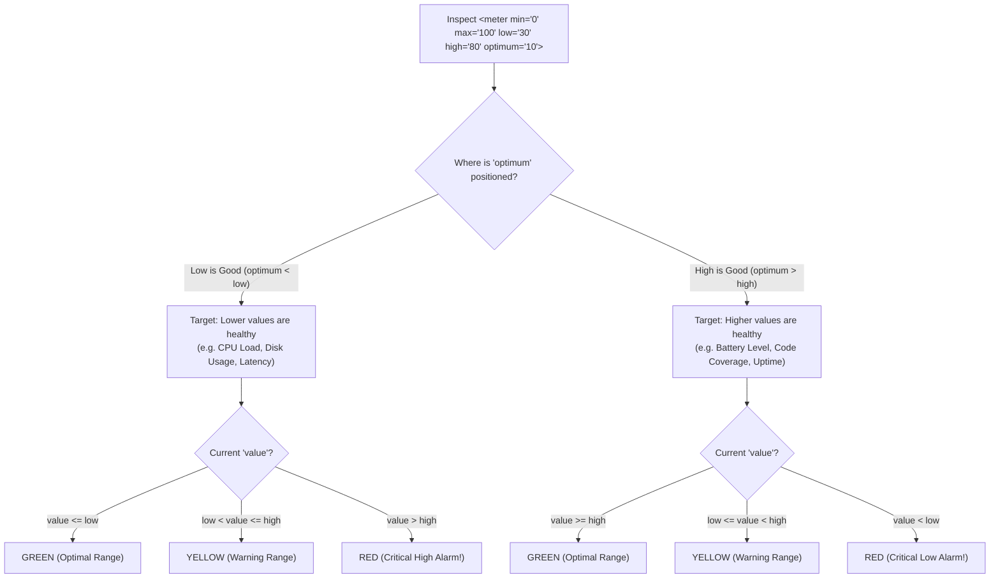

# Calculations, Progress Indicators, and Scalar Meters

| Metadata | Details |
| :--- | :--- |
| **Level** | Core / Fundamental |
| **Prerequisites** | `01-form-basics-and-methods.md`, `02-input-types-and-mobile-keyboards.md` |
| **Estimated Reading Time** | 25 minutes |
| **Status** | Production-Ready |
| **Baseline Status** | Widely Available across all modern browsers |
| **Browsers Tested** | Chrome 120+, Firefox 120+, Safari 17+, Edge 120+ |
| **Tested With** | W3C Nu HTML Checker, Axe-core v4.8, NVDA 2023.3, VoiceOver macOS Sonoma |

---

## Table of Contents
- [1 What & Why](#1-what--why)
- [2 Core Concepts](#2-core-concepts)
- [3 How It Works Internally](#3-how-it-works-internally)
- [4 Syntax & Usage](#4-syntax--usage)
- [5 Practical Examples](#5-practical-examples)
- [6 Best Practices](#6-best-practices)
- [7 Common Mistakes & Pitfalls](#7-common-mistakes--pitfalls)
- [8 Performance, Accessibility, SEO & Security Notes](#8-performance-accessibility-seo--security-notes)
- [9 Comparison / When to Use What](#9-comparison--when-to-use-what)
- [10 Interview Questions](#10-interview-questions)
- [11 Practice Exercises](#11-practice-exercises)
- [12 Summary / Cheat Sheet](#12-summary--cheat-sheet)
- [13 Further Reading](#13-further-reading)

---

## 1 What & Why

Web applications are not passive forms; they are live computational dashboards. Users continuously execute operations: calculating monthly cloud server billing totals, tracking multi-gigabyte container image downloads, and monitoring real-time server RAM consumption.

Historically, developers built gauges and progress indicators out of generic `<div>` tags styled with CSS widths (e.g., `<div class="progress-bar"><div class="fill" style="width: 45%;"></div></div>`).
While visually acceptable to sighted users, this custom markup introduced severe accessibility failures:
- Screen readers could not determine that the div represented a progress bar or scalar gauge.
- Assistive technologies had no programmatic way to read the current numeric value, minimum boundary, or maximum ceiling.
- Live calculation results failed to announce dynamically as inputs were modified.

The HTML Living Standard provides three dedicated semantic elements for quantitative data:
1. **`<output>`**: Represents the live calculation or transformation result of user inputs.
2. **`<progress>`**: Represents the completion progress of an active task (determinate or indeterminate).
3. **`<meter>`**: Represents a scalar measurement within a known range, or a fractional value (e.g., disk usage, memory pressure, battery level).

---

## 2 Core Concepts

### The `<output>` Element
The `<output>` element represents the value of a result of a calculation or user action.
Key attributes:
- **`for`**: A space-separated list of IDs of other elements whose values contributed to the calculation:
  ```html
  <output for="range-input number-input">150</output>
  ```
- **`name`**: Identifies the output in form data sets.
- In the Accessibility Object Model (AOM), `<output>` carries the implicit ARIA role **`status`**, meaning screen readers treat it as an implicit **Live Region** (`aria-live="polite"`), automatically announcing updated values to the user without stealing keyboard focus!

---

### The `<progress>` Element
The `<progress>` element represents the completion progress of a task.
- **Determinate Progress**: When the `value` attribute is specified. Displays an exact proportional completion bar:
  - `value`: Current progress integer or float (e.g., `value="42"`).
  - `max`: Upper bound (defaults to `1.0` if omitted, or any positive float like `max="100"`).
- **Indeterminate Progress**: When the `value` attribute is **omitted entirely**:
  ```html
  <progress max="100"></progress>
  ```
  The browser renders an animated, pulsing back-and-forth loading indicator signaling that an operation is underway, but its duration or byte completion cannot yet be determined.

---

### The `<meter>` Element
The `<meter>` element represents a **scalar measurement within a known range**, or a fractional value (e.g., disk space, temperature, battery gauge, CPU load).
Attributes:
- `value`: The current numerical value (mandatory).
- `min`: The lower bound of the range (defaults to `0`).
- `max`: The upper bound of the range (defaults to `1.0`).
- `low`: The threshold dividing the "low" range from the "medium" range.
- `high`: The threshold dividing the "medium" range from the "high" range.
- `optimum`: The optimal numerical value within the range.

#### The Three Semantic Tiers of `<meter>`
By comparing `value` against `low`, `high`, and `optimum`, the browser engine automatically determines the health state of the gauge and renders appropriate native color themes:
1. **Optimal Zone (Green)**: The current value is on the same side of the thresholds as `optimum`.
2. **Sub-optimal / Warning Zone (Yellow / Amber)**: The current value has drifted past one threshold away from `optimum`.
3. **Critical / Alarm Zone (Red)**: The current value has drifted into the opposing extreme zone away from `optimum`.

---

## 3 How It Works Internally

### The `<meter>` Health Determination Algorithm
The browser layout engine calculates the color status of `<meter>` using a strict comparison matrix:



Because this algorithm is compiled directly into native browser C++ rendering engines, `<meter>` automatically applies platform-consistent, accessible status colors without requiring custom CSS or JavaScript class toggling!

---

## 4 Syntax & Usage

```html
<!-- 1. Real-time Calculation Output -->
<form oninput="totalCost.value = parseInt(baseFee.value) + (parseInt(nodeCount.value) * 45)">
  <label for="baseFee">Base Cluster License ($):</label>
  <input type="number" id="baseFee" value="100" readonly>

  <label for="nodeCount">Worker Nodes ($45/node):</label>
  <input type="range" id="nodeCount" min="1" max="20" value="4">

  <p>
    Total Monthly Invoice: $
    <output id="totalCost" for="baseFee nodeCount" name="total_cost">280</output>
  </p>
</form>

<!-- 2. Determinate Task Completion Progress -->
<div class="progress-block">
  <label for="upload-task">Uploading Diagnostic Tarball (45% completed):</label>
  <progress id="upload-task" max="100" value="45">45%</progress>
</div>

<!-- 3. Indeterminate Task Progress (Loading Spinner / Pulsing Bar) -->
<div class="progress-block">
  <label for="indexing-task">Rebalancing Raft Distributed Log:</label>
  <progress id="indexing-task">Indexing...</progress>
</div>

<!-- 4. Scalar System Quota Meter (Disk Space: Low is good) -->
<div class="meter-block">
  <label for="disk-gauge">Storage Inode Utilization (85% - Warning):</label>
  <meter id="disk-gauge" 
         min="0" 
         max="100" 
         low="60" 
         high="80" 
         optimum="20" 
         value="85">85%</meter>
</div>
```

> [!NOTE]
> **Baseline Status: Widely Available**
> `<output>`, `<progress>`, and `<meter>` are baseline web platform standards supported across all desktop and mobile browsers since HTML5 (2014).

---

## 5 Practical Examples

### Example 1: Interactive Bandwidth Cost Calculator with `<output>`
```html
<!DOCTYPE html>
<html lang="en">
<head>
  <meta charset="utf-8">
  <title>Cloud Bandwidth Calculator</title>
  <style>
    .calc-card { max-width: 450px; padding: 1.5rem; border: 1px solid #cbd5e1; border-radius: 8px; font-family: sans-serif; }
    .form-row { margin-bottom: 1rem; display: flex; flex-direction: column; gap: 0.25rem; }
    output { font-weight: 800; color: #2563eb; font-size: 1.25rem; }
  </style>
</head>
<body>
  <main>
    <div class="calc-card">
      <h1>Egress Bandwidth Estimator</h1>

      <form oninput="calcEgress()">
        <div class="form-row">
          <label for="data-gb">Monthly Egress Volume (GB):</label>
          <input type="range" id="data-gb" name="gb" min="100" max="10000" step="100" value="1000">
          <span id="gb-display">1,000 GB</span>
        </div>

        <div class="form-row">
          <label for="rate-tier">Egress Pricing Tier ($/GB):</label>
          <input type="number" id="rate-tier" name="rate" value="0.08" step="0.01" readonly>
        </div>

        <p>
          Estimated Egress Expense:
          <output id="egress-total" for="data-gb rate-tier">$80.00</output>
        </p>
      </form>
    </div>
  </main>

  <script>
    function calcEgress() {
      const gb = document.getElementById("data-gb").value;
      const rate = document.getElementById("rate-tier").value;
      document.getElementById("gb-display").textContent = Number(gb).toLocaleString() + " GB";
      document.getElementById("egress-total").textContent = "$" + (gb * rate).toFixed(2);
    }
  </script>
</body>
</html>
```

### Example 2: Multi-Stage Firmware Flashing Progress Pipeline
```html
<section aria-labelledby="flashing-title">
  <h2 id="flashing-title">Storage Controller Firmware Update</h2>

  <!-- Stage 1: Determinate progress bar showing download -->
  <div class="step">
    <label for="dl-progress">Stage 1: Downloading Firmware Image (8.4 MB of 10.0 MB)</label>
    <progress id="dl-progress" max="100" value="84">84%</progress>
  </div>

  <!-- Stage 2: Indeterminate progress bar showing flashing -->
  <div class="step" style="margin-top: 1rem;">
    <label for="flash-progress">Stage 2: Writing EEPROM Sectors (In Progress...)</label>
    <progress id="flash-progress">Flashing EEPROM...</progress>
  </div>
</section>
```

### Example 3: Edge Case — Optimizing `<meter>` for Code Coverage (High is Good)
```html
<!-- Scenario: Code coverage percentage. Higher numbers are better! -->
<!-- optimum="100" tells the engine that values above 'high' are Green -->
<!-- Values between 'low' and 'high' are Yellow -->
<!-- Values below 'low' are Red! -->

<article class="test-metrics">
  <h3>Continuous Integration Test Coverage</h3>

  <div class="metric">
    <label for="cov-core">Core Telemetry Engine (92% - Excellent):</label>
    <meter id="cov-core" min="0" max="100" low="70" high="85" optimum="100" value="92">92%</meter>
  </div>

  <div class="metric">
    <label for="cov-api">HTTP Ingress Routing (74% - Sub-optimal):</label>
    <meter id="cov-api" min="0" max="100" low="70" high="85" optimum="100" value="74">74%</meter>
  </div>

  <div class="metric">
    <label for="cov-legacy">Legacy v1 Driver (48% - Failing):</label>
    <meter id="cov-legacy" min="0" max="100" low="70" high="85" optimum="100" value="48">48%</meter>
  </div>
</article>
```

### Example 4: Failure Case — Fatal Metric and Progress Anti-Patterns
```html
<!-- ANTI-PATTERN: DO NOT COPY -->

<!-- Error 1: Using <progress> for disk usage (PROGRESS IS NOT A QUOTA METER!) -->
<!-- <progress> implies an active task that will finish at 100%. Disk space is a static scalar! -->
<label>Disk Space Used:</label>
<progress value="80" max="100"></progress> <!-- WRONG ELEMENT! Must be <meter> -->

<!-- Error 2: Using <meter> for a file download -->
<label>Downloading file:</label>
<meter value="40" min="0" max="100"></meter> <!-- WRONG ELEMENT! Must be <progress> -->

<!-- Error 3: Omitting accessible text fallback between tags -->
<progress value="50" max="100"></progress> <!-- Missing text between tags for legacy fallback! -->

<!-- Error 4: Missing 'for' attribute on <output> -->
<!-- Assistive tech cannot deduce which inputs drove the calculation! -->
<output>42</output> <!-- Missing for="inputA inputB" -->
```

### Example 5: Production Datacenter Rack Telemetry Monitor
```html
<!DOCTYPE html>
<html lang="en">
<head>
  <meta charset="utf-8">
  <title>Host Server Health Telemetry</title>
  <style>
    .host-card { max-width: 480px; padding: 1.5rem; border: 1px solid #cbd5e1; border-radius: 8px; }
    .gauge-row { margin-bottom: 1.25rem; display: flex; flex-direction: column; gap: 0.35rem; }
    meter, progress { width: 100%; height: 18px; }
  </style>
</head>
<body>
  <main>
    <article class="host-card">
      <header>
        <h2>Node: worker-az1-compute-04</h2>
        <p>State: Online &bull; Kernel: 6.8.0-generic</p>
      </header>

      <!-- CPU Utilization: Low is optimal (optimum=10) -->
      <div class="gauge-row">
        <label for="cpu-meter">CPU Load (38% &bull; Optimal)</label>
        <meter id="cpu-meter" min="0" max="100" low="50" high="80" optimum="10" value="38">38%</meter>
      </div>

      <!-- Memory Pressure: Low is optimal -->
      <div class="gauge-row">
        <label for="ram-meter">RAM Allocation (84% &bull; Warning)</label>
        <meter id="ram-meter" min="0" max="100" low="60" high="80" optimum="20" value="84">84%</meter>
      </div>

      <!-- Active Database Snapshot Progress -->
      <div class="gauge-row">
        <label for="backup-progress">ZFS Snapshot Replication (62% Completed)</label>
        <progress id="backup-progress" max="100" value="62">62%</progress>
      </div>
    </article>
  </main>
</body>
</html>
```

---

## 6 Best Practices

1. **Strictly Differentiate `<progress>` vs. `<meter>`**:
   - Use `<progress>` when tracking **completion of an active process** (file download, task execution, data migration).
   - Use `<meter>` when displaying a **static measurement, quota, or scalar value within bounds** (disk capacity, CPU load, battery level, test score).
2. **Always Provide Explicit `for` Attributes on `<output>`**: List the IDs of every input whose value determines the output (e.g., `for="subtotal tax shipping"`).
3. **Configure `low`, `high`, and `optimum` Intentionally on `<meter>`**:
   - If lower numbers are healthy (CPU load, error rates), set `optimum` smaller than `low`.
   - If higher numbers are healthy (battery level, test scores), set `optimum` larger than `high`.
4. **Always Provide Inner Fallback Text**: Place plain-text percentages between `<progress>` and `<meter>` tags (`<progress value="50" max="100">50%</progress>`) for backward compatibility and text scrapers.
5. **Omit `value` for Indeterminate Progress**: When a background job's duration is unknown, omit `value` on `<progress>` to display native pulsing indeterminate spinners.
6. **Ensure High Contrast when Custom Styling**: If styling `progress::-webkit-progress-value` or `meter::-webkit-meter-bar` with custom CSS, maintain at least 3:1 graphical contrast against adjacent tracks (WCAG 1.4.11).

---

## 7 Common Mistakes & Pitfalls

| Mistake | Bad Code | Good Code | Technical Explanation |
| :--- | :--- | :--- | :--- |
| **`<progress>` for Disk Space** | `<progress value="75" max="100">` | `<meter min="0" max="100" value="75">` | Disk space is a static measurement within bounds, not an active task reaching completion. |
| **`<meter>` for Download** | `<meter value="50" max="100">` | `<progress value="50" max="100">` | Downloads are active progressive processes; screen readers announce `<progress>` as task completion. |
| **Missing `for` on `<output>`** | `<output id="total">100</output>` | `<output id="total" for="inA inB">100</output>` | Without `for`, assistive software cannot trace the source inputs responsible for the calculation. |
| **Reversing `low` and `high`** | `<meter low="80" high="20">` | `<meter low="20" high="80">` | Violates HTML specification. `low` must always be numerically less than `high`. |
| **Indeterminate `<meter>`** | `<meter></meter>` | `<progress></progress>` | `<meter>` has no concept of an indeterminate state. Omitting `value` treats it as 0. |
| **Fake Div Progress Bars** | `<div class="bar"><div style="width:50%">` | `<progress value="50" max="100">` | Custom div bars convey zero role, zero value, and zero progress metrics to screen reader users. |

---

## 8 Performance, Accessibility, SEO & Security Notes

### Accessibility (WCAG 2.2 AA)
- **Criterion 4.1.2 (Name, Role, Value - Level A)**:
  - `<progress>` automatically exposes `role="progressbar"` with `aria-valuenow`, `aria-valuemin`, and `aria-valuemax`.
  - `<meter>` automatically exposes `role="meter"` in the Accessibility Object Model.
- **Screen Reader Announcements**:
  - NVDA announces `<progress>` as: *"Progress bar, 45%"*.
  - When `<progress>` is indeterminate, VoiceOver announces: *"Indeterminate progress indicator"*.
  - Screen readers treat `<output>` as an automatic Live Region (`role="status"`), announcing updated figures when inputs change.

### Search Engine Optimization (SEO)
- Search engines parse `<meter>` elements within review and specification schemas to extract numeric ratings, product scores, and battery life metrics for Google Rich Snippets.

### Performance & GPU Rendering
- Native `<progress>` and `<meter>` elements are rendered directly by OS/browser graphics pipelines with zero JavaScript overhead. Indeterminate progress animations run on compositor threads, avoiding main-thread frame drops.

### Security Notes
- Content rendered inside `<output>` is derived from user inputs. When generating `<output>` values dynamically via JavaScript, write to `outputElement.textContent = result` (never `innerHTML`) to prevent Cross-Site Scripting (XSS).

---

## 9 Comparison / When to Use What

| Element | Real-world Analogy | Key Attributes | Implicit ARIA Role | Primary Purpose |
| :--- | :--- | :--- | :--- | :--- |
| `<output>` | Calculator LCD Screen | `for`, `name` | `status` (Live Region) | Displaying live calculated results. |
| `<progress>` | Download Loading Bar | `value`, `max` | `progressbar` | Active task completion percentage. |
| `<meter>` | Car Fuel / Speed Gauge | `value`, `min`, `max`, `low`, `high`, `optimum` | `meter` | Static scalar quantity within fixed range. |
| `<div>` Bar | None (Anti-pattern) | N/A | `generic` | Avoid for metrics! (Fails accessibility). |

---

## 10 Interview Questions

<details>
<summary><strong>1. Explain the architectural and semantic difference between `<progress>` and `<meter>`. Give an example of each.</strong></summary>

**Answer:**
- **`<progress>`**:
  - Represents the **completion state of an ongoing, active process or task** (e.g., uploading a 50MB file, executing a database migration, installation wizard step).
  - It has a starting point and moves towards an expected completion point (100%).
  - Supports an **indeterminate state** (omitting `value`) when task duration is unknown.
  - In the AOM, it exposes `role="progressbar"`.
  - *Example*: `<progress max="100" value="65">65%</progress>` (Tracking a file download).
- **`<meter>`**:
  - Represents a **scalar measurement, gauge, or quota within a fixed, known range** (e.g., disk usage, CPU utilization, battery percentage, student exam score).
  - It is not an active task moving toward completion; rather, it is a measurement of current state that can fluctuate up or down.
  - Supports health thresholds (`low`, `high`, `optimum`) to convey optimal vs. warning states.
  - Does *not* support an indeterminate state.
  - *Example*: `<meter min="0" max="100" low="60" high="80" optimum="20" value="85">85%</meter>` (Memory pressure).
</details>

<details>
<summary><strong>2. How does the browser layout engine determine whether a `<meter>` should render green, yellow, or red?</strong></summary>

**Answer:**
The browser compares the current `value` against `low`, `high`, and `optimum`:
1. If `optimum` is **below `low`** (meaning *lower is better*, such as CPU temperature or error count):
   - `value <= low`: **Green (Optimal)**.
   - `low < value <= high`: **Yellow (Sub-optimal Warning)**.
   - `value > high`: **Red (Critical Alarm)**.
2. If `optimum` is **above `high`** (meaning *higher is better*, such as test score or battery life):
   - `value >= high`: **Green (Optimal)**.
   - `low <= value < high`: **Yellow (Sub-optimal Warning)**.
   - `value < low`: **Red (Critical Alarm)**.
3. If `optimum` is **between `low` and `high`** (meaning *moderate is better*, such as ambient room humidity):
   - Values between `low` and `high` render Green; values drifting above or below render Yellow.
</details>

<details>
<summary><strong>3. How does the `<output>` element communicate live updates to screen reader users?</strong></summary>

**Answer:**
Under the W3C HTML-AAM (HTML Accessibility API Mappings) specification, the `<output>` element carries the **implicit ARIA role of `status`**.

Elements with `role="status"` are automatically assigned **live region semantics** (`aria-live="polite"` and `aria-atomic="true"`). 
When JavaScript updates the text content of `<output>`:
1. The browser's accessibility bridge detects the DOM mutation.
2. Because the live region is `polite`, the screen reader waits until the user has finished their current action (e.g., finished dragging a slider or typing an input).
3. The screen reader automatically announces the updated value in the background without moving focus away from the input control!
</details>

<details>
<summary><strong>4. How do you create an "indeterminate" progress bar in HTML, and what does it communicate?</strong></summary>

**Answer:**
To create an indeterminate progress bar, simply **omit the `value` attribute entirely**:
```html
<progress max="100">Processing...</progress>
```
When `value` is absent:
- The browser renders a native, continuous back-and-forth barber-pole or glowing pulse animation.
- It communicates to all users that a background task is actively running, but the system cannot currently calculate its completion percentage (e.g., waiting for server connection handshake, scanning an unknown number of file nodes).
- In the AOM, screen readers announce: *"Indeterminate progress bar"* instead of a percentage.
</details>

<details>
<summary><strong>5. What is the purpose of the `for` attribute on an `<output>` element?</strong></summary>

**Answer:**
The `for` attribute accepts a space-separated list of element IDs that contributed directly to the calculation displayed in the `<output>`:
```html
<output for="num1 num2">300</output>
```
This establishes an **explicit programmatic relationship** in the Accessibility Object Model. Assistive technologies and automation agents can inspect `output.htmlFor` to understand which inputs drove the result, fulfilling WCAG 1.3.1 (Info and Relationships).
</details>

<details>
<summary><strong>6. Can an `<output>` element be submitted as part of a standard HTML form POST payload?</strong></summary>

**Answer:**
**Yes.** If an `<output>` element possesses a valid `name` attribute:
```html
<output name="total_amount" for="price qty">150</output>
```
According to the WHATWG specification, `<output>` is a listed form-associated element. Its current string value is serialized and submitted to the server alongside standard inputs upon form submission.
</details>

<details>
<summary><strong>7. Why should you always include fallback text content inside `<progress>` and `<meter>` tags?</strong></summary>

**Answer:**
While modern graphical browsers render `<progress>` and `<meter>` as visual tracks and gauges, legacy user agents, text-only browsers (like Lynx), and web crawlers may not support the visual element. 

Placing human-readable text inside the element:
`<progress value="75" max="100">75% completed</progress>`
ensures that if the element fails to render or is stripped of styling, the textual fallback is displayed directly on screen, preserving data accessibility.
</details>

<details>
<summary><strong>8. What is the difference in default maximum value between `<progress>` and `<meter>`?</strong></summary>

**Answer:**
- In **`<progress>`**, if the `max` attribute is omitted, the default maximum is **`1.0`** (and `value` must be between `0.0` and `1.0`).
- In **`<meter>`**, if `min` and `max` are omitted, the default minimum is **`0.0`** and the default maximum is **`1.0`**. However, if a negative `min` is provided (e.g., `min="-50"`), `<meter>` supports negative coordinate bounds, whereas `<progress>` strictly forbids negative values.
</details>

---

## 11 Practice Exercises

### Exercise 1 (Easy): Create an Indeterminate Loading Indicator
**Task**: Author the HTML for an indeterminate progress indicator showing that database migrations are running. Include accessible fallback text.

<details>
<summary><strong>Solution</strong></summary>

```html
<div class="loader-group">
  <label for="db-migration">Executing Database Migrations:</label>
  <progress id="db-migration">Applying migration scripts...</progress>
</div>
```
*Explanation*: Omitting the `value` attribute makes the progress bar indeterminate.
</details>

### Exercise 2 (Easy): Real-Time Multiplier Output
**Task**: Build a form with two inputs: "Unit Price" ($20) and "Quantity" (range 1 to 10). Output the total calculated cost using `<output>` and the `for` attribute.

<details>
<summary><strong>Solution</strong></summary>

```html
<form oninput="total.value = '$' + (parseInt(price.value) * parseInt(qty.value))">
  <label for="price">Unit Price ($):</label>
  <input type="number" id="price" value="20" readonly>

  <label for="qty">Quantity:</label>
  <input type="number" id="qty" min="1" max="10" value="2">

  <p>Total Cost: <output id="total" for="price qty" name="total_price">$40</output></p>
</form>
```
</details>

### Exercise 3 (Medium): Critical CPU Load Meter (Low is Good)
**Task**: Author a `<meter>` displaying a server CPU load currently running at 88%. Configure thresholds so that 0-50% is optimal (Green), 50-80% is warning (Yellow), and >80% is critical (Red).

<details>
<summary><strong>Solution</strong></summary>

```html
<div class="metric-card">
  <label for="cpu-metric">Cluster CPU Load (88% - Critical Alarm):</label>
  <meter id="cpu-metric" 
         min="0" 
         max="100" 
         low="50" 
         high="80" 
         optimum="10" 
         value="88">88%</meter>
</div>
```
*Explanation*: Setting `optimum="10"` (below `low`) signals that low numbers are green. Because `value="88"` exceeds `high`, the browser automatically paints the meter Red.
</details>

### Exercise 4 (Medium): Battery Level Meter (High is Good)
**Task**: Author a `<meter>` displaying device battery level at 15%. Configure thresholds so that >50% is optimal (Green), 20-50% is warning (Yellow), and <20% is critical low (Red).

<details>
<summary><strong>Solution</strong></summary>

```html
<div class="battery-status">
  <label for="bat-level">Battery Reserve (15% - Low Battery Warning):</label>
  <meter id="bat-level" 
         min="0" 
         max="100" 
         low="20" 
         high="50" 
         optimum="100" 
         value="15">15%</meter>
</div>
```
*Explanation*: Setting `optimum="100"` (above `high`) signals that high numbers are green. Because `value="15"` is below `low`, the browser automatically paints the meter Red.
</details>

### Exercise 5 (Hard): Identify and Fix 5 Progress & Meter Anti-Patterns
**Task**: Remediate all 5 bugs in this cloud telemetry panel:

```html
<!-- Flawed Source -->
<div>
  <h3>Cluster Metrics</h3>
  <label>RAM Space</label>
  <progress value="90" max="100"></progress>
  <label>Uploading Log</label>
  <meter min="0" max="100" value="45"></meter>
  <output>Total: $500</output>
</div>
```

<details>
<summary><strong>Solution</strong></summary>

```html
<!-- Fully Remediated Telemetry Panel -->
<section aria-labelledby="telemetry-title">
  <h3 id="telemetry-title">Cluster Metrics</h3>

  <!-- 1. RAM space is a scalar quota -> Converted to <meter> -->
  <!-- 2. Added explicit label pairing via id and for -->
  <div>
    <label for="ram-gauge">RAM Allocation (90% - High Memory Pressure):</label>
    <meter id="ram-gauge" min="0" max="100" low="60" high="80" optimum="20" value="90">90%</meter>
  </div>

  <!-- 3. Upload is an active process -> Converted to <progress> -->
  <div style="margin-top: 1rem;">
    <label for="upload-task">Uploading Log Archive (45% Completed):</label>
    <progress id="upload-task" max="100" value="45">45%</progress>
  </div>

  <!-- 4. Added for attribute to <output> referencing calculating inputs -->
  <div style="margin-top: 1rem;">
    <output id="billing-total" for="ram-gauge">Total: $500</output>
  </div>
</section>
```
</details>

### Exercise 6 (Hard): Construct an Accessible Live Disk Quota Monitor
**Task**: Build a complete disk quota widget displaying storage used (180 GB of 200 GB limit). Include `<meter>` thresholds, text percentages, and an `<output>` calculation displaying remaining available gigabytes.

<details>
<summary><strong>Solution</strong></summary>

```html
<article class="storage-widget">
  <header>
    <h2>Persistent NVMe Volume Quota</h2>
  </header>

  <div class="meter-group">
    <label for="nvme-usage">Disk Utilization: 180 GB / 200 GB (90% Quota Used):</label>
    <meter id="nvme-usage" 
           min="0" 
           max="200" 
           low="120" 
           high="160" 
           optimum="40" 
           value="180">
      180 GB / 200 GB (90%)
    </meter>
  </div>

  <p>
    Remaining Buffer:
    <output for="nvme-usage" aria-live="polite">20 GB Available</output>
  </p>
</article>

<style>
  .storage-widget {
    max-width: 450px;
    padding: 1.5rem;
    border: 1px solid #cbd5e1;
    border-radius: 8px;
    font-family: sans-serif;
  }
  meter {
    width: 100%;
    height: 20px;
    margin: 0.5rem 0;
  }
  output {
    font-weight: 700;
    color: #dc2626; /* Warning red color */
  }
</style>
```
</details>

---

## 12 Summary / Cheat Sheet

```
┌────────────────────────────────────────────────────────────────────────┐
│                        OUTPUT, PROGRESS & METER CHEAT SHEET            │
├───────────────────┬────────────────────────────────────────────────────┤
│ Element           │ Primary Role & Semantics                           │
├───────────────────┼────────────────────────────────────────────────────┤
│ <output>          │ Live calculation result; implicit role="status"    │
│ output for="..."  │ Space-separated list of driving input IDs          │
│ <progress>        │ Active task progress; role="progressbar"           │
│ Determinate       │ <progress max="100" value="45">45%</progress>      │
│ Indeterminate     │ <progress>Loading...</progress> (Omit value attr)  │
│ <meter>           │ Scalar measurement within known bounds; role="meter│
│ meter optimum     │ Determines whether low or high values are Green    │
│ Fallback Text     │ ALWAYS place text between tags: <meter...>75%</..> │
│ Golden Rule       │ Progress = Active task; Meter = Static gauge/quota │
└───────────────────┴────────────────────────────────────────────────────┘
```

---

## 13 Further Reading

- [WHATWG HTML Living Standard: Section 4.10.12 The &lt;output&gt; Element](https://html.spec.whatwg.org/multipage/form-elements.html#the-output-element)
- [WHATWG HTML Living Standard: Section 4.10.13 The &lt;progress&gt; Element](https://html.spec.whatwg.org/multipage/form-elements.html#the-progress-element)
- [WHATWG HTML Living Standard: Section 4.10.14 The &lt;meter&gt; Element](https://html.spec.whatwg.org/multipage/form-elements.html#the-meter-element)
- [MDN Web Docs: The HTML &lt;meter&gt; Element](https://developer.mozilla.org/en-US/docs/Web/HTML/Element/meter)
- [CSS-Tricks: The HTML5 meter Element](https://css-tricks.com/html5-meter-element/)

---

| [Previous: 05 Textarea & Button Types](05-textarea-and-button-types.md) | [Section Index](README.md) | [Next: 07 Built-In Constraint Validation](07-built-in-constraint-validation.md) |
