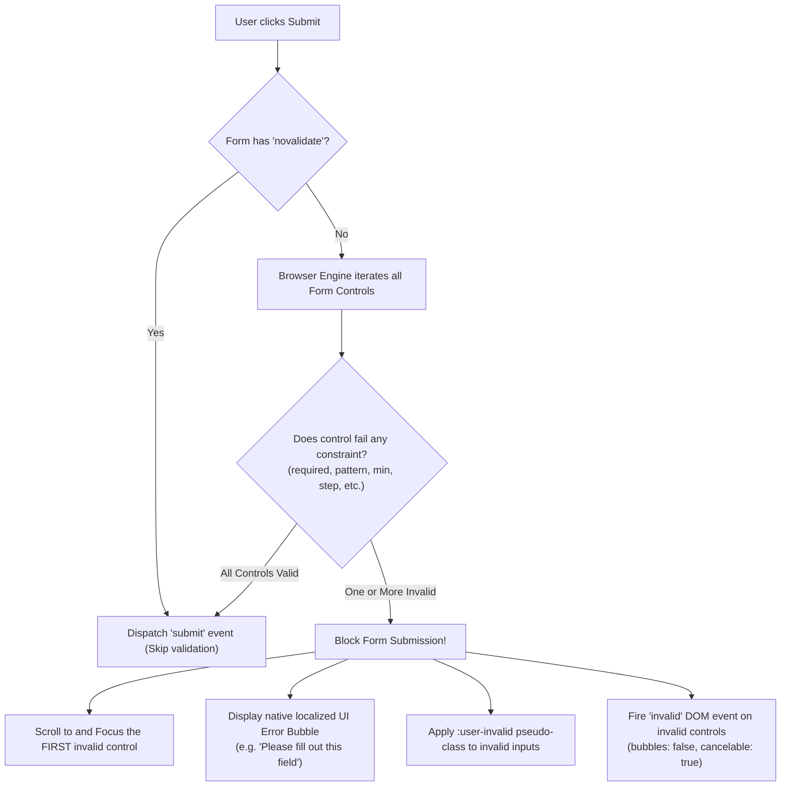

# Declarative Constraint Validation and CSS Pseudo-Classes

| Metadata | Details |
| :--- | :--- |
| **Level** | Core / Fundamental |
| **Prerequisites** | `01-form-basics-and-methods.md`, `02-input-types-and-mobile-keyboards.md` |
| **Estimated Reading Time** | 30 minutes |
| **Status** | Production-Ready |
| **Baseline Status** | Widely Available (`:user-valid` and `:user-invalid` Widely Available 2023) |
| **Browsers Tested** | Chrome 120+, Firefox 120+, Safari 17+, Edge 120+ |
| **Tested With** | W3C Nu HTML Checker, Axe-core v4.8, NVDA 2023.3, VoiceOver macOS Sonoma |

---

## Table of Contents
- [1 What & Why](#1-what--why)
- [2 Core Concepts](#2-core-concepts)
- [3 How It Works Internally](#3-how-it-works-internally)
- [4 Syntax & Usage](#4-syntax--usage)
- [5 Practical Examples](#5-practical-examples)
- [6 Best Practices](#6-best-practices)
- [7 Common Mistakes & Pitfalls](#7-common-mistakes--pitfalls)
- [8 Performance, Accessibility, SEO & Security Notes](#8-performance-accessibility-seo--security-notes)
- [9 Comparison / When to Use What](#9-comparison--when-to-use-what)
- [10 Interview Questions](#10-interview-questions)
- [11 Practice Exercises](#11-practice-exercises)
- [12 Summary / Cheat Sheet](#12-summary--cheat-sheet)
- [13 Further Reading](#13-further-reading)

---

## 1 What & Why

Client-side form validation is the first line of defense in web applications. It serves two distinct purposes:
1. **User Experience (UX)**: Provides immediate, clear feedback guiding users to correct errors before transmitting data over high-latency network connections.
2. **Bandwidth & Server Load Protection**: Filters out incomplete or obviously malformed payloads before they reach expensive backend API servers.

Historically, implementing validation required loading heavy JavaScript libraries (e.g., jQuery Validation, Yup, Joi) that listened to `blur` and `submit` events, evaluated custom regular expressions, and manually injected error `<div>` tags into the DOM.

The modern WHATWG HTML Living Standard provides **Declarative Constraint Validation** directly in the browser engine. By attaching attributes like `required`, `pattern`, `minlength`, `maxlength`, `min`, `max`, and `step`, the browser's C++ layout engine automatically validates fields, blocks invalid submissions, focuses the offending input, and displays native localized error bubbles.

Furthermore, with the universal adoption of **`:user-valid` and `:user-invalid` (Widely Available 2023)**, developers can style interactive validation states purely in CSS without premature "red input" errors flashing on fresh page loads!

---

## 2 Core Concepts

### Declarative Validation Attributes
HTML5 defines eight primary constraint attributes:

1. **`required`**: A boolean attribute specifying that the form control must have a non-empty value before submission.
2. **`pattern`**: A regular expression string conforming to the ECMAScript RegExp standard. The input's entire value must match the compiled pattern. *(Tip: The `title` attribute must be provided to explain the required format to users!)*.
3. **`minlength`**: The minimum number of characters (Unicode code points) required.
4. **`maxlength`**: The maximum number of characters permitted (the browser physically prevents users from typing beyond this limit).
5. **`min`**: The minimum numerical, calendar date, or time value.
6. **`max`**: The maximum numerical, calendar date, or time value.
7. **`step`**: The legal granularity of the value (e.g., `step="0.01"` for currency, `step="60"` for time in minutes). Use `step="any"` to permit any arbitrary floating-point number.
8. **Type-Driven Constraints**: Native validation enforced implicitly by `type="email"`, `type="url"`, and `type="date"`.

---

### CSS Validation Pseudo-Classes

#### 1. The Immediate Pseudo-Classes (`:valid` and `:invalid`)
- `:valid`: Matches an input whose current value satisfies all declared constraints.
- `:invalid`: Matches an input whose current value fails one or more constraints.
- **The "Premature Error" Flaw**: By default, an empty `required` input matches `:invalid` the instant the page loads! If an author styles `input:invalid { border: 2px solid red; }`, the user sees an intimidating red error box before they have even had a chance to touch the keyboard.

#### 2. The User-Interaction Pseudo-Classes (`:user-valid` and `:user-invalid`) *(Widely Available 2023)*
To solve the premature error problem, browser engines standardized `:user-valid` and `:user-invalid`:
- **`:user-valid`**: Matches a valid input **only after** the user has significantly interacted with the control (typed text and moved focus away via `blur`, or attempted to submit the form).
- **`:user-invalid`**: Matches an invalid input **only after** the user has interacted with it and left it in an invalid state, or after an invalid form submission was blocked.
These pseudo-classes provide flawless, professional validation styling purely in CSS without a single line of JavaScript state-tracking code!

#### 3. Boundary & Requirement Pseudo-Classes
- `:required`: Matches controls that have the `required` attribute.
- `:optional`: Matches controls lacking the `required` attribute.
- `:in-range`: Matches `number` or `range` inputs whose value sits between `min` and `max`.
- `:out-of-range`: Matches inputs whose value exceeds `max` or falls below `min`.

---

## 3 How It Works Internally

### Native Submission Interception Pipeline
When a user submits a `<form>`:



1. **Validation Loop**: The browser evaluates each successful form control against its `ValidityState` flags.
2. **First-Invalid Focus**: The browser automatically scrolls the page to the first invalid field and focuses it, ensuring keyboard accessibility.
3. **Localization**: The error bubble text is generated automatically by the operating system/browser in the user's native system language (e.g., German users see *"Bitte füllen Sie dieses Feld aus"*, English users see *"Please fill out this field"*).

---

## 4 Syntax & Usage

```html
<!-- 1. Strict RegEx Pattern Validation with Explanatory Title -->
<div class="field">
  <label for="cluster-slug">Cluster Domain Identifier:</label>
  <input type="text" 
         id="cluster-slug" 
         name="slug" 
         pattern="^[a-z0-9]{3,12}$" 
         title="Must be 3 to 12 lowercase alphanumeric characters with no spaces or symbols." 
         placeholder="e.g. prod-k8s-01" 
         required>
</div>

<!-- 2. Numerical Stepping & Range Constraints -->
<div class="field">
  <label for="ram-alloc">Worker RAM Allocation (GB, Multiples of 4):</label>
  <input type="number" 
         id="ram-alloc" 
         name="ram_gb" 
         min="4" 
         max="128" 
         step="4" 
         value="16" 
         required>
</div>

<!-- 3. Floating-Point Financial Currency with step="0.01" -->
<div class="field">
  <label for="max-bid">Max Spot Instance Bid Price ($ USD):</label>
  <input type="number" 
         id="max-bid" 
         name="bid" 
         min="0.01" 
         max="10.00" 
         step="0.01" 
         placeholder="0.05" 
         required>
</div>

<!-- 4. Text Length Boundaries -->
<div class="field">
  <label for="incident-notes">Incident Summary (20 to 300 characters):</label>
  <textarea id="incident-notes" 
            name="notes" 
            minlength="20" 
            maxlength="300" 
            required></textarea>
</div>
```

> [!NOTE]
> **Baseline Status:**
> - `required`, `pattern`, `minlength`, `maxlength`, `min`, `max`, `step`, `:valid`, and `:invalid` are **Widely Available** baseline web platform standards supported across all browsers.
> - `:user-valid` and `:user-invalid` are **Widely Available** across all major engines (Chrome 119+, Safari 16.5+, Firefox 88+ as of 2023).

---

## 5 Practical Examples

### Example 1: Clean CSS Validation Styling using `:user-invalid`
```html
<!DOCTYPE html>
<html lang="en">
<head>
  <meta charset="utf-8">
  <title>User-Friendly Validation Styling</title>
  <style>
    .form-group { margin-bottom: 1.25rem; display: flex; flex-direction: column; gap: 0.25rem; }
    label { font-weight: 600; font-family: sans-serif; }
    input { padding: 0.6rem; border: 1px solid #cbd5e1; border-radius: 6px; font-size: 1rem; }

    /* The Modern Solution: Style ONLY after the user interacts! */
    input:user-valid {
      border-color: #16a34a; /* Green border */
      background-color: #f0fdf4;
    }
    input:user-invalid {
      border-color: #dc2626; /* Red border */
      background-color: #fef2f2;
    }

    /* Provide a visual error message that only shows when :user-invalid */
    .error-hint { display: none; color: #dc2626; font-size: 0.85rem; }
    input:user-invalid + .error-hint {
      display: block;
    }
  </style>
</head>
<body>
  <main>
    <h1>Provision Database Cluster</h1>

    <form action="/provision" method="post">
      <div class="form-group">
        <label for="cluster-name">Cluster Name (Required, 4-16 alphanumeric)</label>
        <input type="text" 
               id="cluster-name" 
               name="name" 
               pattern="^[a-zA-Z0-9]{4,16}$" 
               title="Cluster name must be between 4 and 16 letters and numbers." 
               required>
        <span class="error-hint">Please enter a valid 4–16 character alphanumeric name.</span>
      </div>

      <div class="form-group">
        <label for="contact-email">Escalation Email Address</label>
        <input type="email" id="contact-email" name="email" required>
        <span class="error-hint">Please provide a valid corporate email address.</span>
      </div>

      <button type="submit">Submit Request</button>
    </form>
  </main>
</body>
</html>
```

### Example 2: Complex RegEx Pattern with ISO Port Number Validation
```html
<form action="/networking/rule" method="post">
  <!-- Validates an IPv4 Socket Address with mandatory port: 192.168.1.1:8080 -->
  <label for="socket-addr">Ingress Proxy Socket (IPv4:Port):</label>
  <input type="text" 
         id="socket-addr" 
         name="socket" 
         pattern="^((25[0-5]|(2[0-4]|1\d|[1-9]|)\d)\.?\b){4}:([1-9][0-9]{0,3}|[1-5][0-9]{4}|6[0-4][0-9]{3}|65[0-4][0-9]{2}|655[0-2][0-9]|6553[0-5])$" 
         title="Must be a valid IPv4 address followed by a colon and port between 1 and 65535 (e.g. 10.0.0.1:8443)." 
         placeholder="10.0.0.1:8443" 
         required>
  
  <button type="submit">Register Socket</button>
</form>
```

### Example 3: Edge Case — Stepping and Floating-Point Decimal Traps
```html
<!-- Problem: By default, <input type="number"> defaults to step="1"! -->
<!-- If a user enters a decimal number like "4.5", validation FAILS with stepMismatch! -->

<!-- BROKEN: Fails if user enters 3.14 -->
<input type="number" name="rate" min="0" max="10">

<!-- SOLUTION A: Explicit fractional step for currency -->
<input type="number" name="currency" min="0" max="100" step="0.01">

<!-- SOLUTION B: step="any" allows ANY decimal precision (e.g. 0.0000042) -->
<input type="number" name="arbitrary_float" min="0" step="any">
```

### Example 4: Failure Case — Broken Validation UX Anti-Patterns
```html
<!-- ANTI-PATTERN: DO NOT COPY -->

<!-- Error 1: Premature error flashing with :invalid -->
<style>
  /* TERRIBLE UX: Makes the entire form glow red the second the page loads! */
  input:invalid { border: 2px solid red; }
</style>
<form>
  <input type="text" required> <!-- Instantly red! -->
  <input type="email" required> <!-- Instantly red! -->
</form>

<!-- Error 2: RegEx pattern lacking an explanatory 'title' -->
<!-- When validation fails, the browser says: "Please match the requested format." -->
<!-- The user has NO IDEA what the format is! -->
<input type="text" pattern="^[A-Z]{3}-[0-9]{4}$" required> <!-- MISSING title="..." -->

<!-- Error 3: Mismatched minlength vs maxlength -->
<input type="text" minlength="10" maxlength="5"> <!-- IMPOSSIBLE TO SATISFY! -->
```

### Example 5: Production Multi-Constraint Security Credential Form
```html
<!DOCTYPE html>
<html lang="en">
<head>
  <meta charset="utf-8">
  <title>Security Credential Rotation</title>
  <style>
    .credential-card { max-width: 500px; padding: 2rem; border: 1px solid #cbd5e1; border-radius: 8px; font-family: sans-serif; }
    .form-field { margin-bottom: 1.5rem; display: flex; flex-direction: column; gap: 0.35rem; }
    input:user-invalid { border-color: #dc2626; box-shadow: 0 0 0 1px #dc2626; }
    .guidance { font-size: 0.8rem; color: #64748b; }
  </style>
</head>
<body>
  <main>
    <div class="credential-card">
      <h1>Rotate Master Database Password</h1>

      <form action="/auth/password/update" method="post">
        <div class="form-field">
          <label for="new-pass">New Master Secret</label>
          <input type="password" 
                 id="new-pass" 
                 name="new_password" 
                 minlength="16" 
                 maxlength="128" 
                 pattern="(?=.*[a-z])(?=.*[A-Z])(?=.*[0-9])(?=.*[^A-Za-z0-9]).{16,}" 
                 title="Password must contain at least 16 characters including uppercase, lowercase, numbers, and symbols." 
                 autocomplete="new-password" 
                 aria-describedby="pass-rules" 
                 required>
          <div id="pass-rules" class="guidance">
            Minimum 16 characters. Must include uppercase, lowercase, numbers, and special symbols.
          </div>
        </div>

        <div class="form-field">
          <label for="session-ttl">Session Inactivity Expiry (Minutes, 5 to 120):</label>
          <input type="number" 
                 id="session-ttl" 
                 name="ttl_minutes" 
                 min="5" 
                 max="120" 
                 step="5" 
                 value="30" 
                 required>
        </div>

        <button type="submit">Enforce New Credentials</button>
      </form>
    </div>
  </main>
</body>
</html>
```

---

## 6 Best Practices

1. **Always Use `:user-invalid` Instead of `:invalid`**: Prevent premature visual error flashing by styling `:user-invalid` and `:user-valid` rather than the raw pseudo-classes.
2. **Always Pair `pattern` with a Descriptive `title` Attribute**: When using a regular expression, the `title` attribute string is displayed directly inside the native browser error bubble. Without `title`, the user receives a useless generic error (*"Please match the requested format"*).
3. **Use `step="any"` for Arbitrary Decimals**: If a number field accepts arbitrary floating-point values (like GPS coordinates or weights), declare `step="any"` to prevent accidental `stepMismatch` validation errors.
4. **Use Explicit Character Counts**: Pair `minlength` and `maxlength` on text controls, and communicate these bounds in adjacent helper text linked via `aria-describedby`.
5. **Never Rely on Client-Side Validation for Security**: Client-side constraint validation is exclusively an ergonomic UX feature. Malicious actors bypass client constraints using `curl`, Postman, or DevTools in milliseconds. **Always re-validate all constraints server-side**.
6. **Support Incomplete Drafts via `formnovalidate`**: When providing "Save Draft" or "Previous Step" buttons, add `formnovalidate` to prevent native validation bubbles from blocking draft persistence.

---

## 7 Common Mistakes & Pitfalls

| Mistake | Bad Code | Good Code | Technical Explanation |
| :--- | :--- | :--- | :--- |
| **Premature `:invalid` Styling** | `input:invalid { border: red; }` | `input:user-invalid { border: red; }` | Pure `:invalid` styles fresh empty fields as errors the moment the page loads, confusing users. |
| **Pattern Missing Title** | `<input pattern="[A-Z]{3}">` | `<input pattern="[A-Z]{3}" title="Three uppercase letters">` | Without `title`, the browser bubble provides zero actionable guidance on what format is expected. |
| **Step Mismatch on Decimals** | `<input type="number">` (defaults to step="1") | `<input type="number" step="0.01">` or `step="any"` | Users entering decimals (e.g. 12.50) are blocked with a mysterious "Please enter a valid value" error. |
| **Impossible Bounds** | `minlength="10" maxlength="5"` | `minlength="5" maxlength="10"` | Contradictory bounds permanently block form submission. |
| **Regex Delimiters in Pattern** | `pattern="/^[0-9]+$/"` | `pattern="^[0-9]+$"` | The `pattern` attribute does not accept forward slashes `/`. Slashes are treated as literal characters to match. |
| **Client-Only Validation** | Trusting `required` without backend check | Re-evaluate all regex and bounds server-side | Anyone can bypass client validation by submitting direct HTTP POST requests via curl or scripts. |

---

## 8 Performance, Accessibility, SEO & Security Notes

### Accessibility (WCAG 2.2 AA)
- **Criterion 3.3.1 (Error Identification - Level A)**: When an input error is detected, the item that is in error must be identified and described to the user in text. Native browser validation bubbles meet this requirement automatically.
- **Screen Reader Announcements**: When submission is halted by constraint validation:
  - The browser automatically shifts focus to the first invalid field.
  - Screen readers read the native validation message aloud: *"Please fill out this field"* or the text provided in `title`.

### Search Engine Optimization (SEO)
- Search crawlers do not execute form validation loops. However, clean declarative HTML attributes (`required`, `min`, `max`) improve DOM parsing quality scores in Google Lighthouse audits.

### Performance & Memory
- Declarative constraint validation runs in native compiled C++ inside the browser engine, consuming **zero JavaScript memory** and incurring no garbage collection overhead.

### Security Notes
- **Client-Side Validation is NOT Security**: A client-side `required` or `pattern` attribute provides zero protection against malicious database injection or payload tampering. Every parameter must be sanitized and validated on the backend persistence tier.

---

## 9 Comparison / When to Use What

| Validation Modality | Execution Layer | Visual Styling Trigger | Best Used For |
| :--- | :--- | :--- | :--- |
| Declarative Attributes | Browser C++ Engine | `:user-invalid` (CSS) | Standard checks (required, length, basic regex, min/max). |
| JavaScript Validation API | JS (`ValidityState`) | Custom CSS Classes | Asynchronous username availability, dynamic cross-field checks. |
| Server-Side Validation | Backend Server | Server-rendered errors | **Mandatory security**, cryptographic checks, database uniqueness. |

---

## 10 Interview Questions

<details>
<summary><strong>1. Why is the `:user-invalid` CSS pseudo-class a massive architectural improvement over the historical `:invalid` pseudo-class?</strong></summary>

**Answer:**
The historical `:invalid` pseudo-class evaluates an element's constraint validation state purely in the abstract, without regard to whether the user has interacted with the control.
Because an empty `<input required>` has a missing value, it evaluates to `invalid` **the instant the HTML is parsed**. If an author applies:
```css
input:invalid { border: 2px solid red; }
```
A user loading the page for the first time is confronted with an intimidating wall of red input fields before they have even had a chance to touch the keyboard.

The standardized **`:user-invalid`** pseudo-class (Widely Available 2023) tracks user interaction state:
- An empty required field does **NOT** match `:user-invalid` when the page loads.
- It only matches `:user-invalid` **after the user has interacted with the control** (typed and blurred away), or after an invalid form submission was blocked.
This provides user-friendly validation feedback purely in CSS with zero custom JavaScript.
</details>

<details>
<summary><strong>2. What is the role of the `title` attribute when used alongside the `pattern` attribute?</strong></summary>

**Answer:**
When an input fails a regular expression constraint specified in `pattern`, the browser halts form submission and displays a native error bubble.
- If the `title` attribute is **omitted**, the browser displays an unhelpful generic message: *"Please match the requested format"*.
- If the `title` attribute is **present**, the browser incorporates the exact text of `title` directly into the error bubble:
  ```html
  <input pattern="[A-Z]{3}" title="Three uppercase letters (e.g. NYC)">
  ```
  The bubble announces: *"Please match the requested format: Three uppercase letters (e.g. NYC)"*.
Screen readers also read this title text aloud upon focus or error announcement, fulfilling WCAG 3.3.2 requirements.
</details>

<details>
<summary><strong>3. How does the `step` attribute behave on `<input type="number">`, and what is the effect of setting `step="any"`?</strong></summary>

**Answer:**
By default, the `step` attribute on a number input defaults to **`1`**, permitting only integers:
- If a user enters a decimal number like `4.5` on a default number input, the browser flags a `stepMismatch` error and blocks submission!
- Setting `step="0.01"` permits numbers with up to two decimal places (currency).
- Setting **`step="any"`** completely removes the stepping constraint, permitting **any arbitrary floating-point number** (e.g., `3.14159265` or `0.0000042`) without triggering `stepMismatch`.
</details>

<details>
<summary><strong>4. How does the browser determine whether a regular expression in the `pattern` attribute matches? Does it match partial substrings?</strong></summary>

**Answer:**
Unlike JavaScript's `RegExp.prototype.test()`, which matches partial substrings unless explicitly anchored with `^` and `$`, the HTML5 specification dictates that the `pattern` attribute must match the **entire input value**:
The browser engine compiles the regular expression as if it were wrapped in `^(?:pattern)$`.
Therefore, writing:
`<input pattern="[0-9]{3}">`
will match `"123"`, but will **fail** on `"abc123def"`, because the entire string from start to finish must satisfy the pattern.
*(Note: Forward slash regex delimiters `/pattern/` must NOT be written in HTML; they are treated as literal slash characters).*
</details>

<details>
<summary><strong>5. What is the difference between `maxlength` and the constraint validation check for `tooLong`?</strong></summary>

**Answer:**
- **`maxlength`**: An interactive behavioral limit. In desktop and mobile browsers, when a user types into an input with `maxlength="10"`, the browser physically intercepts keystrokes and **prevents the user from typing an 11th character**.
- **`validity.tooLong`**: A constraint validation state. In normal typing, a user can never trigger `tooLong` because the browser stops character entry. However, if a script dynamically assigns a longer string (`input.value = "1234567890123"`), or if a pre-populated template exceeds the limit, the browser flags `validity.tooLong === true` and blocks submission.
</details>

<details>
<summary><strong>6. How can an author bypass client-side validation on a specific button without disabling it for the entire form?</strong></summary>

**Answer:**
By using the **`formnovalidate`** attribute directly on the submit button:
```html
<button type="submit" formnovalidate>Save Incomplete Draft</button>
```
When this button is clicked, the browser completely skips all constraint validation checks (`required`, `pattern`, `minlength`, etc.) and immediately submits the form to the server. This is the standard pattern for "Save Draft" or "Previous Step" buttons in multi-page wizards.
</details>

<details>
<summary><strong>7. What happens when an input fails constraint validation during form submission? What events fire?</strong></summary>

**Answer:**
When form submission is blocked by constraint validation:
1. The form submission is halted; no HTTP request is sent, and the form's `submit` event **does NOT fire**.
2. For each invalid control, the browser fires an **`invalid` event** targeting that specific input element (`bubbles: false`, `cancelable: true`).
3. The browser automatically scrolls to and focuses the **first invalid control** in DOM order.
4. The browser displays its native localized error bubble UI pointing to that control.
</details>

<details>
<summary><strong>8. Why should developers never rely on HTML constraint validation for backend security?</strong></summary>

**Answer:**
HTML constraint validation runs exclusively in the user's client browser, which is an untrusted, attacker-controlled environment:
- Attackers can disable validation by opening DevTools and removing `required` or `pattern` attributes from the DOM.
- Attackers can add `novalidate` to the `<form>`.
- Attackers do not even need a browser: they can craft custom HTTP POST requests directly using `curl`, Python, or automated botnets, transmitting arbitrary, malicious payloads directly to the server endpoint.
Client validation is purely an ergonomic UX tool. **All data must be strictly validated and sanitized server-side**.
</details>

---

## 11 Practice Exercises

### Exercise 1 (Easy): Add Currency Stepping Constraint
**Task**: Author an input for bidding on a domain name. Minimum bid is $10.00, maximum is $500.00, and bids must be in increments of cents ($0.01).

<details>
<summary><strong>Solution</strong></summary>

```html
<label for="bid-input">Domain Auction Bid ($ USD):</label>
<input type="number" 
       id="bid-input" 
       name="bid" 
       min="10.00" 
       max="500.00" 
       step="0.01" 
       placeholder="10.00" 
       required>
```
*Explanation*: `step="0.01"` permits cents without triggering `stepMismatch` errors.
</details>

### Exercise 2 (Easy): Require Alphanumeric Product SKU
**Task**: Build an input that requires exactly 2 uppercase letters followed by a hyphen and 4 digits (e.g., `SK-9042`). Include an explanatory title.

<details>
<summary><strong>Solution</strong></summary>

```html
<label for="sku-code">Product SKU:</label>
<input type="text" 
       id="sku-code" 
       name="sku" 
       pattern="[A-Z]{2}-[0-9]{4}" 
       title="Two uppercase letters, a hyphen, and four numbers (e.g. AB-1234)" 
       placeholder="AB-1234" 
       required>
```
</details>

### Exercise 3 (Medium): Style Inputs with `:user-invalid`
**Task**: Write the CSS to style inputs so that invalid fields have a red border and green border when valid, but ONLY after the user has interacted with them.

<details>
<summary><strong>Solution</strong></summary>

```html
<style>
  input {
    border: 1px solid #cbd5e1;
    padding: 0.5rem;
    border-radius: 4px;
    outline: none;
  }
  /* Style only after significant user interaction */
  input:user-valid {
    border-color: #16a34a;
    background-color: #f0fdf4;
  }
  input:user-invalid {
    border-color: #dc2626;
    background-color: #fef2f2;
  }
</style>
```
*Explanation*: Using `:user-valid` and `:user-invalid` prevents empty required fields from rendering red on initial page load.
</details>

### Exercise 4 (Medium): Build a Draft Bypass Button
**Task**: Author a form requiring a support ticket title and 100-character description. Add a "Publish" button and a "Save Incomplete Draft" button that bypasses validation.

<details>
<summary><strong>Solution</strong></summary>

```html
<form action="/tickets" method="post">
  <div>
    <label for="ticket-title">Title:</label>
    <input type="text" id="ticket-title" name="title" required>
  </div>

  <div>
    <label for="ticket-body">Description (Min 100 chars):</label>
    <textarea id="ticket-body" name="body" minlength="100" required></textarea>
  </div>

  <div style="margin-top: 1rem;">
    <button type="submit">Publish Ticket</button>
    <!-- formnovalidate bypasses minlength and required -->
    <button type="submit" formaction="/tickets/draft" formnovalidate>
      Save Incomplete Draft
    </button>
  </div>
</form>
```
</details>

### Exercise 5 (Hard): Identify and Fix 5 Constraint Validation Bugs
**Task**: Review this cloud configuration form and remediate all 5 validation defects:

```html
<!-- Flawed Source -->
<form action="/save" method="post">
  <input type="number" name="weight" min="0" max="100" placeholder="Decimal weight">
  <input type="text" pattern="/^[0-9]{5}$/" name="zip">
  <textarea minlength="100" maxlength="50"></textarea>
  <button type="submit">Save</button>
</form>
```

<details>
<summary><strong>Solution</strong></summary>

```html
<!-- Fully Remediated Source -->
<form action="/save" method="post">
  <div>
    <label for="weight">Weight (Decimal):</label>
    <!-- 1. Added step="any" to allow decimals; 2. Added id/label pairing -->
    <input type="number" id="weight" name="weight" min="0" max="100" step="any" required>
  </div>

  <div>
    <label for="zip">5-Digit Postal Code:</label>
    <!-- 3. Removed invalid forward slashes from regex pattern; 4. Added explanatory title -->
    <input type="text" 
           id="zip" 
           name="zip" 
           pattern="^[0-9]{5}$" 
           title="Five digit postal code (e.g. 90210)" 
           required>
  </div>

  <div>
    <label for="notes">Notes:</label>
    <!-- 5. Fixed inverted minlength/maxlength bounds -->
    <textarea id="notes" name="notes" minlength="50" maxlength="100"></textarea>
  </div>

  <button type="submit">Save Configuration</button>
</form>
```
</details>

### Exercise 6 (Hard): Construct an Accessible Credit Card Expiration Validator
**Task**: Build an accessible MM/YY credit card expiration date input validating strictly two digits for month (01–12), a forward slash, and two digits for year (24–35). Provide complete title guidance and mobile keypad targeting.

<details>
<summary><strong>Solution</strong></summary>

```html
<div class="field-wrapper">
  <label for="cc-expiry">Expiration Date (MM/YY):</label>
  <input type="text" 
         id="cc-expiry" 
         name="exp_date" 
         inputmode="numeric" 
         pattern="^(0[1-9]|1[0-2])\/?(2[4-9]|3[0-5])$" 
         title="Two-digit month (01-12) and two-digit year between 24 and 35, separated by slash (e.g. 08/28)" 
         autocomplete="cc-exp" 
         maxlength="5" 
         placeholder="MM/YY" 
         aria-describedby="expiry-hint" 
         required>
  <div id="expiry-hint" class="hint-text">
    Format: MM/YY (Valid years: 2024 to 2035)
  </div>
</div>

<style>
  input:user-invalid {
    border: 2px solid #dc2626;
    background-color: #fef2f2;
  }
  input:user-valid {
    border: 2px solid #16a34a;
  }
  .hint-text {
    font-size: 0.8rem;
    color: #64748b;
    margin-top: 0.25rem;
  }
</style>
```
</details>

---

## 12 Summary / Cheat Sheet

```
┌────────────────────────────────────────────────────────────────────────┐
│                        CONSTRAINT VALIDATION CHEAT SHEET               │
├───────────────────┬────────────────────────────────────────────────────┤
│ Attribute / Class │ Functional Rule                                    │
├───────────────────┼────────────────────────────────────────────────────┤
│ required          │ Fails if value is empty                            │
│ pattern="..."     │ RegEx match; DO NOT include /slashes/; use title!  │
│ min / max         │ Numerical or calendar boundary limits              │
│ step="0.01"       │ Granularity; use step="any" for arbitrary decimals │
│ minlength / maxlen│ Character count limits                             │
│ :user-invalid     │ Modern CSS! Only matches AFTER user interaction    │
│ :invalid          │ AVOID for initial styling (triggers premature red) │
│ formnovalidate    │ Button attribute to bypass validation for drafts   │
│ novalidate        │ Form attribute to disable all native bubbles       │
│ Golden Rule       │ Client validation = UX; Server validation = Security│
└───────────────────┴────────────────────────────────────────────────────┘
```

---

## 13 Further Reading

- [WHATWG HTML Living Standard: Section 4.10.21 Constraint Validation](https://html.spec.whatwg.org/multipage/form-control-infrastructure.html#constraint-validation)
- [MDN Web Docs: Client-Side Form Validation](https://developer.mozilla.org/en-US/docs/Learn/HTML/Forms/Form_validation)
- [MDN Web Docs: The :user-invalid CSS Pseudo-Class](https://developer.mozilla.org/en-US/docs/Web/CSS/:user-invalid)
- [web.dev: Learn Forms - Help Users Avoid Entering Invalid Data](https://web.dev/learn/forms/validation/)
- [A List Apart: Forward Thinking Form Validation](https://alistapart.com/article/forward-thinking-form-validation/)

---

| [Previous: 06 Output, Progress & Meter](06-output-progress-and-meter.md) | [Section Index](README.md) | [Next: 08 Constraint Validation API](08-constraint-validation-api.md) |
