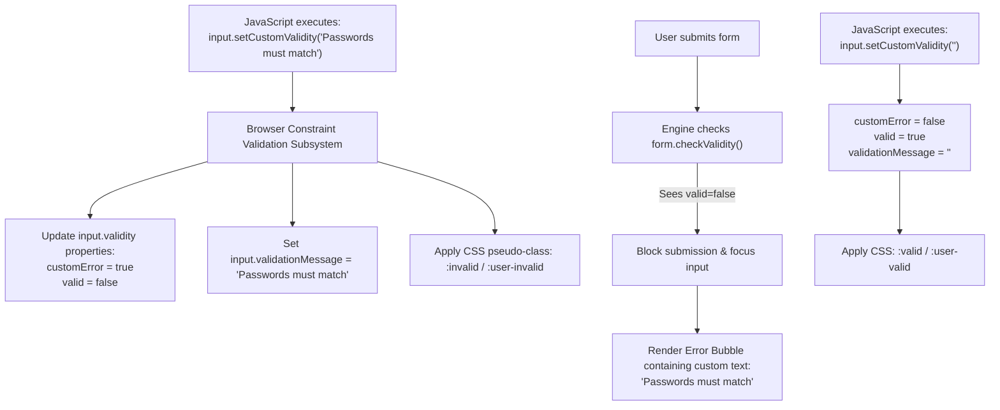

# The JavaScript Constraint Validation API and ValidityState

| Metadata | Details |
| :--- | :--- |
| **Level** | Core / Fundamental |
| **Prerequisites** | `07-built-in-constraint-validation.md` |
| **Estimated Reading Time** | 30 minutes |
| **Status** | Production-Ready |
| **Baseline Status** | Widely Available across all modern browsers |
| **Browsers Tested** | Chrome 120+, Firefox 120+, Safari 17+, Edge 120+ |
| **Tested With** | W3C Nu HTML Checker, Axe-core v4.8, NVDA 2023.3, Node.js DOMParser |

---

## Table of Contents
- [1 What & Why](#1-what--why)
- [2 Core Concepts](#2-core-concepts)
- [3 How It Works Internally](#3-how-it-works-internally)
- [4 Syntax & Usage](#4-syntax--usage)
- [5 Practical Examples](#5-practical-examples)
- [6 Best Practices](#6-best-practices)
- [7 Common Mistakes & Pitfalls](#7-common-mistakes--pitfalls)
- [8 Performance, Accessibility, SEO & Security Notes](#8-performance-accessibility-seo--security-notes)
- [9 Comparison / When to Use What](#9-comparison--when-to-use-what)
- [10 Interview Questions](#10-interview-questions)
- [11 Practice Exercises](#11-practice-exercises)
- [12 Summary / Cheat Sheet](#12-summary--cheat-sheet)
- [13 Further Reading](#13-further-reading)

---

## 1 What & Why

Declarative HTML5 attributes (`required`, `pattern`, `min`, `max`) handle basic synchronous validation. However, enterprise production applications frequently require sophisticated validation logic that declarative attributes alone cannot express:
- Validating that "Confirm Password" matches "New Password".
- Asynchronously verifying whether a username or tenant domain is already claimed via a REST API endpoint.
- Validating cross-field dependencies (e.g., "If *Delivery Method* is *Express*, *Phone Number* becomes mandatory").
- Providing customized, localized error messages instead of the browser's generic default text.

To bridge HTML declarative constraints with JavaScript application logic, the WHATWG standardized the **Constraint Validation API**. This DOM API exposes the internal validation engine to JavaScript, providing the **`ValidityState`** object, programmatic validation checkers (`checkValidity()`, `reportValidity()`), and custom error injections (`setCustomValidity()`).

Mastering this API allows developers to build rich, custom-styled error experiences that remain 100% synchronized with the browser's native accessibility and form submission pipelines.

---

## 2 Core Concepts

### The `ValidityState` Interface
Every form-associated element (`HTMLInputElement`, `HTMLSelectElement`, `HTMLTextAreaElement`, `HTMLButtonElement`) exposes a read-only **`element.validity`** property. 

This property returns a `ValidityState` object containing eleven boolean flags representing the exact failure reason:

| Property | True When... | Triggering HTML Attribute |
| :--- | :--- | :--- |
| `valueMissing` | Control is `required` but has no value. | `required` |
| `typeMismatch` | Value fails syntactic syntax of type. | `type="email"`, `type="url"` |
| `patternMismatch` | Value does not match regular expression. | `pattern="regex"` |
| `tooLong` | String exceeds maximum length limit. | `maxlength="n"` |
| `tooShort` | String is shorter than minimum length. | `minlength="n"` |
| `rangeUnderflow` | Numeric or date value is below minimum. | `min="n"` |
| `rangeOverflow` | Numeric or date value exceeds maximum. | `max="n"` |
| `stepMismatch` | Value does not fit the stepping interval. | `step="n"` |
| `badInput` | Browser cannot convert input to valid type (e.g. text in number). | `type="number"` |
| `customError` | A custom error was set via JavaScript. | `setCustomValidity("msg")` |
| `valid` | **True if and only if all ten other flags are false**. | None (Healthy state) |

---

### The Four Core Validation Methods & Properties

1. **`element.checkValidity()`**:
   Evaluates whether the element satisfies all constraints. Returns `true` if valid, `false` if invalid. If invalid, it fires the `invalid` event on the element, but **does NOT display native error bubbles**.
2. **`element.reportValidity()`**:
   Evaluates constraints, returns `true` or `false`, fires the `invalid` event, **AND displays the native browser error bubble UI** while focusing the field!
3. **`element.setCustomValidity(message)`**:
   Injects a custom error message into the control:
   - If `message` is a non-empty string, it marks `validity.customError = true`, making the input immediately invalid.
   - **Crucial Rule**: To restore the input to valid, you **must call `setCustomValidity("")`** (an empty string). Passing an empty string clears the error.
4. **`element.validationMessage`**:
   A read-only string containing the localized error message currently exposed to users and screen readers.

---

## 3 How It Works Internally

### Custom Error State Synchronization
When a developer calls `element.setCustomValidity("Passwords do not match")`:



Because `setCustomValidity` integrates directly into the browser's C++ validation core, the custom message is automatically exposed to screen readers, halts native form submissions, and triggers `:user-invalid` CSS pseudo-classes.

---

## 4 Syntax & Usage

```javascript
// 1. Inspecting ValidityState flags
const emailInput = document.getElementById("user-email");

if (!emailInput.validity.valid) {
  if (emailInput.validity.valueMissing) {
    console.error("User neglected to type an email.");
  } else if (emailInput.validity.typeMismatch) {
    console.error("User typed a string that is not a valid email address.");
  }
}

// 2. Programmatically reporting validity
const form = document.getElementById("registration-form");
const isValid = form.reportValidity(); // Displays bubbles on first invalid field

// 3. Setting and Clearing Custom Validation Messages
const pass1 = document.getElementById("pass-new");
const pass2 = document.getElementById("pass-confirm");

function validatePasswordConfirmation() {
  if (pass1.value !== pass2.value) {
    // Marks control invalid and sets custom error text
    pass2.setCustomValidity("Confirmation password does not match original password.");
  } else {
    // MANDATORY: Clear error with empty string to restore valid state!
    pass2.setCustomValidity("");
  }
}

pass2.addEventListener("input", validatePasswordConfirmation);
```

> [!NOTE]
> **Baseline Status: Widely Available**
> The `ValidityState` interface, `checkValidity()`, `reportValidity()`, `setCustomValidity()`, and `validationMessage` are baseline web platform standards supported across all modern browsers.

---

## 5 Practical Examples

### Example 1: Synchronized Password Confirmation Validator
```html
<!DOCTYPE html>
<html lang="en">
<head>
  <meta charset="utf-8">
  <title>Password Confirmation Validator</title>
  <style>
    .field { margin-bottom: 1rem; display: flex; flex-direction: column; gap: 0.25rem; }
    input:user-invalid { border-color: #dc2626; background: #fef2f2; }
    input:user-valid { border-color: #16a34a; }
  </style>
</head>
<body>
  <main>
    <h1>Create Security Credentials</h1>

    <form id="pass-form" action="/auth/register" method="post">
      <div class="field">
        <label for="pwd-main">New Password (Min 12 chars):</label>
        <input type="password" id="pwd-main" name="password" minlength="12" required>
      </div>

      <div class="field">
        <label for="pwd-match">Confirm Password:</label>
        <input type="password" id="pwd-match" required>
      </div>

      <button type="submit">Complete Account Registration</button>
    </form>
  </main>

  <script>
    const mainPwd = document.getElementById("pwd-main");
    const matchPwd = document.getElementById("pwd-match");

    function checkMatch() {
      if (matchPwd.value === "") {
        matchPwd.setCustomValidity("");
        return;
      }

      if (mainPwd.value !== matchPwd.value) {
        matchPwd.setCustomValidity("The confirmation password must match the new password.");
      } else {
        matchPwd.setCustomValidity(""); // Clears error
      }
    }

    mainPwd.addEventListener("input", checkMatch);
    matchPwd.addEventListener("input", checkMatch);
  </script>
</body>
</html>
```

### Example 2: Asynchronous Username Availability Checker
```html
<div class="field">
  <label for="tenant-subdomain">Organization Subdomain:</label>
  <div style="display: flex; align-items: center; gap: 0.5rem;">
    <input type="text" 
           id="tenant-subdomain" 
           name="subdomain" 
           pattern="^[a-z0-9-]+$" 
           title="Lowercase letters, numbers, and hyphens only." 
           required>
    <span>.cloudscale.enterprise</span>
  </div>
  <span id="domain-status" aria-live="polite"></span>
</div>

<script>
  const domainInput = document.getElementById("tenant-subdomain");
  const statusDisplay = document.getElementById("domain-status");
  let debounceTimeout;

  domainInput.addEventListener("input", () => {
    clearTimeout(debounceTimeout);
    domainInput.setCustomValidity(""); // Clear state while typing
    statusDisplay.textContent = "Checking availability...";

    debounceTimeout = setTimeout(async () => {
      // 1. Verify standard regex pattern first
      if (domainInput.validity.patternMismatch || domainInput.validity.valueMissing) {
        statusDisplay.textContent = "";
        return;
      }

      // 2. Perform async REST API lookup
      try {
        const response = await fetch(`/api/domains/check?name=${encodeURIComponent(domainInput.value)}`);
        const data = await response.json();

        if (data.available === false) {
          domainInput.setCustomValidity("This subdomain is already claimed by another organization.");
          statusDisplay.textContent = "Subdomain taken. Please choose another.";
          statusDisplay.style.color = "#dc2626";
        } else {
          domainInput.setCustomValidity(""); // Explicitly valid
          statusDisplay.textContent = "Subdomain is available!";
          statusDisplay.style.color = "#16a34a";
        }
      } catch (err) {
        console.warn("Domain check network failure; skipping async check.");
      }
    }, 400); // 400ms debounce
  });
</script>
```

### Example 3: Edge Case — Suppressing Native Bubbles while Preserving Validation
```html
<!-- Problem: Designers want custom accessible inline error text, -->
<!-- but HATE the browser's floating gray/white popup bubbles. -->

<form id="custom-ui-form" action="/submit" method="post" novalidate>
  <div>
    <label for="credit-limit">Credit Limit Allocation ($):</label>
    <input type="number" id="credit-limit" name="limit" min="1000" max="50000" required>
    <div id="error-output" class="custom-error-text" role="alert" aria-live="assertive"></div>
  </div>

  <button type="submit">Submit Request</button>
</form>

<script>
  const myForm = document.getElementById("custom-ui-form");
  const creditInput = document.getElementById("credit-limit");
  const errorBox = document.getElementById("error-output");

  myForm.addEventListener("submit", (e) => {
    // 1. Manually evaluate constraints using checkValidity()
    if (!myForm.checkValidity()) {
      e.preventDefault(); // Stop native submission
      
      // 2. Read native localized message or custom text
      if (creditInput.validity.rangeUnderflow) {
        errorBox.textContent = "Minimum credit allocation limit is $1,000.00.";
      } else if (creditInput.validity.rangeOverflow) {
        errorBox.textContent = "Credit limit cannot exceed $50,000.00 without board approval.";
      } else if (creditInput.validity.valueMissing) {
        errorBox.textContent = "Please specify a credit allocation limit.";
      }
      
      creditInput.focus();
    } else {
      errorBox.textContent = "";
    }
  });
</script>
```

### Example 4: Failure Case — The Permanent Invalidation Bug
```javascript
// ANTI-PATTERN: DO NOT COPY
// Problem: Setting custom validity on error, but FORGETTING to clear it on success!

const emailField = document.getElementById("email");

emailField.addEventListener("input", () => {
  if (!emailField.value.endsWith("@enterprise.com")) {
    emailField.setCustomValidity("Must be an @enterprise.com corporate address.");
  }
  // FATAL BUG: Missing the 'else' branch!
  // Once setCustomValidity() is called with an error, the input remains PERMANENTLY
  // invalid FOREVER, even if the user corrects the email address!
});

// THE FIX:
emailField.addEventListener("input", () => {
  if (!emailField.value.endsWith("@enterprise.com")) {
    emailField.setCustomValidity("Must be an @enterprise.com corporate address.");
  } else {
    emailField.setCustomValidity(""); // RESTORES VALIDITY!
  }
});
```

### Example 5: Production Accessible Custom Validation Coordinator
```html
<!DOCTYPE html>
<html lang="en">
<head>
  <meta charset="utf-8">
  <title>Production Validation Coordinator</title>
  <style>
    .field-row { margin-bottom: 1.25rem; display: flex; flex-direction: column; }
    .field-row label { font-weight: 600; margin-bottom: 0.25rem; font-family: sans-serif; }
    .msg-error { color: #b91c1c; font-size: 0.85rem; margin-top: 0.25rem; display: none; }
    .has-error input { border: 2px solid #b91c1c; }
    .has-error .msg-error { display: block; }
  </style>
</head>
<body>
  <main>
    <h1>Cluster Ingress Registration</h1>

    <form id="ingress-form" action="/ingress/register" method="post" novalidate>
      <div class="field-row" id="row-port">
        <label for="ingress-port">Target Service Port (1024 to 65535):</label>
        <input type="number" 
               id="ingress-port" 
               name="port" 
               min="1024" 
               max="65535" 
               aria-describedby="port-error" 
               required>
        <span id="port-error" class="msg-error" role="alert"></span>
      </div>

      <button type="submit">Register Endpoint</button>
    </form>
  </main>

  <script>
    const form = document.getElementById("ingress-form");
    const port = document.getElementById("ingress-port");
    const portRow = document.getElementById("row-port");
    const portError = document.getElementById("port-error");

    // Intercept native submission to display accessible inline errors
    form.addEventListener("submit", (event) => {
      if (!port.checkValidity()) {
        event.preventDefault();
        portRow.classList.add("has-error");

        if (port.validity.valueMissing) {
          portError.textContent = "Error: Ingress port is required.";
        } else if (port.validity.rangeUnderflow) {
          portError.textContent = "Error: Ports 1–1023 are privileged system ports. Choose >= 1024.";
        } else if (port.validity.rangeOverflow) {
          portError.textContent = "Error: Port numbers cannot exceed 65535.";
        }

        port.focus();
      } else {
        portRow.classList.remove("has-error");
        portError.textContent = "";
      }
    });

    // Clear error immediately when user begins correcting the value
    port.addEventListener("input", () => {
      if (port.validity.valid) {
        portRow.classList.remove("has-error");
        portError.textContent = "";
      }
    });
  </script>
</body>
</html>
```

---

## 6 Best Practices

1. **Always Clear Custom Validity with `setCustomValidity("")`**: Every branch that calls `setCustomValidity("error")` must have a corresponding condition calling `setCustomValidity("")` when the condition is satisfied.
2. **Debounce Asynchronous Lookups**: When checking server-side constraints (username availability) via `setCustomValidity`, debounce keystroke listeners by 300–500ms to prevent flooding API servers with requests.
3. **Use `novalidate` on Form when Suppressing Native Bubbles**: If your application renders custom inline error messages, add `novalidate` to the `<form>` to suppress the browser's default floating bubbles while retaining full programmatic use of `checkValidity()`.
4. **Link Custom Error Elements via `aria-describedby`**: When displaying custom error text below an input, link the error container to the input using `aria-describedby="error-id"` so screen readers speak the error message automatically upon focus.
5. **Listen to the `invalid` Event for Analytics**: Attach `input.addEventListener('invalid', ...)` to log user input bottlenecks and identify which form fields trigger the most validation failures.
6. **Use `reportValidity()` for Programmatic Step Validation**: In multi-step wizards, validate individual form steps before advancing by calling `currentFieldset.querySelectorAll('input').forEach(i => i.reportValidity())`.

---

## 7 Common Mistakes & Pitfalls

| Mistake | Bad Code | Good Code | Technical Explanation |
| :--- | :--- | :--- | :--- |
| **Forgetting to Clear Custom Error** | `if (err) input.setCustomValidity("msg")` | `if (err) input.setCustomValidity("msg") else input.setCustomValidity("")` | Failing to pass an empty string leaves the control permanently invalid, blocking future submissions. |
| **Silent Form Freeze** | Calling `e.preventDefault()` on `submit` without UI feedback | Display visible error and shift focus | Halting submission without visual indicators leaves users wondering why clicking the button does nothing. |
| **Calling `checkValidity()` on Unmounted Nodes** | Calling method before appending to DOM | Verify element is connected | Elements disconnected from the document tree may evaluate validation flags inconsistently. |
| **Assuming `checkValidity()` Shows Bubbles** | `input.checkValidity()` | `input.reportValidity()` | `checkValidity()` strictly returns a boolean; only `reportValidity()` summons the browser's UI error popup. |
| **Relying on `validationMessage` for Security** | Trusting client error state | Validate all business rules server-side | The Constraint Validation API runs entirely in client memory and can be bypassed via DevTools console. |
| **Overriding `badInput` Manually** | Custom parsing numbers | Rely on native `validity.badInput` | Native browser engines automatically flag unparsable inputs (like typing "abc" into a number input). |

---

## 8 Performance, Accessibility, SEO & Security Notes

### Accessibility (WCAG 2.2 AA)
- **Criterion 3.3.1 (Error Identification - Level A)**: If an input error is automatically detected, the item in error is identified and the error is described to the user in text.
- **Criterion 3.3.3 (Error Suggestion - Level AA)**: If an input error is detected and suggestions for correction are known, the suggestions are provided to the user.
- **Accessible Error Linking**: When custom errors are rendered, pairing `aria-invalid="true"` with `aria-describedby="error-id"` guarantees that assistive technologies speak the error immediately upon field focus.

### Search Engine Optimization (SEO)
- Search engines do not execute JavaScript validation routines. Forms relying on clean, progressive enhancement structures allow search bots to evaluate page quality without crashing on script errors.

### Performance & Memory
- Native `ValidityState` queries are microsecond C++ property lookups. They do not trigger layout reflows or DOM tree mutations, making `element.validity.valid` check thousands of times faster than custom regex library executions.

### Security Notes
- **Client API Bypass**: Attackers can disable all JavaScript validation by simply calling `form.submit()` directly in the DevTools console or typing `document.querySelector('form').noValidate = true`. Never skip backend validation.

---

## 9 Comparison / When to Use What

| API Method / Property | Return Type | Shows Native UI Bubble? | Fires `invalid` Event? | Best Used For |
| :--- | :--- | :--- | :--- | :--- |
| `element.validity.valid` | `boolean` | No | No | Instant conditional checks in JS loops. |
| `element.checkValidity()` | `boolean` | No | **Yes** | Evaluating validity silently before proceeding. |
| `element.reportValidity()`| `boolean` | **Yes** | **Yes** | Programmatically triggering native browser error UI. |
| `element.setCustomValidity(msg)`| `void` | Upon next report/submit | Upon next report/submit | Cross-field validation (passwords match), async checks. |
| `element.validationMessage`| `string` | N/A | N/A | Extracting localized error string for custom UI. |

---

## 10 Interview Questions

<details>
<summary><strong>1. Explain how the `ValidityState` object works. Name at least five of its boolean flags and describe what triggers each.</strong></summary>

**Answer:**
The `ValidityState` object is a read-only DOM interface accessible via `element.validity` that details why an input failed constraint validation:
1. **`valueMissing`**: True if the control has the `required` attribute, but its current value is empty.
2. **`typeMismatch`**: True if the value does not conform to the required syntactic format of `type="email"` or `type="url"`.
3. **`patternMismatch`**: True if the value fails to match the regular expression declared in the `pattern` attribute.
4. **`rangeUnderflow`**: True if a numeric or date input is less than the value declared in the `min` attribute.
5. **`rangeOverflow`**: True if the value exceeds the value declared in the `max` attribute.
6. **`stepMismatch`**: True if the value does not fit the stepping granularity specified in `step`.
7. **`customError`**: True if a non-empty string was set via `element.setCustomValidity("error")`.
8. **`valid`**: True if and only if **all other flags are false**.
</details>

<details>
<summary><strong>2. What is the crucial difference between `element.checkValidity()` and `element.reportValidity()`?</strong></summary>

**Answer:**
- **`element.checkValidity()`**: Evaluates whether the element satisfies all constraint validation checks. It returns `true` or `false`. If invalid, it fires the `invalid` event on the element, **but it does NOT display any visual error bubbles or popups to the user**. It is purely a silent programmatic check.
- **`element.reportValidity()`**: Evaluates constraints, returns `true` or `false`, fires the `invalid` event, **AND actively displays the native browser error bubble UI** pointing to the invalid element while focusing it.
`reportValidity()` was introduced to allow developers to trigger the browser's native error bubble on demand (e.g., when validating step 1 of a multi-step form before proceeding).
</details>

<details>
<summary><strong>3. Explain the "Permanent Invalidation Bug" when using `setCustomValidity()`, and how you prevent it.</strong></summary>

**Answer:**
Calling `element.setCustomValidity("Some error message")` flags `validity.customError = true` and `validity.valid = false`. The browser will permanently block form submission as long as this error exists.

The bug occurs when a developer writes an event listener checking a condition, sets the error, but **forgets to clear it when the condition is fixed**:
```javascript
// BUG:
if (input.value !== expected) {
  input.setCustomValidity("Invalid!");
}
// If user corrects the input, customError remains true FOREVER!
```
**The Prevention**:
To clear a custom error and restore an input to a valid state, you **must call `setCustomValidity("")` with an explicit empty string**:
```javascript
if (input.value !== expected) {
  input.setCustomValidity("Invalid!");
} else {
  input.setCustomValidity(""); // Restores valid state!
}
```
</details>

<details>
<summary><strong>4. How do you implement asynchronous validation (e.g., checking if a username is taken via an API) using the Constraint Validation API?</strong></summary>

**Answer:**
1. Attach an `input` event listener to the username field, debounced by ~300ms.
2. In the listener, verify synchronous validity first (`input.validity.patternMismatch`).
3. If syntactically valid, dispatch an asynchronous `fetch()` request to `/api/check-username?u=...`.
4. If the server responds that the username is taken, call `input.setCustomValidity("Username already registered.")`.
5. If the server confirms availability, call `input.setCustomValidity("")`.
This seamlessly integrates asynchronous backend checks into native form submission: if the username is taken, any submit attempt is blocked by native browser validation.
</details>

<details>
<summary><strong>5. What is the `invalid` event in HTML, and how can developers use it to customize error styling?</strong></summary>

**Answer:**
The `invalid` event fires on any form-associated element that fails constraint validation when `checkValidity()` or `reportValidity()` runs, or during form submission:
- It does **not bubble** up the DOM tree (it must be captured or listened to directly on each control).
- It is **cancelable**: calling `event.preventDefault()` inside an `invalid` event listener **suppresses the native browser error bubble**!
Developers use this event to intercept validation failures, prevent ugly default OS popups, and inject accessible custom inline error text into adjacent containers.
</details>

<details>
<summary><strong>6. How does `validity.badInput` differ from `validity.typeMismatch`?</strong></summary>

**Answer:**
- **`typeMismatch`**: Occurs when the input's value is a readable string, but fails the specific syntactic rules of the type (e.g., typing `"hello"` into `<input type="email">` or `<input type="url">`).
- **`badInput`**: Occurs when the user enters characters that the browser's internal engine **cannot even convert into the target data type** (e.g., typing alphabetic letters into `<input type="number">` on browsers that allow raw character entry). The engine cannot evaluate `min` or `max` because the input is not a number; hence it flags `badInput`.
</details>

<details>
<summary><strong>7. How does calling `form.checkValidity()` differ from calling `input.checkValidity()`?</strong></summary>

**Answer:**
- `input.checkValidity()` evaluates constraints exclusively on that single specific control.
- `form.checkValidity()` iterates over **all successful form controls** associated with that `<form>`:
  - If **every** control is valid, it returns `true`.
  - If **any single control** fails, it fires the `invalid` event on every failing control and returns `false`.
  - It does not display UI bubbles (use `form.reportValidity()` for visual bubbles).
</details>

<details>
<summary><strong>8. Why should you always pair `aria-invalid="true"` with `aria-describedby` when displaying custom validation errors?</strong></summary>

**Answer:**
When replacing native validation bubbles with custom inline HTML errors:
1. Setting **`aria-invalid="true"`** alerts the Accessibility Object Model that the field is currently in an error state. Screen readers immediately announce: *"Invalid entry"*.
2. Setting **`aria-describedby="error-message-id"`** points directly to the element containing the human-readable explanation (e.g., *"Password must include a special symbol"*).
When a blind user tabs into the field, the screen reader announces both the error flag and the exact instructions to fix it in a single spoken phrase, fulfilling WCAG 3.3.1.
</details>

---

## 11 Practice Exercises

### Exercise 1 (Easy): Inspect ValidityState in Console
**Task**: Write the JavaScript to inspect an `<input id="user-email" type="email" required>` and log whether the input failed due to being empty (`valueMissing`) or having an invalid email syntax (`typeMismatch`).

<details>
<summary><strong>Solution</strong></summary>

```javascript
const emailInput = document.getElementById("user-email");

function auditEmail() {
  if (emailInput.validity.valueMissing) {
    console.log("Error: Email field is required but currently empty.");
  } else if (emailInput.validity.typeMismatch) {
    console.log("Error: Entered text is not a syntactically valid email.");
  } else if (emailInput.validity.valid) {
    console.log("Success: Email input is completely valid!");
  }
}
```
</details>

### Exercise 2 (Easy): Clear Custom Validity Correctly
**Task**: Write an event listener on a PIN input (`#pin-input`). If the value does not equal `"1234"`, set custom error "Incorrect PIN". If it equals `"1234"`, clear the error.

<details>
<summary><strong>Solution</strong></summary>

```javascript
const pinInput = document.getElementById("pin-input");

pinInput.addEventListener("input", () => {
  if (pinInput.value !== "1234") {
    pinInput.setCustomValidity("Incorrect security PIN code.");
  } else {
    pinInput.setCustomValidity(""); // Clears customError flag!
  }
});
```
</details>

### Exercise 3 (Medium): Validate Password Confirmation Matching
**Task**: Build an accessible password and confirmation password form. Use `setCustomValidity` to ensure the form cannot be submitted unless both passwords match.

<details>
<summary><strong>Solution</strong></summary>

```html
<form id="auth-form" action="/register" method="post">
  <div>
    <label for="p1">New Password:</label>
    <input type="password" id="p1" name="password" minlength="8" required>
  </div>

  <div>
    <label for="p2">Confirm Password:</label>
    <input type="password" id="p2" required>
  </div>

  <button type="submit">Register</button>
</form>

<script>
  const p1 = document.getElementById("p1");
  const p2 = document.getElementById("p2");

  function validatePasswords() {
    if (p2.value === "") {
      p2.setCustomValidity("");
      return;
    }

    if (p1.value !== p2.value) {
      p2.setCustomValidity("Passwords do not match.");
    } else {
      p2.setCustomValidity(""); // Reset
    }
  }

  p1.addEventListener("input", validatePasswords);
  p2.addEventListener("input", validatePasswords);
</script>
```
</details>

### Exercise 4 (Medium): Step Wizard Validation via `reportValidity()`
**Task**: You have a 2-step form where Step 1 is in a `<fieldset id="step-1">`. Write a function `advanceToStep2()` that evaluates all inputs in Step 1 using `reportValidity()`. If valid, reveal Step 2; if invalid, halt and let the browser focus the invalid field.

<details>
<summary><strong>Solution</strong></summary>

```javascript
function advanceToStep2() {
  const step1 = document.getElementById("step-1");
  const inputs = Array.from(step1.querySelectorAll("input, select, textarea"));

  // Find the first invalid input in step 1
  for (const input of inputs) {
    if (!input.checkValidity()) {
      input.reportValidity(); // Focuses input and displays native error bubble!
      return false; // Halt progression
    }
  }

  // All inputs in step 1 are valid!
  document.getElementById("step-1").hidden = true;
  document.getElementById("step-2").hidden = false;
  return true;
}
```
</details>

### Exercise 5 (Hard): Identify and Fix 5 Constraint Validation API Bugs
**Task**: Review this custom validation script and fix all 5 bugs:

```javascript
// Flawed Source
const form = document.getElementById("myForm");
const port = document.getElementById("port");

form.addEventListener("submit", (e) => {
  if (port.value < 1024) {
    port.setCustomValidity("Port must be >= 1024");
  }
  form.checkValidity(); // Line A
});

port.addEventListener("input", () => {
  if (port.value >= 1024) {
    port.setCustomValidity("Valid"); // Line B
  }
});
```

<details>
<summary><strong>Solution</strong></summary>

```javascript
// Fully Remediated Implementation
const form = document.getElementById("myForm");
const port = document.getElementById("port");

function validatePort() {
  const portNum = parseInt(port.value, 10);
  
  if (isNaN(portNum) || portNum < 1024) {
    port.setCustomValidity("Port must be a number greater than or equal to 1024.");
  } else {
    // FIX 1: Passing ANY non-empty string (even "Valid") marks it INVALID!
    // Must pass an EMPTY STRING "" to restore validity!
    port.setCustomValidity("");
  }
}

// FIX 2: Attach to input event so validation updates live as user types
port.addEventListener("input", validatePort);

form.addEventListener("submit", (e) => {
  validatePort();
  
  // FIX 3: form.checkValidity() returns boolean; must inspect result!
  // FIX 4: Use reportValidity() if you want browser error bubbles to show!
  if (!form.reportValidity()) {
    // FIX 5: Prevent form submission when invalid!
    e.preventDefault();
  }
});
```
</details>

### Exercise 6 (Hard): Build an Accessible Inline Error Coordinator
**Task**: Build a complete, accessible form validation coordinator without using native bubbles. Intercept `submit`, evaluate `validity`, inject custom accessible error messages into `aria-describedby` elements, and set `aria-invalid="true"`.

<details>
<summary><strong>Solution</strong></summary>

```html
<form id="coordinator-form" action="/api/save" method="post" novalidate>
  <div class="form-field" id="field-username">
    <label for="uname">Cluster Username:</label>
    <input type="text" 
           id="uname" 
           name="username" 
           pattern="^[a-z0-9_]{3,16}$" 
           aria-describedby="uname-err" 
           required>
    <div id="uname-err" class="err-msg" role="alert"></div>
  </div>

  <button type="submit">Save User</button>
</form>

<script>
  const myForm = document.getElementById("coordinator-form");
  const uname = document.getElementById("uname");
  const unameErr = document.getElementById("uname-err");

  myForm.addEventListener("submit", (e) => {
    if (!uname.checkValidity()) {
      e.preventDefault(); // Stop native submission
      uname.setAttribute("aria-invalid", "true");

      if (uname.validity.valueMissing) {
        unameErr.textContent = "Error: Username is required.";
      } else if (uname.validity.patternMismatch) {
        unameErr.textContent = "Error: Must be 3–16 lowercase characters or numbers.";
      }

      uname.focus();
    } else {
      uname.removeAttribute("aria-invalid");
      unameErr.textContent = "";
    }
  });

  uname.addEventListener("input", () => {
    if (uname.validity.valid) {
      uname.removeAttribute("aria-invalid");
      unameErr.textContent = "";
    }
  });
</script>

<style>
  input[aria-invalid="true"] {
    border: 2px solid #dc2626;
    background-color: #fef2f2;
  }
  .err-msg {
    color: #dc2626;
    font-size: 0.85rem;
    margin-top: 0.25rem;
  }
</style>
```
</details>

---

## 12 Summary / Cheat Sheet

```
┌────────────────────────────────────────────────────────────────────────┐
│                        VALIDATION API CHEAT SHEET                      │
├───────────────────┬────────────────────────────────────────────────────┤
│ Property / Method │ Functional Purpose                                 │
├───────────────────┼────────────────────────────────────────────────────┤
│ element.validity  │ Returns ValidityState object with 11 boolean flags │
│ validity.valid    │ True ONLY if all failure flags are false           │
│ checkValidity()   │ Silent check; returns bool; fires 'invalid' event  │
│ reportValidity()  │ Checks validity AND displays native browser bubble │
│ setCustomValidity │ setCustomValidity("msg") -> Invalid!               │
│ Clear Custom Error│ setCustomValidity("") -> Restores validity!        │
│ validationMessage │ Active error string exposed to screen readers      │
│ Suppress Bubbles  │ Add novalidate to <form>                           │
│ Accessible Link   │ Use aria-invalid="true" + aria-describedby         │
└───────────────────┴────────────────────────────────────────────────────┘
```

---

## 13 Further Reading

- [WHATWG HTML Living Standard: Section 4.10.21 Constraint Validation API](https://html.spec.whatwg.org/multipage/form-control-infrastructure.html#the-constraint-validation-api)
- [MDN Web Docs: Constraint Validation API](https://developer.mozilla.org/en-US/docs/Web/API/Constraint_validation)
- [MDN Web Docs: The ValidityState Interface](https://developer.mozilla.org/en-US/docs/Web/API/ValidityState)
- [web.dev: Learn Forms - JavaScript Validation](https://web.dev/learn/forms/javascript/)
- [Smashing Magazine: Constraint Validation Native API In Depth](https://www.smashingmagazine.com/2023/02/constraint-validation-native-api/)

---

| [Previous: 07 Built-In Constraint Validation](07-built-in-constraint-validation.md) | [Section Index](README.md) | [Next: 09 Autocomplete Tokens & Autofill](09-autocomplete-tokens-and-autofill.md) |
