# The WHATWG Autofill Specification, Password Managers, and Passkeys

| Metadata | Details |
| :--- | :--- |
| **Level** | Core / Fundamental |
| **Prerequisites** | `01-form-basics-and-methods.md`, `02-input-types-and-mobile-keyboards.md` |
| **Estimated Reading Time** | 30 minutes |
| **Status** | Production-Ready |
| **Baseline Status** | Widely Available across all modern browsers |
| **Browsers Tested** | Chrome 120+, Firefox 120+, Safari 17+, Edge 120+ |
| **Tested With** | W3C Nu HTML Checker, Axe-core v4.8, 1Password, Bitwarden, Apple Keychain |

---

## Table of Contents
- [1 What & Why](#1-what--why)
- [2 Core Concepts](#2-core-concepts)
- [3 How It Works Internally](#3-how-it-works-internally)
- [4 Syntax & Usage](#4-syntax--usage)
- [5 Practical Examples](#5-practical-examples)
- [6 Best Practices](#6-best-practices)
- [7 Common Mistakes & Pitfalls](#7-common-mistakes--pitfalls)
- [8 Performance, Accessibility, SEO & Security Notes](#8-performance-accessibility-seo--security-notes)
- [9 Comparison / When to Use What](#9-comparison--when-to-use-what)
- [10 Interview Questions](#10-interview-questions)
- [11 Practice Exercises](#11-practice-exercises)
- [12 Summary / Cheat Sheet](#12-summary--cheat-sheet)
- [13 Further Reading](#13-further-reading)

---

## 1 What & Why

Form filling is the highest-friction activity on the World Wide Web. Typing credit card numbers, billing addresses, and 16-character passwords on touchscreen mobile devices leads to high abandonment rates and frequent typos.

To solve this, modern browser engines and password managers (Apple Keychain, Google Password Manager, 1Password, Bitwarden) integrate automated **Autofill subsystems**. 

However, password managers cannot reliably "guess" the purpose of an input simply by inspecting English placeholder text or localized label strings. If an author labels a field *"Cardholder"* or *"Name on Plastic"*, the autofill heuristic may fail or inject the user's personal name instead of their corporate billing name.

The **WHATWG Autofill Specification** standardizes the **`autocomplete` attribute**. By declaring standardized machine tokens (e.g., `autocomplete="cc-number"`, `autocomplete="one-time-code"`, `autocomplete="username webauthn"`), developers explicitly tell browsers and credential managers:
- Which specific identity, payment, or address field this input represents.
- Whether a password field represents a login attempt (`current-password`) or registration (`new-password`).
- Whether Passkeys (WebAuthn) should be offered as an autofill suggestion.
- How to satisfy **WCAG 2.2 Success Criterion 1.3.5 (Identify Input Purpose)**.

---

## 2 Core Concepts

### The WHATWG Autofill Token Taxonomy
The `autocomplete` attribute accepts a space-separated sequence of tokens consisting of optional scope prefixes followed by a mandatory field name:

#### 1. Identity & Contact Tokens
- `name`: Full personal name.
- `given-name`: First name / Given name.
- `family-name`: Last name / Surname.
- `nickname`: Display handle or screen name.
- `email`: Electronic mail address.
- `username`: Login identity (username, account ID).
- `tel`: Complete telephone number with country code.
- `organization`: Company or employer legal name.

#### 2. Credential & Security Tokens
- `current-password`: The user's active existing password (used on login forms and re-authentication prompts).
- `new-password`: A newly generated password (used on account sign-up and password reset forms). Signals password managers to generate and save a strong random cryptographic secret!
- `one-time-code`: Two-factor SMS or authenticator OTP tokens (e.g., 6-digit verification codes). Automatically triggers iOS and Android keyboard suggestions like *"From Messages: 492-104"*.
- `webauthn`: Conditional UI autofill token indicating the browser should offer biometric Passkeys alongside standard credentials.

#### 3. Postal & Address Tokens
- `street-address`: Multi-line physical address.
- `address-line1` and `address-line2`: Split street address components.
- `address-level2`: City or town.
- `address-level1`: State, province, or prefecture.
- `postal-code`: ZIP code or postal code.
- `country`: Two-letter ISO 3166-1 alpha-2 country code.

#### 4. Payment Tokens
- `cc-name`: Full name as printed on credit card.
- `cc-number`: Credit or debit card PAN number.
- `cc-exp`: Expiration date (MM/YY or MM/YYYY).
- `cc-exp-month`: Expiration month (MM).
- `cc-exp-year`: Expiration year (YYYY).
- `cc-csc`: Card Security Code (CVV / CVC / 3-4 digits).

---

### Scope Modifiers: `shipping` vs. `billing`
In e-commerce checkouts, a page often features two address forms: a shipping address and a billing address. If both use generic `autocomplete="street-address"`, autofill cannot determine which data to inject.

The specification allows prepending `shipping` or `billing` as a scope token:
```html
<!-- Shipping destination -->
<input type="text" name="ship_addr" autocomplete="shipping street-address">

<!-- Payment card billing address -->
<input type="text" name="bill_addr" autocomplete="billing street-address">
```

---

## 3 How It Works Internally

### Browser Autofill & Credential Injection Pipeline
When a user focuses an input with an `autocomplete` attribute:

```mermaid
sequenceDiagram
    autonumber
    actor User as User
    participant Browser as Browser Autofill Engine
    participant PM as Password Manager / Passkey Vault
    participant DOM as HTML Form Input

    User->>DOM: Focuses <input autocomplete="username webauthn">
    DOM->>Browser: Emit Focus Event + Autocomplete Context
    Browser->>PM: Query Saved Credentials for Origin (https://enterprise.net)
    PM-->>Browser: Return Matched Accounts + Passkey Credentials
    Browser->>User: Display Native Dropdown Suggestion Overlay
    User->>Browser: Selects "shiva@corp.net" or touches TouchID / FaceID
    Browser->>DOM: Programmatically populate username and current-password fields!
```



### The `autocomplete="off"` Myth
Historically, developers attempted to block browser autofill on login forms by setting `autocomplete="off"`. 

**The Modern Reality**: All major modern browser engines (Chrome, Safari, Firefox, Edge) **deliberately ignore `autocomplete="off"` on password and credential fields**. 
Browser security teams observed that disabling autofill forced users to choose simple, easily crackable passwords. To protect user security and promote password managers, browsers override `autocomplete="off"` on login forms and inject credentials regardless of developer declarations.

---

## 4 Syntax & Usage

```html
<!-- 1. Authentication Form with Passkey (Conditional UI) Support -->
<form action="/auth/login" method="post">
  <div>
    <label for="login-user">Username or Corporate Email:</label>
    <!-- "username webauthn" enables seamless biometric Passkey auto-suggest! -->
    <input type="text" 
           id="login-user" 
           name="user" 
           autocomplete="username webauthn" 
           required>
  </div>

  <div>
    <label for="login-pass">Password:</label>
    <!-- "current-password" tells manager: DO NOT overwrite with a new password! -->
    <input type="password" 
           id="login-pass" 
           name="password" 
           autocomplete="current-password" 
           required>
  </div>

  <button type="submit">Sign In</button>
</form>

<!-- 2. Two-Factor Authentication SMS Verification -->
<label for="otp-token">Verification Code (SMS or Authenticator):</label>
<input type="text" 
       id="otp-token" 
       name="token" 
       inputmode="numeric" 
       pattern="[0-9]{6}" 
       autocomplete="one-time-code" 
       enterkeyhint="done" 
       required>

<!-- 3. New Account Registration (Triggers Password Generator) -->
<label for="create-pass">Create New Secure Master Password:</label>
<input type="password" 
       id="create-pass" 
       name="new_password" 
       autocomplete="new-password" 
       minlength="16" 
       required>
```

> [!NOTE]
> **Baseline Status: Widely Available**
> The core WHATWG Autofill specification tokens (`name`, `email`, `tel`, `current-password`, `new-password`, `one-time-code`, and payment tokens) are baseline standards supported across all modern mobile and desktop browsers. The `webauthn` token extension is widely supported in Chrome, Safari, and Edge.

---

## 5 Practical Examples

### Example 1: High-Conversion E-Commerce Checkout Form
```html
<!DOCTYPE html>
<html lang="en">
<head>
  <meta charset="utf-8">
  <title>Payment &amp; Delivery Checkout</title>
  <style>
    fieldset { border: 1px solid #cbd5e1; border-radius: 8px; padding: 1.5rem; margin-bottom: 1.5rem; }
    legend { font-weight: 700; color: #1e293b; }
    .row { margin-bottom: 1rem; display: flex; flex-direction: column; gap: 0.25rem; }
    label { font-weight: 600; font-family: sans-serif; }
    input { padding: 0.6rem; border: 1px solid #9ca3af; border-radius: 4px; font-size: 1rem; }
  </style>
</head>
<body>
  <main>
    <h1>Infrastructure Hardware Checkout</h1>

    <form action="/checkout/finalize" method="post">
      <!-- Shipping Destination -->
      <fieldset>
        <legend>Shipping Destination</legend>

        <div class="row">
          <label for="ship-name">Recipient Full Name</label>
          <input type="text" id="ship-name" name="ship_name" autocomplete="shipping name" required>
        </div>

        <div class="row">
          <label for="ship-addr">Street Address</label>
          <input type="text" id="ship-addr" name="ship_addr" autocomplete="shipping street-address" required>
        </div>

        <div class="row">
          <label for="ship-zip">Postal / ZIP Code</label>
          <input type="text" id="ship-zip" name="ship_zip" autocomplete="shipping postal-code" inputmode="numeric" required>
        </div>
      </fieldset>

      <!-- Credit Card Payment -->
      <fieldset>
        <legend>Encrypted Payment Method</legend>

        <div class="row">
          <label for="card-holder">Cardholder Name (As printed on card)</label>
          <input type="text" id="card-holder" name="cc_name" autocomplete="cc-name" required>
        </div>

        <div class="row">
          <label for="card-pan">Credit Card Number</label>
          <input type="text" id="card-pan" name="cc_number" autocomplete="cc-number" inputmode="numeric" pattern="[0-9\s]{13,19}" required>
        </div>

        <div style="display: flex; gap: 1rem;">
          <div class="row" style="flex: 1;">
            <label for="card-exp">Expiration (MM/YY)</label>
            <input type="text" id="card-exp" name="cc_exp" autocomplete="cc-exp" placeholder="MM/YY" required>
          </div>

          <div class="row" style="flex: 1;">
            <label for="card-cvv">Security Code (CVV)</label>
            <input type="password" id="card-cvv" name="cc_csc" autocomplete="cc-csc" inputmode="numeric" maxlength="4" required>
          </div>
        </div>
      </fieldset>

      <button type="submit">Place Hardware Order</button>
    </form>
  </main>
</body>
</html>
```

### Example 2: Passkey Conditional UI Sign-In Pattern
```html
<!-- Passkey Conditional UI: When input is focused, the browser automatically -->
<!-- displays saved biometric Passkeys in the virtual keyboard / autofill dropdown -->

<form id="passkey-login-form" action="/login" method="post">
  <h2>Sign In to Console</h2>

  <div>
    <label for="user-login">Corporate Email or Username</label>
    <input type="text" 
           id="user-login" 
           name="username" 
           autocomplete="username webauthn" 
           autofocus 
           required>
  </div>

  <div>
    <label for="user-secret">Password (Optional if using Passkey)</label>
    <input type="password" 
           id="user-secret" 
           name="password" 
           autocomplete="current-password">
  </div>

  <button type="submit">Sign In</button>
</form>

<script>
  // Check if browser supports WebAuthn Conditional Mediation
  if (window.PublicKeyCredential && PublicKeyCredential.isConditionalMediationAvailable) {
    PublicKeyCredential.isConditionalMediationAvailable().then(available => {
      if (available) {
        // Trigger background Passkey listener
        navigator.credentials.get({
          mediation: "conditional",
          publicKey: {
            challenge: new Uint8Array([1, 2, 3, 4 /* server challenge */]),
            rpId: window.location.hostname
          }
        }).then(credential => {
          if (credential) {
            console.log("Biometric Passkey authenticated successfully!", credential);
            // Submit authenticated WebAuthn assertion to backend API
          }
        }).catch(err => console.log("Conditional UI dismissed"));
      }
    });
  }
</script>
```

### Example 3: Edge Case — Multi-Section Address Scope (`section-*`)
```html
<!-- When a page contains multiple independent people (e.g. Primary Contact and Emergency Contact), -->
<!-- prefixing with 'section-<name>' scopes the autofill engine cleanly! -->

<form action="/contacts" method="post">
  <fieldset>
    <legend>Primary Account Lead</legend>
    <input type="text" name="lead_name" autocomplete="section-lead name" placeholder="Lead Name">
    <input type="email" name="lead_email" autocomplete="section-lead email" placeholder="Lead Email">
  </fieldset>

  <fieldset>
    <legend>Emergency Security Escalation Contact</legend>
    <input type="text" name="esc_name" autocomplete="section-sec name" placeholder="Escalation Name">
    <input type="tel" name="esc_phone" autocomplete="section-sec tel" placeholder="Escalation Phone">
  </fieldset>
</form>
```

### Example 4: Failure Case — Broken Autofill and Security Traps
```html
<!-- ANTI-PATTERN: DO NOT COPY -->

<!-- Error 1: Using "new-password" on a login form! -->
<!-- Password managers will think this is account creation and OVERWRITE -->
<!-- the user's existing saved password with an empty or wrong secret! -->
<form action="/login" method="post">
  <input type="text" autocomplete="username">
  <input type="password" autocomplete="new-password"> <!-- DISASTROUS: Must be "current-password" -->
</form>

<!-- Error 2: Using autocomplete="off" on login forms -->
<!-- Browsers ignore it; password managers ignore it; frustrates accessibility audits. -->
<form autocomplete="off">
  <input type="password" autocomplete="off"> <!-- USELESS -->
</form>

<!-- Error 3: Arbitrary non-standard tokens -->
<input type="text" autocomplete="first_name"> <!-- INVALID: Must be "given-name" -->
<input type="text" autocomplete="zipcode">    <!-- INVALID: Must be "postal-code" -->
<input type="text" autocomplete="cvv">        <!-- INVALID: Must be "cc-csc" -->
```

### Example 5: Production User Password Reset Flow
```html
<!DOCTYPE html>
<html lang="en">
<head>
  <meta charset="utf-8">
  <title>Reset Master Security Credentials</title>
</head>
<body>
  <main>
    <h1>Credential Rotation Portal</h1>

    <form action="/auth/password/reset" method="post">
      <!-- 1. Identity context: Username must be present for manager association -->
      <div>
        <label for="acct-user">Account Identity</label>
        <input type="text" 
               id="acct-user" 
               name="username" 
               value="shiva.ram@enterprise.net" 
               autocomplete="username" 
               readonly>
      </div>

      <!-- 2. Existing credential verification -->
      <div>
        <label for="old-pwd">Current Password</label>
        <input type="password" 
               id="old-pwd" 
               name="old_password" 
               autocomplete="current-password" 
               required>
      </div>

      <!-- 3. New credential generation -->
      <div>
        <label for="new-pwd">New Master Password</label>
        <input type="password" 
               id="new-pwd" 
               name="new_password" 
               autocomplete="new-password" 
               minlength="16" 
               required>
      </div>

      <button type="submit">Update Credentials</button>
    </form>
  </main>
</body>
</html>
```

---

## 6 Best Practices

1. **Always Distinguish `current-password` vs. `new-password`**:
   - On Sign-In forms: use `autocomplete="current-password"`.
   - On Registration / Password Reset forms: use `autocomplete="new-password"`.
2. **Always Use `autocomplete="one-time-code"` on OTP Inputs**: This enables native mobile operating systems (iOS and Android) to scan incoming SMS messages and present a one-tap verification button above the virtual keyboard.
3. **Use Official WHATWG Tokens, Never Informal Names**: Always use standardized tokens:
   - `given-name` (NOT `first-name` or `fname`).
   - `family-name` (NOT `last-name` or `lname`).
   - `postal-code` (NOT `zip` or `zipcode`).
   - `cc-csc` (NOT `cvv` or `cvc`).
4. **Disambiguate Addresses with `shipping` and `billing` Prefixes**: When both delivery and payment billing addresses are on the same page, prefix every token with `shipping` or `billing`.
5. **Include `autocomplete="username"` on Password Reset Screens**: Password managers need the `username` field on the page to know which specific account vault entry should be updated with the `new-password`.
6. **Support Passkeys via `autocomplete="username webauthn"`**: Provide `webauthn` in the autocomplete list on username fields to allow users with biometric hardware to authenticate without entering passwords.

---

## 7 Common Mistakes & Pitfalls

| Mistake | Bad Code | Good Code | Technical Explanation |
| :--- | :--- | :--- | :--- |
| **`new-password` on Sign-In** | `<input autocomplete="new-password">` on login | `autocomplete="current-password"` | Password managers overwrite the user's existing saved password vault entry. |
| **Informal Token Names** | `autocomplete="first_name"` | `autocomplete="given-name"` | Invalid tokens are rejected by the browser autofill parser, breaking automation. |
| **Missing `one-time-code`** | `<input name="otp" type="text">` | `<input autocomplete="one-time-code">` | Misses the native iOS/Android "Paste code from SMS" operating system shortcut. |
| **Relying on `autocomplete="off"`** | `<input type="password" autocomplete="off">` | Embrace password managers | Modern browsers deliberately ignore `autocomplete="off"` on passwords for security. |
| **Unscoped Multi-Addresses** | Two inputs with `autocomplete="street-address"` | `shipping street-address` vs `billing street-address` | Autofill fills both fields with the exact same address, corrupting shipping manifests. |
| **Missing Username on Reset** | Form with only `new-password` input | Include readonly `autocomplete="username"` | Password manager cannot determine which account credential to update in its database. |

---

## 8 Performance, Accessibility, SEO & Security Notes

### Accessibility (WCAG 2.2 AA)
- **Success Criterion 1.3.5 (Identify Input Purpose - Level AA)**:
  In forms collecting user personal information (names, emails, phone numbers, credit cards, addresses), the purpose of each input field **must be programmatically determinable**.
  Applying the correct WHATWG `autocomplete` token is the **official, standardized technique** to pass WCAG 1.3.5. Users with cognitive, memory, or motor impairments rely on automated autofill to complete forms without fatigue or error.

### Search Engine Optimization (SEO)
- Search engine crawlers do not evaluate personal autofill tokens directly, but Google's Page Experience algorithms favor forms with high task-completion velocity and low abandonment rates.

### Performance & Memory
- Native browser autofill runs inside compiled C++ browser storage engines. It avoids loading 200 KB of third-party address-prediction or credit-card formatting scripts.

### Security Notes (Autofill Phishing Mitigations)
- **Hidden Field Credential Sniffing**: Historically, malicious sites hid inputs (e.g., `<input type="text" autocomplete="cc-number" style="opacity:0">`) in a benign newsletter form to trick browsers into autofilling credit card numbers. Modern browsers (Chrome, Safari) now require **explicit user confirmation** before filling credit card or address data that was not visible in the viewport.

---

## 9 Comparison / When to Use What

| Form Type | Field Role | Exact Recommended `autocomplete` Token |
| :--- | :--- | :--- |
| **Sign-In / Login** | Username / Email | `autocomplete="username webauthn"` |
| **Sign-In / Login** | Password | `autocomplete="current-password"` |
| **Registration / Sign-Up** | New Password | `autocomplete="new-password"` |
| **2FA / MFA Verification** | 6-Digit Code | `autocomplete="one-time-code"` |
| **E-Commerce Checkout** | Delivery Address | `autocomplete="shipping street-address"` |
| **E-Commerce Checkout** | Billing Address | `autocomplete="billing street-address"` |
| **Payment Gateway** | Card Number | `autocomplete="cc-number"` |
| **Payment Gateway** | Security Code | `autocomplete="cc-csc"` |
| **Search Bar / In-Page Query** | Search Query | `autocomplete="off"` (Valid here!) |

---

## 10 Interview Questions

<details>
<summary><strong>1. Explain the requirements of WCAG 2.2 Success Criterion 1.3.5 (Identify Input Purpose) and how HTML `autocomplete` satisfies it.</strong></summary>

**Answer:**
**WCAG 2.2 SC 1.3.5 (Level AA)** requires that for any input collecting information about the user (e.g., name, email, phone, street address, credit card), the input's purpose must be programmatically determinable by assistive software.

**How `autocomplete` Satisfies It**:
Visual labels (like *"Mail"*, *"Email"*, or localized *"Courriel"*) vary across languages and layouts. Assistive technologies and user-agent personalization tools cannot parse them consistently.
By adding standardized WHATWG autofill tokens (e.g., `autocomplete="email"` or `autocomplete="postal-code"`):
1. The purpose is hardcoded into the Accessibility Object Model (AOM).
2. Users with motor disabilities can use browser autofill to complete forms in a single click without typing.
3. Users with cognitive disabilities can employ browser extensions that substitute standardized pictograms (e.g., an icon of an envelope next to `autocomplete="email"`) to improve comprehension.
</details>

<details>
<summary><strong>2. Why do all major modern browsers deliberately ignore `autocomplete="off"` on password input fields?</strong></summary>

**Answer:**
Historically, banks and enterprise software vendors placed `autocomplete="off"` on login forms under the mistaken belief that disabling password managers enhanced security.

**The Reality Discovered by Security Researchers**:
1. When users were blocked from using password managers, they were forced to memorize passwords, leading them to choose short, simple, reused passwords across multiple websites (e.g., `Password123!`).
2. Users were prevented from using cryptographically generated 32-character random passwords.
3. Disabling autofill made users vulnerable to credential phishing, because password managers refuse to autofill on phishing domains that do not match the authentic origin.
To protect global user security, browser engineering teams at Google, Apple, and Mozilla formed a consensus: **browsers deliberately ignore `autocomplete="off"` on fields with `type="password"` or `autocomplete="current-password"`**, ensuring password managers always function.
</details>

<details>
<summary><strong>3. What is the difference between `autocomplete="current-password"` and `autocomplete="new-password"`? What breaks if you mix them up?</strong></summary>

**Answer:**
- **`autocomplete="current-password"`**: Signals that the field is requesting the user's **existing** password to authenticate their identity (used on Sign-In forms and re-authentication modals). It instructs password managers to retrieve and fill the currently stored password vault entry.
- **`autocomplete="new-password"`**: Signals that the user is **creating or rotating** a password (used on Sign-Up, Account Registration, and Password Reset forms). It instructs password managers to prompt their built-in strong password generator and create a new vault record.

**What Breaks if Mixed Up**:
If an author puts `new-password` on a login form, the user's password manager will assume the account password was changed, offering to overwrite the saved working password with the newly entered characters, corrupting the user's credential vault!
</details>

<details>
<summary><strong>4. How does `autocomplete="one-time-code"` operate on mobile devices (iOS Safari and Android Chrome)?</strong></summary>

**Answer:**
When an input declares `autocomplete="one-time-code"`:
1. When an SMS text message arrives containing a two-factor verification code (e.g., *"Your verification code is 849201"*), the mobile operating system's security daemon intercepts the message.
2. If the user currently has focus on an input with `autocomplete="one-time-code"`, the operating system parses the numeric code from the SMS.
3. It displays a one-tap suggestion bar directly above the virtual keyboard: *"From Messages: 849201"*.
4. Tapping the suggestion immediately injects the 6-digit code into the field and advances focus.
This eliminates the frustrating context-switching workflow of leaving the browser, opening the SMS app, memorizing the code, and switching back.
</details>

<details>
<summary><strong>5. What is the `autocomplete="username webauthn"` token, and what capability does it unlock?</strong></summary>

**Answer:**
The `webauthn` token enables **WebAuthn Conditional UI** (Passkeys). 
Traditionally, using a Passkey required clicking an explicit "Sign in with Passkey" button. 
By adding `webauthn` to the username input:
```html
<input type="text" autocomplete="username webauthn">
```
When the user focuses the field, the browser automatically queries the device's hardware enclave (TouchID, FaceID, Windows Hello). If a saved Passkey exists for that domain, it displays the user's Passkey directly inside the native autofill dropdown. Selecting it immediately completes biometric authentication with zero password entry.
</details>

<details>
<summary><strong>6. How do `shipping` and `billing` prefix scopes prevent autofill corruption in e-commerce forms?</strong></summary>

**Answer:**
E-commerce checkouts frequently contain two separate address forms on the same page: a Delivery Address and a Credit Card Billing Address.
If both sets of inputs use generic `autocomplete="street-address"`, the browser autofill engine cannot determine which form represents which destination, frequently filling both with the exact same address.

Prepending the scope token:
- `autocomplete="shipping street-address"`
- `autocomplete="billing street-address"`
instructs the browser's profile manager to extract the user's separate saved shipping and billing identities from their wallet and inject each into its respective form section.
</details>

<details>
<summary><strong>7. When is it valid and appropriate to use `autocomplete="off"` in modern web standards?</strong></summary>

**Answer:**
`autocomplete="off"` is valid and appropriate when the data being entered is **transient, sensitive, or unique per transaction**, where recalling previous entries provides zero value or creates privacy leaks:
1. **Search inputs**: Where browser dropdown suggestions obscure custom in-app search results.
2. **One-time security questions / Captchas**: Where caching previous answers is irrelevant.
3. **Computer generated cryptographic seeds**: Where saving to browser history is a security risk.
4. **Internal enterprise POS terminals / medical records**: Shared public terminals where displaying the previous patient's or customer's name on focus violates privacy regulations (HIPAA / GDPR).
</details>

<details>
<summary><strong>8. What is the correct token sequence for credit card security codes (CVV)? Why not `autocomplete="cvv"`?</strong></summary>

**Answer:**
The standardized WHATWG token is **`autocomplete="cc-csc"`** (Card Security Code). 

Using informal abbreviations like `autocomplete="cvv"` or `autocomplete="cvc"` is invalid HTML:
- The browser autofill parser strictly validates tokens against the WHATWG specification vocabulary.
- Any unrecognized token like `"cvv"` is classified as an unrecognized string and ignored, preventing browser wallets (Google Pay, Apple Pay) from recognizing and autofilling the security code.
</details>

---

## 11 Practice Exercises

### Exercise 1 (Easy): Configure an Accessible Login Form
**Task**: Author a standard username and password login form. Configure the `autocomplete` attributes so password managers accurately fill existing credentials and offer biometric Passkey suggestions.

<details>
<summary><strong>Solution</strong></summary>

```html
<form action="/auth/login" method="post">
  <div>
    <label for="uid">Username or Corporate Email:</label>
    <input type="text" id="uid" name="username" autocomplete="username webauthn" required>
  </div>

  <div>
    <label for="pwd">Password:</label>
    <input type="password" id="pwd" name="password" autocomplete="current-password" required>
  </div>

  <button type="submit">Sign In</button>
</form>
```
</details>

### Exercise 2 (Easy): One-Time Verification Code Input
**Task**: Author an input for receiving an SMS verification code with mobile numeric keypad and operating system SMS auto-detection tokens.

<details>
<summary><strong>Solution</strong></summary>

```html
<label for="mfa-sms">6-Digit SMS Verification Code:</label>
<input type="text" 
       id="mfa-sms" 
       name="sms_code" 
       inputmode="numeric" 
       pattern="[0-9]{6}" 
       maxlength="6" 
       autocomplete="one-time-code" 
       enterkeyhint="done" 
       placeholder="000000" 
       required>
```
</details>

### Exercise 3 (Medium): Complete Credit Card Payment Block
**Task**: Build an accessible credit card entry block with 4 inputs: Cardholder Name, Card Number, Expiration (MM/YY), and Security Code (CVV). Apply all correct WHATWG payment tokens.

<details>
<summary><strong>Solution</strong></summary>

```html
<fieldset>
  <legend>Credit or Debit Card Payment</legend>

  <div>
    <label for="cc-name">Name on Card:</label>
    <input type="text" id="cc-name" name="ccname" autocomplete="cc-name" required>
  </div>

  <div>
    <label for="cc-num">Card Number:</label>
    <input type="text" 
           id="cc-num" 
           name="cardnumber" 
           inputmode="numeric" 
           pattern="[0-9\s]{13,19}" 
           autocomplete="cc-number" 
           required>
  </div>

  <div>
    <label for="cc-exp">Expiration Date (MM/YY):</label>
    <input type="text" 
           id="cc-exp" 
           name="ccexp" 
           autocomplete="cc-exp" 
           placeholder="MM/YY" 
           required>
  </div>

  <div>
    <label for="cc-cvv">Security Code (CSC):</label>
    <input type="password" 
           id="cc-cvv" 
           name="cvc" 
           inputmode="numeric" 
           maxlength="4" 
           autocomplete="cc-csc" 
           required>
  </div>
</fieldset>
```
</details>

### Exercise 4 (Medium): Scoped Multi-Address Form
**Task**: Author an order form with two address sections: "Delivery Location" and "Payment Billing Address". Apply `shipping` and `billing` scopes to `street-address` and `postal-code`.

<details>
<summary><strong>Solution</strong></summary>

```html
<form action="/order" method="post">
  <fieldset>
    <legend>Delivery Location</legend>
    <label for="ship-street">Street:</label>
    <input type="text" id="ship-street" name="ship_street" autocomplete="shipping street-address" required>

    <label for="ship-zip">ZIP / Postal Code:</label>
    <input type="text" id="ship-zip" name="ship_zip" autocomplete="shipping postal-code" required>
  </fieldset>

  <fieldset>
    <legend>Card Billing Address</legend>
    <label for="bill-street">Street:</label>
    <input type="text" id="bill-street" name="bill_street" autocomplete="billing street-address" required>

    <label for="bill-zip">ZIP / Postal Code:</label>
    <input type="text" id="bill-zip" name="bill_zip" autocomplete="billing postal-code" required>
  </fieldset>

  <button type="submit">Proceed</button>
</form>
```
</details>

### Exercise 5 (Hard): Identify and Fix 5 Autofill Specification Defects
**Task**: Review this user registration snippet and remediate all 5 token and security bugs:

```html
<!-- Flawed Source -->
<form action="/signup" method="post" autocomplete="off">
  <label>First Name</label><input type="text" autocomplete="first-name">
  <label>Last Name</label><input type="text" autocomplete="last-name">
  <label>Create Password</label><input type="password" autocomplete="current-password">
  <label>Phone</label><input type="text" autocomplete="telephone">
  <label>Card</label><input type="text" autocomplete="card_number">
</form>
```

<details>
<summary><strong>Solution</strong></summary>

```html
<!-- Fully Remediated Source -->
<form action="/signup" method="post">
  <div>
    <!-- 1. Changed "first-name" to standardized "given-name" -->
    <label for="fname">First Name</label>
    <input type="text" id="fname" name="fname" autocomplete="given-name" required>
  </div>

  <div>
    <!-- 2. Changed "last-name" to standardized "family-name" -->
    <label for="lname">Last Name</label>
    <input type="text" id="lname" name="lname" autocomplete="family-name" required>
  </div>

  <div>
    <!-- 3. Changed "current-password" to "new-password" for account creation -->
    <label for="pwd">Create Password</label>
    <input type="password" id="pwd" name="password" autocomplete="new-password" minlength="12" required>
  </div>

  <div>
    <!-- 4. Changed "telephone" to standardized "tel" -->
    <label for="phone">Phone</label>
    <input type="tel" id="phone" name="phone" autocomplete="tel">
  </div>

  <div>
    <!-- 5. Changed "card_number" to standardized "cc-number" -->
    <label for="cc">Payment Card Number</label>
    <input type="text" id="cc" name="card_num" autocomplete="cc-number" inputmode="numeric">
  </div>

  <button type="submit">Complete Sign-Up</button>
</form>
```
</details>

### Exercise 6 (Hard): Construct an Accessible Password Reset Matrix
**Task**: Build a complete, accessible password rotation interface containing:
1. A readonly username field.
2. A current password field.
3. A new password field with strong length constraints.
4. Correct `autocomplete` tokens on all 3 fields.

<details>
<summary><strong>Solution</strong></summary>

```html
<form action="/auth/rotate" method="post" class="rotation-card">
  <h2>Rotate Security Credentials</h2>

  <div class="form-row">
    <label for="static-user">Target Account Identity:</label>
    <!-- Readonly username allows manager to associate the updated credential -->
    <input type="text" 
           id="static-user" 
           name="username" 
           value="alex.rivera@enterprise.net" 
           autocomplete="username" 
           readonly>
  </div>

  <div class="form-row">
    <label for="curr-secret">Existing Password (To confirm identity):</label>
    <input type="password" 
           id="curr-secret" 
           name="current_password" 
           autocomplete="current-password" 
           required>
  </div>

  <div class="form-row">
    <label for="new-secret">New Master Password (Min 16 characters):</label>
    <input type="password" 
           id="new-secret" 
           name="new_password" 
           minlength="16" 
           autocomplete="new-password" 
           aria-describedby="pass-rule" 
           required>
    <span id="pass-rule" class="hint">
      Must contain at least 16 characters including numbers and symbols.
    </span>
  </div>

  <button type="submit">Update Password Vault</button>
</form>

<style>
  .rotation-card { max-width: 480px; padding: 1.5rem; border: 1px solid #cbd5e1; border-radius: 8px; font-family: sans-serif; }
  .form-row { margin-bottom: 1rem; display: flex; flex-direction: column; gap: 0.25rem; }
  input { padding: 0.6rem; border: 1px solid #9ca3af; border-radius: 4px; }
  input[readonly] { background-color: #f1f5f9; color: #475569; }
  .hint { font-size: 0.8rem; color: #64748b; }
</style>
```
</details>

---

## 12 Summary / Cheat Sheet

```
┌────────────────────────────────────────────────────────────────────────┐
│                        AUTOFILL SPECIFICATION CHEAT SHEET              │
├───────────────────┬────────────────────────────────────────────────────┤
│ Token             │ Purpose / Target Input                             │
├───────────────────┼────────────────────────────────────────────────────┤
│ username          │ Login account handle / identity                    │
│ current-password  │ Sign-In password (DO NOT use on sign-up!)          │
│ new-password      │ Registration password (Triggers generator)         │
│ one-time-code     │ SMS / Authenticator 2FA OTP codes                  │
│ username webauthn │ Enables conditional Passkey biometric autofill     │
│ given-name        │ First name (NOT first-name or fname)               │
│ family-name       │ Last name (NOT last-name or lname)                 │
│ postal-code       │ ZIP / Postal code (NOT zip or zipcode)             │
│ cc-number         │ Credit / Debit Card PAN number                     │
│ cc-csc            │ Card Security Code / CVV (NOT cvv or cvc)          │
│ shipping / billing│ Scope prefixes for multi-address forms             │
│ WCAG 1.3.5        │ Autocomplete tokens are mandatory for AA compliance│
└───────────────────┴────────────────────────────────────────────────────┘
```

---

## 13 Further Reading

- [WHATWG HTML Living Standard: Section 4.10.18.7 Autofill](https://html.spec.whatwg.org/multipage/form-control-infrastructure.html#autofill)
- [W3C Understanding WCAG 2.2: Success Criterion 1.3.5 Identify Input Purpose](https://www.w3.org/WAI/WCAG22/Understanding/identify-input-purpose.html)
- [MDN Web Docs: The HTML autocomplete Attribute](https://developer.mozilla.org/en-US/docs/Web/HTML/Attributes/autocomplete)
- [web.dev: Sign-in Form Best Practices](https://web.dev/articles/sign-in-form-best-practices)
- [FIDO Alliance: Passkeys and WebAuthn Conditional UI Explainer](https://fidoalliance.org/passkeys/)

---

| [Previous: 08 Constraint Validation API](08-constraint-validation-api.md) | [Section Index](README.md) | [Next: 10 File Inputs & Drag Upload](10-file-inputs-and-drag-upload.md) |
