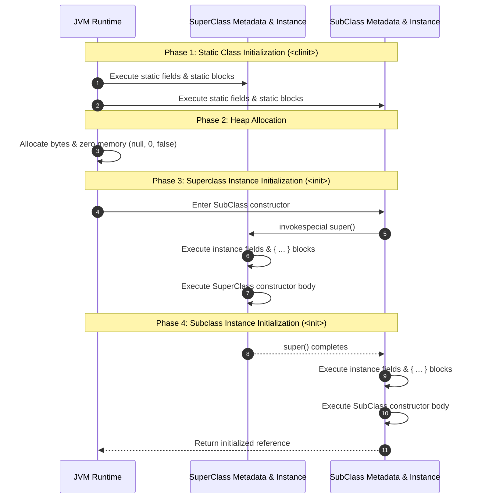

# Java Class and Object Initialization Order

> An exhaustive technical breakdown of the 11-step initialization lifecycle in Java, covering static `<clinit>` vs instance `<init>`, initializer blocks, and subtle constructor order hazards.

| Metadata | Details |
| :--- | :--- |
| **Level** | Intermediate to Advanced |
| **Prerequisites** | [00_classes-and-objects.md](./00_classes-and-objects.md), [01_constructors.md](./01_constructors.md), [02_static.md](./02_static.md) |
| **Time to Read** | 25 minutes |
| **Status** | Active |
| **Java Version** | Java 8+ (Java 25 LTS verified) |

---

## Table of Contents
1. [What & Why](#1-what--why)
2. [Core Concepts](#2-core-concepts)
3. [How It Works Internally](#3-how-it-works-internally)
4. [Syntax & Usage](#4-syntax--usage)
5. [Practical Examples](#5-practical-examples)
6. [Best Practices](#6-best-practices)
7. [Common Mistakes & Pitfalls](#7-common-mistakes--pitfalls)
8. [Performance & Security Notes](#8-performance--security-notes)
9. [Comparison: Class vs Instance Initialization](#9-comparison-class-vs-instance-initialization)
10. [Interview Questions](#10-interview-questions)
11. [Practice Exercises](#11-practice-exercises)
12. [Summary & Cheat Sheet](#12-summary--cheat-sheet)
13. [Further Reading](#13-further-reading)

---

## 1. What & Why

In Java, constructing an object is governed by a strictly defined, multi-phase lifecycle specified by the Java Language Specification (JLS §12.4 and §12.5). When a class is loaded and an instance is created, initialization proceeds through static class-level phases followed by instance-level phases across the entire inheritance hierarchy.

Misunderstanding this deterministic ordering is one of the most prolific causes of subtle bugs in enterprise systems:
- Uninitialized field reads yielding `null` or `0`.
- Mysterious `NullPointerException`s during object construction.
- Class initialization deadlocks during multi-threaded class loading.

---

## 2. Core Concepts

### 2.1 The Two Fundamental Lifecycles
1. **Class Initialization (`<clinit>`):** Executes **once** when the class is first loaded and initialized by a `ClassLoader`. Handles static variables and `static { ... }` blocks from top to bottom.
2. **Instance Initialization (`<init>`):** Executes **every time** `new` is called. Handles instance fields, instance initializer blocks `{ ... }`, and constructor bodies.

### 2.2 Hierarchical Priority
Initialization always proceeds **from the top of the inheritance hierarchy down to the leaf subclass**:
$$\text{Superclass Initialization} \longrightarrow \text{Subclass Initialization}$$

---

## 3. How It Works Internally

### 3.1 The Canonical 11-Step Initialization Order
When executing `SubClass obj = new SubClass()` for the first time:

```
[Phase 1: Class Loading & Static Initialization (<clinit>)] - ONCE PER CLASSLOADER
  1. Load and initialize ParentClass:
     - ParentClass static fields & static { ... } blocks in textual order
  2. Load and initialize SubClass:
     - SubClass static fields & static { ... } blocks in textual order

[Phase 2: Heap Allocation & Field Zeroing] - EVERY 'new'
  3. Heap allocation in Eden space
  4. All instance fields of ParentClass and SubClass zeroed (0, false, null)

[Phase 3: Parent Instance Initialization (<init>)]
  5. Enter SubClass constructor -> calls super()
  6. Enter ParentClass constructor -> calls Object()
  7. ParentClass instance fields & instance initializer blocks in textual order
  8. ParentClass constructor body executes

[Phase 4: Subclass Instance Initialization (<init>)]
  9. SubClass instance fields & instance initializer blocks in textual order
  10. SubClass constructor body executes
  11. Reference to fully initialized object returned to caller
```



---

## 4. Syntax & Usage

### 4.1 Demonstrating All Initialization Blocks
```java
public class InitializationSyntax {
    // 1. Static Field
    public static int staticVar = initStatic("1. Static Field");

    // 2. Static Block
    static {
        System.out.println("2. Static Initializer Block");
    }

    // 3. Instance Field
    public int instanceVar = initInstance("3. Instance Field");

    // 4. Instance Initializer Block
    {
        System.out.println("4. Instance Initializer Block");
    }

    // 5. Constructor
    public InitializationSyntax() {
        System.out.println("5. Constructor Body");
    }

    private static int initStatic(String msg) {
        System.out.println(msg);
        return 10;
    }

    private int initInstance(String msg) {
        System.out.println(msg);
        return 20;
    }
}
```

---

## 5. Practical Examples

### Example 1: Full Hierarchy Trace
```java
class BaseClass {
    static { System.out.println("1. BaseClass static block"); }
    { System.out.println("3. BaseClass instance block"); }
    public BaseClass() {
        System.out.println("4. BaseClass constructor");
    }
}

class DerivedClass extends BaseClass {
    static { System.out.println("2. DerivedClass static block"); }
    { System.out.println("5. DerivedClass instance block"); }
    public DerivedClass() {
        System.out.println("6. DerivedClass constructor");
    }
}

public class InitializationTraceDemo {
    public static void main(String[] args) {
        System.out.println("--- First Instance ---");
        new DerivedClass();

        System.out.println("--- Second Instance ---");
        new DerivedClass();
    }
}
```
**Output:**
```text
--- First Instance ---
1. BaseClass static block
2. DerivedClass static block
3. BaseClass instance block
4. BaseClass constructor
5. DerivedClass instance block
6. DerivedClass constructor
--- Second Instance ---
3. BaseClass instance block
4. BaseClass constructor
5. DerivedClass instance block
6. DerivedClass constructor
```
*Note: Static blocks (1 and 2) run strictly once on the first instance and never repeat!*

### Example 2: Real-World Static Initialization with Complex Exception Handling
```java
import java.io.InputStream;
import java.util.Properties;

public class ConfigurationLoader {
    public static final Properties CONFIG = new Properties();

    static {
        try (InputStream in = ConfigurationLoader.class.getResourceAsStream("/app.properties")) {
            if (in != null) {
                CONFIG.load(in);
            } else {
                CONFIG.setProperty("env", "development");
                CONFIG.setProperty("timeout", "5000");
            }
        } catch (Exception ex) {
            // Cannot throw checked exception from static block; wrap in unchecked error
            throw new ExceptionInInitializerError("Failed to initialize configuration: " + ex.getMessage());
        }
    }

    public static void main(String[] args) {
        System.out.println("Env: " + CONFIG.getProperty("env"));
    }
}
```
**Output:**
```text
Env: development
```

### Example 3: Edge Case – The Uninitialized Field Read Trap
```java
class SuperNode {
    SuperNode() {
        printValue(); // Calls polymorphic method before SubNode field is initialized!
    }
    void printValue() {
        System.out.println("SuperNode value");
    }
}

class SubNode extends SuperNode {
    private String name = "ACTIVE_NODE";

    @Override
    void printValue() {
        // When SuperNode constructor runs, 'name' has not been assigned yet; it is still null!
        System.out.println("SubNode name: " + name);
    }
}

public class PrematureFieldReadDemo {
    public static void main(String[] args) {
        new SubNode();
    }
}
```
**Output:**
```text
SubNode name: null
```

### Example 4: Failure Case – Static Circular Dependency Deadlock
```java
class WorkerA {
    static {
        System.out.println("WorkerA <clinit> waiting for WorkerB...");
        try { Thread.sleep(100); } catch (Exception e) {}
        WorkerB.ping();
    }
    static void ping() {}
}

class WorkerB {
    static {
        System.out.println("WorkerB <clinit> waiting for WorkerA...");
        try { Thread.sleep(100); } catch (Exception e) {}
        WorkerA.ping();
    }
    static void ping() {}
}

public class StaticDeadlockDemo {
    public static void main(String[] args) {
        System.out.println("Circular static initialization across threads deadlocks the JVM class loader!");
        // Thread 1 loads WorkerA, Thread 2 loads WorkerB -> mutually wait on Class initialization locks!
    }
}
```
**Output:**
```text
Circular static initialization across threads deadlocks the JVM class loader!
```

### Example 5: Optimized / Idiomatic – Instance Initializer for Anonymous Classes
```java
import java.util.HashMap;
import java.util.Map;

public class AnonymousInitializerDemo {
    public static void main(String[] args) {
        // Double-brace initialization anti-pattern (creates an anonymous subclass)
        // Avoid in production because it holds a hidden outer class reference!
        // Instead, use modern Map.of()
        Map<String, String> modernMap = Map.of(
            "env", "production",
            "region", "us-east-1"
        );

        System.out.println("Clean immutable map: " + modernMap);
    }
}
```
**Output:**
```text
Clean immutable map: {region=us-east-1, env=production}
```

---

## 6. Best Practices

1. **Never Call Overridable Methods from Constructors:** As demonstrated in Example 3, overridable methods execute before the subclass has executed its instance initializers, observing fields as `null` or `0`.
2. **Keep Static Blocks Minimal and Fast:** Static initializers block other threads during class loading. Never perform slow I/O, network calls, or thread joins inside `static { ... }`.
3. **Avoid Circular Class Dependencies:** Interdependent static initializers between two classes will deadlock the JVM during simultaneous multi-threaded class loading.
4. **Prefer Inline Initializers Over Initializer Blocks:** Declare and initialize fields directly (`private final List<String> list = new ArrayList<>();`). Reserve `{ ... }` blocks only for anonymous inner classes.
5. **Catch All Exceptions in Static Initializers:** An uncaught exception in `<clinit>` wraps into `ExceptionInInitializerError` and makes the class permanently unusable (`NoClassDefFoundError`).

---

## 7. Common Mistakes & Pitfalls

| Mistake | Why It Is Wrong | Correct Idiom |
| :--- | :--- | :--- |
| Overridable method in constructor | Subclass instance fields have not been initialized yet; reads fields as `null`. | Mark methods called in constructors `private` or `final`. |
| Uncaught exception in static block | Crashes class loading with `ExceptionInInitializerError`; class becomes unusable. | Wrap static block body in `try-catch`. |
| Expecting static blocks to re-run | Static blocks run strictly once per `ClassLoader`. | Use instance methods or factory methods for repeated logic. |
| Double-brace initialization | Creates an anonymous subclass with a hidden outer `this$0` pointer, causing memory leaks. | Use `List.of()`, `Map.of()`, or explicit population. |
| Assuming static methods run after instance init | Static blocks run long before any constructor runs. | Do not access instance state from static blocks. |

---

## 8. Performance & Security Notes

### 8.1 Class Initialization Locks
During `<clinit>`, the JVM acquires a unique initialization lock per class. If thread A triggers class loading for `ClassA` and thread B triggers class loading for `ClassB` with circular static references, the threads will deadlock inside the JVM runtime C++ monitor lock without triggering standard Java thread dump deadlocks! Always ensure a strict, acyclic dependency tree.

---

## 9. Comparison: Class vs Instance Initialization

| Attribute | Class Initialization (`<clinit>`) | Instance Initialization (`<init>`) |
| :--- | :--- | :--- |
| **Trigger** | First static reference or `new` | Every `new` instantiation |
| **Frequency** | Once per `ClassLoader` | Once per object instance |
| **Constructs** | `static` fields, `static { ... }` | Instance fields, `{ ... }`, constructors |
| **Hierarchy** | Superclass static $\to$ Subclass static | Superclass instance $\to$ Subclass instance |
| **Exception Thrown** | `ExceptionInInitializerError` | Any declared or runtime exception |
| **Thread Safety** | Guaranteed by JVM Class Lock | Must be synchronized by developer |

---

## 10. Interview Questions

<details>
<summary><strong>1. What is the exact execution order when a subclass instance is created for the first time?</strong></summary>

1. Superclass static fields and static blocks (textual order).
2. Subclass static fields and static blocks (textual order).
3. Superclass instance fields and instance blocks (textual order).
4. Superclass constructor body.
5. Subclass instance fields and instance blocks (textual order).
6. Subclass constructor body.
</details>

<details>
<summary><strong>2. What is <clinit> and how does it differ from <init>?</strong></summary>

`<clinit>` is the class initialization method generated by the compiler to initialize static fields and execute static blocks. It has no parameters, returns void, and is executed once by the JVM under a class lock. `<init>` is the instance initialization method corresponding to a constructor. It initializes instance fields, executes instance blocks, and runs the constructor body for every `new` object.
</details>

<details>
<summary><strong>3. Why does calling an overridden method in a constructor output null for subclass fields?</strong></summary>

Because superclass constructors execute **before** subclass instance field initializers. When the superclass constructor calls an overridden method, dynamic dispatch invokes the subclass implementation. At this point, the subclass constructor and its field initializers have not yet executed, meaning the subclass fields hold only their default JVM zero values (`null`, `0`, or `false`).
</details>

<details>
<summary><strong>4. What happens if a static initialization block throws a RuntimeException?</strong></summary>

The JVM catches the exception and wraps it in a `java.lang.ExceptionInInitializerError`. The class fails initialization and cannot be loaded. Any future attempt to access the class will immediately throw `java.lang.NoClassDefFoundError`.
</details>

<details>
<summary><strong>5. Do static blocks execute if you only reference a compile-time constant?</strong></summary>

No. If a class defines `public static final int CONST = 42;` (a primitive or String literal compile-time constant), the compiler inlines the value directly into the caller's bytecode. The class defining the constant is **not loaded or initialized**, so its static block does not execute.
</details>

<details>
<summary><strong>6. Can an instance initializer block throw a checked exception?</strong></summary>

Yes, but only if **every constructor** in the class explicitly declares that checked exception in its `throws` clause. If any constructor does not declare it, a compilation error occurs.
</details>

<details>
<summary><strong>7. What is "Double-Brace Initialization" and why is it dangerous?</strong></summary>

Double-brace initialization (`new ArrayList<String>() {{ add("a"); }}`) creates an anonymous inner subclass with an instance initializer block. Because non-static inner classes hold a hidden reference to the enclosing class instance (`this$0`), this idiom prevents the outer class from being garbage collected, causing serious memory leaks.
</details>

<details>
<summary><strong>8. In what order do multiple initializer blocks in the same class execute?</strong></summary>

Multiple initializer blocks (static or instance) execute strictly in **textual order** from top to bottom as they appear in the source code file.
</details>

---

## 11. Practice Exercises

### Easy
1. **Predict Output 1:** Predict the exact printed console output of a class with alternating instance fields and instance blocks.
2. **Static Counter Init:** Track how many times a static block vs an instance block executes across 10 object instantiations.
3. **Default Field Check:** Inspect the default values of fields accessed during constructor execution before assignment.

### Medium
4. **Order Hierarchy Simulator:** Build a 3-tier hierarchy (`Grandparent -> Parent -> Child`) with mixed initializers and verify output order.
5. **Compile-Time Constant vs Static Init:** Verify that accessing a static primitive constant does NOT trigger class loading, but accessing an object static field DOES trigger it.
6. **Safe Constructor Refactoring:** Refactor a broken class that called an overridable method in its constructor to be 100% safe.

### Hard
7. **Deadlock Reproduction:** Write a minimal multi-threaded program that reproduces an initialization deadlock between two classes and analyze the thread dump.
8. **Bytecode Inspection of <init>:** Compile a class with multiple field initializers and constructors; use `javap -c -v` to prove that field initializers are inlined into every constructor.
9. **Dynamic ClassLoader Initialization:** Create a custom `ClassLoader` that loads and initializes a class dynamically, observing when `<clinit>` is invoked.

<details>
<summary><strong>Exercise Solutions</strong></summary>

```java
// Solution to Exercise 2: Static vs Instance Counter
public class CounterTest {
    static int staticCount = 0;
    int instanceCount = 0;

    static {
        staticCount++;
    }

    {
        instanceCount++;
    }

    public static void main(String[] args) {
        for (int i = 0; i < 5; i++) {
            new CounterTest();
        }
        System.out.println("Static count: " + CounterTest.staticCount); // 1
    }
}
```
</details>

---

## 12. Summary & Cheat Sheet

```
┌────────────────────────────────────────────────────────────────────────┐
│                   INITIALIZATION ORDER CHEAT SHEET                     │
├────────────────────────────────────────────────────────────────────────┤
│ 1. Superclass Static: Fields & static { ... } blocks in textual order  │
│ 2. Subclass Static:   Fields & static { ... } blocks in textual order  │
│ 3. Superclass Inst.:  Fields & { ... } blocks in textual order         │
│ 4. Superclass Ctor:   Constructor body executes                        │
│ 5. Subclass Inst.:    Fields & { ... } blocks in textual order         │
│ 6. Subclass Ctor:     Constructor body executes                        │
│ Golden Rule:          NEVER invoke overridable methods in constructors │
│ Static Failure:       Uncaught exception -> ExceptionInInitializerError│
│ Inlining:             Compile-time constants do NOT trigger <clinit>   │
└────────────────────────────────────────────────────────────────────────┘
```

---

## 13. Further Reading
- Java Language Specification (JLS) Section 12.4: Initialization of Classes and Interfaces
- Java Language Specification (JLS) Section 12.5: Creation of New Class Instances
- *Effective Java (3rd Edition)*, Joshua Bloch, Item 19: "Design and document for inheritance or else prohibit it".
