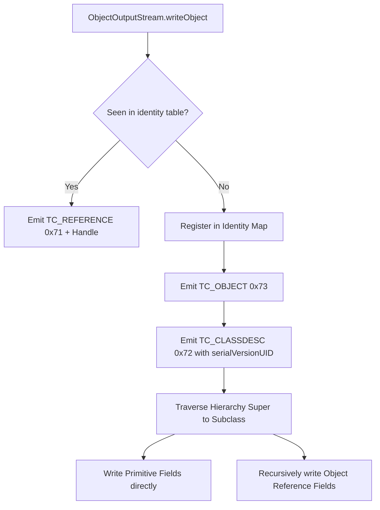

# Java Object Serialization and Filtered Deserialization

> Deep dive into Java's built-in object serialization protocol, `Serializable`, `Externalizable`, `serialVersionUID`, critical remote code execution (RCE) vulnerabilities, deserialization filters (JEP 290), and modern migration alternatives.

| Metadata | Value |
|---|---|
| **Level** | Advanced |
| **Prerequisites** | [00_io-streams-readers-writers.md](00_io-streams-readers-writers.md), [04-oop/00_classes-and-objects.md](../04-oop/00_classes-and-objects.md), [06-exceptions-and-debugging/00_exception-hierarchy-and-types.md](../06-exceptions-and-debugging/00_exception-hierarchy-and-types.md) |
| **Time to Read** | 28 minutes |
| **Status** | Active |
| **Java Version** | Java 1.1+ (Serialization Filtering JEP 290 in Java 9, Context-specific filters JEP 415 in Java 17) |

---

## Table of Contents
1. [What & Why](#1-what--why)
2. [Core Concepts](#2-core-concepts)
3. [How It Works Internally](#3-how-it-works-internally)
4. [Syntax & Usage](#4-syntax--usage)
5. [Practical Examples](#5-practical-examples)
6. [Best Practices](#6-best-practices)
7. [Common Mistakes & Pitfalls](#7-common-mistakes--pitfalls)
8. [Performance & Security Notes](#8-performance--security-notes)
9. [Comparison / When to Use What](#9-comparison--when-to-use-what)
10. [Interview Questions](#10-interview-questions)
11. [Practice Exercises](#11-practice-exercises)
12. [Summary / Cheat Sheet](#12-summary--cheat-sheet)
13. [Further Reading](#13-further-reading)

---

## 1. What & Why

### The Problem
In distributed computing, caching, and persistence systems, programs must transmit in-memory object graphs across network sockets or save them to disk, and subsequently reconstruct the exact object graph at a later time or on a completely different JVM instance.

Before native serialization, developers had to manually marshal and unmarshal every primitive field and recursively construct child objects, tracking circular references and maintaining field order manually.

### The Solution: Native Java Serialization
Java 1.1 introduced Java Object Serialization via `java.io.Serializable`, `ObjectOutputStream`, and `ObjectInputStream`. It allows the JVM to automatically walk an arbitrary graph of interconnected objects, encode their types, metadata, and field values into a binary byte stream (magic header `0xACED 0005`), and reconstitute the graph upon deserialization without invoking constructors on the serialized classes.

### The Historic Pitfall and Warning
While conceptually elegant, Java native serialization is widely recognized by computer scientists (including Joshua Bloch and Brian Goetz) as one of the biggest architectural design mistakes in Java's history. Arbitrary deserialization creates catastrophic Remote Code Execution (RCE) vulnerabilities through "gadget chains" (e.g., Apache Commons Collections exploit). Modern enterprise development avoids native Java serialization in favor of JSON, Protocol Buffers, FlatBuffers, or Avro, and enforces strict `ObjectInputFilter` guards whenever native serialization cannot be avoided.

---

## 2. Core Concepts

### `Serializable` vs `Externalizable`
- `java.io.Serializable`: A marker interface with zero methods. The JVM runtime reflects over all non-`static` and non-`transient` fields and manages stream formatting automatically.
- `java.io.Externalizable`: Extends `Serializable` and declares `writeExternal(ObjectOutput out)` and `readExternal(ObjectInput in)`. The developer has complete control over what is written and read. Deserialization **requires a public no-arg constructor** because it instantiates the blank object before invoking `readExternal`.

### `transient` Keyword
The `transient` modifier marks instance fields that must not be serialized into the output stream. Common candidates:
- Sensitive credentials (passwords, tokens, private keys).
- Runtime state bound to local JVM resources (thread handles, open sockets, database connections, GUI components).
- Derived/cached fields that can be recomputed dynamically.

### `serialVersionUID`
A 64-bit hash (`long`) representing the class version. If not explicitly declared, the compiler computes one automatically based on class structure, fields, and signatures.
- **Problem**: Any minor compiler change, synthetic field addition, or harmless method addition changes the generated UID, causing `InvalidClassException: local class incompatible`.
- **Rule**: Always explicitly declare `private static final long serialVersionUID = 1L;`.

### Customizing Serialization: `writeObject` and `readObject`
Classes implementing `Serializable` can declare private lifecycle hook methods:
```java
private void writeObject(ObjectOutputStream out) throws IOException {
    out.defaultWriteObject(); // serializes standard non-transient fields
    out.writeInt(extraCalculatedData);
}

private void readObject(ObjectInputStream in) throws IOException, ClassNotFoundException {
    in.defaultReadObject(); // deserializes standard non-transient fields
    this.extraCalculatedData = in.readInt();
    validateInvariants(); // crucial defensive verification!
}
```

### Replacement Hooks: `writeReplace` and `readResolve`
- `writeReplace()`: Allows an object to substitute another object (e.g., a Serialization Proxy) before writing to the stream.
- `readResolve()`: Invoked after deserialization to return an alternative instance. Indispensable for preserving **Singleton guarantees** across serialization cycles.

### Serialization Filtering (JEP 290 & JEP 415)
Introduced in Java 9 (extended with context-specific filters in Java 17), `java.io.ObjectInputFilter` allows inspection of incoming classes, array lengths, object graph depth, and total stream bytes before instantiation occurs, effectively neutralizing gadget chain exploits.

---

## 3. How It Works Internally

### Stream Protocol Structure
When an object is written via `ObjectOutputStream.writeObject(obj)`, the output stream produces a well-defined binary layout:

```
+-------------------+-------------------+--------------------+
| STREAM_MAGIC      | STREAM_VERSION    | CONTENT (Records)  |
| 0xAC 0xED (2 byte)| 0x00 0x05 (2 byte)| TC_OBJECT / etc.   |
+-------------------+-------------------+--------------------+
```

### Memory & Graph Serialization Flow


### Deserialization Execution Mechanics
1. **Header Validation**: `ObjectInputStream` validates magic numbers `0xACED 0x0005`.
2. **Filter Interception**: `ObjectInputFilter.checkInput()` validates class name, depth, references, array length.
3. **Instance Allocation**: The JVM allocates uninitialized heap memory for the object **without invoking the class's constructor**. It invokes the no-arg constructor of the closest non-serializable superclass.
4. **Field Restoration**: Primitive values are unpacked; referenced object handles are looked up or recursively deserialized.
5. **Hook Invocation**: If present, `readObject()` and `readResolve()` are invoked.

---

## 4. Syntax & Usage

### Basic Implementation with Explicit UID and Transient Fields
```java
import java.io.*;
import java.time.Instant;

public class UserSession implements Serializable {
    @Serial
    private static final long serialVersionUID = 1001L;

    private final String userId;
    private final Instant loginTime;
    
    // transient field will NOT be persisted in serialization stream
    private transient String sessionToken;
    private transient long requestCounter;

    public UserSession(String userId, Instant loginTime, String sessionToken) {
        this.userId = userId;
        this.loginTime = loginTime;
        this.sessionToken = sessionToken;
        this.requestCounter = 0;
    }

    public String getUserId() { return userId; }
    public Instant getLoginTime() { return loginTime; }
    public String getSessionToken() { return sessionToken; }

    @Serial
    private void readObject(ObjectInputStream ois) throws IOException, ClassNotFoundException {
        ois.defaultReadObject();
        // Invariants and transients re-initialized
        this.sessionToken = "EXPIRED";
        this.requestCounter = 0;
    }
}
```

### Implementing `Externalizable`
```java
import java.io.*;

public class NetworkPacket implements Externalizable {
    private int packetId;
    private String payload;

    // MANDATORY: Public no-arg constructor required by Externalizable
    public NetworkPacket() {}

    public NetworkPacket(int packetId, String payload) {
        this.packetId = packetId;
        this.payload = payload;
    }

    @Override
    public void writeExternal(ObjectOutput out) throws IOException {
        out.writeInt(packetId);
        out.writeUTF(payload);
    }

    @Override
    public void readExternal(ObjectInput in) throws IOException, ClassNotFoundException {
        this.packetId = in.readInt();
        this.payload = in.readUTF();
    }
}
```

---

## 5. Practical Examples

### Example 1: Basic Serialization Cycle
```java
// Goal: Serialize and deserialize an object graph to a byte array
import java.io.*;

record UserProfile(String username, int age) implements Serializable {
    @Serial
    private static final long serialVersionUID = 1L;
}

public class BasicSerializationDemo {
    public static void main(String[] args) throws IOException, ClassNotFoundException {
        UserProfile original = new UserProfile("ada_lovelace", 36);

        // Serialization
        ByteArrayOutputStream byteOut = new ByteArrayOutputStream();
        try (ObjectOutputStream out = new ObjectOutputStream(byteOut)) {
            out.writeObject(original);
        }

        byte[] serializedData = byteOut.toByteArray();
        System.out.println("Serialized bytes length: " + serializedData.length);

        // Deserialization
        ByteArrayInputStream byteIn = new ByteArrayInputStream(serializedData);
        try (ObjectInputStream in = new ObjectInputStream(byteIn)) {
            UserProfile restored = (UserProfile) in.readObject();
            System.out.println("Restored user: " + restored.username() + ", age: " + restored.age());
            System.out.println("Equals original: " + original.equals(restored));
        }
    }
}
```
*Output:*
```
Serialized bytes length: 98
Restored user: ada_lovelace, age: 36
Equals original: true
```
*Explanation:* Standard serialization cycle using byte arrays. Records automatically serialize cleanly in modern Java with immutable components.

### Example 2: Real-World Safe Deserialization with JEP 290 Filter
```java
// Goal: Defend JVM against arbitrary class loading and gadget chains using ObjectInputFilter
import java.io.*;

public class SecureFilterDemo {
    public static void main(String[] args) throws Exception {
        UserProfile profile = new UserProfile("alan_turing", 41);

        ByteArrayOutputStream baos = new ByteArrayOutputStream();
        try (ObjectOutputStream oos = new ObjectOutputStream(baos)) {
            oos.writeObject(profile);
        }

        byte[] data = baos.toByteArray();

        // Configure strict whitelist filter
        ObjectInputFilter strictFilter = ObjectInputFilter.Config.createFilter(
            "UserProfile;!*" // Allow UserProfile, reject all other classes
        );

        try (ByteArrayInputStream bais = new ByteArrayInputStream(data);
             ObjectInputStream ois = new ObjectInputStream(bais)) {
            
            ois.setObjectInputFilter(strictFilter);
            UserProfile recovered = (UserProfile) ois.readObject();
            System.out.println("Safely deserialized: " + recovered.username());
        }
    }
}
```
*Output:*
```
Safely deserialized: alan_turing
```
*Explanation:* The filter inspects every incoming class metadata. Any class not matching `UserProfile` triggers an `InvalidClassException`, preventing gadget execution.

### Example 3: Edge Case: Preserving Singleton with `readResolve`
```java
// Goal: Guarantee that serializing a Singleton does not create a second instance
import java.io.*;

public class DatabaseRegistry implements Serializable {
    @Serial
    private static final long serialVersionUID = 1L;

    public static final DatabaseRegistry INSTANCE = new DatabaseRegistry();

    private DatabaseRegistry() {
        // Private constructor
    }

    @Serial
    private Object readResolve() {
        // Enforce singleton instance replacement
        return INSTANCE;
    }
}
```
*Explanation:* Without `readResolve()`, `readObject()` generates a brand-new instance in memory, violating the singleton invariant.

### Example 4: Failure Case: Missing `serialVersionUID` and Signature Incompatibility
```java
// Goal: Demonstrate InvalidClassException when schema changes without fixed UID
import java.io.*;

class LegacyPacket implements Serializable {
    // Missing explicit serialVersionUID
    String payload;
    public LegacyPacket(String payload) { this.payload = payload; }
}

public class UIDMismatchDemo {
    public static void demonstrate() {
        // If LegacyPacket adds a field 'int version = 1;' after serialization,
        // deserialization throws:
        // java.io.InvalidClassException: LegacyPacket; local class incompatible:
        // stream classdesc serialVersionUID = -283748293, local class serialVersionUID = 492817283
    }
}
```
*Explanation:* Implicit serialVersionUID is calculated via SHA-1 over method signatures, field names, and modifiers. Any change breaks backwards compatibility.

### Example 5: Optimized & Idiomatic: Serialization Proxy Pattern
```java
// Goal: Protect class invariants, prevent constructor bypass, and eliminate serialization exploits
import java.io.*;

public final class Period implements Serializable {
    @Serial
    private static final long serialVersionUID = 1L;

    private final long start;
    private final long end;

    public Period(long start, long end) {
        if (start > end) {
            throw new IllegalArgumentException("start > end");
        }
        this.start = start;
        this.end = end;
    }

    public long start() { return start; }
    public long end() { return end; }

    // Serialization Proxy Inner Class
    private static class SerializationProxy implements Serializable {
        @Serial
        private static final long serialVersionUID = 1L;

        private final long start;
        private final long end;

        SerializationProxy(Period p) {
            this.start = p.start;
            this.end = p.end;
        }

        @Serial
        private Object readResolve() {
            // Re-invokes standard constructor with all validations!
            return new Period(start, end);
        }
    }

    @Serial
    private Object writeReplace() {
        return new SerializationProxy(this);
    }

    @Serial
    private void readObject(ObjectInputStream stream) throws InvalidObjectException {
        throw new InvalidObjectException("Proxy required - direct serialization forbidden!");
    }
}
```
*Explanation:* The Serialization Proxy Pattern replaces the enclosing object with an inert proxy during serialization, and deserialization reconstructs the object via its regular public constructor, ensuring invariants are never bypassed.

---

## 6. Best Practices
1. **Default to Modern Formats**: Never use Java native serialization for new systems. Prefer JSON (Jackson/Moshi), Protocol Buffers, or CBOR.
2. **Always Declare `serialVersionUID`**: Always declare `private static final long serialVersionUID = 1L;` to guard against automatic compiler hash divergence.
3. **Use the Serialization Proxy Pattern**: For complex domain entities requiring validation, use the Serialization Proxy Pattern to invoke canonical constructors during deserialization.
4. **Mandate ObjectInputFilter (JEP 290/415)**: If reading serialized objects over network or untrusted sources, configure strict whitelisting filters.
5. **Tag Sensitive Data as `transient`**: Mark passwords, tokens, API keys, and connection handles as `transient`.
6. **Defensive Validation in `readObject`**: If custom `readObject` is implemented, always validate domain invariants at the end of the method.

---

## 7. Common Mistakes & Pitfalls

| Mistake | Why Wrong | Fix |
|---|---|---|
| Omitting `serialVersionUID` | Any re-compilation or harmless method edit alters the auto-computed hash, breaking deserialization. | Explicitly define `private static final long serialVersionUID = 1L;`. |
| Deserializing untrusted byte streams without filters | Allows attackers to supply malicious gadget chains, leading to instant Remote Code Execution (RCE). | Implement `ObjectInputFilter` or replace with JSON/Protobuf. |
| Forgetting `public` no-arg constructor in `Externalizable` | `InvalidClassException: no valid constructor` thrown at deserialization runtime. | Provide a public zero-argument constructor for any `Externalizable` class. |
| Non-serializable fields in a `Serializable` class | Throws runtime `NotSerializableException` as soon as `writeObject` visits the field. | Make referenced classes implement `Serializable` or mark field `transient`. |
| Not using `readResolve` on Singletons | Deserialization creates a brand new instance on the heap, violating Singleton pattern. | Implement `private Object readResolve() { return INSTANCE; }`. |
| Assuming constructors are called during deserialization | `readObject` allocates memory directly via JVM internals, bypassing constructors completely. | Validate invariants inside `readObject()` or use the Serialization Proxy pattern. |

---

## 8. Performance & Security Notes

### Remote Code Execution (RCE) via Gadget Chains
Deserialization vulnerability is the most lethal class of security bugs in Java enterprise history. Attackers craft binary payloads leveraging classes already present on the classpath (e.g. InvokerTransformer in older Commons-Collections). When `readObject()` walks the graph, method invocations execute arbitrary OS shell commands without authentication.

### Memory Allocation Bombs (Billion Laughs / Deserialization Bombs)
A stream can contain nested references creating an exponential graph expansion (e.g., HashSet containing HashSets of HashSets). Parsing a payload of only a few kilobytes can exhaust gigabytes of JVM heap, triggering fatal `OutOfMemoryError` DoS.

### Performance Overhead
- Heavy Reflection: JVM must reflect over field tables and metadata on every write and read.
- Stream Bloat: Native serialization embeds full class package names, field names, and type signatures in the stream, making payloads 5–10x larger than compact binary protocols like Protocol Buffers.

---

## 9. Comparison / When to Use What

| Feature / Format | Java Native Serialization | Protocol Buffers | Jackson JSON |
|---|---|---|---|
| **Human Readable** | No (Binary with magic header) | No (Compact Binary) | Yes (UTF-8 Text) |
| **Cross-Language** | Java JVM Only | Universal (C++, Go, Python, Rust) | Universal |
| **Security Risk** | Critical (Gadget RCE risks) | Extremely Low | Low (Safe with typed bindings) |
| **Schema Evolution** | Brittle (`serialVersionUID`) | Superior (Numbered field tags) | Flexible (Optional fields) |
| **Payload Size** | Large (Heavy metadata overhead) | Minimal (Varint, no field names) | Medium |
| **Recommended Use** | Legacy JVM migration only | High-perf microservices & gRPC | Web APIs, configurations |

---

## 10. Interview Questions

<details>
<summary>1. Why is native Java serialization considered dangerous?</summary>
Because `ObjectInputStream.readObject()` automatically allocates heap memory and reconstructs class hierarchies without invoking user constructors. If untrusted input contains serialized malicious gadget chains from classes available on the JVM classpath, arbitrary code executes during graph instantiation before the caller can validate the object.
</details>

<details>
<summary>2. What is the difference between `Serializable` and `Externalizable`?</summary>
`Serializable` is a marker interface where serialization is automated by the JVM using reflection. `Externalizable` extends `Serializable` and mandates `writeExternal` and `readExternal` methods, giving complete manual control over stream bytes, and requires a public no-arg constructor.
</details>

<details>
<summary>3. What is the purpose of `serialVersionUID`?</summary>
It identifies the version of the class structure. If a class undergoes changes (e.g. adding methods or fields) and lacks an explicit UID, the compiler generates a new hash. Deserializing older payloads then throws `InvalidClassException`. Declaring a static `serialVersionUID` prevents false incompatibility errors.
</details>

<details>
<summary>4. How does `readResolve()` protect the Singleton pattern?</summary>
When deserialized, the JVM generates a new distinct instance. `readResolve()` is a callback invoked right before returning the deserialized object, allowing the developer to replace the newly created object with the canonical existing `INSTANCE`, preserving object identity (`==`).
</details>

<details>
<summary>5. What does the `transient` keyword do?</summary>
It instructs `ObjectOutputStream` to skip that instance variable during serialization. Upon deserialization, the field is assigned its JVM default value (null, 0, or false) unless manually populated in `readObject()`.
</details>

<details>
<summary>6. How do Java 16+ Records interact with Serialization?</summary>
Records have specialized, hardened serialization semantics. Unlike regular classes, records are **always deserialized using their canonical constructor**. Their serialized stream only contains component values, and `readObject`/`writeObject` methods are ignored, making records immune to constructor-bypass exploits.
</details>

<details>
<summary>7. What are JEP 290 and JEP 415 Serialization Filters?</summary>
They provide filter hooks (`ObjectInputFilter`) executed by `ObjectInputStream` before deserializing any class. Filters inspect class names, graph depth, number of references, and stream size against whitelist/blacklist patterns, aborting deserialization if malicious gadgets are detected.
</details>

<details>
<summary>8. What is the Serialization Proxy Pattern?</summary>
It is an architectural pattern where an object emits an inert, private static proxy class via `writeReplace()`. The proxy contains only raw data and reconstructs the enclosing instance via its public constructor in `readResolve()`. This protects class invariants and avoids serialization vulnerabilities.
</details>

---

## 11. Practice Exercises

### Exercise 1 (Easy): Safe Transient Password Handling
- **Task**: Implement a `UserCredentials` class with `username` and `password`. Ensure `password` is never written to disk, and upon deserialization is initialized to `"[CLEARED]"`.
<details>
<summary>Solution</summary>

```java
import java.io.*;

public class UserCredentials implements Serializable {
    @Serial private static final long serialVersionUID = 1L;
    private final String username;
    private transient String password;

    public UserCredentials(String username, String password) {
        this.username = username;
        this.password = password;
    }

    public String username() { return username; }
    public String password() { return password; }

    @Serial
    private void readObject(ObjectInputStream in) throws IOException, ClassNotFoundException {
        in.defaultReadObject();
        this.password = "[CLEARED]";
    }
}
```
</details>

### Exercise 2 (Medium): Serialization Whitelist Filter
- **Task**: Create an `ObjectInputStream` configured with an `ObjectInputFilter` that strictly allows instances of `java.lang.String` and `java.lang.Integer`, rejecting all other classes.
<details>
<summary>Solution</summary>

```java
import java.io.*;

public class WhitelistFilterDemo {
    public static Object deserializeFiltered(byte[] bytes) throws Exception {
        ObjectInputFilter filter = filterInfo -> {
            Class<?> clazz = filterInfo.serialClass();
            if (clazz != null) {
                if (clazz == String.class || clazz == Integer.class) {
                    return ObjectInputFilter.Status.ALLOWED;
                }
                return ObjectInputFilter.Status.REJECTED;
            }
            return ObjectInputFilter.Status.UNDECIDED;
        };

        try (ByteArrayInputStream bais = new ByteArrayInputStream(bytes);
             ObjectInputStream ois = new ObjectInputStream(bais)) {
            ois.setObjectInputFilter(filter);
            return ois.readObject();
        }
    }
}
```
</details>

### Exercise 3 (Hard): Serialization Proxy for Immutable Range
- **Task**: Implement an immutable class `DateRange(Instant start, Instant end)` enforcing invariant `start.isBefore(end)`. Use the Serialization Proxy Pattern to guarantee invariant validation during deserialization.
<details>
<summary>Solution</summary>

```java
import java.io.*;
import java.time.Instant;

public final class DateRange implements Serializable {
    @Serial private static final long serialVersionUID = 1L;
    private final Instant start;
    private final Instant end;

    public DateRange(Instant start, Instant end) {
        if (start == null || end == null || !start.isBefore(end)) {
            throw new IllegalArgumentException("Invalid range: start must be before end");
        }
        this.start = start;
        this.end = end;
    }

    public Instant start() { return start; }
    public Instant end() { return end; }

    private static class Proxy implements Serializable {
        @Serial private static final long serialVersionUID = 1L;
        private final Instant start;
        private final Instant end;

        Proxy(DateRange range) {
            this.start = range.start;
            this.end = range.end;
        }

        @Serial
        private Object readResolve() {
            return new DateRange(start, end);
        }
    }

    @Serial
    private Object writeReplace() {
        return new Proxy(this);
    }

    @Serial
    private void readObject(ObjectInputStream stream) throws InvalidObjectException {
        throw new InvalidObjectException("Proxy required");
    }
}
```
</details>

---

## 12. Summary / Cheat Sheet

```
+-----------------------------------------------------------------------------------------+
|                              JAVA SERIALIZATION CHEAT SHEET                             |
+-----------------------------------------------------------------------------------------+
| Marker Interface         | implements Serializable (zero methods)                       |
| Custom Control           | implements Externalizable (writeExternal, readExternal)      |
| Skip Field               | transient String token;                                      |
| Version Identifier       | private static final long serialVersionUID = 1L;            |
| Lifecycle Hooks          | private void writeObject(ObjectOutputStream out)             |
|                          | private void readObject(ObjectInputStream in)                |
| Substitution Hooks       | private Object writeReplace() / private Object readResolve() |
| Security Filtering       | ObjectInputFilter.Config.createFilter("pattern;!*")          |
| Modern Alternative       | Jackson JSON, Protocol Buffers, FlatBuffers, Avro            |
+-----------------------------------------------------------------------------------------+
```

---

## 13. Further Reading
- [JEP 290: Filter Incoming Serialization Data](https://openjdk.org/jeps/290)
- [JEP 415: Context-Specific Deserialization Filters](https://openjdk.org/jeps/415)
- Effective Java (3rd Edition) by Joshua Bloch — Chapters 11 & 12 (Serialization)
- OWASP Deserialization of Untrusted Data Prevention Cheat Sheet
