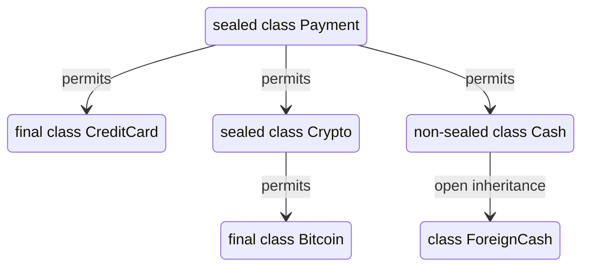

# Sealed Classes and Interfaces

> Complete guide to Sealed Classes and Interfaces (JEP 409): modeling closed hierarchies, `permits` clauses, exhaustive pattern matching in `switch`, and Domain-Driven Design Algebraic Data Types (ADTs).

| Metadata | Value |
|---|---|
| **Level** | Advanced |
| **Prerequisites** | [04-oop/06_inheritance.md](../04-oop/06_inheritance.md), [04-oop/09_interfaces.md](../04-oop/09_interfaces.md), [01_records.md](01_records.md) |
| **Time to Read** | 24 minutes |
| **Status** | Active |
| **Java Version** | Java 15/16 Preview, Java 17 Final (JEP 409) |

---

## Table of Contents
1. [What & Why](#1-what--why)
2. [Core Concepts](#2-core-concepts)
3. [How It Works Internally](#3-how-it-works-internally)
4. [Syntax & Usage](#4-syntax--usage)
5. [Practical Examples](#5-practical-examples)
6. [Best Practices](#6-best-practices)
7. [Common Mistakes & Pitfalls](#7-common-mistakes--pitfalls)
8. [Performance & Security Notes](#8-performance--security-notes)
9. [Comparison / When to Use What](#9-comparison--when-to-use-what)
10. [Interview Questions](#10-interview-questions)
11. [Practice Exercises](#11-practice-exercises)
12. [Summary / Cheat Sheet](#12-summary--cheat-sheet)
13. [Further Reading](#13-further-reading)

---

## 1. What & Why

### The Uncontrolled Inheritance Problem
In standard object-oriented programming, inheritance is an "all or nothing" proposition:
- A class is open to extension by any subclass across any package (`public class Animal`).
- Or a class is completely closed to any subclassing (`public final class Animal`).

There was no clean mechanism in Java to declare that an interface or base class should only be implemented by a **known, finite, fixed set of subclasses**. Prior workarounds involved package-private constructors, which constrained subclasses to the same package and prevented clean domain modeling.

### The Solution: Sealed Classes (JEP 409)
Standardized in Java 17, **Sealed Classes and Interfaces** allow a class or interface to explicitly restrict which other classes or interfaces may extend or implement it.
- Developers define closed type hierarchies: `sealed interface Vehicle permits Car, Truck, Motorcycle`.
- The compiler verifies exhaustive coverage in `switch` expressions without requiring defensive `default` branches.
- Enables genuine **Algebraic Data Types (Sum Types)** when combined with Records (Product Types).

---

## 2. Core Concepts

### The Sealed Modifiers Triad
Every direct subclass of a sealed class must explicitly declare one of three modifiers:
1. **`final`**: The subclass cannot be extended any further (closes that branch of the hierarchy).
2. **`sealed`**: The subclass is itself sealed and must declare its own `permits` clause.
3. **`non-sealed`**: The subclass explicitly opens that branch to arbitrary extension by any third-party class.

### The `permits` Clause
The `permits` keyword specifies the permitted subclasses:
```java
public sealed class PaymentMethod permits CreditCard, DebitCard, Crypto {}
```
**Implicit `permits` Rule**: If all permitted subclasses are declared inside the same compilation unit (`.java` file), the `permits` clause can be omitted. The compiler infers permitted subclasses automatically.

### Co-location Constraints
Permitted subclasses must either:
- Reside in the **same module** (if named JPMS module).
- Reside in the **same package** (if unnamed module / classpath).

---

## 3. How It Works Internally

### ClassFile Attribute: `PermittedSubclasses`
The Java compiler adds a dedicated attribute `PermittedSubclasses` to the class file:
```
ClassFile {
    ...
    u2 attributes_count;
    attribute_info attributes[attributes_count];
    // PermittedSubclasses_attribute {
    //     u2 attribute_name_index;
    //     u4 attribute_length;
    //     u2 number_of_classes;
    //     u2 classes[number_of_classes];
    // }
}
```
During class loading and byte code verification, the JVM verifies that any class attempting to extend the sealed class is present in the `PermittedSubclasses` table. If an unauthorized class attempts inheritance, the JVM throws `IncompatibleClassChangeError`.

### Sealed Hierarchy State Diagram


---

## 4. Syntax & Usage

### Basic Sealed Interface with Records
```java
public sealed interface Result<T> permits Result.Success, Result.Failure {
    record Success<T>(T data) implements Result<T> {}
    record Failure<T>(String error, Throwable cause) implements Result<T> {}
}
```

### Exhaustive Switch Without Default
```java
public class ResultProcessor {
    public static <T> void handle(Result<T> result) {
        // Compiler guarantees all permitted subclasses are covered!
        // No 'default' branch needed!
        switch (result) {
            case Result.Success<T> s -> System.out.println("Success: " + s.data());
            case Result.Failure<T> f -> System.err.println("Failed: " + f.error());
        }
    }
}
```

---

## 5. Practical Examples

### Example 1: Domain-Driven Modeling: JSON AST
```java
// Goal: Model abstract syntax tree for JSON values using Sealed Interfaces and Records
public sealed interface JsonValue permits JsonObject, JsonArray, JsonString, JsonNumber, JsonBoolean, JsonNull {}

record JsonObject(java.util.Map<String, JsonValue> members) implements JsonValue {}
record JsonArray(java.util.List<JsonValue> elements) implements JsonValue {}
record JsonString(String value) implements JsonValue {}
record JsonNumber(double value) implements JsonValue {}
record JsonBoolean(boolean value) implements JsonValue {}
enum JsonNull implements JsonValue { INSTANCE }
```
*Explanation:* Forms a closed, mathematical definition of JSON. The compiler guarantees that any parser or serializer handling `JsonValue` accounts for all 6 possible variations.

### Example 2: Financial Transaction Pipeline
```java
// Goal: Manage transactional state with strict transitions
sealed interface TransactionStatus permits Pending, Completed, Failed {}

record Pending(long timestamp) implements TransactionStatus {}
record Completed(long timestamp, String transactionHash) implements TransactionStatus {}
record Failed(long timestamp, String reason) implements TransactionStatus {}

public class TransactionHandler {
    public static String getSummary(TransactionStatus status) {
        return switch (status) {
            case Pending p -> "In progress since " + p.timestamp();
            case Completed c -> "Settled with hash " + c.transactionHash();
            case Failed f -> "Aborted: " + f.reason();
        };
    }
}
```
*Explanation:* Adding a new status (e.g. `Refunded`) immediately produces compile errors across the entire codebase wherever `TransactionStatus` is evaluated, preventing silent omissions.

### Example 3: Edge Case: Subclassing Sealed Class with `non-sealed`
```java
// Goal: Allow a specific plugin subclass to be extended by third parties
public sealed class Gateway permits PaypalGateway, CustomPluginGateway {}

public final class PaypalGateway extends Gateway {}

// non-sealed opens CustomPluginGateway for extension by external libraries
public non-sealed class CustomPluginGateway extends Gateway {}
```
*Explanation:* The `non-sealed` keyword provides an intentional architectural escape hatch, allowing specific branches to rejoin open polymorphism.

### Example 4: Failure Case: Subclass Located in Wrong Package
```java
// File: com/bank/core/Account.java
package com.bank.core;
public sealed class Account permits com.bank.savings.SavingsAccount {}

// File: com/bank/savings/SavingsAccount.java
package com.bank.savings;
// COMPILE ERROR:
// Subclass SavingsAccount must be in the same package (com.bank.core) or same module!
public final class SavingsAccount extends com.bank.core.Account {}
```
*Explanation:* Subclasses must be located in the exact same package unless the project is organized into a named JPMS module.

---

### Advanced Algebraic Data Type Modeling: State Machines
Combining sealed interfaces with record types allows bulletproof compile-time modeling of state machine transitions. In an order fulfillment domain:

```java
public sealed interface OrderState permits DraftOrder, PlacedOrder, ShippedOrder, CancelledOrder {
    record DraftOrder(String orderId, java.util.List<String> items) implements OrderState {}
    record PlacedOrder(String orderId, long placedTimestamp, double totalPaid) implements OrderState {}
    record ShippedOrder(String orderId, String trackingNumber, long shippedTimestamp) implements OrderState {}
    record CancelledOrder(String orderId, String cancelReason) implements OrderState {}
}

public class OrderStateMachine {
    public static OrderState ship(OrderState current, String trackingNumber) {
        return switch (current) {
            case OrderState.PlacedOrder p -> new OrderState.ShippedOrder(p.orderId(), trackingNumber, System.currentTimeMillis());
            case OrderState.DraftOrder d -> throw new IllegalStateException("Cannot ship draft order: " + d.orderId());
            case OrderState.ShippedOrder s -> throw new IllegalStateException("Order already shipped: " + s.trackingNumber());
            case OrderState.CancelledOrder c -> throw new IllegalStateException("Cannot ship cancelled order: " + c.cancelReason());
        };
    }
}
```
Because `OrderState` is sealed, invalid transitions cannot be introduced without compiler verification, eliminating runtime state corruption bugs.

## 6. Best Practices
1. **Combine Sealed Interfaces with Records**: Use sealed interfaces as Sum types and Records as Product types to construct powerful Algebraic Data Types (ADTs).
2. **Omit `default` in Sealed Switches**: Never add a `default` case to a sealed type switch. Omitting `default` lets the compiler alert you with a build failure if a new subclass is added in the future.
3. **Keep Sealed Hierarchies Focused**: Seal domain concepts that represent naturally finite states (protocols, AST nodes, payment types, execution statuses).
4. **Co-locate Simple Subclasses in Single File**: When permitted subclasses are concise records, declare them inside the sealed interface file to omit the `permits` clause.
5. **Carefully Restrict `non-sealed`**: Use `non-sealed` sparingly, only where extension points for plugins or custom implementations are genuinely necessary.

---

## 7. Common Mistakes & Pitfalls

| Mistake | Why Wrong | Fix |
|---|---|---|
| Omitting one of the 3 modifiers on subclasses | Subclasses must explicitly be declared `final`, `sealed`, or `non-sealed`. | Add `final`, `sealed`, or `non-sealed` to the subclass declaration. |
| Adding defensive `default:` to sealed switches | Masks compile errors when a new permitted subclass is added, leading to silent bugs. | Remove `default:` to let the compiler enforce exhaustiveness. |
| Placing permitted subclasses in different packages without JPMS | Compiler rejects permitted subclasses in different packages unless bound within the same named module. | Move to same package or configure `module-info.java`. |
| Trying to seal a class with non-permitted subclasses | Compiler throws error if permitted class does not extend the sealed parent. | Ensure all classes listed in `permits` extend the sealed parent. |
| Using sealed classes when dynamic runtime plugin loading is required | Sealed hierarchies are fixed at compile time and cannot accept dynamic third-party plugins. | Use `non-sealed` on an extension base class or use standard interfaces. |

---

## 8. Performance & Security Notes

### JIT Compiler Monomorphic / Bimorphic Optimization
When the HotSpot JVM optimizes dynamic method calls, it uses Class Hierarchy Analysis (CHA). Because sealed classes have an immutable list of permitted subclasses, CHA can reliably determine if a method is overridden by 1, 2, or more classes. For bimorphic cases (e.g. `Success` and `Failure`), HotSpot emits branch-predicated inline caches without expensive megamorphic virtual dispatch tables.

### Security and Attack Surface Containment
Sealed classes prevent untrusted third parties or malicious class loaders from injecting unauthorized subclasses into core security domains (e.g. credentials, tokens, or permissions), enforcing strict behavioral guarantees.

---

## 9. Comparison / When to Use What

| Feature | Sealed Class | Enum | Traditional Interface |
|---|---|---|---|
| **Instances** | Multiple distinct instances per subclass | Fixed singleton instances | Infinite implementations |
| **State Carrying** | Each subclass has custom fields/types | Enums share identical field layout | Unlimited |
| **Exhaustive Switch** | Yes | Yes | No (Requires `default`) |
| **Extensibility** | Closed to permitted list | Closed | Fully open |
| **Primary Use Case** | Complex ADTs & typed results | Simple fixed constants | General contracts / SPI |

---

## 10. Interview Questions

<details>
<summary>1. What are Sealed Classes in Java and what problem do they solve?</summary>
Sealed classes allow developers to restrict which classes or interfaces may extend or implement them. They solve the problem of uncontrolled inheritance, enabling Domain-Driven Design with Algebraic Data Types and compiler-enforced exhaustive pattern matching.
</details>

<details>
<summary>2. What modifiers can a subclass of a sealed class declare?</summary>
Every direct subclass must declare exactly one of three modifiers: `final` (prevents further extension), `sealed` (continues controlled inheritance with its own permits), or `non-sealed` (opens that branch to unrestricted subclassing).
</details>

<details>
<summary>3. When can the `permits` clause be omitted from a sealed class?</summary>
When all permitted subclasses are declared within the same source compilation unit (`.java` file). The compiler automatically infers the permitted subclasses.
</details>

<details>
<summary>4. How do sealed classes interact with switch expressions?</summary>
The compiler knows every possible concrete subtype of a sealed class. If a `switch` expression covers every permitted subclass, the compiler considers the switch exhaustive, eliminating the need for a fallback `default` clause.
</details>

<details>
<summary>5. What are the packaging/modular constraints on permitted subclasses?</summary>
Permitted subclasses must reside in the same named JPMS module, or if in the unnamed module (standard classpath), they must reside in the exact same package.
</details>

<details>
<summary>6. How does the JVM verify sealed classes at runtime?</summary>
The compiler generates a `PermittedSubclasses` class file attribute. When a subclass is loaded, the JVM verifies that it is listed in the superclass's `PermittedSubclasses` table, throwing `IncompatibleClassChangeError` on violation.
</details>

<details>
<summary>7. What is an Algebraic Data Type (ADT) and how is it implemented in modern Java?</summary>
An ADT is a composite type formed by combining Sum types (disjoint unions: "type A OR type B") and Product types ("type A AND type B"). In Java, Sealed Interfaces represent Sum types, while Records represent Product types.
</details>

<details>
<summary>8. Can an interface be sealed?</summary>
Yes. Sealed interfaces can be implemented by permitted classes or extended by permitted interfaces using the `sealed interface ... permits ...` syntax.
</details>

---

## 11. Practice Exercises

### Exercise 1 (Easy): Basic Sealed Hierarchy
- **Task**: Declare a sealed interface `TrafficLight` permitting `Red`, `Yellow`, and `Green` record implementations.
<details>
<summary>Solution</summary>

```java
public sealed interface TrafficLight permits Red, Yellow, Green {}

record Red(int durationSeconds) implements TrafficLight {}
record Yellow(int durationSeconds) implements TrafficLight {}
record Green(int durationSeconds) implements TrafficLight {}
```
</details>

### Exercise 2 (Medium): Exhaustive Evaluation
- **Task**: Write a switch expression that takes a `TrafficLight` and returns the next appropriate light color without using a `default` clause.
<details>
<summary>Solution</summary>

```java
public class TrafficLightController {
    public static TrafficLight nextLight(TrafficLight current) {
        return switch (current) {
            case Red r -> new Green(45);
            case Yellow y -> new Red(60);
            case Green g -> new Yellow(5);
        };
    }
}
```
</details>

### Exercise 3 (Hard): Mathematical Expression Evaluator with Sealed AST
- **Task**: Implement a sealed AST `Expr` representing mathematical expressions: `Const(double val)`, `Add(Expr left, Expr right)`, and `Multiply(Expr left, Expr right)`. Write an exhaustive recursive evaluator.
<details>
<summary>Solution</summary>

```java
public sealed interface Expr permits Const, Add, Multiply {}

record Const(double value) implements Expr {}
record Add(Expr left, Expr right) implements Expr {}
record Multiply(Expr left, Expr right) implements Expr {}

public class MathEvaluator {
    public static double eval(Expr expr) {
        return switch (expr) {
            case Const(double val) -> val;
            case Add(Expr l, Expr r) -> eval(l) + eval(r);
            case Multiply(Expr l, Expr r) -> eval(l) * eval(r);
        };
    }

    public static void main(String[] args) {
        // (3 + 5) * 2 = 16
        Expr expression = new Multiply(
            new Add(new Const(3), new Const(5)),
            new Const(2)
        );
        System.out.println("Result: " + eval(expression));
    }
}
```
</details>

---

## 12. Summary / Cheat Sheet

```
+-----------------------------------------------------------------------------------------+
|                               SEALED CLASSES CHEAT SHEET                                |
+-----------------------------------------------------------------------------------------+
| Declaration              | public sealed class Parent permits ChildA, ChildB {}         |
| Permitted Subclasses     | Must be declared final, sealed, or non-sealed                |
| Implicit Permits         | Omit 'permits' if all children declared in same .java file   |
| Scope Boundary           | Same package (unnamed module) or same named JPMS module      |
| Exhaustive Switch        | switch (parent) { case ChildA a -> ...; case ChildB b -> ...}|
| Sum + Product Types      | Sealed Interface (Sum) + Records (Product) = ADT             |
| JVM Attribute            | PermittedSubclasses classfile attribute                      |
+-----------------------------------------------------------------------------------------+
```

---

## 13. Further Reading
- [JEP 409: Sealed Classes (Standardized in Java 17)](https://openjdk.org/jeps/409)
- Java Language Specification — Section 8.1.6 (Permitted Subclasses)
- "Data-Oriented Programming in Java" by Brian Goetz
- Oracle Dev.java: Sealed Classes Deep Dive
