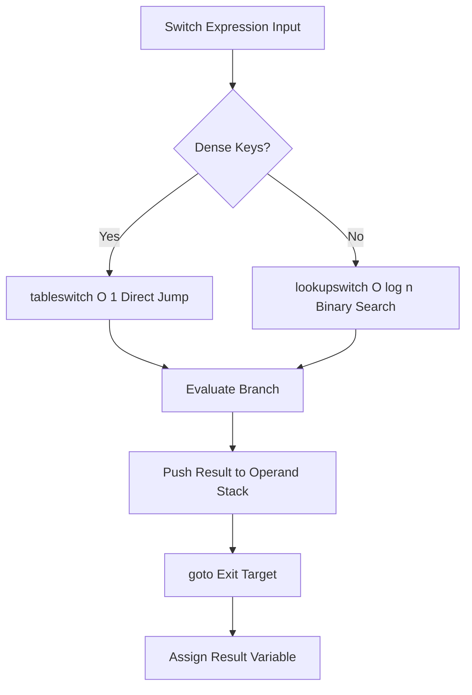

# Switch Expressions and Exhaustiveness

> Comprehensive guide to Switch Expressions (JEP 361): arrow syntax (`->`), yielding values (`yield`), expressions vs statements, exhaustive evaluation, and elimination of fall-through bugs.

| Metadata | Value |
|---|---|
| **Level** | Intermediate |
| **Prerequisites** | [01-fundamentals/06_control-flow.md](../01-fundamentals/06_control-flow.md), [04-oop/11_enums.md](../04-oop/11_enums.md), [02_sealed-classes.md](02_sealed-classes.md) |
| **Time to Read** | 24 minutes |
| **Status** | Active |
| **Java Version** | Java 12/13 Preview, Java 14 Final (JEP 361), Java 21 Pattern Matching Integration |

---

## Table of Contents
1. [What & Why](#1-what--why)
2. [Core Concepts](#2-core-concepts)
3. [How It Works Internally](#3-how-it-works-internally)
4. [Syntax & Usage](#4-syntax--usage)
5. [Practical Examples](#5-practical-examples)
6. [Best Practices](#6-best-practices)
7. [Common Mistakes & Pitfalls](#7-common-mistakes--pitfalls)
8. [Performance & Security Notes](#8-performance--security-notes)
9. [Comparison / When to Use What](#9-comparison--when-to-use-what)
10. [Interview Questions](#10-interview-questions)
11. [Practice Exercises](#11-practice-exercises)
12. [Summary / Cheat Sheet](#12-summary--cheat-sheet)
13. [Further Reading](#13-further-reading)

---

## 1. What & Why

### The Flaws of Classic Switch Statements
Classic Java `switch` statements inherited the low-level semantics of C (1970s):
- **Accidental Fall-Through**: If a developer forgot a `break;` statement, execution fell through into subsequent labels, causing subtle logic bugs and security flaws.
- **Statement-Only Nature**: Classic switch was a statement, not an expression. To compute and return a value, developers had to declare a mutable variable outside the switch, assign it inside each case, break, and return it after the block.
- **Scope Pollution**: Variable declarations inside one case block were visible throughout the entire switch body.
- **No Exhaustiveness Guarantee**: If a new enum constant was introduced, classic switch quietly did nothing or hit an uninformative default, failing silently at runtime.

### The Modern Solution: Switch Expressions (JEP 361)
Standardized in Java 14, **Switch Expressions** upgrade `switch` into a first-class functional construct:
- Can be used as either an expression (producing a value) or a statement.
- Introduces arrow syntax (`case X -> ...`) that **completely eliminates accidental fall-through**.
- Introduces the `yield` keyword to return values from complex multi-statement case blocks.
- Compiler enforces **strict exhaustiveness** for enums and sealed types.

---

## 2. Core Concepts

### Arrow Syntax (`->`) vs Colon Syntax (`:`)
- **Arrow Syntax (`case L -> ...`)**: Executes *only* the expression, block, or throw on the right-hand side. No `break` statement is required, and execution never falls through to the next case.
- **Colon Syntax (`case L: ...`)**: Preserves legacy fall-through semantics. When used as an expression, values must be returned using `yield value;`.

### The `yield` Keyword
`yield` is a contextual keyword used to produce a value from a multi-line case block within a switch expression. It acts like `return`, but only exits the enclosing switch expression:
```java
int result = switch (mode) {
    case FAST -> 1;
    case ADVANCED -> {
        int temp = calculateComplexity();
        yield temp * 2; // Produces value for the switch expression
    }
};
```

### Expression vs Statement
- **Switch Statement**: Executed purely for side effects (`System.out.println()`). Does not yield a value. Exhaustiveness is optional.
- **Switch Expression**: Evaluates to a value (`var x = switch(...)`). Must be **exhaustive**—the compiler guarantees that every possible input value produces a result or throws an exception.

### Multi-Label Matching
Multiple matching labels can be combined with commas on a single line:
```java
case MONDAY, FRIDAY, SUNDAY -> 6;
```

---

## 3. How It Works Internally

### Bytecode Compilation: `tableswitch` vs `lookupswitch`
At the JVM bytecode level, the compiler maps switch expressions to either:
1. **`tableswitch`**: Used when case values are dense integers (e.g., 1, 2, 3, 4). Implemented as an $O(1)$ direct array index jump table.
2. **`lookupswitch`**: Used when case values are sparse (e.g., 10, 1000, 50000). Implemented as a sorted table with binary search ($O(\log n)$).

### Expression Yield Lowering
In a switch expression, the compiler ensures every branch leaves a single value of the target type on the top of the JVM operand stack before jumping to the common exit instruction (`goto`).



---

## 4. Syntax & Usage

### Basic Switch Expression with Arrow Syntax
```java
public class DayClassifier {
    public enum Day { MON, TUE, WED, THU, FRI, SAT, SUN }

    public static String classify(Day day) {
        return switch (day) {
            case MON, TUE, WED, THU, FRI -> "Weekday";
            case SAT, SUN -> "Weekend";
        }; // Semicolon required because it terminates the return statement
    }
}
```

### Switch Expression with `yield` in Multi-Line Blocks
```java
public class YieldExample {
    public static int parseCode(String code) {
        return switch (code) {
            case "OK", "SUCCESS" -> 200;
            case "NOT_FOUND" -> 404;
            default -> {
                int defaultCode = 500;
                System.err.println("Unrecognized status code: " + code + ", defaulting to " + defaultCode);
                yield defaultCode;
            }
        };
    }
}
```

---

## 5. Practical Examples

### Example 1: Calculating Days in Month
```java
// Goal: Compute leap-year aware day counts cleanly
import java.time.Month;

public class DaysInMonthDemo {
    public static int getDays(Month month, boolean isLeapYear) {
        return switch (month) {
            case JANUARY, MARCH, MAY, JULY, AUGUST, OCTOBER, DECEMBER -> 31;
            case APRIL, JUNE, SEPTEMBER, NOVEMBER -> 30;
            case FEBRUARY -> isLeapYear ? 29 : 28;
        };
    }

    public static void main(String[] args) {
        System.out.println("Feb in leap year: " + getDays(Month.FEBRUARY, true));
        System.out.println("July days: " + getDays(Month.JULY, false));
    }
}
```
*Output:*
```
Feb in leap year: 29
July days: 31
```
*Explanation:* Clean, readable, and exhaustive. If a new month were ever added to `java.time.Month`, the compiler would fail the build immediately.

### Example 2: Real-World HTTP Status Code Router
```java
// Goal: Map HTTP status code ranges to business severity levels
public class HttpStatusRouter {
    public enum HttpCategory { INFORMATIONAL, SUCCESS, REDIRECTION, CLIENT_ERROR, SERVER_ERROR, UNKNOWN }

    public static HttpCategory categorize(int statusCode) {
        return switch (statusCode / 100) {
            case 1 -> HttpCategory.INFORMATIONAL;
            case 2 -> HttpCategory.SUCCESS;
            case 3 -> HttpCategory.REDIRECTION;
            case 4 -> HttpCategory.CLIENT_ERROR;
            case 5 -> HttpCategory.SERVER_ERROR;
            default -> HttpCategory.UNKNOWN;
        };
    }
}
```

### Example 3: Edge Case: Mixing Arrow and Colon Syntax is Prohibited
```java
// Goal: Highlight compilation error on mixed switch syntax
public class MixedSyntaxHazard {
    public static void test(int x) {
        // COMPILE ERROR:
        // Different case kinds used in the same switch
        /*
        switch (x) {
            case 1 -> System.out.println("One");
            case 2: System.out.println("Two"); break;
        }
        */
    }
}
```
*Explanation:* A switch statement or expression must consistently use either arrow syntax (`->`) or colon syntax (`:`). Mixing them in the same switch is a compile-time error.

### Example 4: Failure Case: Missing Exhaustiveness in Switch Expression
```java
// Goal: Demonstrate compiler enforcement of exhaustiveness
enum Priority { LOW, MEDIUM, HIGH }

public class IncompleteSwitchDemo {
    public static int getScore(Priority p) {
        // COMPILE ERROR:
        // 'switch' expression does not cover all possible input values (HIGH missing)
        /*
        return switch (p) {
            case LOW -> 10;
            case MEDIUM -> 50;
        };
        */
        return 0;
    }
}
```
*Explanation:* In switch expressions, all possible domain values must be covered, or a `default` case provided.

---

## 6. Best Practices
1. **Always Prefer Arrow Syntax (`->`)**: Standardize on arrow syntax to permanently eliminate accidental fall-through bugs.
2. **Omit `default` on Enums and Sealed Types**: Let the compiler enforce exhaustiveness. If a new enum constant or sealed subtype is introduced, compilation will fail, alerting you to update the handler.
3. **Keep Case Bodies Concise**: If a case branch requires extensive logic, delegate to a private helper method rather than embedding large multi-line blocks with `yield`.
4. **Combine Identical Handlers**: Group multiple comma-separated case labels together (`case A, B, C -> ...`) to eliminate duplicate code blocks.
5. **Use `yield` Only in Multi-Line Blocks**: Single expressions on the right of `->` do not require `yield`.

---

## 7. Common Mistakes & Pitfalls

| Mistake | Why Wrong | Fix |
|---|---|---|
| Forgetting semicolon after switch expression | Switch expressions assigned to variables or returned are statements that must end with `;`. | Add `;` after the closing brace of the switch expression. |
| Using `return` instead of `yield` in case block | `return` exits the entire enclosing method, not just the switch expression. | Use `yield value;` to exit the switch expression. |
| Mixing `->` and `:` in the same switch | The compiler strictly forbids mixing arrow and colon styles in one switch. | Standardize entirely on `case X ->`. |
| Adding unnecessary `default:` on enums | Masking future compiler warnings when new enum constants are added. | Remove `default:` and explicitly handle all enum cases. |
| Accidental fall-through with colon syntax | Colon syntax still falls through unless explicit `break` or `yield` is present. | Switch to arrow syntax (`->`). |
| Forgetting that switch expressions require a value on every branch | A branch that ends without yielding a value causes a compile error. | Ensure every branch produces a value or throws an exception. |

---

## 8. Performance & Security Notes

### Elimination of Fall-Through Vulnerabilities
Historically, missing `break;` statements in C and classic Java have led to high-severity security vulnerabilities (such as bypasses in authentication state machines). Arrow syntax guarantees that execution exits immediately after evaluating the target branch, eliminating this entire class of bugs.

### Constant Folding and Optimization
Because switch expressions guarantee single-point value evaluation, the HotSpot C2 compiler can aggressively inline switch expression branches and perform constant folding when input variables are known compile-time constants.

---

## 9. Comparison / When to Use What

| Feature | Modern Switch Expression (`->`) | Classic Switch Statement (`:`) | If-Else-If Chain |
|---|---|---|---|
| **Returns a Value** | Yes (`var x = switch(...)`) | No (Requires external var) | No (Requires external var) |
| **Fall-Through** | Impossible | Yes (Default behavior) | Impossible |
| **Exhaustiveness** | Compiler Enforced | Optional | Optional |
| **Syntax Style** | Compact, functional | Verbose, procedural | Verbose |
| **Recommended Use** | Default for all modern code | Legacy code maintenance | Boolean conditions |

---

## 10. Interview Questions

<details>
<summary>1. What are the key improvements of Switch Expressions (JEP 361)?</summary>
Switch expressions allow `switch` to be used as an expression producing a value, introduce arrow syntax (`->`) that eliminates accidental fall-through, support multi-label cases (`case A, B ->`), introduce `yield` for multi-line blocks, and enforce compile-time exhaustiveness.
</details>

<details>
<summary>2. What is the purpose of the `yield` keyword?</summary>
`yield` is a contextual keyword used within a block of a switch expression to yield a result value back to the caller, similar to how `return` yields a value from a method.
</details>

<details>
<summary>3. Can arrow syntax (`->`) fall through to the next case?</summary>
No. Arrow syntax strictly evaluates only the single expression, block, or throw on its right-hand side. It is physically impossible for execution to fall through to the next case.
</details>

<details>
<summary>4. Why should you avoid adding a `default` branch when switching over an Enum?</summary>
If you handle all enum constants explicitly without `default`, adding a new constant to the enum will cause a compilation error wherever that enum is switched over. This forces developers to handle the new constant everywhere, preventing silent runtime bugs.
</details>

<details>
<summary>5. Can you mix arrow syntax (`->`) and colon syntax (`:`) in the same switch?</summary>
No. The Java compiler strictly forbids mixing the two syntax styles within the same switch block.
</details>

<details>
<summary>6. Is `yield` a reserved keyword in Java?</summary>
No, `yield` is a contextual keyword (restricted identifier). You can still declare variables or methods named `yield` without compilation errors outside of switch expressions.
</details>

<details>
<summary>7. How does the compiler verify exhaustiveness in switch expressions?</summary>
For numeric types and strings, a `default` case is required. For enums and sealed classes/interfaces, the compiler inspects all constants/subtypes; if every possible variant is covered, the switch is considered exhaustive without requiring `default`.
</details>

<details>
<summary>8. How does the JVM optimize switch execution at runtime?</summary>
The compiler generates either `tableswitch` (an $O(1)$ index jump table for dense keys) or `lookupswitch` (a binary search jump table for sparse keys), optimizing execution performance far beyond long chains of `if-else` comparisons.
</details>

---

## 11. Practice Exercises

### Exercise 1 (Easy): Basic Traffic Signal Timing
- **Task**: Write a switch expression that takes an enum `TrafficSignal { RED, YELLOW, GREEN }` and returns the duration in seconds: RED = 60, YELLOW = 5, GREEN = 45.
<details>
<summary>Solution</summary>

```java
public class TrafficSignalTiming {
    public enum TrafficSignal { RED, YELLOW, GREEN }

    public static int getDuration(TrafficSignal signal) {
        return switch (signal) {
            case RED -> 60;
            case YELLOW -> 5;
            case GREEN -> 45;
        };
    }
}
```
</details>

### Exercise 2 (Medium): Multi-line Calculator with `yield`
- **Task**: Implement an arithmetic evaluator using a switch expression that takes an `Operation { ADD, SUBTRACT, MULTIPLY, DIVIDE }` and two integers, logging the operation and using `yield` for division to guard against division by zero.
<details>
<summary>Solution</summary>

```java
public class SafeCalculator {
    public enum Operation { ADD, SUBTRACT, MULTIPLY, DIVIDE }

    public static int calculate(Operation op, int a, int b) {
        return switch (op) {
            case ADD -> a + b;
            case SUBTRACT -> a - b;
            case MULTIPLY -> a * b;
            case DIVIDE -> {
                if (b == 0) {
                    throw new ArithmeticException("Cannot divide by zero");
                }
                yield a / b;
            }
        };
    }
}
```
</details>

### Exercise 3 (Hard): Comprehensive String Normalizer
- **Task**: Write a switch expression that takes an arbitrary HTTP method string (e.g. "GET", "post", "DELETE") and returns an enum `HttpMethod`, returning `HttpMethod.CUSTOM` for unrecognized strings, using `yield` and string transformation.
<details>
<summary>Solution</summary>

```java
public class HttpMethodParser {
    public enum HttpMethod { GET, POST, PUT, DELETE, PATCH, CUSTOM }

    public static HttpMethod parse(String rawMethod) {
        if (rawMethod == null) return HttpMethod.CUSTOM;
        return switch (rawMethod.trim().toUpperCase()) {
            case "GET" -> HttpMethod.GET;
            case "POST" -> HttpMethod.POST;
            case "PUT" -> HttpMethod.PUT;
            case "DELETE" -> HttpMethod.DELETE;
            case "PATCH" -> HttpMethod.PATCH;
            default -> {
                System.out.println("Encountered custom HTTP method: " + rawMethod);
                yield HttpMethod.CUSTOM;
            }
        };
    }
}
```
</details>

---

## 12. Summary / Cheat Sheet

```
+-----------------------------------------------------------------------------------------+
|                              SWITCH EXPRESSIONS CHEAT SHEET                             |
+-----------------------------------------------------------------------------------------+
| Expression Syntax        | var val = switch (x) { case A -> 1; case B -> 2; };          |
| Multi-label Case         | case MON, TUE, WED -> 10;                                    |
| Block with Yield         | case ADVANCED -> { int res = calc(); yield res * 2; }        |
| Fall-Through             | Arrow syntax ('->') NEVER falls through                      |
| Semicolon Requirement    | Semicolon required after the closing brace of an expression  |
| Exhaustiveness           | Enforced on all switch expressions (compiler error if gap)   |
| Bytecode Instructions    | tableswitch (O(1) table) or lookupswitch (O(log n) search)   |
+-----------------------------------------------------------------------------------------+
```

---

## 13. Further Reading
- [JEP 361: Switch Expressions (Standardized in Java 14)](https://openjdk.org/jeps/361)
- Java Language Specification — Section 14.11 (The Switch Statement and Expression)
- Inside Java Podcast: Switch Expressions and Pattern Matching Deep Dive
