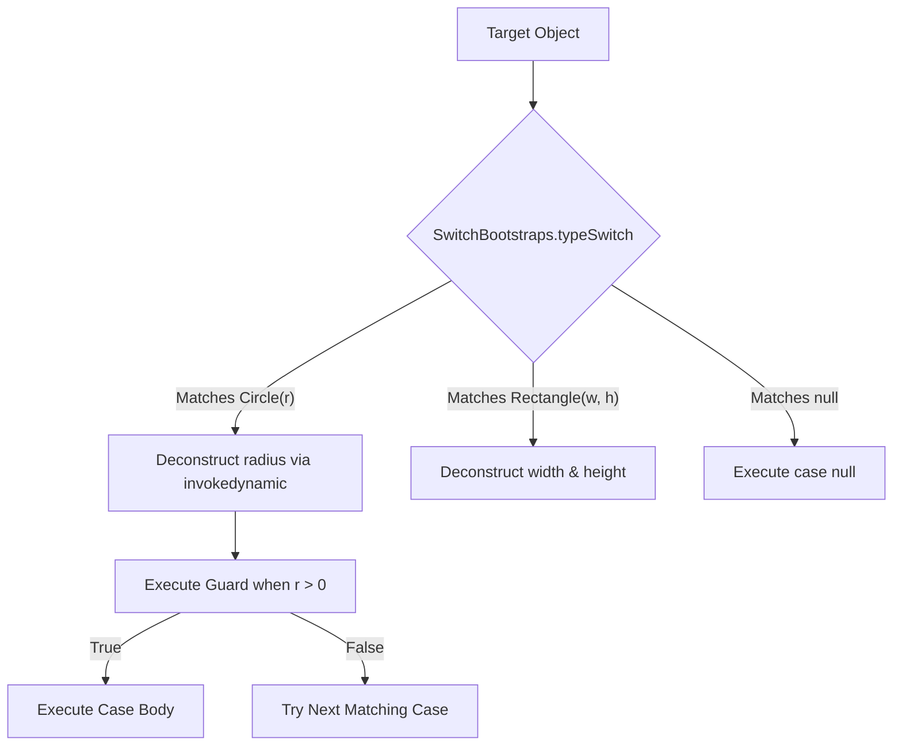

# Pattern Matching and Record Patterns

> The definitive guide to Java Pattern Matching: Pattern Matching for `instanceof` (JEP 394), Pattern Matching for `switch` (JEP 441), Record Patterns and Deconstruction (JEP 440), Guarded Patterns (`when`), and Unnamed Patterns (JEP 456).

| Metadata | Value |
|---|---|
| **Level** | Advanced |
| **Prerequisites** | [01_records.md](01_records.md), [02_sealed-classes.md](02_sealed-classes.md), [03_switch-expressions.md](03_switch-expressions.md) |
| **Time to Read** | 28 minutes |
| **Status** | Active |
| **Java Version** | Java 16 (instanceof JEP 394), Java 21 (switch JEP 441, records JEP 440), Java 22 (Unnamed Patterns JEP 456) |

---

## Table of Contents
1. [What & Why](#1-what--why)
2. [Core Concepts](#2-core-concepts)
3. [How It Works Internally](#3-how-it-works-internally)
4. [Syntax & Usage](#4-syntax--usage)
5. [Practical Examples](#5-practical-examples)
6. [Best Practices](#6-best-practices)
7. [Common Mistakes & Pitfalls](#7-common-mistakes--pitfalls)
8. [Performance & Security Notes](#8-performance--security-notes)
9. [Comparison / When to Use What](#9-comparison--when-to-use-what)
10. [Interview Questions](#10-interview-questions)
11. [Practice Exercises](#11-practice-exercises)
12. [Summary / Cheat Sheet](#12-summary--cheat-sheet)
13. [Further Reading](#13-further-reading)

---

## 1. What & Why

### The Tedium of Casting and Type Discrimination
In traditional Java, handling heterogeneous objects required repetitive, error-prone boilerplate:
```java
if (obj instanceof String) {
    String s = (String) obj; // Redundant manual cast!
    System.out.println(s.length());
}
```
Developers had to test the type with `instanceof`, declare a new variable, and cast the object manually. If the type changed or was cast incorrectly, runtime `ClassCastException` crashed the application.

### The Solution: Pattern Matching
Pattern matching integrates a **predicate test** on a target with **conditional variable extraction (binding)**.
- **Java 16 (JEP 394)**: Pattern Matching for `instanceof`.
- **Java 21 (JEP 441)**: Pattern Matching for `switch` (type patterns, null handling).
- **Java 21 (JEP 440)**: Record Patterns (deconstructing nested components).
- **Java 22 (JEP 456)**: Unnamed Patterns and Variables (`_`).

Together with Sealed Classes and Records, Pattern Matching brings full **Data-Oriented Programming** to Java.

---

## 2. Core Concepts

### Pattern Anatomy
A pattern consists of:
1. A **test (predicate)** against an expression.
2. Zero or more **pattern variables (bindings)** that are extracted and in-scope only when the test succeeds.

### Flow Scoping
Pattern variables use **flow scoping** (definite assignment analysis). A pattern variable is only in scope where the compiler can prove the pattern has matched:
```java
if (obj instanceof String s && s.length() > 5) {
    // 's' is in scope here because '&&' short-circuits if false
    System.out.println(s.toUpperCase());
}
// 's' is NOT in scope here!
```
Conversely, with `||`:
```java
// COMPILE ERROR: 's' might not have matched!
// if (obj instanceof String s || s.length() > 5) ...
```

### Guarded Patterns (`when` Clause)
When switching over patterns, you can refine the match with a boolean guard using the `when` keyword:
```java
case String s when s.length() > 10 -> "Long string: " + s;
case String s -> "Short string: " + s;
```

### Record Patterns and Nested Deconstruction
Record patterns unpack the components of a record directly into local variables:
```java
record Point(int x, int y) {}

if (obj instanceof Point(int x, int y)) {
    System.out.println("x: " + x + ", y: " + y);
}
```
Record patterns can be nested arbitrarily deep (e.g. `Rectangle(Point(int x1, int y1), Point(int x2, int y2))`).

### Unnamed Patterns (`_`) (JEP 456)
When deconstructing complex records where certain components are not needed, the underscore `_` discards unused components:
```java
case Customer(String name, _, _) -> System.out.println("Customer: " + name);
```

---

## 3. How It Works Internally

### Flow Scoping and Definite Assignment
The Java compiler tracks variable availability through Flow Analysis. If the `instanceof` check is negated:
```java
if (!(obj instanceof String s)) {
    return; // Early exit
}
// Because of early exit, 's' is definitely assigned and in scope here!
System.out.println(s.toLowerCase());
```

### Switch Pattern Matching Lowering
Under the hood, pattern matching switch does not rely on simple integer `tableswitch`. Instead, the compiler generates calls to `java.lang.runtime.SwitchBootstraps.typeSwitch`, which optimizes type hierarchy checks dynamically using JVM indy call sites.



---

## 4. Syntax & Usage

### Pattern Matching with `instanceof`
```java
public class InstanceOfDemo {
    public static void printDetails(Object obj) {
        if (obj instanceof String s) {
            System.out.println("String length: " + s.length());
        } else if (obj instanceof Integer i) {
            System.out.println("Integer square: " + (i * i));
        } else if (obj instanceof List<?> list && !list.isEmpty()) {
            System.out.println("First element: " + list.get(0));
        }
    }
}
```

### Pattern Matching `switch` with Null Handling and Guards
```java
public class SwitchPatternDemo {
    public static String formatValue(Object obj) {
        return switch (obj) {
            case null -> "NULL_VALUE";
            case Integer i when i < 0 -> "Negative integer: " + i;
            case Integer i -> "Positive integer: " + i;
            case String s when s.isBlank() -> "Blank string";
            case String s -> "Text: " + s.trim();
            default -> "Unknown type: " + obj.getClass().getSimpleName();
        };
    }
}
```

---

## 5. Practical Examples

### Example 1: Nested Record Pattern Matching
```java
// Goal: Deconstruct nested records in a single pattern step
public class NestedRecordDemo {
    record Location(String city, String country) {}
    record Company(String name, Location location) {}
    record Employee(String name, Company company) {}

    public static void printEmployeeOrigin(Employee emp) {
        if (emp instanceof Employee(String empName, Company(String compName, Location(String city, String country)))) {
            System.out.println(empName + " works at " + compName + " in " + city + ", " + country);
        }
    }

    public static void main(String[] args) {
        Employee e = new Employee("Alice", new Company("Acme Corp", new Location("Tokyo", "Japan")));
        printEmployeeOrigin(e);
    }
}
```
*Output:*
```
Alice works at Acme Corp in Tokyo, Japan
```

### Example 2: Algebraic Data Type Pipeline with Sealed Interface
```java
// Goal: Model and process an e-commerce discount policy
sealed interface Discount permits PercentageDiscount, FixedDiscount, FreeShipping {}

record PercentageDiscount(double percent) implements Discount {}
record FixedDiscount(double amount) implements Discount {}
record FreeShipping(double minimumOrder) implements Discount {}

public class DiscountEngine {
    public static double apply(Discount discount, double orderTotal) {
        return switch (discount) {
            case PercentageDiscount(double p) -> orderTotal * (1.0 - (p / 100.0));
            case FixedDiscount(double a) -> Math.max(0.0, orderTotal - a);
            case FreeShipping(double min) when orderTotal >= min -> orderTotal; // Free shipping applies
            case FreeShipping(_) -> orderTotal + 15.0; // Standard shipping fee added
        };
    }

    public static void main(String[] args) {
        System.out.println("20% off $100: " + apply(new PercentageDiscount(20), 100));
        System.out.println("$15 off $50: " + apply(new FixedDiscount(15), 50));
    }
}
```
*Output:*
```
20% off $100: 80.0
$15 off $50: 35.0
```

### Example 3: Edge Case: Dominance and Order of Cases
```java
// Goal: Demonstrate compile error when a general pattern shadows a specific pattern
public class DominanceHazard {
    public static void test(Object obj) {
        /*
        switch (obj) {
            case CharSequence cs -> System.out.println("CharSequence: " + cs);
            case String s -> System.out.println("String: " + s); // COMPILE ERROR: dominated by CharSequence!
            default -> {}
        }
        */
    }
}
```
*Explanation:* More specific patterns must always precede broader supertype patterns, or the compiler reports a **Pattern Dominance** error.

### Example 4: Unnamed Variables in Record Patterns (Java 22 JEP 456)
```java
// Goal: Ignore unnecessary components using underscore '_'
record SensorReading(String sensorId, long timestamp, double temperature, double humidity) {}

public class SensorProcessor {
    public static void checkOverheat(SensorReading reading) {
        // Only inspect sensorId and temperature, ignore timestamp and humidity
        if (reading instanceof SensorReading(String id, _, double temp, _) && temp > 75.0) {
            System.err.println("ALERT: Sensor " + id + " overheated at " + temp + "C!");
        }
    }
}
```

---

## 6. Best Practices
1. **Combine Sealed Hierarchies with Pattern Switch**: Eliminates `default:` and lets the compiler guarantee exhaustive handling across the domain.
2. **Order Specific Patterns Before General Ones**: Always position specific types and guarded cases before broader fallback cases to satisfy dominance rules.
3. **Use Record Patterns for Deconstruction**: Avoid extracting components with manual accessor calls (`p.x()`); deconstruct records directly in `case Point(var x, var y)`.
4. **Explicitly Handle `case null`**: Include `case null` in pattern switches when null values represent a valid input state; otherwise, unhandled nulls throw `NullPointerException`.
5. **Use Unnamed Patterns (`_`) for Clean Code**: Discard irrelevant tuple/record components with `_` to emphasize the data that actually matters.

---

## 7. Common Mistakes & Pitfalls

| Mistake | Why Wrong | Fix |
|---|---|---|
| Dominance violation (general case before specific) | Supertype case matches first, making the subtype case unreachable dead code. | Place specific subtypes or guarded cases before broader supertypes. |
| Neglecting `case null` in pattern switch | Pattern switches throw `NullPointerException` immediately if input is `null` unless `case null` is present. | Add `case null -> ...` or ensure input is non-null. |
| Accessing pattern variable out of flow scope | Pattern variable is only in scope where match is guaranteed true. | Check flow scoping rules; ensure variable is referenced inside the matched branch. |
| Using `||` with pattern matching | If first condition is false, pattern variable was not assigned, so second operand cannot access it. | Use `&&` to chain conditions on pattern variables. |
| Overcomplicating guards with heavy side effects | Guards in `when` clauses should be pure boolean functions. Side effects during pattern evaluation can cause subtle race conditions. | Keep `when` expressions idempotent and pure. |

---

## 8. Performance & Security Notes

### Elimination of ClassCastException
Pattern matching guarantees compile-time verified casting. It is impossible to encounter a `ClassCastException` from an evaluated pattern variable, closing a major source of production runtime crashes.

### Indy TypeSwitch Optimization
Modern JDKs compile pattern switches via invokedynamic calls to `SwitchBootstraps.typeSwitch`. The JVM tracks type distributions and dynamically generates optimized type tests, avoiding cascading linear `if (x instanceof A) ... else if (x instanceof B)` inspection loops.

---

## 9. Comparison / When to Use What

| Feature | Pattern Matching `instanceof` | Pattern Matching `switch` | Traditional Visitor Pattern |
|---|---|---|---|
| **Best For** | Single type checks | Multi-branch type dispatch | Complex hierarchical AST walking |
| **Boilerplate** | Minimal | Very low | Very high (accept/visit methods) |
| **Exhaustiveness** | No | Yes (with sealed types) | Yes (interface contract) |
| **Adding New Types** | Easy | Compiler flags missing cases | Must edit Visitor interface |
| **Null Safe** | Evaluates to `false` | Explicit `case null` | Requires null checks |

---

## 10. Interview Questions

<details>
<summary>1. What is Flow Scoping in Java pattern matching?</summary>
Flow scoping means a pattern variable is only in scope in the exact code paths where the compiler can prove the pattern has successfully matched. For example, in `if (obj instanceof String s && s.length() > 0)`, `s` is in scope for the second condition because `&&` only evaluates if the first operand is true.
</details>

<details>
<summary>2. How does pattern matching handle `null` in `switch`?</summary>
In classic switch, passing `null` threw `NullPointerException` immediately. In pattern matching switch, developers can explicitly declare `case null -> ...` or `case null, default -> ...` to handle null cleanly. If neither is present, passing `null` still throws NPE.
</details>

<details>
<summary>3. What is Pattern Dominance?</summary>
Pattern dominance is a compile-time error that occurs when an earlier case pattern in a switch completely covers (shadows) a subsequent case pattern, making the later case unreachable. For example, `case Object o` dominates `case String s`.
</details>

<details>
<summary>4. What are Guarded Patterns and how are they written?</summary>
Guarded patterns refine a type pattern with an additional boolean condition using the `when` clause: `case String s when s.length() > 5 -> ...`. The case only matches if both the type matches and the boolean expression evaluates to true.
</details>

<details>
<summary>5. What are Record Patterns (JEP 440)?</summary>
Record patterns allow matching a record type and deconstructing its components into individual variables in one step: `if (obj instanceof Point(int x, int y)) { ... }`.
</details>

<details>
<summary>6. What are Unnamed Patterns and Variables (JEP 456)?</summary>
Introduced in Java 22, the underscore `_` denotes an unnamed pattern or variable, indicating that the matched component or exception variable is intentionally discarded and will not be used.
</details>

<details>
<summary>7. Can you use `var` inside Record Patterns?</summary>
Yes. You can write `case Point(var x, var y) -> ...`, and the compiler will infer the component types from the record header.
</details>

<details>
<summary>8. How does pattern matching replace the classic Visitor Pattern?</summary>
The Visitor pattern was used to achieve double dispatch and simulate pattern matching over object hierarchies, requiring `accept()` methods on every class. Sealed classes combined with pattern matching `switch` provide identical type safety and exhaustiveness without polluting domain classes with visitor infrastructure.
</details>

---

## 11. Practice Exercises

### Exercise 1 (Easy): Basic Type Pattern Extraction
- **Task**: Write a method that accepts an `Object` and returns its string representation: if it is a `String`, return it in uppercase; if an `Integer`, return its value multiplied by 2; otherwise, return `"OTHER"`.
<details>
<summary>Solution</summary>

```java
public class TypePatternExercise {
    public static String process(Object obj) {
        return switch (obj) {
            case String s -> s.toUpperCase();
            case Integer i -> String.valueOf(i * 2);
            default -> "OTHER";
        };
    }
}
```
</details>

### Exercise 2 (Medium): Nested Geometric Shape Deconstruction
- **Task**: Model `Point(double x, double y)` and `Circle(Point center, double radius)`. Write a method using nested record patterns that returns true if the circle is centered at the origin `(0, 0)`.
<details>
<summary>Solution</summary>

```java
public class CircleOriginCheck {
    public record Point(double x, double y) {}
    public record Circle(Point center, double radius) {}

    public static boolean isCenteredAtOrigin(Object shape) {
        return shape instanceof Circle(Point(double x, double y), _) && x == 0.0 && y == 0.0;
    }
}
```
</details>

### Exercise 3 (Hard): Comprehensive JSON Parser Dispatcher
- **Task**: Given the sealed hierarchy `JsonValue` (`JsonObject`, `JsonArray`, `JsonString`, `JsonNumber`, `JsonBoolean`, `JsonNull`), write an exhaustive switch pattern method that formats any `JsonValue` to a compact string.
<details>
<summary>Solution</summary>

```java
import java.util.*;
import java.util.stream.Collectors;

public class JsonFormatter {
    public sealed interface JsonValue permits JsonObject, JsonArray, JsonString, JsonNumber, JsonBoolean, JsonNull {}
    public record JsonObject(Map<String, JsonValue> map) implements JsonValue {}
    public record JsonArray(List<JsonValue> list) implements JsonValue {}
    public record JsonString(String val) implements JsonValue {}
    public record JsonNumber(double val) implements JsonValue {}
    public record JsonBoolean(boolean val) implements JsonValue {}
    public enum JsonNull implements JsonValue { INSTANCE }

    public static String stringify(JsonValue json) {
        return switch (json) {
            case JsonNull.INSTANCE -> "null";
            case JsonBoolean(boolean b) -> String.valueOf(b);
            case JsonNumber(double d) -> (d == (long) d) ? String.valueOf((long) d) : String.valueOf(d);
            case JsonString(String s) -> "\"" + s + "\"";
            case JsonArray(List<JsonValue> list) -> "[" + list.stream().map(JsonFormatter::stringify).collect(Collectors.joining(",")) + "]";
            case JsonObject(Map<String, JsonValue> map) -> "{" + map.entrySet().stream()
                .map(e -> "\"" + e.getKey() + "\":" + stringify(e.getValue()))
                .collect(Collectors.joining(",")) + "}";
        };
    }
}
```
</details>

---

## 12. Summary / Cheat Sheet

```
+-----------------------------------------------------------------------------------------+
|                               PATTERN MATCHING CHEAT SHEET                              |
+-----------------------------------------------------------------------------------------+
| instanceof Pattern       | if (obj instanceof String s) { s.length(); }                 |
| Switch Type Pattern      | case Integer i -> i * 2;                                     |
| Guarded Pattern          | case String s when s.length() > 5 -> s.trim();               |
| Null in Switch           | case null -> "NULL"; / case null, default -> ...             |
| Record Pattern           | case Point(int x, int y) -> x + y;                           |
| Nested Record Pattern    | case Rect(Point(int x1, int y1), Point(int x2, int y2))      |
| Unnamed Pattern (Java 22)| case Customer(String name, _, _) -> name;                    |
| Dominance Rule           | Specific patterns must precede general supertype patterns    |
+-----------------------------------------------------------------------------------------+
```

---

## 13. Further Reading
- [JEP 394: Pattern Matching for instanceof](https://openjdk.org/jeps/394)
- [JEP 441: Pattern Matching for switch](https://openjdk.org/jeps/441)
- [JEP 440: Record Patterns](https://openjdk.org/jeps/440)
- [JEP 456: Unnamed Variables & Patterns](https://openjdk.org/jeps/456)
