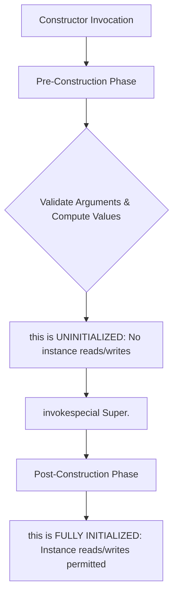

# Modern Language Enhancements (Java 21 to Java 25 LTS)

> In-depth exploration of the latest Java language enhancements leading up to and finalized in Java 25 LTS: Flexible Constructor Bodies (JEP 513), Compact Source Files and Instance Main Methods (JEP 512), Module Import Declarations (JEP 511), and Modern Syntax Evolution.

| Metadata | Value |
|---|---|
| **Level** | Advanced |
| **Prerequisites** | [01_records.md](01_records.md), [04_pattern-matching.md](04_pattern-matching.md), [05-packages-and-modules/02_java-modules.md](../05-packages-and-modules/02_java-modules.md) |
| **Time to Read** | 26 minutes |
| **Status** | Active |
| **Java Version** | Java 21 to Java 25 LTS (Oracle JDK 25 LTS baseline) |

---

## Table of Contents
1. [What & Why](#1-what--why)
2. [Core Concepts](#2-core-concepts)
3. [How It Works Internally](#3-how-it-works-internally)
4. [Syntax & Usage](#4-syntax--usage)
5. [Practical Examples](#5-practical-examples)
6. [Best Practices](#6-best-practices)
7. [Common Mistakes & Pitfalls](#7-common-mistakes--pitfalls)
8. [Performance & Security Notes](#8-performance--security-notes)
9. [Comparison / When to Use What](#9-comparison--when-to-use-what)
10. [Interview Questions](#10-interview-questions)
11. [Practice Exercises](#11-practice-exercises)
12. [Summary / Cheat Sheet](#12-summary--cheat-sheet)
13. [Further Reading](#13-further-reading)

---

## 1. What & Why

### The Legacy Ceremonies of Java
Over decades of evolution, certain historic restrictions in Java created unnatural programming idioms:
1. **The `super()` First Restriction**: In subclasses, `super(...)` or `this(...)` was required to be the very first statement of any constructor. Developers could not validate arguments, transform inputs, or prepare state before delegating to the superclass constructor without resorting to hacky static helper methods.
2. **Beginner and Scripting Friction**: Even a 1-line "Hello World" required declaring a public class matching the filename and an arcane `public static void main(String[] args)` method with unused array parameters.
3. **Module Import Fatigue**: Modern modular applications required dozens of individual `import` lines for basic packages.

### Modern Solutions in Java 25 LTS
1. **Flexible Constructor Bodies (JEP 513 / JEP 482)**: Statements are now officially permitted **before** an explicit constructor invocation (`super()` or `this()`), allowing argument validation, preparation, and calculation in the pre-construction context.
2. **Compact Source Files and Instance Main Methods (JEP 512 / JEP 495 / JEP 477)**: Streamlines program entry points, permitting instance `void main()` methods without static modifiers or `String[]` parameters, inside unnamed classes.
3. **Module Import Declarations (JEP 511 / JEP 494 / JEP 476)**: Enables importing all public top-level packages of an entire module with a single concise line: `import module java.base;`.

---

## 2. Core Concepts

### Flexible Constructor Bodies (JEP 513)
Prior to Java 22/25, code like this failed compilation:
```java
public class SubClass extends SuperClass {
    public SubClass(int x) {
        if (x < 0) throw new IllegalArgumentException(); // COMPILE ERROR in Java 8-21!
        super(x);
    }
}
```
**In Java 25 LTS**, code is partitioned into two distinct constructor phases:
- **Pre-Construction Context**: Statements executing before `super(...)`. In this context, code cannot reference `this` (instance fields, instance methods) to prevent accessing uninitialized memory, but can validate arguments, compute values, and initialize static state.
- **Post-Construction Context**: Statements executing after `super(...)`. Full access to `this` is enabled.

### Compact Source Files and Instance Main Methods (JEP 512)
Java 25 reduces boilerplate for beginners, utilities, and lightweight CLI microservices:
- `void main()` can be an instance method (non-`static`).
- Parameter `String[] args` is optional if arguments are unused.
- The class declaration itself can be omitted in single-file source execution:
```java
// Legal standalone Java 25 program!
void main() {
    println("Hello, Java 25 LTS!");
}
```

### Module Import Declarations (JEP 511)
Instead of importing multiple individual packages (`import java.util.*; import java.io.*; import java.nio.file.*;`), developers can import all public classes in every package exported by a module:
```java
import module java.base;

void main() {
    List<String> list = List.of("A", "B");
    Path p = Path.of("file.txt");
    Instant now = Instant.now();
}
```

---

## 3. How It Works Internally

### JVM Verification and `<init>` Bytecode Evolution
Historically, the JVM bytecode verifier enforced the rule that no instruction in a constructor `<init>` method could precede the `invokespecial` call to `super.<init>`.
In modern JDKs, the JVM specification was updated:
- The verifier allows arbitrary stack operations, arithmetic, and static method invocations before `invokespecial`.
- The verifier strictly enforces that `aload_0` (`this`) is **uninitialized** in the pre-construction context. Any attempt to read or write instance fields or pass `this` to methods before `invokespecial` triggers a `VerifyError`.



---

## 4. Syntax & Usage

### Pre-Construction Argument Transformation
```java
public class EncryptedPayload extends RawPayload {
    private final String algorithm;

    public EncryptedPayload(String rawData, String algorithm) {
        // Pre-construction validation and transformation
        if (rawData == null || rawData.isBlank()) {
            throw new IllegalArgumentException("Payload cannot be blank");
        }
        String encrypted = CryptoUtil.encrypt(rawData, algorithm);

        // Delegation to superconstructor after preparation
        super(encrypted);

        // Post-construction assignment
        this.algorithm = algorithm;
    }
}
```

### Module Import in Modern Applications
```java
// Import all packages in java.base module at once
import module java.base;

public class ModuleImportDemo {
    public static void main(String[] args) {
        // From java.util
        List<String> items = new ArrayList<>();
        // From java.time
        LocalDate today = LocalDate.now();
        // From java.nio.file
        Path path = Path.of("output.log");

        System.out.println("Today: " + today);
    }
}
```

---

## 5. Practical Examples

### Example 1: Validating Subclass Arguments Before Superclass Allocation
```java
// Goal: Prevent expensive superclass resource allocation when arguments are invalid
public class PositiveBigInteger extends Number {
    private final java.math.BigInteger value;

    public PositiveBigInteger(String val) {
        // Java 25 Flexible Constructor: validate before calling super!
        if (val == null || val.startsWith("-")) {
            throw new IllegalArgumentException("Must be strictly positive: " + val);
        }
        java.math.BigInteger parsed = new java.math.BigInteger(val);
        if (parsed.signum() <= 0) {
            throw new IllegalArgumentException("Value must be > 0");
        }

        super(); // Call Number()
        this.value = parsed;
    }

    @Override public int intValue() { return value.intValue(); }
    @Override public long longValue() { return value.longValue(); }
    @Override public float floatValue() { return value.floatValue(); }
    @Override public double doubleValue() { return value.doubleValue(); }
}
```
*Explanation:* In Java 8–21, developers had to pass validation down or invoke static helpers inside `super(...)`. Java 25 allows clean procedural validation first.

### Example 2: Minimalist CLI Tool via Compact Source (Java 25)
```java
// File: InspectSystem.java
// Run with: java InspectSystem.java
import module java.base;

void main(String[] args) {
    println("Java Runtime: " + System.getProperty("java.version"));
    println("Available Processors: " + Runtime.getRuntime().availableProcessors());
    println("Free Memory: " + (Runtime.getRuntime().freeMemory() / (1024 * 1024)) + " MB");
}
```
*Explanation:* Shows how single-file Java programs eliminate boilerplate classes, public access modifiers, and static declarations for quick automation scripts.

### Example 3: Edge Case: Illegal Reference to `this` in Pre-Construction
```java
// Goal: Demonstrate compile error when attempting to access 'this' before super()
public class InvalidPreConstruction extends SuperClass {
    private int factor = 10;

    public InvalidPreConstruction(int x) {
        /*
        // COMPILE ERROR: cannot reference 'this' before supertype constructor has been called
        int adjusted = this.factor * x;
        super(adjusted);
        */
        super(x * 10);
    }
}
```
*Explanation:* The compiler strictly prevents reading instance fields before the superclass constructor has established invariants.

---

### Evolution of String Templates and Interpolation
In Java 21 and 22, String Templates (STR template processor) were explored as preview features (JEP 430, JEP 459) using syntax like `STR."Hello \{name}"`.
Based on extensive feedback regarding security boundaries, injection risks, and cleaner interpolation ergonomics, the Java language architects withdrew the STR template processor in Java 23 to design a superior, unified string interpolation model. Understanding this preview withdrawal illustrates how the Java community feedback cycle protects the platform from committing flawed APIs into permanent LTS specifications.

## 6. Best Practices
1. **Validate Preconditions Early in Constructors**: Utilize flexible constructor bodies to fail-fast on null or illegal arguments before invoking superclass constructors.
2. **Never Attempt Leaking `this` Early**: Keep pre-construction logic strictly stateless or static; never attempt to capture or publish `this` before `super()` returns.
3. **Use `import module java.base;` for Applications and Scripts**: Eliminates cluttered blocks of individual `java.util.*`, `java.io.*`, and `java.time.*` imports in enterprise services.
4. **Leverage Compact Source Files for Prototyping and Tools**: Use instance main methods and top-level scripts for CLI utilities and rapid testing.
5. **Keep Pre-Construction Blocks Lean**: Avoid long, complex algorithmic loops before `super()`. Extract non-trivial preparation into private static helper methods.

---

## 7. Common Mistakes & Pitfalls

| Mistake | Why Wrong | Fix |
|---|---|---|
| Referencing `this` or instance methods before `super()` | The object is uninitialized; accessing instance state causes compile error or `VerifyError`. | Only reference constructor parameters or invoke `static` methods before `super()`. |
| Writing to instance fields before `super()` | In Java 25, assigning instance fields declared in the *current* class before `super()` is allowed only under strict rules, but fields in superclasses are forbidden. | Initialize instance fields after `super(...)`. |
| Ambiguous imports with `import module` | Importing two modules that export identical class names (e.g. `java.util.Date` vs `java.sql.Date`) causes naming collision. | Use explicit single-type imports to resolve the specific collision. |
| Deploying unnamed classes to enterprise libraries | Unnamed classes are intended for standalone scripts and learning; they cannot be imported by other compilation units. | Always declare standard named classes and packages for reusable libraries. |

---

## 8. Performance & Security Notes

### Preventing Partial Object Initialization Attacks
A historic security vulnerability in Java involved creating malicious subclasses of security-sensitive classes. If the superclass constructor threw a security exception, the attacker could catch the exception, retain a reference to the uninitialized object via finalizers or asynchronous threads, and access corrupted state.
Flexible constructor bodies allow subclasses to validate parameters **before** superclasses run, completely preventing the allocation of sensitive superclass native resources when inputs are malformed.

---

## 9. Comparison / When to Use What

| Feature | Java 8 to 21 LTS | Java 25 LTS Standard |
|---|---|---|
| **Constructor Delegation** | `super(...)` must be 1st line | Statements allowed before `super(...)` (JEP 513) |
| **Main Method** | `public static void main(String[] args)` | `void main()` instance method (JEP 512) |
| **Class Declaration** | Mandatory `class Name {}` | Optional for single-file scripts (JEP 512) |
| **Module Imports** | Package-by-package `import pkg.*` | Module-wide `import module <name>` (JEP 511) |

---

## 10. Interview Questions

<details>
<summary>1. What are Flexible Constructor Bodies (JEP 513)?</summary>
A Java 25 enhancement that allows statements to execute prior to an explicit constructor invocation (`super(...)` or `this(...)`). This allows argument validation and transformation before delegating to superclass constructors.
</details>

<details>
<summary>2. What is strictly forbidden in the pre-construction context?</summary>
Referencing `this`, reading instance fields, invoking instance methods, or passing `this` as an argument are strictly forbidden because the object has not yet completed superclass initialization.
</details>

<details>
<summary>3. What is an Instance Main Method (JEP 512)?</summary>
A streamlined program entry point where `main()` can be an instance method without the `static` modifier, and the `String[] args` parameter can be omitted if command-line arguments are not needed.
</details>

<details>
<summary>4. What are Compact Source Files?</summary>
Source files where the enclosing `public class ClassName` declaration can be omitted. The compiler treats the file as an unnamed class, making single-file programs and scripts as concise as Python.
</details>

<details>
<summary>5. How does `import module java.base;` work?</summary>
It automatically imports all public top-level classes and interfaces in every package exported by the `java.base` module, eliminating multiple package import statements.
</details>

<details>
<summary>6. How do Flexible Constructor Bodies improve application security?</summary>
They allow subclasses to validate incoming parameters and abort with exceptions before invoking superclass constructors, preventing partial initialization exploits where malicious callers capture uninitialized superclass instances.
</details>

<details>
<summary>7. Can an instance main method still accept command line arguments?</summary>
Yes. You can declare `void main(String[] args)` as an instance method. If you do not need arguments, you can simply write `void main()`.
</details>

<details>
<summary>8. How does the JVM launcher locate and execute an instance main method?</summary>
If the launcher detects an instance `main()` method, it invokes the class's no-arg constructor to instantiate an instance, then invokes `main()` on that newly created instance.
</details>

---

## 11. Practice Exercises

### Exercise 1 (Easy): Flexible Constructor Validation
- **Task**: Implement a class `PositiveAccount extends BankAccount` where the account balance must be verified $\ge 0$ before invoking `super(balance)`.
<details>
<summary>Solution</summary>

```java
class BankAccount {
    private final double balance;
    public BankAccount(double balance) { this.balance = balance; }
    public double getBalance() { return balance; }
}

public class PositiveAccount extends BankAccount {
    public PositiveAccount(double balance) {
        if (balance < 0) {
            throw new IllegalArgumentException("Initial balance cannot be negative");
        }
        super(balance);
    }
}
```
</details>

### Exercise 2 (Medium): Compact Source CLI Utility
- **Task**: Write a complete standalone Java 25 source script using module import and instance `void main()` that prints the current system time and the hostname.
<details>
<summary>Solution</summary>

```java
import module java.base;

void main() {
    println("Current Time: " + Instant.now());
    try {
        println("Hostname: " + java.net.InetAddress.getLocalHost().getHostName());
    } catch (Exception e) {
        println("Hostname unavailable");
    }
}
```
</details>

### Exercise 3 (Hard): Pre-Construction Parameter Normalizer
- **Task**: Create a subclass `NormalizedUrlConnection extends UrlConnection` that takes a raw URL string, trims it, enforces HTTPS protocol, and converts host to lowercase before passing to `super(url)`.
<details>
<summary>Solution</summary>

```java
import java.net.URI;

class UrlConnection {
    protected final URI uri;
    public UrlConnection(URI uri) { this.uri = uri; }
}

public class NormalizedUrlConnection extends UrlConnection {
    public NormalizedUrlConnection(String rawUrl) {
        if (rawUrl == null || rawUrl.isBlank()) {
            throw new IllegalArgumentException("URL cannot be empty");
        }
        String clean = rawUrl.trim();
        URI parsed = URI.create(clean);
        if (!"https".equalsIgnoreCase(parsed.getScheme())) {
            throw new IllegalArgumentException("Only HTTPS connections permitted: " + clean);
        }

        super(parsed);
    }
}
```
</details>

---

## 12. Summary / Cheat Sheet

```
+-----------------------------------------------------------------------------------------+
|                          MODERN JAVA (21 TO 25 LTS) CHEAT SHEET                         |
+-----------------------------------------------------------------------------------------+
| Flexible Constructors    | Statements allowed BEFORE super(...) (JEP 513)               |
| Pre-Construction Rules   | 'this' is uninitialized; NO instance reads/writes/calls     |
| Instance Main            | void main() without static or String[] args (JEP 512)        |
| Compact Source Files     | Single-file scripts without class declaration (JEP 512)     |
| Module Import            | import module java.base; (Imports all exported packages)     |
| Baseline LTS Version     | Oracle JDK 25 LTS (Released September 2025)                 |
+-----------------------------------------------------------------------------------------+
```

---

## 13. Further Reading
- [JEP 513: Flexible Constructor Bodies (Java 25)](https://openjdk.org/jeps/513)
- [JEP 512: Compact Source Files and Instance Main Methods (Java 25)](https://openjdk.org/jeps/512)
- [JEP 511: Module Import Declarations (Java 25)](https://openjdk.org/jeps/511)
- Oracle Dev.java: What's New in Java 25
