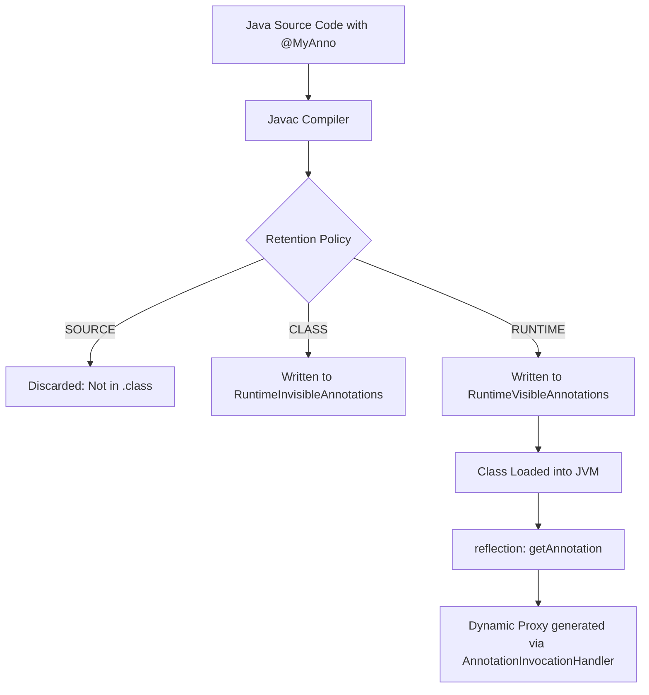

# Annotations and Compile-Time Metaprogramming

> Comprehensive reference for Java Annotations: standard built-in annotations, meta-annotations (`@Retention`, `@Target`, `@Repeatable`), annotation processing (JSR 269), runtime reflection inspection, bytecode storage, and modern architectural patterns.

| Metadata | Value |
|---|---|
| **Level** | Advanced |
| **Prerequisites** | [04-oop/09_interfaces.md](../04-oop/09_interfaces.md), [04-oop/11_enums.md](../04-oop/11_enums.md), [05-packages-and-modules/00_packages-and-imports.md](../05-packages-and-modules/00_packages-and-imports.md) |
| **Time to Read** | 25 minutes |
| **Status** | Active |
| **Java Version** | Java 5.0+ (Repeatable Java 8, Type annotations Java 8) |

---

## Table of Contents
1. [What & Why](#1-what--why)
2. [Core Concepts](#2-core-concepts)
3. [How It Works Internally](#3-how-it-works-internally)
4. [Syntax & Usage](#4-syntax--usage)
5. [Practical Examples](#5-practical-examples)
6. [Best Practices](#6-best-practices)
7. [Common Mistakes & Pitfalls](#7-common-mistakes--pitfalls)
8. [Performance & Security Notes](#8-performance--security-notes)
9. [Comparison / When to Use What](#9-comparison--when-to-use-what)
10. [Interview Questions](#10-interview-questions)
11. [Practice Exercises](#11-practice-exercises)
12. [Summary / Cheat Sheet](#12-summary--cheat-sheet)
13. [Further Reading](#13-further-reading)

---

## 1. What & Why

### The Problem: Decoupling Metadata from Code Execution
Before Java 5, developers configured frameworks using XML files or brittle naming conventions (such as naming test methods `testDoSomething()` in JUnit 3). XML files drifted out of sync with refactored class names, lacked compile-time type validation, and cluttered project repositories.

### The Solution: First-Class Annotations (JSR 175)
Introduced in Java 5, annotations allow attaching structured, compile-time verified metadata directly to program declarations (classes, fields, methods, parameters, type uses).
Annotations do not directly alter the imperative execution logic of code. Instead, they serve as informational tags consumed by:
1. **The Java Compiler**: Enforcing rules (`@Override`, `@FunctionalInterface`, `@SuppressWarnings`).
2. **Annotation Processors (APT)**: Generating source code or validating contracts at compile time (Lombok, MapStruct, Dagger).
3. **Runtime Frameworks**: Inspecting class structures via Reflection to configure dependency injection, ORM mapping, and routing (Spring, Hibernate, Jackson).

---

## 2. Core Concepts

### Annotation Anatomy
Declared using the `@interface` keyword:
```java
public @interface Priority {
    int value() default 0; // element with default value
    String description() default "";
}
```
Permissible element types are strictly limited by the Java Language Specification to:
- Primitives (`int`, `boolean`, `double`, etc.).
- `String`.
- `Class<?>` or bounded wildcards.
- Enums.
- Other annotations.
- 1-dimensional arrays of any of the above.

### Meta-Annotations
Meta-annotations are annotations applied to annotation definitions to configure their lifecycle and target locations:
- **`@Retention`**: Defines how long the annotation is retained:
  - `SOURCE`: Discarded by the compiler; invisible to bytecode (e.g., `@Override`).
  - `CLASS`: Recorded in `.class` file, but ignored by VM at runtime (default).
  - `RUNTIME`: Retained in `.class` file and loaded by JVM; readable via reflection (`@Test`).
- **`@Target`**: Restricts where the annotation can be applied (`TYPE`, `METHOD`, `FIELD`, `PARAMETER`, `RECORD_COMPONENT`, `TYPE_USE`).
- **`@Documented`**: Includes the annotation in Javadoc documentation.
- **`@Inherited`**: Automatically inherited by subclasses of an annotated class (classes only; does not apply to interfaces).
- **`@Repeatable`**: Permits applying the same annotation multiple times to a single declaration.

---

## 3. How It Works Internally

### Bytecode Representation of Annotations
When compiled, annotations are stored in dedicated ClassFile attributes:
- `RuntimeVisibleAnnotations`: Contains `RetentionPolicy.RUNTIME` annotations. Loaded into the JVM heap and accessible via reflection.
- `RuntimeInvisibleAnnotations`: Contains `RetentionPolicy.CLASS` annotations. Present in `.class` bytes for bytecode analyzers (e.g. FindBugs/SpotBugs), but discarded by the JVM class loader.
- `RuntimeVisibleTypeAnnotations` (JSR 308): Type-use annotations stored alongside target descriptors.

### Annotation Proxy Generation
When code invokes `element.getAnnotation(MyAnnotation.class)`, the JVM does **not** return a simple POJO. It dynamically constructs a proxy implementing the `@interface` backed by `sun.reflect.annotation.AnnotationInvocationHandler`, converting element values into method return values on the fly.



---

## 4. Syntax & Usage

### Declaring a Custom Runtime Annotation
```java
import java.lang.annotation.*;

@Retention(RetentionPolicy.RUNTIME)
@Target({ElementType.METHOD, ElementType.TYPE})
@Documented
public @interface AuditLog {
    String action();
    int severity() default 1;
    String[] tags() default {};
}
```

### Declaring Repeatable Annotations (Java 8+)
```java
import java.lang.annotation.*;

@Retention(RetentionPolicy.RUNTIME)
@Target(ElementType.METHOD)
@Repeatable(Schedules.class)
public @interface Schedule {
    String dayOfWeek();
    int hour() default 12;
}

// Mandatory containing annotation type
@Retention(RetentionPolicy.RUNTIME)
@Target(ElementType.METHOD)
public @interface Schedules {
    Schedule[] value();
}
```

---

## 5. Practical Examples

### Example 1: Custom Validation Processor via Runtime Reflection
```java
// Goal: Implement a custom @NotNullField validator using reflection
import java.lang.annotation.*;
import java.lang.reflect.Field;

@Retention(RetentionPolicy.RUNTIME)
@Target(ElementType.FIELD)
@interface RequiredField {
    String message() default "Field cannot be null";
}

class UserRegistration {
    @RequiredField(message = "Username is strictly required")
    private String username;

    @RequiredField
    private String email;

    public UserRegistration(String username, String email) {
        this.username = username;
        this.email = email;
    }
}

public class AnnotationValidator {
    public static void validate(Object obj) throws IllegalAccessException {
        Class<?> clazz = obj.getClass();
        for (Field field : clazz.getDeclaredFields()) {
            if (field.isAnnotationPresent(RequiredField.class)) {
                field.setAccessible(true);
                Object val = field.get(obj);
                if (val == null) {
                    RequiredField anno = field.getAnnotation(RequiredField.class);
                    throw new IllegalArgumentException("Validation failed on " + field.getName() + ": " + anno.message());
                }
            }
        }
    }

    public static void main(String[] args) throws Exception {
        UserRegistration valid = new UserRegistration("ada", "ada@example.com");
        validate(valid);
        System.out.println("Valid user passed validation!");

        try {
            UserRegistration invalid = new UserRegistration("alan", null);
            validate(invalid);
        } catch (IllegalArgumentException e) {
            System.err.println("Caught expected error: " + e.getMessage());
        }
    }
}
```
*Output:*
```
Valid user passed validation!
Caught expected error: Validation failed on email: Field cannot be null
```

### Example 2: Repeatable Annotations in Action
```java
// Goal: Attach multiple schedules to a single automated batch job
public class BatchJobService {
    @Schedule(dayOfWeek = "MON", hour = 8)
    @Schedule(dayOfWeek = "WED", hour = 14)
    @Schedule(dayOfWeek = "FRI", hour = 20)
    public void executePayroll() {
        System.out.println("Executing payroll sync...");
    }

    public static void main(String[] args) throws Exception {
        var method = BatchJobService.class.getMethod("executePayroll");
        Schedule[] schedules = method.getAnnotationsByType(Schedule.class);
        System.out.println("Found " + schedules.length + " configured schedules:");
        for (var s : schedules) {
            System.out.println(" - " + s.dayOfWeek() + " at " + s.hour() + ":00");
        }
    }
}
```
*Output:*
```
Found 3 configured schedules:
 - MON at 8:00
 - WED at 14:00
 - FRI at 20:00
```

### Example 3: Edge Case: Reading Annotations on Records
```java
// Goal: Ensure annotations apply to record components vs fields
import java.lang.annotation.*;

@Retention(RetentionPolicy.RUNTIME)
@Target({ElementType.RECORD_COMPONENT, ElementType.FIELD})
@interface JsonProperty {
    String value();
}

public record CustomerPayload(@JsonProperty("cust_id") long id, @JsonProperty("full_name") String name) {
    public static void main(String[] args) {
        for (var rc : CustomerPayload.class.getRecordComponents()) {
            var prop = rc.getAnnotation(JsonProperty.class);
            if (prop != null) {
                System.out.println("Component " + rc.getName() + " maps to JSON key: " + prop.value());
            }
        }
    }
}
```
*Output:*
```
Component id maps to JSON key: cust_id
Component name maps to JSON key: full_name
```

### Example 4: Failure Case: Attempting Complex Objects in Annotation Elements
```java
// Goal: Illustrate compile error when unsupported element types are declared
/*
public @interface BadAnnotation {
    // COMPILE ERROR: Invalid type for annotation member
    java.time.Instant timestamp(); // Classes other than Class<?> not permitted!
    java.util.List<String> tags(); // Collections forbidden! Arrays required instead.
}
*/
```
*Explanation:* Annotation elements are restricted strictly to primitives, String, Class, Enums, Annotations, and 1D arrays thereof.

---

## 6. Best Practices
1. **Always Set Explicit `@Retention` and `@Target`**: Never leave meta-annotations omitted. The default retention is `CLASS`, which is invisible to runtime reflection.
2. **Name Single Elements `value()`**: When an annotation has only one required element, name it `value()`. This allows callers to omit the element name: `@Audit("PAY")` instead of `@Audit(value = "PAY")`.
3. **Prefer Compile-Time Processing over Runtime Reflection**: For high-performance microservices, use compile-time annotation processors (e.g. MapStruct, Micronaut) to generate code at build time, avoiding reflection startup penalties.
4. **Target `RECORD_COMPONENT` on Records**: If an annotation is designed for records, include `ElementType.RECORD_COMPONENT` in `@Target`.
5. **Provide Sensible Defaults**: Use `default` values for optional elements to minimize clutter at use sites.

---

## 7. Common Mistakes & Pitfalls

| Mistake | Why Wrong | Fix |
|---|---|---|
| Omitting `@Retention(RetentionPolicy.RUNTIME)` | Default is `CLASS`; `isAnnotationPresent()` returns false at runtime. | Explicitly annotate with `@Retention(RetentionPolicy.RUNTIME)`. |
| Attempting to store `null` as annotation element | `null` is forbidden as a default value or passed argument in annotations. | Use sentinel constants like `""` or `void.class`. |
| Using `getAnnotation()` for repeatable annotations | Returns `null` if multiple instances are present (reads the container type). | Use `getAnnotationsByType(MyAnnotation.class)`. |
| Trying to inherit annotations on interfaces | `@Inherited` only applies to class inheritance hierarchies, not interface implementations. | Inspect implemented interfaces manually via reflection. |
| Storing complex domain models in annotations | The specification forbids non-primitive, non-string, non-enum objects in annotations. | Use string keys or identifiers and look up domain objects at runtime. |

---

## 8. Performance & Security Notes

### Reflection Overhead & GraalVM Native Image
Runtime reflection over annotations incurs startup overhead due to class inspection and dynamic proxy allocation. Ahead-of-Time (AOT) compilers (like GraalVM Native Image) require pre-registering reflective annotation lookups in JSON configuration files, or the lookups fail silently in compiled native binaries.

### Security Boundaries
Annotations themselves carry no executable code and cannot introduce security vulnerabilities directly. However, frameworks that dynamically instantiate classes based on annotation string values (e.g., class names in `@Component("com.evil.Gadget")`) can be susceptible to arbitrary object injection if metadata is loaded from untrusted user configurations.

---

## 9. Comparison / When to Use What

| Technique | Lifecycle | Performance | Flexibility | Common Use Case |
|---|---|---|---|---|
| **Runtime Reflection** | Runtime (`RUNTIME`) | Slower startup | Maximum dynamic behavior | Spring DI, Jackson JSON |
| **Annotation Processing (APT)**| Compile-time (`SOURCE`) | Zero runtime cost | Generates static code | Dagger, MapStruct, Lombok |
| **Bytecode Analysis** | Build / Classload (`CLASS`) | Very fast | Pre-execution verification | SpotBugs, ArchUnit |

---

## 10. Interview Questions

<details>
<summary>1. What are the three Retention Policies for Java annotations?</summary>
`SOURCE` (discarded by compiler, not in bytecode), `CLASS` (stored in bytecode, discarded by JVM class loader, default), and `RUNTIME` (retained in bytecode and JVM heap, readable via reflection).
</details>

<details>
<summary>2. What types are permitted as annotation elements?</summary>
Primitives, `java.lang.String`, `java.lang.Class<?>`, Enums, other Annotations, and 1-dimensional arrays of these types. Complex classes and collections (`List`, `Map`) are strictly forbidden.
</details>

<details>
<summary>3. What is the purpose of the `@Inherited` meta-annotation?</summary>
It specifies that an annotation applied to a superclass is automatically inherited by any subclasses. It does not work on interfaces or interface implementations.
</details>

<details>
<summary>4. How do Repeatable Annotations work under the hood?</summary>
Java requires a containing annotation type that defines an array element `value()` holding the repeatable annotations. The compiler wraps repeated annotations into the container annotation in the class file.
</details>

<details>
<summary>5. What does the JVM return when `getAnnotation(Class<T>)` is called?</summary>
It returns a dynamic proxy instance generated at runtime that implements the annotation's `@interface` and delegates calls to `AnnotationInvocationHandler`.
</details>

<details>
<summary>6. What is the difference between `getAnnotation()` and `getAnnotationsByType()`?</summary>
`getAnnotation()` fetches a single direct annotation. For repeatable annotations, it returns `null` unless invoked on the container type. `getAnnotationsByType()` automatically unwraps repeatable container annotations into an array of the repeatable type.
</details>

<details>
<summary>7. What are Type Annotations (JSR 308)?</summary>
Annotations with `@Target(ElementType.TYPE_USE)` that can be placed on any use of a type (e.g. `List<@NonNull String>`, `new @Interned Object()`), widely used by pluggable type checkers like the Checker Framework.
</details>

<details>
<summary>8. Why are modern frameworks shifting toward Compile-Time Annotation Processing?</summary>
To eliminate the runtime reflection and bytecode manipulation startup penalty, and to enable seamless Ahead-of-Time (AOT) compilation with GraalVM Native Image.
</details>

---

## 11. Practice Exercises

### Exercise 1 (Easy): Basic Configuration Annotation
- **Task**: Declare an annotation `@ServiceEndpoint` with elements `String path()` and `int port() default 8080`, retaining it at runtime for classes.
<details>
<summary>Solution</summary>

```java
import java.lang.annotation.*;

@Retention(RetentionPolicy.RUNTIME)
@Target(ElementType.TYPE)
public @interface ServiceEndpoint {
    String path();
    int port() default 8080;
}
```
</details>

### Exercise 2 (Medium): Runtime Method Invocation Filter
- **Task**: Declare `@BenchmarkTest`. Write a runner that scans a class for methods annotated with `@BenchmarkTest` and executes each one, measuring elapsed nanoseconds.
<details>
<summary>Solution</summary>

```java
import java.lang.annotation.*;
import java.lang.reflect.Method;

@Retention(RetentionPolicy.RUNTIME)
@Target(ElementType.METHOD)
@interface BenchmarkTest {}

public class SimpleBenchmarkRunner {
    public static void run(Object target) throws Exception {
        for (Method m : target.getClass().getDeclaredMethods()) {
            if (m.isAnnotationPresent(BenchmarkTest.class)) {
                m.setAccessible(true);
                long start = System.nanoTime();
                m.invoke(target);
                long duration = System.nanoTime() - start;
                System.out.println("Method " + m.getName() + " executed in " + duration + " ns");
            }
        }
    }
}
```
</details>

### Exercise 3 (Hard): Role-Based Access Control (RBAC) Interceptor
- **Task**: Declare `@RolesAllowed(String[] roles)`. Write an authorization validator that verifies a given `UserContext(String username, Set<String> roles)` has permission to execute an annotated method.
<details>
<summary>Solution</summary>

```java
import java.lang.annotation.*;
import java.lang.reflect.Method;
import java.util.Set;

@Retention(RetentionPolicy.RUNTIME)
@Target(ElementType.METHOD)
@interface RolesAllowed {
    String[] value();
}

public class SecurityInterceptor {
    public record UserContext(String username, Set<String> roles) {}

    public static void checkAccess(Method method, UserContext user) {
        RolesAllowed allowed = method.getAnnotation(RolesAllowed.class);
        if (allowed == null) return; // Publicly accessible

        for (String requiredRole : allowed.value()) {
            if (user.roles().contains(requiredRole)) {
                return; // Authorized!
            }
        }
        throw new SecurityException("User " + user.username() + " unauthorized to execute " + method.getName());
    }
}
```
</details>

---

## 12. Summary / Cheat Sheet

```
+-----------------------------------------------------------------------------------------+
|                               JAVA ANNOTATIONS CHEAT SHEET                              |
+-----------------------------------------------------------------------------------------+
| Declaration              | public @interface MyAnno { String value() default ""; }      |
| Retention Policies       | SOURCE (compiler only), CLASS (default), RUNTIME (reflection)|
| Key Meta-Annotations     | @Retention, @Target, @Documented, @Inherited, @Repeatable    |
| Allowed Element Types    | Primitives, String, Class<?>, Enums, Annotations, 1D arrays  |
| Unwrapping Repeatable    | element.getAnnotationsByType(MyAnno.class)                   |
| Record Component Target  | @Target(ElementType.RECORD_COMPONENT)                        |
| Null in Annotations      | STRICTLY ILLEGAL (use default "" or void.class)              |
+-----------------------------------------------------------------------------------------+
```

---

## 13. Further Reading
- [JSR 175: A Metadata Facility for the Java Programming Language](https://jcp.org/en/jsr/detail?id=175)
- [JSR 269: Pluggable Annotation Processing API](https://jcp.org/en/jsr/detail?id=269)
- [JSR 308: Annotations on Java Types](https://jcp.org/en/jsr/detail?id=308)
- Effective Java (3rd Edition) — Item 39: Prefer annotations to naming patterns
