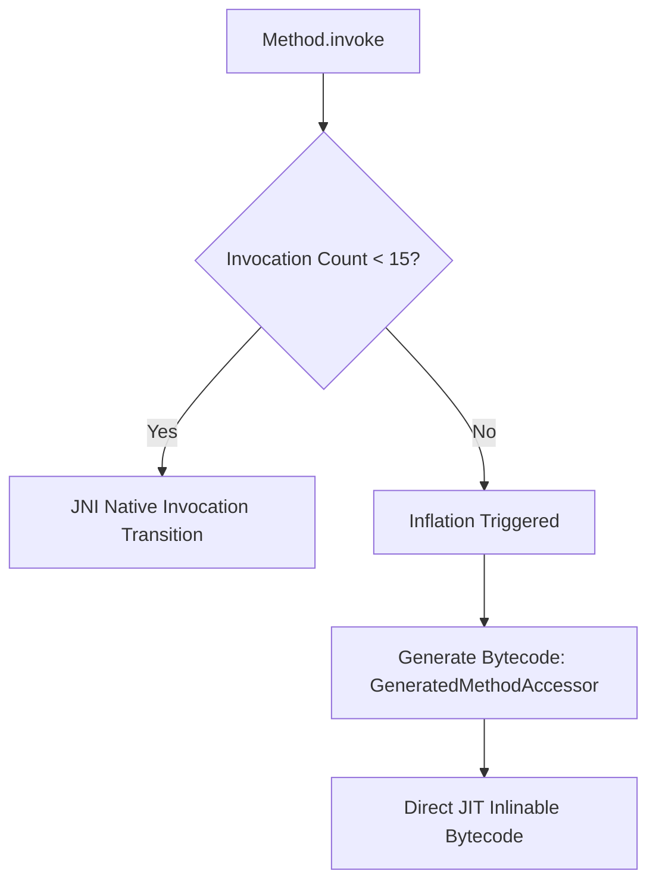

# Java Reflection and MethodHandles

> Comprehensive architectural reference for Java Reflection (`java.lang.reflect`), `java.lang.invoke.MethodHandles`, `VarHandle`, JPMS strong encapsulation barriers (`--add-opens`), and performance optimization.

| Metadata | Value |
|---|---|
| **Level** | Advanced |
| **Prerequisites** | [00_annotations.md](00_annotations.md), [04-oop/00_classes-and-objects.md](../04-oop/00_classes-and-objects.md), [05-packages-and-modules/02_java-modules.md](../05-packages-and-modules/02_java-modules.md) |
| **Time to Read** | 28 minutes |
| **Status** | Active |
| **Java Version** | Java 1.1+ (MethodHandles Java 7, VarHandle Java 9, JPMS Encapsulation Java 9-17) |

---

## Table of Contents
1. [What & Why](#1-what--why)
2. [Core Concepts](#2-core-concepts)
3. [How It Works Internally](#3-how-it-works-internally)
4. [Syntax & Usage](#4-syntax--usage)
5. [Practical Examples](#5-practical-examples)
6. [Best Practices](#6-best-practices)
7. [Common Mistakes & Pitfalls](#7-common-mistakes--pitfalls)
8. [Performance & Security Notes](#8-performance--security-notes)
9. [Comparison / When to Use What](#9-comparison--when-to-use-what)
10. [Interview Questions](#10-interview-questions)
11. [Practice Exercises](#11-practice-exercises)
12. [Summary / Cheat Sheet](#12-summary--cheat-sheet)
13. [Further Reading](#13-further-reading)

---

## 1. What & Why

### The Need for Runtime Introspection
Static typing provides compile-time safety, but many enterprise systems require **runtime introspection**:
- Dependency Injection containers (Spring, Guice) must inspect class constructors and inject dependencies dynamically.
- Serialization frameworks (Jackson, Gson) must read private fields without boilerplate getters.
- Test runners (JUnit) must discover and execute test methods dynamically.

### The Evolution: Reflection to MethodHandles
Java 1.1 introduced the classic Core Reflection API (`java.lang.Class`, `Field`, `Method`, `Constructor`). While powerful, classic reflection was slow, bypassed encapsulation via `setAccessible(true)`, and created maintenance nightmares.
Java 7 introduced `java.lang.invoke.MethodHandles`, followed by `VarHandle` in Java 9. These modern APIs provide strongly-typed, low-overhead direct bytecode handles that align with JVM JIT compiler optimizations.

---

## 2. Core Concepts

### Core Reflection Components
- `Class<?>`: Entry point to introspection. Obtained via `obj.getClass()`, `String.class`, or `Class.forName("...")`.
- `Constructor<?>`: Represents class constructors. `newInstance(args)` instantiates objects.
- `Method`: Represents methods. `invoke(target, args)` dynamically calls the method.
- `Field`: Represents instance or static variables. `get(target)` and `set(target, val)` read and write field memory.

### JPMS Strong Encapsulation (Java 9 to 17+)
Historically, developers invoked `field.setAccessible(true)` to bypass private access modifiers.
Starting in Java 9 and finalized in Java 17 (JEP 403: Strongly Encapsulate JDK Internals), **the JVM strictly forbids deep reflection into non-exported, non-opened packages of named modules**. Calling `setAccessible(true)` across modular boundaries throws `InaccessibleObjectException` unless the module explicitly exports or opens the package:
```java
module my.module {
    opens com.my.entity to com.fasterxml.jackson.databind; // Permits deep reflection
}
```

### `MethodHandles` and `Lookup`
`java.lang.invoke.MethodHandles` is the modern, high-performance alternative to reflection:
- `MethodHandles.Lookup`: Security context token representing the caller's access rights.
- `MethodHandle`: A typed, directly executable reference to an underlying method, constructor, or field.
- **Performance**: When stored in `static final` constants, the HotSpot JIT compiler can inline `MethodHandle.invokeExact()` calls identically to direct bytecode invocations.

### `VarHandle` (Java 9 JEP 193)
Replaces `sun.misc.Unsafe` for atomic and memory-ordered field operations. Provides memory fence operations (`getVolatile`, `setRelease`, `compareAndSet`) with strict type safety.

---

## 3. How It Works Internally

### Inflation and Native vs Bytecode Invocation
When `Method.invoke()` is called in the HotSpot JVM:
1. **Native Accessor (Calls 1 to 15)**: The JVM uses JNI native transitions (`Reflection::invoke()`). This avoids generating bytecode for one-off calls.
2. **Inflation (Call 16+)**: If a method is invoked reflectively more than the inflation threshold (`-Dsun.reflect.inflationThreshold=15`), the JVM dynamically generates a synthetic class (`GeneratedMethodAccessorN`) containing direct bytecode calls and loads it via a dedicated delegating class loader.



---

## 4. Syntax & Usage

### Traditional Reflection Inspection
```java
import java.lang.reflect.*;

public class ReflectionBasics {
    public static void inspect(Class<?> clazz) {
        System.out.println("Class: " + clazz.getName());
        for (Method m : clazz.getDeclaredMethods()) {
            System.out.println(" - Method: " + m.getName() + ", Returns: " + m.getReturnType().getSimpleName());
        }
    }
}
```

### Modern `MethodHandles` Lookup and Invocation
```java
import java.lang.invoke.*;

public class MethodHandleDemo {
    public static void main(String[] args) throws Throwable {
        MethodHandles.Lookup lookup = MethodHandles.lookup();

        // Target method: String.substring(int, int)
        MethodType mt = MethodType.methodType(String.class, int.class, int.class);
        MethodHandle mh = lookup.findVirtual(String.class, "substring", mt);

        // Direct strongly typed invocation
        String result = (String) mh.invokeExact("Modern Java 25", 0, 6);
        System.out.println("Result: " + result); // "Modern"
    }
}
```

---

## 5. Practical Examples

### Example 1: Generic Object-to-Map Serializer
```java
// Goal: Convert arbitrary object fields to a Map using reflection
import java.lang.reflect.Field;
import java.util.*;

public class ReflectionSerializer {
    public static Map<String, Object> toMap(Object obj) throws IllegalAccessException {
        Map<String, Object> map = new LinkedHashMap<>();
        Class<?> clazz = obj.getClass();

        while (clazz != null && clazz != Object.class) {
            for (Field field : clazz.getDeclaredFields()) {
                if (Modifier.isStatic(field.getModifiers())) continue;
                field.setAccessible(true);
                map.put(field.getName(), field.get(obj));
            }
            clazz = clazz.getSuperclass();
        }
        return map;
    }

    record User(String name, int age) {}

    public static void main(String[] args) throws Exception {
        User u = new User("Grace Hopper", 85);
        Map<String, Object> fields = toMap(u);
        System.out.println("Serialized map: " + fields);
    }
}
```
*Output:*
```
Serialized map: {name=Grace Hopper, age=85}
```

### Example 2: Atomic State Machine with `VarHandle`
```java
// Goal: High-performance atomic CAS state management replacing AtomicReference
import java.lang.invoke.*;

public class OrderProcessor {
    public enum State { NEW, PROCESSING, COMPLETED }

    private volatile State state = State.NEW;

    private static final VarHandle STATE_HANDLE;

    static {
        try {
            STATE_HANDLE = MethodHandles.lookup()
                .findVarHandle(OrderProcessor.class, "state", State.class);
        } catch (ReflectiveOperationException e) {
            throw new ExceptionInInitializerError(e);
        }
    }

    public boolean completeOrder() {
        // Atomic compare-and-set
        return STATE_HANDLE.compareAndSet(this, State.PROCESSING, State.COMPLETED);
    }

    public void startProcessing() {
        STATE_HANDLE.setVolatile(this, State.PROCESSING);
    }

    public State getState() {
        return (State) STATE_HANDLE.getVolatile(this);
    }
}
```

### Example 3: Edge Case: Illegal Access in Named JPMS Modules
```java
// Goal: Demonstrate InaccessibleObjectException under strong encapsulation
public class ModuleEncapsulationDemo {
    public static void attemptIllegalAccess() {
        try {
            // Attempting to reflectively access private field in java.lang.String
            Field f = String.class.getDeclaredField("value");
            f.setAccessible(true); // Throws InaccessibleObjectException in Java 17+
        } catch (Exception e) {
            System.err.println("Access blocked by JPMS: " + e.getClass().getSimpleName());
        }
    }

    public static void main(String[] args) {
        attemptIllegalAccess();
    }
}
```
*Output:*
```
Access blocked by JPMS: InaccessibleObjectException
```
*Explanation:* Modern Java completely blocks cracking open JDK internal fields via `setAccessible(true)`.

---

## 6. Best Practices
1. **Prefer `MethodHandles` and `VarHandle`**: For performance-critical infrastructure, use `MethodHandles` and `VarHandle` over classic reflection.
2. **Store MethodHandles in `static final` Constants**: HotSpot can only perform direct inlining and constant folding if the `MethodHandle` reference is compile-time constant.
3. **Use `getDeclaredConstructor().newInstance()`**: Never invoke `Class.newInstance()`, which was deprecated in Java 9 because it bypasses checked exceptions and private constructors.
4. **Respect Module Boundaries**: Use `opens ... to ...` in `module-info.java` to grant reflective access cleanly instead of resorting to JVM command-line flags (`--add-opens`).
5. **Cache Reflective Lookups**: Reflective operations (`getMethod`, `getDeclaredField`) are computationally expensive. Cache lookups in `ConcurrentHashMap`.

---

## 7. Common Mistakes & Pitfalls

| Mistake | Why Wrong | Fix |
|---|---|---|
| Calling deprecated `Class.newInstance()` | Silently swallows exceptions and fails on private constructors. | Call `clazz.getDeclaredConstructor().newInstance()`. |
| Uncached reflection in loops | Calling `getMethod()` inside tight loops causes massive GC garbage and latency. | Cache `Method` or `MethodHandle` instances in static fields. |
| Expecting `setAccessible(true)` to always work | Throws `InaccessibleObjectException` on modular JDK internals in Java 17+. | Export/open packages via `module-info.java` or use public APIs. |
| Catching raw `Exception` on reflective calls | Masks underlying domain exceptions wrapped in `InvocationTargetException`. | Unpack with `e.getCause()` when handling `InvocationTargetException`. |
| Using `invokeExact()` with boxed types | `invokeExact()` mandates exact type matching (e.g. `int.class`, not `Integer.class`). | Use `invoke()` or ensure exact argument types. |

---

## 8. Performance & Security Notes

### Overhead of Reflection
1. **Boxed Arguments**: Primitives passed to `Method.invoke()` must be boxed into heap objects (`Integer.valueOf()`).
2. **Type Checking on Every Call**: Classic reflection performs dynamic type and permission verification on every invocation.
3. **Inlining Barrier**: Classic reflection prevents JIT inlining until inflation occurs.

### Security and Attack Surface
Reflection bypasses standard compiler type checking. Untrusted class loading or method invocation based on user input can lead to arbitrary code execution. The Java platform enforces strict modular encapsulation to prevent attackers from manipulating security internals.

---

## 9. Comparison / When to Use What

| Feature | Classic Reflection (`Method`) | `MethodHandle` | `VarHandle` |
|---|---|---|---|
| **Java Version** | Java 1.1 | Java 7 | Java 9 |
| **Type Safety** | Object array / Boxed | Strongly typed `MethodType` | Strongly typed |
| **JIT Inlining** | Difficult (requires inflation) | Direct inlining (if `static final`) | Direct inlining |
| **Target Use** | Dynamic inspection, frameworks | High-perf method dispatch | Atomic memory operations |

---

## 10. Interview Questions

<details>
<summary>1. Why was `Class.newInstance()` deprecated in Java 9?</summary>
Because it propagated checked exceptions without declaring them, bypassed constructor access checks, and could not invoke parameterized constructors. The recommended replacement is `clazz.getDeclaredConstructor().newInstance()`.
</details>

<details>
<summary>2. What is Inflation in Java reflection?</summary>
A HotSpot optimization where initial reflective calls use fast JNI native code, but after exceeding a threshold (default 15 calls), the JVM generates specialized bytecode (`GeneratedMethodAccessor`) to enable JIT optimization.
</details>

<details>
<summary>3. What is the impact of Java 17 JEP 403 on reflection?</summary>
Java 17 strongly encapsulated JDK internal packages. Calling `setAccessible(true)` on private fields or methods of standard library classes now throws `InaccessibleObjectException`.
</details>

<details>
<summary>4. What are the key differences between `Method.invoke()` and `MethodHandle.invokeExact()`?</summary>
`Method.invoke()` accepts boxed `Object[]` arguments and performs dynamic access checks each time. `MethodHandle.invokeExact()` enforces strict signature matching at the bytecode level and can be inlined directly by HotSpot if stored in a `static final` constant.
</details>

<details>
<summary>5. What is a `VarHandle`?</summary>
Introduced in Java 9 (JEP 193), `VarHandle` is a type-safe reference to a variable that allows low-level atomic memory access modes (`getVolatile`, `compareAndSet`, `getAndAdd`), safely replacing `sun.misc.Unsafe`.
</details>

<details>
<summary>6. How do you handle an exception thrown by an invoked method?</summary>
Reflection wraps all checked and unchecked exceptions thrown by the target method inside `InvocationTargetException`. You must call `e.getCause()` to retrieve the original root cause.
</details>

<details>
<summary>7. What is `MethodHandles.Lookup`?</summary>
It represents the security context and credentials of the caller that performed the lookup. A lookup created inside class `A` has access to private members of `A`, while a public lookup (`MethodHandles.publicLookup()`) can only access public members.
</details>

<details>
<summary>8. How do JPMS modules configure reflective access for frameworks?</summary>
A module uses the `opens <package> to <framework>;` directive in `module-info.java`, granting deep reflective access to specified frameworks while keeping the package encapsulated from other modules.
</details>

---

## 11. Practice Exercises

### Exercise 1 (Easy): Dynamic Method Invoker
- **Task**: Write a method that accepts an object, a method name string, and executes it reflectively if it takes no arguments, returning the result.
<details>
<summary>Solution</summary>

```java
import java.lang.reflect.Method;

public class DynamicInvoker {
    public static Object invokeNoArg(Object target, String methodName) throws Exception {
        Method m = target.getClass().getMethod(methodName);
        return m.invoke(target);
    }
}
```
</details>

### Exercise 2 (Medium): Deep Field Cloner via Reflection
- **Task**: Implement a utility that takes an object and creates a new instance of the same class, copying all declared instance fields.
<details>
<summary>Solution</summary>

```java
import java.lang.reflect.*;

public class SimpleCloner {
    @SuppressWarnings("unchecked")
    public static <T> T cloneObject(T original) throws Exception {
        Class<T> clazz = (Class<T>) original.getClass();
        Constructor<T> ctor = clazz.getDeclaredConstructor();
        ctor.setAccessible(true);
        T clone = ctor.newInstance();

        for (Field f : clazz.getDeclaredFields()) {
            if (Modifier.isStatic(f.getModifiers())) continue;
            f.setAccessible(true);
            f.set(clone, f.get(original));
        }
        return clone;
    }
}
```
</details>

### Exercise 3 (Hard): High-Performance Field Accessor with MethodHandle
- **Task**: Create a `GetterHandle` class that constructs a getter `MethodHandle` for a named field and benchmarks its speed compared to classic `Field.get()`.
<details>
<summary>Solution</summary>

```java
import java.lang.invoke.*;

public class FieldHandleDemo {
    public static class Data {
        public final int id = 42;
    }

    public static void main(String[] args) throws Throwable {
        Data data = new Data();
        MethodHandles.Lookup lookup = MethodHandles.lookup();

        // High performance getter handle
        MethodHandle getter = lookup.findGetter(Data.class, "id", int.class);

        int value = (int) getter.invokeExact(data);
        System.out.println("Extracted id via MethodHandle: " + value);
    }
}
```
</details>

---

## 12. Summary / Cheat Sheet

```
+-----------------------------------------------------------------------------------------+
|                               JAVA REFLECTION CHEAT SHEET                               |
+-----------------------------------------------------------------------------------------+
| Instantiate Class        | clazz.getDeclaredConstructor().newInstance()                 |
| Invoke Method            | method.invoke(targetInstance, args...)                       |
| Read Field               | field.setAccessible(true); field.get(targetInstance);        |
| Handle Exceptions        | catch (InvocationTargetException e) { throw e.getCause(); }  |
| MethodHandle Lookup      | MethodHandles.lookup().findVirtual(Class, "name", MethodType)|
| VarHandle Memory Op      | varHandle.compareAndSet(instance, expected, update)          |
| JPMS Permission          | opens com.pkg to framework.module; in module-info.java      |
| JDK 17 Encapsulation     | Deep reflection on JDK internals throws InaccessibleObjectEx |
+-----------------------------------------------------------------------------------------+
```

---

## 13. Further Reading
- [JEP 403: Strongly Encapsulate JDK Internals (Java 17)](https://openjdk.org/jeps/403)
- [JEP 193: Variable Handles (Java 9)](https://openjdk.org/jeps/193)
- Official Javadoc: `java.lang.invoke.MethodHandles`
- Inside Java Podcast: Demystifying MethodHandles and Reflection
