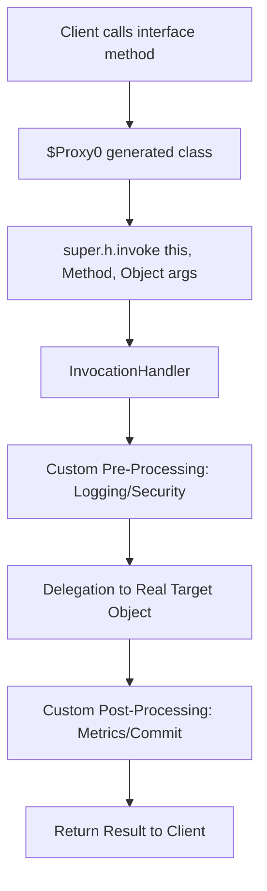

# Dynamic Proxies and Runtime Interception

> Comprehensive guide to Java Dynamic Proxies (`java.lang.reflect.Proxy`), `InvocationHandler`, runtime method interception, Aspect-Oriented Programming (AOP), and modern bytecode alternatives.

| Metadata | Value |
|---|---|
| **Level** | Advanced |
| **Prerequisites** | [04-oop/09_interfaces.md](../04-oop/09_interfaces.md), [01_reflection.md](01_reflection.md) |
| **Time to Read** | 24 minutes |
| **Status** | Active |
| **Java Version** | Java 1.3+ (Interface proxies), Modern Java JPMS modular considerations |

---

## Table of Contents
1. [What & Why](#1-what--why)
2. [Core Concepts](#2-core-concepts)
3. [How It Works Internally](#3-how-it-works-internally)
4. [Syntax & Usage](#4-syntax--usage)
5. [Practical Examples](#5-practical-examples)
6. [Best Practices](#6-best-practices)
7. [Common Mistakes & Pitfalls](#7-common-mistakes--pitfalls)
8. [Performance & Security Notes](#8-performance--security-notes)
9. [Comparison / When to Use What](#9-comparison--when-to-use-what)
10. [Interview Questions](#10-interview-questions)
11. [Practice Exercises](#11-practice-exercises)
12. [Summary / Cheat Sheet](#12-summary--cheat-sheet)
13. [Further Reading](#13-further-reading)

---

## 1. What & Why

### The Cross-Cutting Concern Problem
In enterprise applications, operations such as **logging, metrics, transaction management (`@Transactional`), security authorization, and caching** must be applied across dozens of business services.
Hardcoding this logic directly into every method pollutes domain logic and creates massive code duplication.

### The Solution: Dynamic Proxies
Java 1.3 introduced `java.lang.reflect.Proxy`. A dynamic proxy allows the JVM to generate a class implementing arbitrary interfaces **at runtime** without requiring pre-compiled source files.
Every method call on the proxy is routed through a single centralized callback method (`InvocationHandler.invoke()`), enabling seamless aspect-oriented interception, decorating, and security checks.

---

## 2. Core Concepts

### Core Components
1. **`java.lang.reflect.Proxy`**: Factory class that creates dynamic proxy instances (`Proxy.newProxyInstance(...)`).
2. **`InvocationHandler`**: Functional interface declaring a single interception method:
   ```java
   Object invoke(Object proxy, Method method, Object[] args) throws Throwable;
   ```
3. **Target Interfaces**: Dynamic proxies can **only** implement interfaces. They cannot extend concrete or abstract classes.

### Method Dispatch Protocol
When a client invokes `service.processOrder(123)` on a proxy instance:
1. The proxy intercepts the call.
2. It bundles the target method reference and boxed arguments into `Method` and `Object[]`.
3. It passes them to `InvocationHandler.invoke(proxy, method, args)`.
4. The handler executes custom pre-processing, optionally delegates to a real underlying target object, executes post-processing, and returns the result.

---

## 3. How It Works Internally

### Runtime Bytecode Generation
When `Proxy.newProxyInstance(loader, interfaces, handler)` is called:
1. The JVM generates a synthetic class named `$Proxy0` extending `java.lang.reflect.Proxy` and implementing all specified interfaces.
2. In `$Proxy0`, every interface method is implemented to delegate directly to `super.h.invoke(this, method, args)`.
3. The generated bytecode is loaded into memory via an internal dynamic class loader.



### The Java Single-Inheritance Limitation
Because the dynamically generated class `$Proxy0` already extends `java.lang.reflect.Proxy`, **JDK dynamic proxies can never subclass a concrete class**. Class-based proxying requires third-party bytecode generation libraries like ByteBuddy or CGLIB.

---

## 4. Syntax & Usage

### Basic Proxy Creation
```java
import java.lang.reflect.*;

public interface PaymentGateway {
    boolean pay(double amount);
}

public class ProxyFactory {
    public static PaymentGateway createLoggingProxy(PaymentGateway realGateway) {
        return (PaymentGateway) Proxy.newProxyInstance(
            PaymentGateway.class.getClassLoader(),
            new Class<?>[]{ PaymentGateway.class },
            (proxy, method, args) -> {
                System.out.println("START: " + method.getName() + " with args: " + java.util.Arrays.toString(args));
                long start = System.nanoTime();

                // Delegate to real target
                Object result = method.invoke(realGateway, args);

                long elapsed = System.nanoTime() - start;
                System.out.println("END: " + method.getName() + " took " + elapsed + " ns");
                return result;
            }
        );
    }
}
```

---

## 5. Practical Examples

### Example 1: Transactional Interceptor
```java
// Goal: Automatically handle database transactions around service methods
import java.lang.reflect.*;

public interface OrderService {
    void placeOrder(long orderId);
}

class RealOrderService implements OrderService {
    @Override
    public void placeOrder(long orderId) {
        System.out.println("Persisting order #" + orderId + " to database.");
    }
}

public class TransactionProxyDemo {
    public static <T> T wrapWithTransaction(Class<T> iface, T target) {
        InvocationHandler handler = (proxy, method, args) -> {
            System.out.println("[DB] BEGIN TRANSACTION");
            try {
                Object result = method.invoke(target, args);
                System.out.println("[DB] COMMIT TRANSACTION");
                return result;
            } catch (InvocationTargetException e) {
                System.out.println("[DB] ROLLBACK TRANSACTION on error: " + e.getCause().getMessage());
                throw e.getCause();
            }
        };

        return iface.cast(Proxy.newProxyInstance(iface.getClassLoader(), new Class<?>[]{ iface }, handler));
    }

    public static void main(String[] args) {
        OrderService service = wrapWithTransaction(OrderService.class, new RealOrderService());
        service.placeOrder(42);
    }
}
```
*Output:*
```
[DB] BEGIN TRANSACTION
Persisting order #42 to database.
[DB] COMMIT TRANSACTION
```

### Example 2: Transparent In-Memory Cache Proxy
```java
// Goal: Cache query results transparently using Dynamic Proxies
import java.lang.reflect.*;
import java.util.*;

public interface WeatherService {
    String getForecast(String city);
}

public class CachingProxyFactory {
    public static WeatherService createCachedService(WeatherService realService) {
        Map<String, String> cache = new HashMap<>();

        return (WeatherService) Proxy.newProxyInstance(
            WeatherService.class.getClassLoader(),
            new Class<?>[]{ WeatherService.class },
            (proxy, method, args) -> {
                if ("getForecast".equals(method.getName()) && args.length == 1) {
                    String city = (String) args[0];
                    if (cache.containsKey(city)) {
                        System.out.println("[CACHE HIT] Returning stored forecast for " + city);
                        return cache.get(city);
                    }
                    System.out.println("[CACHE MISS] Fetching from remote service for " + city);
                    String result = (String) method.invoke(realService, args);
                    cache.put(city, result);
                    return result;
                }
                return method.invoke(realService, args);
            }
        );
    }
}
```

### Example 3: Edge Case: Invoking `default` Interface Methods on Proxies
```java
// Goal: Route interface default methods correctly in Java 9+
import java.lang.invoke.MethodHandles;
import java.lang.reflect.*;

public interface Greeter {
    default String greet(String name) {
        return "Hello, " + name;
    }
}

public class DefaultMethodProxy {
    public static void main(String[] args) {
        Greeter greeter = (Greeter) Proxy.newProxyInstance(
            Greeter.class.getClassLoader(),
            new Class<?>[]{ Greeter.class },
            (proxy, method, methodArgs) -> {
                if (method.isDefault()) {
                    // Java 9+ MethodHandles approach to invoke default methods on proxies
                    return MethodHandles.lookup()
                        .findSpecial(
                            Greeter.class,
                            method.getName(),
                            java.lang.invoke.MethodType.methodType(method.getReturnType(), method.getParameterTypes()),
                            Greeter.class
                        )
                        .bindTo(proxy)
                        .invokeWithArguments(methodArgs);
                }
                return null;
            }
        );

        System.out.println(greeter.greet("Duke"));
    }
}
```
*Output:*
```
Hello, Duke
```

### Example 4: Failure Case: Attempting to Proxy a Concrete Class
```java
// Goal: Demonstrate why Proxy.newProxyInstance fails on classes
public class ConcreteClassProxyHazard {
    public static void test() {
        /*
        // COMPILE / RUNTIME ERROR:
        // java.lang.IllegalArgumentException: com.corp.ConcreteService is not an interface!
        Proxy.newProxyInstance(
            ConcreteService.class.getClassLoader(),
            new Class<?>[]{ ConcreteService.class },
            handler
        );
        */
    }
}
```
*Explanation:* Standard JDK Dynamic Proxies strictly mandate interfaces.

---

## 6. Best Practices
1. **Design Clean Interfaces for Business Services**: Use interface-based architecture so services can be decorated with dynamic proxies without third-party bytecode hacks.
2. **Unpack `InvocationTargetException`**: Always unpack `e.getCause()` when delegating via `method.invoke()` so business exceptions propagate cleanly to callers.
3. **Handle `equals`, `hashCode`, and `toString`**: Always account for `Object` methods inside the `InvocationHandler` to avoid infinite recursion or unexpected comparisons.
4. **Beware of Self-Invocation**: If method `A()` in the target object calls method `B()` internally, the call to `B()` bypasses the proxy interceptor!
5. **Use ByteBuddy for Class Proxies**: If proxying concrete classes is strictly necessary, use ByteBuddy rather than legacy CGLIB.

---

## 7. Common Mistakes & Pitfalls

| Mistake | Why Wrong | Fix |
|---|---|---|
| Passing a class instead of an interface to `Proxy.newProxyInstance` | Throws `IllegalArgumentException` at runtime. | Wrap functionality in an interface or use ByteBuddy. |
| Forgetting to unpack `InvocationTargetException` | Caller receives generic reflective error instead of expected domain business exception. | Re-throw `e.getCause()`. |
| Calling methods on the `proxy` parameter inside `invoke()` | Causes infinite recursive loop leading to `StackOverflowError`. | Invoke methods on the *real target* object, not the `proxy` parameter. |
| Self-invocation bypass | Internal calls between methods on `this` skip the proxy interceptor. | Structure calls externally or inject the self-proxy. |
| Class loader mismatch | Passing wrong class loader causes `ClassNotFoundException` or type linkage failure. | Use the interface's class loader (`Interface.class.getClassLoader()`). |

---

## 8. Performance & Security Notes

### Boxing and Reflective Dispatch Cost
Every method invocation on a dynamic proxy packages arguments into an `Object[]` array and boxes primitives. For latency-sensitive microsecond loops, this creates heap allocation and GC pressure. High-performance frameworks use generated bytecode classes with direct method calls instead.

### Security and Trust Boundaries
Dynamic proxies execute with the permissions of the calling class loader. Never expose unvalidated dynamic proxies across security domains where untrusted callers could invoke unauthorized interface methods.

---

## 9. Comparison / When to Use What

| Feature | JDK Dynamic Proxy | ByteBuddy / CGLIB | AspectJ |
|---|---|---|---|
| **Class vs Interface** | Interfaces Only | Classes & Interfaces | Classes & Interfaces |
| **Runtime Dependency** | Standard JDK Built-in | Requires External Library | Requires Compiler / Weaving |
| **Performance** | Medium (Reflection/Boxing) | High (Direct Bytecode) | Highest (Compile-time woven) |
| **Complexity** | Minimal | Medium | High |

---

## 10. Interview Questions

<details>
<summary>1. What is a Java Dynamic Proxy and when is it used?</summary>
A dynamic proxy is a runtime-generated class implementing specified interfaces that routes all method calls through a single `InvocationHandler`. It is used for AOP cross-cutting concerns like logging, transactions, security, and caching.
</details>

<details>
<summary>2. Why can't JDK Dynamic Proxies proxy concrete classes?</summary>
Because the generated proxy class (`$Proxy0`) already extends `java.lang.reflect.Proxy`. Since Java does not support multiple class inheritance, it cannot extend any other concrete class.
</details>

<details>
<summary>3. What happens if you call `method.invoke(proxy, args)` inside `InvocationHandler`?</summary>
It creates an infinite recursive loop: the method call on the proxy is intercepted again by the same handler, leading immediately to `StackOverflowError`. You must invoke the method on the *target delegate* object.
</details>

<details>
<summary>4. What is the self-invocation problem in proxy-based frameworks (like Spring AOP)?</summary>
If method `A()` calls method `B()` directly on `this`, the call does not pass through the proxy object. Any annotations (like `@Transactional` or `@Cacheable`) on method `B()` are silently ignored.
</details>

<details>
<summary>5. How are `equals`, `hashCode`, and `toString` handled by a Dynamic Proxy?</summary>
They are dispatched through the `InvocationHandler.invoke()` method just like any interface method. Handlers should explicitly check for these methods to avoid unexpected behavior.
</details>

<details>
<summary>6. How do you invoke `default` interface methods from an `InvocationHandler` in modern Java?</summary>
Using `MethodHandles.lookup().findSpecial(...)` bound to the proxy instance, allowing clean execution of interface default logic.
</details>

<details>
<summary>7. What alternative exists if you need to proxy a concrete class without interfaces?</summary>
Bytecode generation libraries such as ByteBuddy or CGLIB, which generate a synthetic subclass of the target class at runtime.
</details>

<details>
<summary>8. How are dynamic proxies treated under JPMS modular encapsulation?</summary>
Dynamic proxies are generated in dynamic modules or in the package of their interfaces. If an interface is in a non-exported package, the proxy must be generated within the same module to have visibility.
</details>

---

## 11. Practice Exercises

### Exercise 1 (Easy): UpperCase String Interceptor
- **Task**: Create an interface `StringTransformer` with method `String transform(String input)`. Create a dynamic proxy that converts any returned string to uppercase.
<details>
<summary>Solution</summary>

```java
import java.lang.reflect.*;

public class UpperCaseProxyDemo {
    public interface StringTransformer {
        String transform(String input);
    }

    public static StringTransformer createProxy(StringTransformer target) {
        return (StringTransformer) Proxy.newProxyInstance(
            StringTransformer.class.getClassLoader(),
            new Class<?>[]{ StringTransformer.class },
            (proxy, method, args) -> {
                String result = (String) method.invoke(target, args);
                return (result != null) ? result.toUpperCase() : null;
            }
        );
    }
}
```
</details>

### Exercise 2 (Medium): Performance Timer Proxy
- **Task**: Implement a generic factory `createTimedProxy(Class<T> iface, T target)` that prints execution time in milliseconds for any method call taking longer than 10ms.
<details>
<summary>Solution</summary>

```java
import java.lang.reflect.*;

public class TimingProxyFactory {
    @SuppressWarnings("unchecked")
    public static <T> T createTimedProxy(Class<T> iface, T target) {
        return (T) Proxy.newProxyInstance(
            iface.getClassLoader(),
            new Class<?>[]{ iface },
            (proxy, method, args) -> {
                long start = System.currentTimeMillis();
                try {
                    return method.invoke(target, args);
                } finally {
                    long duration = System.currentTimeMillis() - start;
                    if (duration > 10) {
                        System.out.println("ALERT: " + method.getName() + " took " + duration + "ms");
                    }
                }
            }
        );
    }
}
```
</details>

### Exercise 3 (Hard): Declarative `@ReadOnly` Enforcement Proxy
- **Task**: Declare an annotation `@ReadOnly`. Write an interceptor proxy that inspects called methods; if the method is annotated with `@ReadOnly`, it verifies that the method name starts with "get", "find", or "is", throwing `UnsupportedOperationException` if a mutator method (e.g. "set", "delete") is executed.
<details>
<summary>Solution</summary>

```java
import java.lang.annotation.*;
import java.lang.reflect.*;

@Retention(RetentionPolicy.RUNTIME)
@Target({ElementType.METHOD, ElementType.TYPE})
@interface ReadOnly {}

public class ReadOnlyInterceptor {
    @SuppressWarnings("unchecked")
    public static <T> T protect(Class<T> iface, T target) {
        return (T) Proxy.newProxyInstance(
            iface.getClassLoader(),
            new Class<?>[]{ iface },
            (proxy, method, args) -> {
                if (target.getClass().isAnnotationPresent(ReadOnly.class) || method.isAnnotationPresent(ReadOnly.class)) {
                    String name = method.getName();
                    if (!name.startsWith("get") && !name.startsWith("find") && !name.startsWith("is")) {
                        throw new UnsupportedOperationException("Mutation method " + name + " forbidden in @ReadOnly mode");
                    }
                }
                return method.invoke(target, args);
            }
        );
    }
}
```
</details>

---

## 12. Summary / Cheat Sheet

```
+-----------------------------------------------------------------------------------------+
|                              DYNAMIC PROXIES CHEAT SHEET                                |
+-----------------------------------------------------------------------------------------+
| Factory Method           | Proxy.newProxyInstance(loader, interfaces[], handler)         |
| Interception Callback    | Object invoke(Object proxy, Method method, Object[] args)    |
| Class Limitation         | Interfaces ONLY (cannot proxy concrete classes)              |
| Under the Hood           | Generates synthetic class $Proxy0 extends Proxy              |
| Exception Handling       | Always unwrap and re-throw e.getCause()                      |
| Infinite Loop Danger     | Never call methods on 'proxy' inside invoke(); call target!  |
| Modern Alternative       | ByteBuddy for class proxying; Class-File API in Java 24/25   |
+-----------------------------------------------------------------------------------------+
```

---

## 13. Further Reading
- [Java Official Documentation: Dynamic Proxy Classes](https://docs.oracle.com/en/java/javase/21/docs/api/java.base/java/lang/reflect/Proxy.html)
- Design Patterns: Elements of Reusable Object-Oriented Software (Proxy Pattern)
- Spring Framework Documentation: AOP Proxies Deep Dive
