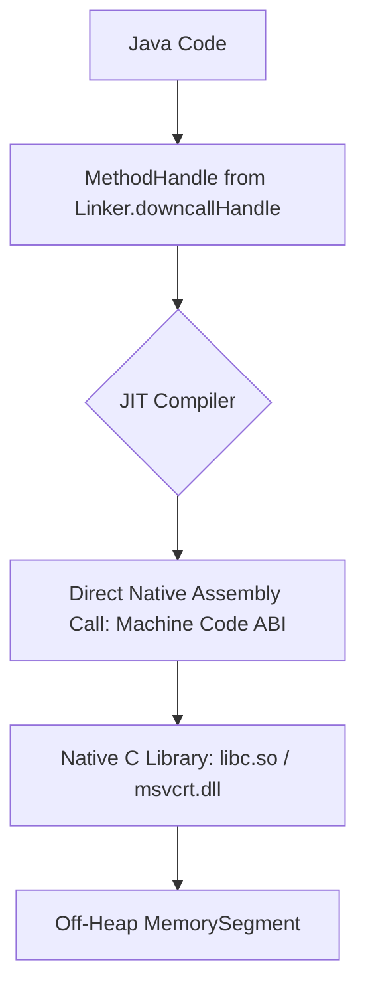

# Foreign Function & Memory API and Class-File API

> Deep dive into Project Panama's Foreign Function & Memory (FFM) API (JEP 454 finalized in Java 22), the Class-File API (JEP 484 standardized in Java 24/25), and the Vector API: replacing JNI, off-heap memory safety, and bytecode parsing.

| Metadata | Value |
|---|---|
| **Level** | Advanced |
| **Prerequisites** | [01_reflection.md](01_reflection.md), [11-io-and-networking/01_nio-paths-and-files.md](../11-io-and-networking/01_nio-paths-and-files.md) |
| **Time to Read** | 28 minutes |
| **Status** | Active |
| **Java Version** | Java 22 Final (FFM JEP 454), Java 24/25 Final (Class-File API JEP 484) |

---

## Table of Contents
1. [What & Why](#1-what--why)
2. [Core Concepts](#2-core-concepts)
3. [How It Works Internally](#3-how-it-works-internally)
4. [Syntax & Usage](#4-syntax--usage)
5. [Practical Examples](#5-practical-examples)
6. [Best Practices](#6-best-practices)
7. [Common Mistakes & Pitfalls](#7-common-mistakes--pitfalls)
8. [Performance & Security Notes](#8-performance--security-notes)
9. [Comparison / When to Use What](#9-comparison--when-to-use-what)
10. [Interview Questions](#10-interview-questions)
11. [Practice Exercises](#11-practice-exercises)
12. [Summary / Cheat Sheet](#12-summary--cheat-sheet)
13. [Further Reading](#13-further-reading)

---

## 1. What & Why

### The Flaws of Java Native Interface (JNI) and `sun.misc.Unsafe`
Historically, integrating Java with native C/C++ libraries (like TensorFlow, RocksDB, or OpenGL) required **JNI (Java Native Interface)**:
- Developers had to write brittle C glue code, compile platform-specific dynamic libraries, and manage complex cross-compilation builds.
- Any memory error in C code crashed the entire JVM process immediately (`SIGSEGV`).
- Direct off-heap memory management relied on internal, unsupported APIs like `sun.misc.Unsafe`, which bypassed safety guarantees and lacked lifetime tracking.

### The Solution: FFM API (JEP 454) and Class-File API (JEP 484)
- **Foreign Function & Memory (FFM) API (Project Panama)**: Standardized in Java 22, the FFM API enables pure Java code to interoperate with native foreign libraries and allocate structured off-heap memory **with 100% type safety and zero C glue code**.
- **Class-File API (JEP 484)**: Standardized in Java 24/25, provides a modern, standard Java SE API for parsing, generating, and transforming class files, eliminating dependency on third-party libraries like ASM.
- **Vector API (Incubator)**: Expresses vector computations that compile reliably at runtime to SIMD (Single Instruction, Multiple Data) CPU instructions (AVX, NEON).

---

## 2. Core Concepts

### FFM Core Architecture: Memory Management
1. **`MemorySegment`**: Models a contiguous region of off-heap or on-heap memory. Provides spatial bounds (size, offsets) and temporal bounds (lifetime).
2. **`Arena`**: Controls the allocation and deallocation lifecycle of memory segments:
   - `Arena.ofConfined()`: Allocated segments are bound to a single thread; closing the arena frees all memory immediately.
   - `Arena.ofShared()`: Thread-safe arena accessible across multiple threads.
   - `Arena.global()`: Unbounded lifetime; memory is never freed (process lifetime).
   - `Arena.ofAuto()`: Memory lifecycle managed automatically by JVM Garbage Collector.
3. **`MemoryLayout`**: Structured binary layouts (`ValueLayout.JAVA_INT`, `JAVA_LONG`, `JAVA_DOUBLE`, struct layouts).

### FFM Core Architecture: Native Foreign Calls
1. **`Linker`**: Connects Java code to native calling conventions (C ABI). Accessed via `Linker.nativeLinker()`.
2. **`SymbolLookup`**: Locates native library functions (e.g. `lookup.find("strlen")`).
3. **`FunctionDescriptor`**: Specifies native method signatures (return types, argument layouts).

### The Class-File API (JEP 484)
A standard, tree-based and streaming API inside `java.lang.classfile.*` that models every element of the JVM class file format (attributes, instructions, constant pool), ensuring that tools and frameworks upgrade automatically when new bytecode versions appear.

---

## 3. How It Works Internally

### Zero-Copy Native Invocations
When calling a native function via `Linker.downcallHandle()`:
- The FFM API bypasses JNI transitions.
- The JVM JIT compiler translates the `MethodHandle` call directly into machine code calling conventions (passing arguments directly in CPU registers `rdi`, `rsi`, `rdx` on x86_64).
- Calling overhead is virtually identical to an internal C function pointer call!



### Off-Heap Memory Safety Guarantees
Every read or write to a `MemorySegment` enforces two checks:
1. **Spatial Safety**: Buffer overflow/underflow is impossible; offsets are checked against segment bounds, throwing `IndexOutOfBoundsException`.
2. **Temporal Safety**: Use-after-free is impossible; accessing memory after the enclosing `Arena` has been closed throws `IllegalStateException`.

---

## 4. Syntax & Usage

### Allocating and Accessing Structured Off-Heap Memory
```java
import java.lang.foreign.*;

public class OffHeapMemoryDemo {
    public static void main(String[] args) {
        // Confined arena: deterministic lifecycle bound to try-with-resources
        try (Arena arena = Arena.ofConfined()) {
            // Allocate off-heap native memory for 10 integers
            MemorySegment segment = arena.allocate(ValueLayout.JAVA_INT, 10);

            for (long i = 0; i < 10; i++) {
                segment.setAtIndex(ValueLayout.JAVA_INT, i, (int) (i * 100));
            }

            for (long i = 0; i < 10; i++) {
                int val = segment.getAtIndex(ValueLayout.JAVA_INT, i);
                System.out.println("Offset " + i + " -> " + val);
            }
        } // All off-heap native memory freed immediately here!
    }
}
```

### Invoking Native C Functions Directly from Java
```java
import java.lang.foreign.*;
import java.lang.invoke.MethodHandle;

public class NativeStrlenDemo {
    public static void main(String[] args) throws Throwable {
        Linker linker = Linker.nativeLinker();
        SymbolLookup lookup = linker.defaultLookup();

        // Locate 'strlen' in C runtime
        MemorySegment strlenAddress = lookup.find("strlen").orElseThrow();

        // Signature: size_t strlen(const char *s)
        FunctionDescriptor descriptor = FunctionDescriptor.of(
            ValueLayout.JAVA_LONG,      // Return: size_t
            ValueLayout.ADDRESS         // Arg 1: pointer to char
        );

        MethodHandle strlen = linker.downcallHandle(strlenAddress, descriptor);

        try (Arena arena = Arena.ofConfined()) {
            // Allocate C string off-heap
            MemorySegment cString = arena.allocateFrom("Hello from Modern Java 25!");

            // Invoke native C strlen directly
            long length = (long) strlen.invokeExact(cString);
            System.out.println("Native strlen returned: " + length);
        }
    }
}
```

---

## 5. Practical Examples

### Example 1: Struct Modeling with `MemoryLayout`
```java
// Goal: Model a C struct { int id; double balance; } in pure Java
import java.lang.foreign.*;
import java.lang.invoke.VarHandle;

public class StructLayoutDemo {
    public static void main(String[] args) {
        // Define C struct layout
        StructLayout pointLayout = MemoryLayout.structLayout(
            ValueLayout.JAVA_INT.withName("x"),
            MemoryLayout.paddingLayout(4), // 4-byte padding for 8-byte alignment
            ValueLayout.JAVA_DOUBLE.withName("y")
        );

        VarHandle xHandle = pointLayout.varHandle(MemoryLayout.PathElement.groupElement("x"));
        VarHandle yHandle = pointLayout.varHandle(MemoryLayout.PathElement.groupElement("y"));

        try (Arena arena = Arena.ofConfined()) {
            MemorySegment structSeg = arena.allocate(pointLayout);

            xHandle.set(structSeg, 0L, 100);
            yHandle.set(structSeg, 0L, 99.95);

            int x = (int) xHandle.get(structSeg, 0L);
            double y = (double) yHandle.get(structSeg, 0L);

            System.out.println("Struct point: (" + x + ", " + y + ")");
        }
    }
}
```
*Output:*
```
Struct point: (100, 99.95)
```

### Example 2: Class-File API (JEP 484) Bytecode Inspection
```java
// Goal: Parse class bytes using the standardized Java 24/25 Class-File API
import java.lang.classfile.*;
import java.nio.file.Files;
import java.nio.file.Path;

public class ClassFileInspector {
    public static void inspectClass(byte[] classBytes) {
        ClassModel model = ClassFile.of().parse(classBytes);
        System.out.println("Class Name: " + model.thisClass().asInternalName());
        System.out.println("Superclass: " + model.superclass().map(sc -> sc.asInternalName()).orElse("None"));

        for (ClassElement element : model) {
            if (element instanceof MethodModel method) {
                System.out.println(" - Method: " + method.methodName().stringValue() + method.methodType().stringValue());
            }
        }
    }
}
```

### Example 3: Edge Case: Use-After-Free Prevention
```java
// Goal: Demonstrate temporal memory safety in FFM API
import java.lang.foreign.*;

public class TemporalSafetyDemo {
    public static void main(String[] args) {
        MemorySegment segment;
        try (Arena arena = Arena.ofConfined()) {
            segment = arena.allocate(ValueLayout.JAVA_INT, 5);
            segment.setAtIndex(ValueLayout.JAVA_INT, 0, 42);
        } // Arena closed here

        try {
            // Attempting to access segment after arena closed throws IllegalStateException!
            segment.getAtIndex(ValueLayout.JAVA_INT, 0);
        } catch (IllegalStateException e) {
            System.out.println("Caught expected temporal safety violation: " + e.getMessage());
        }
    }
}
```
*Output:*
```
Caught expected temporal safety violation: Already closed
```
*Explanation:* The JVM prevents `SIGSEGV` by tracking segment lifetimes against their arena state.

---

## 6. Best Practices
1. **Prefer Confined Arenas**: Use `Arena.ofConfined()` within `try-with-resources` blocks for predictable, immediate off-heap memory reclamation.
2. **Use Structured Memory Layouts**: Never calculate byte offsets manually. Use `MemoryLayout.structLayout()` and `PathElement` handles.
3. **Avoid JNI in New Projects**: Replace legacy JNI native implementations entirely with `java.lang.foreign.Linker`.
4. **Leverage the Class-File API**: For bytecode analysis, instrumentation, and code generation, migrate from third-party ASM to `java.lang.classfile`.
5. **Handle Native Null Pointers Safely**: Check pointers returned from native calls against `MemorySegment.NULL`.

---

## 7. Common Mistakes & Pitfalls

| Mistake | Why Wrong | Fix |
|---|---|---|
| Accessing a segment after arena closed | Throws `IllegalStateException` due to temporal safety violation. | Ensure memory operations occur inside the enclosing arena lifecycle. |
| Passing confined segment to another thread | Throws `WrongThreadException` because confined arenas enforce single-thread access. | Use `Arena.ofShared()` for multi-threaded memory access. |
| Forgetting struct alignment padding | Native C compilers align members according to hardware rules; omitting padding corrupts fields. | Include `MemoryLayout.paddingLayout(n)` in structs. |
| Hardcoding native library paths | Library paths differ across OSes (`.so`, `.dylib`, `.dll`). | Use `System.loadLibrary()` or platform-adaptive lookup. |
| Omitting `--enable-native-access` flag | Invoking native downcall handles triggers a JVM warning or restricted method access error. | Pass `--enable-native-access=ALL-UNNAMED` or target module. |

---

## 8. Performance & Security Notes

### Zero Garbage Collection Pressure
Massive off-heap memory segments allocated via `Arena` live completely outside the JVM garbage collection heap. Multi-gigabyte caches or datasets can be stored without incurring GC pause times or object header overhead.

### Native Access Security Flags
The FFM API restricts native linking to prevent untrusted code from breaking JVM integrity. By default, attempting to create native downcall handles requires the command-line flag:
`--enable-native-access=<module-name>`
This ensures administrators maintain strict visibility into which modules execute native code.

---

## 9. Comparison / When to Use What

| Feature | FFM API (Project Panama) | JNI (Java Native Interface) | `sun.misc.Unsafe` |
|---|---|---|---|
| **Language** | Pure Java | C/C++ Glue Code Required | Java Internal |
| **Safety** | Spatial & Temporal Bounds | None (Crashes JVM) | None (Crashes JVM) |
| **Supported** | Standard Java 22+ SE | Legacy Standard | Deprecated / Encapsulated |
| **Performance** | Native register calling | High (JNI transition cost) | Direct pointer |
| **Maintenance** | Zero C compiler builds | High (C toolchains required)| Brittle |

---

## 10. Interview Questions

<details>
<summary>1. What is the Foreign Function & Memory (FFM) API?</summary>
A modern Java standard API (JEP 454) allowing pure Java code to allocate and manage off-heap native memory safely and interoperate with native C/C++ libraries without JNI or C glue code.
</details>

<details>
<summary>2. How does the FFM API guarantee memory safety?</summary>
Via Spatial Safety (bounds checks prevent buffer overruns) and Temporal Safety (arena tracking prevents use-after-free by throwing `IllegalStateException` when accessing closed memory).
</details>

<details>
<summary>3. What are the different types of `Arena` in the FFM API?</summary>
`ofConfined()` (single thread, explicit close), `ofShared()` (thread-safe, explicit close), `global()` (unbounded lifetime), and `ofAuto()` (garbage-collected lifetime).
</details>

<details>
<summary>4. What is the Class-File API (JEP 484)?</summary>
A standardized Java SE API introduced in Java 24/25 for parsing, generating, and transforming JVM class files, providing a permanent standard replacement for third-party libraries like ASM and ByteBuddy.
</details>

<details>
<summary>5. What is the purpose of `--enable-native-access`?</summary>
It is a JVM security flag that authorizes specific modules to invoke native foreign functions, preventing untrusted code from violating JVM memory protections.
</details>

<details>
<summary>6. How does FFM native invocation performance compare to JNI?</summary>
FFM calls are optimized directly by the HotSpot JIT compiler into native machine calling conventions, matching direct C function pointer speed and eliminating JNI dispatch overhead.
</details>

<details>
<summary>7. What is the Vector API?</summary>
An incubator API that allows developers to write hardware-agnostic SIMD vector computations that compile directly into vector instructions on supported CPUs (AVX-512, ARM NEON).
</details>

<details>
<summary>8. Can `MemorySegment` be converted to a `ByteBuffer`?</summary>
Yes. `segment.asByteBuffer()` provides a zero-copy bridge between modern FFM memory segments and legacy NIO byte buffers.
</details>

---

## 11. Practice Exercises

### Exercise 1 (Easy): Off-Heap Integer Array Allocation
- **Task**: Use `Arena.ofConfined()` to allocate an off-heap array of 5 `long` integers, populate them with sequential values, print their sum, and let the arena clean up.
<details>
<summary>Solution</summary>

```java
import java.lang.foreign.*;

public class OffHeapSumExercise {
    public static void main(String[] args) {
        try (Arena arena = Arena.ofConfined()) {
            MemorySegment segment = arena.allocate(ValueLayout.JAVA_LONG, 5);
            for (long i = 0; i < 5; i++) {
                segment.setAtIndex(ValueLayout.JAVA_LONG, i, (i + 1) * 10);
            }

            long sum = 0;
            for (long i = 0; i < 5; i++) {
                sum += segment.getAtIndex(ValueLayout.JAVA_LONG, i);
            }
            System.out.println("Sum of off-heap longs: " + sum);
        }
    }
}
```
</details>

### Exercise 2 (Medium): Calling Native `puts` Function
- **Task**: Use the `Linker` and `SymbolLookup` to invoke the native C library `puts` function to print a string to standard output.
<details>
<summary>Solution</summary>

```java
import java.lang.foreign.*;
import java.lang.invoke.MethodHandle;

public class NativePutsDemo {
    public static void main(String[] args) throws Throwable {
        Linker linker = Linker.nativeLinker();
        MemorySegment putsAddr = linker.defaultLookup().find("puts").orElseThrow();

        // int puts(const char *s)
        FunctionDescriptor descriptor = FunctionDescriptor.of(ValueLayout.JAVA_INT, ValueLayout.ADDRESS);
        MethodHandle puts = linker.downcallHandle(putsAddr, descriptor);

        try (Arena arena = Arena.ofConfined()) {
            MemorySegment str = arena.allocateFrom("Hello Native World via Project Panama!");
            puts.invokeExact(str);
        }
    }
}
```
</details>

### Exercise 3 (Hard): Binary Off-Heap Ring Buffer
- **Task**: Implement an off-heap circular ring buffer for fixed-size records using `Arena` and `MemorySegment` that tracks read and write offsets without object allocation.
<details>
<summary>Solution</summary>

```java
import java.lang.foreign.*;

public class OffHeapRingBuffer implements AutoCloseable {
    private final Arena arena;
    private final MemorySegment segment;
    private final int capacity;
    private int head = 0;
    private int tail = 0;
    private int count = 0;

    public OffHeapRingBuffer(int capacity) {
        this.capacity = capacity;
        this.arena = Arena.ofShared();
        this.segment = arena.allocate(ValueLayout.JAVA_INT, capacity);
    }

    public synchronized boolean offer(int value) {
        if (count == capacity) return false;
        segment.setAtIndex(ValueLayout.JAVA_INT, tail, value);
        tail = (tail + 1) % capacity;
        count++;
        return true;
    }

    public synchronized Integer poll() {
        if (count == 0) return null;
        int val = segment.getAtIndex(ValueLayout.JAVA_INT, head);
        head = (head + 1) % capacity;
        count--;
        return val;
    }

    @Override
    public void close() {
        arena.close();
    }
}
```
</details>

---

## 12. Summary / Cheat Sheet

```
+-----------------------------------------------------------------------------------------+
|                                FFM & BYTECODE CHEAT SHEET                               |
+-----------------------------------------------------------------------------------------+
| Off-Heap Memory          | Arena.ofConfined() / MemorySegment segment                   |
| Structured Layout        | MemoryLayout.structLayout(ValueLayout.JAVA_INT, ...)         |
| Native Linker            | Linker linker = Linker.nativeLinker();                       |
| Find C Function          | linker.defaultLookup().find("symbolName")                    |
| Downcall Handle          | linker.downcallHandle(address, FunctionDescriptor)           |
| Memory Safety            | IndexOutOfBoundsException (spatial), IllegalStateException(t)|
| Class-File API           | ClassFile.of().parse(bytes) / build(model -> ...)           |
| Security Flag            | --enable-native-access=ALL-UNNAMED                           |
+-----------------------------------------------------------------------------------------+
```

---

## 13. Further Reading
- [JEP 454: Foreign Function & Memory API (Java 22)](https://openjdk.org/jeps/454)
- [JEP 484: Class-File API (Java 24/25)](https://openjdk.org/jeps/484)
- Project Panama OpenJDK Documentation
- "State of the Foreign Function & Memory API" by Maurizio Cimadamore
