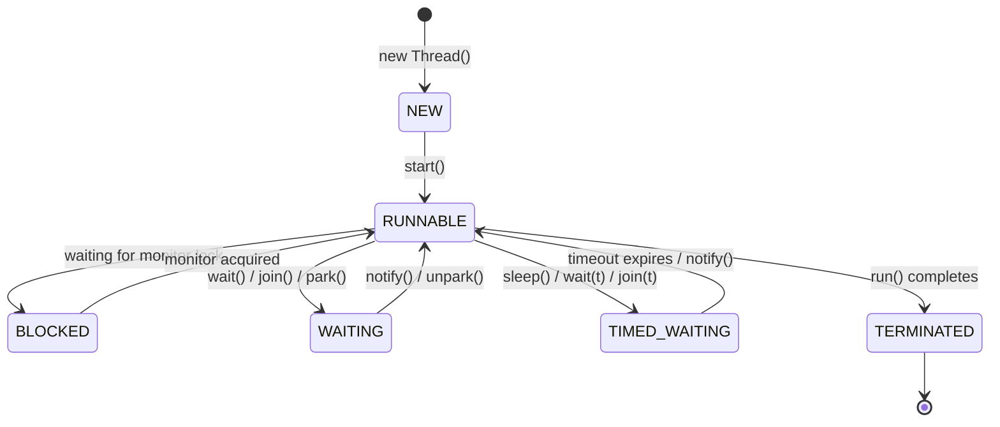

# Threads and Thread Lifecycle

> Architectural guide to Java threads: OS platform threads vs Virtual threads (JEP 444), the 6 JVM thread states, thread scheduling, cooperative interruption, and lifecycle management.

| Metadata | Value |
|---|---|
| **Level** | Intermediate |
| **Prerequisites** | [01-fundamentals/06_control-flow.md](../01-fundamentals/06_control-flow.md), [06-exceptions-and-debugging/00_exception-hierarchy-and-types.md](../06-exceptions-and-debugging/00_exception-hierarchy-and-types.md) |
| **Time to Read** | 25 minutes |
| **Status** | Active |
| **Java Version** | Java 1.0+ (Thread.ofPlatform/ofVirtual in Java 21+ JEP 444) |

---

## Table of Contents
1. [What & Why](#1-what--why)
2. [Core Concepts](#2-core-concepts)
3. [How It Works Internally](#3-how-it-works-internally)
4. [Syntax & Usage](#4-syntax--usage)
5. [Practical Examples](#5-practical-examples)
6. [Best Practices](#6-best-practices)
7. [Common Mistakes & Pitfalls](#7-common-mistakes--pitfalls)
8. [Performance & Security Notes](#8-performance--security-notes)
9. [Comparison / When to Use What](#9-comparison--when-to-use-what)
10. [Interview Questions](#10-interview-questions)
11. [Practice Exercises](#11-practice-exercises)
12. [Summary / Cheat Sheet](#12-summary--cheat-sheet)
13. [Further Reading](#13-further-reading)

---

## 1. What & Why

### Concurrency vs Parallelism
In modern computing systems:
- **Concurrency** is the architectural composition of independently executing processes (managing multiple tasks in overlapping time slices).
- **Parallelism** is the simultaneous physical execution of multiple computations across separate physical CPU hardware cores.

### The Problem: Operating System Threads as Expensive Resources
In classic Java (Java 1.0 through 20), every `java.lang.Thread` instance was a 1:1 wrapper around an operating system (kernel) thread. An OS thread allocates roughly 1 MB of native stack memory, requires kernel context switches, and limits standard servers to a few thousand concurrent connections before exhausting memory or crashing under thread starvation.

### The Modern Solution: Platform vs Virtual Threads (Java 21 JEP 444)
Java 21 bifurcated threads into two distinct categories:
1. **Platform Threads**: Heavyweight, OS-backed kernel threads (1:1 mapping). Ideal for CPU-intensive parallel math and cryptographic operations.
2. **Virtual Threads (Project Loom)**: Lightweight user-mode threads managed entirely by the JVM (M:N mapping). Millions of virtual threads can run concurrently on a handful of OS carrier threads, revolutionizing high-throughput I/O.

---

## 2. Core Concepts

### The 6 JVM Thread States (`Thread.State`)
A Java thread always exists in exactly one of 6 states:
1. **`NEW`**: Thread instance created, but `start()` has not yet been invoked.
2. **`RUNNABLE`**: Executing in the JVM or waiting for CPU OS scheduling.
3. **`BLOCKED`**: Waiting to acquire a monitor lock to enter/re-enter a `synchronized` block/method.
4. **`WAITING`**: Waiting indefinitely for another thread to perform a particular action (`Object.wait()`, `Thread.join()`, `LockSupport.park()`).
5. **`TIMED_WAITING`**: Waiting for a specified timeout period (`Thread.sleep(ms)`, `Object.wait(ms)`, `Thread.join(ms)`).
6. **`TERMINATED`**: Thread has completed execution of `run()` or terminated via an unhandled exception.

### Cooperative Interruption
Java threads **cannot be forcefully killed or terminated** from the outside (`Thread.stop()` and `Thread.destroy()` are permanently deprecated/removed). Instead, Java relies on **cooperative interruption**:
- `thread.interrupt()` sets the thread's internal interrupt status flag.
- Blocking methods (`sleep`, `wait`, `join`) detect the flag, abort the wait, and throw `InterruptedException`, clearing the flag.
- Non-blocking computational loops must periodically poll `Thread.currentThread().isInterrupted()` to exit gracefully.

### Daemon vs Non-Daemon Threads
- **Non-Daemon (User) Threads**: The JVM process will **not exit** as long as at least one non-daemon user thread is alive.
- **Daemon Threads**: Background service threads (e.g. GC, finalizer, housekeeping). The JVM exits immediately when all non-daemon user threads finish, abruptly halting all running daemon threads.

---

## 3. How It Works Internally

### JVM Thread State Machine


### OS Thread Stack vs Virtual Thread Continuation
- **Platform Thread**: Allocates 1 MB fixed native memory stack mapped directly to a kernel task struct (`task_struct` in Linux).
- **Virtual Thread**: Has a small user-space continuation stack that starts at just a few hundred bytes on the JVM heap. When blocking on I/O, the JVM unmounts the virtual thread from its underlying OS carrier thread, parking its state on the heap without blocking the OS thread.

---

## 4. Syntax & Usage

### Creating Threads in Modern Java (Java 21+)
```java
// Fluent builders introduced in Java 21
Thread platformThread = Thread.ofPlatform()
    .name("worker-platform-1")
    .daemon(false)
    .priority(Thread.NORM_PRIORITY)
    .start(() -> System.out.println("Running on platform thread: " + Thread.currentThread()));

Thread virtualThread = Thread.ofVirtual()
    .name("worker-virtual-1")
    .start(() -> System.out.println("Running on virtual thread: " + Thread.currentThread()));
```

### Handling Cooperative Interruption
```java
public class InterruptionHandlingWorker implements Runnable {
    @Override
    public void run() {
        while (!Thread.currentThread().isInterrupted()) {
            try {
                // Blocking operation
                Thread.sleep(1000);
                System.out.println("Working...");
            } catch (InterruptedException e) {
                // InterruptedException clears the interrupt status!
                // Best practice: Restore interrupt status or exit loop immediately!
                System.out.println("Interrupted during sleep! Cleaning up and exiting...");
                Thread.currentThread().interrupt(); // Re-assert interrupt flag
                break; // Exit gracefully
            }
        }
    }
}
```

---

## 5. Practical Examples

### Example 1: Thread Coordination via `join()`
```java
// Goal: Coordinate multiple worker threads to assemble data before printing
public class ThreadJoinDemo {
    public static void main(String[] args) throws InterruptedException {
        Thread worker1 = Thread.ofPlatform().name("DB-Worker").start(() -> {
            try {
                Thread.sleep(200);
                System.out.println("Database results fetched.");
            } catch (InterruptedException e) {
                Thread.currentThread().interrupt();
            }
        });

        Thread worker2 = Thread.ofPlatform().name("API-Worker").start(() -> {
            try {
                Thread.sleep(300);
                System.out.println("API payload fetched.");
            } catch (InterruptedException e) {
                Thread.currentThread().interrupt();
            }
        });

        // Wait for both worker threads to finish before continuing main thread
        worker1.join();
        worker2.join();

        System.out.println("All worker dependencies completed. Processing main report...");
    }
}
```
*Output:*
```
Database results fetched.
API payload fetched.
All worker dependencies completed. Processing main report...
```

### Example 2: Inspecting Thread States Dynamically
```java
// Goal: Track the transition of a thread through NEW, RUNNABLE, TIMED_WAITING, TERMINATED
public class ThreadStateTracker {
    public static void main(String[] args) throws Exception {
        Thread task = new Thread(() -> {
            try {
                Thread.sleep(200);
            } catch (InterruptedException ignored) {}
        });

        System.out.println("1. State after new: " + task.getState()); // NEW
        task.start();
        System.out.println("2. State after start: " + task.getState()); // RUNNABLE

        Thread.sleep(50);
        System.out.println("3. State during sleep: " + task.getState()); // TIMED_WAITING

        task.join();
        System.out.println("4. State after completion: " + task.getState()); // TERMINATED
    }
}
```
*Output:*
```
1. State after new: NEW
2. State after start: RUNNABLE
3. State during sleep: TIMED_WAITING
4. State after completion: TERMINATED
```

### Example 3: Edge Case: Uncaught Exception Handler
```java
// Goal: Ensure unhandled runtime exceptions in background threads are logged properly
public class UncaughtExceptionDemo {
    public static void main(String[] args) {
        Thread worker = Thread.ofPlatform().name("Faulty-Worker").unstarted(() -> {
            throw new RuntimeException("Fatal database timeout in background task!");
        });

        // Register custom uncaught exception handler
        worker.setUncaughtExceptionHandler((t, ex) -> {
            System.err.println("ALERT: Thread [" + t.getName() + "] crashed with error: " + ex.getMessage());
        });

        worker.start();
    }
}
```
*Output:*
```
ALERT: Thread [Faulty-Worker] crashed with error: Fatal database timeout in background task!
```

### Example 4: Failure Case: Swallowing `InterruptedException`
```java
// Goal: Demonstrate anti-pattern that causes threads to ignore shutdown signals
public class SwallowedInterruptHazard implements Runnable {
    @Override
    public void run() {
        while (true) {
            try {
                Thread.sleep(1000);
            } catch (InterruptedException e) {
                // FATAL ANTI-PATTERN:
                // Exception is caught and ignored without re-asserting interrupt or breaking!
                // Thread will ignore all cancellation/shutdown requests forever!
                System.err.println("Swallowed interrupt! Continuing endlessly...");
            }
        }
    }
}
```

---

## 6. Best Practices
1. **Never Call `run()` Directly**: Calling `t.run()` executes the task synchronously on the current thread; call `t.start()` to launch a new OS or virtual thread.
2. **Never Swallow `InterruptedException`**: Either re-throw it, exit the loop, or restore the flag with `Thread.currentThread().interrupt()`.
3. **Use Thread Pools over Raw Threads**: For platform threads, use `ExecutorService` rather than continuously instantiating `new Thread()`.
4. **Name All Threads**: Always assign descriptive names (`Thread.ofPlatform().name("order-sync-")`) to simplify debugging thread dumps (`jstack`).
5. **Configure UncaughtExceptionHandler**: Set a default handler via `Thread.setDefaultUncaughtExceptionHandler()` to ensure uncaught exceptions are logged in production.

---

## 7. Common Mistakes & Pitfalls

| Mistake | Why Wrong | Fix |
|---|---|---|
| Calling `t.run()` instead of `t.start()` | Executes synchronously on the calling thread; no new thread is spawned. | Call `t.start()`. |
| Swallowing `InterruptedException` | Clears interrupt flag without exiting, causing thread to ignore shutdown signals. | Re-assert flag (`Thread.currentThread().interrupt()`) or break. |
| Calling deprecated `Thread.stop()` | Arbitrarily releases locks, leaving shared data structures in corrupted states. | Use cooperative cancellation via `interrupt()`. |
| Assuming thread priorities guarantee order | Thread priorities are hints to the OS; many kernels completely ignore Java thread priority. | Use explicit locks, latches, or queues to control execution order. |
| Forgetting that Daemon threads abort on exit | JVM terminates immediately when user threads finish, leaving daemon work incomplete. | Use user threads or shutdown hooks for tasks requiring graceful flush. |
| Calling `start()` multiple times on same thread | Throws `IllegalThreadStateException`; a thread cannot be restarted once started. | Instantiate a new thread instance. |

---

## 8. Performance & Security Notes

### Operating System Context Switching Cost
Platform threads incur significant context-switching penalties. The CPU must save register state, invalidate Translation Lookaside Buffers (TLB), and switch execution privileges between user space and kernel space. Having more active platform threads than CPU cores leads to thrashing.

### Memory Overhead
Each platform thread reserves a default 1 MB stack (`-Xss1m`). Spawning 10,000 platform threads consumes 10 GB of native RAM purely for thread stacks. Virtual threads solve this by allocating stacks dynamically on the heap starting at under 1 KB.

---

## 9. Comparison / When to Use What

| Feature | Platform Thread | Virtual Thread (Java 21+) |
|---|---|---|
| **OS Mapping** | 1:1 Kernel Thread | M:N User-mode on Carrier Threads |
| **Stack Memory** | ~1 MB (Fixed native) | Variable (starts at ~1 KB on heap) |
| **Creation Cost** | High (Kernel syscall) | Microscopic (Heap allocation) |
| **Max Concurrent** | Thousands (~5,000) | Millions (~1,000,000+) |
| **Optimal Workload** | Heavy CPU computation | I/O-bound (HTTP, DB, Sockets) |
| **Thread Pooling** | Mandatory | Anti-pattern (Create per task) |

---

## 10. Interview Questions

<details>
<summary>1. What are the six thread states in Java?</summary>
`NEW`, `RUNNABLE`, `BLOCKED` (waiting for monitor lock), `WAITING` (waiting indefinitely), `TIMED_WAITING` (waiting with timeout), and `TERMINATED`.
</details>

<details>
<summary>2. What is the difference between `start()` and `run()`?</summary>
`start()` requests the JVM to allocate execution resources and launch a new asynchronous thread that invokes `run()`. Calling `run()` directly merely executes the method synchronously on the existing caller thread.
</details>

<details>
<summary>3. Why were `Thread.stop()`, `suspend()`, and `resume()` deprecated and removed?</summary>
`stop()` forcefully terminated a thread while holding monitor locks, leaving shared data structures corrupted. `suspend()` halted a thread holding locks, easily causing permanent deadlocks.
</details>

<details>
<summary>4. How does cooperative interruption work in Java?</summary>
Calling `interrupt()` sets an internal boolean flag. If the thread is blocked in an interruptible method (`sleep`, `wait`, `join`), an `InterruptedException` is thrown and the flag is cleared. Code should periodically inspect `isInterrupted()` and exit cleanly.
</details>

<details>
<summary>5. What happens when `InterruptedException` is thrown?</summary>
The thread's interrupt status flag is automatically cleared (reset to false). Therefore, catch blocks must either handle shutdown or call `Thread.currentThread().interrupt()` to preserve the flag for outer callers.
</details>

<details>
<summary>6. What is a Daemon Thread and when should you use one?</summary>
A daemon thread is a background service thread that does not prevent the JVM from exiting. When all non-daemon (user) threads terminate, the JVM immediately terminates all daemon threads.
</details>

<details>
<summary>7. What does `Thread.yield()` do?</summary>
It is a hint to the OS thread scheduler that the current thread is willing to yield its current use of the processor. The OS scheduler is completely free to ignore this hint.
</details>

<details>
<summary>8. How do Virtual Threads in Java 21 differ from Platform Threads?</summary>
Virtual threads are lightweight, user-mode threads managed by the JVM runtime rather than the operating system kernel. They have tiny stack footprints and allow millions of concurrent tasks to execute on a small pool of carrier OS threads.
</details>

---

## 11. Practice Exercises

### Exercise 1 (Easy): Graceful Polling Loop
- **Task**: Implement a `Runnable` loop that computes numbers continuously and stops cleanly within 100ms when interrupted from the outside.
<details>
<summary>Solution</summary>

```java
public class GracefulPoller implements Runnable {
    @Override
    public void run() {
        long count = 0;
        while (!Thread.currentThread().isInterrupted()) {
            count++;
        }
        System.out.println("Terminated cleanly after counting to: " + count);
    }

    public static void main(String[] args) throws InterruptedException {
        Thread t = new Thread(new GracefulPoller());
        t.start();
        Thread.sleep(100);
        t.interrupt();
        t.join();
    }
}
```
</details>

### Exercise 2 (Medium): Multi-Threaded Staged Pipeline
- **Task**: Spawn 3 worker threads. Thread 1 loads data, Thread 2 waits for Thread 1 to finish before transforming, and Thread 3 waits for Thread 2 to finish before saving. Use `join()`.
<details>
<summary>Solution</summary>

```java
public class StagedPipeline {
    public static void main(String[] args) throws InterruptedException {
        Thread t1 = Thread.ofPlatform().name("Loader").start(() -> {
            System.out.println("Stage 1: Data loaded.");
        });

        Thread t2 = Thread.ofPlatform().name("Transformer").start(() -> {
            try {
                t1.join(); // Wait for t1
                System.out.println("Stage 2: Data transformed.");
            } catch (InterruptedException e) {
                Thread.currentThread().interrupt();
            }
        });

        Thread t3 = Thread.ofPlatform().name("Saver").start(() -> {
            try {
                t2.join(); // Wait for t2
                System.out.println("Stage 3: Data persisted.");
            } catch (InterruptedException e) {
                Thread.currentThread().interrupt();
            }
        });

        t3.join();
        System.out.println("Pipeline complete!");
    }
}
```
</details>

### Exercise 3 (Hard): Thread Monitor Watchdog
- **Task**: Implement a `Watchdog` thread that monitors a target worker thread. If the worker remains in `BLOCKED` or `WAITING` state for more than 2 seconds, the watchdog interrupts the worker and logs an alert.
<details>
<summary>Solution</summary>

```java
public class WatchdogDemo {
    public static void main(String[] args) {
        Thread worker = new Thread(() -> {
            try {
                Thread.sleep(10000); // Intentionally hangs
            } catch (InterruptedException e) {
                System.out.println("Worker interrupted by watchdog!");
            }
        });

        Thread watchdog = new Thread(() -> {
            long stuckSince = 0;
            while (worker.isAlive()) {
                Thread.State state = worker.getState();
                if (state == Thread.State.WAITING || state == Thread.State.TIMED_WAITING || state == Thread.State.BLOCKED) {
                    if (stuckSince == 0) stuckSince = System.currentTimeMillis();
                    else if (System.currentTimeMillis() - stuckSince > 2000) {
                        System.err.println("ALERT: Worker stuck for > 2s. Interrupting!");
                        worker.interrupt();
                        break;
                    }
                } else {
                    stuckSince = 0;
                }
                try { Thread.sleep(200); } catch (InterruptedException ignored) {}
            }
        });
        watchdog.setDaemon(true);

        worker.start();
        watchdog.start();
    }
}
```
</details>

---

## 12. Summary / Cheat Sheet

```
+-----------------------------------------------------------------------------------------+
|                               JAVA THREAD LIFECYCLE CHEAT SHEET                         |
+-----------------------------------------------------------------------------------------+
| Launch Thread            | Thread.ofPlatform().name("p1").start(runnable);              |
| Launch Virtual Thread    | Thread.ofVirtual().name("v1").start(runnable);               |
| 6 Thread States          | NEW, RUNNABLE, BLOCKED, WAITING, TIMED_WAITING, TERMINATED   |
| Cancellation             | Cooperative: thread.interrupt(); + test isInterrupted()      |
| Clear Interrupted Flag   | Thread.interrupted() (Static, clears flag)                   |
| Test Without Clearing    | thread.isInterrupted() (Instance, preserves flag)            |
| Synchronization Join     | worker.join(); (Waits for target thread to terminate)        |
| Uncaught Exceptions      | thread.setUncaughtExceptionHandler((t, e) -> ...);           |
+-----------------------------------------------------------------------------------------+
```

---

## 13. Further Reading
- [JEP 444: Virtual Threads (Java 21)](https://openjdk.org/jeps/444)
- Java Concurrency in Practice by Brian Goetz — Chapter 7 (Cancellation and Shutdown)
- Java Language Specification — Section 17.2 (Threads)
- Inside Java Podcast: Thread States and Loom Internals
