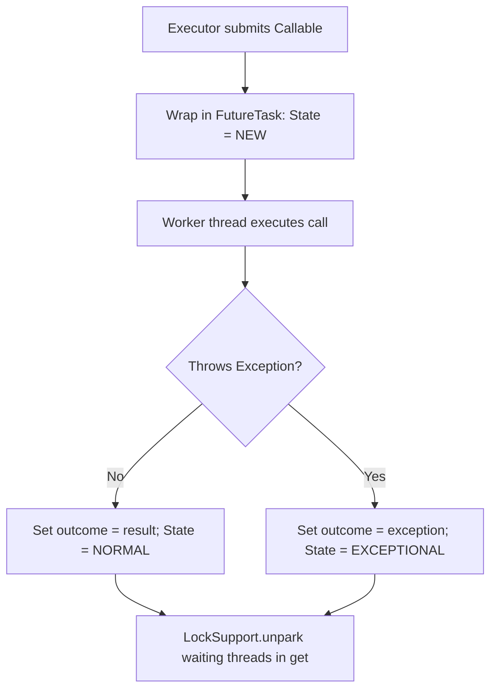

# Runnable, Callable, and Future

> Comprehensive architectural reference for Java asynchronous task modeling: `Runnable` vs `Callable<V>`, `Future<V>`, polling vs blocking retrieval, task cancellation, `CompletableFuture` preview, and `Future.State` (Java 19+).

| Metadata | Value |
|---|---|
| **Level** | Intermediate |
| **Prerequisites** | [00_threads-and-lifecycle.md](00_threads-and-lifecycle.md), [09-functional-java/01_functional-interfaces.md](../09-functional-java/01_functional-interfaces.md) |
| **Time to Read** | 24 minutes |
| **Status** | Active |
| **Java Version** | Java 1.0 (Runnable), Java 5.0 (Callable/Future), Java 19+ (Future.State JEP 425/444) |

---

## Table of Contents
1. [What & Why](#1-what--why)
2. [Core Concepts](#2-core-concepts)
3. [How It Works Internally](#3-how-it-works-internally)
4. [Syntax & Usage](#4-syntax--usage)
5. [Practical Examples](#5-practical-examples)
6. [Best Practices](#6-best-practices)
7. [Common Mistakes & Pitfalls](#7-common-mistakes--pitfalls)
8. [Performance & Security Notes](#8-performance--security-notes)
9. [Comparison / When to Use What](#9-comparison--when-to-use-what)
10. [Interview Questions](#10-interview-questions)
11. [Practice Exercises](#11-practice-exercises)
12. [Summary / Cheat Sheet](#12-summary--cheat-sheet)
13. [Further Reading](#13-further-reading)

---

## 1. What & Why

### The Limitations of `Runnable`
In early Java (Java 1.0 to 1.4), asynchronous tasks were represented exclusively via `java.lang.Runnable`:
```java
@FunctionalInterface
public interface Runnable {
    void run();
}
```
`Runnable` had two severe design limitations:
1. **Cannot Return a Result**: Its return type is `void`. To extract computed data from a background worker, developers had to mutate shared memory or store results in fields, introducing race conditions.
2. **Cannot Throw Checked Exceptions**: The method signature declares no exceptions. Any checked exception had to be caught and swallowed or wrapped in `RuntimeException`.

### The Solution: `Callable<V>` and `Future<V>` (Java 5)
Java 5 introduced the `java.util.concurrent` package, establishing:
- **`Callable<V>`**: Returns a typed value of type `V` and declares `throws Exception`.
- **`Future<V>`**: Represents the lifecycle and eventual result of an asynchronous computation, providing methods to check completion, cancel execution, and block until the result is available.

---

## 2. Core Concepts

### `Runnable` vs `Callable<V>`
| Characteristic | `Runnable` | `Callable<V>` |
|---|---|---|
| **Method Signature** | `void run()` | `V call() throws Exception` |
| **Return Value** | None (`void`) | Typed result (`V`) |
| **Exception Handling** | Unchecked only | Any checked or unchecked exception |
| **Primary Executor Method** | `executor.execute(r)` / `submit(r)` | `executor.submit(c)` |

### The `Future<V>` Contract
`Future<V>` provides 5 core operations:
1. `V get()`: Blocks indefinitely until computation finishes, then returns the result.
2. `V get(long timeout, TimeUnit unit)`: Blocks up to the specified duration; throws `TimeoutException` if computation is not complete.
3. `boolean isDone()`: Non-blocking poll returning `true` if completed, cancelled, or failed.
4. `boolean cancel(boolean mayInterruptIfRunning)`: Attempts to cancel execution.
5. `boolean isCancelled()`: Returns `true` if cancelled before normal completion.

### `Future.state()` (Java 19+ JEP 425/444)
Modern Java adds `future.state()`, returning an enum `Future.State`:
- `RUNNING`: Task is actively running.
- `SUCCESS`: Task completed successfully; `resultNow()` can be called without blocking.
- `FAILED`: Task threw an exception; `exceptionNow()` retrieves the cause.
- `CANCELLED`: Task was cancelled.

---

## 3. How It Works Internally

### `FutureTask<V>` Execution Mechanics
When an executor receives a `Callable<V>`, it wraps it inside a `FutureTask<V>`. `FutureTask` implements both `Runnable` and `Future`:
1. **State Machine**: Tracks atomic transitions (`NEW -> COMPLETING -> NORMAL / EXCEPTIONAL / CANCELLED`).
2. **Wait Queue (Treiber Stack)**: When a thread calls `get()`, it is parked via `LockSupport.park()` and placed onto an internal linked list of waiting threads.
3. **Completion Unparking**: When `call()` finishes, the result is stored in an internal field, the state transitions to `NORMAL`, and all waiting threads are unparked via `LockSupport.unpark()`.



---

## 4. Syntax & Usage

### Submitting a `Callable` to an `ExecutorService`
```java
import java.util.concurrent.*;

public class CallableDemo {
    public static void main(String[] args) throws Exception {
        try (ExecutorService executor = Executors.newVirtualThreadPerTaskExecutor()) {
            Callable<Integer> calculation = () -> {
                Thread.sleep(100);
                return 42 * 2;
            };

            Future<Integer> future = executor.submit(calculation);

            // Do other work concurrently...
            System.out.println("Computation submitted. Polling isDone: " + future.isDone());

            // Blocking retrieval with timeout
            Integer result = future.get(1, TimeUnit.SECONDS);
            System.out.println("Result received: " + result);
        }
    }
}
```

### Modern `Future.state()` and `resultNow()` (Java 19+)
```java
public class FutureStateDemo {
    public static void process(Future<String> future) {
        if (future.state() == Future.State.SUCCESS) {
            // Non-blocking retrieval! Throws IllegalStateException if not SUCCESS.
            String val = future.resultNow();
            System.out.println("Success: " + val);
        } else if (future.state() == Future.State.FAILED) {
            Throwable ex = future.exceptionNow();
            System.err.println("Failure: " + ex.getMessage());
        }
    }
}
```

---

## 5. Practical Examples

### Example 1: Parallel Batch Fetching with Timeouts
```java
// Goal: Fetch data from multiple independent services concurrently with a strict SLA
import java.util.*;
import java.util.concurrent.*;

public class ParallelBatchFetcher {
    record ServiceResponse(String serviceName, String data, long durationMs) {}

    public static List<ServiceResponse> fetchAll(List<String> services) throws Exception {
        try (ExecutorService executor = Executors.newVirtualThreadPerTaskExecutor()) {
            List<Future<ServiceResponse>> futures = new ArrayList<>();

            for (String service : services) {
                futures.add(executor.submit(() -> {
                    long start = System.currentTimeMillis();
                    // Simulate network latency
                    Thread.sleep(new Random().nextInt(150) + 50);
                    return new ServiceResponse(service, "DATA_FROM_" + service, System.currentTimeMillis() - start);
                }));
            }

            List<ServiceResponse> results = new ArrayList<>();
            for (Future<ServiceResponse> f : futures) {
                try {
                    // Strict 300ms SLA per service
                    results.add(f.get(300, TimeUnit.MILLISECONDS));
                } catch (TimeoutException e) {
                    f.cancel(true); // Cancel slow requests!
                    System.err.println("Service timed out; cancelled request.");
                }
            }
            return results;
        }
    }

    public static void main(String[] args) throws Exception {
        var responses = fetchAll(List.of("Billing", "Inventory", "Shipping"));
        responses.forEach(System.out::println);
    }
}
```

### Example 2: Cancellation of Long-Running Task
```java
// Goal: Cancel a background computation when user aborts
import java.util.concurrent.*;

public class TaskCancellationDemo {
    public static void main(String[] args) throws Exception {
        try (ExecutorService executor = Executors.newSingleThreadExecutor()) {
            Future<?> longTask = executor.submit(() -> {
                while (!Thread.currentThread().isInterrupted()) {
                    System.out.println("Crunching massive dataset...");
                    try {
                        Thread.sleep(500);
                    } catch (InterruptedException e) {
                        System.out.println("Task detected interrupt during sleep! Aborting...");
                        Thread.currentThread().interrupt();
                        break;
                    }
                }
            });

            Thread.sleep(1200);
            System.out.println("Cancelling task with mayInterruptIfRunning = true...");
            longTask.cancel(true); // Triggers Thread.interrupt()
            System.out.println("Is task cancelled: " + longTask.isCancelled());
        }
    }
}
```
*Output:*
```
Crunching massive dataset...
Crunching massive dataset...
Crunching massive dataset...
Cancelling task with mayInterruptIfRunning = true...
Task detected interrupt during sleep! Aborting...
Is task cancelled: true
```

### Example 3: Edge Case: Exception Unpacking from `ExecutionException`
```java
// Goal: Correctly extract and propagate original root cause
import java.util.concurrent.*;

public class ExceptionUnpackingDemo {
    public static void main(String[] args) {
        try (ExecutorService executor = Executors.newSingleThreadExecutor()) {
            Future<String> future = executor.submit(() -> {
                throw new java.io.FileNotFoundException("Config file missing: app.properties");
            });

            try {
                future.get();
            } catch (InterruptedException e) {
                Thread.currentThread().interrupt();
            } catch (ExecutionException e) {
                Throwable cause = e.getCause(); // Retrieve original exception!
                System.out.println("Original exception type: " + cause.getClass().getSimpleName());
                System.out.println("Original message: " + cause.getMessage());
            }
        }
    }
}
```
*Output:*
```
Original exception type: FileNotFoundException
Original message: Config file missing: app.properties
```

### Example 4: Failure Case: Calling `future.get()` on Main Thread in Tight Loop
```java
// Goal: Highlight anti-pattern that destroys concurrency
public class SerializedFutureHazard {
    public static void badParallelism(List<Callable<String>> tasks, ExecutorService executor) throws Exception {
        // HAZARD: Submitting and calling get() immediately turns parallel tasks into sequential ones!
        for (Callable<String> task : tasks) {
            Future<String> f = executor.submit(task);
            f.get(); // BLOCKS IMMEDIATELY! Next task is not even submitted until this one completes!
        }
    }
}
```
*Explanation:* Always submit all tasks first into a collection of futures, and only then loop through collecting results with `get()`.

---

## 6. Best Practices
1. **Always Specify Timeouts with `get()`**: Never call unadorned `future.get()` in production; always use `future.get(timeout, unit)` to prevent permanent thread deadlocks.
2. **Submit All Tasks Before Calling `get()`**: Avoid submitting and immediately blocking on `get()`, which degrades parallel execution to serial execution.
3. **Always Inspect `e.getCause()` on `ExecutionException`**: The checked exception thrown by `Callable` is wrapped inside `ExecutionException`. Unpack `e.getCause()`.
4. **Use `cancel(true)` for Aborted Tasks**: Cancel unneeded tasks to free up executor worker threads and reduce CPU waste.
5. **Adopt `CompletableFuture` for Complex Orchestration**: For chaining, combining, and non-blocking callbacks, prefer `CompletableFuture` over classic `Future`.

---

## 7. Common Mistakes & Pitfalls

| Mistake | Why Wrong | Fix |
|---|---|---|
| Calling unadorned `future.get()` | If the task hangs or deadlocks, the caller thread is blocked forever. | Always use `future.get(timeout, unit)`. |
| Submitting and getting in the same loop iteration | Turns concurrent execution into sequential, single-threaded execution. | Collect all `Future` objects first, then retrieve values. |
| Catching `ExecutionException` and ignoring cause | Hides the true domain exception that caused the task to fail. | Inspect and rethrow `e.getCause()`. |
| Expecting `cancel(false)` to stop active computation | `cancel(false)` only prevents unstarted tasks from running; running tasks continue. | Pass `cancel(true)` to send a thread interrupt signal. |
| Calling `resultNow()` when state is not `SUCCESS` | Throws `IllegalStateException` if task is still running, failed, or cancelled. | Verify `future.state() == Future.State.SUCCESS` first. |

---

## 8. Performance & Security Notes

### Thread Starvation Deadlocks with Classic Thread Pools
If tasks running inside a fixed-size thread pool submit sub-tasks to the *same* pool and block waiting for `future.get()`, the pool can become completely exhausted, causing a permanent **Thread Starvation Deadlock**. Virtual threads eliminate this issue by parking without consuming OS threads.

### Memory Leak on Abandoned Futures
If thousands of tasks are submitted to an executor but their returned `Future` handles are stored in a long-lived list without retrieval or removal, completed tasks retain references to their results on the heap, leading to memory leaks.

---

## 9. Comparison / When to Use What

| Feature | `Runnable` | `Callable<V>` | `Future<V>` | `CompletableFuture<V>` |
|---|---|---|---|---|
| **Returns Value** | No (`void`) | Yes (`V`) | Holds result | Holds result |
| **Throws Checked**| No | Yes (`Exception`) | Via ExecutionException | Exceptional completion |
| **Non-blocking Callbacks**| No | No | No (Requires polling) | Yes (`thenApply`, `thenAccept`) |
| **Composition** | None | None | None | Rich functional combinators |
| **Best For** | Fire-and-forget | Task definition | Legacy sync retrieval | Modern reactive pipelines |

---

## 10. Interview Questions

<details>
<summary>1. What are the key differences between `Runnable` and `Callable`?</summary>
`Runnable.run()` returns `void` and cannot throw checked exceptions. `Callable.call()` returns a parameterized type `V` and declares `throws Exception`.
</details>

<details>
<summary>2. What happens when you call `future.get()`?</summary>
The invoking thread is blocked (parked) until the background task completes, fails, or is cancelled. If the task completed normally, the result is returned; if it failed, an `ExecutionException` wrapping the root cause is thrown.
</details>

<details>
<summary>3. What is the difference between `cancel(true)` and `cancel(false)`?</summary>
`cancel(false)` prevents the task from starting if it is still queued in the executor. `cancel(true)` additionally sends an interrupt signal (`Thread.interrupt()`) to the executing thread if the task is already running.
</details>

<details>
<summary>4. What exceptions can `Future.get(long, TimeUnit)` throw?</summary>
`InterruptedException` (caller thread interrupted), `ExecutionException` (task threw exception), `TimeoutException` (timeout elapsed before completion), and `CancellationException` (task was cancelled).
</details>

<details>
<summary>5. What are `resultNow()` and `exceptionNow()` introduced in Java 19?</summary>
They are non-blocking methods on `Future` that immediately return the result or exception if the task is already complete. If the task is still running or not in the expected state, they throw `IllegalStateException`.
</details>

<details>
<summary>6. How does a thread pool avoid recreating threads for each `Callable`?</summary>
The pool keeps a fixed number of worker threads alive in a loop polling an internal `BlockingQueue<Runnable>`. When a task arrives, a worker picks it up, calls `run()`, and returns to poll for the next task.
</details>

<details>
<summary>7. What is a `FutureTask`?</summary>
The standard JDK implementation of `Future` and `Runnable`. It encapsulates the lifecycle state machine and synchronization needed to run a `Callable` and deliver its result to waiting threads.
</details>

<details>
<summary>8. Why should you avoid calling `future.get()` without a timeout?</summary>
Without a timeout, if the background task deadlocks, hangs on external socket I/O, or enters an infinite loop, the calling thread will remain blocked forever, leading to thread exhaustion.
</details>

---

## 11. Practice Exercises

### Exercise 1 (Easy): Basic Asynchronous Number Multiplier
- **Task**: Submit a `Callable<Long>` that multiplies two large numbers and retrieve the result using `Future.get(1, TimeUnit.SECONDS)`.
<details>
<summary>Solution</summary>

```java
import java.util.concurrent.*;

public class CallableMultiplyExercise {
    public static void main(String[] args) throws Exception {
        try (ExecutorService executor = Executors.newSingleThreadExecutor()) {
            Callable<Long> task = () -> 123456789L * 987654321L;
            Future<Long> future = executor.submit(task);
            Long result = future.get(1, TimeUnit.SECONDS);
            System.out.println("Product: " + result);
        }
    }
}
```
</details>

### Exercise 2 (Medium): Timed Resilient Task Execution
- **Task**: Implement a helper method `executeWithFallback(Callable<T> task, T fallback, long timeoutMs)` that executes a task and returns the fallback value if a `TimeoutException` or `ExecutionException` occurs.
<details>
<summary>Solution</summary>

```java
import java.util.concurrent.*;

public class ResilientTaskRunner {
    public static <T> T executeWithFallback(Callable<T> task, T fallback, long timeoutMs, ExecutorService executor) {
        Future<T> future = executor.submit(task);
        try {
            return future.get(timeoutMs, TimeUnit.MILLISECONDS);
        } catch (TimeoutException e) {
            future.cancel(true);
            return fallback;
        } catch (Exception e) {
            return fallback;
        }
    }
}
```
</details>

### Exercise 3 (Hard): Parallel Map-Reduce with Futures
- **Task**: Divide an array of 1,000,000 integers into 4 equal segments. Submit 4 `Callable<Long>` tasks to compute segment sums, and sum the results in the main thread using `Future.get()`.
<details>
<summary>Solution</summary>

```java
import java.util.*;
import java.util.concurrent.*;

public class ParallelArraySum {
    public static void main(String[] args) throws Exception {
        int[] data = new int[1_000_000];
        Arrays.fill(data, 1); // Sum should be 1,000,000

        int chunks = 4;
        int chunkSize = data.length / chunks;

        try (ExecutorService executor = Executors.newFixedThreadPool(chunks)) {
            List<Future<Long>> futures = new ArrayList<>();

            for (int i = 0; i < chunks; i++) {
                final int start = i * chunkSize;
                final int end = (i == chunks - 1) ? data.length : start + chunkSize;

                futures.add(executor.submit(() -> {
                    long partialSum = 0;
                    for (int j = start; j < end; j++) {
                        partialSum += data[j];
                    }
                    return partialSum;
                }));
            }

            long totalSum = 0;
            for (Future<Long> f : futures) {
                totalSum += f.get(2, TimeUnit.SECONDS);
            }

            System.out.println("Calculated Total Sum: " + totalSum);
        }
    }
}
```
</details>

---

## 12. Summary / Cheat Sheet

```
+-----------------------------------------------------------------------------------------+
|                              CALLABLE & FUTURE CHEAT SHEET                              |
+-----------------------------------------------------------------------------------------+
| Runnable Interface       | void run() (No result, unchecked exceptions only)            |
| Callable Interface       | V call() throws Exception (Typed result, checked exceptions) |
| Submit Task              | Future<V> f = executor.submit(callable);                     |
| Blocking Get             | V result = f.get(timeout, TimeUnit.SECONDS);                |
| Cancel Task              | f.cancel(true); (Sends Thread.interrupt())                   |
| Java 19+ State Check     | if (f.state() == Future.State.SUCCESS) f.resultNow();        |
| Handle Failure           | catch (ExecutionException e) { Throwable cause = e.getCause()|
+-----------------------------------------------------------------------------------------+
```

---

## 13. Further Reading
- [Official Javadoc: java.util.concurrent.Future](https://docs.oracle.com/en/java/javase/21/docs/api/java.base/java/util/concurrent/Future.html)
- Java Concurrency in Practice by Brian Goetz — Chapter 6 (Task Execution)
- Oracle Dev.java: Concurrency and the Executor Framework
