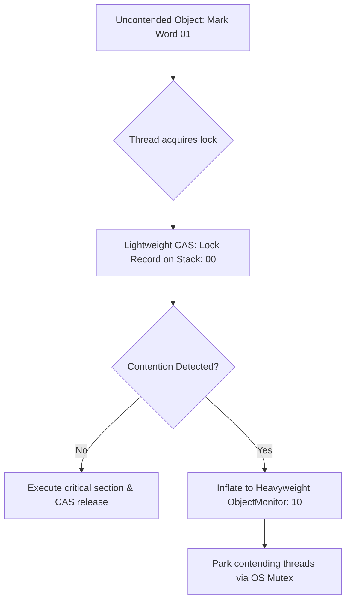

# Synchronization and Monitors

> Deep dive into Java intrinsic locks: synchronized methods and blocks, monitor mechanics, object header Mark Word, monitor inflation (biased $\to$ thin $\to$ heavy), `wait()`, `notify()`, `notifyAll()`, and lock reentrancy.

| Metadata | Value |
|---|---|
| **Level** | Advanced |
| **Prerequisites** | [02_thread-safety.md](02_thread-safety.md), [04-oop/13_object-class.md](../04-oop/13_object-class.md) |
| **Time to Read** | 26 minutes |
| **Status** | Active |
| **Java Version** | Java 1.0+ (Biased Locking disabled in Java 15 JEP 374) |

---

## Table of Contents
1. [What & Why](#1-what--why)
2. [Core Concepts](#2-core-concepts)
3. [How It Works Internally](#3-how-it-works-internally)
4. [Syntax & Usage](#4-syntax--usage)
5. [Practical Examples](#5-practical-examples)
6. [Best Practices](#6-best-practices)
7. [Common Mistakes & Pitfalls](#7-common-mistakes--pitfalls)
8. [Performance & Security Notes](#8-performance--security-notes)
9. [Comparison / When to Use What](#9-comparison--when-to-use-what)
10. [Interview Questions](#10-interview-questions)
11. [Practice Exercises](#11-practice-exercises)
12. [Summary / Cheat Sheet](#12-summary--cheat-sheet)
13. [Further Reading](#13-further-reading)

---

## 1. What & Why

### The Mutual Exclusion Problem
When multiple threads attempt to execute critical sections that access shared mutable resources, execution must be **serialized** so that only one thread executes the critical section at any given instant.
Without mutual exclusion (mutex), interleaved reads and writes corrupt internal invariants.

### The Solution: Intrinsic Locks and `synchronized`
Every object in Java inherently possesses an **intrinsic lock** (also called a **monitor**).
The `synchronized` keyword provides language-level mutual exclusion and automatic memory visibility barriers:
- Ensures only one thread can hold the monitor lock simultaneously.
- Establishes a **happens-before** ordering between lock release and subsequent lock acquisition.
- Automatically releases the lock even if the critical section terminates via an uncaught exception.

---

## 2. Core Concepts

### Synchronized Methods vs Synchronized Blocks
1. **Synchronized Instance Method**: Locks on `this` (the enclosing object instance).
   ```java
   public synchronized void update() { ... }
   ```
2. **Synchronized Static Method**: Locks on the class mirror object (`ClassName.class`).
   ```java
   public static synchronized void updateGlobal() { ... }
   ```
3. **Synchronized Block**: Locks on an explicitly designated monitor object:
   ```java
   private final Object lock = new Object();
   public void update() {
       synchronized (lock) { ... }
   }
   ```
   **Best Practice**: Prefer synchronized blocks locking on private final objects. This prevents outside callers from locking on `this` and causing unintended lock contention or deadlocks.

### Reentrancy
Java intrinsic locks are **reentrant**: if a thread already holds a monitor lock, it can acquire the same lock again without deadlocking with itself. The JVM increments an internal recursion counter upon acquisition and decrements it upon release.

### Coordination: `wait()`, `notify()`, and `notifyAll()`
- `wait()`: Releases the monitor lock and places the current thread into the object's **Wait Set**, suspending it until notified or interrupted.
- `notify()`: Wakes up one arbitrarily chosen thread from the object's wait set.
- `notifyAll()`: Wakes up all threads in the object's wait set.
**Mandatory Rule**: These methods can **only** be invoked from within a `synchronized` block holding the target object's monitor, or an `IllegalMonitorStateException` is thrown immediately.

---

## 3. How It Works Internally

### Bytecode Representation: `monitorenter` and `monitorexit`
Synchronized blocks compile directly into paired JVM instructions:
```bytecode
aload_1         // Push monitor object reference
monitorenter    // Acquire monitor
...             // Critical section bytecode
aload_1
monitorexit     // Normal exit release
goto End
// Exception table covers block with catch-all:
astore_2
aload_1
monitorexit     // Exceptional exit release! Guarantees lock is never leaked!
aload_2
athrow
```

### HotSpot Monitor Inflation Lifecycle
Every Java object header starts with an 8-byte **Mark Word**. The lowest 2 bits encode lock state:
```
[ Mark Word State Bits ]
01 = Normal (Unlocked)
00 = Thin / Lightweight Lock (Thread stack basic lock record via CAS)
10 = Heavyweight Monitor (Inflated ObjectMonitor with OS mutex and wait set)
```
1. **Unlocked**: Object is uncontended.
2. **Lightweight Lock**: A thread acquires the lock by CAS-swapping a pointer to its stack frame into the Mark Word. Very fast; zero OS syscalls.
3. **Heavyweight Inflation**: If a second thread contends for the lock while held, the JVM inflates the lock into an `ObjectMonitor` structure containing an OS mutex, parking the contending thread.



---

## 4. Syntax & Usage

### Idiomatic Private Lock Pattern
```java
public class SafeBankRegistry {
    // Private lock object prevents external lock interference
    private final Object lock = new Object();
    private double balance = 0.0;

    public void deposit(double amount) {
        if (amount <= 0) throw new IllegalArgumentException("Invalid amount");
        synchronized (lock) {
            balance += amount;
        }
    }

    public double getBalance() {
        synchronized (lock) {
            return balance;
        }
    }
}
```

### The Standard `wait()` Loop Idiom
```java
public class ProducerConsumerQueue {
    private final Object lock = new Object();
    private String data = null;

    public void put(String val) throws InterruptedException {
        synchronized (lock) {
            // CRUCIAL: Always check wait conditions in a WHILE loop, NEVER an IF statement!
            while (data != null) {
                lock.wait(); // Releases lock and sleeps
            }
            data = val;
            lock.notifyAll(); // Wake up consumers
        }
    }

    public String take() throws InterruptedException {
        synchronized (lock) {
            while (data == null) {
                lock.wait(); // Wait for data to arrive
            }
            String result = data;
            data = null;
            lock.notifyAll(); // Wake up producers
            return result;
        }
    }
}
```

---

## 5. Practical Examples

### Example 1: Demonstrating Lock Reentrancy
```java
// Goal: Prove that a thread can re-enter multiple synchronized methods on the same instance
public class ReentrancyDemo {
    public synchronized void outerMethod() {
        System.out.println("Inside outerMethod: lock acquired.");
        innerMethod(); // Re-entrant call on the same monitor!
        System.out.println("Exiting outerMethod.");
    }

    public synchronized void innerMethod() {
        System.out.println("Inside innerMethod: re-entered successfully without deadlock!");
    }

    public static void main(String[] args) {
        new ReentrancyDemo().outerMethod();
    }
}
```
*Output:*
```
Inside outerMethod: lock acquired.
Inside innerMethod: re-entered successfully without deadlock!
Exiting outerMethod.
```

### Example 2: Spurious Wakeups and Why `while` is Mandatory
```java
// Goal: Demonstrate handling of spurious wakeups and state invalidation
public class SpuriousWakeupDefense {
    private boolean conditionMet = false;

    public synchronized void awaitCondition() throws InterruptedException {
        // CORRECT: while loop protects against spurious wakeups and race steals
        while (!conditionMet) {
            wait();
        }
        System.out.println("Proceeding with verified condition!");
    }

    public synchronized void signalCondition() {
        conditionMet = true;
        notifyAll();
    }
}
```
*Explanation:* OS kernels occasionally wake waiting threads without any `notify()` signal (**Spurious Wakeup**). Furthermore, another thread might have consumed the condition between notification and monitor acquisition. Checking inside a `while` loop re-verifies the invariant.

### Example 3: Edge Case: IllegalMonitorStateException
```java
// Goal: Demonstrate error when invoking wait() without holding the monitor
public class MonitorExceptionDemo {
    public static void main(String[] args) {
        Object lock = new Object();
        try {
            // ERROR: Invoking wait() without synchronized(lock) block!
            lock.wait();
        } catch (Exception e) {
            System.err.println("Caught expected exception: " + e.getClass().getSimpleName());
        }
    }
}
```
*Output:*
```
Caught expected exception: IllegalMonitorStateException
```

---

## 6. Best Practices
1. **Always Check `wait()` in a `while` Loop**: Never use an `if` statement for wait conditions; re-verify invariants to defend against spurious wakeups.
2. **Lock on Private Final Objects**: Never lock on `this`, public objects, or String literals. Use `private final Object lock = new Object();`.
3. **Prefer `notifyAll()` over `notify()`**: `notify()` can wake the wrong waiting thread (e.g. waking another producer instead of a consumer), causing permanent deadlocks.
4. **Keep Critical Sections as Short as Possible**: Never perform network I/O, heavy computation, or blocking database calls inside synchronized blocks.
5. **Acquire Locks in a Consistent Global Order**: If acquiring multiple locks, always acquire them in the exact same order application-wide to prevent deadlocks.

---

## 7. Common Mistakes & Pitfalls

| Mistake | Why Wrong | Fix |
|---|---|---|
| Locking on a String literal | String literals are interned across the entire JVM; unrelated libraries locking on the same string will block each other. | Lock on `new Object()`. |
| Locking on boxed primitives (`Integer`) | Primitive wrappers can be cached (`Integer.valueOf`) or reassigned, changing the lock reference. | Use `private final Object lock = new Object()`. |
| Using `if (condition) wait()` | Spurious wakeups allow execution to proceed when the condition is false. | Always use `while (condition) wait()`. |
| Calling `wait()` outside `synchronized` | Throws runtime `IllegalMonitorStateException`. | Enclose in `synchronized(lock) { lock.wait(); }`. |
| Calling `notify()` with multiple wait conditions | Can signal a thread waiting for a different condition, causing pipeline stalls. | Use `notifyAll()`. |

---

## 8. Performance & Security Notes

### Biased Locking Removal (Java 15 JEP 374)
Biased locking was an old optimization designed for uncontended synchronization that "biased" locks toward the first thread. In modern multi-threaded architectures, revoking biased locks required expensive global JVM safepoints. Java 15 disabled biased locking by default and Java 18 removed it, simplifying HotSpot code and improving throughput.

### Virtual Thread Pinning Hazard
In Java 21+, executing `synchronized` blocks inside a Virtual Thread **pins** the virtual thread to its underlying OS carrier thread if blocking I/O occurs inside the block.
**Recommendation**: For virtual thread applications, replace `synchronized` blocks that guard blocking I/O with `java.util.concurrent.locks.ReentrantLock`, which does not pin carrier threads.

---

## 9. Comparison / When to Use What

| Feature | `synchronized` Block | `ReentrantLock` |
|---|---|---|
| **Syntax** | Built-in language keyword | Standard Library Class |
| **Lock Release** | Automatic (guaranteed by JVM) | Manual (must use `finally`) |
| **Try-Lock with Timeout**| Not supported | Supported (`tryLock()`) |
| **Fairness Policy** | Unfair only | Configurable (Fair/Unfair) |
| **Virtual Thread Pinning**| Pins carrier thread during I/O | Does NOT pin carrier thread |
| **Multiple Wait Sets** | 1 Wait Set per object | Multiple `Condition` objects |

---

## 10. Interview Questions

<details>
<summary>1. What is an Intrinsic Lock (Monitor) in Java?</summary>
An entity embedded in every Java object that provides mutual exclusion and memory synchronization. A thread acquires the monitor upon entering a `synchronized` block and releases it upon exit.
</details>

<details>
<summary>2. What is Lock Reentrancy?</summary>
The capability of a thread to acquire a lock it already holds without deadlocking. The JVM tracks lock acquisition depth with an internal counter.
</details>

<details>
<summary>3. Why must `wait()` and `notify()` be called inside a `synchronized` block?</summary>
To eliminate race conditions between checking the wait condition and calling `wait()`. Without holding the monitor, a notifying thread could signal between the check and the wait, causing the waiting thread to sleep indefinitely (**lost wake-up**).
</details>

<details>
<summary>4. What is a Spurious Wakeup?</summary>
A phenomenon where a waiting thread wakes up from `wait()` without being explicitly signaled by `notify()` or interrupted. It occurs due to OS-level thread scheduler implementation details.
</details>

<details>
<summary>5. Why should you prefer locking on a `private final Object` over `synchronized(this)`?</summary>
`this` is publicly accessible. Outside callers can lock on the instance, intentionally or accidentally causing lock contention, priority inversions, or deadlocks with internal methods.
</details>

<details>
<summary>6. How does the JVM HotSpot optimize uncontended synchronized blocks?</summary>
Via Lightweight Locking: the JVM avoids operating system mutexes by attempting a fast CAS operation to record a pointer to the thread's stack in the object's Mark Word.
</details>

<details>
<summary>7. What happens if an uncaught exception is thrown inside a synchronized block?</summary>
The JVM automatically executes the compiled `monitorexit` exception handler, releasing the monitor lock before propagating the exception up the call stack.
</details>

<details>
<summary>8. What is Virtual Thread Carrier Pinning with `synchronized`?</summary>
In Java 21+, if a virtual thread blocks on I/O or parks inside a `synchronized` block, it cannot unmount from its underlying OS carrier thread. Replacing `synchronized` with `ReentrantLock` allows the virtual thread to unmount cleanly.
</details>

---

## 11. Practice Exercises

### Exercise 1 (Easy): Thread-Safe Message Box
- **Task**: Implement a single-slot message box with synchronized methods `send(String msg)` and `receive()` using `wait()` and `notifyAll()`.
<details>
<summary>Solution</summary>

```java
public class MessageBox {
    private String message;
    private boolean empty = true;

    public synchronized void send(String msg) throws InterruptedException {
        while (!empty) {
            wait();
        }
        empty = false;
        this.message = msg;
        notifyAll();
    }

    public synchronized String receive() throws InterruptedException {
        while (empty) {
            wait();
        }
        empty = true;
        notifyAll();
        return message;
    }
}
```
</details>

### Exercise 2 (Medium): Reentrant Lock Emulation
- **Task**: Build a custom reentrant mutual exclusion lock `SimpleReentrantLock` using `wait()`, `notifyAll()`, tracking the owning `Thread` and a recursion `holdCount`.
<details>
<summary>Solution</summary>

```java
public class SimpleReentrantLock {
    private Thread owner = null;
    private int holdCount = 0;

    public synchronized void lock() throws InterruptedException {
        Thread current = Thread.currentThread();
        while (owner != null && owner != current) {
            wait();
        }
        owner = current;
        holdCount++;
    }

    public synchronized void unlock() {
        if (Thread.currentThread() != owner) {
            throw new IllegalMonitorStateException("Calling thread does not hold lock");
        }
        holdCount--;
        if (holdCount == 0) {
            owner = null;
            notifyAll();
        }
    }
}
```
</details>

### Exercise 3 (Hard): Bounded Blocking Queue
- **Task**: Implement a generic bounded blocking FIFO queue `BoundedBlockingQueue<T>` with fixed capacity using an array, `wait()`, and `notifyAll()`.
<details>
<summary>Solution</summary>

```java
public class BoundedBlockingQueue<T> {
    private final Object[] buffer;
    private int head = 0;
    private int tail = 0;
    private int count = 0;

    public BoundedBlockingQueue(int capacity) {
        if (capacity <= 0) throw new IllegalArgumentException();
        this.buffer = new Object[capacity];
    }

    public synchronized void put(T item) throws InterruptedException {
        while (count == buffer.length) {
            wait();
        }
        buffer[tail] = item;
        tail = (tail + 1) % buffer.length;
        count++;
        notifyAll();
    }

    @SuppressWarnings("unchecked")
    public synchronized T take() throws InterruptedException {
        while (count == 0) {
            wait();
        }
        T item = (T) buffer[head];
        buffer[head] = null;
        head = (head + 1) % buffer.length;
        count--;
        notifyAll();
        return item;
    }
}
```
</details>

---

## 12. Summary / Cheat Sheet

```
+-----------------------------------------------------------------------------------------+
|                               SYNCHRONIZATION CHEAT SHEET                               |
+-----------------------------------------------------------------------------------------+
| Lock Type                | Intrinsic Monitor (Embedded in every Object header)          |
| Keyword Syntax           | synchronized (lock) { ... } / public synchronized void m()   |
| Bytecode Instructions    | monitorenter / monitorexit (Handled by JVM exception table)  |
| Coordination Methods     | wait(), notify(), notifyAll() (Only inside synchronized)     |
| Wait Loop Rule           | Always check conditions in a WHILE loop, never an IF         |
| Preferred Monitor Target | private final Object lock = new Object();                    |
| Lock Progression         | Unlocked -> Lightweight CAS -> Heavyweight Inflated Monitor  |
| Virtual Thread Rule      | Prefer ReentrantLock over synchronized to avoid carrier pin  |
+-----------------------------------------------------------------------------------------+
```

---

## 13. Further Reading
- [JEP 374: Disable and Deprecate Biased Locking](https://openjdk.org/jeps/374)
- Java Concurrency in Practice by Brian Goetz — Chapter 3 (Sharing Objects)
- Java Language Specification — Section 17.1 (Synchronization and Monitors)
