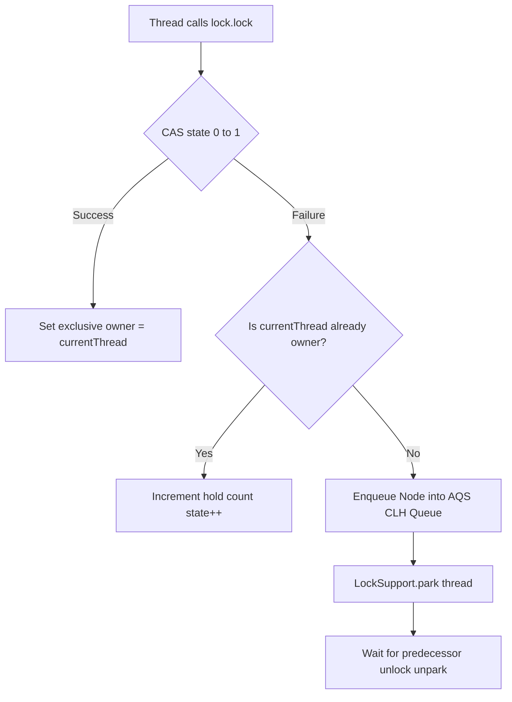

# Explicit Locks: ReentrantLock and StampedLock

> Deep dive into Java explicit locking mechanisms (`java.util.concurrent.locks`): `Lock`, `ReentrantLock` (fair vs non-fair), `Condition` variables, `ReadWriteLock`, and high-throughput optimistic reading with `StampedLock`.

| Metadata | Value |
|---|---|
| **Level** | Advanced |
| **Prerequisites** | [02_thread-safety.md](02_thread-safety.md), [03_synchronization.md](03_synchronization.md) |
| **Time to Read** | 26 minutes |
| **Status** | Active |
| **Java Version** | Java 5.0+ (StampedLock in Java 8+) |

---

## Table of Contents
1. [What & Why](#1-what--why)
2. [Core Concepts](#2-core-concepts)
3. [How It Works Internally](#3-how-it-works-internally)
4. [Syntax & Usage](#4-syntax--usage)
5. [Practical Examples](#5-practical-examples)
6. [Best Practices](#6-best-practices)
7. [Common Mistakes & Pitfalls](#7-common-mistakes--pitfalls)
8. [Performance & Security Notes](#8-performance--security-notes)
9. [Comparison / When to Use What](#9-comparison--when-to-use-what)
10. [Interview Questions](#10-interview-questions)
11. [Practice Exercises](#11-practice-exercises)
12. [Summary / Cheat Sheet](#12-summary--cheat-sheet)
13. [Further Reading](#13-further-reading)

---

## 1. What & Why

### The Rigid Constraints of `synchronized`
While `synchronized` is simple and safe, intrinsic locks have fundamental limitations:
- **Cannot Back Out**: A thread blocked waiting for a `synchronized` block cannot be interrupted, and cannot specify a timeout. If a deadlock occurs, the thread is frozen forever.
- **Strict Block Scoping**: Intrinsic locks must be acquired and released within the exact same syntactic block; hand-over-hand locking (e.g. across linked list nodes) is impossible.
- **Single Wait Set**: An object has only one wait set; `notifyAll()` wakes *all* waiting threads regardless of whether they are waiting for different conditions.
- **Virtual Thread Pinning**: In Java 21+, blocking inside `synchronized` pins the underlying OS carrier thread.

### The Solution: `java.util.concurrent.locks`
Java 5 introduced explicit locks (`Lock`, `ReentrantLock`, `ReadWriteLock`), extended in Java 8 with `StampedLock`. They provide:
- Timed and interruptible lock acquisition (`tryLock(timeout)`).
- Multiple distinct `Condition` wait sets per lock.
- Support for concurrent readers with exclusive writers.
- High-performance optimistic non-blocking read validation.
- Clean unmounting for Virtual Threads.

---

## 2. Core Concepts

### `ReentrantLock`
A reentrant mutual exclusion lock with the same basic behavior as `synchronized`, but with extended capabilities:
- **Fair vs Non-Fair**:
  - *Non-Fair (Default)*: Incoming threads can barge ahead of queued threads if the lock happens to be free, delivering 10–50x higher throughput.
  - *Fair*: Threads acquire the lock in strict First-In, First-Out (FIFO) arrival order, preventing thread starvation at the expense of throughput.

### `Condition` Variables
Replaces `Object.wait()` and `notify()`. Created via `lock.newCondition()`:
- `await()`: Atomically releases the lock and waits on this specific condition.
- `signal()`: Wakes one thread waiting on this condition.
- `signalAll()`: Wakes all threads waiting on this condition.
Enables separating wait sets (e.g. `notFull` condition for producers and `notEmpty` condition for consumers on the same queue).

### `ReentrantReadWriteLock`
Maintains a pair of locks:
- **Read Lock**: Multiple threads can hold the read lock concurrently, provided no thread holds the write lock.
- **Write Lock**: Exclusive access; only one thread can hold the write lock.
Ideal for read-heavy, write-infrequent shared caches.

### `StampedLock` (Java 8)
An advanced capability-based lock that does not implement `Lock` or `ReadWriteLock`:
- Returns a 64-bit `long stamp` representing lock acquisition state.
- Supports **Optimistic Reading**: A thread reads data *without acquiring a lock*, checks `lock.validate(stamp)` afterward, and falls back to a read lock only if a writer intervened!

---

## 3. How It Works Internally

### AbstractQueuedSynchronizer (AQS)
`ReentrantLock` is powered by Doug Lea's **AbstractQueuedSynchronizer (AQS)** framework:
1. **Volatile State Variable**: An atomic 32-bit `state` integer representing hold count.
2. **FIFO Wait Queue (CLH Lock Queue)**: When a thread fails to acquire the lock via CAS on `state`, it is encapsulated in a `Node` and enqueued onto a doubly linked FIFO queue.
3. **Parking**: The thread is suspended using `LockSupport.park(this)`. When released, `LockSupport.unpark()` wakes the successor thread.



---

## 4. Syntax & Usage

### Standard Idiom: Mandatory `finally` Block
```java
import java.util.concurrent.locks.ReentrantLock;

public class ExplicitLockIdiom {
    private final ReentrantLock lock = new ReentrantLock();

    public void criticalOperation() {
        // MANDATORY: Call lock() immediately before try!
        lock.lock();
        try {
            // Critical section
        } finally {
            // MANDATORY: Always unlock inside finally!
            lock.unlock();
        }
    }
}
```

### Try-Lock with Timeout
```java
public boolean attemptOperation(long timeoutMs) throws InterruptedException {
    if (lock.tryLock(timeoutMs, java.util.concurrent.TimeUnit.MILLISECONDS)) {
        try {
            // Acquired lock within timeout!
            return true;
        } finally {
            lock.unlock();
        }
    } else {
        // Did not acquire lock; back off and avoid deadlock!
        return false;
    }
}
```

---

## 5. Practical Examples

### Example 1: Bounded Queue with Dual Conditions
```java
// Goal: Eliminate redundant notifyAll wakeups using separate Conditions
import java.util.concurrent.locks.*;

public class DualConditionQueue<T> {
    private final Object[] items;
    private int tail = 0, head = 0, count = 0;

    private final Lock lock = new ReentrantLock();
    private final Condition notFull = lock.newCondition();
    private final Condition notEmpty = lock.newCondition();

    public DualConditionQueue(int capacity) {
        this.items = new Object[capacity];
    }

    public void put(T item) throws InterruptedException {
        lock.lock();
        try {
            while (count == items.length) {
                notFull.await(); // Sleep until buffer has space
            }
            items[tail] = item;
            tail = (tail + 1) % items.length;
            count++;
            notEmpty.signal(); // Signal waiting consumers only!
        } finally {
            lock.unlock();
        }
    }

    @SuppressWarnings("unchecked")
    public T take() throws InterruptedException {
        lock.lock();
        try {
            while (count == 0) {
                notEmpty.await(); // Sleep until data arrives
            }
            T item = (T) items[head];
            items[head] = null;
            head = (head + 1) % items.length;
            count--;
            notFull.signal(); // Signal waiting producers only!
            return item;
        } finally {
            lock.unlock();
        }
    }
}
```
*Explanation:* Producers only wake consumers, and consumers only wake producers, cutting context switches by 50%.

### Example 2: Optimistic Reading with `StampedLock`
```java
// Goal: Ultra-high performance point coordinates using optimistic reads
import java.util.concurrent.locks.StampedLock;

public class Point2D {
    private double x, y;
    private final StampedLock sl = new StampedLock();

    public void move(double deltaX, double deltaY) {
        long stamp = sl.writeLock(); // Exclusive write lock
        try {
            x += deltaX;
            y += deltaY;
        } finally {
            sl.unlockWrite(stamp);
        }
    }

    public double distanceFromOrigin() {
        // 1. Try optimistic read (zero locks acquired!)
        long stamp = sl.tryOptimisticRead();
        double currentX = x;
        double currentY = y;

        // 2. Validate whether a write occurred during the read
        if (!sl.validate(stamp)) {
            // Interrupted by writer! Fall back to fully acquired read lock
            stamp = sl.readLock();
            try {
                currentX = x;
                currentY = y;
            } finally {
                sl.unlockRead(stamp);
            }
        }

        return Math.hypot(currentX, currentY);
    }
}
```
*Explanation:* Under high read contention, optimistic reading avoids all memory synchronization overhead.

---

## 6. Best Practices
1. **Always Unlock Inside `finally`**: Failure to release a lock in a `finally` block creates a permanent deadlock on exceptions.
2. **Call `lock.lock()` Immediately Before `try`**: Never place code that can throw an exception between `lock()` and `try`.
3. **Prefer Non-Fair Locks**: Stick with default non-fair `ReentrantLock` unless fairness is strictly required to prevent starvation.
4. **Use `StampedLock` for Read-Heavy Numerical Data**: For small sets of fields that are read frequently and updated rarely, `StampedLock` delivers maximum throughput.
5. **Beware of Virtual Thread Pinning**: Use `ReentrantLock` instead of `synchronized` inside virtual threads to allow clean carrier thread unmounting during blocking calls.

---

## 7. Common Mistakes & Pitfalls

| Mistake | Why Wrong | Fix |
|---|---|---|
| Putting `lock.lock()` inside the `try` block | If `lock()` throws (e.g. OutOfMemory), `finally` tries to `unlock()` without holding the lock. | Call `lock.lock()` immediately before `try`. |
| Forgetting to release lock in `finally` | Any uncaught exception leaves the lock permanently held, bricking the application. | Always enclose critical sections in `try { ... } finally { lock.unlock(); }`. |
| Calling `await()` outside lock acquisition | Throws `IllegalMonitorStateException`. | Ensure the lock is held prior to calling `condition.await()`. |
| Using `StampedLock` reentrantly | `StampedLock` is **not reentrant**; attempting to re-acquire deadlocks the calling thread! | Use `ReentrantLock` or `ReentrantReadWriteLock` if recursion is needed. |
| Catching `InterruptedException` without restoring status | Swallows cancellation intent. | Re-assert flag (`Thread.currentThread().interrupt()`). |

---

## 8. Performance & Security Notes

### Non-Fair Lock Barging Throughput
In non-fair mode, if a thread attempts to acquire the lock at the exact moment another thread releases it, the arriving thread can acquire the lock immediately without waiting in the AQS queue (**Lock Barging**). This avoids CPU context switches and can increase throughput by orders of magnitude compared to fair FIFO locking.

### Denial of Service via Lock Starvation
Under extreme contention, fair locks can suffer from convoying: if one thread is descheduled by the OS, all subsequent threads in the FIFO queue are forced to wait, creating latency spikes.

---

## 9. Comparison / When to Use What

| Feature | `synchronized` | `ReentrantLock` | `StampedLock` |
|---|---|---|---|
| **Reentrant** | Yes | Yes | **No** |
| **Optimistic Reads** | No | No | **Yes** |
| **Multiple Conditions**| No (1 Wait Set) | Yes | No |
| **Virtual Thread Safe**| Pins carrier on I/O | Safe (unmounts cleanly) | Safe |
| **Timeout Support** | No | `tryLock(timeout)` | `tryWriteLock(timeout)` |

---

## 10. Interview Questions

<details>
<summary>1. What are the key advantages of `ReentrantLock` over `synchronized`?</summary>
Ability to specify timeouts (`tryLock`), interruptible lock acquisition (`lockInterruptibly`), fairness policies, multiple condition variables, and prevention of Virtual Thread carrier pinning.
</details>

<details>
<summary>2. Why must `lock.lock()` be called outside the `try` block?</summary>
If `lock.lock()` were inside the `try` block and threw an exception (such as `Error` or `OutOfMemoryError`), the `finally` block would execute and call `lock.unlock()`, throwing an `IllegalMonitorStateException` and masking the original error.
</details>

<details>
<summary>3. What is the difference between Fair and Non-Fair locks?</summary>
A fair lock grants access to threads in strict FIFO arrival order. A non-fair lock allows an active thread to barge ahead and acquire an available lock immediately, avoiding context switch delays and providing much higher throughput.
</details>

<details>
<summary>4. How does a `Condition` differ from `Object.wait()`?</summary>
A single `ReentrantLock` can have multiple independent `Condition` objects (`notFull`, `notEmpty`), allowing selective thread wakeups. `Object.wait()` binds to a single implicit wait set per object.
</details>

<details>
<summary>5. What is Optimistic Reading in `StampedLock`?</summary>
A lock-free reading mechanism where the reader reads fields without acquiring a read lock, receives a stamp, and validates whether a write occurred during the read via `validate(stamp)`. If invalid, it falls back to a standard read lock.
</details>

<details>
<summary>6. Is `StampedLock` reentrant?</summary>
No. `StampedLock` is strictly non-reentrant. If a thread holding a stamp attempts to acquire another lock on the same `StampedLock`, it will deadlock with itself.
</details>

<details>
<summary>7. What is AQS (AbstractQueuedSynchronizer)?</summary>
The underlying framework powering `ReentrantLock`, `Semaphore`, and `CountDownLatch`. It manages thread queuing and blocking using atomic state operations and `LockSupport.park()/unpark()`.
</details>

<details>
<summary>8. Why is `ReentrantLock` preferred over `synchronized` in Java 21+ Virtual Threads?</summary>
Because blocking on a `synchronized` block currently pins the virtual thread to its underlying OS carrier thread during blocking operations, whereas `ReentrantLock` allows the virtual thread to unmount cleanly.
</details>

---

## 11. Practice Exercises

### Exercise 1 (Easy): Timed Resource Access
- **Task**: Implement a method that tries to acquire a `ReentrantLock` with a 200ms timeout. If acquired, sleep 50ms and print success; if timed out, print fallback.
<details>
<summary>Solution</summary>

```java
import java.util.concurrent.TimeUnit;
import java.util.concurrent.locks.ReentrantLock;

public class TimedLockExercise {
    private final ReentrantLock lock = new ReentrantLock();

    public void accessResource() {
        try {
            if (lock.tryLock(200, TimeUnit.MILLISECONDS)) {
                try {
                    Thread.sleep(50);
                    System.out.println("Resource accessed successfully!");
                } finally {
                    lock.unlock();
                }
            } else {
                System.out.println("Resource busy; fallback executed.");
            }
        } catch (InterruptedException e) {
            Thread.currentThread().interrupt();
        }
    }
}
```
</details>

### Exercise 2 (Medium): Read-Write Cached Registry
- **Task**: Implement a thread-safe in-memory cache `SafeCache<K, V>` using `ReentrantReadWriteLock` supporting concurrent `get(key)` calls and exclusive `put(key, value)`.
<details>
<summary>Solution</summary>

```java
import java.util.*;
import java.util.concurrent.locks.*;

public class SafeCache<K, V> {
    private final Map<K, V> map = new HashMap<>();
    private final ReadWriteLock rwLock = new ReentrantReadWriteLock();
    private final Lock readLock = rwLock.readLock();
    private final Lock writeLock = rwLock.writeLock();

    public V get(K key) {
        readLock.lock();
        try {
            return map.get(key);
        } finally {
            readLock.unlock();
        }
    }

    public void put(K key, V val) {
        writeLock.lock();
        try {
            map.put(key, val);
        } finally {
            writeLock.unlock();
        }
    }
}
```
</details>

### Exercise 3 (Hard): Optimistic Bank Balance with StampedLock
- **Task**: Implement a `BankAccount` with `balance` and `overdraftLimit` using `StampedLock`. Write an optimistic `double getAvailableFunds()` method that validates the stamp and falls back to a read lock on write collision.
<details>
<summary>Solution</summary>

```java
import java.util.concurrent.locks.StampedLock;

public class BankAccount {
    private double balance = 1000.0;
    private double overdraftLimit = 500.0;
    private final StampedLock lock = new StampedLock();

    public void deposit(double amount) {
        long stamp = lock.writeLock();
        try {
            balance += amount;
        } finally {
            lock.unlockWrite(stamp);
        }
    }

    public double getAvailableFunds() {
        long stamp = lock.tryOptimisticRead();
        double currentBal = balance;
        double currentLimit = overdraftLimit;

        if (!lock.validate(stamp)) {
            stamp = lock.readLock();
            try {
                currentBal = balance;
                currentLimit = overdraftLimit;
            } finally {
                lock.unlockRead(stamp);
            }
        }
        return currentBal + currentLimit;
    }
}
```
</details>

---

## 12. Summary / Cheat Sheet

```
+-----------------------------------------------------------------------------------------+
|                                EXPLICIT LOCKS CHEAT SHEET                               |
+-----------------------------------------------------------------------------------------+
| ReentrantLock Idiom      | lock.lock(); try { ... } finally { lock.unlock(); }          |
| Timed Lock               | if (lock.tryLock(timeout, unit)) try { ... } finally ...     |
| Conditions               | Condition cond = lock.newCondition(); cond.await()/signal()  |
| ReadWriteLock            | rw.readLock() (Shared) / rw.writeLock() (Exclusive)          |
| StampedLock Optimistic   | long s = sl.tryOptimisticRead(); ... if (!sl.validate(s))... |
| StampedLock Limitation   | Strictly NOT reentrant; cannot be acquired recursively       |
| Virtual Threads          | Prefer ReentrantLock over synchronized to avoid carrier pin  |
+-----------------------------------------------------------------------------------------+
```

---

## 13. Further Reading
- [Official Javadoc: java.util.concurrent.locks](https://docs.oracle.com/en/java/javase/21/docs/api/java.base/java/util/concurrent/locks/package-summary.html)
- "The java.util.concurrent Synchronizer Framework" by Doug Lea
- Java Concurrency in Practice by Brian Goetz — Chapter 13 (Explicit Locks)
