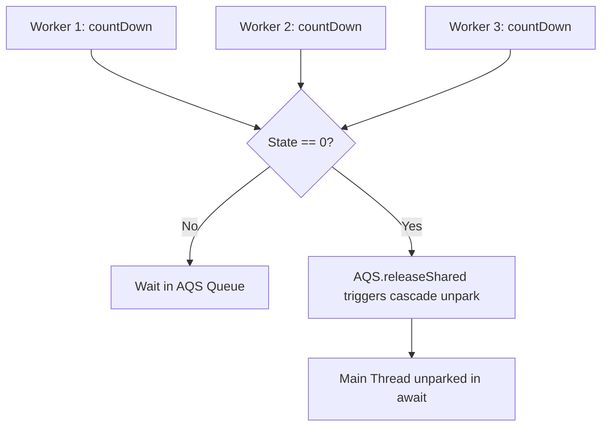

# Thread Synchronizers: Latches, Barriers, Semaphores, and Phasers

> Architectural reference for coordination primitives in `java.util.concurrent`: `CountDownLatch`, `CyclicBarrier`, `Semaphore`, `Phaser`, and `Exchanger` for orchestrating complex concurrent workflows.

| Metadata | Value |
|---|---|
| **Level** | Advanced |
| **Prerequisites** | [02_thread-safety.md](02_thread-safety.md), [05_locks.md](05_locks.md) |
| **Time to Read** | 26 minutes |
| **Status** | Active |
| **Java Version** | Java 5.0+ (Phaser in Java 7+) |

---

## Table of Contents
1. [What & Why](#1-what--why)
2. [Core Concepts](#2-core-concepts)
3. [How It Works Internally](#3-how-it-works-internally)
4. [Syntax & Usage](#4-syntax--usage)
5. [Practical Examples](#5-practical-examples)
6. [Best Practices](#6-best-practices)
7. [Common Mistakes & Pitfalls](#7-common-mistakes--pitfalls)
8. [Performance & Security Notes](#8-performance--security-notes)
9. [Comparison / When to Use What](#9-comparison--when-to-use-what)
10. [Interview Questions](#10-interview-questions)
11. [Practice Exercises](#11-practice-exercises)
12. [Summary / Cheat Sheet](#12-summary--cheat-sheet)
13. [Further Reading](#13-further-reading)

---

## 1. What & Why

### The Multi-Thread Coordination Challenge
Threads rarely execute in complete isolation. Real-world applications require coordinated choreography:
- Waiting for 10 microservices to initialize before opening HTTP ports (**CountDownLatch**).
- Synchronizing 4 parallel computational worker threads at the end of each iteration step (**CyclicBarrier**).
- Limiting concurrent access to a pool of 20 database connections (**Semaphore**).
- Managing multi-phase workflows with dynamic numbers of registered participants (**Phaser**).

Writing custom coordination logic with `wait()` and `notify()` is error-prone. The `java.util.concurrent` synchronizers provide robust, high-performance building blocks.

---

## 2. Core Concepts

### `CountDownLatch` (One-Shot Gate)
- Initialized with an integer count: `new CountDownLatch(N)`.
- `countDown()`: Decrements the count.
- `await()`: Blocks calling threads until the count reaches zero.
- **Key Characteristic**: **One-shot**. Once the count hits zero, it cannot be reset.

### `CyclicBarrier` (Reusable Rendezvous Point)
- Initialized with participant count and optional barrier action: `new CyclicBarrier(parties, runnable)`.
- `await()`: Threads arrive and block until all $N$ parties call `await()`.
- When all parties arrive, the barrier action executes, and all threads are released simultaneously.
- **Key Characteristic**: **Reusable (Cyclic)**. Automatically resets for subsequent rounds.

### `Semaphore` (Permit Granter)
- Controls concurrent access to a finite number of shared resources via permits: `new Semaphore(permits)`.
- `acquire()`: Takes a permit, blocking if none are available.
- `release()`: Returns a permit, waking up a waiting thread.
- Can be configured with fair or non-fair queueing policies.

### `Phaser` (Dynamic Barrier, Java 7+)
- A flexible, reusable synchronizer similar to `CyclicBarrier`, but allows dynamic registration and deregistration of parties at runtime (`register()`, `arriveAndDeregister()`).

### `Exchanger<V>` (Bidirectional Swap)
- Provides a synchronization point where two threads swap elements atomically: `V item2 = exchanger.exchange(item1)`.

---

## 3. How It Works Internally

### AQS Shared-Mode State Machine
`CountDownLatch` and `Semaphore` implement AQS in **Shared Mode** (`acquireShared` / `releaseShared`):
- Unlike exclusive locks (where only one thread can hold state), shared mode unparks **multiple** waiting threads in a cascade when state changes.
- In `CountDownLatch`, `state` represents remaining counts. When `countDown()` decrements state to 0, it calls `releaseShared()`, unparking all waiting threads.



---

## 4. Syntax & Usage

### Service Startup with `CountDownLatch`
```java
import java.util.concurrent.CountDownLatch;

public class StartupGate {
    public static void main(String[] args) throws InterruptedException {
        int services = 3;
        CountDownLatch latch = new CountDownLatch(services);

        for (int i = 1; i <= services; i++) {
            final int id = i;
            Thread.ofPlatform().start(() -> {
                System.out.println("Service " + id + " initialized.");
                latch.countDown(); // Signal readiness
            });
        }

        // Main thread waits until count reaches 0
        latch.await();
        System.out.println("All services ready. Server started!");
    }
}
```

### Rate Limiting with `Semaphore`
```java
import java.util.concurrent.Semaphore;

public class RateLimiter {
    // Limit to 5 concurrent database connections
    private final Semaphore semaphore = new Semaphore(5);

    public void executeQuery(String sql) throws InterruptedException {
        semaphore.acquire(); // Acquire permit
        try {
            System.out.println("Executing query on DB connection: " + sql);
            Thread.sleep(100);
        } finally {
            semaphore.release(); // Always release permit!
        }
    }
}
```

---

## 5. Practical Examples

### Example 1: Parallel Simulation Steps with `CyclicBarrier`
```java
// Goal: Coordinate multiple physics worker threads across multiple computation steps
import java.util.concurrent.*;

public class SimulationEngine {
    public static void runSimulation(int workers, int steps) {
        CyclicBarrier barrier = new CyclicBarrier(workers, () -> {
            // Barrier action: runs once per step when all workers arrive!
            System.out.println("--- End of Step: Aggregating global state ---");
        });

        try (ExecutorService executor = Executors.newFixedThreadPool(workers)) {
            for (int w = 0; w < workers; w++) {
                final int workerId = w;
                executor.submit(() -> {
                    try {
                        for (int s = 1; s <= steps; s++) {
                            System.out.println("Worker " + workerId + " computing step " + s);
                            Thread.sleep(50);
                            barrier.await(); // Wait for all workers to finish step
                        }
                    } catch (Exception e) {
                        Thread.currentThread().interrupt();
                    }
                });
            }
        }
    }

    public static void main(String[] args) {
        runSimulation(3, 2);
    }
}
```
*Output:*
```
Worker 0 computing step 1
Worker 1 computing step 1
Worker 2 computing step 1
--- End of Step: Aggregating global state ---
Worker 0 computing step 2
Worker 1 computing step 2
Worker 2 computing step 2
--- End of Step: Aggregating global state ---
```

### Example 2: Dynamic Multi-Phase Pipeline with `Phaser`
```java
// Goal: Coordinate multi-stage task with workers joining and leaving dynamically
import java.util.concurrent.Phaser;

public class PhaserWorkflowDemo {
    public static void main(String[] args) {
        Phaser phaser = new Phaser(1); // Register main thread

        for (int i = 1; i <= 3; i++) {
            phaser.register(); // Register each worker
            final int id = i;
            Thread.ofPlatform().start(() -> {
                System.out.println("Worker " + id + " completed Phase 1");
                phaser.arriveAndAwaitAdvance(); // Wait for phase 1

                if (id == 2) {
                    System.out.println("Worker 2 leaving workflow.");
                    phaser.arriveAndDeregister(); // Deregister worker 2
                    return;
                }

                System.out.println("Worker " + id + " completed Phase 2");
                phaser.arriveAndAwaitAdvance(); // Wait for phase 2
            });
        }

        phaser.arriveAndAwaitAdvance(); // Advance Phase 1
        System.out.println(">> Phase 1 Complete <<");

        phaser.arriveAndAwaitAdvance(); // Advance Phase 2
        System.out.println(">> Phase 2 Complete <<");
    }
}
```

---

## 6. Best Practices
1. **Always Release Semaphores in `finally`**: Failure to release permits causes permanent resource leaks.
2. **Handle `BrokenBarrierException` in `CyclicBarrier`**: If one thread is interrupted while waiting at a barrier, all other waiting threads receive `BrokenBarrierException`.
3. **Prefer `CountDownLatch` for Startup Synchronization**: Ideal for waiting on dependencies before serving requests.
4. **Use `tryAcquire()` with Timeouts on Semaphores**: Prevent client threads from hanging indefinitely when connection pools are exhausted.
5. **Use `Phaser` for Variable Worker Counts**: When worker counts fluctuate dynamically, use `Phaser` instead of `CyclicBarrier`.

---

## 7. Common Mistakes & Pitfalls

| Mistake | Why Wrong | Fix |
|---|---|---|
| Reusing a `CountDownLatch` | Once count hits 0, `await()` returns immediately and cannot be reset. | Use `CyclicBarrier` for reusable synchronization. |
| Forgetting `semaphore.release()` in `finally` | Permitted slots leak, eventually deadlocking all callers. | Wrap in `try { ... } finally { semaphore.release(); }`. |
| Mismatch in `CyclicBarrier` party count | If fewer threads arrive than configured parties, threads hang forever. | Ensure the number of calling threads matches `parties`. |
| Swallowing `BrokenBarrierException` | Leaves the barrier in a broken state; subsequent calls will fail immediately. | Reset barrier via `barrier.reset()` or handle gracefully. |
| Calling `countDown()` inside loops without try-finally | If an exception occurs, the latch never reaches 0, freezing `await()`. | Place `countDown()` in a `finally` block. |

---

## 8. Performance & Security Notes

### Cascade Unparking Scalability
When `CountDownLatch.countDown()` reaches zero, the AQS shared release propagates through the wait queue rapidly. Because threads are unparked concurrently, thousands of waiting threads can wake up simultaneously (**Thundering Herd**), potentially causing CPU spikes if threads contend for the same downstream resource.

### Fair vs Non-Fair Semaphores
Non-fair semaphores offer significantly higher throughput because arriving threads can immediately acquire available permits without context-switching through the AQS queue. Use fair semaphores only when preventing starvation is an absolute business requirement.

---

## 9. Comparison / When to Use What

| Synchronizer | Reusable? | Dynamic Parties? | Main Use Case |
|---|---|---|---|
| **`CountDownLatch`** | **No** (One-shot) | No | Startup gates, waiting for N events |
| **`CyclicBarrier`** | **Yes** | No | Parallel iterative algorithms |
| **`Semaphore`** | N/A (Permits) | N/A | Resource throttling, connection pooling |
| **`Phaser`** | **Yes** | **Yes** | Multi-phase dynamic workflows |
| **`Exchanger`** | **Yes** | No (Exactly 2) | Dual-buffer swapping (producer-consumer)|

---

## 10. Interview Questions

<details>
<summary>1. What is the difference between `CountDownLatch` and `CyclicBarrier`?</summary>
`CountDownLatch` is a one-shot gate that cannot be reset, used when one or more threads wait for N events. `CyclicBarrier` is reusable, used when a fixed set of threads must meet repeatedly at a common rendezvous point.
</details>

<details>
<summary>2. What happens if a thread is interrupted while waiting at a `CyclicBarrier`?</summary>
The interrupted thread throws `InterruptedException`, and the barrier becomes "broken". All other waiting threads are awakened with `BrokenBarrierException`.
</details>

<details>
<summary>3. Can a `Semaphore` be released by a thread that did not acquire it?</summary>
Yes. Semaphores track permits, not ownership. Any thread can call `release()` to add a permit, which is useful for asynchronous handoffs (unlike `Lock`, which requires ownership).
</details>

<details>
<summary>4. What is a `Phaser` and why was it introduced in Java 7?</summary>
`Phaser` is a flexible, dynamic synchronization barrier that supports variable numbers of registered parties that can arrive, advance, register, and deregister dynamically across execution phases.
</details>

<details>
<summary>5. How does `Exchanger` work?</summary>
An `Exchanger` provides a synchronization point where exactly two threads swap values atomically: each thread presents an object and receives the object passed by the other thread.
</details>

<details>
<summary>6. How does `CountDownLatch` implement AQS Shared Mode?</summary>
The count is stored in the AQS `state`. When `countDown()` decrements state to 0, it calls `releaseShared()`, which cascades through the AQS queue, unparking all waiting threads.
</details>

<details>
<summary>7. What is the Barrier Action in `CyclicBarrier`?</summary>
An optional `Runnable` passed into the barrier constructor that executes exactly once per barrier cycle when all parties have arrived, before any threads are released.
</details>

<details>
<summary>8. How do you implement a Mutex using a `Semaphore`?</summary>
By instantiating a `new Semaphore(1)` (binary semaphore). However, `ReentrantLock` is generally preferred because it provides ownership checks and reentrancy.
</details>

---

## 11. Practice Exercises

### Exercise 1 (Easy): Service Initializer Latch
- **Task**: Write a program where a `WebServer` thread waits for a `DatabaseService` and a `CacheService` to initialize before starting, using a `CountDownLatch(2)`.
<details>
<summary>Solution</summary>

```java
import java.util.concurrent.CountDownLatch;

public class ServiceInitExercise {
    public static void main(String[] args) throws InterruptedException {
        CountDownLatch latch = new CountDownLatch(2);

        Thread.ofPlatform().start(() -> {
            System.out.println("DatabaseService initialized.");
            latch.countDown();
        });

        Thread.ofPlatform().start(() -> {
            System.out.println("CacheService initialized.");
            latch.countDown();
        });

        latch.await();
        System.out.println("All services initialized. WebServer online!");
    }
}
```
</details>

### Exercise 2 (Medium): Bounded Connection Pool with Semaphore
- **Task**: Implement a `ConnectionPool` with 3 available permits. Simulate 6 concurrent tasks requesting connections using `acquire()` and `release()` in `finally`.
<details>
<summary>Solution</summary>

```java
import java.util.concurrent.*;

public class ConnectionPoolExercise {
    private final Semaphore semaphore = new Semaphore(3);

    public void runQuery(int taskId) {
        try {
            semaphore.acquire();
            try {
                System.out.println("Task " + taskId + " acquired DB connection.");
                Thread.sleep(150);
            } finally {
                System.out.println("Task " + taskId + " releasing DB connection.");
                semaphore.release();
            }
        } catch (InterruptedException e) {
            Thread.currentThread().interrupt();
        }
    }

    public static void main(String[] args) {
        ConnectionPoolExercise pool = new ConnectionPoolExercise();
        try (ExecutorService executor = Executors.newFixedThreadPool(6)) {
            for (int i = 1; i <= 6; i++) {
                final int id = i;
                executor.submit(() -> pool.runQuery(id));
            }
        }
    }
}
```
</details>

### Exercise 3 (Hard): Multi-Round Racing Tournament with CyclicBarrier
- **Task**: Simulate 4 race cars across 3 tournament laps. At the end of each lap, all cars must wait at a `CyclicBarrier`, where the barrier action logs the completion of that lap.
<details>
<summary>Solution</summary>

```java
import java.util.concurrent.*;

public class TournamentRace {
    public static void main(String[] args) {
        int cars = 4;
        int laps = 3;

        CyclicBarrier barrier = new CyclicBarrier(cars, new Runnable() {
            private int currentLap = 1;
            @Override
            public void run() {
                System.out.println("=== LAP " + currentLap + " COMPLETED BY ALL CARS ===");
                currentLap++;
            }
        });

        try (ExecutorService executor = Executors.newFixedThreadPool(cars)) {
            for (int i = 1; i <= cars; i++) {
                final int carId = i;
                executor.submit(() -> {
                    try {
                        for (int lap = 1; lap <= laps; lap++) {
                            Thread.sleep((long) (Math.random() * 100));
                            System.out.println("Car " + carId + " finished lap " + lap);
                            barrier.await();
                        }
                    } catch (Exception e) {
                        Thread.currentThread().interrupt();
                    }
                });
            }
        }
    }
}
```
</details>

---

## 12. Summary / Cheat Sheet

```
+-----------------------------------------------------------------------------------------+
|                               SYNCHRONIZERS CHEAT SHEET                                 |
+-----------------------------------------------------------------------------------------+
| CountDownLatch           | new CountDownLatch(N); countDown(); await(); (ONE-SHOT)      |
| CyclicBarrier            | new CyclicBarrier(N, barrierAction); await(); (REUSABLE)     |
| Semaphore                | new Semaphore(permits, isFair); acquire(); release();        |
| Phaser                   | phaser.arriveAndAwaitAdvance(); phaser.register(); (DYNAMIC) |
| Exchanger                | V peerData = exchanger.exchange(myData); (2 THREADS SWAP)    |
| Mandatory Practice       | Always release Semaphore permits inside finally blocks       |
| BrokenBarrier            | Handled via BrokenBarrierException if any thread interrupted |
+-----------------------------------------------------------------------------------------+
```

---

## 13. Further Reading
- [Official Javadoc: java.util.concurrent](https://docs.oracle.com/en/java/javase/21/docs/api/java.base/java/util/concurrent/package-summary.html)
- Java Concurrency in Practice by Brian Goetz — Chapter 5 (Building Blocks)
- Oracle Dev.java: Synchronizers and Coordination
