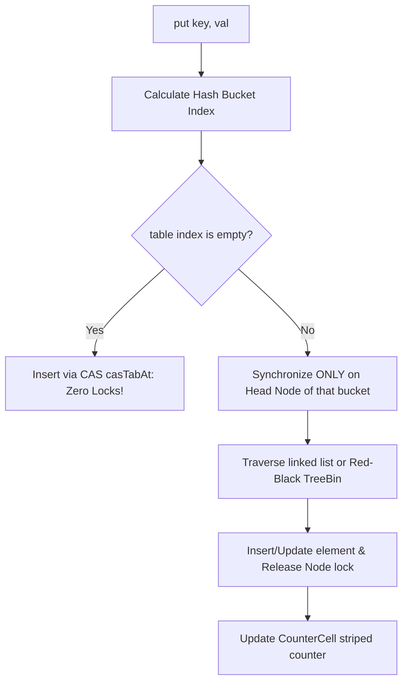

# Concurrent Collections

> Comprehensive guide to high-throughput thread-safe collections in `java.util.concurrent`: `ConcurrentHashMap` internals (CAS + synchronized buckets, CounterCell striping), `CopyOnWriteArrayList`, `ConcurrentSkipListMap`, and `BlockingQueue` variants.

| Metadata | Value |
|---|---|
| **Level** | Advanced |
| **Prerequisites** | [08-collections/00_collection-hierarchy.md](../08-collections/00_collection-hierarchy.md), [05_locks.md](05_locks.md), [06_atomic-classes.md](06_atomic-classes.md) |
| **Time to Read** | 28 minutes |
| **Status** | Active |
| **Java Version** | Java 5.0+ (Java 8 ConcurrentHashMap rewrite) |

---

## Table of Contents
1. [What & Why](#1-what--why)
2. [Core Concepts](#2-core-concepts)
3. [How It Works Internally](#3-how-it-works-internally)
4. [Syntax & Usage](#4-syntax--usage)
5. [Practical Examples](#5-practical-examples)
6. [Best Practices](#6-best-practices)
7. [Common Mistakes & Pitfalls](#7-common-mistakes--pitfalls)
8. [Performance & Security Notes](#8-performance--security-notes)
9. [Comparison / When to Use What](#9-comparison--when-to-use-what)
10. [Interview Questions](#10-interview-questions)
11. [Practice Exercises](#11-practice-exercises)
12. [Summary / Cheat Sheet](#12-summary--cheat-sheet)
13. [Further Reading](#13-further-reading)

---

## 1. What & Why

### The Bottleneck of Synchronized Wrappers
In early Java, thread safety for collections was achieved via synchronized wrappers:
```java
Map<K, V> syncMap = Collections.synchronizedMap(new HashMap<>());
```
`Collections.synchronizedMap` wraps every method call inside a single monolithic lock on the map instance. When 100 concurrent threads access the map, 99 threads are blocked waiting for the single lock, collapsing throughput to that of a single-threaded system.

### The Solution: `java.util.concurrent` Collections
Designed by Doug Lea, modern concurrent collections provide high concurrency without coarse-grained locks:
- Non-blocking lock-free reads.
- Fine-grained bucket-level synchronization for writes.
- Weakly consistent, fail-safe iterators that never throw `ConcurrentModificationException`.
- Specialized producers-consumers blocking queues with backpressure support.

---

## 2. Core Concepts

### `ConcurrentHashMap`
The flagship concurrent map in Java:
- Reads (`get()`) are completely lock-free via volatile field reads.
- Writes (`put()`) lock only the specific head node of the target hash bucket.
- Atomic compound methods: `putIfAbsent()`, `computeIfAbsent()`, `computeIfPresent()`, `merge()`.

### `CopyOnWriteArrayList`
A thread-safe variant of `ArrayList` where all mutative operations (`add`, `set`, `remove`) create a fresh copy of the underlying array:
- Iterators read an immutable snapshot array; they never block, never lock, and never throw `ConcurrentModificationException`.
- Writes are expensive ($O(N)$ memory copy). Ideal for read-heavy, write-rare lists (like event listener registries).

### `ConcurrentSkipListMap` and `ConcurrentSkipListSet`
A scalable concurrent alternative to `TreeMap`:
- Implemented as a lock-free probabilistic **Skip List**.
- Maintains sorted order with $O(\log N)$ time complexity for search, insertion, and deletion.

### `BlockingQueue` Family
Thread-safe queues designed for producer-consumer workflows that block threads on insertion when full and on retrieval when empty:
- `ArrayBlockingQueue`: Bounded array with a single lock.
- `LinkedBlockingQueue`: Optionally bounded linked nodes with two separate locks (`takeLock` and `putLock`).
- `SynchronousQueue`: Zero-capacity direct handoff queue.
- `PriorityBlockingQueue`: Unbounded heap-based priority queue.

---

## 3. How It Works Internally

### `ConcurrentHashMap` Architecture (Java 8+ Rewrite)
In Java 7, `ConcurrentHashMap` used 16 Segment locks. In Java 8+, it was rewritten:
1. **Array of `Node<K, V>`**: The bucket array is declared `transient volatile Node<K, V>[] table;`.
2. **Lock-Free Empty Insert**: If the target bucket is empty (`table[i] == null`), the node is inserted via a single hardware CAS instruction (`casTabAt`) without acquiring any lock!
3. **Bucket Head Lock**: If the bucket is occupied, the thread synchronizes **only on the head `Node`** of that specific bucket (`synchronized(f)`). Other threads accessing different buckets proceed concurrently!
4. **Treeification**: When a bucket exceeds 8 nodes, it converts into a Red-Black Tree (`TreeBin`).
5. **Striped Counter**: Size is tracked using `CounterCell` striped cells (identical to `LongAdder`), avoiding global counter contention.



---

## 4. Syntax & Usage

### Atomic Map Operations with `computeIfAbsent`
```java
import java.util.concurrent.ConcurrentHashMap;
import java.util.concurrent.atomic.LongAdder;

public class FrequencyCounter {
    private final ConcurrentHashMap<String, LongAdder> wordCounts = new ConcurrentHashMap<>();

    public void recordWord(String word) {
        // computeIfAbsent is atomic: creates LongAdder only once per unique key!
        wordCounts.computeIfAbsent(word, k -> new LongAdder()).increment();
    }

    public long getCount(String word) {
        LongAdder adder = wordCounts.get(word);
        return (adder != null) ? adder.sum() : 0L;
    }
}
```

### Producer-Consumer with `BlockingQueue`
```java
import java.util.concurrent.*;

public class WorkerQueueDemo {
    private final BlockingQueue<String> queue = new ArrayBlockingQueue<>(100);

    public void produce(String task) throws InterruptedException {
        queue.put(task); // Blocks if buffer is full (backpressure)
    }

    public String consume() throws InterruptedException {
        return queue.take(); // Blocks if queue is empty
    }
}
```

---

## 5. Practical Examples

### Example 1: Thread-Safe LRU Cache via `ConcurrentLinkedDeque`
```java
// Goal: Construct high-throughput thread-safe cache with bounded capacity
import java.util.concurrent.*;

public class SimpleConcurrentCache<K, V> {
    private final int capacity;
    private final ConcurrentHashMap<K, V> map = new ConcurrentHashMap<>();
    private final ConcurrentLinkedDeque<K> accessOrder = new ConcurrentLinkedDeque<>();

    public SimpleConcurrentCache(int capacity) {
        this.capacity = capacity;
    }

    public V get(K key) {
        V val = map.get(key);
        if (val != null) {
            accessOrder.remove(key);
            accessOrder.addLast(key);
        }
        return val;
    }

    public void put(K key, V val) {
        if (map.put(key, val) == null) {
            accessOrder.addLast(key);
        }
        if (map.size() > capacity) {
            K oldest = accessOrder.pollFirst();
            if (oldest != null) {
                map.remove(oldest);
            }
        }
    }
}
```

### Example 2: CopyOnWriteArrayList for Event Listeners
```java
// Goal: High-concurrency event broadcasting without locking readers
import java.util.List;
import java.util.concurrent.CopyOnWriteArrayList;

public class EventBroadcaster {
    public interface Listener { void onEvent(String msg); }

    private final List<Listener> listeners = new CopyOnWriteArrayList<>();

    public void register(Listener l) {
        listeners.add(l); // Expensive write copy
    }

    public void unregister(Listener l) {
        listeners.remove(l);
    }

    public void broadcast(String message) {
        // Completely lock-free iteration over snapshot! Zero contention!
        for (Listener l : listeners) {
            l.onEvent(message);
        }
    }
}
```

### Example 3: Edge Case: Null Keys and Values Forbidden
```java
// Goal: Demonstrate why ConcurrentHashMap throws NullPointerException
import java.util.concurrent.ConcurrentHashMap;

public class NullHazardDemo {
    public static void main(String[] args) {
        ConcurrentHashMap<String, String> map = new ConcurrentHashMap<>();
        try {
            // Null keys and null values are STRICTLY FORBIDDEN in ConcurrentHashMap!
            map.put("key", null);
        } catch (NullPointerException e) {
            System.out.println("Caught expected NPE: ConcurrentHashMap forbids null values.");
        }
    }
}
```
*Explanation:* Doug Lea explicitly banned `null` in concurrent collections because `map.get(key) == null` creates ambiguity: is the key missing, or is the key mapped to null? In concurrent settings, `containsKey()` cannot resolve the ambiguity without race conditions.

---

## 6. Best Practices
1. **Never Put Nulls in Concurrent Collections**: `ConcurrentHashMap`, `ConcurrentSkipListMap`, and `ArrayBlockingQueue` forbid null keys and values.
2. **Use Atomic Compound Operations**: Avoid `if (!map.containsKey(k)) map.put(k, v);` which creates a check-then-act race condition. Use `map.putIfAbsent(k, v)` or `computeIfAbsent(k, mappingFunction)`.
3. **Do Not Overuse `CopyOnWriteArrayList`**: Only use `CopyOnWriteArrayList` when reads outnumber writes by 100:1 or more. Modifying large copy-on-write lists degrades heap allocation.
4. **Choose BlockingQueue Capacity Wisely**: Always use bounded queues (`new LinkedBlockingQueue<>(capacity)`) to apply backpressure; unbounded queues can exhaust heap memory under high load.
5. **Beware of Long Computations inside `computeIfAbsent`**: `computeIfAbsent` holds the lock for that specific bucket; expensive calculations inside the lambda stall all threads targeting that bucket.

---

## 7. Common Mistakes & Pitfalls

| Mistake | Why Wrong | Fix |
|---|---|---|
| Passing `null` key or value to `ConcurrentHashMap` | Throws `NullPointerException` immediately. | Use `Optional` or placeholder sentinel objects. |
| Check-then-act using `containsKey()` and `put()` | State can change between the check and the act, causing lost updates. | Use `computeIfAbsent()` or `putIfAbsent()`. |
| Modifying heavy `CopyOnWriteArrayList` in tight loops | Re-allocates and copies the entire array on every single modification ($O(N^2)$). | Batch modifications or use a synchronized list. |
| Expecting exact atomic snapshot from `size()` | `size()` aggregates striped cells; under concurrent writes, it reflects an approximate count. | Accept eventual consistency or use explicit synchronization. |
| Blocking inside `computeIfAbsent` lambda | Locks the hash bucket head, blocking all concurrent updates to that bucket. | Perform expensive computations before calling `computeIfAbsent`. |

---

## 8. Performance & Security Notes

### Elimination of Hash Collision Denial-of-Service (HashDoS)
In older Java versions, malicious attackers could craft HTTP POST requests with strings that hash to the exact same bucket, causing $O(N)$ linked list degradation.
Modern `ConcurrentHashMap` automatically transforms buckets into Red-Black Trees (`TreeBin`) when bucket depth exceeds 8, guaranteeing $O(\log N)$ worst-case lookup time even under deliberate hash collision attacks.

---

## 9. Comparison / When to Use What

| Feature | `ConcurrentHashMap` | `Collections.synchronizedMap` | `ConcurrentSkipListMap` |
|---|---|---|---|
| **Locking Strategy** | Bucket-level CAS & synchronized | Single global monitor | Lock-free Skip List |
| **Reads** | Lock-free | Blocking | Lock-free |
| **Sorted Order** | No | No | **Yes (Sorted)** |
| **Null Keys/Values** | Forbidden | Allowed | Forbidden |
| **Concurrency Level**| Scales with bucket count | 1 thread at a time | High |

---

## 10. Interview Questions

<details>
<summary>1. How does `ConcurrentHashMap` achieve thread safety without locking the entire map?</summary>
In Java 8+, reads are completely lock-free via volatile field reads. Empty bucket insertions use atomic hardware CAS. Occupied buckets synchronize only on the head `Node` of that specific bucket, allowing concurrent writes to different buckets.
</details>

<details>
<summary>2. Why are null keys and values forbidden in `ConcurrentHashMap`?</summary>
To eliminate ambiguity. In a single-threaded `HashMap`, `map.get(k) == null` can be clarified with `map.containsKey(k)`. In concurrent maps, the state could change between the two calls, making it impossible to determine if the key is absent or mapped to null.
</details>

<details>
<summary>3. When is `CopyOnWriteArrayList` preferred over a synchronized list?</summary>
When reads vastly outnumber writes (e.g. event listener lists). Iterators read an immutable snapshot array with zero locking and zero risk of `ConcurrentModificationException`.
</details>

<details>
<summary>4. What is a Weakly Consistent Iterator?</summary>
An iterator returned by concurrent collections (like `ConcurrentHashMap`) that does not throw `ConcurrentModificationException`, reflects the state of the collection at or after the iterator was constructed, and may or may not reflect subsequent modifications.
</details>

<details>
<summary>5. What are the differences between `ArrayBlockingQueue` and `LinkedBlockingQueue`?</summary>
`ArrayBlockingQueue` is backed by a circular array and uses a single lock for both enqueue and dequeue. `LinkedBlockingQueue` is backed by linked nodes and uses two separate locks (`putLock` and `takeLock`), allowing concurrent producers and consumers.
</details>

<details>
<summary>6. How does `SynchronousQueue` differ from standard queues?</summary>
It has zero capacity. An insert operation must wait for another thread to take the element, and a take operation must wait for an insert. It acts as a direct rendezvous handoff mechanism.
</details>

<details>
<summary>7. What happens when a bucket in `ConcurrentHashMap` has too many collisions?</summary>
When the number of nodes in a bucket exceeds 8 (and total table capacity $\ge 64$), the linked list converts into a balanced Red-Black Tree (`TreeBin`), reducing worst-case search complexity from $O(N)$ to $O(\log N)$.
</details>

<details>
<summary>8. How does `ConcurrentHashMap.size()` calculate total elements under high concurrency?</summary>
It uses a striped `CounterCell` array (similar to `LongAdder`). Threads update separate cells via CAS; `size()` iterates over all cells and adds their values together, providing a scalable eventual count.
</details>

---

## 11. Practice Exercises

### Exercise 1 (Easy): Atomic Counter Registry
- **Task**: Implement a thread-safe page visit counter using `ConcurrentHashMap` and `computeIfAbsent`.
<details>
<summary>Solution</summary>

```java
import java.util.concurrent.ConcurrentHashMap;
import java.util.concurrent.atomic.LongAdder;

public class PageVisitTracker {
    private final ConcurrentHashMap<String, LongAdder> visits = new ConcurrentHashMap<>();

    public void recordVisit(String url) {
        visits.computeIfAbsent(url, k -> new LongAdder()).increment();
    }

    public long getVisits(String url) {
        LongAdder adder = visits.get(url);
        return (adder != null) ? adder.sum() : 0;
    }
}
```
</details>

### Exercise 2 (Medium): Bounded Producer-Consumer Pipeline
- **Task**: Create an asynchronous logging buffer with a `LinkedBlockingQueue(50)`. Producer threads push log messages, and a dedicated consumer background thread writes them to a console.
<details>
<summary>Solution</summary>

```java
import java.util.concurrent.*;

public class AsyncLogger implements AutoCloseable {
    private final BlockingQueue<String> queue = new LinkedBlockingQueue<>(50);
    private final Thread consumerThread;
    private volatile boolean running = true;

    public AsyncLogger() {
        consumerThread = Thread.ofPlatform().name("AsyncLogConsumer").start(() -> {
            while (running || !queue.isEmpty()) {
                try {
                    String msg = queue.poll(100, TimeUnit.MILLISECONDS);
                    if (msg != null) {
                        System.out.println("[ASYNC LOG]: " + msg);
                    }
                } catch (InterruptedException e) {
                    Thread.currentThread().interrupt();
                    break;
                }
            }
        });
    }

    public void log(String msg) throws InterruptedException {
        queue.put(msg);
    }

    @Override
    public void close() throws Exception {
        running = false;
        consumerThread.join();
    }
}
```
</details>

### Exercise 3 (Hard): Concurrent Inverted Index
- **Task**: Implement an inverted index `ConcurrentInvertedIndex` that maps words to a thread-safe set of document IDs using `ConcurrentHashMap` and `ConcurrentSkipListSet`.
<details>
<summary>Solution</summary>

```java
import java.util.*;
import java.util.concurrent.*;

public class ConcurrentInvertedIndex {
    private final ConcurrentHashMap<String, ConcurrentSkipListSet<Integer>> index = new ConcurrentHashMap<>();

    public void addDocument(int docId, String text) {
        String[] tokens = text.toLowerCase().split("\\W+");
        for (String token : tokens) {
            if (!token.isBlank()) {
                index.computeIfAbsent(token, k -> new ConcurrentSkipListSet<>()).add(docId);
            }
        }
    }

    public Set<Integer> search(String word) {
        var set = index.get(word.toLowerCase());
        return (set != null) ? Collections.unmodifiableSet(set) : Collections.emptySet();
    }
}
```
</details>

---

## 12. Summary / Cheat Sheet

```
+-----------------------------------------------------------------------------------------+
|                          CONCURRENT COLLECTIONS CHEAT SHEET                             |
+-----------------------------------------------------------------------------------------+
| ConcurrentHashMap        | Lock-free reads, bucket-head synchronized writes, tree bins  |
| Null Policy              | Null keys & values STRICTLY FORBIDDEN in ConcurrentHashMap   |
| Atomic Methods           | computeIfAbsent, putIfAbsent, merge, computeIfPresent        |
| CopyOnWriteArrayList     | Mutative writes copy array; iterators read immutable snapshot|
| ConcurrentSkipListMap    | Sorted concurrent map; lock-free Skip List (TreeMap replace) |
| ArrayBlockingQueue       | Bounded array with single lock for backpressure              |
| LinkedBlockingQueue      | Optionally bounded linked queue with dual locks (put/take)   |
| SynchronousQueue         | Zero capacity; direct handoff rendezvous between 2 threads   |
+-----------------------------------------------------------------------------------------+
```

---

## 13. Further Reading
- [Official Javadoc: java.util.concurrent](https://docs.oracle.com/en/java/javase/21/docs/api/java.base/java/util/concurrent/package-summary.html)
- Java Concurrency in Practice by Brian Goetz — Chapter 5 (Building Blocks)
- "ConcurrentHashMap Internal Architecture" by Doug Lea
