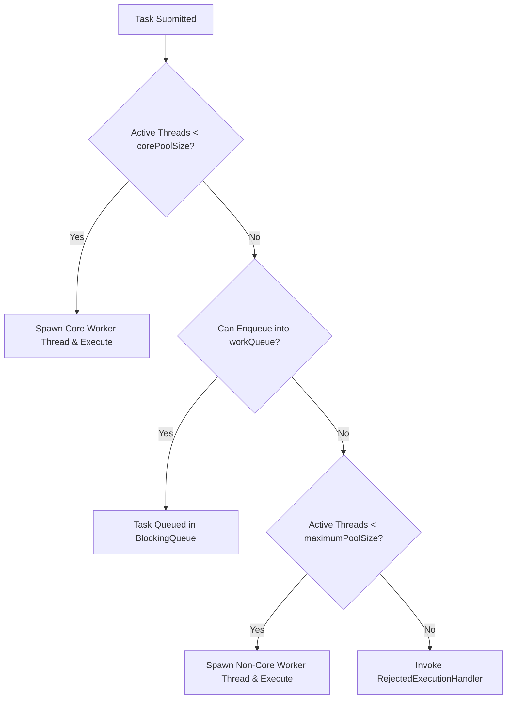

# Executors and Thread Pools

> Comprehensive architectural reference for Java thread pools: `ExecutorService`, `ThreadPoolExecutor` parameters (core/max size, keep-alive, queues), saturation policies, thread pool sizing math, graceful shutdown, and Virtual Thread executors.

| Metadata | Value |
|---|---|
| **Level** | Advanced |
| **Prerequisites** | [00_threads-and-lifecycle.md](00_threads-and-lifecycle.md), [01_runnable-callable-and-future.md](01_runnable-callable-and-future.md), [08_concurrent-collections.md](08_concurrent-collections.md) |
| **Time to Read** | 28 minutes |
| **Status** | Active |
| **Java Version** | Java 5.0+ (Executors.newVirtualThreadPerTaskExecutor in Java 21+ JEP 444) |

---

## Table of Contents
1. [What & Why](#1-what--why)
2. [Core Concepts](#2-core-concepts)
3. [How It Works Internally](#3-how-it-works-internally)
4. [Syntax & Usage](#4-syntax--usage)
5. [Practical Examples](#5-practical-examples)
6. [Best Practices](#6-best-practices)
7. [Common Mistakes & Pitfalls](#7-common-mistakes--pitfalls)
8. [Performance & Security Notes](#8-performance--security-notes)
9. [Comparison / When to Use What](#9-comparison--when-to-use-what)
10. [Interview Questions](#10-interview-questions)
11. [Practice Exercises](#11-practice-exercises)
12. [Summary / Cheat Sheet](#12-summary--cheat-sheet)
13. [Further Reading](#13-further-reading)

---

## 1. What & Why

### The Perils of Unbounded Thread Creation
In naive concurrent software, developers spawn a new thread for every arriving request:
```java
new Thread(task).start(); // LETHAL IN PRODUCTION
```
If 10,000 requests arrive concurrently, the JVM spawns 10,000 OS platform threads, consuming 10 GB of memory for thread stacks, triggering massive context-switching overhead, and causing `OutOfMemoryError: unable to create native thread`.

### The Solution: The Executor Framework
Java 5 decoupled **task submission** from **task execution** via the Executor Framework (`java.util.concurrent.ExecutorService`). Thread pools manage a finite set of reusable worker threads, queue excess tasks, enforce backpressure, and insulate systems from load spikes.

---

## 2. Core Concepts

### Core Interfaces Hierarchy
- `Executor`: Single method interface: `void execute(Runnable command)`.
- `ExecutorService`: Extends `Executor` with lifecycle control (`shutdown`, `shutdownNow`) and task submission producing `Future` handles (`submit`, `invokeAll`, `invokeAny`).
- `ScheduledExecutorService`: Adds support for delayed and periodic task scheduling (`scheduleAtFixedRate`, `scheduleWithFixedDelay`).

### `ThreadPoolExecutor` Core Parameters
Every standard thread pool is configured by 7 core parameters:
1. **`corePoolSize`**: The minimum number of worker threads kept alive, even if idle.
2. **`maximumPoolSize`**: The absolute upper limit of worker threads permitted.
3. **`keepAliveTime` & `TimeUnit`**: How long non-core idle threads wait before terminating.
4. **`workQueue`**: The `BlockingQueue<Runnable>` holding tasks waiting for available threads.
5. **`threadFactory`**: Configures naming, daemon status, and priorities for new threads.
6. **`handler` (RejectedExecutionHandler)**: Saturation policy invoked when the queue is full and `maximumPoolSize` is reached.

### The 4 Saturation (Rejection) Policies
1. **`AbortPolicy` (Default)**: Throws `RejectedExecutionException`.
2. **`CallerRunsPolicy`**: Executes the task synchronously on the calling thread (applies natural backpressure!).
3. **`DiscardPolicy`**: Silently drops the rejected task without error.
4. **`DiscardOldestPolicy`**: Discards the oldest unhandled task in the queue and retries submission.

---

## 3. How It Works Internally

### Task Submission Decision Tree
When a task is submitted via `executor.execute(task)`:
1. **If running threads < `corePoolSize`**: Create a new worker thread and run task immediately.
2. **If running threads $\ge$ `corePoolSize`**: Attempt to enqueue task into `workQueue`.
3. **If `workQueue` is FULL and running threads < `maximumPoolSize`**: Create a new non-core worker thread.
4. **If `workQueue` is FULL and running threads == `maximumPoolSize`**: Invoke the `RejectedExecutionHandler`.



### Worker Loop Mechanics
Worker threads execute inside an internal `Worker` loop:
```java
while (task != null || (task = getTask()) != null) {
    task.run();
}
```
`getTask()` blocks on `workQueue.take()` for core threads, or `workQueue.poll(keepAliveTime)` for non-core threads.

---

## 4. Syntax & Usage

### Configuring an Enterprise-Grade `ThreadPoolExecutor`
```java
import java.util.concurrent.*;
import java.util.concurrent.atomic.AtomicInteger;

public class CustomThreadPoolFactory {
    public static ThreadPoolExecutor createEnterprisePool() {
        int corePool = 8;
        int maxPool = 16;
        long keepAliveSec = 60L;
        BlockingQueue<Runnable> queue = new ArrayBlockingQueue<>(500); // Bounded queue!

        ThreadFactory namedFactory = new ThreadFactory() {
            private final AtomicInteger count = new AtomicInteger(1);
            @Override
            public Thread newThread(Runnable r) {
                Thread t = new Thread(r, "OrderWorker-" + count.getAndIncrement());
                t.setDaemon(false);
                return t;
            }
        };

        // CallerRunsPolicy throttles incoming submissions when overloaded!
        RejectedExecutionHandler rejectionHandler = new ThreadPoolExecutor.CallerRunsPolicy();

        return new ThreadPoolExecutor(
            corePool,
            maxPool,
            keepAliveSec,
            TimeUnit.SECONDS,
            queue,
            namedFactory,
            rejectionHandler
        );
    }
}
```

### Virtual Thread Per Task Executor (Java 21+)
```java
// Lightweight high-throughput executor for Virtual Threads
try (ExecutorService vExecutor = Executors.newVirtualThreadPerTaskExecutor()) {
    for (int i = 0; i < 10_000; i++) {
        vExecutor.submit(() -> {
            // High concurrency I/O without thread pooling!
        });
    }
} // Auto-closes and waits for all tasks to finish!
```

---

## 5. Practical Examples

### Example 1: Graceful Two-Phase Shutdown Pattern
```java
// Goal: Ensure in-flight tasks finish while preventing new submissions
import java.util.concurrent.*;

public class GracefulShutdownDemo {
    public static void shutdownGracefully(ExecutorService executor, long timeoutSec) {
        executor.shutdown(); // Phase 1: Disable new tasks from being submitted
        try {
            // Wait for existing tasks to finish
            if (!executor.awaitTermination(timeoutSec, TimeUnit.SECONDS)) {
                System.err.println("Tasks did not finish in time; forcing cancellation...");
                executor.shutdownNow(); // Phase 2: Cancel running tasks via interrupt

                // Wait again for cancelled tasks to respond to interrupt
                if (!executor.awaitTermination(timeoutSec, TimeUnit.SECONDS)) {
                    System.err.println("Executor pool did not terminate!");
                }
            }
        } catch (InterruptedException e) {
            executor.shutdownNow();
            Thread.currentThread().interrupt();
        }
    }
}
```

### Example 2: Periodic Task Scheduling
```java
// Goal: Execute a heartbeat ping every 5 seconds with fixed delay
import java.util.concurrent.*;

public class HeartbeatScheduler {
    public static void main(String[] args) throws InterruptedException {
        ScheduledExecutorService scheduler = Executors.newScheduledThreadPool(1);

        // scheduleWithFixedDelay guarantees 5s delay AFTER previous task finishes
        scheduler.scheduleWithFixedDelay(() -> {
            System.out.println("Heartbeat ping sent at: " + System.currentTimeMillis());
        }, 1, 5, TimeUnit.SECONDS);

        Thread.sleep(16000);
        scheduler.shutdown();
    }
}
```

### Example 3: Edge Case: Avoiding Memory Exhaustion in `Executors.newCachedThreadPool()`
```java
// Goal: Highlight hazard of unbound cached thread pools
public class CachedThreadPoolHazard {
    public static void demo() {
        // HAZARD: newCachedThreadPool() uses maximumPoolSize = Integer.MAX_VALUE!
        // A sudden spike of 20,000 requests will attempt to spawn 20,000 OS threads,
        // crashing the JVM with OutOfMemoryError!
        // ExecutorService dangerous = Executors.newCachedThreadPool();
    }
}
```
*Explanation:* Never use `Executors.newCachedThreadPool()` for un-throttled external web requests. Always specify bounded pools.

---

## 6. Best Practices
1. **Never Use Unbounded Queues with Fixed Pools**: `Executors.newFixedThreadPool(N)` uses an unbounded `LinkedBlockingQueue`. Under load, tasks accumulate indefinitely in RAM, crashing the JVM.
2. **Apply Sizing Math**:
   - For **CPU-Bound** tasks: $\text{Threads} = \text{CPU Cores} + 1$.
   - For **I/O-Bound** tasks: $\text{Threads} = \text{CPU Cores} \times \left(1 + \frac{\text{Wait Time}}{\text{Compute Time}}\right)$, or adopt **Virtual Threads**.
3. **Always Name Your Threads**: Use a custom `ThreadFactory` to assign human-readable names (`OrderProcessor-1`) for debugging and profiling.
4. **Enforce Graceful Two-Phase Shutdown**: Always invoke `shutdown()`, followed by `awaitTermination()`, and fallback to `shutdownNow()`.
5. **Use `CallerRunsPolicy` for Graceful Throttling**: Slows down the producer thread by forcing it to execute rejected tasks itself when the pool is saturated.

---

## 7. Common Mistakes & Pitfalls

| Mistake | Why Wrong | Fix |
|---|---|---|
| Using `Executors.newFixedThreadPool()` in production | Uses unbounded `LinkedBlockingQueue`, causing `OutOfMemoryError` under sustained load. | Construct `ThreadPoolExecutor` with a bounded queue (`ArrayBlockingQueue`). |
| Using `Executors.newCachedThreadPool()` under high load | Has unlimited max threads; spawns thousands of OS threads until native memory is exhausted. | Use bounded max pool size. |
| Forgetting to shut down executors | Active worker threads prevent the JVM from exiting. | Call `executor.shutdown()` or use try-with-resources. |
| Pooling Virtual Threads | Virtual threads are cheap and transient; pooling them wastes memory and defeats their purpose. | Use `Executors.newVirtualThreadPerTaskExecutor()`. |
| Swallowing exceptions in tasks submitted via `execute()` | Uncaught exceptions crash the worker thread without notifying the caller. | Set `UncaughtExceptionHandler` or use `submit()` and inspect `Future.get()`. |

---

## 8. Performance & Security Notes

### Thread Starvation Deadlocks in Single Pools
If tasks running in a thread pool submit sub-tasks to the *same* pool and block waiting for results via `future.get()`, all worker threads can become trapped waiting for sub-tasks that are stuck in the queue, creating a permanent deadlock.
**Solution**: Separate thread pools for independent processing stages, or migrate to Virtual Threads.

---

## 9. Comparison / When to Use What

| Factory Method | Work Queue | Threads | Primary Use Case |
|---|---|---|---|
| `newFixedThreadPool(N)` | Unbounded LinkedQueue | Fixed $N$ | Predictable background jobs |
| `newCachedThreadPool()` | SynchronousQueue | 0 to $\infty$ | Many short-lived tasks (internal only)|
| `newSingleThreadExecutor()`| Unbounded LinkedQueue | Exactly 1 | Sequential ordering |
| `newScheduledThreadPool(N)`| DelayedWorkQueue | Fixed $N$ | Periodic cron timers |
| `newVirtualThreadPerTaskExecutor()`| Unbounded internal | Millions | High-throughput I/O (Java 21+) |

---

## 10. Interview Questions

<details>
<summary>1. How does a `ThreadPoolExecutor` decide whether to create a new thread or queue a task?</summary>
If running threads < `corePoolSize`, it creates a new thread. If $\ge$ `corePoolSize`, it attempts to queue the task. If the queue is full, it creates a non-core thread up to `maximumPoolSize`. If max threads is reached, it triggers rejection.
</details>

<details>
<summary>2. Why are the standard static factory methods in `Executors` discouraged for production?</summary>
`newFixedThreadPool` uses an unbounded queue which causes OOM on memory buildup. `newCachedThreadPool` has an unbounded maximum pool size which causes OOM on thread creation spikes. Custom `ThreadPoolExecutor` with bounded queues is preferred.
</details>

<details>
<summary>3. What is the difference between `shutdown()` and `shutdownNow()`?</summary>
`shutdown()` initiates a graceful shutdown: no new tasks are accepted, but existing queued tasks are executed. `shutdownNow()` attempts to cancel running tasks via `Thread.interrupt()`, halts queue processing, and returns a list of unexecuted tasks.
</details>

<details>
<summary>4. What are the four RejectedExecutionHandler policies?</summary>
`AbortPolicy` (throws exception), `CallerRunsPolicy` (caller thread executes task), `DiscardPolicy` (drops task silently), and `DiscardOldestPolicy` (drops oldest queued task and retries).
</details>

<details>
<summary>5. How should thread pool size be calculated for CPU-bound vs I/O-bound tasks?</summary>
CPU-bound: $N_{\text{threads}} = N_{\text{cores}} + 1$. I/O-bound: $N_{\text{threads}} = N_{\text{cores}} \times (1 + \frac{\text{Wait}}{\text{Compute}})$, or leverage Virtual Threads where pooling is unnecessary.
</details>

<details>
<summary>6. Should you pool Virtual Threads in Java 21+?</summary>
No. Virtual threads are designed to be ephemeral and cheap to create (costing under 1 KB of heap). Pooling them is an anti-pattern. Create them per-task via `Executors.newVirtualThreadPerTaskExecutor()`.
</details>

<details>
<summary>7. What is `awaitTermination(timeout, unit)`?</summary>
A blocking method that waits for all tasks to complete execution after a shutdown request, or until the timeout occurs, or the current thread is interrupted.
</details>

<details>
<summary>8. How do thread pools handle an unhandled exception thrown in `Runnable.run()`?</summary>
The worker thread that encountered the exception terminates and is removed from the pool. The pool immediately creates a new replacement worker thread to preserve `corePoolSize`.
</details>

---

## 11. Practice Exercises

### Exercise 1 (Easy): Custom Named Thread Factory
- **Task**: Implement a `ThreadFactory` that names threads `"PaymentProcessor-#"` and marks them as non-daemon.
<details>
<summary>Solution</summary>

```java
import java.util.concurrent.ThreadFactory;
import java.util.concurrent.atomic.AtomicInteger;

public class PaymentThreadFactory implements ThreadFactory {
    private final AtomicInteger counter = new AtomicInteger(1);

    @Override
    public Thread newThread(Runnable r) {
        Thread t = new Thread(r, "PaymentProcessor-" + counter.getAndIncrement());
        t.setDaemon(false);
        return t;
    }
}
```
</details>

### Exercise 2 (Medium): Throttling Pool with `CallerRunsPolicy`
- **Task**: Configure a `ThreadPoolExecutor` with 2 core threads, 2 max threads, and an `ArrayBlockingQueue(2)`. Submit 10 tasks and observe how `CallerRunsPolicy` throttles submissions.
<details>
<summary>Solution</summary>

```java
import java.util.concurrent.*;

public class ThrottlingPoolDemo {
    public static void main(String[] args) {
        ThreadPoolExecutor pool = new ThreadPoolExecutor(
            2, 2, 0L, TimeUnit.MILLISECONDS,
            new ArrayBlockingQueue<>(2),
            new ThreadPoolExecutor.CallerRunsPolicy()
        );

        for (int i = 1; i <= 10; i++) {
            final int taskId = i;
            System.out.println("Submitting task " + taskId + " from " + Thread.currentThread().getName());
            pool.execute(() -> {
                try {
                    Thread.sleep(100);
                    System.out.println("Task " + taskId + " finished on " + Thread.currentThread().getName());
                } catch (InterruptedException ignored) {}
            });
        }

        pool.shutdown();
    }
}
```
</details>

### Exercise 3 (Hard): Dynamic Pool Auto-Scaler
- **Task**: Build an adaptive monitor that periodically inspects `pool.getQueue().size()`; if the queue size exceeds 100, increase `corePoolSize`, and if below 10, decrease it back to baseline.
<details>
<summary>Solution</summary>

```java
import java.util.concurrent.*;

public class AdaptivePoolScaler {
    private final ThreadPoolExecutor pool;
    private final int minCore;
    private final int maxCore;

    public AdaptivePoolScaler(ThreadPoolExecutor pool, int minCore, int maxCore) {
        this.pool = pool;
        this.minCore = minCore;
        this.maxCore = maxCore;
    }

    public void evaluateScale() {
        int queueSize = pool.getQueue().size();
        int currentCore = pool.getCorePoolSize();

        if (queueSize > 100 && currentCore < maxCore) {
            int newCore = Math.min(maxCore, currentCore + 2);
            pool.setCorePoolSize(newCore);
            System.out.println("Scaled UP core pool size to: " + newCore);
        } else if (queueSize < 10 && currentCore > minCore) {
            int newCore = Math.max(minCore, currentCore - 2);
            pool.setCorePoolSize(newCore);
            System.out.println("Scaled DOWN core pool size to: " + newCore);
        }
    }
}
```
</details>

---

## 12. Summary / Cheat Sheet

```
+-----------------------------------------------------------------------------------------+
|                                  EXECUTORS CHEAT SHEET                                  |
+-----------------------------------------------------------------------------------------+
| Standard Construction    | new ThreadPoolExecutor(core, max, keepAlive, queue, handler) |
| Safe Queue               | ArrayBlockingQueue(capacity) (Enforces bounded limits)       |
| Saturation Policies      | AbortPolicy (default), CallerRunsPolicy (backpressure)       |
| Two-Phase Shutdown       | executor.shutdown(); awaitTermination(); shutdownNow();      |
| Sizing Rule (CPU)        | Cores + 1                                                    |
| Sizing Rule (I/O)        | Cores * (1 + Wait/Compute)                                   |
| Java 21+ Virtual Threads | Executors.newVirtualThreadPerTaskExecutor() (Do NOT pool VT) |
+-----------------------------------------------------------------------------------------+
```

---

## 13. Further Reading
- [Official Javadoc: java.util.concurrent.ThreadPoolExecutor](https://docs.oracle.com/en/java/javase/21/docs/api/java.base/java/util/concurrent/ThreadPoolExecutor.html)
- Java Concurrency in Practice by Brian Goetz — Chapter 8 (Applying Thread Pools)
- Oracle Dev.java: The Executor Framework
