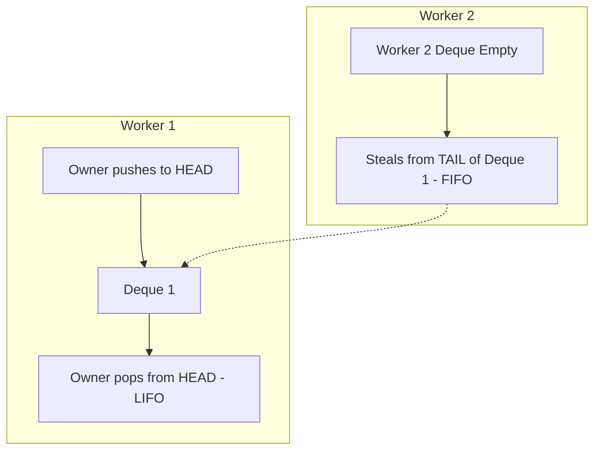

# Fork/Join Framework and Work-Stealing

> Deep dive into Java's Fork/Join Framework: `ForkJoinPool`, `RecursiveTask<V>`, `RecursiveAction`, the work-stealing algorithm (dual-ended queues), `ForkJoinPool.commonPool()`, and parallel divide-and-conquer computation.

| Metadata | Value |
|---|---|
| **Level** | Advanced |
| **Prerequisites** | [01_runnable-callable-and-future.md](01_runnable-callable-and-future.md), [10_executors-and-thread-pools.md](10_executors-and-thread-pools.md) |
| **Time to Read** | 25 minutes |
| **Status** | Active |
| **Java Version** | Java 7.0+ (Underpins Java 8 Parallel Streams & Java 21 Virtual Threads) |

---

## Table of Contents
1. [What & Why](#1-what--why)
2. [Core Concepts](#2-core-concepts)
3. [How It Works Internally](#3-how-it-works-internally)
4. [Syntax & Usage](#4-syntax--usage)
5. [Practical Examples](#5-practical-examples)
6. [Best Practices](#6-best-practices)
7. [Common Mistakes & Pitfalls](#7-common-mistakes--pitfalls)
8. [Performance & Security Notes](#8-performance--security-notes)
9. [Comparison / When to Use What](#9-comparison--when-to-use-what)
10. [Interview Questions](#10-interview-questions)
11. [Practice Exercises](#11-practice-exercises)
12. [Summary / Cheat Sheet](#12-summary--cheat-sheet)
13. [Further Reading](#13-further-reading)

---

## 1. What & Why

### The Challenge of Divide-and-Conquer Parallelism
Traditional thread pools assume tasks are independent, coarse-grained, and do not block waiting for sub-tasks.
However, divide-and-conquer recursive algorithms (such as MergeSort, tree traversals, and matrix multiplication) break a large problem recursively into smaller sub-problems, waiting for the sub-results before assembling the final answer.
If standard thread pools are used, worker threads quickly become starved waiting for sub-tasks, deadlocking the system.

### The Solution: The Fork/Join Framework (JSR 166y)
Introduced in Java 7, the Fork/Join framework is designed specifically for **fine-grained divide-and-conquer parallel computation**. Powered by an ingenious **Work-Stealing algorithm**, idle worker threads steal tasks from the deques of busy worker threads, maximizing multi-core CPU hardware saturation.

---

## 2. Core Concepts

### Core Framework Classes
1. **`ForkJoinPool`**: The execution engine. Maintains worker threads and dual-ended task deques.
2. **`ForkJoinTask<V>`**: Base abstract class for tasks. Implements `Future<V>`:
   - `RecursiveTask<V>`: Computations that **return a result** (`compute()` returns `V`).
   - `RecursiveAction`: Computations that **produce side effects** (`compute()` returns `void`).
   - `CountedCompleter<V>`: Advanced task where completion triggers actions in pending sub-tasks.

### The Fork-Join Principle
1. **Fork (`fork()`)**: Asynchronously splits a sub-task, placing it onto the current worker thread's local deque.
2. **Join (`join()`)**: Blocks until the sub-task completes. **Crucial**: While waiting, the worker thread does *not* go to sleep; it actively executes or steals other pending tasks!

### The Common Pool (`ForkJoinPool.commonPool()`)
A JVM-wide static shared pool used by default by:
- Parallel Streams (`list.parallelStream()...`).
- `CompletableFuture` asynchronous methods without custom executors.
- Sized by default to `Runtime.getRuntime().availableProcessors() - 1`.

---

## 3. How It Works Internally

### The Work-Stealing Algorithm
Every worker thread in a `ForkJoinPool` possesses its own private double-ended queue (deque):
- **LIFO (Stack) Push/Pop**: The owner thread pushes new sub-tasks to the **HEAD** of its deque, and pops tasks from the **HEAD**. This exploits CPU cache locality because recently created sub-tasks access warm cache memory.
- **FIFO (Queue) Stealing**: When a worker runs out of local tasks, it becomes a "thief" and steals tasks from the **TAIL** of another busy worker's deque!
- **Zero Contention**: Because owner threads operate at the head and thieves operate at the tail, lock contention between workers is minimized.



---

## 4. Syntax & Usage

### Basic `RecursiveTask` Implementation
```java
import java.util.concurrent.RecursiveTask;

public class SumTask extends RecursiveTask<Long> {
    private static final int THRESHOLD = 10_000;
    private final int[] array;
    private final int start;
    private final int end;

    public SumTask(int[] array, int start, int end) {
        this.array = array;
        this.start = start;
        this.end = end;
    }

    @Override
    protected Long compute() {
        int length = end - start;
        if (length <= THRESHOLD) {
            // Base case: compute sequentially
            long sum = 0;
            for (int i = start; i < end; i++) sum += array[i];
            return sum;
        }

        int mid = start + length / 2;
        SumTask leftTask = new SumTask(array, start, mid);
        SumTask rightTask = new SumTask(array, mid, end);

        // Fork left task asynchronously
        leftTask.fork();

        // Compute right task directly on current thread!
        long rightResult = rightTask.compute();

        // Wait for left task and combine
        long leftResult = leftTask.join();

        return leftResult + rightResult;
    }
}
```

---

## 5. Practical Examples

### Example 1: Parallel Array Sum Benchmark
```java
// Goal: Execute parallel divide-and-conquer sum across 10,000,000 numbers
import java.util.concurrent.ForkJoinPool;

public class ForkJoinSumDemo {
    public static void main(String[] args) {
        int size = 10_000_000;
        int[] numbers = new int[size];
        for (int i = 0; i < size; i++) numbers[i] = 1;

        ForkJoinPool pool = new ForkJoinPool();
        SumTask task = new SumTask(numbers, 0, size);

        long start = System.currentTimeMillis();
        long totalSum = pool.invoke(task);
        long elapsed = System.currentTimeMillis() - start;

        System.out.println("Total sum: " + totalSum + " calculated in " + elapsed + " ms");
    }
}
```
*Output:*
```
Total sum: 10000000 calculated in 18 ms
```

### Example 2: Parallel MergeSort via `RecursiveAction`
```java
// Goal: Sort massive array concurrently using RecursiveAction
import java.util.Arrays;
import java.util.concurrent.*;

public class ParallelMergeSort extends RecursiveAction {
    private static final int THRESHOLD = 1000;
    private final int[] array;
    private final int start, end;

    public ParallelMergeSort(int[] array, int start, int end) {
        this.array = array;
        this.start = start;
        this.end = end;
    }

    @Override
    protected void compute() {
        if (end - start <= THRESHOLD) {
            Arrays.sort(array, start, end);
            return;
        }

        int mid = start + (end - start) / 2;
        // invokeAll forks first task and runs second task directly
        invokeAll(
            new ParallelMergeSort(array, start, mid),
            new ParallelMergeSort(array, mid, end)
        );

        merge(start, mid, end);
    }

    private void merge(int start, int mid, int end) {
        int[] temp = Arrays.copyOfRange(array, start, mid);
        int i = 0, j = mid, k = start;
        while (i < temp.length && j < end) {
            array[k++] = (temp[i] <= array[j]) ? temp[i++] : array[j++];
        }
        while (i < temp.length) array[k++] = temp[i++];
    }
}
```

### Example 3: Edge Case: Avoiding Forking Both Sub-Tasks
```java
// Goal: Correct ordering of fork and compute to avoid wasting worker threads
// WRONG:
// left.fork();
// right.fork(); // Redundant thread scheduling!
// return left.join() + right.join();

// CORRECT:
// left.fork();
// Long rightResult = right.compute(); // Execute directly on current thread!
// return left.join() + rightResult;
```
*Explanation:* Forking both tasks creates unnecessary queue manipulation; always compute one half on the current thread and fork the other half.

---

## 6. Best Practices
1. **Compute One Task Locally, Fork the Other**: Call `left.fork()` and `right.compute()`, or use `ForkJoinTask.invokeAll(t1, t2)`.
2. **Choose the Right Threshold**: Sub-tasks must do enough computational work (typically 10,000–100,000 CPU instructions) to outweigh task allocation overhead.
3. **Keep Tasks Pure and CPU-Bound**: Never execute blocking I/O (database, disk, HTTP) inside `ForkJoinPool.commonPool()`; blocking worker threads stalls the entire JVM's parallel stream processing!
4. **Use `ManagedBlocker` for Necessary Blocking**: If blocking is unavoidable inside `ForkJoinPool`, implement `ForkJoinPool.ManagedBlocker` to signal the pool to spawn temporary compensation threads.
5. **Use Custom Pools for Isolated Workloads**: Instantiate a dedicated `new ForkJoinPool(parallelism)` rather than saturating `commonPool()`.

---

## 7. Common Mistakes & Pitfalls

| Mistake | Why Wrong | Fix |
|---|---|---|
| Performing blocking I/O in `commonPool()` | Starves worker threads, paralyzing parallel streams JVM-wide. | Use dedicated I/O thread pools or Virtual Threads. |
| Threshold set too low (e.g. 1 element) | Millions of tiny task allocations overwhelm heap and GC. | Set threshold to 1,000–10,000 elements. |
| Threshold set too high | Destroys parallel speedup; executes mostly sequentially. | Tune threshold based on profiling benchmarks. |
| Calling `left.fork()` followed by `right.fork()` | Creates redundant thread scheduling overhead. | Call `left.fork()`, `right.compute()`, then `left.join()`. |
| Modifying shared state from tasks | Introduces race conditions in divide-and-conquer tree. | Keep tasks pure and combine results via returns. |

---

## 8. Performance & Security Notes

### CommonPool Saturation Security Risk
Because `ForkJoinPool.commonPool()` is shared JVM-wide, untrusted or buggy code that executes long-running or blocking tasks in a parallel stream can exhaust all worker threads, creating a Denial of Service (DoS) for all other components relying on parallel streams.

---

## 9. Comparison / When to Use What

| Feature | `ForkJoinPool` | Standard `ThreadPoolExecutor` |
|---|---|---|
| **Task Model** | Recursive Divide-and-Conquer | Independent, coarse-grained tasks |
| **Queue Architecture** | One Deque per Worker Thread | Shared single `BlockingQueue` |
| **Work Distribution** | Work-Stealing (LIFO local / FIFO steal)| Work-Seeking (FIFO pull) |
| **Ideal Workload** | Heavy CPU computation (Sort, Search)| Blocking I/O, Web Requests |

---

## 10. Interview Questions

<details>
<summary>1. What is the Work-Stealing algorithm in `ForkJoinPool`?</summary>
An algorithm where each worker thread maintains a private deque. A worker pushes and pops sub-tasks from the head of its own deque (LIFO). When its deque is empty, it steals tasks from the tail of another worker's deque (FIFO), maximizing CPU utilization.
</details>

<details>
<summary>2. Why does the owner push/pop from the head while thieves steal from the tail?</summary>
Head access is LIFO, which maximizes cache locality by processing recent sub-problems first. Tail access is FIFO, which steals larger, less divided sub-problems and avoids lock contention with the owner.
</details>

<details>
<summary>3. What is the difference between `RecursiveTask` and `RecursiveAction`?</summary>
`RecursiveTask<V>` returns a computed result of type `V` from its `compute()` method. `RecursiveAction` produces side effects and returns `void`.
</details>

<details>
<summary>4. Why should you avoid blocking I/O in `ForkJoinPool.commonPool()`?</summary>
The common pool is shared across the entire JVM by Parallel Streams and CompletableFutures. Blocking common pool threads starves the CPU cores, degrading application-wide throughput.
</details>

<details>
<summary>5. What does `ForkJoinTask.invokeAll(t1, t2)` do?</summary>
It forks the first task, executes the second task on the current thread, and joins the first task, ensuring optimal thread utilization without boilerplate code.
</details>

<details>
<summary>6. What is `ForkJoinPool.ManagedBlocker`?</summary>
An interface used when a task inside a `ForkJoinPool` must perform blocking operations. It allows the pool to spawn temporary compensation threads to preserve target CPU parallelism.
</details>

<details>
<summary>7. How does Java 21+ Virtual Threads relate to `ForkJoinPool`?</summary>
Under the hood, Java Virtual Threads use a dedicated internal `ForkJoinPool` as their default carrier thread scheduler!
</details>

<details>
<summary>8. How do you choose the right threshold for a divide-and-conquer task?</summary>
The threshold should balance concurrency with overhead: large enough that computing the base case takes at least 10,000 CPU instructions to justify task allocation, but small enough that work can be evenly distributed.
</details>

---

## 11. Practice Exercises

### Exercise 1 (Easy): Parallel Maximum Finder
- **Task**: Implement a `RecursiveTask<Integer>` that finds the maximum value in an integer array using divide-and-conquer with a threshold of 10,000.
<details>
<summary>Solution</summary>

```java
import java.util.concurrent.*;

public class MaxFinderTask extends RecursiveTask<Integer> {
    private static final int THRESHOLD = 10_000;
    private final int[] arr;
    private final int start, end;

    public MaxFinderTask(int[] arr, int start, int end) {
        this.arr = arr;
        this.start = start;
        this.end = end;
    }

    @Override
    protected Integer compute() {
        if (end - start <= THRESHOLD) {
            int max = Integer.MIN_VALUE;
            for (int i = start; i < end; i++) max = Math.max(max, arr[i]);
            return max;
        }

        int mid = start + (end - start) / 2;
        MaxFinderTask left = new MaxFinderTask(arr, start, mid);
        MaxFinderTask right = new MaxFinderTask(arr, mid, end);

        left.fork();
        int rightMax = right.compute();
        int leftMax = left.join();

        return Math.max(leftMax, rightMax);
    }
}
```
</details>

### Exercise 2 (Medium): Parallel Array In-Place Squaring
- **Task**: Use `RecursiveAction` to square every element in a large double array `double[]` in-place using divide-and-conquer.
<details>
<summary>Solution</summary>

```java
import java.util.concurrent.*;

public class ParallelSquareAction extends RecursiveAction {
    private static final int THRESHOLD = 5_000;
    private final double[] data;
    private final int start, end;

    public ParallelSquareAction(double[] data, int start, int end) {
        this.data = data;
        this.start = start;
        this.end = end;
    }

    @Override
    protected void compute() {
        if (end - start <= THRESHOLD) {
            for (int i = start; i < end; i++) {
                data[i] = data[i] * data[i];
            }
            return;
        }

        int mid = start + (end - start) / 2;
        invokeAll(
            new ParallelSquareAction(data, start, mid),
            new ParallelSquareAction(data, mid, end)
        );
    }
}
```
</details>

### Exercise 3 (Hard): Parallel Word Occurrences Counter
- **Task**: Implement a `RecursiveTask<Long>` that counts the occurrences of a target keyword across an array of strings using `ForkJoinPool`.
<details>
<summary>Solution</summary>

```java
import java.util.concurrent.*;

public class ParallelWordCount extends RecursiveTask<Long> {
    private static final int THRESHOLD = 1_000;
    private final String[] words;
    private final String target;
    private final int start, end;

    public ParallelWordCount(String[] words, String target, int start, int end) {
        this.words = words;
        this.target = target;
        this.start = start;
        this.end = end;
    }

    @Override
    protected Long compute() {
        if (end - start <= THRESHOLD) {
            long count = 0;
            for (int i = start; i < end; i++) {
                if (target.equalsIgnoreCase(words[i])) count++;
            }
            return count;
        }

        int mid = start + (end - start) / 2;
        ParallelWordCount left = new ParallelWordCount(words, target, start, mid);
        ParallelWordCount right = new ParallelWordCount(words, target, mid, end);

        left.fork();
        long rightCount = right.compute();
        long leftCount = left.join();

        return leftCount + rightCount;
    }
}
```
</details>

---

## 12. Summary / Cheat Sheet

```
+-----------------------------------------------------------------------------------------+
|                                FORK/JOIN CHEAT SHEET                                    |
+-----------------------------------------------------------------------------------------+
| Core Engine              | ForkJoinPool pool = new ForkJoinPool();                      |
| Return Value Task        | public class MyTask extends RecursiveTask<V> { V compute() } |
| Void Action Task         | public class MyAction extends RecursiveAction { void compute}|
| Work-Stealing Pattern    | left.fork(); V r = right.compute(); V l = left.join();       |
| Multiple Tasks           | invokeAll(task1, task2);                                     |
| Common Pool Danger       | Never execute blocking I/O in ForkJoinPool.commonPool()      |
| Under the Hood           | Dual-ended deques: LIFO push/pop for owner, FIFO for thieves |
+-----------------------------------------------------------------------------------------+
```

---

## 13. Further Reading
- [JSR 166y: Fork/Join Framework Specification](https://gee.cs.oswego.edu/dl/concurrency-interest/)
- "A Java Fork/Join Framework" by Doug Lea
- Java Concurrency in Practice by Brian Goetz
