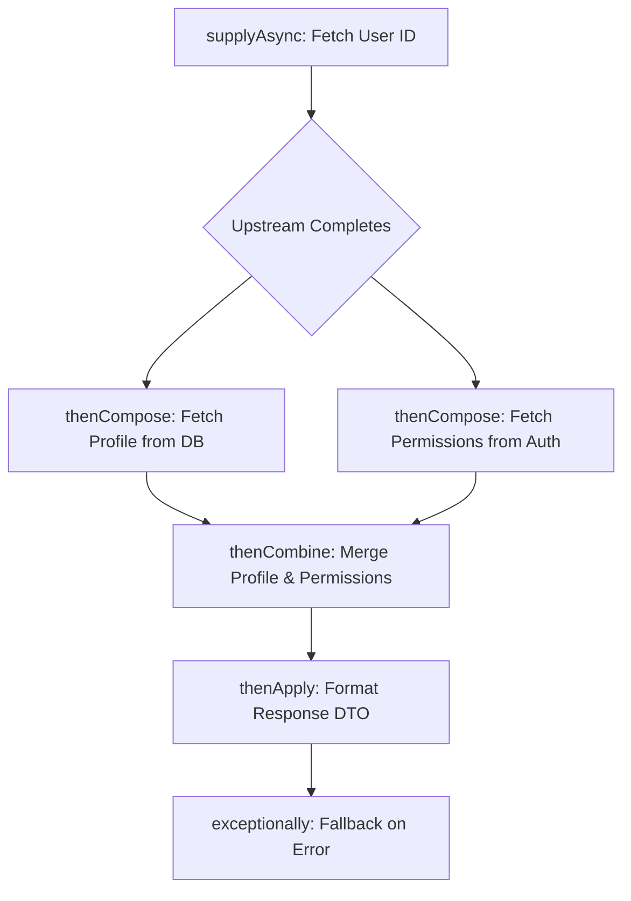

# CompletableFuture and Asynchronous Pipelines

> Comprehensive architectural guide to `CompletableFuture<T>`: non-blocking asynchronous programming, functional pipeline composition (`thenApply`, `thenCompose`, `thenCombine`), exception handling, multi-future orchestration (`allOf`, `anyOf`), and executor routing.

| Metadata | Value |
|---|---|
| **Level** | Advanced |
| **Prerequisites** | [01_runnable-callable-and-future.md](01_runnable-callable-and-future.md), [09-functional-java/00_lambda-expressions.md](../09-functional-java/00_lambda-expressions.md) |
| **Time to Read** | 28 minutes |
| **Status** | Active |
| **Java Version** | Java 8+ (Enhanced methods in Java 9+ JEP 266) |

---

## Table of Contents
1. [What & Why](#1-what--why)
2. [Core Concepts](#2-core-concepts)
3. [How It Works Internally](#3-how-it-works-internally)
4. [Syntax & Usage](#4-syntax--usage)
5. [Practical Examples](#5-practical-examples)
6. [Best Practices](#6-best-practices)
7. [Common Mistakes & Pitfalls](#7-common-mistakes--pitfalls)
8. [Performance & Security Notes](#8-performance--security-notes)
9. [Comparison / When to Use What](#9-comparison--when-to-use-what)
10. [Interview Questions](#10-interview-questions)
11. [Practice Exercises](#11-practice-exercises)
12. [Summary / Cheat Sheet](#12-summary--cheat-sheet)
13. [Further Reading](#13-further-reading)

---

## 1. What & Why

### The Pain of Callback Hell and Blocking `Future.get()`
The classic `java.util.concurrent.Future` interface had no mechanism to attach callback functions. To obtain a value, calling threads had to invoke blocking `future.get()` or continuously poll `isDone()`.
Furthermore, classic `Future` could not:
- Combine multiple independent futures together.
- Chain downstream processing stages without blocking intermediate threads.
- Handle exceptions reactively without clumsy `try-catch` blocks.

### The Solution: `CompletableFuture<T>` (JSR 166)
Introduced in Java 8 and enhanced in Java 9, `CompletableFuture<T>` implements both `Future<T>` and `CompletionStage<T>`:
- Provides over 50 functional combinator methods.
- Supports pure non-blocking reactive pipelines.
- Allows explicit manual completion via `complete(value)` or `completeExceptionally(ex)`.
- Seamlessly coordinates parallel distributed calls across microservices.

---

## 2. Core Concepts

### Initiating Asynchronous Computations
- `CompletableFuture.supplyAsync(Supplier<U>, [Executor])`: Runs an asynchronous task that returns a value.
- `CompletableFuture.runAsync(Runnable, [Executor])`: Runs an asynchronous task that returns `void`.
- If no executor is specified, the task defaults to `ForkJoinPool.commonPool()`.

### The Core Transformation Operators
1. **`thenApply(Function<T, U>)`**: Synchronous value transformation (equivalent to `Stream.map`).
2. **`thenAccept(Consumer<T>)`**: Terminal consumer yielding `CompletableFuture<Void>`.
3. **`thenRun(Runnable)`**: Runs an action upon completion, ignoring previous value.

### Pipeline Chaining and Combination
- **`thenCompose(Function<T, CompletableFuture<U>>)`**: Flattens nested futures (equivalent to `Stream.flatMap` or Monadic bind).
- **`thenCombine(CompletableFuture<U>, BiFunction<T, U, V>)`**: Executes two futures concurrently and combines their results when both complete.

### Exceptional Handling
- **`exceptionally(Function<Throwable, T>)`**: Recovers from exceptions by returning a fallback value.
- **`handle(BiFunction<T, Throwable, U>)`**: Unifies success and failure paths in a single callback.
- **`whenComplete(BiConsumer<T, Throwable>)`**: Observes completion or failure without altering the result.

---

## 3. How It Works Internally

### The Completion Dependency DAG
Internally, each `CompletableFuture` maintains a stack of dependent `Completion` nodes (Treiber stack):
1. When a stage like `thenApply` is chained, a `UniApply` completion node is pushed onto the future's internal `stack`.
2. When the upstream future completes (via `complete()` or worker exit), it traverses its dependency stack, popping each node and triggering downstream execution.
3. If an executor was passed (e.g. `thenApplyAsync(fn, executor)`), the downstream node is submitted to the specified executor; otherwise, it executes inline on the completing thread!



---

## 4. Syntax & Usage

### Asynchronous Transformation Pipeline
```java
import java.util.concurrent.*;

public class CompletableFutureBasics {
    public static void main(String[] args) {
        ExecutorService customPool = Executors.newFixedThreadPool(4);

        CompletableFuture.supplyAsync(() -> {
            System.out.println("Fetching user on " + Thread.currentThread().getName());
            return 101L;
        }, customPool)
        .thenApplyAsync(userId -> {
            System.out.println("Formatting payload for user " + userId);
            return "USER_DTO_" + userId;
        }, customPool)
        .thenAccept(dto -> {
            System.out.println("Finished processing: " + dto);
        })
        .join(); // Wait for demo completion

        customPool.shutdown();
    }
}
```

### Combining Two Independent Futures with `thenCombine`
```java
CompletableFuture<Double> priceFuture = CompletableFuture.supplyAsync(() -> 100.0);
CompletableFuture<Double> taxFuture   = CompletableFuture.supplyAsync(() -> 0.15);

CompletableFuture<Double> totalFuture = priceFuture.thenCombine(taxFuture, (price, tax) -> {
    return price * (1.0 + tax);
});

System.out.println("Total Price: " + totalFuture.join()); // 115.0
```

---

## 5. Practical Examples

### Example 1: Resilient Microservice Aggregator
```java
// Goal: Fetch price and stock from separate services with fallback and timeout
import java.util.concurrent.*;

public class ProductAggregator {
    record ProductDetails(String id, double price, int inventory) {}

    public static CompletableFuture<ProductDetails> getProduct(String id, ExecutorService executor) {
        CompletableFuture<Double> priceFuture = CompletableFuture.supplyAsync(() -> {
            // Simulated HTTP price service
            return 29.99;
        }, executor)
        .orTimeout(500, TimeUnit.MILLISECONDS) // Java 9+ timeout
        .exceptionally(ex -> 0.0); // Fallback price on timeout

        CompletableFuture<Integer> stockFuture = CompletableFuture.supplyAsync(() -> {
            // Simulated inventory DB
            return 150;
        }, executor)
        .orTimeout(500, TimeUnit.MILLISECONDS)
        .exceptionally(ex -> 0); // Fallback inventory

        return priceFuture.thenCombine(stockFuture, (price, stock) -> new ProductDetails(id, price, stock));
    }
}
```

### Example 2: Multi-Future Fan-Out and Aggregation with `allOf`
```java
// Goal: Concurrently fetch 5 URLs and collect results
import java.util.*;
import java.util.concurrent.*;

public class BatchUrlFetcher {
    public static List<String> fetchAll(List<String> urls, ExecutorService executor) {
        List<CompletableFuture<String>> futures = urls.stream()
            .map(url -> CompletableFuture.supplyAsync(() -> "Content of " + url, executor))
            .toList();

        // allOf creates a single future that completes when ALL sub-futures complete
        CompletableFuture<Void> allDone = CompletableFuture.allOf(futures.toArray(new CompletableFuture[0]));

        // Wait for all and extract results
        return allDone.thenApply(v -> {
            return futures.stream()
                .map(CompletableFuture::join) // Non-blocking because allOf is complete!
                .toList();
        }).join();
    }
}
```

### Example 3: Edge Case: Fast Fallback with `anyOf`
```java
// Goal: Query 3 redundant DNS mirrors; accept the fastest response and discard others
import java.util.concurrent.*;

public class FastestMirrorDemo {
    public static void main(String[] args) {
        CompletableFuture<String> mirrorA = CompletableFuture.supplyAsync(() -> {
            try { Thread.sleep(300); } catch (InterruptedException ignored) {}
            return "Mirror A Response";
        });

        CompletableFuture<String> mirrorB = CompletableFuture.supplyAsync(() -> {
            try { Thread.sleep(100); } catch (InterruptedException ignored) {}
            return "Mirror B (Fastest!)";
        });

        CompletableFuture<Object> fastest = CompletableFuture.anyOf(mirrorA, mirrorB);
        System.out.println("Fastest result: " + fastest.join());
    }
}
```
*Output:*
```
Fastest result: Mirror B (Fastest!)
```

### Example 4: Failure Case: Swallowing Exceptions in Intermediate Stages
```java
// Goal: Demonstrate why exceptionally or handle is strictly required
public class UncaughtFailureHazard {
    public static void demonstrate() {
        CompletableFuture.supplyAsync(() -> {
            throw new IllegalStateException("Database connection pool failed!");
        })
        .thenApply(res -> "Formatted: " + res);
        // HAZARD: No exceptionally() or join()!
        // The exception is trapped inside the future and silently disappears!
    }
}
```

---

## 6. Best Practices
1. **Always Supply a Custom Executor**: Never use default unadorned `supplyAsync(supplier)` in production. Defaulting to `ForkJoinPool.commonPool()` causes thread starvation if I/O blocks.
2. **Use `thenCompose` for Flattening**: When a transformation method returns a `CompletableFuture`, use `thenCompose` rather than `thenApply` to prevent nested `CompletableFuture<CompletableFuture<T>>`.
3. **Always Configure Timeouts**: Use Java 9+ `.orTimeout(n, unit)` or `.completeOnTimeout(fallback, n, unit)` to guard against hanging external dependencies.
4. **Prefer `handle` over `exceptionally` for Unified Control**: `handle((res, ex) -> ...)` processes both success and error paths cleanly without creating extra intermediate stages.
5. **Beware of Inline Execution**: Methods without the `*Async` suffix (e.g. `thenApply`) can execute directly on the thread completing the upstream future, potentially executing heavy computation on I/O threads.

---

## 7. Common Mistakes & Pitfalls

| Mistake | Why Wrong | Fix |
|---|---|---|
| Using `thenApply` instead of `thenCompose` | Produces nested `CompletableFuture<CompletableFuture<T>>`. | Use `thenCompose`. |
| Defaulting to `commonPool()` for blocking I/O | Starves the shared JVM common pool, stalling parallel streams. | Pass custom `Executor` or Virtual Thread executor. |
| Calling `.get()` inside reactive callback lambdas | Blocks the completing worker thread, destroying reactive non-blocking benefits. | Chain downstream stages reactively (`thenApply`, `thenCompose`). |
| Missing exception handling | Unhandled exceptions remain trapped inside the future without logging or notification. | Attach `.exceptionally()` or `.handle()`. |
| Calling `join()` without timeout in production | If the future hangs, the caller thread blocks indefinitely. | Use `future.orTimeout(...)` before calling `join()`. |

---

## 8. Performance & Security Notes

### Memory Overhead of Deep DAG Pipelines
Every stage attached to a `CompletableFuture` allocates a `Completion` object on the heap. While lightweight, creating pipelines with hundreds of chained stages per HTTP request can elevate GC allocation rates under high throughput.

### Unhandled Asynchronous Exceptions
In asynchronous execution models, exceptions do not appear in standard thread stack traces. If a future fails and is never joined or queried, the failure is silently lost. Always configure centralized logging via `.whenComplete((res, ex) -> { if (ex != null) log.error(...); })`.

---

## 9. Comparison / When to Use What

| Feature | Classic `Future` | `CompletableFuture` | Reactive Streams (RxJava/Reactor) |
|---|---|---|---|
| **Values** | Single (1) | Single (1) | Stream ($0 \dots \infty$) |
| **Non-Blocking Callbacks**| No | **Yes** | **Yes** |
| **Pipeline Combinators** | None | **50+ Built-in Methods** | Rich Operators |
| **External Dependencies**| Standard JDK | Standard JDK | Third-Party Libraries |
| **Backpressure** | N/A | None | Built-in Backpressure |

---

## 10. Interview Questions

<details>
<summary>1. What is the difference between `thenApply` and `thenCompose`?</summary>
`thenApply` takes a function that returns a regular value `U` and wraps it in `CompletableFuture<U>`. `thenCompose` takes a function that returns a `CompletableFuture<U>` and flattens it directly, preventing nested `CompletableFuture<CompletableFuture<U>>`.
</details>

<details>
<summary>2. What is the difference between `thenApply` and `thenApplyAsync`?</summary>
`thenApply` executes the callback synchronously on the thread that completed the upstream stage (or inline on caller if already complete). `thenApplyAsync` submits the callback to an executor to run on a separate worker thread.
</details>

<details>
<summary>3. What executor does `CompletableFuture` use by default?</summary>
`ForkJoinPool.commonPool()`. If the common pool has only 1 core, it falls back to spawning a new thread per task. Production code should always supply a custom executor.
</details>

<details>
<summary>4. How does `CompletableFuture.allOf()` work?</summary>
It takes an array of futures and returns a `CompletableFuture<Void>` that completes only when every input future has completed. If any future completes exceptionally, the combined future also fails.
</details>

<details>
<summary>5. What are `orTimeout()` and `completeOnTimeout()` introduced in Java 9?</summary>
`orTimeout(t, u)` exceptionally completes the future with a `TimeoutException` if not finished within the specified duration. `completeOnTimeout(val, t, u)` completes the future normally with a default fallback value if the timeout expires.
</details>

<details>
<summary>6. What is the difference between `join()` and `get()`?</summary>
Both block until the future completes. `get()` throws checked exceptions (`InterruptedException`, `ExecutionException`). `join()` throws unchecked `CompletionException`, making it cleaner for lambda pipelines.
</details>

<details>
<summary>7. How does manual completion work via `complete()`?</summary>
A `CompletableFuture` can be created empty (`new CompletableFuture<>()`) and completed explicitly from an external thread by calling `future.complete(value)` or `future.completeExceptionally(throwable)`.
</details>

<details>
<summary>8. Can you cancel a running `CompletableFuture`?</summary>
Calling `cancel(true)` marks the future as cancelled and throws `CancellationException` to downstream stages, but does **not** interrupt the underlying executing thread if the task is already running.
</details>

---

## 11. Practice Exercises

### Exercise 1 (Easy): Basic Asynchronous UpperCase Pipeline
- **Task**: Create an asynchronous pipeline that fetches a string `"modern java"`, converts it to uppercase, prepends `"TITLE: "`, and prints the result using `thenApply` and `thenAccept`.
<details>
<summary>Solution</summary>

```java
import java.util.concurrent.CompletableFuture;

public class BasicPipelineDemo {
    public static void main(String[] args) {
        CompletableFuture.supplyAsync(() -> "modern java")
            .thenApply(String::toUpperCase)
            .thenApply(s -> "TITLE: " + s)
            .thenAccept(System.out::println)
            .join();
    }
}
```
</details>

### Exercise 2 (Medium): Dual-Service Parallel Fetch with Timeout
- **Task**: Concurrently query a mock `WeatherService` and `LocationService`. If either takes longer than 200ms, fall back to default values. Combine results into a `String` report.
<details>
<summary>Solution</summary>

```java
import java.util.concurrent.*;

public class DualServiceTimeout {
    public static void main(String[] args) {
        ExecutorService executor = Executors.newFixedThreadPool(2);

        CompletableFuture<String> weatherFuture = CompletableFuture.supplyAsync(() -> {
            try { Thread.sleep(100); } catch (InterruptedException ignored) {}
            return "Sunny, 24C";
        }, executor).completeOnTimeout("Weather Unavailable", 200, TimeUnit.MILLISECONDS);

        CompletableFuture<String> locationFuture = CompletableFuture.supplyAsync(() -> {
            try { Thread.sleep(50); } catch (InterruptedException ignored) {}
            return "San Francisco, CA";
        }, executor).completeOnTimeout("Unknown Location", 200, TimeUnit.MILLISECONDS);

        String report = weatherFuture.thenCombine(locationFuture, (weather, loc) -> {
            return "Location: " + loc + " | Conditions: " + weather;
        }).join();

        System.out.println(report);
        executor.shutdown();
    }
}
```
</details>

### Exercise 3 (Hard): Resilient Retry Loop with CompletableFuture
- **Task**: Implement a method `CompletableFuture<String> fetchWithRetry(Supplier<String> call, int maxRetries, Executor executor)` that recursively retries the asynchronous task on failure up to `maxRetries` times.
<details>
<summary>Solution</summary>

```java
import java.util.concurrent.*;
import java.util.function.Supplier;

public class AsyncRetryDemo {
    public static CompletableFuture<String> fetchWithRetry(Supplier<String> call, int retriesLeft, Executor executor) {
        return CompletableFuture.supplyAsync(call, executor)
            .handle((result, ex) -> {
                if (ex == null) {
                    return CompletableFuture.completedFuture(result);
                }
                if (retriesLeft > 0) {
                    System.out.println("Retry attempt left: " + retriesLeft + ". Retrying...");
                    return fetchWithRetry(call, retriesLeft - 1, executor);
                }
                CompletableFuture<String> failed = new CompletableFuture<>();
                failed.completeExceptionally(ex);
                return failed;
            })
            .thenCompose(future -> future);
    }
}
```
</details>

---

## 12. Summary / Cheat Sheet

```
+-----------------------------------------------------------------------------------------+
|                               COMPLETABLEFUTURE CHEAT SHEET                             |
+-----------------------------------------------------------------------------------------+
| Start Task               | supplyAsync(() -> val, executor) / runAsync(() -> ...)       |
| Transform Value          | thenApply(x -> x.format()) (Map operation)                   |
| Flatten Pipeline         | thenCompose(x -> fetchAsync(x)) (FlatMap operation)          |
| Combine Two Futures      | f1.thenCombine(f2, (r1, r2) -> merge(r1, r2))                |
| Consume Value            | thenAccept(val -> System.out.println(val))                   |
| Error Recovery           | exceptionally(ex -> fallback) / handle((res, ex) -> ...)     |
| Timeout (Java 9+)        | orTimeout(time, unit) / completeOnTimeout(fallback, t, u)    |
| Aggregate Multiple       | CompletableFuture.allOf(f1, f2, f3).thenApply(...)           |
| Fastest Wins             | CompletableFuture.anyOf(f1, f2, f3)                          |
+-----------------------------------------------------------------------------------------+
```

---

## 13. Further Reading
- [JEP 266: Enhanced CompletableFuture API](https://openjdk.org/jeps/266)
- Official Javadoc: `java.util.concurrent.CompletableFuture`
- "Reactive Programming with CompletableFuture" by Tomasz Nurkiewicz
