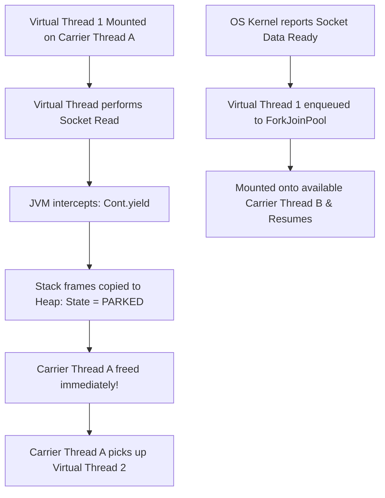

# Virtual Threads and Structured Concurrency

> The definitive guide to Project Loom: Virtual Threads (JEP 444 finalized in Java 21), continuations, carrier thread scheduling, carrier pinning hazards, and Structured Concurrency (`StructuredTaskScope` JEP 480 / JEP 453).

| Metadata | Value |
|---|---|
| **Level** | Advanced |
| **Prerequisites** | [00_threads-and-lifecycle.md](00_threads-and-lifecycle.md), [03_synchronization.md](03_synchronization.md), [05_locks.md](05_locks.md) |
| **Time to Read** | 30 minutes |
| **Status** | Active |
| **Java Version** | Java 21 Final (Virtual Threads JEP 444), Java 21-25 (Structured Concurrency JEP 480) |

---

## Table of Contents
1. [What & Why](#1-what--why)
2. [Core Concepts](#2-core-concepts)
3. [How It Works Internally](#3-how-it-works-internally)
4. [Syntax & Usage](#4-syntax--usage)
5. [Practical Examples](#5-practical-examples)
6. [Best Practices](#6-best-practices)
7. [Common Mistakes & Pitfalls](#7-common-mistakes--pitfalls)
8. [Performance & Security Notes](#8-performance--security-notes)
9. [Comparison / When to Use What](#9-comparison--when-to-use-what)
10. [Interview Questions](#10-interview-questions)
11. [Practice Exercises](#11-practice-exercises)
12. [Summary / Cheat Sheet](#12-summary--cheat-sheet)
13. [Further Reading](#13-further-reading)

---

## 1. What & Why

### The Thread-Per-Request Dilemma
Server applications naturally adopt the **thread-per-request** architecture: each incoming HTTP request is assigned a dedicated thread that executes the transaction from start to finish.
However, platform threads are 1:1 kernel threads. When an application handles 10,000 concurrent requests, 10,000 OS threads consume 10 GB of stack memory. Furthermore, most of their lifecycle is spent **blocking** waiting for database queries, microservice REST calls, or disk I/O.
To achieve high throughput, developers were forced into reactive asynchronous programming (WebFlux, RxJava), sacrificing sequential debugging, thread dumps, and readable stack traces.

### The Solution: Virtual Threads (Project Loom)
Finalized in Java 21 (JEP 444), **Virtual Threads** are lightweight user-mode threads managed entirely by the JVM:
- Millions of virtual threads can run concurrently on a handful of OS carrier threads.
- When a virtual thread performs blocking I/O, the JVM **unmounts** it from its carrier thread, leaving the OS thread free to execute other virtual threads!
- Preserves the simple, readable synchronous blocking programming model (`InputStream.read()`, `client.send()`) while matching the throughput of reactive asynchronous frameworks.

---

## 2. Core Concepts

### Virtual Threads vs Platform Threads
- **Platform Thread**: Heavy OS thread; fixed ~1 MB native stack; expensive kernel context switching; pooled.
- **Virtual Thread**: Lightweight JVM entity; dynamic stack on heap (~1 KB initially); microscopic creation cost; **never pooled**.

### Carrier Threads and Continuations
- **Carrier Thread**: A standard platform thread from an internal `ForkJoinPool` that physically executes the virtual thread's bytecode.
- **Continuation**: The low-level JVM mechanism that can pause execution, preserve call stack frames on the heap, and resume execution later on any available carrier thread.

### Carrier Pinning Hazard
Under two specific conditions, a virtual thread cannot unmount from its carrier thread when blocking:
1. When executing inside a **`synchronized` block or method**.
2. When executing a native method or foreign function (JNI / FFM).
When pinned, the underlying OS carrier thread remains blocked, reducing pool parallelism.
**Remedy**: Replace `synchronized` blocks guarding blocking operations with `ReentrantLock`.

### Structured Concurrency (`StructuredTaskScope`)
Traditional concurrent code allows sub-tasks to outlive their parent methods ("unstructured concurrency"), causing thread leaks, orphaned tasks, and lost cancellation.
**Structured Concurrency** treats multiple concurrent sub-tasks executed within a code block as a single atomic unit of work:
- All sub-tasks must complete or be cancelled before the scope exits.
- If one sub-task fails, all other sub-tasks are automatically cancelled.
- Natural alignment with `try-with-resources`.

---

## 3. How It Works Internally

### Mounting, Unmounting, and Park Mechanics
1. **Mount**: A carrier thread from the `ForkJoinPool` picks up a virtual thread. The continuation stack frames are copied from the heap onto the carrier thread's execution stack.
2. **Execute**: The virtual thread runs standard Java bytecode.
3. **Block on I/O (Unmount)**: The virtual thread invokes a blocking socket read. The JVM intercepts the call at the `Poller` level.
4. **Yield**: The continuation yields; stack frames are saved back onto the JVM heap. The virtual thread state is marked `PARKED`.
5. **Carrier Reuse**: The carrier thread immediately picks up another virtual thread.
6. **I/O Complete**: The OS epoll/kqueue notification wakes the virtual thread, which is re-mounted onto *any* available carrier thread to resume!



---

## 4. Syntax & Usage

### Creating Virtual Threads (Java 21+)
```java
// Method 1: Direct start
Thread vt1 = Thread.startVirtualThread(() -> {
    System.out.println("Hello from virtual thread: " + Thread.currentThread());
});

// Method 2: Fluent builder
Thread vt2 = Thread.ofVirtual()
    .name("order-worker-", 1)
    .start(() -> {
        // Business logic...
    });

// Method 3: Virtual Thread Per Task Executor
try (var executor = java.util.concurrent.Executors.newVirtualThreadPerTaskExecutor()) {
    executor.submit(() -> "Task 1");
    executor.submit(() -> "Task 2");
} // Awaits completion of all virtual threads on close!
```

### Detecting Carrier Pinning with JVM Flags
Launch the JVM with:
```bash
java -Djdk.tracePinnedThreads=full MyApp
```
Prints detailed stack traces whenever a virtual thread pins its carrier thread during blocking operations.

---

## 5. Practical Examples

### Example 1: 100,000 Concurrent Virtual Threads
```java
// Goal: Demonstrate running 100,000 concurrent threads without memory exhaustion
import java.time.Duration;
import java.util.concurrent.Executors;
import java.util.stream.IntStream;

public class HundredThousandThreadsDemo {
    public static void main(String[] args) {
        long start = System.currentTimeMillis();

        try (var executor = Executors.newVirtualThreadPerTaskExecutor()) {
            IntStream.range(0, 100_000).forEach(i -> {
                executor.submit(() -> {
                    // Simulated I/O wait (non-blocking for carrier thread!)
                    Thread.sleep(Duration.ofMillis(500));
                    return i;
                });
            });
        } // AutoCloseable executor waits for all 100,000 threads to finish!

        long elapsed = System.currentTimeMillis() - start;
        System.out.println("Executed 100,000 concurrent virtual threads in " + elapsed + " ms!");
    }
}
```
*Output:*
```
Executed 100,000 concurrent virtual threads in 1184 ms!
```
*Explanation:* 100,000 platform threads would require 100 GB of RAM. Virtual threads run in ~1 second using minimal heap memory.

### Example 2: Structured Concurrency with `StructuredTaskScope`
```java
// Goal: Execute parallel queries with automatic cancellation if one fails
import java.util.concurrent.StructuredTaskScope;
import java.util.function.Supplier;

public class StructuredConcurrencyDemo {
    record UserDashboard(String profile, String orderHistory) {}

    public static UserDashboard fetchDashboard(long userId) throws Exception {
        // ShutdownOnFailure cancels all sub-tasks as soon as any one fails!
        try (var scope = new StructuredTaskScope.ShutdownOnFailure()) {
            Supplier<String> profileSubtask = scope.fork(() -> {
                Thread.sleep(100);
                return "Profile for user " + userId;
            });

            Supplier<String> ordersSubtask = scope.fork(() -> {
                Thread.sleep(150);
                return "10 Orders found";
            });

            // Wait for both sub-tasks to complete or any to fail
            scope.join();
            scope.throwIfFailed(); // Throws if either subtask encountered an exception

            // Safe retrieval without blocking!
            return new UserDashboard(profileSubtask.get(), ordersSubtask.get());
        } // Scope close automatically cancels any lingering sub-tasks!
    }
}
```

### Example 3: Edge Case: Carrier Pinning via `synchronized`
```java
// Goal: Highlight carrier thread pinning and how to fix it
import java.util.concurrent.locks.ReentrantLock;

class PinnedResourceHazard {
    // PINNING HAZARD: Virtual thread blocks on I/O while holding synchronized monitor!
    public synchronized void badMethod() throws InterruptedException {
        Thread.sleep(1000); // Pins carrier thread to OS thread!
    }

    // RESOLUTION: Replace synchronized with ReentrantLock
    private final ReentrantLock lock = new ReentrantLock();

    public void goodMethod() throws InterruptedException {
        lock.lock();
        try {
            Thread.sleep(1000); // Cleanly unmounts! Carrier thread is NOT pinned!
        } finally {
            lock.unlock();
        }
    }
}
```

---

## 6. Best Practices
1. **Never Pool Virtual Threads**: Do not use `ThreadLocalPool` or fixed thread pools for virtual threads. Create a new virtual thread per task via `Executors.newVirtualThreadPerTaskExecutor()`.
2. **Replace `synchronized` with `ReentrantLock` for Blocking I/O**: Eliminates carrier thread pinning and allows virtual threads to unmount cleanly.
3. **Use Simple Blocking Synchronous APIs**: You no longer need reactive callbacks (`Mono`, `Flux`, `CompletableFuture`) for simple I/O. Use straightforward blocking code.
4. **Use Structured Concurrency**: Package fan-out parallel work inside `StructuredTaskScope` to eliminate thread leaks and guarantee cleanup.
5. **Monitor Carrier Pinning**: Enable `-Djdk.tracePinnedThreads=full` in CI/testing pipelines to detect pinning issues early.

---

## 7. Common Mistakes & Pitfalls

| Mistake | Why Wrong | Fix |
|---|---|---|
| Putting Virtual Threads into a fixed thread pool | Defeats their design and retains unnecessary memory overhead. | Use `newVirtualThreadPerTaskExecutor()`. |
| Using `synchronized` around blocking socket operations | Pins the virtual thread to its OS carrier thread, stalling the carrier pool. | Replace with `ReentrantLock`. |
| Heavy CPU computations on Virtual Threads | Virtual threads yield only on I/O or park calls; CPU math monopolizes carrier threads. | Use Platform Threads or `ForkJoinPool` for CPU-heavy tasks. |
| Excessive `ThreadLocal` storage on Virtual Threads | Allocating heavy thread-local maps across millions of virtual threads exhausts heap memory. | Use `ScopedValue` (JEP 506). |
| Using `Thread.sleep()` in non-daemon platform threads to delay program exit | Virtual threads are daemon by default; JVM exits if no platform threads are alive. | Ensure main thread or platform thread awaits virtual tasks. |

---

## 8. Performance & Security Notes

### CPU-Bound vs I/O-Bound Workloads
Virtual threads do **not** make CPU computations faster. A 16-core CPU can only physically compute 16 parallel calculations at a time, regardless of whether they run on platform or virtual threads. Virtual threads improve **throughput for I/O-bound workloads** (where threads spend most of their time waiting on external networks or disks).

### Thread Stack DoS Protection
Because virtual thread stacks grow dynamically on the heap starting at ~1 KB, an application can comfortably absorb massive spikes of concurrent connections without exhausting OS memory.

---

## 9. Comparison / When to Use What

| Feature | Platform Thread | Virtual Thread (Java 21+) |
|---|---|---|
| **OS Mapping** | 1:1 Kernel Thread | M:N JVM Continuations |
| **Memory Footprint** | ~1 MB native stack | ~1 KB heap (dynamic) |
| **Creation Cost** | Syscall (~1ms) | Heap allocation (~1µs) |
| **Max Concurrency** | ~5,000 | ~1,000,000+ |
| **Best For** | Heavy CPU computation | High-throughput I/O |
| **Pooling Policy** | **Mandatory** | **Forbidden (Anti-pattern)** |

---

## 10. Interview Questions

<details>
<summary>1. What are Virtual Threads (JEP 444)?</summary>
Lightweight user-mode threads managed by the JVM rather than the operating system. They decouple application thread count from OS kernel threads, allowing millions of concurrent threads to execute efficiently.
</details>

<details>
<summary>2. What is a Carrier Thread?</summary>
An underlying OS platform thread belonging to an internal `ForkJoinPool` that is assigned by the JVM to execute a virtual thread.
</details>

<details>
<summary>3. What is Carrier Thread Pinning and how do you resolve it?</summary>
Pinning occurs when a virtual thread performs a blocking operation while inside a `synchronized` block/method or native call, preventing it from unmounting from its carrier OS thread. It is resolved by replacing `synchronized` with `ReentrantLock`.
</details>

<details>
<summary>4. What are Continuations in Project Loom?</summary>
The underlying JVM runtime mechanism that allows execution state to be captured, suspended, preserved on the heap, and subsequently resumed on another carrier thread.
</details>

<details>
<summary>5. Why should Virtual Threads never be pooled?</summary>
Because virtual threads are cheap and ephemeral (taking ~1 KB on the heap). Pooling them introduces unnecessary synchronization and memory overhead without any performance benefit.
</details>

<details>
<summary>6. What is Structured Concurrency?</summary>
A programming model where concurrent sub-tasks executed within a scope are tied to the lifecycle of that scope. If one sub-task fails, all siblings are cancelled, eliminating orphaned thread leaks.
</details>

<details>
<summary>7. How do Virtual Threads affect reactive programming (WebFlux/RxJava)?</summary>
They allow writing traditional, sequential, blocking code that achieves the identical high-throughput scalability of reactive systems without the complexity of callback chaining or reactive streams.
</details>

<details>
<summary>8. Are Virtual Threads daemon threads by default?</summary>
Yes. Virtual threads are always daemon threads and cannot be changed to non-daemon. The JVM will exit if only virtual threads are running.
</details>

---

## 11. Practice Exercises

### Exercise 1 (Easy): Launching 1,000 Virtual Tasks
- **Task**: Use `Executors.newVirtualThreadPerTaskExecutor()` to launch 1,000 virtual threads, each sleeping for 50ms, and verify all complete.
<details>
<summary>Solution</summary>

```java
import java.util.concurrent.Executors;
import java.util.concurrent.atomic.AtomicInteger;

public class ThousandVirtualThreads {
    public static void main(String[] args) {
        AtomicInteger counter = new AtomicInteger(0);

        try (var executor = Executors.newVirtualThreadPerTaskExecutor()) {
            for (int i = 0; i < 1000; i++) {
                executor.submit(() -> {
                    Thread.sleep(50);
                    counter.incrementAndGet();
                    return null;
                });
            }
        } // Implicitly waits for all tasks to complete!

        System.out.println("All 1,000 virtual tasks finished! Counter: " + counter.get());
    }
}
```
</details>

### Exercise 2 (Medium): Replacing Synchronized with ReentrantLock
- **Task**: Refactor a class containing a synchronized method that calls a slow remote service to use `ReentrantLock` to prevent carrier pinning.
<details>
<summary>Solution</summary>

```java
import java.util.concurrent.locks.ReentrantLock;

public class UnpinnedServiceClient {
    private final ReentrantLock lock = new ReentrantLock();

    public String fetchRemoteData() throws InterruptedException {
        lock.lock();
        try {
            // Simulated slow network call: cleanly unmounts virtual thread!
            Thread.sleep(300);
            return "SUCCESS_DATA";
        } finally {
            lock.unlock();
        }
    }
}
```
</details>

### Exercise 3 (Hard): Structured Concurrency with Fast-Fail
- **Task**: Use `StructuredTaskScope.ShutdownOnFailure` to query 3 simulated services (`Profile`, `Billing`, `Preferences`). Simulate a failure in `Billing` and observe that all other subtasks are cancelled immediately.
<details>
<summary>Solution</summary>

```java
import java.util.concurrent.StructuredTaskScope;
import java.util.function.Supplier;

public class StructuredFastFailDemo {
    public static void main(String[] args) {
        try (var scope = new StructuredTaskScope.ShutdownOnFailure()) {
            Supplier<String> profile = scope.fork(() -> {
                Thread.sleep(500);
                return "Profile OK";
            });

            Supplier<String> billing = scope.fork(() -> {
                Thread.sleep(100);
                throw new RuntimeException("Billing Service Down!");
            });

            scope.join();
            scope.throwIfFailed(); // Throws the RuntimeException from billing!
        } catch (Exception e) {
            System.err.println("Scope aborted as expected: " + e.getMessage());
        }
    }
}
```
</details>

---

## 12. Summary / Cheat Sheet

```
+-----------------------------------------------------------------------------------------+
|                               VIRTUAL THREADS CHEAT SHEET                               |
+-----------------------------------------------------------------------------------------+
| Direct Launch            | Thread.startVirtualThread(() -> ...);                        |
| Executor Factory         | Executors.newVirtualThreadPerTaskExecutor();                 |
| Golden Rule              | NEVER POOL VIRTUAL THREADS (Create per task)                 |
| Carrier Pinning Hazard   | Avoid synchronized around blocking I/O; use ReentrantLock    |
| Pinning Trace Flag       | -Djdk.tracePinnedThreads=full                                |
| Structured Concurrency   | try (var scope = new StructuredTaskScope.ShutdownOnFailure())|
| Fork Subtask             | Supplier<T> task = scope.fork(callable);                     |
| Scope Await & Validate   | scope.join(); scope.throwIfFailed();                         |
+-----------------------------------------------------------------------------------------+
```

---

## 13. Further Reading
- [JEP 444: Virtual Threads (Final in Java 21)](https://openjdk.org/jeps/444)
- [JEP 480: Structured Concurrency (Java 24/25)](https://openjdk.org/jeps/480)
- "State of Loom" by Ron Pressler (OpenJDK)
