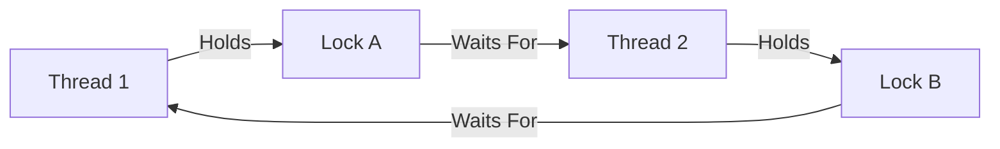

# Deadlocks, Livelocks, and Thread Starvation

> In-depth analysis of concurrency failures: Coffman conditions, deadlock detection using thread dumps (`jstack`) and `ThreadMXBean`, lock ordering protocols, lock timeouts, livelock scenarios, and thread starvation prevention.

| Metadata | Value |
|---|---|
| **Level** | Advanced |
| **Prerequisites** | [03_synchronization.md](03_synchronization.md), [05_locks.md](05_locks.md) |
| **Time to Read** | 26 minutes |
| **Status** | Active |
| **Java Version** | Java 1.0+ |

---

## Table of Contents
1. [What & Why](#1-what--why)
2. [Core Concepts](#2-core-concepts)
3. [How It Works Internally](#3-how-it-works-internally)
4. [Syntax & Usage](#4-syntax--usage)
5. [Practical Examples](#5-practical-examples)
6. [Best Practices](#6-best-practices)
7. [Common Mistakes & Pitfalls](#7-common-mistakes--pitfalls)
8. [Performance & Security Notes](#8-performance--security-notes)
9. [Comparison / When to Use What](#9-comparison--when-to-use-what)
10. [Interview Questions](#10-interview-questions)
11. [Practice Exercises](#11-practice-exercises)
12. [Summary / Cheat Sheet](#12-summary--cheat-sheet)
13. [Further Reading](#13-further-reading)

---

## 1. What & Why

### The Dark Side of Concurrency
While concurrency enhances system throughput, incorrect thread coordination can paralyze a system completely:
- **Deadlock**: Two or more threads are permanently blocked, each waiting for a lock held by another thread in the group.
- **Livelock**: Threads are not blocked; they actively change state in response to each other, but make zero forward progress (like two polite people trying to pass each other in a narrow hallway).
- **Starvation**: A runnable thread is perpetually denied CPU execution time or access to shared resources because higher-priority or greedy threads monopolize access.

---

## 2. Core Concepts

### The 4 Coffman Conditions for Deadlock
A deadlock can occur **if and only if** all four conditions hold simultaneously:
1. **Mutual Exclusion**: At least one resource must be held in a non-shareable mode.
2. **Hold and Wait**: A thread holds at least one resource while waiting to acquire additional resources held by other threads.
3. **No Preemption**: Resources cannot be forcibly taken from a thread; they can only be released voluntarily.
4. **Circular Wait**: A closed chain of threads exists such that each thread holds a resource that the next thread in the chain is waiting to acquire.

**Breaking Any One Condition Prevents Deadlocks Permanently!**
The most effective programming strategy is breaking condition 4 (**Circular Wait**) by enforcing a **strict global lock ordering protocol**.

### Livelock Mechanics
Unlike deadlock, threads in a livelock are actively running, consuming CPU cycles, but are stuck in an infinite loop of reactionary state changes. Common in retry algorithms without randomized backoff.

### Starvation Mechanics
Occurs when thread scheduling policies or unfair locks repeatedly grant resources to other threads, leaving waiting threads starved indefinitely.

---

## 3. How It Works Internally

### Resource Allocation Graph (Circular Wait)


### Programmatic Deadlock Detection via `ThreadMXBean`
The JVM includes built-in cycle-detection algorithms in `ManagementFactory.getThreadMXBean()`:
- `findDeadlockedThreads()`: Detects deadlocks involving intrinsic monitors (`synchronized`) and explicit `Lock` objects.
- `findMonitorDeadlockedThreads()`: Detects deadlocks involving only intrinsic monitors.
The algorithm performs depth-first search (DFS) over the thread wait graph to locate cycles.

---

## 4. Syntax & Usage

### Deadlock Prevention via Global Lock Ordering
```java
public class SafeAccountTransfer {
    public static void transfer(Account from, Account to, double amount) {
        // Enforce strict global ordering using account IDs!
        Account firstLock = from.getId() < to.getId() ? from : to;
        Account secondLock = from.getId() < to.getId() ? to : from;

        synchronized (firstLock) {
            synchronized (secondLock) {
                from.withdraw(amount);
                to.deposit(amount);
            }
        }
    }
}
```

### Deadlock Prevention via `tryLock` with Backoff
```java
import java.util.concurrent.TimeUnit;
import java.util.concurrent.locks.Lock;

public class TryLockDeadlockDefense {
    public static boolean transfer(Lock lockA, Lock lockB) throws InterruptedException {
        while (true) {
            if (lockA.tryLock(50, TimeUnit.MILLISECONDS)) {
                try {
                    if (lockB.tryLock(50, TimeUnit.MILLISECONDS)) {
                        try {
                            // Acquired both locks!
                            return true;
                        } finally {
                            lockB.unlock();
                        }
                    }
                } finally {
                    lockA.unlock(); // Release lockA to avoid hold-and-wait!
                }
            }
            // Randomized backoff to prevent livelock collisions!
            Thread.sleep((long) (Math.random() * 20 + 10));
        }
    }
}
```

---

## 5. Practical Examples

### Example 1: Creating and Detecting a Deadlock
```java
// Goal: Intentionally cause a classic deadlock and detect it programmatically
import java.lang.management.ManagementFactory;
import java.lang.management.ThreadMXBean;

public class DeadlockDetectionDemo {
    private static final Object lock1 = new Object();
    private static final Object lock2 = new Object();

    public static void main(String[] args) throws InterruptedException {
        Thread t1 = new Thread(() -> {
            synchronized (lock1) {
                try { Thread.sleep(50); } catch (InterruptedException ignored) {}
                synchronized (lock2) {
                    System.out.println("T1 acquired both locks!");
                }
            }
        }, "Deadlock-Thread-1");

        Thread t2 = new Thread(() -> {
            synchronized (lock2) {
                try { Thread.sleep(50); } catch (InterruptedException ignored) {}
                synchronized (lock1) {
                    System.out.println("T2 acquired both locks!");
                }
            }
        }, "Deadlock-Thread-2");

        t1.start();
        t2.start();

        Thread.sleep(200);

        // Detect deadlock via ThreadMXBean
        ThreadMXBean bean = ManagementFactory.getThreadMXBean();
        long[] deadlockedIds = bean.findDeadlockedThreads();

        if (deadlockedIds != null) {
            System.err.println("CRITICAL: Detected " + deadlockedIds.length + " deadlocked threads!");
            for (long id : deadlockedIds) {
                System.err.println(" - Deadlocked Thread: " + bean.getThreadInfo(id).getThreadName());
            }
        }
    }
}
```
*Output:*
```
CRITICAL: Detected 2 deadlocked threads!
 - Deadlocked Thread: Deadlock-Thread-1
 - Deadlocked Thread: Deadlock-Thread-2
```

### Example 2: Livelock Demonstration and Resolution
```java
// Goal: Show two threads repeatedly backing off and colliding, then fix with randomized jitter
import java.util.concurrent.locks.*;

public class LivelockDemo {
    static class PoliteWorker {
        private final String name;
        private boolean active = true;

        PoliteWorker(String name) { this.name = name; }

        public void cooperate(PoliteWorker partner) {
            while (active) {
                if (partner.active) {
                    System.out.println(name + ": partner is active, yielding turn...");
                    try {
                        // FIXED: Add random jitter to prevent synchronous lockstep livelock!
                        Thread.sleep((long) (Math.random() * 50 + 10));
                    } catch (InterruptedException ignored) {}
                    continue;
                }
                System.out.println(name + ": working!");
                active = false;
            }
        }
    }
}
```

---

## 6. Best Practices
1. **Acquire Locks in a Strict Global Order**: The number one defense against deadlock is enforcing that all threads acquire multiple locks in identical order.
2. **Use Timed Lock Acquisition (`tryLock`)**: Replace indefinite blocking with `tryLock(timeout, unit)` to back out gracefully if a lock is unavailable.
3. **Minimize Lock Holding Duration**: Never perform network I/O, user interaction, or long calculations while holding locks.
4. **Use Randomized Backoff on Retry**: When backing off from failed lock acquisitions, always introduce randomized jitter to prevent livelock synchronization.
5. **Analyze Thread Dumps in Production**: Use `jcmd <pid> Thread.dump_to_file` or `jstack <pid>` to diagnose deadlocks in production environments.

---

## 7. Common Mistakes & Pitfalls

| Mistake | Why Wrong | Fix |
|---|---|---|
| Inconsistent lock acquisition order | Threads acquire Lock A then B, while others acquire B then A, causing deadlock. | Sort locks by identity hash code or unique ID before acquiring. |
| Calling external alien methods inside locks | Alien method may acquire another lock, forming an unexpected circular wait. | Use open calls: copy state and release lock before invoking alien methods. |
| Fixed sleep intervals during lock backoff | Both threads back off and retry at identical time intervals, causing persistent livelock. | Introduce randomized jitter (`Math.random() * backoff`). |
| Starvation caused by Fair Locks under extreme load | Fair lock queues can suffer from convoying, causing throughput collapse. | Use non-fair locks unless fairness is strictly mandatory. |
| Ignoring `Thread.interrupt()` during deadlocks | Threads blocked on `synchronized` cannot be interrupted, remaining frozen permanently. | Use `ReentrantLock.lockInterruptibly()`. |

---

## 8. Performance & Security Notes

### Denial of Service via Deadlock
A single deadlock in an enterprise service can permanently tie up worker threads one by one. As new requests arrive and attempt to acquire the deadlocked monitor, the entire thread pool becomes exhausted, leading to complete service outage.

### Open Calls Pattern
An **Open Call** is an architectural pattern where methods are invoked without holding any locks. This protects against alien method deadlocks. Always narrow the synchronized block to internal state mutations only.

---

## 9. Comparison / When to Use What

| Failure Mode | Thread State | CPU Utilization | Resolution Strategy |
|---|---|---|---|
| **Deadlock** | `BLOCKED` / `WAITING` | 0% (Idle/Blocked) | Global lock ordering, timeouts |
| **Livelock** | `RUNNABLE` | 100% (High spin) | Randomized backoff jitter |
| **Starvation** | `WAITING` / `BLOCKED` | Low for starved | Fair queueing, priority normalization |

---

## 10. Interview Questions

<details>
<summary>1. What are the four Coffman conditions required for a deadlock?</summary>
Mutual Exclusion, Hold and Wait, No Preemption, and Circular Wait. If any one condition is eliminated, deadlocks are impossible.
</details>

<details>
<summary>2. How do you prevent deadlocks when transferring funds between two bank accounts?</summary>
Enforce a strict lock ordering protocol: compare account unique IDs and always acquire the lock on the lower ID account first, followed by the higher ID account.
</details>

<details>
<summary>3. What is the difference between Deadlock and Livelock?</summary>
In a deadlock, threads are frozen in `BLOCKED` or `WAITING` states waiting for resources. In a livelock, threads remain in `RUNNABLE` state actively executing code, but repeatedly yield or back off, making zero forward progress.
</details>

<details>
<summary>4. What is Thread Starvation?</summary>
A situation where a runnable thread is perpetually denied access to CPU time or shared locks because other threads (e.g. higher-priority threads or unfair lock bargers) monopolize access.
</details>

<details>
<summary>5. How can deadlocks be detected programmatically in Java?</summary>
Using `ManagementFactory.getThreadMXBean().findDeadlockedThreads()`, which inspects the JVM thread graph and returns the thread IDs of all deadlocked threads.
</details>

<details>
<summary>6. What is an Open Call and why does it prevent deadlocks?</summary>
An open call is calling a method outside of any synchronized block. Invoking unknown or external methods while holding locks can lead to circular dependencies; open calls eliminate this risk.
</details>

<details>
<summary>7. Can `synchronized` blocks be interrupted if deadlocked?</summary>
No. Threads blocked waiting to enter a `synchronized` block are in `BLOCKED` state and cannot be interrupted. `ReentrantLock.lockInterruptibly()` must be used if interruptibility is required.
</details>

<details>
<summary>8. How do you generate a thread dump to inspect deadlocks in Linux production?</summary>
Using `jcmd <PID> Thread.print` or `jstack <PID>`, or sending `kill -3 <PID>` to output thread dumps to standard out.
</details>

---

## 11. Practice Exercises

### Exercise 1 (Easy): Ordered Lock Transfer
- **Task**: Implement a method `void transfer(Account a1, Account a2)` that acquires locks in deterministic order using `System.identityHashCode()` to prevent deadlocks.
<details>
<summary>Solution</summary>

```java
public class OrderedTransferDemo {
    static class Account {
        double balance = 100.0;
    }

    public static void transfer(Account a1, Account a2, double amount) {
        int hash1 = System.identityHashCode(a1);
        int hash2 = System.identityHashCode(a2);

        Account first = (hash1 < hash2) ? a1 : a2;
        Account second = (hash1 < hash2) ? a2 : a1;

        synchronized (first) {
            synchronized (second) {
                a1.balance -= amount;
                a2.balance += amount;
            }
        }
    }
}
```
</details>

### Exercise 2 (Medium): Timed Backoff Transfer
- **Task**: Implement a money transfer between two accounts using `ReentrantLock.tryLock()` with a timeout. If the second lock cannot be acquired within 50ms, release the first lock, wait a random jitter interval, and retry.
<details>
<summary>Solution</summary>

```java
import java.util.concurrent.TimeUnit;
import java.util.concurrent.locks.ReentrantLock;

public class ResilientTransfer {
    static class SafeAccount {
        final ReentrantLock lock = new ReentrantLock();
        double balance;
        SafeAccount(double bal) { this.balance = bal; }
    }

    public static boolean tryTransfer(SafeAccount from, SafeAccount to, double amount) throws InterruptedException {
        while (true) {
            if (from.lock.tryLock(50, TimeUnit.MILLISECONDS)) {
                try {
                    if (to.lock.tryLock(50, TimeUnit.MILLISECONDS)) {
                        try {
                            from.balance -= amount;
                            to.balance += amount;
                            return true;
                        } finally {
                            to.lock.unlock();
                        }
                    }
                } finally {
                    from.lock.unlock();
                }
            }
            // Random backoff jitter prevents livelock
            Thread.sleep((long) (Math.random() * 30 + 10));
        }
    }
}
```
</details>

### Exercise 3 (Hard): Automated Deadlock Watchdog Daemon
- **Task**: Write a background daemon thread that runs every 3 seconds, queries `ThreadMXBean`, and if a deadlock is detected, logs the stack traces of all deadlocked threads.
<details>
<summary>Solution</summary>

```java
import java.lang.management.*;

public class DeadlockWatchdog {
    public static void startWatchdog() {
        Thread watchdog = new Thread(() -> {
            ThreadMXBean bean = ManagementFactory.getThreadMXBean();
            while (true) {
                long[] deadlocked = bean.findDeadlockedThreads();
                if (deadlocked != null && deadlocked.length > 0) {
                    System.err.println("ALERT: Deadlock detected across " + deadlocked.length + " threads!");
                    ThreadInfo[] infos = bean.getThreadInfo(deadlocked, true, true);
                    for (ThreadInfo info : infos) {
                        System.err.println(info);
                    }
                    break;
                }
                try { Thread.sleep(3000); } catch (InterruptedException ignored) {}
            }
        }, "DeadlockWatchdog");
        watchdog.setDaemon(true);
        watchdog.start();
    }
}
```
</details>

---

## 12. Summary / Cheat Sheet

```
+-----------------------------------------------------------------------------------------+
|                               DEADLOCK & LIVELOCK CHEAT SHEET                           |
+-----------------------------------------------------------------------------------------+
| 4 Coffman Conditions     | Mutual Exclusion, Hold & Wait, No Preemption, Circular Wait  |
| Primary Prevention       | Enforce strict global lock acquisition order                 |
| Timeout Defense          | lock.tryLock(timeout, unit) (Back out instead of hanging)    |
| Livelock Defense         | Add randomized jitter to backoff retry loops                 |
| Open Calls Rule          | Never invoke unknown/external methods while holding locks    |
| Diagnostics (CLI)        | jcmd <PID> Thread.print / jstack <PID>                       |
| Diagnostics (Code)       | ManagementFactory.getThreadMXBean().findDeadlockedThreads()  |
+-----------------------------------------------------------------------------------------+
```

---

## 13. Further Reading
- Java Concurrency in Practice by Brian Goetz — Chapter 10 (Avoiding Liveness Hazards)
- Operating System Concepts (Silberschatz) — Chapter on Deadlocks
- Oracle Troubleshooting Guide: Diagnosing Deadlocks
