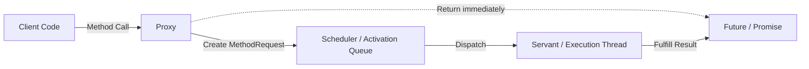

# Concurrency Design Patterns

> Architectural catalog of essential concurrency patterns in Java: Producer-Consumer, Thread Pool, Reader-Writer, Work Stealing, Future / Promise, Guarded Suspension, Active Object, and Double-Checked Locking.

| Metadata | Value |
|---|---|
| **Level** | Advanced |
| **Prerequisites** | [08_concurrent-collections.md](08_concurrent-collections.md), [10_executors-and-thread-pools.md](10_executors-and-thread-pools.md), [12_completablefuture.md](12_completablefuture.md) |
| **Time to Read** | 28 minutes |
| **Status** | Active |
| **Java Version** | Java 5.0+ |

---

## Table of Contents
1. [What & Why](#1-what--why)
2. [Core Concepts](#2-core-concepts)
3. [How It Works Internally](#3-how-it-works-internally)
4. [Syntax & Usage](#4-syntax--usage)
5. [Practical Examples](#5-practical-examples)
6. [Best Practices](#6-best-practices)
7. [Common Mistakes & Pitfalls](#7-common-mistakes--pitfalls)
8. [Performance & Security Notes](#8-performance--security-notes)
9. [Comparison / When to Use What](#9-comparison--when-to-use-what)
10. [Interview Questions](#10-interview-questions)
11. [Practice Exercises](#11-practice-exercises)
12. [Summary / Cheat Sheet](#12-summary--cheat-sheet)
13. [Further Reading](#13-further-reading)

---

## 1. What & Why

### The Value of Battle-Tested Architectural Patterns
Concurrency problems (race conditions, starvation, deadlocks) are notoriously difficult to debug and reproduce. Designing ad-hoc multi-threaded synchronization leads to fragile, unmaintainable software.
**Concurrency Design Patterns** represent proven, reusable architectural blueprints developed over decades by systems engineers to decouple tasks, maximize hardware throughput, and eliminate synchronization hazards.

---

## 2. Core Concepts

### Catalog of Essential Patterns
1. **Producer-Consumer**: Decouples components producing work from components consuming work via a shared buffer (`BlockingQueue`).
2. **Thread Pool (Worker Threads)**: Manages a pool of reusable worker threads to execute incoming tasks, avoiding thread creation overhead.
3. **Reader-Writer**: Allows concurrent multiple readers while enforcing exclusive access for writers (`ReentrantReadWriteLock`).
4. **Work Stealing**: Idle worker threads steal tasks from busy workers' deques (`ForkJoinPool`).
5. **Future / Promise**: Represents the eventual result of an asynchronous operation (`CompletableFuture`).
6. **Guarded Suspension**: Suspends execution until a precondition is met (`while (!condition) wait()`).
7. **Active Object**: Decouples method execution from method invocation by packaging requests into message queues processed by a private thread.
8. **Double-Checked Locking (DCL)**: Lazily initializes a shared resource safely while avoiding synchronization overhead on subsequent reads.

---

## 3. How It Works Internally

### Active Object Pattern Architecture
The Active Object pattern transforms synchronous method calls into asynchronous messages:

The client calls a method on the proxy, which encapsulates the call into a `MethodRequest` object and enqueues it. A single background servant thread processes requests sequentially, **completely eliminating synchronization inside domain objects**.

---

## 4. Syntax & Usage

### Producer-Consumer Pattern with Poison Pill
```java
import java.util.concurrent.*;

public class PoisonPillProducerConsumer {
    private static final String POISON_PILL = "END_OF_WORK_SIGNAL";

    public static void main(String[] args) throws Exception {
        BlockingQueue<String> queue = new LinkedBlockingQueue<>(10);

        // Producer
        Thread producer = Thread.ofPlatform().start(() -> {
            try {
                for (int i = 1; i <= 5; i++) {
                    queue.put("ITEM-" + i);
                }
                queue.put(POISON_PILL); // Send shutdown sentinel
            } catch (InterruptedException e) {
                Thread.currentThread().interrupt();
            }
        });

        // Consumer
        Thread consumer = Thread.ofPlatform().start(() -> {
            try {
                while (true) {
                    String item = queue.take();
                    if (POISON_PILL.equals(item)) {
                        System.out.println("Poison pill received. Consumer shutting down.");
                        break;
                    }
                    System.out.println("Processed: " + item);
                }
            } catch (InterruptedException e) {
                Thread.currentThread().interrupt();
            }
        });

        producer.join();
        consumer.join();
    }
}
```

---

## 5. Practical Examples

### Example 1: Active Object Pattern Implementation
```java
// Goal: Decouple service invocation from execution using an Active Object queue
import java.util.concurrent.*;

public class ActiveOrderService {
    private final BlockingQueue<Runnable> dispatchQueue = new LinkedBlockingQueue<>();
    private final Thread servantThread;
    private volatile boolean running = true;

    public ActiveOrderService() {
        servantThread = Thread.ofPlatform().name("OrderServant").start(() -> {
            while (running || !dispatchQueue.isEmpty()) {
                try {
                    Runnable task = dispatchQueue.poll(100, TimeUnit.MILLISECONDS);
                    if (task != null) task.run();
                } catch (InterruptedException ignored) {}
            }
        });
    }

    // Client invokes method asynchronously; returns a CompletableFuture
    public CompletableFuture<String> processOrder(String orderId) {
        CompletableFuture<String> promise = new CompletableFuture<>();
        dispatchQueue.offer(() -> {
            // Executed strictly sequentially by servant thread! Zero race conditions!
            System.out.println("Servant executing order: " + orderId);
            promise.complete("ORDER_PROCESSED_" + orderId);
        });
        return promise;
    }
}
```

### Example 2: Guarded Suspension Pattern (Wait for Network Connection)
```java
// Goal: Suspend caller until a network link becomes available
public class NetworkGuardedSuspension {
    private boolean connected = false;

    public synchronized void send(String payload) throws InterruptedException {
        // Guarded suspension: check precondition in while loop
        while (!connected) {
            System.out.println("Link down; suspending send call...");
            wait();
        }
        System.out.println("Payload sent over active link: " + payload);
    }

    public synchronized void onConnected() {
        this.connected = true;
        notifyAll(); // Wake up suspended senders
    }
}
```

---

### The Disruptor Pattern: High-Throughput Lock-Free Ring Buffer
Pioneered by LMAX Exchange, the Disruptor pattern replaces traditional `BlockingQueue` implementations in low-latency trading systems. Instead of queue head/tail pointers requiring locks or atomic contention, the Disruptor uses a pre-allocated circular ring buffer where multiple producers and consumers coordinate using cache-line padded sequence counters and memory barriers, achieving millions of operations per second with near-zero latency jitter.

### Half-Sync/Half-Async Pattern
The Half-Sync/Half-Async pattern structures concurrent systems into two distinct layers:
1. **Asynchronous Layer**: Handles incoming external socket I/O non-blockingly using selectors or epoll events.
2. **Synchronous Layer**: Dispatches decoded request messages to dedicated worker threads that execute business operations synchronously.
This pattern cleanly decouples network multiplexing from complex business workflow logic.

## 6. Best Practices
1. **Prefer `BlockingQueue` for Producer-Consumer**: Avoid manual `wait()`/`notify()` coordination; `BlockingQueue` handles capacity, blocking, and backpressure out of the box.
2. **Use Sentinel / Poison Pill for Graceful Shutdown**: Pass a recognizable marker object to notify consumer threads to exit cleanly.
3. **Keep Shared Mutexes Minimal**: Use Active Object or Actor patterns to confine state mutations to a single thread rather than synchronizing shared state across dozens of threads.
4. **Use ReadWriteLock for 90%+ Read Ratios**: If write frequency is high, ReadWriteLock performs worse than simple ReentrantLock due to bookkeeping overhead.
5. **Always Make DCL Fields `volatile`**: Double-Checked Locking without `volatile` is fundamentally broken.

---

## 7. Common Mistakes & Pitfalls

| Mistake | Why Wrong | Fix |
|---|---|---|
| Unbounded queue in Producer-Consumer | Memory consumption grows without bound if producers outpace consumers. | Use bounded queue (`ArrayBlockingQueue(N)`). |
| Using `notify()` instead of `notifyAll()` in Guarded Suspension | Can wake the wrong thread, stalling the pipeline. | Always use `notifyAll()`. |
| Missing `volatile` in Double-Checked Locking | Reordering leads to reading partially constructed objects. | Add `volatile` to the singleton instance field. |
| Forgetting Poison Pill for all consumers | If multiple consumers exist, sending one poison pill stops only one consumer. | Send one poison pill per consumer thread. |

---

## 8. Performance & Security Notes

### Backpressure Enforcement
In Producer-Consumer architectures, if producers generate 100,000 tasks per second but consumers process only 10,000, unbounded buffers will exhaust system heap memory. Bounded queues apply backpressure by blocking producers until consumers catch up, stabilizing production memory footprints.

---

## 9. Comparison / When to Use What

| Pattern | Concurrency Mechanism | Best Suited For |
|---|---|---|
| **Producer-Consumer** | Bounded `BlockingQueue` | Task decoupling, backpressure |
| **Active Object** | Single-thread message queue | Complex stateful services |
| **Reader-Writer** | `ReentrantReadWriteLock` | High-frequency read caches |
| **Work Stealing** | Dual-ended deques | Recursive divide-and-conquer math |
| **Guarded Suspension** | `wait()` / `notifyAll()` | State precondition waiting |

---

## 10. Interview Questions

<details>
<summary>1. What is the Producer-Consumer pattern and how is it implemented in Java?</summary>
A pattern that decouples work submission from work processing using a shared buffer. In Java, it is implemented using `BlockingQueue` implementations like `ArrayBlockingQueue` or `LinkedBlockingQueue`.
</details>

<details>
<summary>2. What is a Poison Pill in Producer-Consumer architectures?</summary>
A special sentinel object placed onto the queue by the producer to signal to consumer threads that no more data will arrive, allowing consumers to terminate cleanly.
</details>

<details>
<summary>3. What is the Active Object Pattern?</summary>
A pattern that decouples method execution from method invocation by encapsulating method calls into objects enqueued onto an activation queue and processed by a dedicated scheduler thread, returning a Future.
</details>

<details>
<summary>4. What is Guarded Suspension?</summary>
A pattern where a method suspends execution (via `wait()` in a while loop) until a specific precondition or state condition becomes true.
</details>

<details>
<summary>5. How many poison pills must be submitted if there are $N$ consumer threads?</summary>
Exactly $N$ poison pills. Each consumer consumes one poison pill and terminates; subsequent consumers need their own poison pill.
</details>

<details>
<summary>6. When should you avoid using `ReentrantReadWriteLock`?</summary>
When write contention is frequent or the read duration is very short. The bookkeeping overhead of maintaining read/write lock counters can make it slower than a standard `ReentrantLock`.
</details>

<details>
<summary>7. How does the Thread Pool pattern prevent OutOfMemory errors?</summary>
By capping the maximum number of simultaneously executing threads and bounding the task queue, insulating the JVM from traffic spikes.
</details>

<details>
<summary>8. How does the Actor Model relate to the Active Object pattern?</summary>
Both patterns rely on message passing and thread confinement: state is never shared; actors/active objects communicate exclusively by exchanging asynchronous messages.
</details>

---

## 11. Practice Exercises

### Exercise 1 (Easy): Multi-Consumer Poison Pill
- **Task**: Implement a producer-consumer setup with 3 consumers and 1 producer. Submit 10 items, followed by 3 poison pills, and verify all consumers exit.
<details>
<summary>Solution</summary>

```java
import java.util.concurrent.*;

public class MultiConsumerPoisonPill {
    private static final String POISON = "SHUTDOWN";

    public static void main(String[] args) throws Exception {
        BlockingQueue<String> queue = new LinkedBlockingQueue<>();
        int consumers = 3;

        // Start consumers
        for (int i = 1; i <= consumers; i++) {
            final int id = i;
            Thread.ofPlatform().start(() -> {
                try {
                    while (true) {
                        String item = queue.take();
                        if (POISON.equals(item)) break;
                        System.out.println("Consumer " + id + " processed: " + item);
                    }
                    System.out.println("Consumer " + id + " exited cleanly.");
                } catch (InterruptedException ignored) {}
            });
        }

        // Producer sends 5 items + 3 poison pills
        for (int i = 1; i <= 5; i++) queue.put("TASK-" + i);
        for (int i = 0; i < consumers; i++) queue.put(POISON);
    }
}
```
</details>

### Exercise 2 (Medium): Rate-Throttled Token Bucket Pattern
- **Task**: Implement a `TokenBucket` pattern that releases 5 permits every second using `ScheduledExecutorService` and `Semaphore`.
<details>
<summary>Solution</summary>

```java
import java.util.concurrent.*;

public class TokenBucket {
    private final Semaphore tokens;
    private final int capacity;

    public TokenBucket(int capacity, int refillPerSecond) {
        this.capacity = capacity;
        this.tokens = new Semaphore(capacity);

        ScheduledExecutorService scheduler = Executors.newSingleThreadScheduledExecutor();
        scheduler.scheduleAtFixedRate(() -> {
            int current = tokens.availablePermits();
            int toAdd = Math.min(refillPerSecond, capacity - current);
            if (toAdd > 0) tokens.release(toAdd);
        }, 1, 1, TimeUnit.SECONDS);
    }

    public boolean tryAcquire() {
        return tokens.tryAcquire();
    }
}
```
</details>

### Exercise 3 (Hard): Active Object File Writer
- **Task**: Implement an `ActiveFileWriter` that allows multiple threads to asynchronously write lines to a log file without locks, processed sequentially by a private worker thread.
<details>
<summary>Solution</summary>

```java
import java.util.concurrent.*;

public class ActiveFileWriter implements AutoCloseable {
    private final BlockingQueue<String> queue = new LinkedBlockingQueue<>();
    private final Thread worker;
    private volatile boolean running = true;

    public ActiveFileWriter() {
        worker = Thread.ofPlatform().start(() -> {
            while (running || !queue.isEmpty()) {
                try {
                    String line = queue.poll(50, TimeUnit.MILLISECONDS);
                    if (line != null) {
                        System.out.println("[WRITE TO DISK]: " + line);
                    }
                } catch (InterruptedException ignored) {}
            }
        });
    }

    public void append(String line) {
        queue.offer(line);
    }

    @Override
    public void close() throws Exception {
        running = false;
        worker.join();
    }
}
```
</details>

---

## 12. Summary / Cheat Sheet

```
+-----------------------------------------------------------------------------------------+
|                               CONCURRENCY PATTERNS CHEAT SHEET                          |
+-----------------------------------------------------------------------------------------+
| Producer-Consumer        | BlockingQueue with backpressure + Poison Pill for shutdown   |
| Active Object            | Method calls turn into queue messages; single servant thread |
| Guarded Suspension       | while (!ready) wait(); ... onStateChange() -> notifyAll();   |
| Double-Checked Locking   | if (inst == null) synchronized { if (inst == null) ... }     |
| DCL Golden Rule          | Singleton reference MUST be declared volatile                |
| Read-Write Pattern       | ReentrantReadWriteLock (Multiple readers, exclusive writer)  |
| Work-Stealing Pattern    | ForkJoinPool with dual-ended deques                          |
+-----------------------------------------------------------------------------------------+
```

---

## 13. Further Reading
- Design Patterns: Elements of Reusable Object-Oriented Software (GoF)
- Pattern-Oriented Software Architecture (POSA Volume 2): Patterns for Concurrent and Networked Objects
- Java Concurrency in Practice by Brian Goetz
