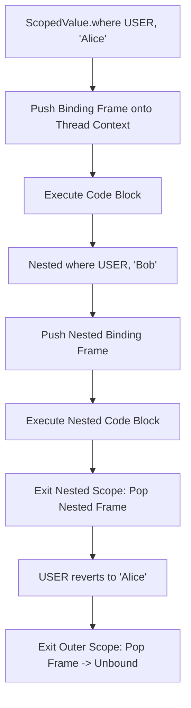

# Scoped Values

> Deep dive into Scoped Values (JEP 506 / JEP 446 in Java 21-25): immutable, bounded-lifetime context sharing across threads, seamless Virtual Thread synergy, and elimination of `ThreadLocal` memory leaks.

| Metadata | Value |
|---|---|
| **Level** | Advanced |
| **Prerequisites** | [00_threads-and-lifecycle.md](00_threads-and-lifecycle.md), [09_thread-local.md](09_thread-local.md), [13_virtual-threads-and-structured-concurrency.md](13_virtual-threads-and-structured-concurrency.md) |
| **Time to Read** | 25 minutes |
| **Status** | Active |
| **Java Version** | Java 21 Preview (JEP 446), Java 25 Final (JEP 506) |

---

## Table of Contents
1. [What & Why](#1-what--why)
2. [Core Concepts](#2-core-concepts)
3. [How It Works Internally](#3-how-it-works-internally)
4. [Syntax & Usage](#4-syntax--usage)
5. [Practical Examples](#5-practical-examples)
6. [Best Practices](#6-best-practices)
7. [Common Mistakes & Pitfalls](#7-common-mistakes--pitfalls)
8. [Performance & Security Notes](#8-performance--security-notes)
9. [Comparison / When to Use What](#9-comparison--when-to-use-what)
10. [Interview Questions](#10-interview-questions)
11. [Practice Exercises](#11-practice-exercises)
12. [Summary / Cheat Sheet](#12-summary--cheat-sheet)
13. [Further Reading](#13-further-reading)

---

## 1. What & Why

### The Flaws of `ThreadLocal` at Scale
For decades, `ThreadLocal` was Java's only tool for implicit context propagation (user identities, transaction tokens, telemetry). However, in modern systems running millions of Virtual Threads, `ThreadLocal` suffers from fatal flaws:
1. **Unbounded Mutability**: Any method down the call chain can call `tl.set(...)`, altering state unpredictably.
2. **Unbounded Lifetime & Memory Leaks**: Values remain bound to threads until explicitly removed. In thread pools, forgotten cleanup causes severe memory leaks.
3. **Expensive Child Inheritance**: `InheritableThreadLocal` deeply copies map entries for every new child thread. When spawning 100,000 sub-tasks, memory explodes.

### The Solution: Scoped Values (JEP 506)
Standardized in Java 25 (previewed in Java 20-24), `java.lang.ScopedValue` provides:
- **Immutability**: A scoped value is bound once and cannot be mutated during its scope.
- **Bounded Lifetime**: The value is bound strictly for the duration of a specific method block (`where(KEY, val).run(...)`).
- **Zero Memory Leaks**: When the block exits, the binding ceases to exist automatically.
- **Zero-Copy Inheritance**: Child threads in Structured Concurrency share the exact same immutable binding pointers without copying.

---

## 2. Core Concepts

### Core API Elements
- `ScopedValue.newInstance()`: Creates a new scoped value carrier handle (typically declared `public static final ScopedValue<T> KEY = ScopedValue.newInstance();`).
- `ScopedValue.where(KEY, value)`: Binds a value to the key for a scope.
- `run(Runnable)` / `call(Callable)`: Executes a block within the scope of the bound value.
- `KEY.get()`: Retrieves the value currently bound in the calling thread's scope. Throws `NoSuchElementException` if unbound.
- `KEY.isBound()`: Returns `true` if a binding is active.
- `KEY.orElse(fallback)`: Returns bound value or fallback if unbound.

### Rebinding in Nested Scopes
A scoped value cannot be mutated, but it can be **re-bound** in a nested scope:
```java
ScopedValue.where(ROLE, "USER").run(() -> {
    System.out.println(ROLE.get()); // "USER"

    // Nested rebinding
    ScopedValue.where(ROLE, "ADMIN").run(() -> {
        System.out.println(ROLE.get()); // "ADMIN"
    });

    System.out.println(ROLE.get()); // Restored to "USER"!
});
```

---

## 3. How It Works Internally

### Stack-Bound Activation Frames
Unlike `ThreadLocalMap` (which lives in a separate heap hash map on the `Thread` object), `ScopedValue` bindings are tracked in a compact singly-linked list of **ScopedValue Bindings** linked to the thread's call frame:
- When entering a scope (`where().run()`), the JVM pushes a new binding frame onto the thread's context chain.
- When exiting the scope, the JVM pops the frame.
- Lookup is optimized using a small inline cache in the JVM, yielding read performance comparable to reading a local variable.



---

## 4. Syntax & Usage

### Basic Scoped Value Definition and Binding
```java
import java.lang.ScopedValue;

public class SecurityContextDemo {
    public static final ScopedValue<String> USER_ID = ScopedValue.newInstance();
    public static final ScopedValue<String> TENANT_ID = ScopedValue.newInstance();

    public static void main(String[] args) {
        // Multi-value binding
        ScopedValue.where(USER_ID, "usr_1024")
                   .where(TENANT_ID, "tenant_acme")
                   .run(() -> {
                       processRequest();
                   });
    }

    private static void processRequest() {
        System.out.println("Processing for Tenant: " + TENANT_ID.get() + ", User: " + USER_ID.get());
    }
}
```

---

## 5. Practical Examples

### Example 1: Zero-Copy Sharing in Structured Concurrency
```java
// Goal: Pass security context to 10,000 sub-tasks without copying memory
import java.lang.ScopedValue;
import java.util.concurrent.StructuredTaskScope;

public class ScopedStructuredDemo {
    public static final ScopedValue<String> TRACE_ID = ScopedValue.newInstance();

    public static void handleRequest() throws Exception {
        ScopedValue.where(TRACE_ID, "REQ-9988-XYZ").run(() -> {
            try (var scope = new StructuredTaskScope.ShutdownOnFailure()) {
                // Child virtual threads inherit TRACE_ID with ZERO copying!
                var task1 = scope.fork(() -> "Result from DB with Trace: " + TRACE_ID.get());
                var task2 = scope.fork(() -> "Result from Cache with Trace: " + TRACE_ID.get());

                scope.join();
                System.out.println(task1.get());
                System.out.println(task2.get());
            } catch (Exception e) {
                throw new RuntimeException(e);
            }
        });
    }

    public static void main(String[] args) throws Exception {
        handleRequest();
    }
}
```
*Output:*
```
Result from DB with Trace: REQ-9988-XYZ
Result from Cache with Trace: REQ-9988-XYZ
```

### Example 2: Safe Privilege Elevation via Nested Scope Rebinding
```java
// Goal: Temporarily elevate privileges for an audited operation
import java.lang.ScopedValue;

public class PrivilegeElevationDemo {
    public static final ScopedValue<String> ROLE = ScopedValue.newInstance();

    public static void main(String[] args) {
        ScopedValue.where(ROLE, "ANONYMOUS").run(() -> {
            System.out.println("Initial role: " + ROLE.get());

            // Elevate role only for internal auditing method
            ScopedValue.where(ROLE, "AUDITOR").run(() -> {
                System.out.println("Elevated role inside audit block: " + ROLE.get());
            });

            // Automatically restored!
            System.out.println("Role after audit block: " + ROLE.get());
        });
    }
}
```
*Output:*
```
Initial role: ANONYMOUS
Elevated role inside audit block: AUDITOR
Role after audit block: ANONYMOUS
```

---

### Dynamic Scope Binding Resolution and JVM Intrinsics
Under the hood, the HotSpot C2 compiler treats `ScopedValue.get()` as an intrinsic operation. The JVM inspects the current thread's activation frame link:
- If the target ScopedValue key matches the top activation record, the value is returned immediately via a single pointer dereference.
- For deeper scopes, the lookup traverses the small linked chain of bindings.
Because scoped values are strictly immutable, the JIT compiler can perform constant folding and eliminate repeated lookups across contiguous method inlinings, achieving execution speeds virtually identical to passing local variables directly on the stack.

### Migrating Legacy Frameworks from ThreadLocal to Scoped Values
Enterprise frameworks (such as Spring Framework 6.x and Micronaut 4.x) are migrating security and transaction interceptors to Scoped Values. To maintain backward compatibility during migration, frameworks introduce bridge adapters:
```java
public class ThreadLocalScopedBridge {
    public static <T> void adapt(ScopedValue<T> scoped, ThreadLocal<T> legacy, T value, Runnable task) {
        ScopedValue.where(scoped, value).run(() -> {
            legacy.set(value);
            try {
                task.run();
            } finally {
                legacy.remove();
            }
        });
    }
}
```
This enables gradual modernization without breaking legacy third-party plugins that still invoke `legacy.get()`.

## 6. Best Practices
1. **Declare as `public static final`**: ScopedValue keys should always be public static constants so callers can bind and read them.
2. **Combine with Structured Concurrency**: Pair `ScopedValue` with `StructuredTaskScope` to propagate context seamlessly across child threads.
3. **Use for Context, Not Arguments**: Use scoped values for ambient context (security tokens, metrics, trace IDs), not for normal method parameters.
4. **Prefer `orElse` for Optional Bindings**: Use `KEY.orElse(defaultValue)` to avoid checking `isBound()` and handling `NoSuchElementException`.
5. **Never Use ThreadLocal for Virtual Threads**: Replace `ThreadLocal` with `ScopedValue` when working with virtual threads to protect heap memory.

---

## 7. Common Mistakes & Pitfalls

| Mistake | Why Wrong | Fix |
|---|---|---|
| Calling `get()` on an unbound ScopedValue | Throws runtime `NoSuchElementException`. | Use `KEY.orElse(defaultVal)` or check `KEY.isBound()`. |
| Trying to mutate a ScopedValue | Scoped values are immutable; there is no `set()` method. | Rebind in a nested `where().run(...)` block. |
| Expecting ScopedValue to cross unstructured threads | Sub-tasks spawned via raw `new Thread()` outside `StructuredTaskScope` do not inherit bindings. | Use `StructuredTaskScope` for child thread execution. |
| Using ScopedValue for ordinary method arguments | Obscures method contracts and creates hidden dependencies. | Pass normal business domain parameters explicitly. |

---

## 8. Performance & Security Notes

### Zero Memory Leak Guarantee
Because Scoped Value bindings are bound strictly to the execution lifecycle of a method frame, they are mathematically impossible to leak into thread pools. When the block completes, the binding ceases to exist, eliminating an entire class of production vulnerabilities.

### Immutability Security Boundary
In contrast to `ThreadLocal` (where malicious or buggy code can call `ThreadLocal.set()` to forge identity credentials), a `ScopedValue` cannot be modified by any method inside the scope.

---

## 9. Comparison / When to Use What

| Feature | `ScopedValue` (Java 25) | `ThreadLocal` |
|---|---|---|
| **Mutability** | **Strictly Immutable** | Mutable (`set()` anytime) |
| **Lifetime** | Bounded to scope block | Unbounded (manual `remove()`) |
| **Child Thread Sharing** | Zero-copy reference sharing | Deep map copy (expensive) |
| **Memory Leak Risk** | **Zero** | High (in thread pools) |
| **Recommended Use** | All modern Java 21+ code | Legacy code maintenance only |

---

## 10. Interview Questions

<details>
<summary>1. What are Scoped Values (JEP 506) and what problem do they solve?</summary>
Scoped Values provide an immutable, bounded-lifetime mechanism to share context data across method calls and child threads, solving `ThreadLocal`'s mutability, memory leaks, and virtual thread scaling issues.
</details>

<details>
<summary>2. How does `ScopedValue` eliminate memory leaks in thread pools?</summary>
A `ScopedValue` is only bound for the duration of its `run()` or `call()` block. When the block exits, the binding is automatically popped from the thread's context chain, requiring zero manual cleanup.
</details>

<details>
<summary>3. Can a `ScopedValue` be mutated once bound?</summary>
No. Scoped values are strictly immutable. To change a value, you must rebind it in a nested scope (`ScopedValue.where(KEY, newVal).run(...)`), which automatically restores the outer value upon exit.
</details>

<details>
<summary>4. How does `ScopedValue` achieve zero-copy sharing with child threads?</summary>
In Structured Concurrency, child virtual threads inherit a pointer to the parent's immutable scope binding chain, completely avoiding the expensive array copying incurred by `InheritableThreadLocal`.
</details>

<details>
<summary>5. What exception is thrown if `KEY.get()` is called outside an active scope?</summary>
`java.util.NoSuchElementException`.
</details>

<details>
<summary>6. How do you define a default fallback value for a ScopedValue?</summary>
By calling `KEY.orElse(defaultValue)`, which returns the bound value if present, or the default value if unbound.
</details>

<details>
<summary>7. Why should `ScopedValue` instances be declared `public static final`?</summary>
Because they serve as immutable keys/tokens for looking up values; declaring them static constants avoids redundant key allocations.
</details>

<details>
<summary>8. How do Scoped Values compare with method parameter drilling?</summary>
Scoped values allow cross-cutting ambient context (trace IDs, security tokens) to be passed implicitly across dozens of architectural layers without polluting method signatures.
</details>

---

## 11. Practice Exercises

### Exercise 1 (Easy): Basic Scoped Value Execution
- **Task**: Declare a `ScopedValue<String> APP_ENV`, bind it to `"PRODUCTION"`, and verify that `APP_ENV.get()` returns `"PRODUCTION"` inside the block and `isBound()` returns `false` outside.
<details>
<summary>Solution</summary>

```java
import java.lang.ScopedValue;

public class BasicScopedExercise {
    public static final ScopedValue<String> APP_ENV = ScopedValue.newInstance();

    public static void main(String[] args) {
        ScopedValue.where(APP_ENV, "PRODUCTION").run(() -> {
            System.out.println("Environment inside scope: " + APP_ENV.get());
        });

        System.out.println("Is bound outside scope: " + APP_ENV.isBound());
    }
}
```
</details>

### Exercise 2 (Medium): Nested Scope Elevation
- **Task**: Bind `ScopedValue<Integer> ACCESS_LEVEL` to `1` (Read). Inside a nested method, rebind it to `2` (Write), print the value, and verify that upon exit, the level reverts to `1`.
<details>
<summary>Solution</summary>

```java
import java.lang.ScopedValue;

public class NestedScopeExercise {
    public static final ScopedValue<Integer> ACCESS_LEVEL = ScopedValue.newInstance();

    public static void main(String[] args) {
        ScopedValue.where(ACCESS_LEVEL, 1).run(() -> {
            System.out.println("Outer level: " + ACCESS_LEVEL.get()); // 1

            ScopedValue.where(ACCESS_LEVEL, 2).run(() -> {
                System.out.println("Nested elevated level: " + ACCESS_LEVEL.get()); // 2
            });

            System.out.println("Outer level restored: " + ACCESS_LEVEL.get()); // 1
        });
    }
}
```
</details>

### Exercise 3 (Hard): Scoped Tenant Database Router
- **Task**: Implement a database router that checks a `ScopedValue<String> TENANT_ID`. If `"EUROPE"`, route to EU database; otherwise route to US database, using `orElse("US")`.
<details>
<summary>Solution</summary>

```java
import java.lang.ScopedValue;

public class TenantRouterDemo {
    public static final ScopedValue<String> TENANT_ID = ScopedValue.newInstance();

    public static String getDatabaseUrl() {
        String tenant = TENANT_ID.orElse("US");
        return switch (tenant) {
            case "EUROPE" -> "jdbc:postgresql://eu-db.corp.internal/main";
            default -> "jdbc:postgresql://us-db.corp.internal/main";
        };
    }

    public static void main(String[] args) {
        System.out.println("Default DB: " + getDatabaseUrl()); // US

        ScopedValue.where(TENANT_ID, "EUROPE").run(() -> {
            System.out.println("Tenant DB: " + getDatabaseUrl()); // EUROPE
        });
    }
}
```
</details>

---

## 12. Summary / Cheat Sheet

```
+-----------------------------------------------------------------------------------------+
|                                  SCOPED VALUES CHEAT SHEET                              |
+-----------------------------------------------------------------------------------------+
| Declaration              | public static final ScopedValue<T> KEY = ScopedValue.new...  |
| Binding Scope            | ScopedValue.where(KEY, value).run(() -> { ... });            |
| Retrieval                | KEY.get() (Throws NoSuchElementException if unbound)         |
| Safe Fallback            | KEY.orElse(defaultValue);                                    |
| Multi-Key Binding        | ScopedValue.where(K1, v1).where(K2, v2).run(...)            |
| Rebinding                | ScopedValue.where(KEY, nestedVal).run(...) (Restores on exit)|
| Structured Concurrency   | Child threads in StructuredTaskScope share bindings directly |
+-----------------------------------------------------------------------------------------+
```

---

## 13. Further Reading
- [JEP 506: Scoped Values (Java 25)](https://openjdk.org/jeps/506)
- [JEP 446: Scoped Values Preview (Java 21)](https://openjdk.org/jeps/446)
- "Scoped Values: The Modern Alternative to ThreadLocal" by Brian Goetz
