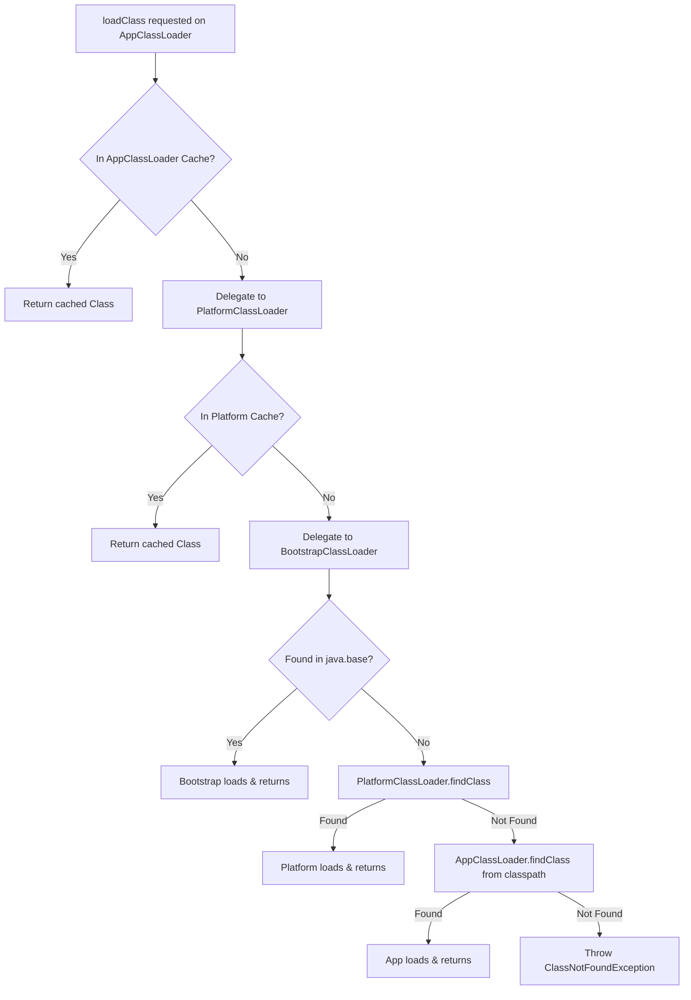

# Class Loading and ClassLoader Hierarchy

> Complete guide to the JVM ClassLoader Subsystem: the 3 phases of class loading (Loading, Linking, Initialization), the ClassLoader hierarchy, the Parent Delegation model, breaking delegation, and dynamic class unloading.

| Metadata | Value |
|---|---|
| **Level** | Advanced |
| **Prerequisites** | [00_jvm-architecture.md](00_jvm-architecture.md), [05-packages-and-modules/01_classpath-and-jars.md](../05-packages-and-modules/01_classpath-and-jars.md) |
| **Time to Read** | 26 minutes |
| **Status** | Active |
| **Java Version** | Java 1.0+ (Modular ClassLoaders since Java 9 JEP 261) |

---

## Table of Contents
1. [What & Why](#1-what--why)
2. [Core Concepts](#2-core-concepts)
3. [How It Works Internally](#3-how-it-works-internally)
4. [Syntax & Usage](#4-syntax--usage)
5. [Practical Examples](#5-practical-examples)
6. [Best Practices](#6-best-practices)
7. [Common Mistakes & Pitfalls](#7-common-mistakes--pitfalls)
8. [Performance & Security Notes](#8-performance--security-notes)
9. [Comparison / When to Use What](#9-comparison--when-to-use-what)
10. [Interview Questions](#10-interview-questions)
11. [Practice Exercises](#11-practice-exercises)
12. [Summary / Cheat Sheet](#12-summary--cheat-sheet)
13. [Further Reading](#13-further-reading)

---

## 1. What & Why

### Dynamic Lazy Loading
Unlike compiled C/C++ binaries (where all dependencies are statically linked into an executable file before execution), Java classes are loaded **dynamically and lazily on demand**.
A class is only loaded into JVM memory when it is first referenced by executing code (e.g., instantiating with `new`, calling a `static` method, or using reflection).

### The ClassLoader Responsibility
The ClassLoader Subsystem performs three essential roles:
1. Locates binary `.class` bytes across filesystems, JARs, network sockets, or dynamic bytecode generators.
2. Verifies bytecode to guarantee security and memory integrity.
3. Allocates and initializes `java.lang.Class` runtime representations in Metaspace.

---

## 2. Core Concepts

### The 3 Phases of Class Loading
1. **Loading**: Reads binary byte arrays and creates a `Class<?>` instance.
2. **Linking**: Prepares the class for execution:
   - **Verification**: Checks bytecode structural validity (no stack underflow, valid jump targets, type compatibility).
   - **Preparation**: Allocates memory for `static` fields and initializes them to **default zero values** (0, null, false).
   - **Resolution**: Resolves symbolic references in the Constant Pool into direct memory pointers.
3. **Initialization**: Executes static initializers and static field assignments (`<clinit>` method).

### The Built-in ClassLoader Hierarchy
Since Java 9 (JPMS), the standard hierarchy consists of:
1. **Bootstrap ClassLoader**: Native C++ loader built into HotSpot kernel. Loads core system classes from `java.base` (e.g. `java.lang.Object`, `String`). Represented by `null` in Java code.
2. **Platform ClassLoader** (formerly Extension ClassLoader): Loads non-base Java SE modules (e.g. `java.sql`, `java.compiler`).
3. **Application (System) ClassLoader**: Loads application classes from the classpath (`-cp`) and modulepath.
4. **Custom ClassLoaders**: User-defined loaders extending `java.lang.ClassLoader` (used by Tomcat, OSGi, Spring).

### The Parent Delegation Model
When a ClassLoader is requested to load a class:
1. It checks if the class is **already loaded in its local cache**.
2. If not, it **delegates the request up to its parent ClassLoader**.
3. Only if the parent ClassLoader fails (`ClassNotFoundException`) does the child ClassLoader attempt to load the class itself via `findClass(name)`.

---

## 3. How It Works Internally

### ClassLoader Delegation Flowchart


### Class Identity Uniqueness Rule
In the Java Virtual Machine:
$$\text{Class Identity} = \text{Fully Qualified Binary Name} + \text{Defining ClassLoader}$$
Two classes with the identical package and class name loaded by two different ClassLoaders are treated as **completely incompatible, distinct types** by the JVM. Attempting to cast between them throws `ClassCastException`!

---

## 4. Syntax & Usage

### Inspecting ClassLoader Hierarchy Programmatically
```java
public class ClassLoaderHierarchyDemo {
    public static void main(String[] args) {
        ClassLoader appLoader = ClassLoaderHierarchyDemo.class.getClassLoader();
        System.out.println("1. AppClassLoader: " + appLoader);

        ClassLoader platformLoader = appLoader.getParent();
        System.out.println("2. PlatformClassLoader: " + platformLoader);

        ClassLoader bootstrapLoader = platformLoader.getParent();
        System.out.println("3. BootstrapClassLoader: " + bootstrapLoader); // Prints 'null'!
    }
}
```
*Output:*
```
1. AppClassLoader: jdk.internal.loader.ClassLoaders$AppClassLoader@...
2. PlatformClassLoader: jdk.internal.loader.ClassLoaders$PlatformClassLoader@...
3. BootstrapClassLoader: null
```

### Implementing a Custom ClassLoader
```java
import java.io.IOException;
import java.nio.file.*;

public class DiskClassLoader extends ClassLoader {
    private final Path classDir;

    public DiskClassLoader(Path classDir, ClassLoader parent) {
        super(parent);
        this.classDir = classDir;
    }

    @Override
    protected Class<?> findClass(String name) throws ClassNotFoundException {
        try {
            String fileName = name.replace('.', '/') + ".class";
            Path classFile = classDir.resolve(fileName);
            byte[] bytes = Files.readAllBytes(classFile);
            // Converts raw bytes into a Class object
            return defineClass(name, bytes, 0, bytes.length);
        } catch (IOException e) {
            throw new ClassNotFoundException("Could not load: " + name, e);
        }
    }
}
```

---

## 5. Practical Examples

### Example 1: Breaking Delegation (Child-First Loading in Web Servers)
```java
// Goal: Model web server behavior where webapps load their own libraries first
public class ChildFirstClassLoader extends ClassLoader {
    public ChildFirstClassLoader(ClassLoader parent) {
        super(parent);
    }

    @Override
    public Class<?> loadClass(String name, boolean resolve) throws ClassNotFoundException {
        // Prevent overriding core java.* runtime classes!
        if (name.startsWith("java.")) {
            return super.loadClass(name, resolve);
        }

        // Try child findClass first!
        try {
            Class<?> clazz = findLoadedClass(name);
            if (clazz == null) {
                clazz = findClass(name);
            }
            if (resolve) resolveClass(clazz);
            return clazz;
        } catch (ClassNotFoundException e) {
            // Fallback to parent ClassLoader
            return super.loadClass(name, resolve);
        }
    }
}
```
*Explanation:* Web servers (like Tomcat) break standard parent delegation for webapp libraries, allowing different WAR applications to run different versions of the same library without collision.

### Example 2: Static Initialization `<clinit>` Trigger
```java
// Goal: Observe exact moment of class initialization
class LazyTarget {
    static {
        System.out.println(">>> LazyTarget <clinit> initialized! <<<");
    }
    public static final String CONSTANT = "COMPILE_TIME_CONSTANT";
    public static String dynamicState = "INITIALIZED_STATE";
}

public class InitTriggerDemo {
    public static void main(String[] args) throws Exception {
        System.out.println("Step 1: Referencing compile-time constant...");
        // Constant inlined by compiler; does NOT trigger class initialization!
        System.out.println(LazyTarget.CONSTANT);

        System.out.println("Step 2: Accessing static field...");
        // Triggers class initialization!
        System.out.println(LazyTarget.dynamicState);
    }
}
```
*Output:*
```
Step 1: Referencing compile-time constant...
COMPILE_TIME_CONSTANT
Step 2: Accessing static field...
>>> LazyTarget <clinit> initialized! <<<
INITIALIZED_STATE
```

---

## 6. Best Practices
1. **Always Override `findClass()`, Not `loadClass()`**: When creating custom loaders, override `findClass()` to preserve the Parent Delegation model automatically.
2. **Never Break Delegation for `java.*` Packages**: The JVM security verifier will throw `SecurityException: Prohibited package name` if a custom loader attempts to define classes in `java.*`.
3. **Release Custom ClassLoaders for Garbage Collection**: A class can only be unloaded if its defining `ClassLoader` is garbage collected. Clean up all instances to prevent Metaspace leaks.
4. **Use `Thread.currentThread().getContextClassLoader()`**: In modular and plugin frameworks, use ContextClassLoader to locate classes defined by calling frameworks.
5. **Beware of Static Singletons Across Multiple Loaders**: If two ClassLoaders load the same class, they maintain two independent sets of `static` fields.

---

## 7. Common Mistakes & Pitfalls

| Mistake | Why Wrong | Fix |
|---|---|---|
| Casting between identical classes from different loaders | Throws `ClassCastException` because JVM identity includes defining loader. | Use interfaces loaded by a shared parent loader. |
| Forgetting parent delegation in custom loaders | Results in loading duplicate versions of standard classes or `LinkageError`. | Call `super.loadClass()` or override `findClass()`. |
| Metaspace memory leaks from retained ClassLoaders | Retaining a single reference to a ClassLoader prevents unloading all its classes. | Dereference all instances and verify with heap profilers. |
| Assuming `Class.forName(name)` initializes by default | `Class.forName(name, false, loader)` loads without initializing. | Specify `initialize = true` if `<clinit>` must run. |

---

## 8. Performance & Security Notes

### Class Bytecode Verification Overhead
During the linking phase, the bytecode verifier inspects every instruction to ensure type safety and prevent memory attacks. While essential for security, verifying thousands of classes adds startup latency. Modern JVMs use pre-computed **StackMapTable** attributes generated by `javac` to perform verification in a single linear pass ($O(N)$).

### Dynamic Class Unloading
Classes cannot be unloaded individually. An entire set of classes is only unloaded from Metaspace during full GC if and only if:
1. Zero instances of any class defined by that ClassLoader exist on the heap.
2. Zero `java.lang.Class` references are reachable.
3. The `ClassLoader` instance itself is completely unreachable.

---

## 9. Comparison / When to Use What

| ClassLoader | Loads From | Parent | Can Be Subclassed? |
|---|---|---|---|
| **Bootstrap** | `lib/modules` (`java.base`) | None (`null`) | No (Native C++) |
| **Platform** | Non-base Java SE modules | Bootstrap | No (JDK Internal) |
| **App / System**| Classpath / Modulepath | Platform | No (JDK Internal) |
| **Custom** | Network, Encrypted, Hot-Reload | App | Yes (`extends ClassLoader`) |

---

## 10. Interview Questions

<details>
<summary>1. What are the three phases of the ClassLoader subsystem?</summary>
Loading (reading bytes to create Class object), Linking (Verification of bytecode, Preparation of static memory, Resolution of symbolic references), and Initialization (executing static initializers `<clinit>`).
</details>

<details>
<summary>2. What is the Parent Delegation Model and why is it important?</summary>
A mechanism where a ClassLoader delegates class loading requests to its parent before attempting to load the class itself. It prevents malicious code from replacing core Java classes (like `java.lang.String`) and prevents duplicate class loading.
</details>

<details>
<summary>3. Why does `String.class.getClassLoader()` return `null`?</summary>
Because core classes are loaded by the Bootstrap ClassLoader, which is implemented in native C++ inside the HotSpot JVM kernel and has no Java `ClassLoader` object representation.
</details>

<details>
<summary>4. What determines the identity of a class inside the JVM?</summary>
The fully qualified class name AND the specific `ClassLoader` instance that loaded it. Two identical classes loaded by different ClassLoaders are incompatible types.
</details>

<details>
<summary>5. How does a web container (like Tomcat) break the Parent Delegation model?</summary>
Tomcat overrides `loadClass` to search the web application's local `WEB-INF/classes` and `WEB-INF/lib` first before delegating to the parent shared loader, allowing webapps to override shared libraries.
</details>

<details>
<summary>6. What causes a `NoClassDefFoundError` vs a `ClassNotFoundException`?</summary>
`ClassNotFoundException` is a checked exception occurring when code explicitly attempts to load a class via string name (e.g. `Class.forName()`) and the file is missing. `NoClassDefFoundError` is an unchecked error occurring when a class was present at compile time, but is missing or failed to initialize at runtime.
</details>

<details>
<summary>7. Under what conditions can a class be garbage-collected and unloaded from Metaspace?</summary>
Only when its defining `ClassLoader` instance is completely unreachable, all its `Class` objects are unreachable, and zero instances of any class defined by that loader exist on the heap.
</details>

<details>
<summary>8. What is the Thread Context ClassLoader (TCCL)?</summary>
A ClassLoader attached to the current thread (`Thread.currentThread().getContextClassLoader()`). It allows core JDK classes (loaded by Bootstrap) to load application plugin classes (loaded by AppClassLoader), breaking through standard delegation boundaries (e.g. in JDBC `DriverManager` and ServiceLoader SPI).
</details>

---

## 11. Practice Exercises

### Exercise 1 (Easy): ClassLoader Traversal Utility
- **Task**: Write a method `printLoaderChain(Class<?> clazz)` that prints the ClassLoader hierarchy of any given class up to the Bootstrap loader.
<details>
<summary>Solution</summary>

```java
public class ClassLoaderTracer {
    public static void printLoaderChain(Class<?> clazz) {
        System.out.println("Chain for class: " + clazz.getName());
        ClassLoader cl = clazz.getClassLoader();
        int depth = 1;
        while (cl != null) {
            System.out.println(" " + depth + ". " + cl.getClass().getName());
            cl = cl.getParent();
            depth++;
        }
        System.out.println(" " + depth + ". Bootstrap ClassLoader (null)");
    }

    public static void main(String[] args) {
        printLoaderChain(ClassLoaderTracer.class);
        printLoaderChain(String.class);
    }
}
```
</details>

### Exercise 2 (Medium): Memory-Isolated Reloading Loader
- **Task**: Implement a simple `InMemoryClassLoader` that accepts raw class bytes and defines a new class, demonstrating how reloading creates distinct class types.
<details>
<summary>Solution</summary>

```java
public class InMemoryClassLoader extends ClassLoader {
    public Class<?> loadFromBytes(String name, byte[] classBytes) {
        return defineClass(name, classBytes, 0, classBytes.length);
    }
}
```
</details>

### Exercise 3 (Hard): SPI ServiceLoader Context Loader Inspection
- **Task**: Demonstrate how `ServiceLoader.load(Driver.class)` uses the Thread Context ClassLoader (TCCL) to bridge core JDK APIs with application classpath drivers.
<details>
<summary>Solution</summary>

```java
import java.sql.Driver;
import java.util.ServiceLoader;

public class ServiceLoaderDemo {
    public static void inspectSpiLoading() {
        ClassLoader contextLoader = Thread.currentThread().getContextClassLoader();
        System.out.println("Current Context ClassLoader: " + contextLoader);

        ServiceLoader<Driver> drivers = ServiceLoader.load(Driver.class, contextLoader);
        for (Driver d : drivers) {
            System.out.println("Found registered JDBC Driver: " + d.getClass().getName() + " via " + d.getClass().getClassLoader());
        }
    }

    public static void main(String[] args) {
        inspectSpiLoading();
    }
}
```
</details>

---

## 12. Summary / Cheat Sheet

```
+-----------------------------------------------------------------------------------------+
|                               CLASS LOADING CHEAT SHEET                                 |
+-----------------------------------------------------------------------------------------+
| Three Phases             | Loading -> Linking (Verify, Prepare, Resolve) -> Init       |
| Parent Delegation        | Cache Check -> Delegate to Parent -> findClass() locally     |
| ClassLoader Hierarchy    | Bootstrap (null) -> Platform -> Application -> Custom        |
| Class Uniqueness         | Fully Qualified Name + Defining ClassLoader Instance         |
| Breaking Delegation      | Override loadClass() to check child first (Tomcat model)     |
| Class Unloading          | Classes unload ONLY when entire ClassLoader is garbage coll. |
| Context Loader           | Thread.currentThread().getContextClassLoader() (SPI bridge)  |
+-----------------------------------------------------------------------------------------+
```

---

## 13. Further Reading
- [The Java Virtual Machine Specification: Chapter 5 (Loading, Linking, and Initializing)](https://docs.oracle.com/javase/specs/jvms/se21/html/jvms-5.html)
- "Understanding Class.forName() and ClassLoaders" by Brian Goetz
- OpenJDK JEP 261: Module System Runtime ClassLoading
