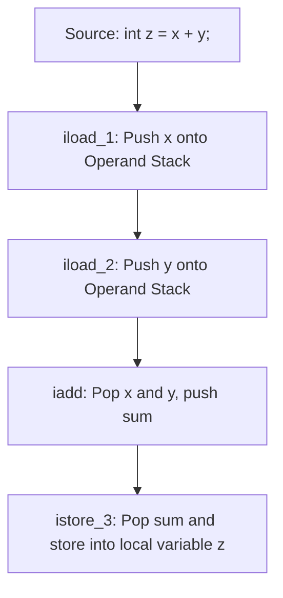

# Bytecode Fundamentals and ClassFile Anatomy

> Comprehensive architectural guide to the JVM Bytecode instruction set: ClassFile binary structure, Constant Pool, opcode taxonomy (load/store, arithmetic, branching, method invocations), decompilation analysis with `javap`, and `invokedynamic`.

| Metadata | Value |
|---|---|
| **Level** | Advanced |
| **Prerequisites** | [00_jvm-architecture.md](00_jvm-architecture.md), [02_jvm-memory-areas.md](02_jvm-memory-areas.md) |
| **Time to Read** | 28 minutes |
| **Status** | Active |
| **Java Version** | Java 1.0 to Java 25 LTS (Class-File API JEP 484) |

---

## Table of Contents
1. [What & Why](#1-what--why)
2. [Core Concepts](#2-core-concepts)
3. [How It Works Internally](#3-how-it-works-internally)
4. [Syntax & Usage](#4-syntax--usage)
5. [Practical Examples](#5-practical-examples)
6. [Best Practices](#6-best-practices)
7. [Common Mistakes & Pitfalls](#7-common-mistakes--pitfalls)
8. [Performance & Security Notes](#8-performance--security-notes)
9. [Comparison / When to Use What](#9-comparison--when-to-use-what)
10. [Interview Questions](#10-interview-questions)
11. [Practice Exercises](#11-practice-exercises)
12. [Summary / Cheat Sheet](#12-summary--cheat-sheet)
13. [Further Reading](#13-further-reading)

---

## 1. What & Why

### The True Language of the JVM
The JVM does not execute Java source code. It executes **JVM Bytecode**—a compact, stream-oriented sequence of 1-byte opcodes followed by optional operand parameters.
Languages such as Java, Kotlin, Scala, Groovy, and Clojure all compile into the identical standard ClassFile format.

Mastering bytecode enables developers to:
- Understand precisely what the compiler does under the hood (autoboxing, string concatenation, pattern matching).
- Diagnose subtle performance bottlenecks and verify JIT inlining prerequisites.
- Safely engineer bytecode transformers, profilers, and AOP frameworks.

---

## 2. Core Concepts

### Binary ClassFile Structure
Every `.class` file adheres to an exact C-like struct layout:
```
ClassFile {
    u4             magic;             // 0xCAFEBABE (Magic Number)
    u2             minor_version;     // Minor version (e.g. 0 or 65535 preview)
    u2             major_version;     // Major version (e.g. 69 for Java 25)
    u2             constant_pool_count;
    cp_info        constant_pool[constant_pool_count - 1];
    u2             access_flags;      // ACC_PUBLIC, ACC_FINAL, etc.
    u2             this_class;        // Constant pool index
    u2             super_class;       // Constant pool index
    u2             interfaces_count;
    u2             interfaces[interfaces_count];
    u2             fields_count;
    field_info     fields[fields_count];
    u2             methods_count;
    method_info    methods[methods_count];
    u2             attributes_count;
    attribute_info attributes[attributes_count];
}
```

### The Constant Pool
The Constant Pool acts as the **symbol table** for the class. It stores literal constants (strings, integers, floats) and symbolic references to classes, interfaces, method names, and field descriptors. Instructions refer to constant pool entries via 2-byte indices (`#1`, `#2`).

### Stack-Based Architecture
Unlike x86 or ARM (which are register-based architectures), the JVM is a **stack-based machine**. Instructions take their inputs from the top of the current stack frame's **Operand Stack** and push the results back onto the operand stack.

---

## 3. How It Works Internally

### Opcode Taxonomy
There are roughly 200 distinct opcodes in the JVM instruction set, grouped into categories:
1. **Load and Store**: Move data between Local Variables and the Operand Stack:
   - `iload_1` (push int from local var 1), `aload_0` (push reference from local var 0, typically `this`), `istore_2` (pop int and store in local var 2).
2. **Arithmetic & Logic**: `iadd`, `dsub`, `imul`, `idiv`, `ishl`, `iand`.
3. **Type Conversion**: `i2l` (int to long), `i2d` (int to double), `checkcast` (type cast verification).
4. **Object Creation & Manipulation**: `new`, `newarray`, `getfield`, `putfield`, `getstatic`, `putstatic`.
5. **Control Transfer**: `ifeq`, `if_icmpne`, `goto`, `tableswitch`, `lookupswitch`.
6. **Method Invocations**:
   - `invokevirtual`: Standard dynamic dispatch for public/protected instance methods (uses vtable).
   - `invokespecial`: Non-polymorphic dispatch for private methods, constructors (`<init>`), and `super` calls.
   - `invokestatic`: Dispatches static methods directly.
   - `invokeinterface`: Dispatches interface methods (uses itable).
   - `invokedynamic`: Dynamically bootstrapped call sites (lambdas, string concat, pattern matching).



---

## 4. Syntax & Usage

### Decompiling with `javap`
The JDK includes `javap` (the Java Class File Disassembler):
```bash
# Basic disassembly
javap -c MyClass.class

# Verbose disassembly showing Constant Pool, Stack Sizes, and Local Variables
javap -v -p MyClass.class
```

### Analyzing Bytecode Example
```java
public class Calculator {
    public int add(int a, int b) {
        return a + b;
    }
}
```
Decompiles to:
```bytecode
public int add(int, int);
  descriptor: (II)I
  flags: (0x0001) ACC_PUBLIC
  Code:
    stack=2, locals=3, args_size=3
       0: iload_1       // Push 'a' (local var 1)
       1: iload_2       // Push 'b' (local var 2)
       2: iadd          // Pop a and b, compute a + b
       3: ireturn       // Return int result
```

---

## 5. Practical Examples

### Example 1: Dissecting String Concatenation (`invokedynamic`)
In Java 8, `String s = a + b` compiled into `StringBuilder.append()` calls.
In Java 9+ (JEP 280), it compiles to a single `invokedynamic` call site:
```java
public class StringConcatBytecode {
    public static String greet(String name, int age) {
        return "Hello " + name + ", age: " + age;
    }
}
```
`javap -c` reveals:
```bytecode
0: aload_0
1: iload_1
2: invokedynamic #7, 0 // InvokeDynamic #0:makeConcatWithConstants:(Ljava/lang/String;I)Ljava/lang/String;
7: areturn
```
*Explanation:* `StringConcatFactory.makeConcatWithConstants` defers strategy selection to the JVM runtime, achieving zero intermediate object allocations and optimizing buffer sizing dynamically.

### Example 2: Lambda Compilation via `LambdaMetafactory`
```java
// Goal: Inspect how lambdas avoid generating anonymous inner class files
import java.util.function.Function;

public class LambdaBytecodeDemo {
    public static Function<String, Integer> getParser() {
        return String::length;
    }
}
```
Bytecode:
```bytecode
0: invokedynamic #7, 0 // InvokeDynamic #0:apply:()Ljava/util/function/Function;
5: areturn
```
*Explanation:* Lambdas use `invokedynamic` targeting `LambdaMetafactory`, generating the call site dynamically in memory without cluttering disk with `$1.class` files.

---

### Dynamic Language Support and Bootstrap Methods
The introduction of `invokedynamic` in Java 7 (JEP 292) laid the foundation for modern JVM language design. Unlike static opcodes (`invokevirtual`, `invokestatic`) where method resolution is performed strictly at compile-time by `javac`, `invokedynamic` delegates linkage to an arbitrary Java method called a **Bootstrap Method (BSM)**:
1. The first time an `invokedynamic` instruction is encountered, the JVM suspends execution of the call site and invokes the designated BSM.
2. The BSM computes the target method dynamically and returns a `java.lang.invoke.CallSite` wrapping a `MethodHandle`.
3. The JVM binds this CallSite permanently to the instruction. Subsequent calls execute directly without re-executing the BSM.
4. If the CallSite is a `ConstantCallSite`, the JIT compiler can inline the target method directly across the dynamic call boundary!

### ClassFile Attribute Types Reference
Attributes are the extensible metadata mechanism of the ClassFile format. Major standard attributes include:
- `Code`: Contains the executable bytecode instructions, maximum operand stack depth, local variable count, and exception table.
- `ConstantValue`: Denotes the compile-time constant value of a `static final` field.
- `Exceptions`: Declares checked exceptions that may be thrown by a method.
- `InnerClasses`: Records nested and inner class relationships.
- `Signature`: Preserves generic type signatures for reflection (`List<String>`).
- `SourceFile`: Records the name of the source `.java` file for stack traces.
- `LineNumberTable`: Maps bytecode instruction offsets to source code line numbers for debuggers.
- `LocalVariableTable`: Maps local variable slots to source code variable names and scopes.

### Comprehensive Exception Table Anatomy
Bytecode handles `try-catch-finally` blocks using an **Exception Table** rather than special jump instructions.
In a method with error handling:
```bytecode
Exception table:
   from    to  target type
       0     8    11   Class java/io/IOException
       0    15    18   any
```
- `from` and `to`: Bytecode offset ranges defining the `try` block.
- `target`: The bytecode instruction offset where execution jumps if an exception is caught.
- `type`: The specific `Class` matching the exception, or `any` (used for `finally` cleanup blocks).
When an exception is thrown, the JVM walks the exception table linearly from top to bottom; the first entry matching the active instruction offset and exception class is selected. If no entry matches, the stack frame is popped and the search continues in the caller frame.

### Method Descriptors and Internal Type Signatures
In the ClassFile constant pool and method descriptors, JVM types are represented using a compact single-character format:
- `B`: `byte`
- `C`: `char`
- `D`: `double`
- `F`: `float`
- `I`: `int`
- `J`: `long`
- `S`: `short`
- `Z`: `boolean`
- `V`: `void`
- `L<classname>;`: Reference type (e.g. `Ljava/lang/String;`)
- `[`: Array dimension (e.g. `[I` for `int[]`, `[[Ljava/lang/String;` for `String[][]`)

For example, a method signature `public String process(int id, double[] rates, boolean flag)` has the binary descriptor:
`(I[DZ)Ljava/lang/String;`

## 6. Best Practices
1. **Inspect Bytecode to Validate Compiler Assumptions**: Use `javap -c` to verify whether switch expressions, string templates, or record patterns generate the anticipated instructions.
2. **Minimize Autoboxing in Critical Loops**: Inspect bytecode for `valueOf()` calls (`Integer.valueOf()`), which reveal hidden heap allocation in performance-critical code.
3. **Leverage the Class-File API (JEP 484)**: In Java 24/25, migrate bytecode manipulation tools from third-party ASM to standard `java.lang.classfile`.
4. **Understand Method Inlining Limits**: HotSpot C2 inlines methods whose bytecode size is $\le 35$ bytes (`-XX:MaxInlineSize=35`). Keep frequently called utility methods concise.
5. **Verify Monomorphic Call Sites**: Monomorphic calls with single receiver types are easily inlined; megamorphic calls with 3+ implementations require slower dynamic dispatch.

---

## 7. Common Mistakes & Pitfalls

| Mistake | Why Wrong | Fix |
|---|---|---|
| Assuming `invokevirtual` is always slow | HotSpot uses inline caches (vtable) and inlines single-target virtual methods into direct assembly. | Design for monomorphic call sites. |
| Hidden Autoboxing in tight loops | Using primitives with generics generates hidden `invokestatic Integer.valueOf()` calls. | Use primitive streams (`IntStream`) or arrays. |
| Huge method bodies exceeding 35 bytes | Prevents JIT compiler from inlining methods into caller loops. | Refactor large methods into smaller, focused helper methods. |
| Corrupted stack operations in bytecode generators | Bytecode verifier immediately rejects classes with `VerifyError`. | Validate stack heights using the Class-File API. |

---

## 8. Performance & Security Notes

### StackMapTable and Linear Verification
Since Java 6, class files include a `StackMapTable` attribute. Instead of the JVM inferring stack frame types at every branch target via costly dataflow analysis, the compiler records the exact types in the `StackMapTable`, allowing verification in a single linear $O(N)$ pass.

### Dynamic Call Site Linking Overhead
`invokedynamic` call sites incur a small one-time bootstrap overhead on first execution (`BootstrapMethod`). Once linked, the JVM optimizes the call site into direct assembly, matching direct method invocation speeds.

---

## 9. Comparison / When to Use What

| Invocation Bytecode | Dispatch Target | Polymorphic? | Used For |
|---|---|---|---|
| `invokestatic` | Static Method | No | Utility methods |
| `invokespecial` | Private, `<init>`, `super` | No | Constructors, super calls |
| `invokevirtual` | Class Instance Method | **Yes (vtable)** | Standard object OOP calls |
| `invokeinterface`| Interface Method | **Yes (itable)** | Interface contract calls |
| `invokedynamic` | Dynamic Bootstrap | **Dynamic** | Lambdas, StringConcat |

---

## 10. Interview Questions

<details>
<summary>1. What is the magic number of a Java ClassFile?</summary>
`0xCAFEBABE`. It serves as the file header signature identifying the binary as a valid JVM class file.
</details>

<details>
<summary>2. What is the difference between a register-based VM and a stack-based VM?</summary>
A stack-based VM (like the JVM) performs operations on a push/pop operand stack without referencing CPU registers, making bytecode hardware-independent and compact. A register-based VM (like Dalvik or Lua) stores operands in virtual registers, requiring fewer instructions but larger instruction sizes.
</details>

<details>
<summary>3. What is the purpose of the Constant Pool in a `.class` file?</summary>
It serves as the symbol table for the class, storing string literals, numeric constants, class names, field names, and method signatures referenced by bytecode instructions via indexed tags.
</details>

<details>
<summary>4. What are the 5 method invocation bytecode instructions?</summary>
`invokevirtual` (public/protected instance methods), `invokestatic` (static methods), `invokespecial` (constructors, private methods, super calls), `invokeinterface` (interface methods), and `invokedynamic` (dynamically bootstrapped call sites).
</details>

<details>
<summary>5. How does `invokedynamic` (JEP 292) work?</summary>
`invokedynamic` defers the linkage of a call site until runtime. On first invocation, it executes a Bootstrap Method (BSM) that returns a `CallSite` pointing to a `MethodHandle`. Subsequent invocations execute the linked target directly with JIT inlining.
</details>

<details>
<summary>6. How does modern Java implement string concatenation at the bytecode level?</summary>
Since Java 9, string concatenation compiles into a single `invokedynamic` call site targeting `StringConcatFactory.makeConcatWithConstants`, replacing legacy chained `StringBuilder` allocations.
</details>

<details>
<summary>7. What is the `StackMapTable` attribute?</summary>
An attribute generated by `javac` that records the types of local variables and operand stack entries at jump targets, allowing the JVM verifier to verify bytecode safety in a single linear pass without full dataflow analysis.
</details>

<details>
<summary>8. What is the significance of the 35-byte method size threshold in HotSpot?</summary>
HotSpot's C2 JIT compiler uses `-XX:MaxInlineSize=35` as the default threshold for inlining frequently executed methods. Methods whose bytecode size exceeds 35 bytes may be skipped for aggressive inlining unless they are extremely hot.
</details>

---

## 11. Practice Exercises

### Exercise 1 (Easy): Disassembling Arithmetic Bytecode
- **Task**: Compile a simple class `Multiply { public int times(int x) { return x * 5; } }` and run `javap -c` to inspect the generated instructions.
<details>
<summary>Solution</summary>

```bash
# Compilation
javac Multiply.java
javap -c Multiply.class
```
Expected output:
```bytecode
0: iload_1
1: iconst_5
2: imul
3: ireturn
```
</details>

### Exercise 2 (Medium): Spotting Autoboxing Overhead in Bytecode
- **Task**: Disassemble a method returning `Integer` from an `int` argument and identify the `invokestatic` autoboxing bytecode instruction.
<details>
<summary>Solution</summary>

```java
public class BoxDemo {
    public static Integer box(int val) {
        return val;
    }
}
```
Bytecode contains:
```bytecode
0: iload_0
1: invokestatic  #7 // Method java/lang/Integer.valueOf:(I)Ljava/lang/Integer;
4: areturn
```
</details>

### Exercise 3 (Hard): Bytecode Stack Height Calculation
- **Task**: Calculate the maximum operand stack height for computing `(a + b) * (c - d)` where all variables are integers.
<details>
<summary>Solution</summary>

```bytecode
iload_0       // Stack: [a] (height 1)
iload_1       // Stack: [a, b] (height 2)
iadd          // Stack: [sum1] (height 1)
iload_2       // Stack: [sum1, c] (height 2)
iload_3       // Stack: [sum1, c, d] (height 3)
isub          // Stack: [sum1, diff] (height 2)
imul          // Stack: [product] (height 1)
ireturn
```
The maximum stack height required is **3** (`stack=3`).
</details>

---

### Exercise 4 (Advanced): Decoding Switch Bytecode (tableswitch vs lookupswitch)
- **Task**: Create two switch methods: one with dense contiguous integer cases (1, 2, 3), and one with sparse integer cases (10, 1000, 50000). Run `javap -c` and identify which instruction each method generates.
<details>
<summary>Solution</summary>

```java
public class SwitchDisassemblyExercise {
    // Generates tableswitch (O(1) direct array jump table)
    public int denseSwitch(int x) {
        return switch (x) {
            case 1 -> 100;
            case 2 -> 200;
            case 3 -> 300;
            default -> 0;
        };
    }

    // Generates lookupswitch (O(log n) binary search table)
    public int sparseSwitch(int x) {
        return switch (x) {
            case 10 -> 100;
            case 1000 -> 200;
            case 50000 -> 300;
            default -> 0;
        };
    }
}
```
</details>

## 12. Summary / Cheat Sheet

```
+-----------------------------------------------------------------------------------------+
|                                    BYTECODE CHEAT SHEET                                 |
+-----------------------------------------------------------------------------------------+
| Magic Number             | 0xCAFEBABE (First 4 bytes of every valid .class file)        |
| Major Versions           | Java 8 = 52, Java 17 = 61, Java 21 = 65, Java 25 = 69        |
| Stack Architecture       | Push operands to Operand Stack, compute, pop result          |
| Load / Store             | iload / istore, aload / astore, dload / dstore               |
| Invocation Types         | invokevirtual (vtable), invokestatic, invokespecial (<init>) |
| Interface Calls          | invokeinterface (itable dispatch)                            |
| Dynamic Dispatch         | invokedynamic (Bootstrap method -> CallSite -> MethodHandle) |
| Disassembler Command     | javap -v -p MyClass.class (Inspect constant pool & bytecode) |
+-----------------------------------------------------------------------------------------+
```

---

## 13. Further Reading
- [The Java Virtual Machine Specification: Chapter 6 (The Java Virtual Machine Instruction Set)](https://docs.oracle.com/javase/specs/jvms/se21/html/jvms-6.html)
- [JEP 484: Class-File API (Java 24/25)](https://openjdk.org/jeps/484)
- "Java Bytecode Crash Course" by Oracle Technology Network
