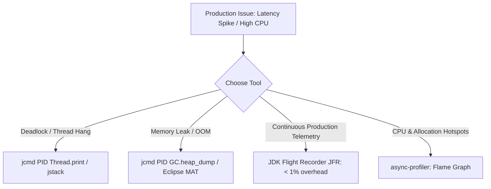

# JVM Tuning, Monitoring, and Diagnostics

> Practical production guide to JVM performance engineering: diagnostic CLI utilities (`jcmd`, `jstack`, `jmap`, `jstat`), JDK Flight Recorder (JFR), async-profiler, Unified GC Logging (`-Xlog:gc*`), and production container flag recipes.

| Metadata | Value |
|---|---|
| **Level** | Advanced |
| **Prerequisites** | [00_jvm-architecture.md](00_jvm-architecture.md), [04_garbage-collection.md](04_garbage-collection.md), [05_gc-algorithms.md](05_gc-algorithms.md) |
| **Time to Read** | 28 minutes |
| **Status** | Active |
| **Java Version** | Java 9+ (Unified Logging), Java 11+ (Open-source JFR), Java 21-25 Production baseline |

---

## Table of Contents
1. [What & Why](#1-what--why)
2. [Core Concepts](#2-core-concepts)
3. [How It Works Internally](#3-how-it-works-internally)
4. [Syntax & Usage](#4-syntax--usage)
5. [Practical Examples](#5-practical-examples)
6. [Best Practices](#6-best-practices)
7. [Common Mistakes & Pitfalls](#7-common-mistakes--pitfalls)
8. [Performance & Security Notes](#8-performance--security-notes)
9. [Comparison / When to Use What](#9-comparison--when-to-use-what)
10. [Interview Questions](#10-interview-questions)
11. [Practice Exercises](#11-practice-exercises)
12. [Summary / Cheat Sheet](#12-summary--cheat-sheet)
13. [Further Reading](#13-further-reading)

---

## 1. What & Why

### The Reality of Production Diagnostics
Even with extensive unit and integration testing, production applications face real-world failure modes:
- Sudden CPU spikes caused by lock contention or infinite loops.
- OutOfMemoryError crashes caused by heap leaks or Metaspace exhaustion.
- Latency spikes caused by long GC pauses or disk I/O stalls.

Debugging production issues by deploying code with debug logging is slow and hazardous. The modern JDK provides a rich suite of **zero-overhead diagnostic and profiling tools** built directly into the HotSpot runtime.

---

## 2. Core Concepts

### The Essential JDK CLI Diagnostic Toolkit
1. **`jcmd`**: The Swiss Army Knife of JVM diagnostics. Sends control commands to live JVM processes (thread dumps, GC inspection, JFR recordings, native memory tracking).
2. **`jstack`**: Dumps thread call stacks and monitors lock states for deadlock analysis.
3. **`jmap`**: Inspects heap memory utilization, generates memory histograms, and dumps heap snapshots (`.hprof`).
4. **`jstat`**: Displays real-time sampling statistics of garbage collection, compiler activity, and class loading.

### JDK Flight Recorder (JFR) & JDK Mission Control (JMC)
- **JFR**: An event-recording framework built directly into the HotSpot kernel. Captures CPU execution, memory allocations, thread locks, network I/O, and GC events with **$< 1\%$ overhead**. Safe for continuous 24/7 production use!
- **JMC**: The desktop graphical analysis tool used to inspect `.jfr` recording files.

### async-profiler
An open-source low-overhead sampling profiler for Linux and macOS that avoids the Safepoint Bias Problem of standard Java profilers by leveraging Linux `perf_events`. Generates interactive **Flame Graphs**.

---

## 3. How It Works Internally

### The Safepoint Bias Problem in Traditional Profilers
Standard Java profilers sample thread stack traces by requesting a JVM Safepoint.
**Problem**: The JVM can only stop threads at safepoint locations (e.g. method exits, loop back-edges).
Code executing between safepoints is invisible to the sampler, skewing CPU profiles (**Safepoint Bias**).
`async-profiler` and modern JFR overcome this by sampling execution using asynchronous OS signals (`SIGPROF`), capturing true, unbiased hardware call stacks.



---

## 4. Syntax & Usage

### Swiss Army Knife: `jcmd` Recipes
```bash
# List all running Java processes
jcmd

# Print JVM uptime and command-line flags
jcmd <PID> VM.flags

# Generate full thread dump
jcmd <PID> Thread.print > threads.tdump

# Generate class histogram (shows top memory consumers)
jcmd <PID> GC.class_histogram

# Dump Heap to file for Eclipse MAT / VisualVM
jcmd <PID> GC.heap_dump /tmp/heap.hprof

# Start a 60-second JFR recording
jcmd <PID> JFR.start name=prod_profile duration=60s filename=/tmp/profile.jfr
```

### Unified JVM Logging Syntax (`-Xlog`)
```bash
# Standard Production Logging Recipe:
java -Xlog:gc*,gc+phases=debug:file=/var/log/java/gc.log:time,uptime,pid:filecount=5,filesize=50m MyApp
```

---

## 5. Practical Examples

### Example 1: Automated Heap Dump on OutOfMemoryError
```bash
# Launch application with automatic crash dumping
java -XX:+HeapDumpOnOutOfMemoryError \
     -XX:HeapDumpPath=/var/dumps/oom.hprof \
     -XX:+ExitOnOutOfMemoryError \
     MyApp
```
*Explanation:* When `OutOfMemoryError` occurs, the JVM automatically dumps the exact heap state to disk before crashing, enabling developers to open `oom.hprof` in Eclipse MAT to locate the exact leaking object graph.

### Example 2: Profiling with JFR Programmatically
```java
// Goal: Trigger a JFR recording during a high-value business transaction
import jdk.jfr.Recording;
import java.nio.file.Path;

public class JfrProgrammaticDemo {
    public static void recordCriticalTransaction() throws Exception {
        try (Recording recording = new Recording()) {
            recording.enable("jdk.CPULoad");
            recording.enable("jdk.JavaMonitorEnter");
            recording.start();

            // Execute critical workload...
            System.out.println("Executing performance-critical operation...");
            Thread.sleep(500);

            recording.stop();
            recording.dump(Path.of("transaction_profile.jfr"));
            System.out.println("JFR recording dumped successfully!");
        }
    }

    public static void main(String[] args) throws Exception {
        recordCriticalTransaction();
    }
}
```

---

## 6. Best Practices
1. **Always Enable `-XX:+HeapDumpOnOutOfMemoryError` in Production**: Never deploy enterprise services without automated heap dump generation on OOM.
2. **Use `-XX:+ExitOnOutOfMemoryError` in Kubernetes**: Prevent zombie pods; crash the container immediately on OOM so Kubernetes can restart a healthy replacement pod.
3. **Turn on Continuous JFR Recording**: Keep a continuous circular JFR recording buffer active (`-XX:StartFlightRecording=disk=true,dumponexit=true,maxsize=200m`) to analyze crashes post-mortem.
4. **Use Container-Aware Percentage Flags**: Use `-XX:MaxRAMPercentage=75.0` rather than hardcoded `-Xmx` values in containerized environments.
5. **Inspect Native Memory with NMT**: Use `-XX:NativeMemoryTracking=summary` to diagnose off-heap memory leaks from direct buffers and Metaspace.

---

## 7. Common Mistakes & Pitfalls

| Mistake | Why Wrong | Fix |
|---|---|---|
| Triggering `jmap -dump:live` on a busy production server | Forces a full Stop-The-World GC to inspect live objects, freezing the server for minutes. | Omit `:live` or take dumps during maintenance windows. |
| Missing heap dump flags on OOM | Application crashes and leaves zero diagnostics behind to investigate root cause. | Add `-XX:+HeapDumpOnOutOfMemoryError`. |
| Unbounded GC log files | Logging to a single file exhausts disk space, causing server disk full errors. | Use log rotation: `filecount=5,filesize=50m`. |
| Using outdated legacy flags (`-XX:+PrintGCDetails`) | Deprecated in Java 9; replaced by unified logging. | Use modern `-Xlog:gc*`. |

---

## 8. Performance & Security Notes

### Production Container Sizing Recipe
```bash
# Recommended production container flags for Java 21/25 LTS:
java -XX:+UseContainerSupport \
     -XX:MaxRAMPercentage=75.0 \
     -XX:+AlwaysPreTouch \
     -XX:+HeapDumpOnOutOfMemoryError \
     -XX:HeapDumpPath=/var/log/java/oom.hprof \
     -XX:+ExitOnOutOfMemoryError \
     -XX:+UseG1GC \
     -Xlog:gc*:file=/var/log/java/gc.log:time,uptime,pid:filecount=5,filesize=50m \
     -jar app.jar
```

---

## 9. Comparison / When to Use What

| Diagnostic Tool | Overhead | Safe for 24/7 Production? | Primary Specialty |
|---|---|---|---|
| **`jcmd`** | Instant / Minimal | **Yes** | On-demand commands, thread dumps |
| **`jstack`** | Brief freeze | **Yes** | Deadlocks, thread state analysis |
| **JDK Flight Recorder (JFR)**| **< 1%** | **Yes** | 24/7 continuous event recording |
| **async-profiler** | ~2% | **Yes** | Unbiased CPU and Allocation Flame Graphs |
| **VisualVM / JConsole**| High (JMX polling) | **No** | Local development only |

---

## 10. Interview Questions

<details>
<summary>1. What is the preferred all-in-one CLI diagnostic tool in modern JDK?</summary>
`jcmd`. It supersedes `jstack`, `jmap`, and `jinfo` by sending unified commands to the target JVM process.
</details>

<details>
<summary>2. What is the Safepoint Bias problem in Java profilers?</summary>
Traditional Java profilers only sample thread stacks at JVM safepoints. Code running between safepoints is omitted, skewing CPU profiling results. Async-profiler and modern JFR eliminate this by sampling via OS `SIGPROF` signals.
</details>

<details>
<summary>3. Why should you use `-XX:+ExitOnOutOfMemoryError` in Kubernetes?</summary>
When a JVM encounters an OutOfMemoryError, threads die and state corrupts, but the process often remains alive as a zombie that fails health checks. `-XX:+ExitOnOutOfMemoryError` forces an immediate process exit, prompting Kubernetes to restart a fresh pod.
</details>

<details>
<summary>4. What is the overhead of JDK Flight Recorder (JFR)?</summary>
Less than 1%, making it safe to run continuously 24/7 in high-throughput enterprise production environments.
</details>

<details>
<summary>5. How does Unified JVM Logging work in modern Java?</summary>
Configured via `-Xlog:<tags>:<output>:<decorators>:<modifiers>`. It centralizes logging across all JVM subsystems (gc, class, compiler, os) with built-in log rotation support.
</details>

<details>
<summary>6. What is Native Memory Tracking (NMT)?</summary>
A HotSpot diagnostic feature (`-XX:NativeMemoryTracking=summary`) that tracks off-heap native memory allocations (Metaspace, thread stacks, CodeCache, GC structures).
</details>

<details>
<summary>7. What is a Flame Graph?</summary>
A visualization of profiled software where call stacks are represented as layered horizontal bars: width represents relative CPU time or memory allocations, allowing immediate identification of hot spots.
</details>

<details>
<summary>8. Why is `jmap -dump:live` hazardous in production?</summary>
The `:live` flag forces an immediate full Stop-The-World garbage collection cycle before writing the dump, which can freeze massive heaps for tens of seconds.
</details>

---

## 11. Practice Exercises

### Exercise 1 (Easy): Generating Thread Dumps with `jcmd`
- **Task**: Launch any Java process, find its PID using `jcmd`, and generate a full thread dump to a text file.
<details>
<summary>Solution</summary>

```bash
# 1. Locate Java process
jcmd
# 2. Dump threads to file
jcmd <PID> Thread.print > /tmp/thread_dump.txt
```
</details>

### Exercise 2 (Medium): Triggering JFR from Command-Line
- **Task**: Start a 30-second JFR recording on a running Java process and verify the recording file is created.
<details>
<summary>Solution</summary>

```bash
jcmd <PID> JFR.start name=test_run duration=30s filename=/tmp/my_recording.jfr
```
</details>

### Exercise 3 (Hard): Native Memory Tracking Baseline Comparison
- **Task**: Configure a Java application with `-XX:NativeMemoryTracking=summary`, establish a baseline via `jcmd`, perform off-heap direct byte buffer allocations, and generate a diff report.
<details>
<summary>Solution</summary>

```bash
# Launch with NMT
java -XX:NativeMemoryTracking=summary MyApp &
# Establish baseline
jcmd <PID> VM.native_memory baseline
# Later, generate diff report
jcmd <PID> VM.native_memory detail.diff
```
</details>

---


### 11.4 Systematic Production Outage Playbook: High CPU and OutOfMemoryError

When a Java service triggers high-severity alerts in production, follow this disciplined diagnostic sequence:

1. **Step 1: Capture Thread Dumps and Top Processes**:
   Do not restart the process immediately! Collect diagnostics first:
   \\ash
   # On Linux: Identify the thread LWP taking high CPU
   top -H -p <PID>
   # Convert decimal thread ID to hexadecimal:
   printf '%x
' <LWP_ID>

   # Collect 3 consecutive thread dumps spaced 5 seconds apart
   for i in 1 2 3; do
       jcmd <PID> Thread.print > threaddump_.txt
       sleep 5
   done
   \   Search for the hex thread ID inside \	hreaddump_*.txt\ under id=0x...\ to locate the exact Java stack trace consuming CPU cycles.

2. **Step 2: Check for JVM-Internal GC Thrashing vs Business Logic**:
   If the hot threads in the thread dump are named \VM Thread\ or \GC Thread#*\, the high CPU is caused by GC thrashing because the heap is saturated.
   Verify with:
   \\ash
   jcmd <PID> GC.heap_info
   \
3. **Step 3: Capture Diagnostic Heap Dump**:
   If memory is saturated or memory leak is suspected:
   \\ash
   jcmd <PID> GC.heap_dump /var/log/dumps/heap_<PID>.hprof
   \   Load the dump into Eclipse Memory Analyzer (MAT) or JDK VisualVM. Execute:
   - Dominator Tree: Identifies the root objects retaining 80%+ of total retained heap size.
   - Leak Suspects Report: Automatically flags unbounded collections, static caches, or duplicated strings.

4. **Step 4: Container Resource Quota Verification**:
   Inspect whether Kubernetes cgroups are throttling CPU or terminating the pod via OOMKilled:
   \\ash
   # Check container memory limits and current usage:
   cat /sys/fs/cgroup/memory.max
   cat /sys/fs/cgroup/memory.current
   cat /sys/fs/cgroup/cpu.stat
   \   Ensure JVM memory parameters satisfy:
   \MaxRAMPercentage=75.0   Total container limit must account for off-heap allocations, Metaspace, thread stacks (\-Xss1m\ per OS thread), and native memory buffers.


### 11.5 Advanced JFR Event Streaming and Automated Anomaly Detection

Java 14+ provides continuous JFR Event Streaming directly into application health monitoring frameworks:

1. **Subscribing to In-Process Flight Recorder Events**:
   ```java
   import jdk.jfr.consumer.RecordingStream;
   import java.time.Duration;

   public final class JfrWatchdog {
       public static void startMonitoring() {
           Thread.ofVirtual().name("jfr-stream-monitor").start(() -> {
               try (var stream = new RecordingStream()) {
                   stream.enable("jdk.GarbageCollection").withThreshold(Duration.ofMillis(50));
                   stream.enable("jdk.JavaMonitorEnter").withThreshold(Duration.ofMillis(20));
                   stream.enable("jdk.ExecutionSample").withPeriod(Duration.ofMillis(100));

                   stream.onEvent("jdk.GarbageCollection", event -> {
                       System.err.printf("[WARN] Long GC Pause: %s, duration: %d ms%n",
                               event.getString("name"),
                               event.getDuration().toMillis());
                   });

                   stream.onEvent("jdk.JavaMonitorEnter", event -> {
                       System.err.printf("[WARN] Lock Contention: %s held by %s%n",
                               event.getClass("monitorClass").getName(),
                               event.getThread("previousOwner"));
                   });

                   stream.start();
               }
           });
       }
   }
   ```

2. **Benefits of Native Event Streaming**:
   - Zero external parsing of textual log files.
   - Asynchronous and event-driven: pushes structured telemetry directly to Prometheus or OpenTelemetry.
   - Overhead remains < 1% even with granular CPU and lock contention monitoring enabled continuously.
   - Enables predictive autoscaling before threads become pinned or heap memory enters catastrophic GC thrashing cycles.


## 12. Summary / Cheat Sheet

```
+-----------------------------------------------------------------------------------------+
|                                JVM DIAGNOSTICS CHEAT SHEET                              |
+-----------------------------------------------------------------------------------------+
| All-in-One CLI           | jcmd <PID> <command> (Thread.print, GC.heap_dump, etc.)      |
| Production OOM Recipe    | -XX:+HeapDumpOnOutOfMemoryError -XX:+ExitOnOutOfMemoryError  |
| Container RAM Limit      | -XX:+UseContainerSupport -XX:MaxRAMPercentage=75.0           |
| JFR Production Profile   | jcmd <PID> JFR.start duration=60s filename=profile.jfr       |
| Production GC Logging    | -Xlog:gc*:file=gc.log:time,uptime,pid:filecount=5,filesize=50m|
| Native Memory Tracking   | -XX:NativeMemoryTracking=summary (jcmd <PID> VM.native_memory|
| Unbiased Profiling       | async-profiler (Generates CPU & Allocation Flame Graphs)     |
+-----------------------------------------------------------------------------------------+
```

---

## 13. Further Reading
- [Oracle HotSpot Diagnostic Commands Reference (jcmd)](https://docs.oracle.com/en/java/javase/21/docs/specs/man/jcmd.html)
- JDK Flight Recorder (JFR) Official Documentation
- async-profiler GitHub Repository & Flame Graph Guide
