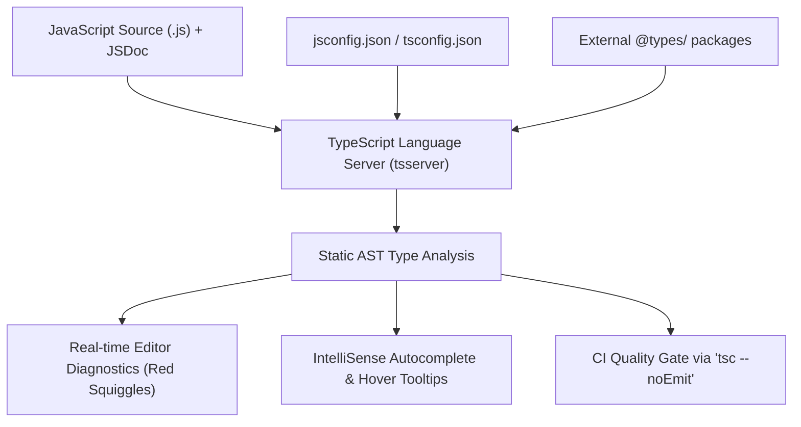

# JSDoc and Type Checking in JavaScript

> Type safety and rich IDE intellisense in vanilla JavaScript using JSDoc annotations, `checkJs`, and TypeScript compiler static analysis without a build or transpilation step.

| Metadata | Details |
| :--- | :--- |
| **Level** | Intermediate |
| **Prerequisites** | [01_what-is-javascript.md](./01_what-is-javascript.md), [05_tooling.md](./05_tooling.md) |
| **Time to Read** | 25 minutes |
| **Status** | Complete |
| **Tooling Baseline** | Node.js v20+ / v22+ LTS, TypeScript 5.0+ (`tsc --noEmit`), VS Code / Neovim LSP |

---

## Table of Contents
1. [What & Why](#1-what--why)
2. [Core Concepts](#2-core-concepts)
3. [How It Works: The Language Server & Type Inference](#3-how-it-works-the-language-server--type-inference)
4. [Syntax & Annotation Reference](#4-syntax--annotation-reference)
5. [Practical Examples](#5-practical-examples)
6. [Edge Cases & Gotchas](#6-edge-cases--gotchas)
7. [Common Mistakes & Anti-Patterns](#7-common-mistakes--anti-patterns)
8. [Performance Characteristics](#8-performance-characteristics)
9. [Language Server Internals (TSServer)](#9-language-server-internals-tsserver)
10. [Best Practices & Style Guide](#10-best-practices--style-guide)
11. [Real-World Applications & Case Studies](#11-real-world-applications--case-studies)
12. [Interview Questions & Deep Dives](#12-interview-questions--deep-dives)
13. [Exercises & Challenges](#13-exercises--challenges)

---

## 1. What & Why

JavaScript is dynamically typed. As applications expand to tens of thousands of lines, lack of type contracts leads to recurring runtime errors: `TypeError: Cannot read properties of undefined`, unexpected `NaN` values, and signature mismatches during refactoring.

Adopting full TypeScript (`.ts` / `.tsx`) provides type guarantees, but incurs costs:
- Mandatory build and transpilation pipelines (Babel, esbuild, SWC).
- Source maps and debugging disconnects in production.
- Build tool configuration drift across monorepos.
- Inability to run raw `.js` source files directly in Node.js or browsers without bundling.

```
┌────────────────────────────────────────────────────────┐
│                   Vanilla JavaScript                   │
│                                                        │
│  /** @type {string} */             ┌────────────────┐  │
│  const id = "usr_102";             │   No Transpile │  │
│                                    │   Zero Bundler │  │
│  /** @param {number} x */          │   Direct Node  │  │
│  function square(x) { ... }        │   Execution    │  │
│                                    └────────────────┘  │
│                                                        │
│   ▲                                                    │
│   │ Analyzed via `// @ts-check` or `jsconfig.json`    │
│   ▼                                                    │
│  TypeScript Compiler Engine (tsc --noEmit)            │
│  Catches type errors, gives full autocomplete          │
└────────────────────────────────────────────────────────┘
```

**JSDoc with `checkJs` provides the "Golden Middle"**: Full static type safety and IDE intellisense driven by the TypeScript compiler engine, while writing 100% standard, executable JavaScript that runs directly on Node.js without any compiler, bundler, or build step.

---

## 2. Core Concepts

### 2.1 The `@ts-check` Directive
Placing `// @ts-check` at the top of any `.js` file instructs the editor and the TypeScript language server (`tsserver`) to perform full static type checking on that file.
```javascript
// @ts-check
let message = "hello";
message = 42; // Error: Type 'number' is not assignable to type 'string'.
```

### 2.2 Project-Wide Checking via `jsconfig.json`
Instead of adding comments to every file, create a `jsconfig.json` file in your repository root to enforce type checking globally:
```json
{
  "compilerOptions": {
    "checkJs": true,
    "target": "ES2024",
    "module": "NodeNext",
    "moduleResolution": "NodeNext",
    "strict": true
  },
  "include": ["src/**/*"]
}
```

### 2.3 Type Definition and Composition (`@typedef`)
JSDoc supports complex object definitions, unions, intersections, and documentation strings without requiring `.d.ts` declaration files:
```javascript
/**
 * @typedef {Object} UserProfile
 * @property {string} id - Unique UUID
 * @property {string} email - Verified user email address
 * @property {number} [age] - Optional age field
 * @property {"active" | "suspended" | "pending"} status - Account lifecycle status
 */
```

### 2.4 Generics with `@template`
JSDoc functions can declare generic type variables for reusable, type-safe utilities:
```javascript
/**
 * Wraps an item in an immutable container.
 * @template T
 * @param {T} value
 * @returns {{ readonly data: T, timestamp: number }}
 */
function wrap(value) {
  return { data: value, timestamp: Date.now() };
}
```

---

## 3. How It Works: The Language Server & Type Inference

Modern IDEs (VS Code, Cursor, WebStorm, Neovim with LSP) execute a background process known as `tsserver`.



When you edit a file:
1. `tsserver` parses the JavaScript AST and extracts all leading JSDoc block comments (`/** ... */`).
2. Type annotations inside curly braces (`@type {string}`) are parsed into internal TypeScript type symbols.
3. The type checker runs control-flow analysis, checking return paths, narrowing variable types on `typeof` guards, and validating argument arities.
4. When `tsc --noEmit` is executed in CI, the compiler verifies all type contracts and exits with code `0` on success or code `1` with diagnostics. The JavaScript code is never modified or emitted.

---

## 4. Syntax & Annotation Reference

### 4.1 Basic Type Annotations

| Tag | Syntax | Purpose |
| :--- | :--- | :--- |
| `@type` | `/** @type {number} */` | Explicitly declares variable or property type |
| `@param` | `/** @param {string} name */` | Documents function parameter and type |
| `@returns` | `/** @returns {boolean} */` | Documents function return type |
| `@throws` | `/** @throws {Error} */` | Documents exception thrown by function |
| `@const` | `/** @const */` | Treats variable as immutable |

### 4.2 Advanced Structural Types

| Tag | Syntax | Purpose |
| :--- | :--- | :--- |
| `@typedef` | `/** @typedef {Object} Config */` | Defines a custom reusable object type |
| `@callback` | `/** @callback Handler */` | Defines a reusable function signature |
| `@template` | `/** @template T, U */` | Declares generic type parameters |
| `@satisfies` | `/** @satisfies {Record<string, number>} */` | Validates value conforms to type without widening |
| `@enum` | `/** @enum {string} */` | Defines an object whose values belong to an enumerated set |
| `@deprecated` | `/** @deprecated Use newApi() */` | Displays strike-through warning in editor |

---

## 5. Practical Examples

### Example 1: Basic Type Checking & Control Flow Narrowing

```javascript
// @ts-check

/**
 * Calculates discount price with type-checked inputs.
 * @param {number} price - Original product price (must be positive)
 * @param {number | null} [discountPercentage] - Optional discount from 0 to 100
 * @returns {number} The discounted price rounded to 2 decimals
 */
function calculatePrice(price, discountPercentage = null) {
  if (typeof price !== "number" || price < 0) {
    throw new TypeError("Price must be a non-negative number");
  }

  // Type narrowing: discountPercentage is number | null | undefined
  if (discountPercentage !== null && discountPercentage !== undefined) {
    const factor = 1 - discountPercentage / 100;
    return Math.round(price * factor * 100) / 100;
  }

  return price;
}

const finalCost = calculatePrice(100, 15); // Returns 85
// calculatePrice("100", 15); // Compiler Error: Argument of type 'string' is not assignable to 'number'
```

### Example 2: Structural Object Models with `@typedef`

```javascript
// @ts-check

/**
 * @typedef {Object} DatabaseRecord
 * @property {string} id
 * @property {Date} createdAt
 * @property {Date} updatedAt
 */

/**
 * @typedef {Object} CustomerDetails
 * @property {string} name
 * @property {string} email
 * @property {number} loyaltyPoints
 * @property {boolean} isVerified
 */

/**
 * Merged customer record in persistent storage
 * @typedef {DatabaseRecord & CustomerDetails} Customer
 */

/**
 * Finds customer by identifier
 * @param {string} id
 * @returns {Promise<Customer | null>}
 */
async function findCustomer(id) {
  // Simulating database lookup
  if (id === "cust_001") {
    return {
      id: "cust_001",
      name: "Jane Doe",
      email: "jane@example.com",
      loyaltyPoints: 340,
      isVerified: true,
      createdAt: new Date(),
      updatedAt: new Date()
    };
  }
  return null;
}
```

### Example 3: Reusable Callbacks and Event Handlers

```javascript
// @ts-check

/**
 * Reusable callback handler signature
 * @callback RequestHandler
 * @param {string} path - URL request path
 * @param {Record<string, string>} headers - Incoming request headers
 * @returns {Promise<{ status: number, body: string }>}
 */

/**
 * Router registry for path callbacks
 */
class MiniRouter {
  constructor() {
    /** @type {Map<string, RequestHandler>} */
    this.routes = new Map();
  }

  /**
   * Register a route handler
   * @param {string} path
   * @param {RequestHandler} handler
   */
  register(path, handler) {
    this.routes.set(path, handler);
  }

  /**
   * Dispatch an incoming request
   * @param {string} path
   * @param {Record<string, string>} headers
   */
  async dispatch(path, headers) {
    const handler = this.routes.get(path);
    if (!handler) {
      return { status: 404, body: "Not Found" };
    }
    return await handler(path, headers);
  }
}
```

### Example 4: Generic Utility Function with `@template`

```javascript
// @ts-check

/**
 * Partitions an array into chunks of a given maximum size.
 * @template T
 * @param {readonly T[]} array - The collection to partition
 * @param {number} size - Maximum chunk size (must be >= 1)
 * @returns {T[][]} An array of array chunks
 */
function chunkArray(array, size) {
  if (size < 1) {
    throw new RangeError("Chunk size must be greater than or equal to 1");
  }

  /** @type {T[][]} */
  const chunks = [];
  for (let i = 0; i < array.length; i += size) {
    chunks.push(array.slice(i, i + size));
  }
  return chunks;
}

const numbers = [1, 2, 3, 4, 5, 6, 7];
const chunkedNums = chunkArray(numbers, 3); // Type inferred as number[][]
const chunkedStrings = chunkArray(["a", "b", "c"], 2); // Type inferred as string[][]
```

### Example 5: Idiomatic `checkJs` CI Setup with `package.json`

```json
{
  "name": "zero-build-service",
  "version": "1.0.0",
  "type": "module",
  "scripts": {
    "start": "node src/index.js",
    "typecheck": "tsc --noEmit",
    "test": "node --test"
  },
  "devDependencies": {
    "@types/node": "^22.9.0",
    "typescript": "^5.6.3"
  }
}
```

---

## 6. Edge Cases & Gotchas

### 6.1 Inline Type Assertions Syntax
When TypeScript encounters an ambiguous type or needs downcasting in `.js`, standard angle brackets (`<Type>val`) or `val as Type` are invalid JavaScript syntax. You must use parenthesized JSDoc comments:
```javascript
// WRONG: SyntaxError at runtime in Node.js
// const el = document.getElementById("app") as HTMLDivElement;

// CORRECT: Fully valid JavaScript and type-checked
const el = /** @type {HTMLDivElement} */ (document.getElementById("app"));
```

### 6.2 Importing Types from External Packages
You can import TypeScript definitions directly into JSDoc annotations without importing the runtime package:
```javascript
/**
 * @param {import('node:http').IncomingMessage} req
 * @param {import('node:http').ServerResponse} res
 */
export function handleHttp(req, res) {
  res.writeHead(200, { "content-type": "application/json" });
  res.end(JSON.stringify({ ok: true }));
}
```

### 6.3 Optional vs. Nullable vs. Undefined
JSDoc distinguishes between optional properties, nullable values, and undefined:
- `number?`: Nullable or undefined (`number | null | undefined`)
- `[number]`: Optional parameter (can be omitted in caller)
- `!number`: Strictly non-nullable (cannot be null or undefined)
- Best practice: Be explicit with standard union types `{number | null}` or `[param]` for optional parameters.

---

## 7. Common Mistakes & Anti-Patterns

| Anti-Pattern | Why It Fails | Correct Approach |
| :--- | :--- | :--- |
| **Using single-asterisk comments `/* @type ... */`** | Parsers only recognize docblocks starting with double asterisks `/**`. | Always use `/** @type {T} */`. |
| **Writing TypeScript syntax inside `.js`** | `let x: number = 5;` causes immediate `SyntaxError` at runtime in Node.js. | Keep code 100% vanilla JS; put types strictly inside `/** ... */`. |
| **Omitting `@types/node` in Node projects** | Node globals like `process`, `Buffer`, and `setTimeout` show type errors. | Install `devDependencies: { "@types/node": "latest" }`. |
| **Overusing `@type {any}`** | Defeats the purpose of type checking and suppresses legitimate bugs. | Use `@type {unknown}` with type narrowing guards (`typeof`, `instanceof`). |
| **Forgetting `--noEmit` in CI** | Running `tsc` without `--noEmit` generates unwanted `.js` files overwriting source code. | Always configure `tsc --noEmit` for validation. |
| **Not checking return types on async functions** | Omitting `Promise<T>` causes downstream callers to treat promises as synchronous values. | Document return as `/** @returns {Promise<User>} */`. |

---

## 8. Performance Characteristics

JSDoc static type checking has zero impact on application execution:

| Metric | JSDoc + `checkJs` | Full TypeScript Compilation | Vanilla JS (No Types) |
| :--- | :--- | :--- | :--- |
| **Runtime Overhead** | **0.00 ms** (comments ignored by V8) | **0.00 ms** | **0.00 ms** |
| **Build / Transpilation Time** | **0.00 ms** (Zero build step) | 1.5s – 12.0s per build | 0.00 ms |
| **Hot Reload / Start Latency** | Instant (`node src/app.js`) | Requires watcher/bundler | Instant |
| **CI Type Validation Time** | Fast (`tsc --noEmit`) | Slower (`tsc` emitting artifacts) | None (high bug risk) |
| **Memory Consumption in V8** | Standard JS memory footprint | Identical after compile | Standard JS memory |

Because comments are discarded during the V8 tokenization phase, JSDoc annotations add zero memory overhead and zero runtime penalties.

---

## 9. Language Server Internals (TSServer)

When a developer opens a project with `checkJs: true`:
1. **Compilation Context**: `tsserver` creates a `Program` object consisting of root files declared in `jsconfig.json`.
2. **Scanner & Parser**: Reads `.js` tokens. When docblocks starting with `/**` are detected, the JSDoc scanner parses tags (`@param`, `@typedef`, `@returns`).
3. **Symbol Table & Binder**: Identifiers and types are bound into the compiler's internal symbol table.
4. **Checker**: The Type Checker inspects nodes against their declared JSDoc types. If an assignment violates the symbol contract, an `ExtendedDiagnostic` object is constructed with line/character coordinates and forwarded via JSON-RPC to your IDE.

---

## 10. Best Practices & Style Guide

1. **Adopt a Root `jsconfig.json`**: Enable `"checkJs": true` and `"strict": true` globally to protect the entire codebase.
2. **Document Public Module Boundaries**: Annotate all exported functions, class methods, and options objects with comprehensive JSDoc.
3. **Use `.d.ts` for Shared Domain Contracts**: If complex types are shared across 20+ modules, define them in a `types/domain.d.ts` file rather than repeating `@typedef` everywhere.
4. **Enforce Type Checking in Git Pre-Push**:
   ```bash
   # Add to .husky/pre-push
   npm run typecheck
   ```

---

## 11. Real-World Applications & Case Studies

### Case Study: Svelte Framework Migration
In 2023, the Svelte core team migrated the Svelte codebase from TypeScript to JavaScript with JSDoc annotations:
- **Rationale**: Eliminating TypeScript compilation reduced iteration cycle time during development. Svelte compiler engineers could test and debug changes directly in Node.js without running a build tool step.
- **Outcome**: Retained 100% of their existing type safety and autocompletion through JSDoc while dramatically reducing maintenance overhead and build matrix complexity.

---

## 12. Interview Questions & Deep Dives

<details>
<summary><strong>1. How does JSDoc type checking differ from using TypeScript directly?</strong></summary>

**Answer:**
TypeScript files (`.ts`) require a compilation step to strip types and produce `.js` files that run in browsers or Node.js. In contrast, JSDoc embeds types inside standard JavaScript multi-line comments (`/** ... */`). The TypeScript compiler engine (`tsserver` or `tsc --noEmit`) analyzes these comments to provide identical type verification and IDE autocompletion, but the files execute directly in any JavaScript runtime without transpilation or build tools.
</details>

<details>
<summary><strong>2. How do you cast or assert a type in JSDoc without triggering a JavaScript syntax error?</strong></summary>

**Answer:**
In TypeScript, you write `const val = expr as TargetType;`. In JavaScript, that syntax causes a runtime `SyntaxError`. In JSDoc, type casting is achieved by wrapping the expression in parentheses and prefixing the inner expression with a `/** @type {TargetType} */` comment:
```javascript
const canvas = /** @type {HTMLCanvasElement} */ (document.getElementById("view"));
```
</details>

<details>
<summary><strong>3. What is the role of `jsconfig.json` in a JavaScript project?</strong></summary>

**Answer:**
`jsconfig.json` is a descendant of `tsconfig.json` specifically tailored for JavaScript projects. It defines the root of the project, instructs the language server how to resolve module imports (`NodeNext`, paths aliases), defines the ECMAScript target, enables `"checkJs": true` across the workspace, and includes or excludes specific directories.
</details>

<details>
<summary><strong>4. How do you import types from a 3rd party TypeScript package into a JSDoc annotated JS file?</strong></summary>

**Answer:**
You use the dynamic `import()` type expression syntax within curly braces:
```javascript
/** @type {import('express').Request} */
let req;
```
This imports only the compile-time type contract without creating a runtime module dependency.
</details>

<details>
<summary><strong>5. Explain how `@satisfies` works in JSDoc and why it is superior to `@type` in certain scenarios.</strong></summary>

**Answer:**
`@type` forces an object into a specified type, widening property types (e.g., widening literal string `"red"` to `string`). `@satisfies` verifies that an expression conforms to a type contract while preserving the exact literal types and specific properties of the inferred value:
```javascript
/** @satisfies {Record<string, string | number>} */
const palette = {
  primary: "#ff0000",
  opacity: 0.8
};
// palette.primary is known to be string, not string | number!
```
</details>

<details>
<summary><strong>6. Can JSDoc generate `.d.ts` declaration files for publishing npm packages?</strong></summary>

**Answer:**
Yes. When configuring `tsconfig.json` with `"allowJs": true` and `"declaration": true`, running `tsc --emitDeclarationOnly` reads your JSDoc comments and generates clean, production `.d.ts` declaration files for consumers, while keeping your source code pure JavaScript.
</details>

<details>
<summary><strong>7. How does type narrowing work with JSDoc annotated parameters?</strong></summary>

**Answer:**
TypeScript's control-flow analysis engine tracks the type of a variable across conditional statements. If a parameter is annotated as `/** @param {string | number} val */`, inside an `if (typeof val === "string")` branch, the compiler automatically narrows the type of `val` to `string`, enabling string methods (`val.toUpperCase()`) without errors or manual casting.
</details>

<details>
<summary><strong>8. How do you define a generic interface with multiple type constraints in JSDoc?</strong></summary>

**Answer:**
Use multiple `@template` statements or declare constraints with the `extends` keyword inside the curly braces:
```javascript
/**
 * @template {Record<string, unknown>} T
 * @template {keyof T} K
 * @param {T} obj
 * @param {K} key
 * @returns {T[K]}
 */
function getProp(obj, key) {
  return obj[key];
}
```
</details>

---

## 13. Exercises & Challenges

### Exercise 1 (Easy): Create a Typed Event Bus Signature
**Task**: Use JSDoc to define a typed event listener callback and an `EventEmitter` function that subscribes and unsubscribes with type checking.

<details>
<summary><strong>Solution</strong></summary>

```javascript
// @ts-check

/**
 * @callback EventCallback
 * @param {string} eventName
 * @param {Record<string, unknown>} payload
 * @returns {void}
 */

/**
 * Subscribes a listener to an event.
 * @param {string} event
 * @param {EventCallback} callback
 * @returns {() => void} Unsubscribe function
 */
function subscribe(event, callback) {
  console.log(`Subscribed to ${event}`);
  return () => console.log(`Unsubscribed from ${event}`);
}

const unsubscribe = subscribe("login", (name, data) => {
  console.log(`Event ${name} received`, data);
});
unsubscribe();
```
</details>

### Exercise 2 (Easy): Strict Optional Configuration Object
**Task**: Define an `AppConfig` typedef with mandatory `port` and `env` properties and optional `ssl` and `corsOrigin` properties.

<details>
<summary><strong>Solution</strong></summary>

```javascript
// @ts-check

/**
 * @typedef {Object} SSLConfig
 * @property {string} cert
 * @property {string} key
 */

/**
 * @typedef {Object} AppConfig
 * @property {number} port - Server listening port
 * @property {"development" | "production" | "test"} env - Operating environment
 * @property {SSLConfig} [ssl] - Optional SSL termination configuration
 * @property {string | string[]} [corsOrigin] - Allowed CORS origins
 */

/**
 * Validates and boots server
 * @param {AppConfig} config
 */
function bootServer(config) {
  console.log(`Starting server on port ${config.port} in ${config.env} mode`);
}
```
</details>

### Exercise 3 (Medium): Generic Filter and Map Pipeline
**Task**: Author a type-safe `filterMap` generic utility that filters elements using a predicate and projects remaining elements with a transform callback, preserving exact types.

<details>
<summary><strong>Solution</strong></summary>

```javascript
// @ts-check

/**
 * Filters and transforms an array in a single iteration pass.
 * @template T, R
 * @param {readonly T[]} items - Input collection
 * @param {(item: T) => boolean} predicate - Inclusion filter condition
 * @param {(item: T) => R} transform - Mapping transformation function
 * @returns {R[]} Transformed array
 */
function filterMap(items, predicate, transform) {
  /** @type {R[]} */
  const results = [];
  for (const item of items) {
    if (predicate(item)) {
      results.push(transform(item));
    }
  }
  return results;
}

// Inferred as number[]
const squares = filterMap([1, 2, 3, 4, 5], (n) => n % 2 !== 0, (n) => n * n);
```
</details>

### Exercise 4 (Medium): Discriminated Union Pattern
**Task**: Model an API Result type representing either a Success payload with data or a Failure payload with an error code and message using `@typedef`.

<details>
<summary><strong>Solution</strong></summary>

```javascript
// @ts-check

/**
 * @template T
 * @typedef {Object} SuccessResult
 * @property {true} ok
 * @property {T} value
 */

/**
 * @typedef {Object} FailureResult
 * @property {false} ok
 * @property {number} code
 * @property {string} message
 */

/**
 * @template T
 * @typedef {SuccessResult<T> | FailureResult} ApiResult
 */

/**
 * Process API response safely
 * @param {ApiResult<{ username: string }>} result
 */
function handleResult(result) {
  if (result.ok) {
    // Narrowed to SuccessResult: value is accessible
    console.log("Logged in user:", result.value.username);
  } else {
    // Narrowed to FailureResult: code and message are accessible
    console.error(`Error ${result.code}: ${result.message}`);
  }
}
```
</details>

### Exercise 5 (Hard): Type-Safe In-Memory Cache with TTL
**Task**: Build an in-memory key-value cache class with generic value support, expiration timestamps, cleanup routines, and full JSDoc annotations without TypeScript.

<details>
<summary><strong>Solution</strong></summary>

```javascript
// @ts-check

/**
 * @template V
 * @typedef {Object} CacheEntry
 * @property {V} value
 * @property {number} expiresAt
 */

/**
 * Generic In-Memory Cache with TTL expiration
 * @template K, V
 */
class MemoryCache {
  /**
   * @param {number} [defaultTtlMs]
   */
  constructor(defaultTtlMs = 60000) {
    /** @type {Map<K, CacheEntry<V>>} */
    this.storage = new Map();
    this.defaultTtlMs = defaultTtlMs;
  }

  /**
   * Stores an entry in cache
   * @param {K} key
   * @param {V} value
   * @param {number} [ttlMs]
   * @returns {void}
   */
  set(key, value, ttlMs = this.defaultTtlMs) {
    this.storage.set(key, {
      value,
      expiresAt: Date.now() + ttlMs
    });
  }

  /**
   * Retrieves an item from cache or null if expired/absent
   * @param {K} key
   * @returns {V | null}
   */
  get(key) {
    const entry = this.storage.get(key);
    if (!entry) {
      return null;
    }

    if (Date.now() > entry.expiresAt) {
      this.storage.delete(key);
      return null;
    }

    return entry.value;
  }

  /**
   * Purges all expired keys
   * @returns {number} Count of evicted keys
   */
  purgeExpired() {
    const now = Date.now();
    let count = 0;
    for (const [key, entry] of this.storage.entries()) {
      if (now > entry.expiresAt) {
        this.storage.delete(key);
        count++;
      }
    }
    return count;
  }
}
```
</details>

### Exercise 6 (Hard): Build an Automated Zero-Build Type Validator
**Task**: Write a Node.js verification script that runs `tsc --noEmit`, parses the diagnostic output stream, and prints formatted GitHub Actions workflow commands (`::error file=...::`).

<details>
<summary><strong>Solution</strong></summary>

```javascript
// scripts/check-types.js
import { spawn } from "node:child_process";

const tsc = spawn("npx", ["tsc", "--noEmit"], { shell: true });

let output = "";
tsc.stdout.on("data", (chunk) => {
  output += chunk.toString();
});

tsc.stderr.on("data", (chunk) => {
  output += chunk.toString();
});

tsc.on("close", (code) => {
  if (code === 0) {
    console.log("\x1b[32m✔ JSDoc type checking passed with 0 errors!\x1b[0m");
    process.exit(0);
  }

  console.error("\x1b[31m✖ Type checking failed:\x1b[0m\n");

  // Regex to parse tsc error format: file.js(line,col): error TSXXXX: message
  const errorRegex = /^([^(]+)\((\d+),(\d+)\):\s+error\s+(TS\d+):\s+(.*)$/gm;
  let match;
  let errorCount = 0;

  while ((match = errorRegex.exec(output)) !== null) {
    errorCount++;
    const [, file, line, col, code, message] = match;
    // GitHub Actions annotation format
    console.log(`::error file=${file},line=${line},col=${col}::[${code}] ${message}`);
  }

  console.log(`\nFound ${errorCount} type violations.`);
  process.exit(1);
});
```
</details>
