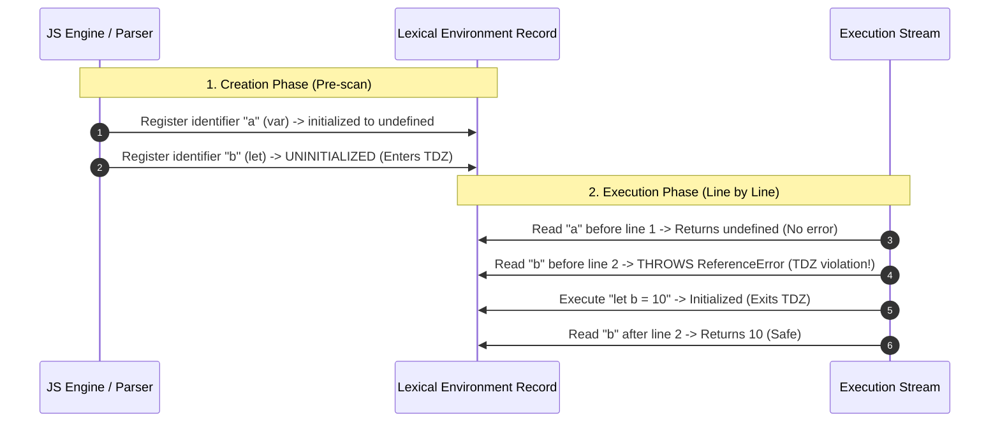

# Variables, Scopes & The Temporal Dead Zone

> An exhaustive technical reference on JavaScript variable declarations (`var`, `let`, `const`), lexical environment records, hoisting mechanics, and the Temporal Dead Zone (TDZ).

| Metadata | Details |
| :--- | :--- |
| **Level** | Beginner to Intermediate |
| **Prerequisites** | [00_setup/01_what-is-javascript.md](../00_setup/01_what-is-javascript.md) |
| **Time to Read** | 25 minutes |
| **Status** | Complete |
| **ECMAScript Standard** | ES6 (ES2015) to Current (ES2024/ES2025) |

---

## Table of Contents
1. [What & Why](#1-what--why)
2. [Core Concepts](#2-core-concepts)
3. [How It Works: Lexical Environments & TDZ](#3-how-it-works-lexical-environments--tdz)
4. [Syntax & API Reference](#4-syntax--api-reference)
5. [Practical Examples](#5-practical-examples)
6. [Edge Cases & Gotchas](#6-edge-cases--gotchas)
7. [Common Mistakes & Anti-Patterns](#7-common-mistakes--anti-patterns)
8. [Performance Characteristics](#8-performance-characteristics)
9. [Engine Internals: V8 Contexts & Scope Allocation](#9-engine-internals-v8-contexts--scope-allocation)
10. [Best Practices & Style Guide](#10-best-practices--style-guide)
11. [Real-World Applications & Case Studies](#11-real-world-applications--case-studies)
12. [Interview Questions & Deep Dives](#12-interview-questions--deep-dives)
13. [Exercises & Challenges](#13-exercises--challenges)

---

## 1. What & Why

In JavaScript, a variable is an identifier bound to a memory location holding a primitive value or an object reference. Prior to ECMAScript 2015 (ES6), JavaScript possessed only a single variable declaration keyword: `var`.

Because `var` is function-scoped and hoisted with an initial value of `undefined`, it historically introduced notorious bugs:
- Accidental variable leakage from loop blocks into parent functions.
- Premature access to uninitialized variables returning `undefined` instead of failing fast.
- Global namespace pollution when declared outside functions.

```
                  ┌─────────────────────────────────────────────────────────┐
                  │                   JavaScript Scopes                     │
                  │                                                         │
                  │  Global Scope (globalThis / window)                     │
                  │   └── Function Scope (var boundaries)                   │
                  │        └── Block Scope (let & const boundaries: { ... })│
                  │             └── Temporal Dead Zone (TDZ)                │
                  └─────────────────────────────────────────────────────────┘
```

ES6 introduced `let` and `const`. These keywords provide block-scoping, eliminate accidental redeclarations, and enforce the **Temporal Dead Zone (TDZ)**—guaranteeing that variables cannot be accessed prior to their explicit declaration line in the source code.

---

## 2. Core Concepts

### 2.1 The Three Declarations Compared

| Characteristic | `var` | `let` | `const` |
| :--- | :--- | :--- | :--- |
| **Scope** | Function (or Global) | Block `{ ... }` | Block `{ ... }` |
| **Hoisted** | Yes (initialized to `undefined`) | Yes (uninitialized in TDZ) | Yes (uninitialized in TDZ) |
| **Reassignable** | Yes | Yes | **No** (throws `TypeError`) |
| **Redeclarable in Same Scope** | Yes | **No** (throws `SyntaxError`) | **No** (throws `SyntaxError`) |
| **Initial Value Required** | No (defaults to `undefined`) | No (defaults to `undefined`) | **Yes** (throws `SyntaxError` if absent) |
| **Attaches to Global Object** | Yes (in non-module scripts) | No | No |

### 2.2 Hoisting: Declaration vs. Initialization
Hoisting is the JavaScript engine's compile-time behavior of scanning source code during the creation phase of an execution context and registering variable and function names in the **Environment Record** before executing any statement.
- For `var`: The binding is created and **immediately initialized** to `undefined`.
- For `let` and `const`: The binding is created, but remains **uninitialized**. The time span between entering the scope and reaching the declaration line is the **Temporal Dead Zone**. Accessing the variable during this window throws a `ReferenceError`.

### 2.3 `const`: Binding Immutability vs. Value Immutability
A fundamental point of confusion is assuming `const` produces an immutable value. `const` creates an **immutable binding**, not an immutable data structure:
```javascript
const user = { name: "Grace" };
user.name = "Ada"; // ALLOWED: mutating object property
// user = { name: "Alan" }; // ERROR: TypeError: Assignment to constant variable
```
To freeze the actual properties of an object, use `Object.freeze()` or recursive deep freezing.

---

## 3. How It Works: Lexical Environments & TDZ

When the JavaScript engine evaluates a block of code, it creates an **Execution Context** containing an **Environment Record**.



### Why the TDZ Exists
1. **Defensive Programming**: Accessing a variable before declaring it is almost always a developer logic error. Silently returning `undefined` (as `var` does) masks bugs that manifest hundreds of lines later.
2. **`const` Invariant**: `const` must never change its value. If `const` were initialized to `undefined` during hoisting and then reassigned to its declared value on its declaration line, it would violate the invariant that a `const` variable never transitions between values.

---

## 4. Syntax & API Reference

### 4.1 Valid Identifiers
JavaScript variable names must follow strict lexical grammar rules:
- Must begin with an ASCII letter (`a-z`, `A-Z`), underscore (`_`), dollar sign (`$`), or any Unicode character in the categories "Uppercase/Lowercase/Titlecase letter" or "Letter number".
- Subsequent characters may also include digits (`0-9`).
- Cannot be a reserved keyword (`class`, `return`, `function`, `let`, `yield`, `await`, etc.).

```javascript
// Valid identifiers
const $total = 100;
const _privateKey = "0xABC";
const π = 3.14159;
const ユーザー名 = "Alice"; // Valid Unicode identifier

// Invalid identifiers (SyntaxError)
// const 1stPlace = "gold";   // Cannot start with a digit
// const user-name = "Alice";  // Hyphens interpreted as subtraction operator
// const default = true;       // Reserved keyword
```

### 4.2 Destructuring Variable Declarations
Variables can be declared and bound simultaneously from arrays or objects:
```javascript
// Object destructuring with renaming and defaults
const { id, username: handle, role = "guest" } = fetchUserData();

// Array destructuring with rest elements
const [head, second, ...tail] = [10, 20, 30, 40, 50];
```

---

## 5. Practical Examples

### Example 1: The Classic `var` Asynchronous Loop Bug vs. `let`

```javascript
// PROBLEM: 'var' shares a single function-scoped binding across all loop iterations
function runVarLoop() {
  for (var i = 0; i < 3; i++) {
    setTimeout(() => {
      console.log(`var i: ${i}`); // Prints: 3, 3, 3
    }, 10);
  }
}

// SOLUTION: 'let' creates a distinct lexical binding for each loop iteration
function runLetLoop() {
  for (let i = 0; i < 3; i++) {
    setTimeout(() => {
      console.log(`let i: ${i}`); // Prints: 0, 1, 2
    }, 10);
  }
}

runVarLoop();
runLetLoop();
```

### Example 2: The Temporal Dead Zone with Parameter Shadowing

```javascript
// Default parameters evaluate left-to-right in their own intermediate scope
function calculateArea(width, height = width * 2) {
  return width * height;
}
console.log(calculateArea(5)); // 5 * 10 = 50

// GOTCHA: Accessing a later parameter before its declaration triggers TDZ
function badDefaults(a = b, b = 2) {
  return a + b;
}
try {
  badDefaults();
} catch (err) {
  console.error(err.name); // ReferenceError: Cannot access 'b' before initialization
}
```

### Example 3: Deep Object Immutability Pattern

```javascript
/**
 * Recursively freezes an object to enforce deep immutability on a const binding.
 * @template T
 * @param {T} object
 * @returns {Readonly<T>}
 */
function deepFreeze(object) {
  const propNames = Reflect.ownKeys(object);

  for (const name of propNames) {
    const value = object[name];
    if (value && typeof value === "object") {
      deepFreeze(value);
    }
  }

  return Object.freeze(object);
}

const config = deepFreeze({
  api: {
    endpoint: "https://api.domain.com",
    retryLimits: { attempts: 3 }
  }
});

// Mutating a nested property throws an error in strict mode
try {
  "use strict";
  config.api.retryLimits.attempts = 10;
} catch (e) {
  console.log("Mutation blocked:", e.message);
  // Output: Cannot assign to read only property 'attempts' of object '#<Object>'
}
```

### Example 4: Lexical Block Isolation in Switch Statements

```javascript
// PROBLEM: Case clauses share the same block scope under the switch statement
function processStatus(status) {
  switch (status) {
    case "PENDING": {
      // Wrapped in curly braces to create a local block scope
      const message = "Transaction is pending";
      console.log(message);
      break;
    }
    case "SUCCESS": {
      // Without block braces, declaring 'const message' would throw a SyntaxError:
      // Identifier 'message' has already been declared
      const message = "Transaction succeeded";
      console.log(message);
      break;
    }
    default:
      console.log("Unknown status");
  }
}

processStatus("SUCCESS");
```

### Example 5: Defending Against Global Namespace Collision

```javascript
// In non-module scripts, top-level 'var' attaches to globalThis / window
var globalApiKey = "SECRET_123";
console.log(globalThis.globalApiKey); // "SECRET_123" (pollutes global object)

// Top-level 'let' and 'const' do NOT attach to the global object
const moduleApiKey = "SECRET_456";
console.log(globalThis.moduleApiKey); // undefined (safe from global collisions)
```

---

## 6. Edge Cases & Gotchas

### 6.1 `typeof` is Not Always Safe in the TDZ
In pre-ES6 JavaScript, `typeof` was historically guaranteed to never throw an error, even for undeclared variables:
```javascript
console.log(typeof nonExistentVar); // "undefined" (Safe)
```
However, using `typeof` on a `let` or `const` variable inside its **Temporal Dead Zone** throws a runtime `ReferenceError`:
```javascript
function tdzTypeOfTrap() {
  console.log(typeof value); // ReferenceError: Cannot access 'value' before initialization
  let value = 42;
}
```

### 6.2 Shadowing in Outer vs. Inner Scopes
Inner block scopes may redeclare an identifier with the same name as an outer scope. While valid, it shadows the outer binding and can lead to subtle bugs:
```javascript
let count = 100;
{
  // TDZ applies to the INNER 'count' from the start of this block!
  // console.log(count); // ReferenceError: Cannot access 'count' before initialization
  let count = 20;
  console.log(count); // 20
}
console.log(count); // 100
```

### 6.3 Function Declarations in Block Scope (ES6 Web Compatibility)
Prior to ES6, function declarations inside blocks were undefined behavior across browser vendors. ES6 standardized block-scoped function declarations:
```javascript
{
  test(); // Works! Function declarations are hoisted to the top of their block
  function test() {
    return "block scoped function";
  }
}
// In strict mode, test() is not accessible outside the block:
// test(); // ReferenceError: test is not defined
```

---

## 7. Common Mistakes & Anti-Patterns

| Anti-Pattern | Why It Fails | Correct Approach |
| :--- | :--- | :--- |
| **Using `var` in modern code** | Hoisting creates silent `undefined` bugs and function-scope leaks across loop boundaries. | Use `const` by default; use `let` when reassignment is strictly required. |
| **Mutating `const` objects expecting errors** | `const` only guarantees the memory reference binding is immutable, not the object's properties. | Use `Object.freeze()` or `deepFreeze()` for immutable data structures. |
| **Declaring `let` inside a `switch` without braces** | All case branches share the switch's block scope, causing `SyntaxError: Identifier already declared`. | Wrap each `case` block in curly braces `{ ... }`. |
| **Relying on `typeof` for TDZ checks** | `typeof` throws a `ReferenceError` when targeting a variable residing in its TDZ. | Never access or check variables prior to their declaration statement. |
| **Accidental global variable creation** | Assigning to an undeclared identifier in non-strict mode creates a property on `globalThis`. | Always enforce `"use strict";` or ESM (which is strict by default). |
| **Re-declaring `let` in catch blocks** | Catch variable `catch (err)` shadows outer error identifiers in subtle ways. | Name catch variables distinctly or avoid nested catch scope collisions. |

---

## 8. Performance Characteristics

Modern engines (V8, JavaScriptCore, SpiderMonkey) optimize variable access based on scope analysis during compilation:

| Scope Type | Storage Location in V8 | Access Overhead |
| :--- | :--- | :--- |
| **Local Primitive (`let`/`const` uncaptured)** | Machine Register or CPU Stack Frame | **Fastest** (~0.1–0.4 ns, direct pointer/register offset) |
| **Captured Variable (inside a closure)** | V8 Heap `Context` Object | Slower (~1.5–3.0 ns, requires pointer dereference) |
| **Global Variable (`var` / `window.prop`)** | Global Property Cell / Global Dictionary | Slowest (~5–10 ns, requires IC lookup / dictionary probe) |

```
Uncaptured local variable:
  [ Stack Pointer + Offset ] ──► Instant CPU register load

Captured variable in closure:
  [ Function Context ] ──► [ Heap Context Slot ] ──► Value
```

---

## 9. Engine Internals: V8 Contexts & Scope Allocation

When V8 parses a function, it performs **Scope Analysis**:
1. **Variable Declaration Tracking**: For every identifier, V8 determines its lifetime and whether it is referenced by an inner nested function (closure).
2. **Stack vs. Heap Context**:
   - If an identifier never escapes the current stack frame, V8 allocates it directly to the local **activation stack frame** (or maps it directly to a CPU register via TurboFan).
   - If an identifier is referenced inside an asynchronous callback or nested closure, it **escapes** the stack. V8 moves the variable to a heap-allocated `Context` object.
3. **TDZ Implementation**:
   - V8 allocates a special sentinel internal value called `TheHole` to the variable's slot during context initialization.
   - Any bytecode read (`LdaNamedProperty`, `Ldar`) checks if the slot contains `TheHole`. If true, the engine halts execution and throws a `ReferenceError: Cannot access 'x' before initialization`.
   - Once the initialization bytecode executes, the real value replaces `TheHole`.

---

## 10. Best Practices & Style Guide

1. **Const-First Rule**: Declare every variable with `const`. Only change to `let` when you discover the binding must be reassigned.
2. **Eliminate `var` Completely**: Configure ESLint rule `"no-var": "error"` across the entire project.
3. **Keep Scopes Small**: Declare variables as close as possible to the point of their first usage. Do not hoist declarations manually to the top of a function (a legacy C89 / `var` habit).
4. **Enforce Strict Mode**: Always write ES modules (`"type": "module"` in `package.json`), which implicitly enforce `"use strict";` and prevent accidental global leakage.

---

## 11. Real-World Applications & Case Studies

### Case Study: Payment Transaction Race Condition
A financial trading platform suffered a duplicate withdrawal bug:
```javascript
// BUGGY LEGACY CODE:
function processWithdrawals(requests) {
  for (var i = 0; i < requests.length; i++) {
    var req = requests[i];
    database.verifyBalance(req.accountId, function (balance) {
      if (balance >= req.amount) {
        // BUG: 'req' was overwritten by subsequent loop iterations before DB returned!
        database.deduct(req.accountId, req.amount);
      }
    });
  }
}
```
- **Root Cause**: Because `req` was declared with `var`, every asynchronous database callback closed over the exact same variable reference. By the time the callbacks executed, `req` pointed to the final item in the array, charging the last user multiple times and skipping the earlier accounts.
- **Resolution**: Migrating `var` to `let` or `const` gave each loop iteration an independent, immutable block-scoped binding, isolating each asynchronous transaction cleanly.

---

## 12. Interview Questions & Deep Dives

<details>
<summary><strong>1. Explain the Temporal Dead Zone (TDZ) and why it was introduced in ES6.</strong></summary>

**Answer:**
The Temporal Dead Zone refers to the time period between when an execution scope is entered and when a `let` or `const` variable is evaluated at its explicit declaration line. During this window, the variable exists in the Environment Record but is uninitialized (`TheHole` sentinel in V8). Any attempt to read or write the variable throws a `ReferenceError`.

The TDZ was introduced to:
1. Catch developer errors early by preventing silent reads of uninitialized `undefined` values.
2. Protect the invariant of `const`, ensuring a constant variable never holds an intermediate initial state before its assigned value.
</details>

<details>
<summary><strong>2. Are `let` and `const` declarations hoisted in JavaScript?</strong></summary>

**Answer:**
Yes, `let` and `const` are hoisted. During the compilation/creation phase, the JavaScript engine registers their identifiers in the block's lexical environment record before executing any code. The difference between `var` and `let`/`const` is that `var` is initialized to `undefined` during hoisting, whereas `let` and `const` remain uninitialized in the Temporal Dead Zone until their declaration line is executed.

Proof:
```javascript
let x = "outer";
{
  // If 'let x' were not hoisted, this would log "outer".
  // Because it IS hoisted, it hits the inner TDZ and throws ReferenceError!
  console.log(x); // ReferenceError: Cannot access 'x' before initialization
  let x = "inner";
}
```
</details>

<details>
<summary><strong>3. What happens when you declare a variable without `var`, `let`, or `const`?</strong></summary>

**Answer:**
In non-strict mode, assigning to an undeclared identifier (`x = 10;`) walks up the entire scope chain. When it reaches the global scope without finding a matching binding, JavaScript automatically creates a property named `x` on the global object (`window` or `globalThis`).

In strict mode (`"use strict";` or standard ES modules), assigning to an undeclared identifier throws a runtime `ReferenceError: x is not defined`.
</details>

<details>
<summary><strong>4. Why does `typeof` fail inside the TDZ?</strong></summary>

**Answer:**
Prior to ES6, `typeof` was considered 100% fail-safe and would return `"undefined"` for any variable not declared in the program. However, ES6 specified that reading an identifier within its TDZ is a fatal design bug that must fail fast. The engine checks if the binding in the current environment record is initialized; because it holds `TheHole`, `typeof` throws a `ReferenceError`.
</details>

<details>
<summary><strong>5. What is the difference between `Object.freeze()` and `const`?</strong></summary>

**Answer:**
- `const` prevents the reassignment of the variable identifier to a different memory reference. It provides **binding immutability**. It does not prevent mutation of the internal properties of the object it references.
- `Object.freeze()` prevents the addition, removal, or modification of properties on the target object. It provides **shallow value immutability**. It does not prevent reassignment of the variable binding unless paired with `const`.
</details>

<details>
<summary><strong>6. How does loop scoping differ between `var` and `let` in a `for` loop?</strong></summary>

**Answer:**
When using `var i = 0; i < n; i++`, a single variable binding `i` is created in the enclosing function scope. Every callback created inside the loop closes over the identical memory location.

When using `let i = 0; i < n; i++`, the ECMAScript specification mandates that the engine create a **brand-new lexical scope binding for each iteration of the loop**, copying the current value into the new iteration's scope. Therefore, closures created inside the loop capture a unique binding containing that specific iteration's value.
</details>

<details>
<summary><strong>7. Does `const` provide any performance advantage over `let` in V8?</strong></summary>

**Answer:**
Historically, developers assumed `const` allowed aggressive compiler optimizations because the value never changed. In modern V8, TurboFan performs **type feedback and SSA (Static Single Assignment)** analysis on both `let` and `const`. If a `let` variable is never reassigned within a function, the optimizing compiler treats it identically to a `const`. However, `const` provides critical cognitive and architectural benefits for human engineers and static linters.
</details>

<details>
<summary><strong>8. What is variable shadowing and what risks does it introduce?</strong></summary>

**Answer:**
Variable shadowing occurs when an identifier in an inner scope has the same name as an identifier in an outer scope. The inner declaration temporarily hides (shadows) access to the outer variable within that block. The primary risk is accidental logic bugs: a developer may modify the inner variable intending to update the outer variable, or refactor code without realizing an outer variable is being masked.
</details>

---

## 13. Exercises & Challenges

### Exercise 1 (Easy): Fix the Scope Bug in a Closure Factory
**Task**: The following function intends to return an array of functions where each function returns its index. Fix the scope bug without using external helper functions.

```javascript
// BUGGY:
function createCounters() {
  var counters = [];
  for (var i = 0; i < 5; i++) {
    counters.push(function () { return i; });
  }
  return counters;
}
```

<details>
<summary><strong>Solution</strong></summary>

Change `var i` to `let i`. Because `let` creates a distinct lexical binding per iteration, each closure captures its own copy of `i`:

```javascript
function createCounters() {
  const counters = [];
  for (let i = 0; i < 5; i++) {
    counters.push(function () { return i; });
  }
  return counters;
}

const list = createCounters();
console.log(list[0]()); // 0
console.log(list[4]()); // 4
```
</details>

### Exercise 2 (Easy): Safe Global Variable Inspection
**Task**: Write a utility function `isGlobalDefined(name)` that safely checks if a global variable exists without throwing a `ReferenceError`, regardless of whether strict mode is active.

<details>
<summary><strong>Solution</strong></summary>

```javascript
function isGlobalDefined(name) {
  return typeof globalThis[name] !== "undefined";
}

console.log(isGlobalDefined("process")); // true in Node.js
console.log(isGlobalDefined("myFakeProp")); // false
```
</details>

### Exercise 3 (Medium): Block Scope Simulation with IIFE
**Task**: Prior to ES6 `let` and `const`, developers used Immediately Invoked Function Expressions (IIFE) to emulate block scoping. Implement a function demonstrating how an IIFE encapsulates variables to avoid polluting the parent function scope.

<details>
<summary><strong>Solution</strong></summary>

```javascript
function legacyEmulatedBlockScope() {
  var outer = "outer visible";

  (function () {
    // Encapsulated within IIFE function scope
    var isolated = "private to IIFE";
    console.log(outer); // Accessible
    console.log(isolated); // "private to IIFE"
  })();

  console.log(outer); // "outer visible"
  // console.log(isolated); // Throws ReferenceError: isolated is not defined
}

legacyEmulatedBlockScope();
```
</details>

### Exercise 4 (Medium): Detect TDZ Programmatically
**Task**: Author a function that attempts to determine if a variable is in the Temporal Dead Zone, catching the resulting exception and returning a boolean diagnostic.

<details>
<summary><strong>Solution</strong></summary>

```javascript
function testTDZ() {
  let isTDZ = false;
  try {
    // Evaluating an uninitialized variable
    eval("accessedBeforeInit");
  } catch (err) {
    if (err instanceof ReferenceError) {
      isTDZ = true;
    }
  }
  let accessedBeforeInit = 42;
  return isTDZ;
}

console.log("Was TDZ triggered:", testTDZ()); // true
```
</details>

### Exercise 5 (Hard): Deep Immutable Proxy Handler
**Task**: Implement a function `createImmutableProxy(target)` using JavaScript `Proxy` and `Reflect` that recursively disallows any property modification, deletion, or prototype alteration, throwing descriptive errors on attempts.

<details>
<summary><strong>Solution</strong></summary>

```javascript
/**
 * Creates a deeply immutable proxy wrapper around an object or array.
 * @template T
 * @param {T} target
 * @returns {T}
 */
function createImmutableProxy(target) {
  if (target === null || typeof target !== "object") {
    return target;
  }

  return new Proxy(target, {
    get(obj, prop, receiver) {
      const val = Reflect.get(obj, prop, receiver);
      // Recursively wrap nested objects
      return createImmutableProxy(val);
    },
    set(obj, prop) {
      throw new TypeError(`Cannot set property '${String(prop)}' on immutable proxy.`);
    },
    deleteProperty(obj, prop) {
      throw new TypeError(`Cannot delete property '${String(prop)}' on immutable proxy.`);
    },
    setPrototypeOf() {
      throw new TypeError("Cannot change prototype of immutable proxy.");
    }
  });
}

const state = createImmutableProxy({
  user: { profile: { theme: "dark" } }
});

try {
  state.user.profile.theme = "light";
} catch (e) {
  console.log(e.message); // Cannot set property 'theme' on immutable proxy.
}
```
</details>

### Exercise 6 (Hard): Build a Lexical Scope Resolver Simulator
**Task**: Write a class `MiniScopeChain` that models lexical environment nesting, supporting `declare(name, kind, value)`, `resolve(name)`, and `set(name, value)`, strictly throwing TDZ errors if a `let`/`const` is accessed before initialization.

<details>
<summary><strong>Solution</strong></summary>

```javascript
class MiniScopeChain {
  constructor(parent = null) {
    this.parent = parent;
    // Map of name -> { kind: 'var'|'let'|'const', initialized: boolean, value: any }
    this.bindings = new Map();
  }

  createChildScope() {
    return new MiniScopeChain(this);
  }

  declare(name, kind, value = undefined, initializeNow = true) {
    if (this.bindings.has(name) && (kind !== "var" || this.bindings.get(name).kind !== "var")) {
      throw new SyntaxError(`Identifier '${name}' has already been declared`);
    }

    this.bindings.set(name, {
      kind,
      initialized: initializeNow,
      value: initializeNow ? value : Symbol("THE_HOLE")
    });
  }

  initialize(name, value) {
    const record = this.bindings.get(name);
    if (!record) {
      throw new ReferenceError(`Identifier '${name}' not found in current scope`);
    }
    record.initialized = true;
    record.value = value;
  }

  resolve(name) {
    if (this.bindings.has(name)) {
      const record = this.bindings.get(name);
      if (!record.initialized) {
        throw new ReferenceError(`Cannot access '${name}' before initialization (TDZ Violation)`);
      }
      return record.value;
    }
    if (this.parent) {
      return this.parent.resolve(name);
    }
    throw new ReferenceError(`'${name}' is not defined`);
  }
}

// Verification
const globalScope = new MiniScopeChain();
globalScope.declare("globalVal", "const", 100);

const blockScope = globalScope.createChildScope();
// Register identifier in creation phase (enters TDZ)
blockScope.declare("x", "let", undefined, false);

try {
  blockScope.resolve("x"); // Throws TDZ ReferenceError
} catch (err) {
  console.log("TDZ Caught:", err.message);
}

// Declaration executed (exits TDZ)
blockScope.initialize("x", 42);
console.log("Resolved value:", blockScope.resolve("x")); // 42
console.log("Resolved outer value:", blockScope.resolve("globalVal")); // 100
```
</details>
