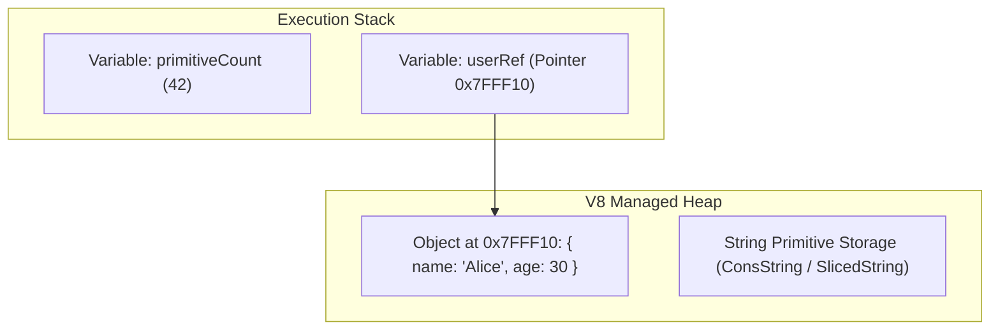

# JavaScript Data Types, Primitives & Object References

> An exhaustive technical reference on JavaScript's type system: 7 primitive types, object references, auto-boxing, Symbol mechanics, BigInt precision, and V8 tagged pointer internals.

| Metadata | Details |
| :--- | :--- |
| **Level** | Beginner to Intermediate |
| **Prerequisites** | [01_variables.md](./01_variables.md) |
| **Time to Read** | 25 minutes |
| **Status** | Complete |
| **ECMAScript Standard** | ES6 (ES2015) to Current (ES2024/ES2025) |

---

## Table of Contents
1. [What & Why](#1-what--why)
2. [Core Concepts](#2-core-concepts)
3. [How It Works: Memory Model & Auto-Boxing](#3-how-it-works-memory-model--auto-boxing)
4. [Syntax & API Reference](#4-syntax--api-reference)
5. [Practical Examples](#5-practical-examples)
6. [Edge Cases & Gotchas](#6-edge-cases--gotchas)
7. [Common Mistakes & Anti-Patterns](#7-common-mistakes--anti-patterns)
8. [Performance Characteristics](#8-performance-characteristics)
9. [Engine Internals: V8 SMI & Tagged Pointers](#9-engine-internals-v8-smi--tagged-pointers)
10. [Best Practices & Style Guide](#10-best-practices--style-guide)
11. [Real-World Applications & Case Studies](#11-real-world-applications--case-studies)
12. [Interview Questions & Deep Dives](#12-interview-questions--deep-dives)
13. [Exercises & Challenges](#13-exercises--challenges)

---

## 1. What & Why

JavaScript is **dynamically typed**: variables do not possess types; **values** do. A single variable binding can hold a string at one instant, and a number or object reference at another.

The ECMAScript specification divides all data into two fundamental categories:
1. **Primitives**: Atomic, immutable values that are copied and compared by their direct binary value.
2. **Objects (Reference Types)**: Collections of key-value properties and methods stored on the heap, copied and compared by memory reference pointer.

```
┌────────────────────────────────────────────────────────────────────────┐
│                        JavaScript Type System                          │
├──────────────────────────────────────┬─────────────────────────────────┤
│            7 Primitives              │         1 Reference Type        │
│   (Immutable, Copied by Value)       │   (Mutable, Copied by Reference)│
├──────────────────────────────────────┼─────────────────────────────────┤
│ • Undefined                          │ • Object                        │
│ • Null                               │   ├── Plain Object ({})         │
│ • Boolean                            │   ├── Array ([])                │
│ • Number (IEEE 754 Float64)          │   ├── Function                  │
│ • BigInt (Arbitrary Precision)       │   ├── Date, RegExp, Map, Set    │
│ • String (UTF-16 Code Units)         │   └── ArrayBuffer, TypedArrays  │
│ • Symbol (Unique Identifiers)        │                                 │
└──────────────────────────────────────┴─────────────────────────────────┘
```

Understanding this dichotomy is critical for avoiding unwanted mutations, memory leaks, and type-coercion defects in production systems.

---

## 2. Core Concepts

### 2.1 The 8 ECMAScript Types and `typeof` Behavior

| Type | Description | Example Literal | `typeof` Return Value |
| :--- | :--- | :--- | :--- |
| **`undefined`** | Absence of an assigned value | `undefined` | `"undefined"` |
| **`null`** | Intentional absence of any object reference | `null` | `"object"` *(Historic 1995 Bug)* |
| **`boolean`** | Logical true or false | `true`, `false` | `"boolean"` |
| **`number`** | 64-bit IEEE 754 double precision float | `42`, `3.14`, `NaN`, `Infinity` | `"number"` |
| **`bigint`** | Arbitrary precision integer | `9007199254740995n` | `"bigint"` |
| **`string`** | Sequence of 16-bit UTF-16 code units | `"hello"`, `'world'`, `` `template` `` | `"string"` |
| **`symbol`** | Globally unique, immutable token | `Symbol("key")` | `"symbol"` |
| **`object`** | Heap-allocated collection of properties | `{}`, `[]`, `new Map()` | `"object"` |
| *Function* | Callable object (Subtype of Object) | `function() {}`, `() => {}` | `"function"` |

### 2.2 Primitive Immutability vs. Object Mutability
Primitives cannot be modified in-place:
```javascript
let str = "hello";
str.toUpperCase(); // Returns new string "HELLO"
console.log(str); // "hello" (Unchanged!)
str[0] = "J"; // Silently fails (or throws TypeError in strict mode)
console.log(str); // "hello"
```
Objects, by contrast, are mutable collections:
```javascript
const user = { name: "Grace" };
user.name = "Ada"; // Mutates object in-place on heap
```

### 2.3 Value Copying vs. Reference Copying
When a primitive is assigned or passed to a function, JavaScript creates a discrete bitwise copy. Modifying the copy has zero effect on the original:
```javascript
let a = 10;
let b = a; // Copy by value
b = 20;
console.log(a); // 10

let obj1 = { score: 10 };
let obj2 = obj1; // Copy by reference pointer
obj2.score = 20;
console.log(obj1.score); // 20 (Both point to identical heap object!)
```

### 2.4 Auto-Boxing (Wrapper Objects)
Primitives are not objects and do not have methods. Yet expressions like `"hello".toUpperCase()` or `(42).toFixed(2)` execute seamlessly.

How? When a property or method is accessed on a primitive (`string`, `number`, `boolean`, `symbol`, `bigint`), JavaScript temporarily **auto-boxes** the primitive by wrapping it in an internal wrapper object (`new String()`, `new Number()`), accesses the prototype method, returns the result, and immediately discards the temporary wrapper for garbage collection.

---

## 3. How It Works: Memory Model & Auto-Boxing



### Auto-Boxing Lifecycle
When you execute:
```javascript
const name = "ada";
console.log(name.length);
```
Under the hood, the engine conceptually executes:
1. Detect property access on primitive string `"ada"`.
2. Construct temporary wrapper: `const temp = new String("ada");`
3. Read property: `const len = temp.length;`
4. Release `temp` for garbage collection.
5. Return `len` (3).

If you attempt to assign a custom property to a primitive:
```javascript
const count = 5;
count.customLabel = "items"; // Auto-boxes temporary Number object, sets property, discards temp!
console.log(count.customLabel); // undefined (new temp object created with no customLabel)
```

---

## 4. Syntax & API Reference

### 4.1 Accurate Type Identification Utility
Because `typeof null === "object"` and `typeof [] === "object"`, robust software requires specialized type introspection:

```javascript
/**
 * Accurately determines the true underlying ECMAScript type of any value.
 * @param {unknown} val
 * @returns {string} e.g. "array", "null", "date", "regexp", "map", "number", "object"
 */
function getExactType(val) {
  if (val === null) return "null";
  if (val === undefined) return "undefined";
  if (typeof val !== "object" && typeof val !== "function") return typeof val;

  // Inspect internal [[Class]] tag via Object.prototype.toString
  const rawTag = Object.prototype.toString.call(val);
  return rawTag.slice(8, -1).toLowerCase();
}
```

### 4.2 Symbols and Well-Known Symbols
Symbols provide collision-free property keys and allow hooking into engine protocols:
```javascript
const id = Symbol("uniqueId");
const obj = { [id]: "USR_9941" };

// Symbols are not enumerated in standard loops
console.log(Object.keys(obj)); // []
console.log(Object.getOwnPropertySymbols(obj)); // [ Symbol(uniqueId) ]

// Global Symbol Registry
const sharedKey1 = Symbol.for("app.theme");
const sharedKey2 = Symbol.for("app.theme");
console.log(sharedKey1 === sharedKey2); // true
console.log(Symbol.keyFor(sharedKey1)); // "app.theme"
```

### 4.3 BigInt Mechanics
BigInt allows safe representation of integers exceeding `Number.MAX_SAFE_INTEGER` ($2^{53} - 1$):
```javascript
const largeInt = 9007199254740991n;
const nextVal = largeInt + 2n; // 9007199254740993n

// BigInt and Number cannot be implicitly mixed
// largeInt + 5; // TypeError: Cannot mix BigInt and other types, use explicit conversions
largeInt + BigInt(5); // 9007199254740996n
```

---

## 5. Practical Examples

### Example 1: Comprehensive Type-Safe Validator

```javascript
// Verification script for all ECMAScript types
const testValues = [
  "string literal",
  100,
  NaN,
  Infinity,
  100n,
  true,
  undefined,
  null,
  Symbol("token"),
  {},
  [1, 2, 3],
  new Date(),
  /^[a-z]+$/,
  new Map(),
  new Set(),
  () => {}
];

function analyzeTypes(list) {
  return list.map((item) => ({
    value: String(item),
    typeof: typeof item,
    exactType: Object.prototype.toString.call(item).slice(8, -1),
    isPrimitive: (typeof item !== "object" && typeof item !== "function") || item === null
  }));
}

console.table(analyzeTypes(testValues));
```

### Example 2: Auto-Boxing Pitfalls with Primitive Constructors

```javascript
// GOTCHA: Using 'new' with primitive constructors creates Object wrappers, not primitives!
const primBool = false;
const objBool = new Boolean(false);

console.log(typeof primBool); // "boolean"
console.log(typeof objBool);  // "object"

// The Fatal Conditional Trap:
// ALL objects in JavaScript are TRUTHY, even an object wrapping 'false'!
if (objBool) {
  console.log("This executes! objBool is truthy because it is an Object instance!");
}

if (primBool) {
  console.log("This never runs.");
}
```

### Example 3: Custom Iterable Using `Symbol.iterator`

```javascript
// Enhancing a plain object with the standard Iteration Protocol
const numberRange = {
  from: 1,
  to: 5,
  [Symbol.iterator]() {
    let current = this.from;
    const last = this.to;
    return {
      next() {
        if (current <= last) {
          return { done: false, value: current++ };
        }
        return { done: true, value: undefined };
      }
    };
  }
};

for (const num of numberRange) {
  console.log(`Range value: ${num}`); // Prints 1, 2, 3, 4, 5
}
console.log([...numberRange]); // [1, 2, 3, 4, 5]
```

### Example 4: BigInt Financial Accounting & Custom JSON Serialization

```javascript
// Native JSON.stringify throws TypeError when encountering a BigInt
const ledgerEntry = {
  transactionId: "TX_10098",
  cents: 125000000000050n // Safe representation of $1,250,000,000,000.50
};

try {
  JSON.stringify(ledgerEntry);
} catch (err) {
  console.log("Standard JSON Error:", err.message);
  // TypeError: Do not know how to serialize a BigInt
}

// Custom JSON replacer for BigInt serialization
function safeJsonStringify(obj) {
  return JSON.stringify(obj, (key, value) => {
    return typeof value === "bigint" ? `${value.toString()}n` : value;
  });
}

const serialized = safeJsonStringify(ledgerEntry);
console.log("Serialized:", serialized);
// Serialized: {"transactionId":"TX_10098","cents":"125000000000050n"}
```

### Example 5: Value Equality (`Object.is` vs. `===`)

```javascript
// '===' treats NaN as unequal to everything, including itself
console.log(NaN === NaN); // false

// '===' considers +0 and -0 strictly equal
console.log(+0 === -0); // true

// Object.is (SameValue algorithm) respects exact mathematical identity
console.log(Object.is(NaN, NaN)); // true
console.log(Object.is(+0, -0));   // false

// Why -0 matters: division by zero produces distinct infinities
console.log(1 / +0); // Infinity
console.log(1 / -0); // -Infinity
```

---

## 6. Edge Cases & Gotchas

### 6.1 The Historic `typeof null === "object"` Bug
In the initial 1995 JavaScript implementation, values were represented as a type tag (1–3 bits) followed by the actual payload. The type tag for objects was `000`. `null` was represented as the null pointer (`0x00`), so its type tag read as `000`, causing `typeof null` to return `"object"`.

A fix proposed in ECMAScript (to make `typeof null === "null"`) was rejected because it broke millions of legacy websites that relied on `typeof null === "object"`.

### 6.2 `NaN` is a Number
`NaN` stands for "Not-a-Number", but its data type is officially `number`:
```javascript
typeof NaN; // "number"
```
To reliably check for `NaN`, use `Number.isNaN(val)`. Never use the legacy global `isNaN(val)` because it coerces non-numeric strings to `NaN`:
```javascript
isNaN("hello");        // true (Coerces "hello" -> NaN)
Number.isNaN("hello"); // false (Strict: only returns true if val is type number AND is NaN)
```

### 6.3 Unicode Astral Planes & String Length
JavaScript strings are indexed by 16-bit code units, not Unicode grapheme clusters or full code points:
```javascript
const emoji = "🚀";
console.log(emoji.length); // 2 (Composed of two UTF-16 surrogate pairs: \uD83D \uDE80)
console.log([...emoji].length); // 1 (Spread operator respects Unicode code points)
```

---

## 7. Common Mistakes & Anti-Patterns

| Anti-Pattern | Why It Fails | Correct Approach |
| :--- | :--- | :--- |
| **Using `typeof` to check for arrays** | `typeof []` returns `"object"`, masking array instances. | Use `Array.isArray(val)`. |
| **Using `typeof null` check** | `typeof null` returns `"object"`. | Use `val === null`. |
| **Invoking `new String()`, `new Number()`** | Creates wrapper objects which evaluate to truthy inside `if` statements. | Use primitive functions without `new`: `String(x)`, `Number(x)`. |
| **Mixing `BigInt` and `Number` in math** | Throws `TypeError: Cannot mix BigInt and other types`. | Explicitly cast with `BigInt(n)` or `Number(b)` before operating. |
| **Using `val === NaN`** | In IEEE 754, `NaN` is never equal to any value, including `NaN`. | Use `Number.isNaN(val)` or `Object.is(val, NaN)`. |
| **Comparing objects with `==` or `===`** | Compares memory reference pointers, not internal values. Two distinct `{}` objects are never equal. | Compare individual properties or use structural deep equality. |

---

## 8. Performance Characteristics

| Operation | V8 Representation / Execution Mode | Relative Speed |
| :--- | :--- | :--- |
| **Small Integer (SMI) arithmetic** | Stored unboxed in tagged pointer (31-bit) | **Fastest** (~0.2 ns) |
| **Double Float arithmetic** | Allocated as heap object (`HeapNumber`) | Fast (~0.8 ns) |
| **String concatenation (`+`)** | Lazily creates `ConsString` tree node | O(1) creation, deferred flattening |
| **Object property lookup** | Cached via Inline Cache (IC) and Hidden Class | Fast (~1.2 ns on monomorphic hit) |
| **BigInt operations** | Arbitrary precision heap allocation | Slow (~15–50 ns) |

---

## 9. Engine Internals: V8 SMI & Tagged Pointers

To achieve high execution speeds without massive memory overhead, 64-bit V8 uses **Pointer Tagging**:

```
64-bit Pointer Tagging Layout:
┌─────────────────────────────────────────────────────────────┬──┐
│                   31-bit / 32-bit Integer Value             │00│ -> SMI (Small Integer)
└─────────────────────────────────────────────────────────────┴──┘
┌─────────────────────────────────────────────────────────────┬──┐
│                   62-bit Heap Object Pointer Address        │01│ -> Heap Object Pointer
└─────────────────────────────────────────────────────────────┴──┘
```

1. **SMI (Small Integer)**: Integers within $[-2^{31}, 2^{31}-1]$ are shifted left and tagged with `00` in their lowest bits. They require **zero heap allocation** and are processed directly by CPU registers.
2. **Heap Objects**: If the lowest bits contain a pointer tag (e.g. `01`), the value is an address pointing to an object on the V8 managed heap.
3. **Strings Representation**:
   - `SeqString`: Sequential flat string buffer in memory.
   - `ConsString`: Tree representing two strings concatenated via `+`. Avoids memory re-allocations until flattened.
   - `SlicedString`: Pointer to an existing string with an offset and length, created during `.slice()` operations.

---

## 10. Best Practices & Style Guide

1. **Prefer Primitives Over Wrappers**: Never call `new Boolean()`, `new Number()`, or `new String()`. Call the conversion functions directly: `String(42)`, `Boolean(val)`.
2. **Use `Number.isNaN` and `Number.isFinite`**: Always qualify with the `Number` namespace to avoid legacy global coercion bugs.
3. **Handle BigInt JSON Serialization Explicitly**: Add a `.toJSON` method to `BigInt.prototype` or supply a custom replacer to `JSON.stringify`.
4. **Use Symbols for True Uniqueness**: When building plugins or attaching metadata to third-party objects, use `Symbol()` keys to guarantee zero property collisions.

---

## 11. Real-World Applications & Case Studies

### Case Study: High-Precision Currency Rounding Failure
An e-commerce payments processor recorded an 8-cent discrepancy per 10,000 transactions:
- **Root Cause**: The application stored cents using standard JavaScript `Number`:
  ```javascript
  const price = 19.99;
  const quantity = 3;
  const total = price * quantity; // 59.970000000000006
  ```
- **Consequence**: Repeated additions of IEEE 754 fractional floats accumulated precision errors, causing credit card settlement mismatches.
- **Solution**: Migrated all monetary logic to integer cents backed by `BigInt` (e.g., `1999n * 3n = 5997n`), eliminating all floating-point rounding errors.

---

## 12. Interview Questions & Deep Dives

<details>
<summary><strong>1. What are the 7 primitive types in modern JavaScript?</strong></summary>

**Answer:**
1. `undefined`: Default value of uninitialized bindings.
2. `null`: Intentional absence of an object value.
3. `boolean`: `true` or `false`.
4. `number`: Double-precision 64-bit IEEE 754 floating-point values.
5. `bigint`: Arbitrary-precision integers.
6. `string`: Sequence of UTF-16 code units.
7. `symbol`: Unique and immutable primitive tokens.
*(Note: `Object` is the 8th type, but it is a reference type, not a primitive).*
</details>

<details>
<summary><strong>2. Explain auto-boxing and why `str.toUpperCase()` works on a primitive string.</strong></summary>

**Answer:**
Auto-boxing is the engine's automatic wrapping of a primitive in its corresponding object wrapper (`new String(str)`) when a method or property lookup is executed. The method on `String.prototype` is invoked with the wrapper object bound to `this`. Once the primitive return value is generated, the temporary wrapper object is discarded for garbage collection.
</details>

<details>
<summary><strong>3. Why does `typeof null` return `"object"`?</strong></summary>

**Answer:**
It is a historical bug from JavaScript's first implementation in 1995. Values were marked with a type tag in their lowest bits; objects had a tag of `000`. The null pointer was represented as all zeroes (`0x00`), which matched the object type tag. It cannot be fixed because doing so would break existing codebases across the web.
</details>

<details>
<summary><strong>4. What is the difference between `Number.isNaN()` and global `isNaN()`?</strong></summary>

**Answer:**
Global `isNaN(value)` forcibly coerces its argument to a number before evaluating `isNaN(Number(value))`. Thus, `isNaN("hello")` returns `true`.

`Number.isNaN(value)` does not perform type coercion. It strictly verifies that the value's type is `number` AND that its value is `NaN`. Thus, `Number.isNaN("hello")` returns `false`, and `Number.isNaN(NaN)` returns `true`.
</details>

<details>
<summary><strong>5. What is the difference between `Object.is()` and the strict equality operator `===`?</strong></summary>

**Answer:**
`===` follows standard IEEE 754 rules:
1. `NaN === NaN` evaluates to `false`.
2. `+0 === -0` evaluates to `true`.

`Object.is()` follows the ECMAScript *SameValue* algorithm:
1. `Object.is(NaN, NaN)` evaluates to `true`.
2. `Object.is(+0, -0)` evaluates to `false`.
In all other cases, `Object.is(a, b)` matches `a === b`.
</details>

<details>
<summary><strong>6. How does V8 store small integers (SMIs) vs. floating-point numbers?</strong></summary>

**Answer:**
V8 uses pointer tagging. For 64-bit architectures, integers between $-2^{31}$ and $2^{31}-1$ are stored directly inside the pointer representation as Small Integers (SMIs) with a `00` tag in their lowest bits, avoiding heap allocations. Numbers with fractional components or integers outside the SMI range are boxed on the heap as `HeapNumber` objects.
</details>

<details>
<summary><strong>7. Why can't `BigInt` and `Number` be added together directly?</strong></summary>

**Answer:**
ECMAScript deliberately disallows implicit coercion between `BigInt` and `Number` to prevent silent precision loss. Converting a large `BigInt` to a `Number` could drop significant bits, while converting a floating-point `Number` to a `BigInt` would discard fractional digits. Developers must explicitly choose the conversion direction (`BigInt(n)` or `Number(b)`).
</details>

<details>
<summary><strong>8. What is the difference between `Symbol("key")` and `Symbol.for("key")`?</strong></summary>

**Answer:**
`Symbol("key")` always constructs a brand-new, globally unique symbol, even if the description string matches another symbol.

`Symbol.for("key")` searches the **Global Symbol Registry** for an existing symbol with the given key. If found, it returns the existing instance; if not, it registers and returns a new symbol. This enables symbol sharing across different execution contexts (e.g. across iframes, service workers, or modules).
</details>

---

## 13. Exercises & Challenges

### Exercise 1 (Easy): Implement a Safe `isNumber` Guard
**Task**: Write a function `isRealNumber(val)` that returns `true` only if `val` is a valid mathematical number (not `NaN`, and not `+Infinity` or `-Infinity`).

<details>
<summary><strong>Solution</strong></summary>

```javascript
function isRealNumber(val) {
  return typeof val === "number" && Number.isFinite(val);
}

console.log(isRealNumber(42));        // true
console.log(isRealNumber(3.14));      // true
console.log(isRealNumber(NaN));       // false
console.log(isRealNumber(Infinity));  // false
console.log(isRealNumber("42"));      // false
```
</details>

### Exercise 2 (Easy): Global Symbol Registry Key Extractor
**Task**: Write a function that accepts two symbols and returns whether they originate from the global registry, along with their registered keys.

<details>
<summary><strong>Solution</strong></summary>

```javascript
function inspectSymbol(sym) {
  if (typeof sym !== "symbol") {
    throw new TypeError("Argument must be a symbol");
  }
  const key = Symbol.keyFor(sym);
  return {
    isGlobal: key !== undefined,
    key: key ?? null,
    description: sym.description
  };
}

const local = Symbol("local_key");
const shared = Symbol.for("shared_key");

console.log(inspectSymbol(local));  // { isGlobal: false, key: null, description: 'local_key' }
console.log(inspectSymbol(shared)); // { isGlobal: true, key: 'shared_key', description: 'shared_key' }
```
</details>

### Exercise 3 (Medium): Safe Deep Clone with Primitives and Built-ins
**Task**: Write a recursive clone utility `cloneValue(val)` that safely handles primitives, arrays, dates, regexps, and plain objects, throwing on unsupported reference types like functions.

<details>
<summary><strong>Solution</strong></summary>

```javascript
function cloneValue(val) {
  // Primitives and functions
  if (val === null || typeof val !== "object") {
    return val;
  }

  if (val instanceof Date) {
    return new Date(val.getTime());
  }

  if (val instanceof RegExp) {
    return new RegExp(val.source, val.flags);
  }

  if (Array.isArray(val)) {
    return val.map((item) => cloneValue(item));
  }

  if (Object.prototype.toString.call(val) === "[object Object]") {
    const copy = {};
    for (const [k, v] of Object.entries(val)) {
      copy[k] = cloneValue(v);
    }
    return copy;
  }

  // Fallback to structuredClone for Maps, Sets, TypedArrays
  return structuredClone(val);
}
```
</details>

### Exercise 4 (Medium): Custom BigInt JSON Serialization & Deserialization
**Task**: Build a pair of functions `serializeWithBigInt(data)` and `deserializeWithBigInt(json)` that serialize data structures containing BigInts and restore them back to true `bigint` primitives.

<details>
<summary><strong>Solution</strong></summary>

```javascript
function serializeWithBigInt(data) {
  return JSON.stringify(data, (key, value) => {
    if (typeof value === "bigint") {
      return { __type: "BigInt", value: value.toString() };
    }
    return value;
  });
}

function deserializeWithBigInt(json) {
  return JSON.parse(json, (key, value) => {
    if (value && typeof value === "object" && value.__type === "BigInt") {
      return BigInt(value.value);
    }
    return value;
  });
}

const input = { balance: 9007199254740995n, owner: "Grace" };
const json = serializeWithBigInt(input);
const output = deserializeWithBigInt(json);

console.log(typeof output.balance); // "bigint"
console.log(output.balance === 9007199254740995n); // true
```
</details>

### Exercise 5 (Hard): Implement `Object.is` Polyfill
**Task**: Write an exact polyfill for `Object.is(x, y)` implementing the ECMAScript SameValue algorithm without using the native `Object.is` method.

<details>
<summary><strong>Solution</strong></summary>

```javascript
function sameValue(x, y) {
  // Case 1: Handle NaN (NaN !== NaN is true only for NaN)
  if (x !== x) {
    return y !== y;
  }

  // Case 2: Handle +0 and -0
  // In IEEE 754: 1 / +0 === Infinity, 1 / -0 === -Infinity
  if (x === 0 && y === 0) {
    return 1 / x === 1 / y;
  }

  // Case 3: All other values (primitives and object reference identity)
  return x === y;
}

// Verification
console.log(sameValue(NaN, NaN)); // true
console.log(sameValue(+0, -0));   // false
console.log(sameValue(42, 42));   // true
console.log(sameValue({}, {}));   // false
```
</details>

### Exercise 6 (Hard): Build a Weak-Key Private Storage Mechanism Using Symbols
**Task**: Build an encapsulation module `createPrivateProperty(name)` that creates an accessor pair using un-exported Symbol properties, preventing inspection via standard `Object.keys` or `for..in` loops.

<details>
<summary><strong>Solution</strong></summary>

```javascript
function createPrivateProperty(description) {
  const sym = Symbol(description);

  return {
    get(target) {
      return target[sym];
    },
    set(target, value) {
      target[sym] = value;
    },
    has(target) {
      return sym in target;
    }
  };
}

// Usage in library class
const privateBalance = createPrivateProperty("balance");

class BankAccount {
  constructor(initialDeposit) {
    privateBalance.set(this, initialDeposit);
  }

  deposit(amount) {
    const current = privateBalance.get(this);
    privateBalance.set(this, current + amount);
  }

  getBalance() {
    return privateBalance.get(this);
  }
}

const acct = new BankAccount(500);
acct.deposit(250);
console.log("Account balance:", acct.getBalance()); // 750
console.log("Enumerated keys:", Object.keys(acct)); // [] (Completely hidden from object keys)
```
</details>
