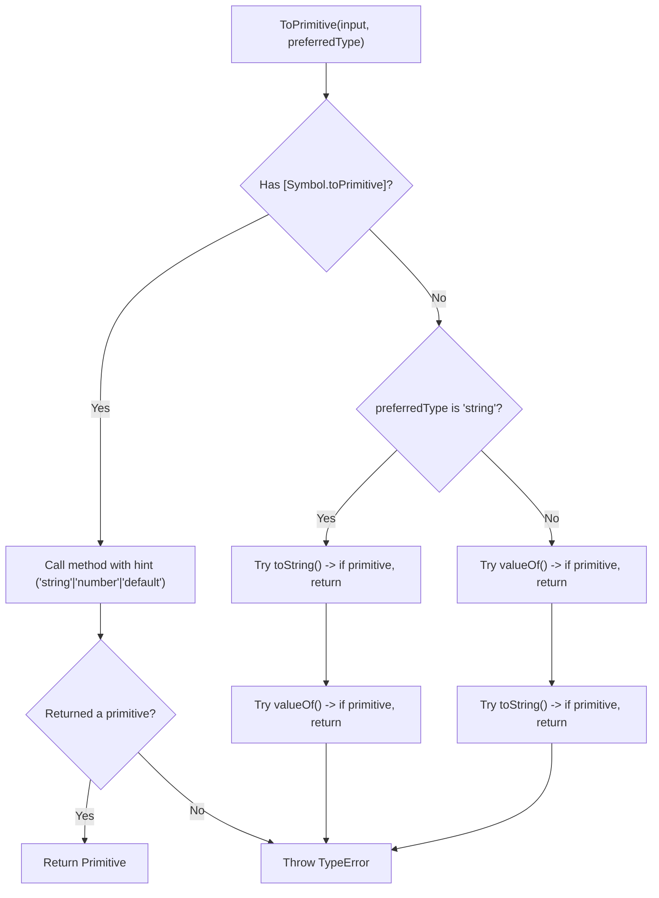

# Type Conversion, Coercion & Equality Algorithms

> An exhaustive technical reference on ECMAScript type conversion, abstract operations (`ToPrimitive`, `ToNumber`, `ToString`, `ToBoolean`), loose vs. strict equality, and equality algorithms (`SameValue`, `SameValueZero`).

| Metadata | Details |
| :--- | :--- |
| **Level** | Beginner to Intermediate |
| **Prerequisites** | [02_data-types.md](./02_data-types.md) |
| **Time to Read** | 25 minutes |
| **Status** | Complete |
| **ECMAScript Standard** | ES6 (ES2015) to Current (ES2024/ES2025) |

---

## Table of Contents
1. [What & Why](#1-what--why)
2. [Core Concepts](#2-core-concepts)
3. [How It Works: ECMAScript Abstract Operations](#3-how-it-works-ecmascript-abstract-operations)
4. [Syntax & Conversion Reference](#4-syntax--conversion-reference)
5. [Practical Examples](#5-practical-examples)
6. [Edge Cases & Gotchas](#6-edge-cases--gotchas)
7. [Common Mistakes & Anti-Patterns](#7-common-mistakes--anti-patterns)
8. [Performance Characteristics](#8-performance-characteristics)
9. [Engine Internals: V8 Coercion Bytecode](#9-engine-internals-v8-coercion-bytecode)
10. [Best Practices & Style Guide](#10-best-practices--style-guide)
11. [Real-World Applications & Case Studies](#11-real-world-applications--case-studies)
12. [Interview Questions & Deep Dives](#12-interview-questions--deep-dives)
13. [Exercises & Challenges](#13-exercises--challenges)

---

## 1. What & Why

JavaScript is a weakly and dynamically typed language. When an operator receives operands of mismatched types (e.g., `"10" - 5` or `[] + {}`), the JavaScript runtime does not crash; instead, it executes **implicit type coercion** according to strict algorithms defined in the ECMAScript specification.

```
Explicit Conversion (Intentional):
  Number("42") ──────────────► 42

Implicit Coercion (Engine-driven via Abstract Operations):
  "42" - 2     ──────────────► ToNumber("42") - 2 ──► 40
  [1, 2] + "3" ──────────────► ToPrimitive([1, 2]) + "3" ──► "1,23"
```

Type coercion is frequently derided as unpredictable ("JavaScript WAT"). However, the engine never behaves randomly: every implicit coercion follows deterministic mathematical algorithms: `ToPrimitive`, `ToBoolean`, `ToNumber`, and `ToString`. Mastering these abstract operations enables engineers to write bug-free code and demystify legacy behaviors.

---

## 2. Core Concepts

### 2.1 The Four Equality Algorithms

ECMAScript specifies four distinct equality comparison algorithms:

| Algorithm | JS Operator / Method | Handles `NaN === NaN` | Handles `+0 === -0` | Type Coercion? | Where It Is Used |
| :--- | :--- | :--- | :--- | :--- | :--- |
| **IsLooselyEqual** | `==` | `false` | `true` | **Yes** | Legacy comparison, `x == null` |
| **IsStrictlyEqual** | `===` | `false` | `true` | **No** | Standard strict comparison, `switch` |
| **SameValue** | `Object.is(a, b)` | **`true`** | **`false`** | **No** | Object immutability, property descriptors |
| **SameValueZero** | `[].includes()`, `Set`, `Map` | **`true`** | `true` | **No** | Collections, hash lookups, array search |

### 2.2 The 8 Falsy Values
In JavaScript, exactly **8 values** evaluate to `false` when passed to `ToBoolean`:
1. `false`
2. `0` (positive zero)
3. `-0` (negative zero)
4. `0n` (BigInt zero)
5. `""` (empty string)
6. `null`
7. `undefined`
8. `NaN`
*(Note: In browser environments, host object `document.all` also coerces to false for backward compatibility with 1990s IE scripts).*

**Everything else in JavaScript is TRUTHY**, including:
- `"0"` (non-empty string)
- `"false"` (non-empty string)
- `[]` (empty array)
- `{}` (empty object)
- `() => {}` (function)

### 2.3 Explicit Conversion Functions vs. Parsing
- `Number("42px")` evaluates to `NaN` because it requires the **entire string** to be numeric.
- `parseInt("42px", 10)` parses from left to right, stopping at the first non-numeric character (`p`), returning `42`.
- `Boolean(val)` explicitly invokes `ToBoolean(val)`.
- `String(val)` explicitly invokes `ToString(val)`.

---

## 3. How It Works: ECMAScript Abstract Operations

### 3.1 The `ToPrimitive` Algorithm
When an object is used in a context expecting a primitive (e.g. `obj + 5` or `String(obj)`), the engine invokes `ToPrimitive(input, preferredType)`:



1. **Default Hints**:
   - Date objects default to hint `"string"`.
   - All other objects default to hint `"number"`.
2. If `Symbol.toPrimitive` is not implemented:
   - For hint `"number"`: calls `.valueOf()`, then `.toString()`.
   - For hint `"string"`: calls `.toString()`, then `.valueOf()`.

### 3.2 The Loose Equality (`==`) Algorithm
When evaluating `x == y`:
1. If `Type(x) === Type(y)`, return `x === y`.
2. If `x` is `null` and `y` is `undefined` (or vice versa), return `true`.
3. If one is `Number` and the other is `String`, convert `String` to `Number` and retry.
4. If one is `Boolean`, convert `Boolean` to `Number` (`true -> 1`, `false -> 0`) and retry.
5. If one is `Object` and the other is `String`, `Number`, `BigInt`, or `Symbol`, convert `Object` to primitive via `ToPrimitive()` and retry.
6. Return `false`.

---

## 4. Syntax & Conversion Reference

### 4.1 Primitive Type Conversion Matrix

| Original Value | `Boolean(val)` | `Number(val)` | `String(val)` |
| :--- | :--- | :--- | :--- |
| `undefined` | `false` | `NaN` | `"undefined"` |
| `null` | `false` | `0` | `"null"` |
| `true` | `true` | `1` | `"true"` |
| `false` | `false` | `0` | `"false"` |
| `""` (empty) | `false` | `0` | `""` |
| `"42"` | `true` | `42` | `"42"` |
| `"42px"` | `true` | `NaN` | `"42px"` |
| `0` | `false` | `0` | `"0"` |
| `-0` | `false` | `-0` | `"0"` |
| `NaN` | `false` | `NaN` | `"NaN"` |
| `Infinity` | `true` | `Infinity` | `"Infinity"` |
| `[]` | `true` | `0` (`"" -> 0`) | `""` |
| `[42]` | `true` | `42` (`"42" -> 42`) | `"42"` |
| `[1, 2]` | `true` | `NaN` (`"1,2" -> NaN`) | `"1,2"` |
| `{}` | `true` | `NaN` (`"[object Object]"`) | `"[object Object]"` |

---

## 5. Practical Examples

### Example 1: Dissecting Classic "WAT" Coercions Step-by-Step

```javascript
// WAT 1: [] + [] -> ""
// Explanation: Both are objects. The '+' operator prefers strings.
// ToPrimitive([]) -> [].toString() -> ""
// "" + "" -> ""
console.log([] + []); // ""

// WAT 2: [] + {} -> "[object Object]"
// ToPrimitive([]) -> ""
// ToPrimitive({}) -> "[object Object]"
// "" + "[object Object]" -> "[object Object]"
console.log([] + {}); // "[object Object]"

// WAT 3: [] == false -> true
// Step 1: Boolean false converted to Number 0 -> [] == 0
// Step 2: Object [] converted to primitive -> "" == 0
// Step 3: String "" converted to Number -> 0 == 0 -> true!
console.log([] == false); // true

// WAT 4: !+[]+!+[] -> 2
// +[] -> 0
// !0 -> true
// !+[] is true (which is 1 when coerced in addition)
// true + true -> 1 + 1 -> 2
console.log(!+[] + !+[]); // 2
```

### Example 2: Implementing `Symbol.toPrimitive` on a Domain Entity

```javascript
class Currency {
  constructor(amount, currencyCode = "USD") {
    this.amount = amount;
    this.currencyCode = currencyCode;
  }

  /**
   * Custom ECMAScript ToPrimitive Hook
   * @param {"number" | "string" | "default"} hint
   */
  [Symbol.toPrimitive](hint) {
    switch (hint) {
      case "number":
        return this.amount;
      case "string":
        return `${this.currencyCode} ${this.amount.toFixed(2)}`;
      case "default":
        // Used in '+' operator: return numeric amount
        return this.amount;
      default:
        throw new TypeError(`Unknown coercion hint: ${hint}`);
    }
  }
}

const itemPrice = new Currency(49.99, "USD");

// Hint: "number"
console.log(+itemPrice); // 49.99
console.log(Math.round(itemPrice)); // 50

// Hint: "string"
console.log(String(itemPrice)); // "USD 49.99"
console.log(`Checkout: ${itemPrice}`); // "Checkout: USD 49.99"

// Hint: "default"
console.log(itemPrice + 10); // 59.99
```

### Example 3: Safe Query Parameter Parser with Type Preservation

```javascript
/**
 * Safely coerces raw URL search query string values to appropriate JS primitives.
 * @param {string} rawValue
 * @returns {string | number | boolean | null}
 */
function parseQueryParam(rawValue) {
  if (rawValue === "null") return null;
  if (rawValue === "true") return true;
  if (rawValue === "false") return false;

  // Strict numeric conversion
  if (/^-?\d+(\.\d+)?$/.test(rawValue.trim())) {
    const num = Number(rawValue);
    if (!Number.isNaN(num)) return num;
  }

  return rawValue;
}

console.log(parseQueryParam("100"));     // 100 (number)
console.log(parseQueryParam("true"));    // true (boolean)
console.log(parseQueryParam("null"));    // null
console.log(parseQueryParam("active"));  // "active" (string)
```

### Example 4: The Only Idiomatic Use of `==` (`x == null`)

```javascript
// Idiomatic pattern to check for both null and undefined in a single check:
function processUser(user) {
  // 'user == null' is true IF AND ONLY IF user is null OR undefined!
  if (user == null) {
    return "Guest Session";
  }
  return `User: ${user.name}`;
}

console.log(processUser(null));      // "Guest Session"
console.log(processUser(undefined)); // "Guest Session"
console.log(processUser({ name: "Alice" })); // "User: Alice"
```

### Example 5: Testing All 4 Equality Algorithms Against Edge Cases

```javascript
const testPairs = [
  [NaN, NaN],
  [+0, -0],
  [null, undefined],
  ["42", 42],
  [false, 0],
  [[], false],
  [{}, {}]
];

function testEqualityAlgorithms(pairs) {
  return pairs.map(([a, b]) => ({
    a: String(a),
    b: String(b),
    "==": a == b,
    "===": a === b,
    "Object.is": Object.is(a, b),
    "SameValueZero": [a].includes(b) // Array.includes uses SameValueZero
  }));
}

console.table(testEqualityAlgorithms(testPairs));
```

---

## 6. Edge Cases & Gotchas

### 6.1 `null` Coerces to `0` in Math, but `undefined` Coerces to `NaN`
```javascript
10 + null;      // 10 (null -> 0)
10 + undefined; // NaN (undefined -> NaN)
```
This asymmetry creates hard-to-detect bugs when calculating default numerical values.

### 6.2 Array Sorting Gotcha
`Array.prototype.sort()` converts elements to **strings** by default before sorting:
```javascript
const numbers = [10, 5, 40, 25, 1];
numbers.sort();
console.log(numbers); // [1, 10, 25, 40, 5] ('10' comes before '5' in Unicode sort order!)

// Correct numerical sort:
numbers.sort((a, b) => a - b);
console.log(numbers); // [1, 5, 10, 25, 40]
```

### 6.3 The `parseInt` Base-Radix Trap
`parseInt` strips trailing non-numeric characters, which causes unexpected behavior when converting floating-point or scientific strings:
```javascript
parseInt(0.0000005); // 5 (Because String(0.0000005) is "5e-7", and parseInt stops at 'e'!)
parseInt("08", 10);  // Always pass radix 10 to avoid historical octal parsing bugs
```

---

## 7. Common Mistakes & Anti-Patterns

| Anti-Pattern | Why It Fails | Correct Approach |
| :--- | :--- | :--- |
| **Using `==` for comparisons** | Performs complex multi-step coercions that produce unexpected truthy matches (`"" == 0`). | Always use `===` strict equality. The only exception is `x == null`. |
| **Using `if (arr.length)` for existence** | Fails to distinguish between an empty array (`0`) and a missing/null value. | Check `if (arr && arr.length > 0)`. |
| **Relying on truthiness for zero** | `if (userCount)` fails when `userCount === 0` because `0` is falsy. | Explicitly check `if (userCount !== undefined)`. |
| **Calling `Number.parseInt` without radix** | Omitting the second argument can lead to unexpected parsing of prefixed numbers. | Always supply radix: `parseInt(str, 10)`. |
| **Assuming `{}` is falsy** | All objects are truthy, even empty `{}` or `[]`. | Check `Object.keys(obj).length === 0`. |
| **Using `+` for integer string conversion** | Unary `+` converts `""` to `0`, hiding empty input bugs. | Use `Number(str)` or strict regex validation. |

---

## 8. Performance Characteristics

In modern JavaScript engines (V8, JavaScriptCore), loose equality comparisons between mixed types trigger **bailouts** from the optimizing compiler:

```
[ Hot Function Call ]
       │
       ▼
Is Type(a) === Type(b)?
  ├─ YES: Monomorphic Comparison -> Single CPU CMP instruction (~0.3 ns)
  └─ NO:  Deoptimization Bailout -> Invocations of ToPrimitive / ToNumber (~12-30 ns)
```

1. **Strict Equality (`===`)**: Compiles directly to an inlined machine-code instruction if types are monomorphic.
2. **Loose Equality (`==`)**: When types differ, the engine must execute multi-step abstract operation fallback routines, generating bytecode overhead and preventing inline caching.

---

## 9. Engine Internals: V8 Coercion Bytecode

When V8's Ignition interpreter generates bytecode for coerced expressions:
```javascript
function add(a, b) {
  return a + b;
}
```
Ignition emits the `Add` bytecode. When executed:
1. Ignition checks the type feedback vector.
2. If both operands have consistently been integers (SMIs), it executes native integer addition.
3. If one operand is an object, Ignition invokes the C++ runtime function `Runtime::ToPrimitive`.
4. If a type change occurs frequently, V8 **deoptimizes** the generated TurboFan machine code, marking the call site as megamorphic.

---

## 10. Best Practices & Style Guide

1. **Enforce `eqeqeq` Rule**: Configure ESLint:
   ```json
   { "rules": { "eqeqeq": ["error", "always", { "null": "ignore" }] } }
   ```
2. **Use Explicit Boolean Conversions**: When assigning booleans, write `Boolean(val)` or `!!val` rather than relying on implicit truthiness.
3. **Check For `null` and `undefined` via Nullish Coalescing**:
   ```javascript
   const timeout = options.timeout ?? 5000;
   ```
4. **Never Overwrite `valueOf` or `toString` Without `Symbol.toPrimitive`**: Implement `Symbol.toPrimitive` to control all coercion branches deterministically.

---

## 11. Real-World Applications & Case Studies

### Case Study: Payment Authorization Bypass via Type Coercion
A major fintech platform encountered a critical security vulnerability:
```javascript
// VULNERABLE CODE:
function authorizeTransaction(userRole) {
  if (userRole == false) {
    denyAccess();
  } else {
    grantAccess();
  }
}
```
- **Vulnerability**: An attacker sent `{ userRole: [] }` in the JSON request payload.
- **Evaluation**:
  - `[] == false` evaluates to `true` (see Example 1).
  - An attacker sending `userRole: "0"` evaluated to `true`, triggering `denyAccess()`.
  - But an attacker sending `userRole: ""` evaluated to `true`!
  - Most critically, sending `userRole: "admin"` evaluated `"admin" == false` -> `false`, which bypassed the `if` and granted access!
- **Resolution**: Replaced loose comparison with strict enum validation:
  ```javascript
  if (userRole === "AUTHORIZED") { grantAccess(); } else { denyAccess(); }
  ```

---

## 12. Interview Questions & Deep Dives

<details>
<summary><strong>1. Explain step-by-step why `[] == ![]` evaluates to `true`.</strong></summary>

**Answer:**
1. The logical NOT operator `!` has higher precedence than `==`.
2. `!` coerces its operand to a boolean via `ToBoolean`.
3. `[]` is an object, so `ToBoolean([])` is `true`.
4. `!true` evaluates to `false`. The expression is now: `[] == false`.
5. Under `IsLooselyEqual`, when a boolean is compared to another type, the boolean is converted to a number: `ToNumber(false)` is `0`. Expression: `[] == 0`.
6. Now comparing an object `[]` to a number `0`. The object is converted via `ToPrimitive([])`, which calls `[].toString()`, returning `""`. Expression: `"" == 0`.
7. When comparing a string `""` to a number `0`, the string is converted via `ToNumber("")`, which returns `0`.
8. Finally: `0 == 0`, which is strictly `true`.
</details>

<details>
<summary><strong>2. What is the difference between `SameValue` and `SameValueZero`?</strong></summary>

**Answer:**
Both algorithms treat `NaN` as equal to `NaN` (unlike `===`). The sole difference lies in how they handle signed zeroes:
- `SameValue` (used by `Object.is`): Distinguishes `+0` and `-0`, considering them **not equal** (`Object.is(+0, -0) === false`).
- `SameValueZero` (used by `Set`, `Map`, and `Array.prototype.includes`): Treats `+0` and `-0` as **equal**. Therefore, a `Set` will not store both `+0` and `-0`.
</details>

<details>
<summary><strong>3. Why does `typeof NaN` return `"number"`?</strong></summary>

**Answer:**
In the IEEE 754 floating-point standard, `NaN` is a specific numeric bit pattern representing an undefined or unrepresentable numeric result (such as `0 / 0` or `Math.sqrt(-1)`). Because it is part of the double-precision floating-point specification, the language classifies it under the `number` type.
</details>

<details>
<summary><strong>4. How does the `+` operator determine whether to perform addition or concatenation?</strong></summary>

**Answer:**
The ECMAScript specification dictates:
1. Both operands are converted to primitives using `ToPrimitive()` with no hint (which defaults to hint `"number"`, except for `Date` which defaults to `"string"`).
2. After primitive conversion, if **either** operand is of type `String`, both operands are converted to strings via `ToString()` and concatenated.
3. Otherwise, both operands are converted to numbers via `ToNumber()` and added mathematically.
</details>

<details>
<summary><strong>5. Why is `x == null` considered acceptable in professional codebases?</strong></summary>

**Answer:**
Under the loose equality specification, `null == undefined` is explicitly defined to return `true`, and neither `null` nor `undefined` loosely equals any other value (not even `0`, `false`, or `""`). Thus, `x == null` is a concise, idiomatic shorthand that checks whether `x` is either `null` or `undefined` without false positives on other falsy values.
</details>

<details>
<summary><strong>6. What does `document.all` evaluate to and why is it unique?</strong></summary>

**Answer:**
`document.all` is an ancient DOM collection from Internet Explorer 4. To allow modern websites to use feature detection (`if (document.all)`) to serve legacy IE code to IE and standard code to modern browsers, the ECMAScript specification added a specific exception (§B.3.7): `document.all` is an Object that produces `"undefined"` when inspected with `typeof` and evaluates to `false` in `ToBoolean`.
</details>

<details>
<summary><strong>7. What are the rules of `Symbol.toPrimitive`?</strong></summary>

**Answer:**
`Symbol.toPrimitive` is a well-known symbol method that overrides default `valueOf` and `toString` conversions on objects. It accepts a single string argument, `hint`, which is guaranteed to be one of `"number"`, `"string"`, or `"default"`. The method must return a primitive value; if it returns an object, the engine throws a `TypeError`.
</details>

<details>
<summary><strong>8. Why does `parseInt("08")` return `8` in modern JS, but returned `0` in legacy browsers?</strong></summary>

**Answer:**
In ECMAScript 3 (pre-2009), strings starting with a leading zero (`"08"`) were parsed as octal (base 8). Because `8` is invalid in octal, parsing halted at `0`. In ECMAScript 5, this behavior was removed, and strings with leading zeros default to base 10 unless prefixed with `"0x"` (hexadecimal). However, explicitly passing radix `10` (`parseInt(str, 10)`) remains a best practice.
</details>

---

## 13. Exercises & Challenges

### Exercise 1 (Easy): Create a Strict Truthiness Checker
**Task**: Write a function `isStrictlyTruthy(val)` that returns `true` if `val` is truthy, but returns `false` if `val` is any of the 8 falsy values or an empty array/empty object.

<details>
<summary><strong>Solution</strong></summary>

```javascript
function isStrictlyTruthy(val) {
  if (!val) return false;
  if (Array.isArray(val) && val.length === 0) return false;
  if (Object.prototype.toString.call(val) === "[object Object]" && Object.keys(val).length === 0) {
    return false;
  }
  return true;
}

console.log(isStrictlyTruthy("hello")); // true
console.log(isStrictlyTruthy(0));       // false
console.log(isStrictlyTruthy([]));      // false
console.log(isStrictlyTruthy({}));      // false
console.log(isStrictlyTruthy([1]));     // true
```
</details>

### Exercise 2 (Easy): Polyfill for `Number.isNaN`
**Task**: Implement a pure JavaScript polyfill for `Number.isNaN(val)` without calling the native `Number.isNaN`.

<details>
<summary><strong>Solution</strong></summary>

```javascript
function myNumberIsNaN(val) {
  // In JavaScript, NaN is the ONLY value in the entire language that is not equal to itself
  return typeof val === "number" && val !== val;
}

console.log(myNumberIsNaN(NaN));       // true
console.log(myNumberIsNaN("NaN"));     // false
console.log(myNumberIsNaN(undefined)); // false
console.log(myNumberIsNaN(42));        // false
```
</details>

### Exercise 3 (Medium): Implement SameValueZero Algorithm
**Task**: Author a function `isSameValueZero(x, y)` implementing the SameValueZero algorithm without using `Set` or `Array.prototype.includes`.

<details>
<summary><strong>Solution</strong></summary>

```javascript
function isSameValueZero(x, y) {
  // NaN check
  if (x !== x) {
    return y !== y;
  }
  // Standard equality handles +0 === -0 and all other values
  return x === y;
}

console.log(isSameValueZero(NaN, NaN)); // true
console.log(isSameValueZero(+0, -0));   // true
console.log(isSameValueZero("a", "a")); // true
console.log(isSameValueZero({}, {}));   // false
```
</details>

### Exercise 4 (Medium): Custom Temperature Class with Exact Coercions
**Task**: Build a `Temperature` class representing degrees Celsius. When converted to a string, it outputs `"25 °C"`. When converted to a number, it outputs `25`. When added with `+`, it returns numeric addition.

<details>
<summary><strong>Solution</strong></summary>

```javascript
class Temperature {
  constructor(celsius) {
    this.celsius = celsius;
  }

  [Symbol.toPrimitive](hint) {
    if (hint === "string") {
      return `${this.celsius} °C`;
    }
    // Handles hint "number" and hint "default"
    return this.celsius;
  }
}

const temp = new Temperature(22);
console.log(String(temp));     // "22 °C"
console.log(temp + 5);         // 27
console.log(temp > 20);        // true
console.log(`Today: ${temp}`); // "Today: 22 °C"
```
</details>

### Exercise 5 (Hard): Deep Structural Equality Comparator
**Task**: Implement a deep equality function `deepEqual(a, b)` that supports primitives, nested objects, arrays, and respects `SameValueZero` semantics without calling third-party libraries.

<details>
<summary><strong>Solution</strong></summary>

```javascript
function deepEqual(a, b) {
  // SameValueZero equality check for primitives and identical references
  if (a === b || (a !== a && b !== b)) {
    return true;
  }

  if (a === null || b === null || typeof a !== "object" || typeof b !== "object") {
    return false;
  }

  // Type checks
  if (Array.isArray(a) !== Array.isArray(b)) {
    return false;
  }

  if (a instanceof Date && b instanceof Date) {
    return a.getTime() === b.getTime();
  }

  if (a instanceof RegExp && b instanceof RegExp) {
    return a.toString() === b.toString();
  }

  const keysA = Reflect.ownKeys(a);
  const keysB = Reflect.ownKeys(b);

  if (keysA.length !== keysB.length) {
    return false;
  }

  for (const key of keysA) {
    if (!Reflect.has(b, key) || !deepEqual(a[key], b[key])) {
      return false;
    }
  }

  return true;
}

// Verification
console.log(deepEqual([1, { a: 2 }], [1, { a: 2 }])); // true
console.log(deepEqual(NaN, NaN)); // true
console.log(deepEqual({ x: 1 }, { x: 2 })); // false
```
</details>

### Exercise 6 (Hard): Build an Abstract Coercion Simulator
**Task**: Write an engine emulator `simulateToPrimitive(obj, hint)` that takes any JavaScript object, checks for `Symbol.toPrimitive`, `.valueOf()`, and `.toString()`, and mirrors the exact ECMAScript ToPrimitive specification, including throwing `TypeError` if no primitive can be resolved.

<details>
<summary><strong>Solution</strong></summary>

```javascript
function simulateToPrimitive(input, preferredType = "default") {
  // 1. If input is already primitive, return as is
  if (input === null || (typeof input !== "object" && typeof input !== "function")) {
    return input;
  }

  // 2. Check for Symbol.toPrimitive
  const exoticToPrim = input[Symbol.toPrimitive];
  if (typeof exoticToPrim === "function") {
    const result = exoticToPrim.call(input, preferredType);
    if (result !== null && (typeof result !== "object" && typeof result !== "function")) {
      return result;
    }
    throw new TypeError("Cannot convert object to primitive value");
  }

  // 3. Fallback methods based on hint
  const hint = preferredType === "default" ? "number" : preferredType;
  const methods = hint === "string" ? ["toString", "valueOf"] : ["valueOf", "toString"];

  for (const name of methods) {
    const fn = input[name];
    if (typeof fn === "function") {
      const val = fn.call(input);
      if (val === null || (typeof val !== "object" && typeof val !== "function")) {
        return val;
      }
    }
  }

  throw new TypeError("Cannot convert object to primitive value");
}

// Verification
console.log(simulateToPrimitive([1, 2], "string")); // "1,2"
console.log(simulateToPrimitive(new Date(0), "number")); // 0
```
</details>
