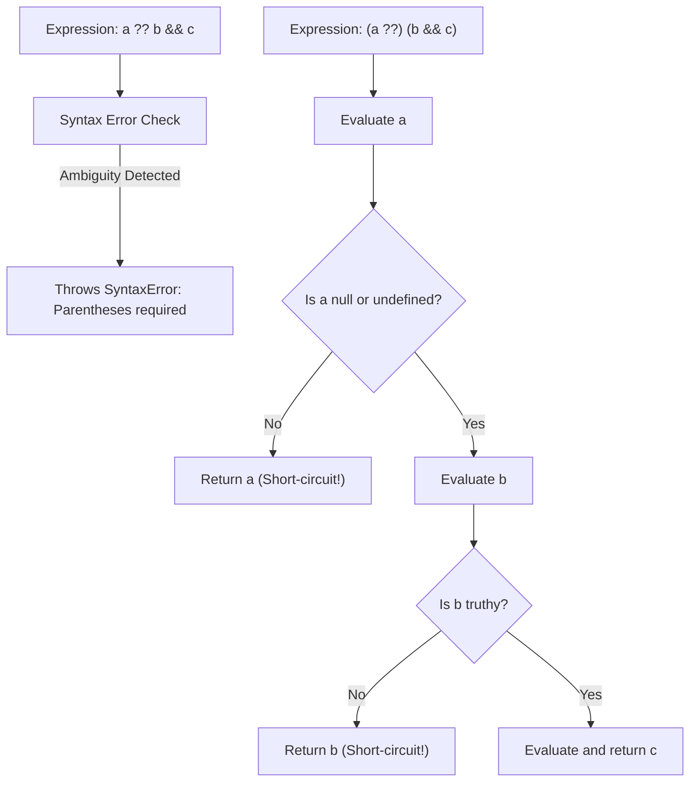

# JavaScript Operators, Precedence & Bitwise Mechanics

> An exhaustive technical reference on JavaScript operators: arithmetic, bitwise 32-bit integer casting, short-circuit evaluation, nullish coalescing (`??`), optional chaining (`?.`), logical assignment, and engine precedence rules.

| Metadata | Details |
| :--- | :--- |
| **Level** | Beginner to Intermediate |
| **Prerequisites** | [02_data-types.md](./02_data-types.md), [03_type-conversion-and-equality.md](./03_type-conversion-and-equality.md) |
| **Time to Read** | 25 minutes |
| **Status** | Complete |
| **ECMAScript Standard** | ES6 (ES2015) to Current (ES2024/ES2025) |

---

## Table of Contents
1. [What & Why](#1-what--why)
2. [Core Concepts](#2-core-concepts)
3. [How It Works: Precedence, Associativity & Short-Circuiting](#3-how-it-works-precedence-associativity--short-circuiting)
4. [Syntax & Operator Precedence Reference](#4-syntax--operator-precedence-reference)
5. [Practical Examples](#5-practical-examples)
6. [Edge Cases & Gotchas](#6-edge-cases--gotchas)
7. [Common Mistakes & Anti-Patterns](#7-common-mistakes--anti-patterns)
8. [Performance Characteristics](#8-performance-characteristics)
9. [Engine Internals: V8 Bitwise Int32 Casting & Jump Bytecode](#9-engine-internals-v8-bitwise-int32-casting--jump-bytecode)
10. [Best Practices & Style Guide](#10-best-practices--style-guide)
11. [Real-World Applications & Case Studies](#11-real-world-applications--case-studies)
12. [Interview Questions & Deep Dives](#12-interview-questions--deep-dives)
13. [Exercises & Challenges](#13-exercises--challenges)

---

## 1. What & Why

Operators are the computational verbs of JavaScript. They manipulate, combine, evaluate, and assign values across memory bindings.

Modern ECMAScript provides a rich set of operators ranging from low-level bit manipulation to high-level defensive accessors:
- **Arithmetic**: Mathematical calculations including integer remainder and right-associative exponentiation.
- **Bitwise**: Low-level 32-bit integer operations essential for bitmasks, cryptography, and binary hashing.
- **Short-Circuiting Logic**: `&&`, `||`, and `??` which evaluate operands lazily and return the determining operand rather than a synthetic boolean.
- **Safe Traversal**: Optional chaining (`?.`) eliminating defensive `if (a && a.b && a.b.c)` boilerplate.
- **Atomic Assignment**: Logical assignment (`&&=`, `||=`, `??=`) combining conditional logic and assignment in a single operation.

```
                  ┌─────────────────────────────────────────────────────────┐
                  │                 Operator Evaluation Tree                │
                  │                                                         │
                  │  1. Member Access / Grouping (., ?., (), []) [Level 18] │
                  │  2. Exponentiation (**)                      [Level 13] │
                  │  3. Multiplication / Division (*, /, %)      [Level 12] │
                  │  4. Addition / Subtraction (+, -)            [Level 11] │
                  │  5. Bitwise Shifts (<<, >>, >>>)             [Level 10] │
                  │  6. Relational (<, >, <=, >=, in)            [Level 9]  │
                  │  7. Equality (===, !==, ==, !=)              [Level 8]  │
                  │  8. Bitwise Logic (&, ^, |)                  [Level 7-5]│
                  │  9. Logical Short-Circuit (&&, ||, ??)       [Level 4-3]│
                  │  10. Ternary Conditional (? :)               [Level 2]  │
                  │  11. Assignment (=, +=, ??=, &&=)            [Level 1]  │
                  │  12. Comma Operator (,)                      [Level 0]  │
                  └─────────────────────────────────────────────────────────┘
```

---

## 2. Core Concepts

### 2.1 Short-Circuit Evaluation and Operand Return Values
Unlike languages where logical operators strictly return booleans (`true`/`false`), JavaScript logical operators return the **value of the deciding operand**:
- **`a && b`**: Evaluates `a`. If `a` is falsy, returns `a` immediately without evaluating `b`. If `a` is truthy, evaluates and returns `b`.
- **`a || b`**: Evaluates `a`. If `a` is truthy, returns `a` immediately. If `a` is falsy, evaluates and returns `b`.
- **`a ?? b` (Nullish Coalescing)**: Evaluates `a`. If `a` is neither `null` nor `undefined`, returns `a`. If `a` is `null` or `undefined`, evaluates and returns `b`.

```javascript
// Demonstrating operand return values
const port = 0 || 3000;    // Returns 3000 (0 is falsy, bug if port 0 was desired!)
const safePort = 0 ?? 3000; // Returns 0 (0 is not null or undefined)
const name = "" || "Guest"; // Returns "Guest"
const blank = "" ?? "Guest"; // Returns ""
```

### 2.2 Optional Chaining (`?.`)
Optional chaining stops evaluation and returns `undefined` if the operand before `?.` is `null` or `undefined`:
- Property access: `user?.profile?.avatar`
- Dynamic property access: `user?.[propName]`
- Method call: `user?.notify?.()` (If `user.notify` is `null`/`undefined`, evaluation ceases; but if `notify` exists and is *not* a function, it throws a `TypeError`).

### 2.3 Logical Assignment Operators
Introduced in ES2021, these combine short-circuiting with assignment:
- **`a ||= b`**: Assigns `b` to `a` only if `a` is falsy (`a || (a = b)`).
- **`a &&= b`**: Assigns `b` to `a` only if `a` is truthy (`a && (a = b)`).
- **`a ??= b`**: Assigns `b` to `a` only if `a` is nullish (`a ?? (a = b)`).

### 2.4 Bitwise Operators and 32-Bit Truncation
All JavaScript numbers are 64-bit IEEE 754 floats. However, bitwise operators (`&`, `|`, `^`, `~`, `<<`, `>>`, `>>>`) **forcibly convert their operands to 32-bit signed integers** (`ToInt32`) before operating, and convert back to double-precision floats afterward.
- `>>`: Sign-propagating right shift (preserves negative sign).
- `>>>`: Zero-fill right shift (produces an unsigned 32-bit integer).
- `~`: Bitwise NOT (inverts all bits, mathematically equivalent to `-(x + 1)`).

---

## 3. How It Works: Precedence, Associativity & Short-Circuiting

### Associativity
- **Left-to-Right**: Most binary operators evaluate left-to-right (`10 - 5 - 2` evaluates as `(10 - 5) - 2 = 3`).
- **Right-to-Left**: Assignment operators (`a = b = c = 5`) and exponentiation (`2 ** 3 ** 2` evaluates as `2 ** (3 ** 2) = 2 ** 9 = 512`).



---

## 4. Syntax & Operator Precedence Reference

### Comprehensive Operator Hierarchy Table (Highest to Lowest)

| Precedence | Operator Type | Operators | Associativity |
| :---: | :--- | :--- | :---: |
| **18** | Grouping / Member Access | `( ... )`, `a.b`, `a[b]`, `a?.b`, `new Foo()` | n/a / Left-to-right |
| **17** | Function Call | `fn( ... )`, `fn?.( ... )` | Left-to-right |
| **16** | Postfix Increment/Decrement | `a++`, `a--` | n/a |
| **15** | Prefix Increment / Logical NOT / Bitwise NOT / Unary `+` `-` / `typeof` / `void` / `delete` | `++a`, `--a`, `!a`, `~a`, `+a`, `-a`, `typeof a`, `void a` | Right-to-left |
| **14** | Exponentiation | `**` | **Right-to-left** |
| **13** | Multiplicative | `*`, `/`, `%` | Left-to-right |
| **12** | Additive | `+`, `-` | Left-to-right |
| **11** | Bitwise Shifts | `<<`, `>>`, `>>>` | Left-to-right |
| **10** | Relational / Membership | `<`, `<=`, `>`, `>=`, `in`, `instanceof` | Left-to-right |
| **9** | Equality | `===`, `!==`, `==`, `!=` | Left-to-right |
| **8** | Bitwise AND | `&` | Left-to-right |
| **7** | Bitwise XOR | `^` | Left-to-right |
| **6** | Bitwise OR | `\|` | Left-to-right |
| **5** | Logical AND | `&&` | Left-to-right |
| **4** | Logical OR | `\|\|` | Left-to-right |
| **3** | Nullish Coalescing | `??` | Left-to-right |
| **2** | Conditional (Ternary) | `condition ? val1 : val2` | **Right-to-left** |
| **1** | Assignment / Logical Assignment | `=`, `+=`, `-=`, `*=`, `**=`, `&&=`, `\|\|=`, `??=` | **Right-to-left** |
| **0** | Comma Operator | `,` | Left-to-right |

---

## 5. Practical Examples

### Example 1: Defensive Object Access with Safe Fallbacks

```javascript
const apiResponse = {
  data: {
    user: {
      id: "usr_100",
      settings: {
        theme: "dark",
        notifications: false
      }
    }
  }
};

// 1. Safe traversal with optional chaining
const avatar = apiResponse?.data?.user?.profile?.avatarUrl ?? "/default-avatar.png";
console.log("Avatar:", avatar); // "/default-avatar.png"

// 2. Reading boolean settings without truthiness bugs
// BUGGY: apiResponse?.data?.user?.settings?.notifications || true -> evaluates to true!
// CORRECT: Nullish coalescing preserves false:
const notificationsEnabled = apiResponse?.data?.user?.settings?.notifications ?? true;
console.log("Notifications:", notificationsEnabled); // false (Preserved!)
```

### Example 2: High-Performance Bitmask Permissions Engine

```javascript
// Bitmask Permission Flags (Each is a distinct power of 2)
const PERMS = {
  NONE: 0,
  READ: 1 << 0,    // 0001 (1)
  WRITE: 1 << 1,   // 0010 (2)
  DELETE: 1 << 2,  // 0100 (4)
  ADMIN: 1 << 3    // 1000 (8)
};

class PermissionManager {
  constructor(mask = PERMS.NONE) {
    this.mask = mask;
  }

  grant(permission) {
    this.mask |= permission; // Bitwise OR adds bit
    return this;
  }

  revoke(permission) {
    this.mask &= ~permission; // Bitwise AND with inverted mask clears bit
    return this;
  }

  has(permission) {
    return (this.mask & permission) === permission; // Bitwise AND isolates bit
  }

  toggle(permission) {
    this.mask ^= permission; // Bitwise XOR toggles bit
    return this;
  }
}

const editor = new PermissionManager();
editor.grant(PERMS.READ).grant(PERMS.WRITE);

console.log("Can Read:", editor.has(PERMS.READ));     // true
console.log("Can Write:", editor.has(PERMS.WRITE));   // true
console.log("Can Delete:", editor.has(PERMS.DELETE)); // false

editor.revoke(PERMS.WRITE);
console.log("Can Write after revoke:", editor.has(PERMS.WRITE)); // false
```

### Example 3: Logical Assignment for In-Memory Memoization

```javascript
class SessionService {
  constructor() {
    this.cache = new Map();
  }

  getUserConfig(userId) {
    let config = this.cache.get(userId);

    // Nullish assignment: evaluate fetch only if config is null or undefined
    config ??= this.fetchConfigFromDisk(userId);

    return config;
  }

  fetchConfigFromDisk(userId) {
    console.log(`[DISK I/O] Loading config for user ${userId}...`);
    const loaded = { userId, theme: "system", refreshedAt: Date.now() };
    this.cache.set(userId, loaded);
    return loaded;
  }
}

const service = new SessionService();
service.getUserConfig("alice"); // Triggers [DISK I/O]
service.getUserConfig("alice"); // Instant cache hit, no I/O printed
```

### Example 4: Prefix vs. Postfix Increment Traps

```javascript
let a = 10;
let b = 10;

// Postfix: evaluates to CURRENT value, then increments
const resultA = a++ * 2;
console.log(`resultA: ${resultA}, a: ${a}`); // resultA: 20, a: 11

// Prefix: increments FIRST, then evaluates to NEW value
const resultB = ++b * 2;
console.log(`resultB: ${resultB}, b: ${b}`); // resultB: 22, b: 11
```

### Example 5: The Comma Operator in Functional Iteration

```javascript
// Comma operator evaluates expressions left-to-right and returns the final value
let counter = 0;
const nextVal = (counter++, counter * 10);
console.log(nextVal); // 10

// Idiomatic in reduce accumulators when logging or performing side effects
const numbers = [1, 2, 3, 4];
const sumWithLog = numbers.reduce((acc, curr) => (console.log(`Adding ${curr} to ${acc}`), acc + curr), 0);
console.log("Sum:", sumWithLog); // 10
```

---

## 6. Edge Cases & Gotchas

### 6.1 SyntaxError When Mixing `??` and `||` / `&&` Without Parentheses
ECMAScript forbids combining `??` with `&&` or `||` at the same precedence level to prevent ambiguous operator precedence bugs:
```javascript
// SYNTAX ERROR:
// const res = a || b ?? c; // Uncaught SyntaxError: Unexpected token '??'

// CORRECT: Must explicitly disambiguate with parentheses:
const res1 = (a || b) ?? c;
const res2 = a || (b ?? c);
```

### 6.2 Exponentiation Precedence with Unary Negation
In mathematics, $-2^2$ is $-4$. In JavaScript, writing `-2 ** 2` is a **SyntaxError**:
```javascript
// -2 ** 2; // SyntaxError: Unary operator used immediately before exponentiation expression

// Disambiguation required:
-(2 ** 2); // -4
(-2) ** 2; // 4
```

### 6.3 32-Bit Overflow in Bitwise Shifts
Because bitwise operations cast to 32-bit signed integers, shifting by 31 bits wraps into negative space:
```javascript
console.log(1 << 30); // 1073741824
console.log(1 << 31); // -2147483648 (Overflown into sign bit!)

// Use zero-fill right shift (>>>) to interpret as an unsigned 32-bit integer:
console.log((1 << 31) >>> 0); // 2147483648
```

### 6.4 Optional Chaining Does Not Protect Against Non-Functions
```javascript
const obj = { run: "not a function" };
// obj?.run?.() throws TypeError!
// Optional chaining only checks if 'obj.run' is null or undefined.
// If it is a string or number, attempting to invoke it throws: TypeError: obj.run is not a function
```

---

## 7. Common Mistakes & Anti-Patterns

| Anti-Pattern | Why It Fails | Correct Approach |
| :--- | :--- | :--- |
| **Using `\|\|` for default numbers** | `0 \|\| 10` evaluates to `10`, silently overriding valid zero values. | Use `??` nullish coalescing: `0 ?? 10` returns `0`. |
| **Using `\|\|` for default booleans** | `false \|\| true` evaluates to `true`, destroying explicit `false` flags. | Use `??` to preserve boolean inputs. |
| **Chaining `?.` when methods might not be functions** | If property is a non-function primitive, `obj?.fn()` crashes. | Check `typeof obj.fn === "function"` before invoking. |
| **Using bitwise operators on large numbers** | Numbers $> 2^{31} - 1$ are truncated to 32-bit signed integers. | Use `BigInt` bitwise operators (`&`, `\|`, `^`) for 64-bit values. |
| **Nesting ternary operators without formatting** | `a ? b : c ? d : e ? f : g` is unreadable and error-prone. | Use `switch`, `if/else`, or lookup dictionaries. |
| **Relying on `delete` for performance** | `delete obj.key` mutates the hidden class (shape) in V8, deoptimizing ICs. | Assign `obj.key = undefined` or use a `Map`. |

---

## 8. Performance Characteristics

| Operator Operation | Engine Execution Mode | Relative Speed |
| :--- | :--- | :--- |
| **Bitwise AND/OR/XOR** | Native 32-bit CPU ALU instruction (`AND`, `OR`, `XOR`) | **Fastest** (~0.1 ns) |
| **Arithmetic (`+`, `-`, `*`)** | Inlined CPU instruction for SMI numbers | **Fastest** (~0.2 ns) |
| **Exponentiation (`**`)** | Internal C++ `Math.pow` library call | Moderate (~2.5 ns) |
| **Optional Chaining (`?.`)** | Inlined nullish guard jump | Negligible overhead (~0.2 ns) |
| **`delete obj.prop`** | De-transitions V8 hidden class, turns object into dictionary mode | **Extremely Slow** (~50–200 ns) |

---

## 9. Engine Internals: V8 Bitwise Int32 Casting & Jump Bytecode

### Bitwise Int32 Conversion (`ToInt32`)
When V8 executes `a | b`:
1. The engine checks if `a` is an unboxed Small Integer (SMI).
2. If `a` is a `HeapNumber` (double), V8 converts the 64-bit float to a 32-bit signed integer using the C++ function `DoubleToInt32`:
   $$\text{int32\_val} = (\text{uint32\_val} \pmod{2^{32}}) - (2^{32} \text{ if bit 31 set})$$
3. Fractional bits are discarded by simple bit truncation.

### Short-Circuit Jump Bytecode
For `const x = a && b;`, Ignition emits:
```
LdaNamedProperty a, [0]         ; Load 'a' into accumulator
JumpIfFalse [offset]            ; If accumulator is falsy, JUMP directly to end!
LdaNamedProperty b, [1]         ; Load 'b' into accumulator
Star r0                         ; Store result in 'x'
```
The jump completely skips loading or evaluating `b`, guaranteeing zero side effects.

---

## 10. Best Practices & Style Guide

1. **Default to `??` Over `||`**: Use nullish coalescing (`??`) for all configuration and variable defaults unless you explicitly want empty strings and zeroes to trigger fallbacks.
2. **Always Parenthesize Mixed Logic**: Never rely on memory of precedence tables when combining `&&`, `||`, and bitwise operators. Write `(a && b) || (c && d)`.
3. **Use `===` Exclusively for Equality**: Never use `==` except for the single idiom `val == null`.
4. **Avoid the Comma Operator in Production**: Restrict comma expressions to `for` loop headers (`for (let i = 0, j = 10; ...)`). Using commas to chain statements impairs code clarity.

---

## 11. Real-World Applications & Case Studies

### Case Study: Zero-Timeout Bug in UI Animation Framework
A popular UI component library had a configuration parser:
```javascript
function scheduleTransition(options) {
  // BUGGY: 0ms transition duration intended for instant dismiss
  const duration = options.duration || 300;
  setTimeout(options.callback, duration);
}
```
- **Symptom**: When developers passed `{ duration: 0 }` to trigger an instant UI transition without animations, the component took `300ms` to close.
- **Root Cause**: `0` is falsy; `options.duration || 300` evaluated `0 || 300`, returning `300`.
- **Resolution**: Updated to nullish coalescing:
  ```javascript
  const duration = options.duration ?? 300;
  ```
  Passing `0` now cleanly preserves `0ms`.

---

## 12. Interview Questions & Deep Dives

<details>
<summary><strong>1. Explain the difference between `||` and `??`.</strong></summary>

**Answer:**
`||` (Logical OR) checks for **falsiness**. It returns the right-hand operand if the left-hand operand is any of the 8 falsy values: `false`, `0`, `-0`, `0n`, `""`, `null`, `undefined`, or `NaN`.

`??` (Nullish Coalescing) checks specifically for **nullishness**. It returns the right-hand operand **only** if the left-hand operand is `null` or `undefined`. Values like `0`, `""`, `false`, and `NaN` are preserved as valid return values.
</details>

<details>
<summary><strong>2. What is the result of `10 + 20 + "30"` vs. `"30" + 10 + 20`?</strong></summary>

**Answer:**
- `10 + 20 + "30"`: The `+` operator is left-associative. First, `10 + 20` executes as numeric addition, returning `30`. Then, `30 + "30"` encounters a string, coercing `30` to string and concatenating to `"3030"`.
- `"30" + 10 + 20`: First, `"30" + 10` encounters a string, producing `"3010"`. Then `"3010" + 20` concatenates to `"301020"`.
</details>

<details>
<summary><strong>3. How does the bitwise NOT operator `~` work and what was its historical idiom?</strong></summary>

**Answer:**
The `~` operator inverts all bits in a 32-bit integer representation of a number. Mathematically, `~x` equals `-(x + 1)`.

Historically, prior to `Array.prototype.includes`, developers searched arrays with `indexOf()`, which returns `-1` if an element is not found. Because `~(-1)` evaluates to `-( -1 + 1 ) = -0 = 0` (which is falsy), developers wrote:
```javascript
if (~str.indexOf("query")) {
  // Found! (Any index >= 0 produces a truthy inverted number)
}
```
Today, `arr.includes(val)` is the standard.
</details>

<details>
<summary><strong>4. Why does `typeof (null)` return `"object"`, but `(void 0)` return `undefined`?</strong></summary>

**Answer:**
`typeof null === "object"` is a legacy bug in the C representation of JS values in 1995.

The `void` operator evaluates any expression and **always** returns the primitive `undefined`. In older JavaScript versions where the global identifier `undefined` could accidentally be overwritten in non-strict mode (`undefined = true`), developers used `void 0` or `void(0)` to obtain a guaranteed, tamper-proof primitive `undefined`.
</details>

<details>
<summary><strong>5. What is the difference between `>>` and `>>>`?</strong></summary>

**Answer:**
- `>>` is the **sign-propagating right shift**. It shifts bits to the right and copies the most significant bit (sign bit) into the vacated leftmost positions, preserving the negative sign of the integer.
- `>>>` is the **zero-fill right shift** (unsigned shift). It shifts bits to the right and fills the leftmost bits with zeroes, regardless of sign. Operating `>>> 0` on a negative 32-bit integer converts it into its positive unsigned 32-bit representation (e.g. `-1 >>> 0 === 4294967295`).
</details>

<details>
<summary><strong>6. Explain how logical assignment `x &&= y` differs from `x = x && y`.</strong></summary>

**Answer:**
`x = x && y` **always** performs an assignment to `x`, even if `x` is falsy.

`x &&= y` only performs the assignment if `x` is truthy (`x && (x = y)`). If `x` is falsy, no assignment operation occurs. This difference is critical when targeting object setters or reactive proxies: `x = x && y` invokes the setter unconditionally, whereas `x &&= y` avoids triggering setter side-effects if the condition is not met.
</details>

<details>
<summary><strong>7. Why does `delete arr[1]` leave a hole instead of resizing an array?</strong></summary>

**Answer:**
Arrays in JavaScript are specialized objects where numeric indices are object properties. The `delete` operator removes the property binding from the object structure. It does not update the `length` property or shift subsequent elements. This converts the array into a **sparse array** containing a hole (`empty`), which degrades V8's array representation from a packed element store to a dictionary mode store.
</details>

<details>
<summary><strong>8. What is the precedence of the comma operator?</strong></summary>

**Answer:**
The comma operator has the **lowest precedence** of all JavaScript operators (Precedence level 0). Expressions separated by commas are evaluated sequentially from left to right, and the value of the entire expression is the value of the rightmost operand.
</details>

---

## 13. Exercises & Challenges

### Exercise 1 (Easy): Guard Configuration Parser
**Task**: Write a function `resolveConfig(userConfig, defaults)` that applies default values for `timeout`, `retries`, and `debug`, ensuring valid falsy values like `0` or `false` provided in `userConfig` are not overridden.

<details>
<summary><strong>Solution</strong></summary>

```javascript
function resolveConfig(userConfig, defaults) {
  return {
    timeout: userConfig?.timeout ?? defaults.timeout,
    retries: userConfig?.retries ?? defaults.retries,
    debug: userConfig?.debug ?? defaults.debug
  };
}

const defaults = { timeout: 5000, retries: 3, debug: true };
const user = { timeout: 0, debug: false };

console.log(resolveConfig(user, defaults));
// Output: { timeout: 0, retries: 3, debug: false }
```
</details>

### Exercise 2 (Easy): Fast Even/Odd Checker Using Bitwise AND
**Task**: Implement an `isEven(n)` function using bitwise operators that runs faster than the modulo operator (`% 2`) for 32-bit integers.

<details>
<summary><strong>Solution</strong></summary>

```javascript
function isEven(n) {
  // In binary, all even numbers have their lowest bit set to 0
  return (n & 1) === 0;
}

console.log(isEven(4));  // true
console.log(isEven(7));  // false
console.log(isEven(0));  // true
console.log(isEven(-2)); // true
```
</details>

### Exercise 3 (Medium): Safe Deep Property Setter
**Task**: Build a function `setDeep(obj, path, value)` that sets a nested property along a dot-separated path (e.g. `"user.settings.theme"`), automatically initializing intermediate empty objects using `??=`.

<details>
<summary><strong>Solution</strong></summary>

```javascript
function setDeep(obj, path, value) {
  const keys = path.split(".");
  let current = obj;

  for (let i = 0; i < keys.length - 1; i++) {
    const key = keys[i];
    current[key] ??= {};
    current = current[key];
  }

  current[keys[keys.length - 1]] = value;
  return obj;
}

const state = {};
setDeep(state, "api.endpoints.auth", "/login");
console.log(state); // { api: { endpoints: { auth: '/login' } } }
```
</details>

### Exercise 4 (Medium): Color RGB to Hex Converter Using Bitwise Shifts
**Task**: Write a function `rgbToHex(r, g, b)` using bitwise shift operators to combine 8-bit color channels into a 24-bit integer, returning a hex color string (`#RRGGBB`).

<details>
<summary><strong>Solution</strong></summary>

```javascript
function rgbToHex(r, g, b) {
  // Combine 3 bytes into one 24-bit number: (r << 16) | (g << 8) | b
  const hexNum = (r << 16) | (g << 8) | b;
  return `#${hexNum.toString(16).padStart(6, "0").toUpperCase()}`;
}

console.log(rgbToHex(255, 0, 128)); // "#FF0080"
console.log(rgbToHex(0, 255, 0));   // "#00FF00"
```
</details>

### Exercise 5 (Hard): Short-Circuiting Safe Method Dispatcher
**Task**: Implement a utility `invokeMethod(target, methodName, ...args)` that uses optional chaining and reflection to invoke a method if and only if it exists and is callable, returning a structured `{ executed: boolean, result: any }`.

<details>
<summary><strong>Solution</strong></summary>

```javascript
function invokeMethod(target, methodName, ...args) {
  // Check if target is not nullish and property is callable
  const fn = target?.[methodName];
  if (typeof fn === "function") {
    return {
      executed: true,
      result: Reflect.apply(fn, target, args)
    };
  }

  return {
    executed: false,
    result: undefined
  };
}

const service = {
  calculate(x, y) {
    return x * y;
  }
};

console.log(invokeMethod(service, "calculate", 6, 7)); // { executed: true, result: 42 }
console.log(invokeMethod(service, "nonExistent"));     // { executed: false, result: undefined }
console.log(invokeMethod(null, "calculate"));          // { executed: false, result: undefined }
```
</details>

### Exercise 6 (Hard): Build an Abstract Expression Evaluator
**Task**: Build a mini expression evaluator `evaluateBinary(op, left, right)` that implements strict ECMAScript operator behavior for `+`, `-`, `*`, `/`, `??`, `&&`, and `||`, throwing appropriate `TypeError` on invalid operand combinations.

<details>
<summary><strong>Solution</strong></summary>

```javascript
function evaluateBinary(operator, left, right) {
  switch (operator) {
    case "+":
      return left + right;
    case "-":
      return left - right;
    case "*":
      return left * right;
    case "/":
      if (right === 0) {
        return left >= 0 ? Infinity : -Infinity;
      }
      return left / right;
    case "??":
      return left !== null && left !== undefined ? left : right;
    case "&&":
      return Boolean(left) ? right : left;
    case "||":
      return Boolean(left) ? left : right;
    default:
      throw new TypeError(`Unsupported binary operator: ${operator}`);
  }
}

// Verification
console.log(evaluateBinary("+", "foo", 5));   // "foo5"
console.log(evaluateBinary("??", 0, 100));    // 0
console.log(evaluateBinary("||", 0, 100));    // 100
console.log(evaluateBinary("/", 10, 0));      // Infinity
```
</details>
