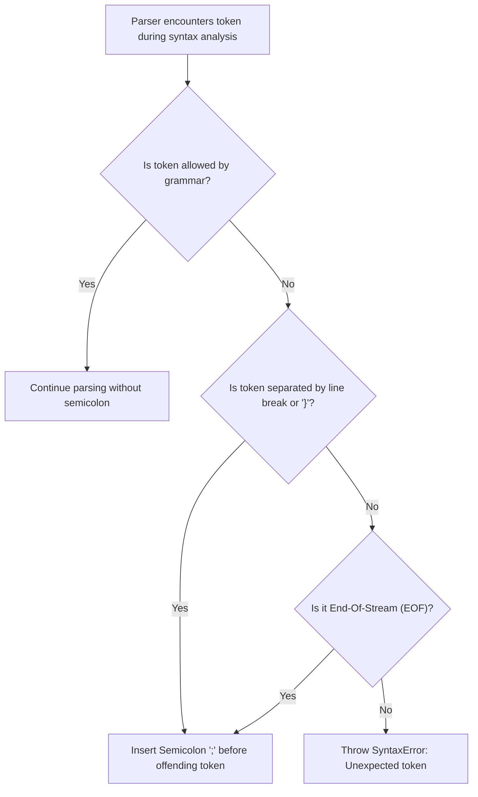

# Expressions, Statements & Automatic Semicolon Insertion (ASI)

> An exhaustive technical reference on ECMAScript expressions, statements, grammar ambiguities, and the complete specification rules of Automatic Semicolon Insertion (ASI).

| Metadata | Details |
| :--- | :--- |
| **Level** | Beginner to Intermediate |
| **Prerequisites** | [01_variables.md](./01_variables.md), [04_operators.md](./04_operators.md) |
| **Time to Read** | 25 minutes |
| **Status** | Complete |
| **ECMAScript Standard** | ES6 (ES2015) to Current (ES2024/ES2025) |

---

## Table of Contents
1. [What & Why](#1-what--why)
2. [Core Concepts](#2-core-concepts)
3. [How It Works: The ECMAScript ASI Grammar Rules](#3-how-it-works-the-ecmascript-asi-grammar-rules)
4. [Syntax & Grammar Reference](#4-syntax--grammar-reference)
5. [Practical Examples](#5-practical-examples)
6. [Edge Cases & Gotchas](#6-edge-cases--gotchas)
7. [Common Mistakes & Anti-Patterns](#7-common-mistakes--anti-patterns)
8. [Performance Characteristics](#8-performance-characteristics)
9. [Engine Internals: V8 Parser Lookahead & Token Scanning](#9-engine-internals-v8-parser-lookahead--token-scanning)
10. [Best Practices & Style Guide](#10-best-practices--style-guide)
11. [Real-World Applications & Case Studies](#11-real-world-applications--case-studies)
12. [Interview Questions & Deep Dives](#12-interview-questions--deep-dives)
13. [Exercises & Challenges](#13-exercises--challenges)

---

## 1. What & Why

Every construct in a JavaScript program belongs to one of two fundamental syntactic categories:
1. **Expressions**: Syntactic units that evaluate to a **value**. Expressions can appear anywhere a value is expected (function arguments, object values, template literals, conditional operands).
2. **Statements**: Syntactic units that execute an **action** or control execution flow. Statements do not resolve to values that can be bound to variables.

```
┌────────────────────────────────────────────────────────┐
│                      Expressions                       │
│                   (Produce Values)                     │
│                                                        │
│  • 42, "hello", [1, 2]         • x = 10 (returns 10)   │
│  • a + b, x ?? y               • () => {}              │
│  • fetchUserData()             • isReady ? "go" : "wait"│
└──────────────────────────┬─────────────────────────────┘
                           │
                           ▼ Can be wrapped to become
┌────────────────────────────────────────────────────────┐
│                   Expression Statement                 │
│              (Expression terminated by ;)              │
│                                                        │
│   doSomething();                                       │
│   count++;                                             │
└──────────────────────────┬─────────────────────────────┘
                           │
                           ▼ Co-exists alongside
┌────────────────────────────────────────────────────────┐
│                       Statements                       │
│                   (Perform Actions)                    │
│                                                        │
│  • let x = 1; (Declaration)    • if (...) { ... }      │
│  • for (...) { ... } (Loop)    • return value;         │
│  • try { ... } catch { ... }   • class User { ... }    │
└────────────────────────────────────────────────────────┘
```

Furthermore, JavaScript features **Automatic Semicolon Insertion (ASI)**—a set of grammar rules where the parser injects semicolons when encountering specific line terminators. When misunderstood, ASI causes silent runtime defects (such as truncated return statements) or parsing crashes.

---

## 2. Core Concepts

### 2.1 The "Can I Pass It To `console.log()`?" Test
A simple heuristic to differentiate expressions from statements:
- If you can pass the construct into `console.log(...)` or embed it inside a template literal `${...}`, it is an **expression**.
- If passing it causes a `SyntaxError`, it is a **statement**:
```javascript
console.log(3 + 5);                 // VALID: 3 + 5 is an expression (evaluates to 8)
console.log(isAuth ? "yes" : "no"); // VALID: ternary conditional is an expression
// console.log(if (isAuth) "yes");  // SYNTAX ERROR: if is a statement!
// console.log(let x = 10);         // SYNTAX ERROR: variable declaration is a statement!
```

### 2.2 Expression Statements
An **expression statement** is simply an expression evaluated solely for its side effects, followed by a semicolon or newline:
```javascript
alert("Hello"); // Call expression evaluated as a statement
counter++;      // Update expression evaluated as a statement
```

### 2.3 Blocks as Statements vs. Objects as Expressions
The curly brace `{ ... }` is syntactically overloaded in JavaScript:
- At the start of a statement: Interpreted as a **Block Statement** (creates a lexical scope for `let`/`const`):
  ```javascript
  {
    const temp = 42;
    console.log(temp);
  }
  ```
- In an expression context: Interpreted as an **Object Literal**:
  ```javascript
  const user = { name: "Alice" };
  ```
This ambiguity requires wrapping object literals in parentheses when returning them from concise arrow functions: `() => ({ name: "Alice" })`.

---

## 3. How It Works: The ECMAScript ASI Grammar Rules

Automatic Semicolon Insertion is defined across three fundamental specification rules (§12.9 ECMAScript Spec):



### Rule 1: The Offending Token Rule
When parsing from left to right, if a token is encountered that is not allowed by the formal grammar, a semicolon is automatically inserted before that token IF:
1. The token is separated from the previous token by at least one **Line Terminator** (newline).
2. Or the offending token is a closing brace `}`.

### Rule 2: The End-of-Stream Rule
When the end of the input stream of tokens is reached and the parser is unable to parse the complete input as a valid program, a semicolon is automatically inserted at the end of the stream.

### Rule 3: Restricted Productions (The Danger Zone)
In certain syntactic productions, no line terminator is permitted between specific tokens. If a line break occurs, a semicolon is **forcibly inserted immediately**, truncating execution!
The restricted keywords are:
- `return`
- `throw`
- `break`
- `continue`
- `yield`
- `await`
- Postfix operators `++` and `--`

```javascript
// Example of Restricted Production:
function calculate() {
  return        // Line terminator detected after 'return'!
    { id: 1 };  // Semicolon forcibly inserted after return: 'return;'
}
console.log(calculate()); // undefined! The object { id: 1 } is never evaluated!
```

---

## 4. Syntax & Grammar Reference

### 4.1 Leading Token Traps in Semicolon-Free Code
When writing JavaScript without semicolons, beginning a line with any of the following characters will **NOT** trigger ASI, causing the line to be evaluated as a continuation of the previous line:

| Leading Character | Intended Behavior | Actual Runtime Behavior | Resulting Defect |
| :--- | :--- | :--- | :--- |
| `[` | Array literal | Array subscript index lookup | `TypeError: Cannot read properties of undefined` |
| `(` | Parenthesized expression | Function call invocation | `TypeError: x is not a function` |
| `/` | Regular expression literal | Division operator | `SyntaxError: Invalid regular expression flags` |
| `+` | Unary plus | Binary addition | Unintended arithmetic string concatenation |
| `-` | Unary negation | Binary subtraction | Unintended numeric subtraction |
| `` ` `` | Template literal | Tagged template literal invocation | `TypeError: x is not a function` |

---

## 5. Practical Examples

### Example 1: The Classic `return` ASI Trap and Dissection

```javascript
// THE ASI DISASTER:
function getUserBroken() {
  return
  {
    name: "Grace Hopper"
  };
}

// HOW THE ENGINE PARSES IT:
// function getUserBroken() {
//   return; // ASI inserted due to Restricted Production rule!
//   {
//     name: "Grace Hopper"; // Interpreted as a labeled block statement!
//   };
// }

console.log(getUserBroken()); // undefined

// THE FIX: Opening brace must remain on the same line as 'return'
function getUserCorrect() {
  return {
    name: "Grace Hopper"
  };
}

console.log(getUserCorrect()); // { name: 'Grace Hopper' }
```

### Example 2: The Semicolon-Free Array Bracket Trap

```javascript
// Intended: two separate statements
const a = 1
const b = 2

// Intended: create an array and iterate
// BUT line starts with '[':
[a, b].forEach((x) => console.log(x))

// HOW THE RUNTIME SEES IT:
// const a = 1;
// const b = 2[a, b].forEach(...);
// 2[a, b] evaluates as property access on number 2, throwing TypeError!
```

### Example 3: Returning Object Literals from Arrow Functions

```javascript
// BUGGY: Curly braces parsed as a function body block, not an object literal!
const makeUserBuggy = (id, name) => { id: id, name: name };
console.log(makeUserBuggy(1, "Ada")); // undefined! (Evaluated as labeled statements returning nothing)

// CORRECT: Wrap object literal in parentheses to force an expression context
const makeUserCorrect = (id, name) => ({ id: id, name: name });
console.log(makeUserCorrect(1, "Ada")); // { id: 1, name: 'Ada' }
```

### Example 4: Function Declaration vs. Function Expression Context

```javascript
// 1. Function Declaration (Statement position at root of scope)
// Hoisted completely with definition
function calculateTotal(items) {
  return items.reduce((acc, n) => acc + n, 0);
}

// 2. Function Expression (Expression position assigned to variable)
// Only the variable binding 'multiply' is hoisted (in TDZ)
const multiply = function (x, y) {
  return x * y;
};

// 3. Named Function Expression (NFE)
// The name 'factorial' is scoped ONLY inside the function itself for recursion
const computeFactorial = function factorial(n) {
  if (n <= 1) return 1;
  return n * factorial(n - 1); // 'factorial' accessible here
};

console.log(computeFactorial(5)); // 120
// console.log(factorial(5)); // ReferenceError: factorial is not defined
```

### Example 5: Block Statements for Scope Isolation Without Functions

```javascript
// Standalone block statements create lexical scopes without closure overhead
const globalId = "app_100";

{
  // Temporary calculation scope
  const tempBuffer = new Uint8Array([10, 20, 30]);
  const checksum = tempBuffer[0] ^ tempBuffer[1] ^ tempBuffer[2];
  console.log("Checksum:", checksum);
  // tempBuffer is eligible for garbage collection as soon as this block exits!
}

// console.log(tempBuffer); // ReferenceError: tempBuffer is not defined
```

---

## 6. Edge Cases & Gotchas

### 6.1 Labeled Statements vs. Object Literals in `eval`
When evaluating a string containing curly braces with `eval()`, the engine parses `{ a: 1 }` in statement position:
```javascript
// eval("{ a: 1 }");
// The parser sees:
// {
//    a: 1;  <- A labeled statement with label 'a' and expression 1!
// }
console.log(eval("{ a: 1 }")); // 1 (Not an object!)

// To parse as an object expression, wrap in parentheses:
console.log(eval("({ a: 1 })")); // { a: 1 }
```

### 6.2 The Postfix Increment ASI Exception
Because of restricted productions, a newline between an identifier and `++` causes the `++` to be parsed as a **prefix operator** on the next line:
```javascript
let i = 0;
let j = 0;

i
++
j;

// Parsed as:
// i;
// ++j;
console.log(`i: ${i}, j: ${j}`); // i: 0, j: 1
```

### 6.3 Empty Statements
A single semicolon `;` on its own line constitutes a valid **empty statement**. While harmless in isolation, placing an accidental empty statement after an `if` or `for` loop produces catastrophic logic errors:
```javascript
let status = "offline";

// FATAL BUG: Semicolon immediately after 'if' terminates the statement!
if (status === "online"); {
  console.log("System is active!"); // ALWAYS EXECUTES regardless of status!
}
```

---

## 7. Common Mistakes & Anti-Patterns

| Anti-Pattern | Why It Fails | Correct Approach |
| :--- | :--- | :--- |
| **Placing newline after `return`** | ASI inserts a semicolon after `return`, returning `undefined`. | Keep the returned expression or opening brace on the same line as `return`. |
| **Accidental semicolon after `if` / `while`** | Terminates the condition statement immediately; following block runs unconditionally. | Never place a semicolon immediately following `if (...)` or `while (...)`. |
| **Unparenthesized object in arrow function** | Braces parsed as function body block; labels evaluate to `undefined`. | Wrap returned object literals in parentheses: `() => ({ ... })`. |
| **Starting lines with `[` or `(` without semicolons** | Evaluates as property access or function call on previous line. | Prepend line with a defensive semicolon `;[` or use a standard formatter. |
| **Confusing assignment expression with statement** | `x = 5` evaluates to `5`, which causes accidental assignment inside `if (x = 5)`. | Use strict equality `if (x === 5)`. |
| **Using `new` without parentheses on chained calls** | `new Foo().bar()` vs `new (Foo().bar)()` have radically different operator precedence. | Always use explicit parentheses: `(new Foo()).bar()`. |

---

## 8. Performance Characteristics

In modern JavaScript engines (V8, SpiderMonkey):
- **ASI Parsing Overhead**: ASI does not degrade runtime speed; it only occurs during the initial AST parsing phase. However, excessive lookaheads and token rewinds in large unminified codebases can add minor milliseconds to parse latency.
- **Minification**: Production minifiers (terser, esbuild) intentionally insert semicolons to collapse code onto single lines, eliminating all ASI ambiguity.

---

## 9. Engine Internals: V8 Parser Lookahead & Token Scanning

The V8 parser (`src/parsing/parser-base.h`) handles ASI using token lookahead:
```
Current Token: Token::RETURN
Next Token (Peek): Token::LINE_TERMINATOR
Action: Lookahead detects restricted production boundary -> Synthesize Token::SEMICOLON
```
1. **Scanner**: Scans bytes and converts them into tokens (`Token::IDENTIFIER`, `Token::LBRACE`, etc.).
2. **Lookahead**: When a grammatical error would occur, the scanner checks `scanner()->has_line_terminator_before_next()`.
3. **Recovery**: If a newline exists and the current position satisfies Rule 1 or Rule 3, the parser synthesizes a virtual semicolon token and proceeds down the parse tree without emitting an error.

---

## 10. Best Practices & Style Guide

1. **Let Prettier Enforce Semicolons Deterministically**: Whether your team prefers semicolons or a semicolon-free style, automate it 100% via Prettier. Never manually debate ASI rules.
2. **Never Break Lines After `return` or `throw`**:
   ```javascript
   // Recommended style:
   return (
     <div>
       <h1>Always wrap multi-line returns</h1>
     </div>
   );
   ```
3. **Ban Accidental Empty Statements**: Enable the ESLint rule:
   ```json
   { "rules": { "no-extra-semi": "error", "no-empty": "error" } }
   ```
4. **Use Parentheses for Complex Expressions**: Even when operator precedence is known, use grouping parentheses to make developer intent explicit.

---

## 11. Real-World Applications & Case Studies

### Case Study: Production Outage Caused by Semicolon-Free IIFE
A high-traffic e-commerce frontend crashed during a Black Friday deployment:
```javascript
// File: analytics.js
console.log("Analytics tracker loaded")

// File: tracking.js (bundled immediately after without semicolon)
(function initTracker() {
  window.tracker = new Tracker();
})()
```
- **What Happened**: When the bundler concatenated the two files without semicolons, the code became:
  ```javascript
  console.log("Analytics tracker loaded")(function initTracker() { ... })()
  ```
- **Error**: `console.log(...)` returns `undefined`. The JavaScript runtime attempted to execute `undefined(...)`, throwing:
  `TypeError: console.log(...) is not a function`.
- **Impact**: Checkout button tracking scripts failed, halting order transactions for 18 minutes.
- **Resolution**: Implemented mandatory Prettier formatting with `"semi": true` in CI.

---

## 12. Interview Questions & Deep Dives

<details>
<summary><strong>1. Explain the difference between an Expression and a Statement in JavaScript.</strong></summary>

**Answer:**
An **expression** is any valid unit of code that resolves to a value (e.g. `2 + 2`, `x.y`, `fn()`, `a ? b : c`). Expressions can be passed as arguments, assigned to variables, or embedded in template strings.

A **statement** is an instruction that directs the execution flow or declares a binding (e.g. `if`, `while`, `let x = 1`, `return`, `class`). Statements do not evaluate to values and cannot be used where an expression is expected.
</details>

<details>
<summary><strong>2. What are Restricted Productions in ECMAScript ASI?</strong></summary>

**Answer:**
Restricted productions are grammar rules where the ECMAScript specification explicitly forbids a line terminator between two tokens. If a line break is present, the parser automatically injects a semicolon immediately after the first token.

The restricted keywords are `return`, `throw`, `break`, `continue`, `yield`, `await`, and postfix `++`/`--`. This is why a line break after `return` results in `return;` returning `undefined`.
</details>

<details>
<summary><strong>3. Why does `(() => { return { a: 1 } })()` work, but `(() => { a: 1 })()` returns `undefined`?</strong></summary>

**Answer:**
In `() => { a: 1 }`, the curly braces are interpreted as the **function body block**, not an object literal. Inside the block, `a:` is interpreted as a **statement label**, and `1` is an expression statement. Since there is no explicit `return` statement in the block, the function returns `undefined`.

To return an object literal from a concise body arrow function, it must be enclosed in parentheses `() => ({ a: 1 })` to force an expression context.
</details>

<details>
<summary><strong>4. Under what exact conditions will JavaScript NOT insert a semicolon at a newline?</strong></summary>

**Answer:**
JavaScript will not insert a semicolon if the line break occurs where the grammar can legally continue parsing the next token as part of the current statement. Common examples:
- The line ends with an unclosed parenthesis `(`, bracket `[`, or brace `{`.
- The line ends with a binary operator (e.g. `+`, `-`, `*`, `&&`, `,`).
- The next line begins with a token that can continue the statement, such as `.` (dot property access), `[` (computed property access), or `(` (function invocation).
</details>

<details>
<summary><strong>5. What is the difference between a Function Declaration and a Function Expression?</strong></summary>

**Answer:**
- A **Function Declaration** appears in statement context (e.g. root of module or block) with the mandatory syntax `function name(...) { ... }`. It is hoisted completely along with its function body, allowing invocation before its line of definition.
- A **Function Expression** appears in expression context (e.g. assigned to a variable, passed as an argument, or wrapped in an IIFE). Only the variable declaration (if any) is hoisted; the function definition is assigned only when execution reaches that line.
</details>

<details>
<summary><strong>6. Why is `x = 5` an expression, and what is its return value?</strong></summary>

**Answer:**
In JavaScript, the assignment operator `=` forms an assignment expression. It evaluates the right-hand operand, assigns that value to the left-hand identifier or property, and **evaluates to the assigned value itself**. Thus, `x = 5` evaluates to `5`. This allows chained assignments like `a = b = c = 5`.
</details>

<details>
<summary><strong>7. How does a labeled statement work in JavaScript and where is it useful?</strong></summary>

**Answer:**
A labeled statement prefixes any statement with an identifier and a colon: `labelName: statement`. It is primarily used with nested loops to allow `break labelName;` or `continue labelName;` to jump out of multiple loop levels at once, rather than only exiting the innermost loop.
</details>

<details>
<summary><strong>8. What happens when an empty statement `;` is placed after a `for` loop header?</strong></summary>

**Answer:**
`for (let i = 0; i < 5; i++); { console.log(i); }`
The semicolon terminates the `for` loop body as an empty statement. The loop iterates 5 times doing nothing. Afterward, the following block executes once. However, because `let i` is scoped to the loop header, referencing `i` inside the block throws a `ReferenceError: i is not defined`.
</details>

---

## 13. Exercises & Challenges

### Exercise 1 (Easy): Identify Expressions vs. Statements
**Task**: Categorize each of the following lines as either an Expression (E) or a Statement (S):
1. `let total = 100;`
2. `total > 50`
3. `throw new Error("Failed");`
4. `(x) => x * 2`
5. `Math.PI`
6. `switch(val) {}`

<details>
<summary><strong>Solution</strong></summary>

1. **Statement** (Variable declaration statement)
2. **Expression** (Relational binary expression evaluating to boolean)
3. **Statement** (Throw statement)
4. **Expression** (Arrow function expression)
5. **Expression** (Member access expression evaluating to 3.14159...)
6. **Statement** (Switch control-flow statement)
</details>

### Exercise 2 (Easy): Fix the Semicolon-Free IIFE Bug
**Task**: Without adding semicolons to the end of every line, fix the syntax/runtime bug in this code snippet:

```javascript
const title = "Dashboard"
(function logTitle() {
  console.log(title)
})()
```

<details>
<summary><strong>Solution</strong></summary>

Prepend a defensive semicolon before the opening parenthesis of the IIFE:

```javascript
const title = "Dashboard"
;(function logTitle() {
  console.log(title)
})()
```
Alternatively, write semicolons at the end of every line.
</details>

### Exercise 3 (Medium): Convert Statement Block to Concise Expression
**Task**: Refactor this multi-statement function into a single concise-body arrow function that returns an object containing calculated statistics without using the `return` keyword.

```javascript
function getStats(scores) {
  const sum = scores.reduce((a, b) => a + b, 0);
  const avg = sum / scores.length;
  return { sum: sum, avg: avg };
}
```

<details>
<summary><strong>Solution</strong></summary>

```javascript
const getStats = (scores) => ({
  sum: scores.reduce((a, b) => a + b, 0),
  avg: scores.reduce((a, b) => a + b, 0) / scores.length
});

console.log(getStats([10, 20, 30])); // { sum: 60, avg: 20 }
```
</details>

### Exercise 4 (Medium): Break Out of Nested Loops with Statement Labels
**Task**: Write a function `findMatrixCoordinates(matrix, target)` that searches a 2D array and uses a labeled `break` statement to exit immediately upon finding the target, returning `[row, col]` or `null`.

<details>
<summary><strong>Solution</strong></summary>

```javascript
function findMatrixCoordinates(matrix, target) {
  let result = null;

  matrixSearch: for (let r = 0; r < matrix.length; r++) {
    for (let c = 0; c < matrix[r].length; c++) {
      if (matrix[r][c] === target) {
        result = [r, c];
        break matrixSearch; // Exits both loops immediately
      }
    }
  }

  return result;
}

const grid = [
  [1, 2, 3],
  [4, 5, 6],
  [7, 8, 9]
];

console.log(findMatrixCoordinates(grid, 5)); // [1, 1]
console.log(findMatrixCoordinates(grid, 99)); // null
```
</details>

### Exercise 5 (Hard): ASI Simulator Parser
**Task**: Build a lightweight function `detectASIInsertions(lines)` that analyzes an array of JavaScript code strings and identifies which lines will trigger Automatic Semicolon Insertion under Rule 3 (Restricted Productions).

<details>
<summary><strong>Solution</strong></summary>

```javascript
function detectASIInsertions(codeLines) {
  const restrictedKeywords = ["return", "throw", "break", "continue", "yield", "await"];
  const asiInsertions = [];

  for (let i = 0; i < codeLines.length; i++) {
    const line = codeLines[i].trim();

    // Check if line is purely a restricted keyword without an expression or semicolon
    if (restrictedKeywords.includes(line)) {
      asiInsertions.push({
        line: i + 1,
        keyword: line,
        injected: `${line};`
      });
    }
  }

  return asiInsertions;
}

const sampleCode = [
  "function test() {",
  "  return",
  "  { id: 10 };",
  "}"
];

console.log(detectASIInsertions(sampleCode));
// Output: [ { line: 2, keyword: 'return', injected: 'return;' } ]
```
</details>

### Exercise 6 (Hard): Build an Expression Evaluator Pipeline
**Task**: Implement a function `evaluateChain(initialValue, ...expressions)` that executes a series of unary transform expressions, where each expression can be either a function or an object mapping methods, demonstrating pure expression chaining.

<details>
<summary><strong>Solution</strong></summary>

```javascript
function evaluateChain(initialValue, ...expressions) {
  return expressions.reduce((currentValue, expr) => {
    if (typeof expr === "function") {
      return expr(currentValue);
    }
    if (expr && typeof expr === "object" && typeof expr.transform === "function") {
      return expr.transform(currentValue);
    }
    throw new TypeError("Each expression must be a callable function or transform object");
  }, initialValue);
}

// Verification
const result = evaluateChain(
  5,
  (n) => n * 2,       // 10
  (n) => n + 3,       // 13
  { transform: (n) => `Total: $${n}.00` } // "Total: $13.00"
);

console.log(result); // "Total: $13.00"
```
</details>
