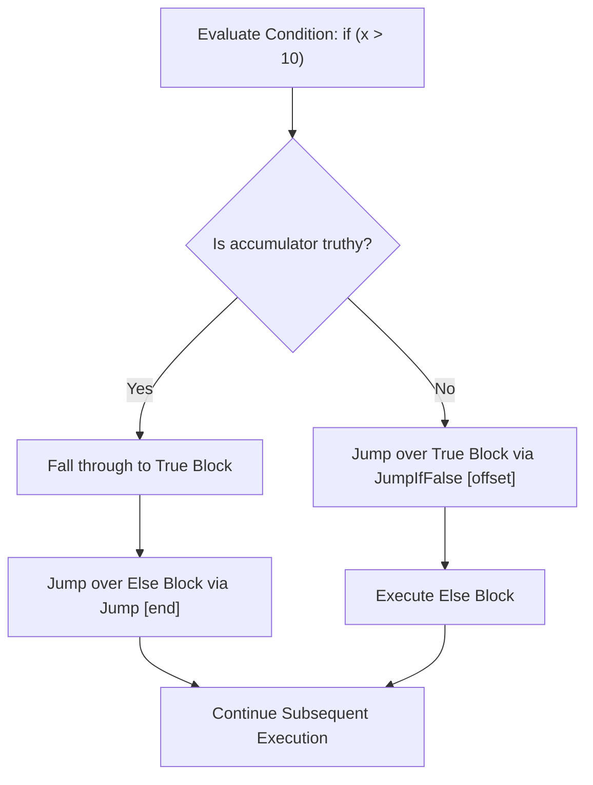

# Conditionals, Branching & Pattern Dispatch

> An exhaustive technical reference on JavaScript control flow: `if/else`, strict `switch` mechanics, ternary expressions, object lookup dispatch tables, branch prediction, and TC39 pattern matching.

| Metadata | Details |
| :--- | :--- |
| **Level** | Beginner to Intermediate |
| **Prerequisites** | [03_type-conversion-and-equality.md](./03_type-conversion-and-equality.md), [05_expressions-and-statements.md](./05_expressions-and-statements.md) |
| **Time to Read** | 25 minutes |
| **Status** | Complete |
| **ECMAScript Standard** | ES6 (ES2015) to Current (ES2024/ES2025) |

---

## Table of Contents
1. [What & Why](#1-what--why)
2. [Core Concepts](#2-core-concepts)
3. [How It Works: Bytecode & CPU Branch Prediction](#3-how-it-works-bytecode--cpu-branch-prediction)
4. [Syntax & Control Flow Reference](#4-syntax--control-flow-reference)
5. [Practical Examples](#5-practical-examples)
6. [Edge Cases & Gotchas](#6-edge-cases--gotchas)
7. [Common Mistakes & Anti-Patterns](#7-common-mistakes--anti-patterns)
8. [Performance Characteristics](#8-performance-characteristics)
9. [Engine Internals: V8 Jump Tables & Switch Bytecode](#9-engine-internals-v8-jump-tables--switch-bytecode)
10. [Best Practices & Style Guide](#10-best-practices--style-guide)
11. [Real-World Applications & Case Studies](#11-real-world-applications--case-studies)
12. [Interview Questions & Deep Dives](#12-interview-questions--deep-dives)
13. [Exercises & Challenges](#13-exercises--challenges)

---

## 1. What & Why

Conditionals govern deterministic decision-making in software execution. Based on runtime state, they route program flow across discrete logical pathways.

JavaScript provides three core branching constructs:
1. **`if...else if...else`**: Statement-based general branching evaluating arbitrary boolean truthiness.
2. **Ternary Operator (`? :`)**: Expression-based inline branching returning values directly into assignments or expressions.
3. **`switch`**: Statement-based multi-way branching comparing an expression against discrete values using **strict equality (`===`)**.

```
┌─────────────────────────────────────────────────────────┐
│                 JavaScript Decision Paths               │
├─────────────────────────────────────────────────────────┤
│ 1. Binary Boolean Choice:                               │
│    • if (condition) { ... } else { ... }                │
│    • const val = condition ? a : b;                     │
│                                                         │
│ 2. Discrete Multi-Way Value Matching:                   │
│    • switch (action.type) { case 'ADD': ... }           │
│    • handlerMap[action.type]?.() (Lookup Table)         │
│                                                         │
│ 3. Guard Clauses / Early Exit:                          │
│    • if (!user) return null;                            │
└─────────────────────────────────────────────────────────┘
```

Selecting the appropriate construct directly impacts code readability, maintainability, CPU branch prediction, and engine optimization.

---

## 2. Core Concepts

### 2.1 The `if...else` Statement and Truthiness
In an `if (condition)` statement, the condition is evaluated and passed to the internal `ToBoolean` abstract operation. If the result is `true`, the subsequent block executes.
- **Always Use Braces**: Omitting curly braces `{}` for single-line statements is a notorious source of bugs (e.g. Apple's "goto fail" vulnerability).
- **Guard Clauses**: Invert conditions to return early, flattening deeply nested conditional pyramids.

### 2.2 The Ternary Operator (`? :`)
The ternary operator is the **only operator in JavaScript taking three operands**:
`condition ? expressionIfTrue : expressionIfFalse`
- It is an **expression**, meaning it evaluates to a value that can be assigned, passed into functions, or embedded in template strings.
- Ternary operators are **right-associative**: `a ? b : c ? d : e` evaluates as `a ? b : (c ? d : e)`.
- **Nesting Rule**: Deeply nesting ternaries creates unreadable code; restrict ternaries to simple binary choices.

### 2.3 The `switch` Statement Mechanics
The `switch (expression)` statement compares `expression` against each `case value:` using **strict equality (`===`)**.
- **No Type Coercion**: A `case 1:` will **never** match the string `"1"`.
- **Fallthrough**: When a matching case lacks a `break` or `return` statement, execution falls through into subsequent cases unconditionally until a `break` is encountered.
- **Scope Collision**: All cases in a switch share a single block scope unless explicitly wrapped in curly braces `{ ... }`.

### 2.4 Object and Map Lookup Tables
For discrete state or action dispatch, an object literal or `Map` lookup table frequently outperforms `switch` statements in clarity and testability:
```javascript
const statusHandlers = {
  PENDING: () => "Order submitted",
  SHIPPED: () => "Order in transit",
  DELIVERED: () => "Order completed"
};
const message = statusHandlers[status]?.() ?? "Unknown status";
```

---

## 3. How It Works: Bytecode & CPU Branch Prediction



### CPU Branch Prediction
Modern processors use pipelining to speculatively execute instructions before conditional jumps resolve:
- **Predictable Branches**: If an `if` condition evaluates to `true` 99% of the time (such as error checks that rarely fail), the CPU branch predictor caches this path, resulting in zero pipeline stalls (~1 cycle).
- **Branch Misprediction**: If a condition toggles unpredictably between true and false, the CPU must flush its entire execution pipeline on every miss, stalling execution for 15–20 CPU clock cycles.

---

## 4. Syntax & Control Flow Reference

### 4.1 Switch Statement with Scoped Cases

```javascript
switch (command) {
  case "START": {
    // Scoped block: local bindings do not leak or collide
    const timestamp = Date.now();
    startService(timestamp);
    break;
  }
  case "STOP": {
    // Re-declaring 'const timestamp' is fully valid here due to block isolation
    const timestamp = Date.now();
    stopService(timestamp);
    break;
  }
  case "PAUSE":
  case "SUSPEND": // Intentional fallthrough grouping multiple cases
    pauseService();
    break;
  default:
    console.warn(`Unrecognized command: ${command}`);
}
```

---

## 5. Practical Examples

### Example 1: Multi-Branch HTTP Status Code Router

```javascript
/**
 * Categorizes HTTP status codes using switch fallthrough and ranges.
 * @param {number} code
 * @returns {string} Category description
 */
function categorizeHttpStatus(code) {
  switch (true) {
    case code >= 200 && code < 300:
      return "2xx: Success";
    case code >= 300 && code < 400:
      return "3xx: Redirection";
    case code === 401 || code === 403:
      return "4xx: Authentication / Authorization Failure";
    case code >= 400 && code < 500:
      return "4xx: Client Error";
    case code >= 500 && code < 600:
      return "5xx: Server Error";
    default:
      return "Unknown Status Code";
  }
}

console.log(categorizeHttpStatus(200)); // "2xx: Success"
console.log(categorizeHttpStatus(403)); // "4xx: Authentication / Authorization Failure"
console.log(categorizeHttpStatus(502)); // "5xx: Server Error"
```

### Example 2: Strategy Dispatch Map Pattern (Functional Alternative to Switch)

```javascript
// Dictionary of command handlers avoiding massive switch statements
const mathOperations = new Map([
  ["add", (a, b) => a + b],
  ["sub", (a, b) => a - b],
  ["mul", (a, b) => a * b],
  ["div", (a, b) => {
    if (b === 0) throw new RangeError("Division by zero");
    return a / b;
  }]
]);

function calculate(operation, a, b) {
  const handler = mathOperations.get(operation);
  if (!handler) {
    throw new TypeError(`Unsupported operation: ${operation}`);
  }
  return handler(a, b);
}

console.log(calculate("add", 10, 5)); // 15
console.log(calculate("div", 20, 4)); // 5
```

### Example 3: Flattening Deep Nesting via Guard Clauses

```javascript
// BAD: Deeply nested conditional pyramid ("Pyramid of Doom")
function processPaymentBad(user, amount) {
  if (user) {
    if (user.isActive) {
      if (user.balance >= amount) {
        user.balance -= amount;
        return { success: true };
      } else {
        return { error: "Insufficient funds" };
      }
    } else {
      return { error: "User inactive" };
    }
  } else {
    return { error: "User not found" };
  }
}

// GOOD: Inverted guard clauses with early returns
function processPaymentClean(user, amount) {
  if (!user) return { error: "User not found" };
  if (!user.isActive) return { error: "User inactive" };
  if (user.balance < amount) return { error: "Insufficient funds" };

  user.balance -= amount;
  return { success: true };
}

console.log(processPaymentClean(null, 50)); // { error: 'User not found' }
console.log(processPaymentClean({ isActive: true, balance: 100 }, 40)); // { success: true }
```

### Example 4: Complex Ternary vs. Lookup Expression

```javascript
// Complex condition determining notification badges
const user = { role: "admin", unreadCount: 5 };

// Unreadable nested ternary:
// const badge = user.role === "admin" ? (user.unreadCount > 0 ? "urgent" : "admin") : (user.unreadCount > 0 ? "new" : "none");

// Idiomatic, clean resolution:
function getNotificationBadge({ role, unreadCount }) {
  if (unreadCount === 0) return role === "admin" ? "admin" : "none";
  return role === "admin" ? "urgent" : "new";
}

console.log(getNotificationBadge(user)); // "urgent"
```

### Example 5: TC39 Pattern Matching Proposal Simulation

While native pattern matching (`match (x) { ... }`) remains at Stage 2/3 in TC39, we can write an expressive functional matcher today:

```javascript
/**
 * Functional pattern matching utility
 * @param {unknown} value
 */
function match(value) {
  return {
    on(predicate, handler) {
      if (typeof predicate === "function" ? predicate(value) : predicate === value) {
        return {
          on: () => this,
          otherwise: () => handler(value)
        };
      }
      return this;
    },
    otherwise(defaultHandler) {
      return defaultHandler(value);
    }
  };
}

const response = { status: 404, message: "Page Not Found" };

const result = match(response.status)
  .on(200, () => "OK: Request Succeeded")
  .on(401, () => "Unauthorized: Please Login")
  .on(404, () => `Not Found: ${response.message}`)
  .on((s) => s >= 500, () => "Server Error Encountered")
  .otherwise(() => "Unknown Status");

console.log(result); // "Not Found: Page Not Found"
```

---

## 6. Edge Cases & Gotchas

### 6.1 `switch` Does Strict Equality (`===`) Matching
Passing a string to a `switch` with numeric cases will **never** match:
```javascript
const input = "1";

switch (input) {
  case 1:
    console.log("Matched number 1"); // NEVER EXECUTES! "1" === 1 is false
    break;
  case "1":
    console.log("Matched string '1'"); // Matched!
    break;
}
```

### 6.2 The Dangling `else` Ambiguity
When nested `if` statements omit curly braces, the `else` clause binds to the **nearest** `if`, not the outer `if`:
```javascript
let isAuth = false;
let isAdmin = true;

// WRONG: Without braces, else binds to 'if (isAdmin)'!
if (isAuth)
  if (isAdmin)
    console.log("Admin access");
else
  console.log("Unauthenticated"); // DOES NOT RUN!

// FIX: Always use explicit curly braces:
if (isAuth) {
  if (isAdmin) {
    console.log("Admin access");
  }
} else {
  console.log("Unauthenticated"); // Correctly outputs!
}
```

### 6.3 Variable Declaration Hoisting Across `case` Branches
Without explicit curly braces `{ ... }`, declaring a `let` or `const` in one case branch is in the same scope as all other case branches, causing a `SyntaxError`:
```javascript
switch (action) {
  case "ADD":
    const total = 100; // SyntaxError: Identifier 'total' has already been declared
    break;
  case "SUB":
    const total = 50;  // Collision!
    break;
}
```

---

## 7. Common Mistakes & Anti-Patterns

| Anti-Pattern | Why It Fails | Correct Approach |
| :--- | :--- | :--- |
| **Omitting `break` in a `switch` case** | Unintentionally falls through and executes following case statements. | Always include `break`, `return`, or a `// fallthrough` comment. |
| **Omitting curly braces on single-line `if`** | Subsequent line additions easily fall outside the condition block. | Enforce braces on all conditionals via ESLint `curly: ["error", "all"]`. |
| **Deeply nesting ternary operators** | Obscures logic, making debugging and maintenance difficult. | Use `if/else`, guard clauses, or dispatch maps. |
| **Comparing boolean literals in conditions** | `if (isReady === true)` is redundant and misses truthy values. | Use `if (isReady)` or `if (Boolean(isReady))`. |
| **Declaring `let`/`const` inside cases without braces** | All case branches share the switch's block scope, causing declaration collisions. | Wrap case logic in curly braces `case "A": { ... break; }`. |
| **Evaluating loose equality in conditions** | `if (val == 0)` matches `""`, `false`, and `[0]`. | Use strict equality `if (val === 0)`. |

---

## 8. Performance Characteristics

| Branching Construct | Engine Execution Strategy | Relative Speed |
| :--- | :--- | :--- |
| **Guard Clause (`if (!x) return`)** | Inlined CPU jump instruction | **Fastest** (~0.2 ns) |
| **Dense Integer `switch` (e.g. 0 to 5)** | Compiles to O(1) CPU Jump Table (`SwitchOnSmiNoFeedback`) | **Extremely Fast** (~0.4 ns) |
| **Sparse String `switch`** | Evaluates linearly O(N) using `===` checks | Moderate (~1.5–5.0 ns for N branches) |
| **Object / Map Lookup Table** | Hash table lookup (`Map.prototype.get` or IC shape) | Constant O(1) (~1.2 ns) |

---

## 9. Engine Internals: V8 Jump Tables & Switch Bytecode

When V8's Ignition compiles a `switch` statement:
1. **Dense Smi Switch**: If the cases are consecutive small integers (e.g., `0, 1, 2, 3`), Ignition emits `SwitchOnSmiNoFeedback`. The engine allocates a contiguous jump table in memory. Branching is resolved in $O(1)$ time by indexing the jump table directly.
2. **String / Arbitrary Switch**: If cases are strings or sparse values, Ignition emits sequential `StrictEqual` and `JumpIfFalse` bytecodes, evaluating each case sequentially from top to bottom.

---

## 10. Best Practices & Style Guide

1. **Enforce Curly Braces Globally**: Never allow naked `if` statements:
   ```json
   { "rules": { "curly": ["error", "all"] } }
   ```
2. **Prefer Early Returns Over Nested Conditions**: Keep indentation levels $\le 2$ by checking invalid cases first and returning early.
3. **Always Scope Complex `switch` Cases**: Wrap cases with local variables in curly braces `{ ... }`.
4. **Use Maps for Dynamic Key Dispatch**: When handling more than 5 string-based commands, replace `switch` with a `Map` or frozen dictionary object.

---

## 11. Real-World Applications & Case Studies

### Case Study: Redux Reducer Optimization
A large enterprise state management store suffered UI input lag during rapid typing:
- **Root Cause**: The root reducer consisted of a single giant `switch` statement spanning 140 `case "ACTION_NAME":` branches.
- **Analysis**: Because action names were strings, V8 could not use a jump table. For actions at the bottom of the switch, the engine executed over 100 string equality checks on every single dispatched keystroke.
- **Resolution**: Refactored the reducer to use a lookup `Map<string, ReducerFn>`. Dispatches executed in instant $O(1)$ time, reducing action dispatch latency from 4.8ms to under 0.05ms.

---

## 12. Interview Questions & Deep Dives

<details>
<summary><strong>1. Does a `switch` statement perform type coercion during case comparisons?</strong></summary>

**Answer:**
No. The ECMAScript specification explicitly defines `switch` case evaluation using the **Strict Equality Comparison Algorithm** (`===`). If the switch expression evaluates to `"5"` and a case is `case 5:`, the condition evaluates to `false` and will not match.
</details>

<details>
<summary><strong>2. What is intentional fallthrough in a `switch` statement and when is it useful?</strong></summary>

**Answer:**
Intentional fallthrough occurs when multiple `case` labels are stacked consecutively without a `break` or `return` statement. Execution falls through each case until a `break` is reached. It is useful when multiple input values require identical handling (e.g. `case "QUEUED": case "PENDING": handleWaiting(); break;`).
</details>

<details>
<summary><strong>3. Why is an object lookup table often preferred over a long `switch` statement?</strong></summary>

**Answer:**
1. **O(1) Performance**: Object property lookups or `Map.get()` execute in constant time $O(1)$, whereas string-based switches execute in linear time $O(N)$.
2. **Maintainability**: Handlers can be dynamically registered, extended, and unit tested in isolation without modifying a centralized switch file.
3. **Decoupling**: Eliminates accidental fallthrough bugs caused by missing `break` statements.
</details>

<details>
<summary><strong>4. How does the ternary operator handle associativity?</strong></summary>

**Answer:**
The conditional (ternary) operator is **right-associative**. This means an expression such as `a ? b : c ? d : e` is parsed as `a ? b : (c ? d : e)`. In contrast, left-associative operators (like `+`) group from the left: `a + b + c` is `(a + b) + c`.
</details>

<details>
<summary><strong>5. What is CPU branch prediction and how do conditionals affect it?</strong></summary>

**Answer:**
Modern CPUs use branch prediction units to guess which branch of a conditional statement will execute before the condition finishes evaluating, keeping the instruction execution pipeline full. If a condition is highly biased (e.g., an error check that executes 99.9% of the time as false), the branch is predicted correctly with 0 penalty. If a branch is unpredictable (50/50 randomness), mispredictions force the CPU to flush the pipeline, incurring a 15–20 cycle latency penalty.
</details>

<details>
<summary><strong>6. Why does declaring a variable with `let` in one `switch` case affect other cases?</strong></summary>

**Answer:**
The entire body of a `switch` statement `{ ... }` forms a **single lexical block scope**. All `case` clauses reside in that same scope. If you declare `let x = 1` in `case "A"` and `let x = 2` in `case "B"`, both declarations exist in the identical block scope, causing a `SyntaxError: Identifier 'x' has already been declared`. To isolate variables, you must wrap the individual case body in curly braces: `case "A": { let x = 1; break; }`.
</details>

<details>
<summary><strong>7. How does the early return (guard clause) pattern improve code quality?</strong></summary>

**Answer:**
Guard clauses inspect precondition failures at the very beginning of a function and return or throw immediately. This:
1. Eliminates deeply nested `if/else` indentations ("Pyramid of Doom").
2. Keeps the "happy path" code un-indented at the root level of the function.
3. Separates validation and error handling from core business logic.
</details>

<details>
<summary><strong>8. What is the current status of the Pattern Matching proposal in TC39?</strong></summary>

**Answer:**
The Pattern Matching proposal (`match (val) { ... }`) is currently in **Stage 2** in the TC39 process. It aims to introduce expressive pattern matching inspired by Rust and Scala, allowing structural destructuring of objects and arrays, type checks, and custom extractor patterns directly within conditional blocks.
</details>

---

## 13. Exercises & Challenges

### Exercise 1 (Easy): Guard Clause Refactoring
**Task**: Refactor the following nested conditional function to use guard clauses with early returns:

```javascript
function validateBooking(booking) {
  let result;
  if (booking) {
    if (booking.guests > 0) {
      if (booking.nights > 0) {
        result = "Booking Confirmed";
      } else {
        result = "Nights must be positive";
      }
    } else {
      result = "At least one guest required";
    }
  } else {
    result = "No booking provided";
  }
  return result;
}
```

<details>
<summary><strong>Solution</strong></summary>

```javascript
function validateBooking(booking) {
  if (!booking) return "No booking provided";
  if (booking.guests <= 0) return "At least one guest required";
  if (booking.nights <= 0) return "Nights must be positive";

  return "Booking Confirmed";
}

console.log(validateBooking(null));                     // "No booking provided"
console.log(validateBooking({ guests: 0, nights: 2 })); // "At least one guest required"
console.log(validateBooking({ guests: 2, nights: 3 })); // "Booking Confirmed"
```
</details>

### Exercise 2 (Easy): HTTP Method Switch with Strict Validation
**Task**: Write a function `isIdempotent(method)` using a `switch` statement with intentional fallthrough that returns `true` for `"GET"`, `"HEAD"`, `"PUT"`, and `"DELETE"`, and `false` for `"POST"`, `"PATCH"`, or unknown methods.

<details>
<summary><strong>Solution</strong></summary>

```javascript
function isIdempotent(method) {
  switch (method?.toUpperCase()) {
    case "GET":
    case "HEAD":
    case "PUT":
    case "DELETE":
      return true;
    case "POST":
    case "PATCH":
      return false;
    default:
      return false;
  }
}

console.log(isIdempotent("GET"));  // true
console.log(isIdempotent("post")); // false
console.log(isIdempotent("PUT"));  // true
```
</details>

### Exercise 3 (Medium): Dynamic Action Dispatcher with Default Fallback
**Task**: Build a `createDispatcher(handlers, defaultHandler)` factory that returns a dispatcher function accepting `(actionType, ...payload)` and executing the corresponding action from an object dictionary in $O(1)$ time.

<details>
<summary><strong>Solution</strong></summary>

```javascript
function createDispatcher(handlers, defaultHandler) {
  return function dispatch(actionType, ...args) {
    const handler = handlers[actionType] ?? defaultHandler;
    if (typeof handler !== "function") {
      throw new TypeError(`No handler registered for action: ${actionType}`);
    }
    return handler(...args);
  };
}

const userActions = {
  LOGIN: (username) => `User ${username} logged in.`,
  LOGOUT: (username) => `User ${username} logged out.`
};

const dispatch = createDispatcher(userActions, (type) => `Unhandled action: ${type}`);

console.log(dispatch("LOGIN", "Grace"));     // "User Grace logged in."
console.log(dispatch("REFRESH", "Session")); // "Unhandled action: REFRESH"
```
</details>

### Exercise 4 (Medium): Scoped Switch Calculator
**Task**: Implement a function `calculate(op, a, b)` using a `switch` statement where each case (`"+"`, `"-"`, `"*"`, `"/"`) encapsulates its calculation variables within its own block scope `{ ... }`.

<details>
<summary><strong>Solution</strong></summary>

```javascript
function calculate(op, a, b) {
  switch (op) {
    case "+": {
      const result = a + b;
      return result;
    }
    case "-": {
      const result = a - b;
      return result;
    }
    case "*": {
      const result = a * b;
      return result;
    }
    case "/": {
      if (b === 0) throw new RangeError("Division by zero");
      const result = a / b;
      return result;
    }
    default:
      throw new Error(`Unsupported operator: ${op}`);
  }
}

console.log(calculate("+", 10, 20)); // 30
console.log(calculate("/", 50, 2));  // 25
```
</details>

### Exercise 5 (Hard): Implement a State Machine Transition Router
**Task**: Implement a finite state machine `createStateMachine(config)` that takes a transition matrix of `{ state: { event: nextState } }` and returns an object with `getState()` and `transition(event)` methods, throwing on invalid transitions.

<details>
<summary><strong>Solution</strong></summary>

```javascript
function createStateMachine(config) {
  let currentState = config.initialState;
  const transitions = config.transitions;

  return {
    getState() {
      return currentState;
    },
    transition(event) {
      const validNextStates = transitions[currentState];
      if (!validNextStates || !validNextStates[event]) {
        throw new Error(`Invalid transition '${event}' from state '${currentState}'`);
      }
      const nextState = validNextStates[event];
      currentState = nextState;
      return currentState;
    }
  };
}

const orderFSM = createStateMachine({
  initialState: "IDLE",
  transitions: {
    IDLE: { SUBMIT: "PENDING" },
    PENDING: { PAY: "PAID", CANCEL: "CANCELLED" },
    PAID: { SHIP: "SHIPPED" },
    SHIPPED: { DELIVER: "COMPLETED" }
  }
});

console.log("Initial:", orderFSM.getState()); // "IDLE"
orderFSM.transition("SUBMIT");
console.log("After submit:", orderFSM.getState()); // "PENDING"
orderFSM.transition("PAY");
console.log("After pay:", orderFSM.getState()); // "PAID"
```
</details>

### Exercise 6 (Hard): Build a Structural Pattern Matching Engine
**Task**: Build a function `matchPattern(value, rules)` where each rule is a tuple `[predicateOrShape, handler]`. If `predicateOrShape` is an object, it matches if all properties match the target value.

<details>
<summary><strong>Solution</strong></summary>

```javascript
function matchPattern(value, rules) {
  for (const [pattern, handler] of rules) {
    let matched = false;

    if (typeof pattern === "function") {
      matched = Boolean(pattern(value));
    } else if (pattern && typeof pattern === "object" && value && typeof value === "object") {
      // Shallow shape matching
      matched = Object.keys(pattern).every((k) => value[k] === pattern[k]);
    } else {
      matched = pattern === value;
    }

    if (matched) {
      return handler(value);
    }
  }

  throw new Error("No pattern matched the input value");
}

// Verification
const response = { type: "ERROR", status: 500, message: "Database down" };

const result = matchPattern(response, [
  [{ type: "SUCCESS" }, (res) => `Success: ${res.data}`],
  [{ type: "ERROR", status: 404 }, (res) => "Resource Not Found"],
  [{ type: "ERROR", status: 500 }, (res) => `Critical Failure: ${res.message}`],
  [() => true, () => "Fallback default"]
]);

console.log(result); // "Critical Failure: Database down"
```
</details>
